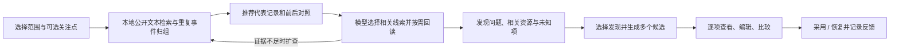

# My Coding Agent

面向个人开发习惯的 Windows 桌面 Coding Harness。Python 核心负责模型调用、工具、上下文与持久化；Electron / React 提供项目、任务、会话、合作空间和编码工作台。

它既用于开发普通应用，也用于开发大模型应用和改进 Harness 自身。工作围绕 **项目 → 任务 → 会话** 组织，工作流、Skill 和团队图可以组合使用；实际代码默认直接保存在用户选择的项目目录。

> 当前开发阶段：**M7 · 经验与改进**，协议 **v12**。截至 2026-10-21，M7 首次实现及本轮增量已同步到 `dev` / `main`。本文描述当前版本能力，不代表所有能力均已完成真实模型长期验证。实际进度、验证证据和剩余问题以 [进度总览](docs/progress/README.md) 和 [M7 记录](docs/progress/m7.md) 为准。
>
> 当前提供源码启动方式，尚未交付安装包、自动更新或跨平台执行后端。

按功能查看操作步骤与应用截图：**[用户指南](docs/guide/README.md)**。首次使用从启动、创建任务、对话与 Goal 开始；合作空间、Skill / MCP、上下文和经验与改进各有独立篇目。

## 快速开始

### 1. 准备开发环境

| 项目 | 当前仓库基线 | 用途 |
| --- | --- | --- |
| Windows | Windows 本机 | 桌面、ConPTY 终端、原生可选沙箱 |
| Python | CPython 3.13，补丁版见 [.python-version](.python-version) | Harness 核心；由 uv 管理项目环境 |
| Node.js | 24.x，准确版本见 [.node-version](.node-version) | 桌面开发与构建 |
| uv / npm | 使用现有工具及提交的锁文件 | 可重复安装依赖 |
| OpenCode Go | `OPENCODE_API_KEY` | 主模型及辅助网页搜索 |
| Git | 可选 | 本地版本控制；不要求配置 remote 或登录 |

在仓库根目录逐条执行，上一条成功后再继续：

```powershell
uv sync --locked
npm.cmd --prefix apps/desktop ci
npm.cmd --prefix apps/desktop run install:electron
```

最后一条下载 Electron 平台运行文件，单独安装 npm 依赖不代表桌面运行时已经就绪。浏览器、语言服务器等可选能力另按使用需求配置，不是应用启动前提。

### 2. 配置本机路径和凭据

将 [agent.paths.example.json](agent.paths.example.json) 复制为根目录的 `agent.paths.local.json`，填写本机位置。已有文件直接编辑，不覆盖。示例：

```json
{
  "data_dir": "E:/MyCodingAgentData/dev",
  "project_dir": "E:/claude_code/my-coding-agent-test"
}
```

- `data_dir` 是应用数据根，应位于项目之外，且两者不能相互包含。
- `project_dir` 只决定目录选择器从哪里打开，不会自动登记或修改项目。请使用已存在的目录。
- 本机文件已被 Git 忽略，不放密钥；其中相对路径以文件所在目录为基准。
- CLI / 环境变量提供的路径使用完整绝对路径。运行时规范化绝对路径不等于在源码中写死机器位置。

将 Go key 配置为本机 `OPENCODE_API_KEY`，或使用应用受信设置入口。不要把真实 key 写入 README、项目文件、命令参数或 Git。启动进程已有非空变量时优先使用该值；修改系统变量后应重新启动应用与启动终端，避免沿用旧进程环境。

### 3. 启动桌面

双击根目录 **[StartAgent.cmd](StartAgent.cmd)**，或执行：

```powershell
npm.cmd --prefix apps/desktop run dev
```

启动控制台可以最小化，关闭应用窗口会停止它持有的运行资源。启动器检查必要文件是否存在，不会先运行全量测试、自动升级依赖或要求额外的项目信任开关。

显式使用另一份数据或预览构建结果：

```powershell
npm.cmd --prefix apps/desktop run dev -- --data-dir E:\MyCodingAgentData\dev-other
npm.cmd --prefix apps/desktop run build
npm.cmd --prefix apps/desktop run preview
```

### 4. 做一个简单完整的任务

选择空项目，在左侧新建任务并打开首会话。可以直接提出：

> 创建一个单页计数器，按钮加一，localStorage 保存数字。只需要 index.html 和简短 README，不安装依赖。用项目已有 Python 启动预览。

先用 **Plan** 讨论也可以；选择 **常规** 执行本轮请求，或用 **Goal** 连续推进明确的局部目标。浏览器能力已安装并在项目启用时，可继续让 Agent 点击按钮、检查页面并保存截图。最后查看修改成果、Trace，或主动启动独立 Review。

任务是长期目标；一次回答或某个 Goal 完成不会自动结束整个任务。

## 已有能力与入口

| 模块 | 可以做什么 | 主要入口 |
| --- | --- | --- |
| 项目 / 任务 / 会话 | 目录登记、阶段目标、任务约束、历史与角色分工 | 左侧可折叠树；右键查看信息、复制 ID、重命名 |
| 对话与执行 | Plan、常规、Goal、插话、停止 / 接续、流式正文与可折叠思考 | 会话输入区 |
| 文件与搜索 | 读写、唯一原文编辑、批量补丁、移动 / 删除、正则与上下文搜索 | 模型工具；编码工作台 |
| 程序与终端 | 命令、HTTP 预览、运行卡片、PowerShell / CMD / 自定义交互终端 | 对话工具卡片；工作台终端 |
| 本地 Git | 状态、工作区 / 暂存区 diff、暂存、提交、历史与模型工具入口 | 编码工作台 Git；项目 Git 开关 |
| 代码与附件 | Monaco、Markdown 预览、LSP、文件 / 选区引用和图片输入 | 编码工作台；输入区附件 |
| Skill / MCP | 本地与在线 Skill、标准 MCP、浏览器、OAuth 接入 | 左侧资源管理 |
| 工作流与合作空间 | 可编辑模板、团队 / 工作图、角色会话、群聊、交接、Review、内部 worker | 工作流管理；任务概览 |
| 上下文与记忆 | 压缩、原文归档回读、用量与材料清单、项目 / 个人记忆 | 输入区附近的上下文与记忆入口 |
| 沙箱与回退 | Windows AppContainer、请求前代码检查点、恢复代码或重新提问 | 项目执行环境；会话回退 |
| Trace 与诊断 | 请求 / 工具关联、参数、结果、来源、用量、错误和独立维护作业 | 查看过程；设置与诊断 |
| 经验与改进 | 选择性复盘、发现相关资源、多候选、采用 / 恢复、代码比较实验 | 现场“复盘此…”；左侧经验与改进 |

这些入口复用 Python 服务和实际事件，不另造一份“成功状态”。缺失的历史用量、来源或验证结果显示未知。

## 日常使用

### 对话、模型与执行环境

默认 Python 直接调用 OpenCode Go，不依赖 OpenCode CLI 承担 Agent 循环。当前配置模型为 `glm-5.3-flash` 和 `deepseek-v4.1-flash`。在输入框切换模型后，**下一次请求**采用新选择，已经发出的请求保持原模型；认证、限流或余额问题不会触发静默换模型。

主请求、辅助搜索与目录采用独立路由，集中保存在配置中：

- 主对话：`https://opencode.ai/inference/go/openai/v1/chat/completions`
- 辅助搜索：`https://opencode.ai/inference/go/anthropic/v1/messages`
- 模型目录：`https://opencode.ai/inference/go/v1/models`

默认共用后端进程的 HTTP 连接池，诊断中可按模型查看、测试和切换连接复用。应用沿用当前网络环境，不绑定 VPN 或修改系统代理；重用连接不保证服务端始终保持连接，也不等于自动重试。

所选项目默认直接使用本机环境。需要特定解释器时，在设置中登记已有 Python / venv、Conda、uv 等，再选择项目默认环境。导入表示引用已有环境，不会自动创建环境或安装依赖。Harness 自身的 Python 3.13 要求不强加给用户项目。

- **常规**完成当前请求后返回用户；**Goal**才会连续推进其授权范围。
- **Plan**默认只读，可明确选择唯一允许保存的计划文档。
- 实际模型连接、执行或保存故障停止受影响运行与 Goal；已保存成果保留。
- 参数缺项、原文匹配问题、写入前内容变化等可修正反馈交回模型调整，不直接终止整项任务。
- 测试正常运行但未通过会报告结果；是否继续修复取决于原请求是否包含修复授权。
- 已交付预览服务在切换会话、回复结束或停止 Goal 后保留；退出应用清理，重启不自动重跑。

普通运行预算在“设置与诊断”调整，Goal 有自己的累计控制。模型思考通过明确的 reasoning 字段流式显示，可折叠；思考首字与正文首字分别计量。

### 工作流与智能体合作空间

工作流管理内置个人流程以及 OpenSpec、Superpowers、Spec Kit 的适配模板，可查看来源、复制编辑或导入导出。模板描述长期阶段；Plan / 常规 / Goal 描述当前会话如何工作。

任务创建时保存模板快照。进入“任务概览 → 合作空间”：

1. 使用首会话建立工作空间，或生成团队草稿。
2. 编辑成员职责、模型 / Skill、关系图；保存配置后明确组建或绑定正式会话。
3. 在工作视角从流程补充骨架，调整节点范围、负责人、依赖和反馈关系。
4. 按所选范围单次执行或持续推进；群聊结果、成员运行和 Trace 保持关联。

图支持编辑、拖动、连线、删除、自动排布和保存布局。工作流提供模板，**任务持有具体团队图与工作图**。生成草稿不会自动创建正式会话；内部子 Agent 由会话开关控制，不强制用于普通任务。

同项目默认共享原目录，通过分工与 handoff 协作，不自动复制工作区。会话协作支持发现已安排的成员、读取历史、请求工作、普通消息、等待结果与取消。投递不等于完成，普通消息不自动唤醒工作；独立 Review 默认只读，发现问题不自动获得修复授权。

工作流、团队图和 Skill 组合可保存为个人工作方式。阶段、工作项和报告用于接续，不要求先填证明表、完整评分或全部依赖满足才能做正常工作。

### 上下文、记忆与能力发现

上下文面板区分**最近实际请求**和**下次组装规则**。优先显示服务返回的输入 token 用量；尚未发送的材料不计入最近请求用量，本地估算会明确标注。仓库目前为两模型配置 1M 窗口，自动压缩起点默认 800K，可调整，不等于每次填满窗口。

压缩组合使用工具结果缩短、按完整对话 / 工具边界选择切点、模型摘要和近期原文的绝对 token 预算。旧原文保留，可按来源回读；压缩结果不变小时不会冒充成功减量。可选择后台压缩，维护失败独立记录，不把已成功的前台工作改成失败；实际容量不足仍需处理。

记忆与摘要分开：

- 摘要用于当前会话接续；长期记忆用于以后按需召回。
- 记忆支持项目 / 个人范围、类型、来源、修改、替代、失效、停用及忘记。
- 当前以本地词法匹配和相关性排序为主，未引入向量数据库。
- “上次带入”表示最近请求真实使用的条目，不是记忆库总量。
- 历史、记忆、实际材料面板均可关闭或折叠；查看本身不等于发送给模型。

工具默认保留小型核心集合，其他能力通过 `discover_tools` 按需加载 schema；Skill 使用短目录与 `discover_skills` / `load_skill` 渐进加载。MCP 工具也先发现再加载，避免长期全量携带所有定义。相关策略可调整，详情见 [M6 方案](docs/plan/m6-sandbox-rollback-and-capabilities.md)。

### Skill、MCP 与浏览器

**Skill 管理**支持内置、用户和项目 `.agents/skills/` 三类来源，同名采用项目 → 用户 → 内置的顺序。可查看、复制、编辑、启停和导入附属资源。项目规范从 `AGENTS.md` 进入请求，子目录规范按路径按需读取。

在线浏览先接入腾讯 SkillHub 和 skills.sh，选择网站后才加载，可直接使用站内搜索和分页。支持公开 GitHub 来源及 SkillHub 原生 ZIP 的下载、预览、安装到资源库和导入项目；其他网址不是通用安装接口，需能解析到受支持来源或改用本地目录导入。不会执行下载内容里的脚本。

**MCP 管理**支持本地 stdio 和远程 Streamable HTTP，提供 Context7 / GitHub 配置预设、工具目录、连接测试、项目启停和凭据变量引用。支持浏览器 OAuth 登录、取消、退出与令牌刷新；服务商要求的 Client ID 等仍须按服务配置。令牌通过 Windows 受信加密设施保存，不写入项目。

Playwright MCP 浏览器按正式会话 / worker 独立持有临时站点上下文，同会话复用，退出清理，重启不恢复登录或 Cookie。安装或指定浏览器运行包后才可使用；它与逛 Skill 网站的浏览状态分开。页面快照供模型交互，截图作为产物或明确图片输入；截图保存成功不代表已完成视觉检查。临时浏览器不等于项目执行沙箱。

### 本地 Git、代码回退与可选沙箱

**Git**无需远端：工作区、暂存区、本地提交和历史可以独立使用。模型工具层也能读取状态 / 差异并执行支持的本地操作。打开项目不会自动初始化 Git。

项目 Git 关闭操作会将支持的独立项目仓库元数据移到应用数据目录，保留可恢复副本，重新启用可恢复；不删除源码。上层仓库、worktree 等特殊布局按实际支持情况提示，不把移走 `.git` 说成通用的所有仓库关闭方式。应用不改全局 Git 身份；远端推送不属于自动行为。

**请求回退**可预览逐文件结果后选择：

- 只恢复代码；
- 恢复代码并从该条消息重新提问。

原会话记录保留，可查看被替代分支；Git 暂存区和未选择文件保留。不要求项目必须启用 Git。快照有明确覆盖范围和容量设置，依赖、忽略文件、数据库及外部服务状态不是完整系统备份。来源未知、外部修改与不可恢复文件会在预览中说明；恢复不重放模型或工具。

**沙箱**按项目选用，当前为 Windows AppContainer 与目录授权，覆盖已接入的命令、终端、HTTP 预览及 Git / Python 探测等入口。常规使用不持续申请管理员权限；项目可写、网络默认开启，也可显式配置目录 / 网络范围。预览通过普通权限转发，应用不自动修改 VPN、系统代理或防火墙。

本机 direct 模式仍是默认，明确未隔离。沙箱不是 VM，也不提供磁盘 / CPU / 内存配额或域名白名单；不能把项目范围检查描述成所有进程的隔离。尚不兼容的可选入口会显示原因和替代方式，实际沙箱启动失败不会偷偷改为直接执行。详细边界与实机证据见 [沙箱实验](docs/plan/sandbox-stability-experiments.md) 和 [M6 进度](docs/progress/m6.md)。

## 经验与改进：从工作记录形成可采用的改进

现场入口和独立页面共用同一后台作业：

- **日常使用**：会话、任务、项目中展开“复盘此…”，可留空或填写关注点，直接开始。快捷入口使用对应范围的正式会话 Trace；独立维护作业、内部 worker 和系统诊断日志不会自动全部纳入。范围在接纳时冻结，后续新增记录不会混入本次复盘。
- **独立定制**：进入左侧“经验与改进”，调整来源项目、会话 / Run / 单条事件、反馈、目标资源、模型与预算。现场入口可直接带入范围或打开已有作业。
- **对话发起**：模型可按需发现 `review_experience`，在当前会话 / 任务 / 项目发起调查并查看或停止。它不暂停原任务、不另建正式会话，也不会因此自动采用修改。



筛选线索包括焦点文本关联、真实失败、用户纠正和重复现象，也保留一般记录与不同结果用于对照。**本地排序只是线索，不是根因判定**；模型不以遍历所有材料或提高阅读覆盖率为目标。无相关改进也是有效结果。

界面分别显示选择范围、推荐线索及实际正文阅读覆盖；短摘录和目录不冒充全文阅读。原记录仍可检索，实际回读内容和资源保存在作业材料中，证据可在当前视窗打开并定位原 Trace。

改进目标可以是项目规范、个人偏好、记忆、Skill、工具使用说明、工作方式或源码。指定目标入口同样先筛选证据；不指定时先调查相关资源，再生成多个独立候选。工具使用说明不会改变工具实现，源码改进使用代码候选与独立比较入口。

预算位于模块内，按项目保存，八项均可单独选择“不限”；新作业冻结当时设置，修改不影响在途作业。它不继承普通对话的运行预算。调查、生成、比较与采用分别保留状态和来源；候选未验证时不会显示成“效果提升”。代码不会自动采用，其他资源按项目已保存的采用设置处理。

当前还没有预设编辑器、长期效果自动评估或通用搜索式自动进化框架。本轮重点是选择性调查和方便的入口，不将生成候选数量当作改进质量证明。

## 数据、凭据与仓库可移植性

桌面开发 / 预览启动的路径优先级：

`显式参数 → 对应环境变量 → agent.paths.local.json → 集中开发默认值`

开发数据默认 `E:\MyCodingAgentData\dev`。Python CLI 的优先级为 `--data-dir → MY_AGENT_DATA_DIR → E:\MyCodingAgentData`。数据根不可用时明确报错，不静默落到 C 盘或项目目录。切换项目不会切换数据根。

| 数据 | 位置或职责 |
| --- | --- |
| 模型配置、项目列表、环境绑定 | 数据根中的配置与项目记录 |
| 会话、任务、合作空间、程序与终端历史 | 对应业务目录，重启可读取 |
| 原始事实、请求材料、摘要、记忆 | 会话记录和记忆存储；原始 provider 续接状态不暴露给 renderer |
| 文件修改与回退 | `changes/`、`file-checkpoints/` 等专用存储 |
| 用户 Skill、工作流、MCP、工作方式 | 应用数据根；明确导入才写项目资源 |
| 改进反馈、作业、候选、比较 | `evolution/` |
| 统一诊断 | `logs/diagnostics/`，保存公开错误、关联信息及脱敏诊断 |
| Electron 状态、缓存、浏览器产物 | 所选数据根下的专用目录 |
| 测试 / 回归数据 | 仓库忽略的 `.artifacts/tests/` 独立运行目录 |

业务由 Python 单写者保存，单文件使用原子替换；这不等于跨文件事务。不要通过删除锁文件抢占运行实例，也不要将个人数据或密钥加入仓库。

重启后项目列表不同，先检查两次启动的数据根是否一致。自动化测试使用隔离数据，不会与日常项目列表合并。仓库可以克隆到其他磁盘；本机路径文件、已登记项目位置与数据根分别管理，源码不依赖固定仓库目录。

## CLI 与工程结构

CLI 共用 Python 服务，可用于诊断、项目 / 会话读取和模型对话；桌面的合作图、编辑器等交互界面不会变成重复的 CLI 业务实现。

```powershell
uv run --locked my-agent --help
uv run --locked my-agent --data-dir E:\MyCodingAgentData\cli ask "解释项目启动流程" --project E:\claude_code\my-coding-agent-test
uv run --locked my-agent --data-dir E:\MyCodingAgentData\cli sessions list <project-id>
uv run --locked my-agent --data-dir E:\MyCodingAgentData\cli sessions get <session-id>
```

后两条使用实际 ID。桌面和 CLI 使用同一数据根时应避免同时持有写入实例；需要并行使用时选择独立数据根。`ask` 会调用真实模型，`--mode plan` 可显式只读，`--run-json` 可覆盖当次运行预算，Ctrl+C 停止并等待清理。

```text
src/my_agent/       Python 业务、运行循环、模型、工具与存储
apps/desktop/      Electron 主进程、有限 preload、React 界面
schemas/           从 Pydantic 导出的公开协议
scripts/           启动、协议生成、聚合工程检查
tests/             集中测试、契约样本、桌面及模型验收入口
docs/plan/         方案与验收定义
docs/progress/     实际进度、证据、剩余限制和接续点
docs/guide/        分功能使用说明与应用截图
docs/research/     上游调研与取舍依据
examples/          独立评测样本
```

业务默认值集中在 [defaults.json](src/my_agent/defaults.json)。renderer 通过受限 IPC / JSON-RPC 调用 Python，不直接读取密钥或业务文件。DTO、schema、生成 TypeScript 同步维护；当前协议 v12，前后端应使用同一源码版本。

修改 DTO 后生成：

```powershell
uv run --locked python scripts/export_schemas.py
npm.cmd --prefix apps/desktop run types:generate
```

日常开发只运行与变更相关的必要检查，入口见 [tests/README.md](tests/README.md)。需要完整阶段验收时：

```powershell
uv run --locked python scripts/check.py
# 包含真实 Electron 窗口的完整验收
uv run --locked python scripts/check.py --desktop
```

模型验收需按对应脚本明确启动，不将安装依赖、离线替身或工具注册视为真实模型验证。当前版本与依赖以锁文件为准，不在开发启动中使用 `@latest`。开发规则见 [AGENTS.md](AGENTS.md)。

## 已知边界与文档导航

- Windows 优先；Docker / WSL 执行后端、跨平台沙箱、安装包与自动更新仍未交付。
- 网络服务、MCP OAuth 和语言服务受实际配置与上游可用性影响；可选能力缺失不阻断普通对话。
- 真实模型短样本成功不代表长任务稳定；此前 GLM 长业务失败、800K 长输入与部分个人 MCP OAuth 的验证缺口保留在进度文件。
- 经验与改进仍需真实使用反馈来验证筛选质量与长期效果；未实施向量记忆、通用插件市场或图形化任意工作流运行时。
- 自动重试、自动推送 Git、重启后自动执行历史副作用都不是默认行为。

| 文档 | 用途 |
| --- | --- |
| [用户指南](docs/guide/README.md) | 12 篇功能操作说明、26 张应用截图与常见问题 |
| [进度总览](docs/progress/README.md) | 当前真实状态与下一步 |
| [总规划](docs/plan/coding-agent-from-zero-plan.md) | 产品方向与阶段依赖 |
| [M7 方案](docs/plan/m7-self-evolution.md) / [进度](docs/progress/m7.md) | 经验与改进的设计、实现和验证 |
| [M6 方案](docs/plan/m6-sandbox-rollback-and-capabilities.md) / [进度](docs/progress/m6.md) | 沙箱、回退、按需能力、记忆与组合复用 |
| [任务工作图](docs/plan/task-work-graph-initial.md) | 模板、任务实例、Loop / Graph 的关系 |
| [MCP OAuth](docs/plan/mcp-oauth.md) | 授权原理、服务配置与实现边界 |
| [测试清单](tests/README.md) | 可复用的定向检查与产物位置 |
| [项目规范](AGENTS.md) | 开发约定、最小验证、进度和 Git 边界 |

后续模块按用户确认的需求逐步规划；计划文档不代表能力已经交付，也不是自动执行下一阶段的授权。
