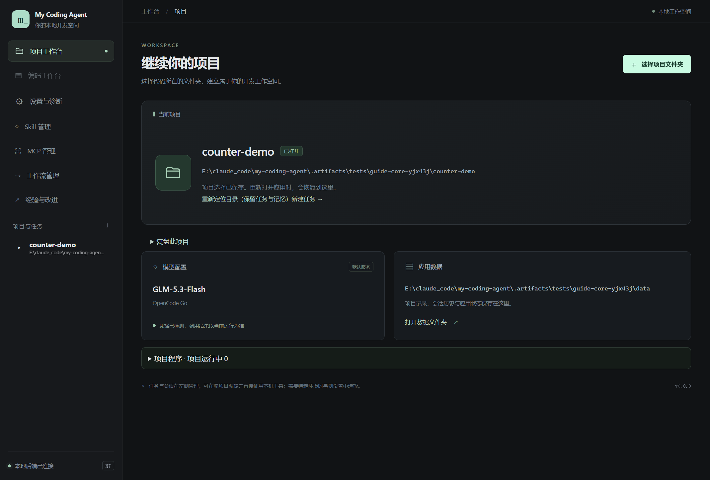

# 01 · 启动与数据位置

[返回指南目录](README.md)

## 首次准备

当前是 Windows 源码启动版，还没有独立安装包。Harness 使用 Python 3.13、uv 和 Node.js 24；准确版本见仓库 `.python-version`、`.node-version`。目标项目可以使用自己的解释器，不要求全部升级到 3.13。

在仓库根目录的 PowerShell 中逐条执行：

```powershell
uv sync --locked
npm.cmd --prefix apps/desktop ci
npm.cmd --prefix apps/desktop run install:electron
```

第三条安装 Electron 运行文件。浏览器 MCP、语言服务器属于可选能力，缺失不影响先打开应用聊天。

## 设置数据和项目选择器

复制根目录 `agent.paths.example.json` 为 `agent.paths.local.json`；已有本机文件时直接修改，不覆盖原配置。例如：

```json
{
  "data_dir": "E:/MyCodingAgentData/dev",
  "project_dir": "E:/claude_code/my-coding-agent-test"
}
```

`data_dir` 存应用自己的数据；`project_dir` 仅指定目录选择器的起点。两者使用不同目录，不能相互包含。项目起点需要已存在，不会因为写了配置就自动登记为项目。

该本机配置不提交 Git，也不要存 API key。换机器时重新填写即可，不需要改源码里的路径。

## 配置模型并启动

1. 在本机配置 `OPENCODE_API_KEY`，或通过应用的受信密钥设置保存。
2. 双击仓库根目录 `StartAgent.cmd`。也可在仓库根执行 `npm.cmd --prefix apps/desktop run dev`。
3. 等左下角显示「本地后端已连接」。这表示桌面与 Python 连接成功，**还不代表模型认证通过**。
4. 到「设置与诊断」查看模型配置和凭据状态。需要确认真实服务时按模型测试，或发一条简短提问。
5. 回到「项目工作台」，点「选择项目文件夹」，确认要开发的目录。



截图使用离线演示凭据；图中的“已检测”只说明本机有配置，不是实际 Go 登录结果。

日常可最小化启动控制台。更新代码、环境变量或 key 后关闭应用并重新启动；启动它的旧终端也可能继承旧环境，必要时重新打开终端。应用不会因余额或认证失败自动换模型。

「正在准备本地工作空间」表示等待本地后端初始化、配置和项目列表，不是在连接模型或复制项目。此时显示的空项目还不是最终读取结果。若持续停留，可查看所选数据根的 `logs/electron.log`：`BACKEND_READY` 记录启动到握手完成的耗时，`WORKSPACE_READY` 记录首次工作区查询耗时；两者可能重叠，不能相加当作总启动时间。日志不包含项目正文、配置正文或密钥。

## 项目列表为什么可能不同

先核对两次启动的**数据根**。测试入口、CLI 与桌面开发入口可能使用不同的根，列表不会自动合并。

| 启动入口 | 路径选择顺序 |
| --- | --- |
| 桌面开发／预览 | 显式参数 → 对应环境变量 → 本机路径文件 → 集中开发默认值 |
| Python CLI | `--data-dir` → `MY_AGENT_DATA_DIR` → `E:\MyCodingAgentData` |

桌面开发默认数据根是 `E:\MyCodingAgentData\dev`。切换项目不会改变数据根；E 盘或所选根不可用时会报错，不会偷偷创建 C 盘副本。关闭应用后再备份整个所选数据根；源码 Git 不包含会话、记忆和个人配置。

临时使用另一套数据：

```powershell
npm.cmd --prefix apps/desktop run dev -- --data-dir E:\MyCodingAgentData\another
```

不要同时让两个写入实例占用同一数据根。遇到占用提示，先关闭对应实例，不通过删除锁文件抢占。

## CLI 入口

```powershell
uv run --locked my-agent --help
```

CLI 与桌面共用后端服务。真实对话命令、独立数据根示例见[README 的 CLI 说明](../../README.md#cli-与工程结构)。首次使用建议先走桌面，以便看到状态与错误位置。
