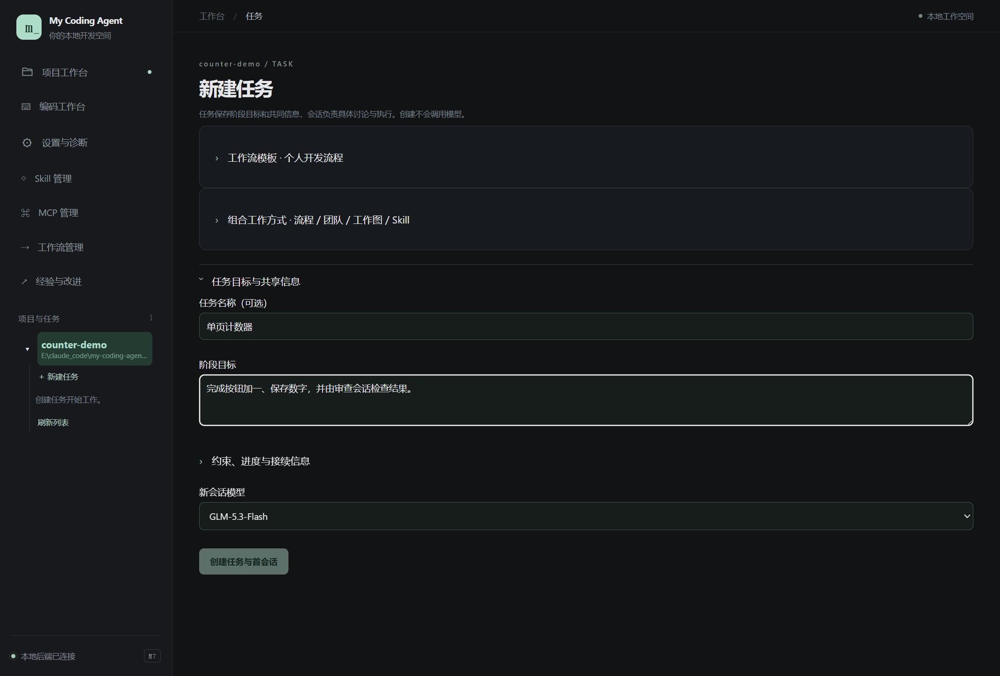
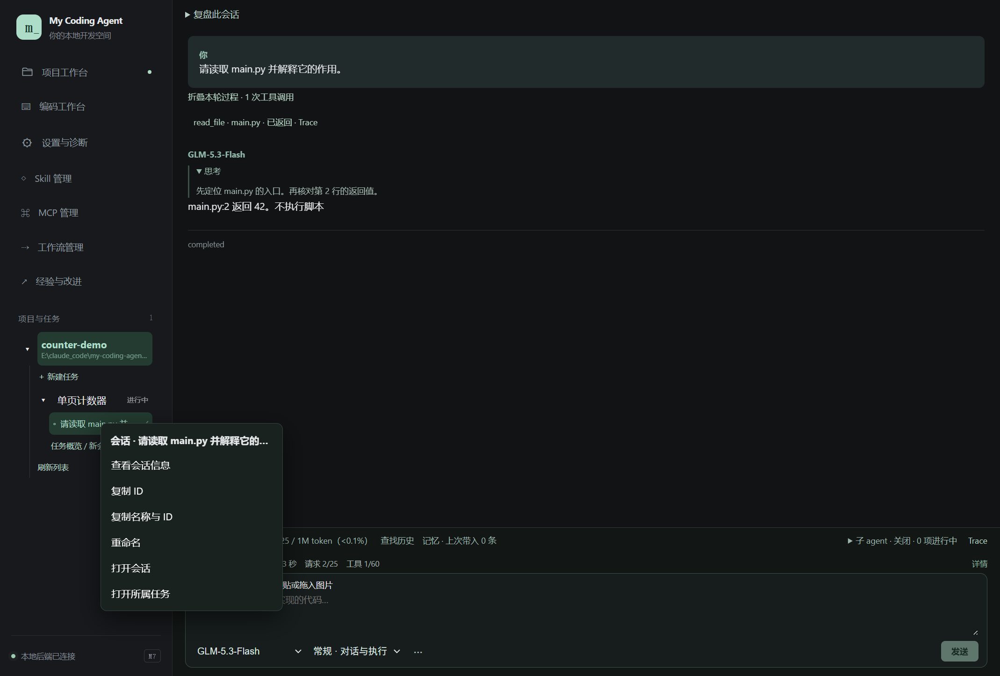

# 02 · 项目、任务与会话

[返回指南目录](README.md)

## 新建一个任务

1. 在「项目工作台」选择已有项目目录。打开目录只登记位置，不自动初始化 Git。
2. 点项目下的「新建任务」，或工作台的「新建任务 →」。
3. 填写任务名称与阶段目标；按需展开约束、进度和接续信息。
4. 选择工作流模板；需要复用团队与 Skill 时再展开「组合工作方式」。第一次用保留个人开发流程即可。
5. 选择首会话模型，点「创建任务与首会话」。
6. 在任务概览点击「打开 / 补齐首会话」，或直接在左侧树点击会话。

任务目标建议写可判断的交付，例如“完成计数器，点击加一、刷新保留，交付源码和启动说明”。暂时未定的需求可以在首会话继续讨论。

## 左侧树怎么用

项目、任务、会话按层级展开／折叠。点击会话进入对话；点击任务进入任务页。展开状态和选中对象是导航，**切换页面不等于停止后台运行**，需要停止时使用运行或 Goal 的控制按钮。

在任务下的「任务概览 / 新会话」进入任务页，可以新建另一条会话承担审查、调研或接续。已有未归属会话可以在会话输入区「···」里的归属与分工中绑定任务；未归属会话仍可普通聊天，但没有具体任务的共享目标和合作空间。

长期目标、约束、已确认结论放在任务信息；单次操作说明放在会话。新会话接续任务目标与已保存进展，历史详情按需读取，不会自动复制其他会话的全部原文。

## 查看 ID 与重命名

在左侧项目、任务或会话上点右键；键盘可先聚焦条目，再按 `Shift+F10`。

会话菜单包含「查看会话信息」「复制 ID」「复制名称与 ID」「重命名」「打开会话」「打开所属任务」。项目／任务菜单按对象提供相应信息、编辑或目录入口。

- 给另一个协作会话明确寻址时，可复制“名称与 ID”，不要只复制截断标题。
- 重命名改变显示名称，不改变 ID 和历史归属。
- 项目显示名和磁盘目录不是同一件事；重命名条目不会移动目录。

## 结果保存在哪里

任务、会话与角色关系存在应用数据根，重启后继续读取。代码在所选项目原目录。关闭对话窗口、切换任务、某个 Goal 完成，都不会自动将整个任务标为完成。

一个项目中的会话默认共享真实文件。按文件／职责分工即可，不会因为新建会话自动创建副本或 Git 分支。需要协作时，接着看[工作流与合作空间](07-workflows-and-collaboration.md)。

常见情况：任务存在但首会话没打开，使用「打开 / 补齐首会话」；列表没有刷新，点左侧「刷新列表」；重启项目不见，先按[数据位置说明](01-start.md)核对数据根。
