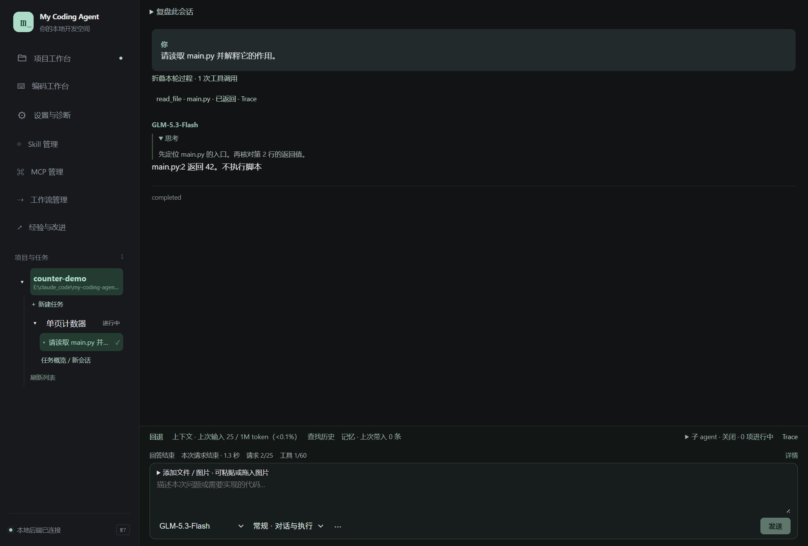
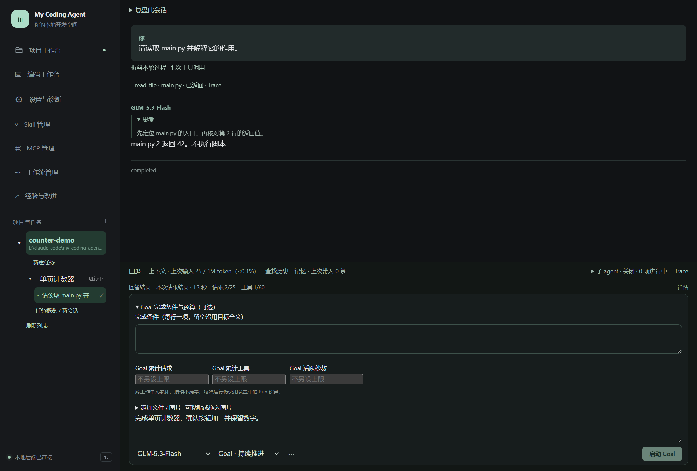

# 03 · 对话与 Goal

[返回指南目录](README.md)

## 普通提问和执行

打开会话，在底部输入问题，选择模型与本次模式，点「发送」或按 `Ctrl+Enter`。输入框支持添加文件、粘贴／拖入图片；发送前可移除附件。

这是离线样本：界面、文件读取和持久记录真实运行，回答、耗时和 token 数不是线上模型测量。

| 模式 | 适合什么 | 会如何结束 |
| --- | --- | --- |
| 常规 · 对话与执行 | 问问题、改一个功能、执行一次明确请求 | 当前请求完成后返回用户 |
| Plan · 讨论与规划 | 分析方案、读代码、比较做法 | 默认只读；如需落计划，明确选择允许保存的计划文档 |
| Goal · 持续推进 | 围绕局部目标连续完成多个工作单元 | 完成、用户停止、预算耗尽或实际故障时停止 |

模型在输入框内选择 GLM 或 DeepSeek。切换后的**下一次模型请求**采用新选择；已经发出的请求保持原模型。

## 普通运行中追加要求

普通 Run 工作时，发送按钮变成「追加要求」。内容立即保存到同一会话，显示「已保存，等待处理」，在当前模型响应或已开始的工具结束后，纳入下一次请求并标为「已纳入后续上下文」。模型可以据此修正计划；尚未派发的旧工具调用会跳过，已经启动的命令不会被强行打断。

追加不创建另一个 Run、不重置预算，也不切换当前执行模式。需要立即停止仍使用停止入口。如果运行先失败或停止，未处理内容继续保留，等你明确发送或接续后再处理，不因队列非空自动重启。Goal 的普通提问后继续原目标仍采用下述控制方式。

## 启动与控制 Goal

1. 将模式切为「Goal · 持续推进」。
2. 在输入框写清目标及范围。可以写“实现并修复验证中发现的问题”，也可以只授权检查。
3. 可选展开「Goal 完成条件与预算」，逐行写完成条件；累计额度留空表示不另设 Goal 上限。
4. 点「启动 Goal」。运行后在输入区附近的 Goal 卡片看状态，展开查看细节与控制。

Goal 工作时插入普通问题，默认先回答，再继续原目标。需要真正停下时使用暂停／取消入口；修复原因后由你明确接续。修改预算本身不会恢复已停止的 Goal。

已结束或取消的 Goal 保留历史记录，但不再作为活动 Goal 自动续跑。旧对话中的目标文字仍属于历史，不能把“取消”理解为删除那段对话。

## 三类预算不要混淆

| 预算 | 调整位置 | 计数范围 |
| --- | --- | --- |
| 普通 Run | 设置与诊断 → 高级运行预算与读取规则 | 一次运行；多次模型与工具调用累计，不是整个会话 |
| Goal 累计 | Goal 完成条件与预算／活动卡片中的调整预算 | 跨 Goal 工作单元累计，接续不清零；每次 Run 仍有自己的预算 |
| 经验与改进 | 经验与改进 → 改进预算 | 独立调查／生成作业，详见第 12 篇 |

M8 新配置的普通 Run 三项累计额度默认“不限”。旧设置原样保留；在运行设置点“改用不限预算”后保存，下一次启动才采用。单请求超时、输出长度与文件容量仍独立设置；经验与改进预算不随之改变。

例如“请求 2/25，工具 1/60”说明这个有上限的 Run 已请求模型两次、调用工具一次，不表示会话只能再问 23 次。父任务与内部 worker 共用该安排的有限额度，在「详情」查看父／子／总计与剩余量。多个 Agent 的活跃秒数累加，不等于用户实际等待时间。保存默认预算不改在途运行快照。

临时模型故障重试也在运行设置中：默认次数为 0。显式设置后才对连接／传输／临时服务故障与限流按退避重试，每次请求计账；认证、余额、格式拒绝不重试。点击停止可中断退避，不自动重放文件或程序工具。

## 看懂运行状态

思考内容默认展开且可折叠，正文独立流式显示。状态区区分网络等待、模型内容、工具调用与程序执行；需要完整参数和结果时点动作后的「Trace」，无需在主对话翻 JSON。

实际连接、执行或保存失败会停止本次运行及 Goal，已保存成果保留。参数缺项、原文不匹配、写入前文件变化等可修正反馈交回模型处理。测试正常执行但未通过会先报告；只有你本来要求修复或优化，才继续相应修复。

折叠思考／过程只是改变显示，不会减少模型上下文。用量、压缩和真实材料见[第 08 篇](08-context-and-memory.md)；长时间没输出见[第 11 篇](11-trace-and-diagnostics.md)。
