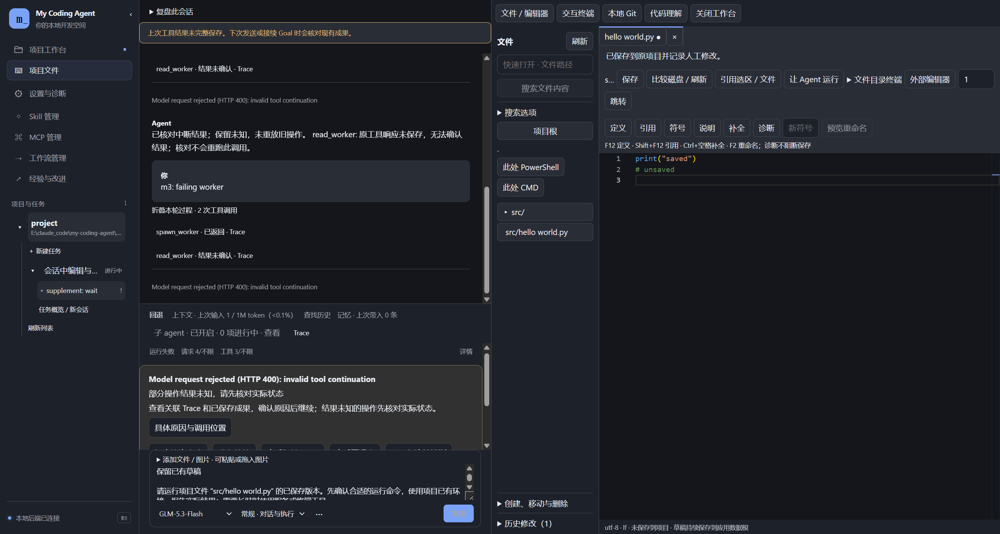
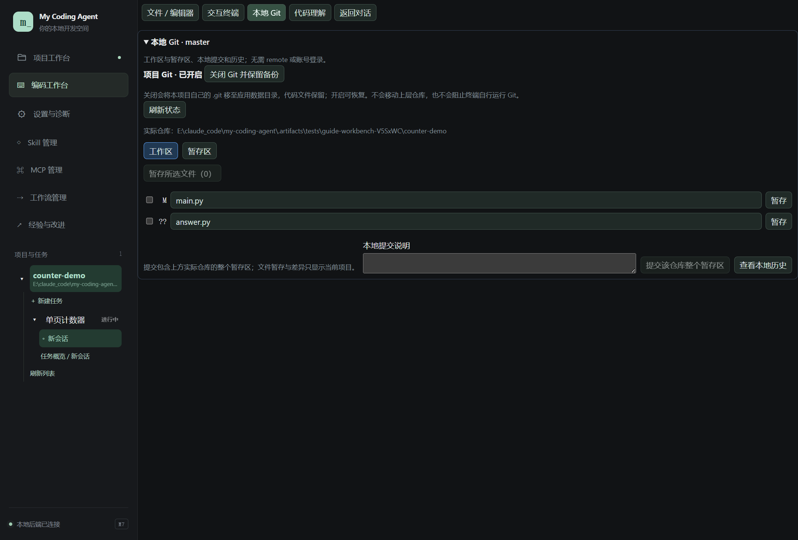

# 04 · 编码工作台与 Git

[返回指南目录](README.md)

## 打开与编辑文件

先选择一个项目会话，再点左侧「项目文件」，打开会话内工作台，顶部选择「文件 / 编辑器」。宽屏与对话并排，窄屏覆盖对话区；点「关闭工作台」返回。选中文件后在编辑器修改，点「保存」。代码直接写入当前项目，不需要再点“应用到项目”。关闭工作台保留编辑草稿和对话输入，不会停止终端。

截图为真实 Electron 和隔离项目，回答与子任务来自离线模型样本。

- 用「快速打开 · 文件路径」定位文件；目录树可展开。
- 「比较磁盘 / 刷新」用于检查编辑草稿与磁盘变化，不要在另一个会话修改后盲目覆盖。
- 「引用选区 / 文件」把相关内容作为提问材料，回到对话补充要求再发送。
- 「外部编辑器」打开配置的编辑器；这不是复制项目。
- 文件区底部展开「创建、移动与删除」处理目录结构；「历史修改」查看 Harness 记录的变更。

文件操作也可以直接交给 Agent：例如“只修改 index.html，为按钮增加键盘可达性”。文件工具保留当前其他位置的修改；唯一原文匹配失败会让模型重新定位，不要求你提供 hash。

## 从文件运行代码

- **让 Agent 运行**：选中文件后点同名按钮，运行要求追加到现有对话草稿。检查后发送，由 Agent 选择项目已有环境与合适命令。使用的是已保存的磁盘版本；未保存的修改请先保存。此入口不自动改变 Plan 模式的执行权限。
- **文件所在目录的终端**：编辑器「目录终端」可选 PowerShell 或 CMD，启动后自动切换到「终端」。文件树的「此处 PowerShell／CMD」使用当前浏览目录。终端复用项目环境及已选执行方式，不要求另存“可信”开关。
- **手动执行**：在终端输入命令，查看实际输出；「关闭终端进程」停止对应进程。切换工作台页签或关闭工作台只隐藏界面，不终止进程。

直接要求 Agent 运行、测试或启动服务也继续可用；界面入口与模型共用现有执行能力，不新建一套运行环境。

## 搜索与代码理解

1. 在文件区输入搜索词。
2. 展开「搜索选项」，根据需要选择正则、路径包含／排除和上下文行数。
3. 点「搜索文件内容」或在输入框按 Enter 执行搜索，从结果跳到具体文件与行，再决定读取或编辑。

查字面文本用默认搜索；查结构可用正则，例如 `function\s+\w+\(`。包含／排除规则缩小项目范围，不等于删除文件。

编辑器上方有「定义」「引用」「符号」「说明」「补全」「诊断」和「预览重命名」。这些使用对应语言服务器，先在相关设置登记可用的服务器。尚未配置时仍能普通编辑、搜索和保存；诊断不作为保存前置条件。快捷键包括 F12 定义、Shift+F12 引用、Ctrl+空格补全、F2 重命名。

## 只用本地 Git 就足够

切换顶部「本地 Git」。没有仓库时可以显式「初始化本地 Git」，已有仓库直接读状态；**不需要 GitHub 登录或 remote**。

1. 点「刷新状态」，先确认页面显示的实际仓库路径和分支。
2. 在「工作区」点击文件查看差异；选需要的文件暂存，或逐项点「暂存」。
3. 到「暂存区」核对本次提交；需要时取消暂存。
4. 填写「本地提交说明」，点「提交该仓库整个暂存区」。
5. 用「查看本地历史」回看提交。

提交对象是**实际仓库的整个暂存区**。如果项目是更大仓库的子目录，当前文件列表不一定展示所有已暂存内容，必须留意页面的仓库提示。作者身份未配置时按实际 Git 报错处理；应用不自动改全局身份。

也可以在对话中要求“查看本地 Git 状态和工作区 diff”，或明确要求暂存／提交；模型通过已接入的本地 Git 工具执行。提交和远端推送是两件事，应用不会自动上传代码。

## Git 开关和回退的区别

「关闭 Git 并保留备份」会将本项目自己的 `.git` 移至应用数据根，源码仍在；「开启 Git（有备份时恢复）」可恢复。它不是只隐藏 Git 面板，也不是代码回退。上层仓库、worktree 等特殊布局按当前支持情况提示，不会顺带移走上层仓库。

关闭不会禁止你在终端手工运行 Git。请求级撤销使用会话「回退」，无需 Git，见[第 06 篇](06-sandbox-and-rollback.md)。Harness 历史修改的前后差异与 Git 相对暂存区／HEAD 的差异用途不同，不能互相替代。
