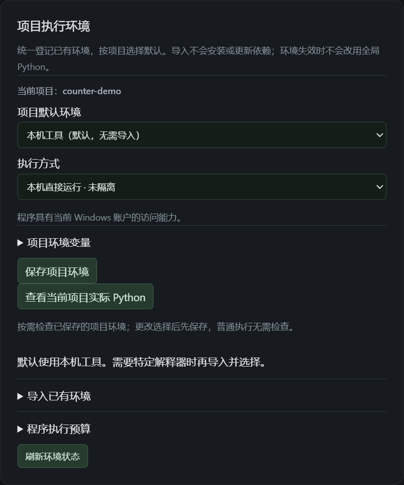
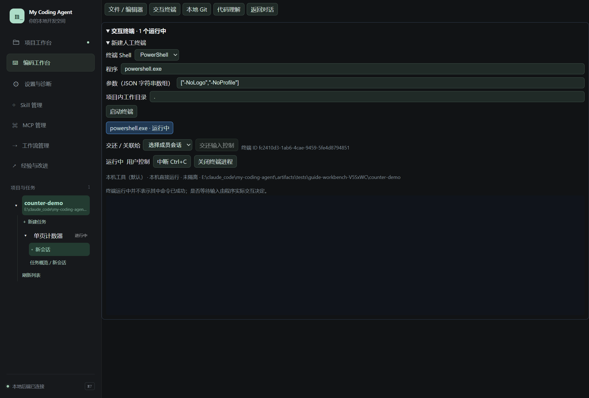

# 05 · 程序与运行环境

[返回指南目录](README.md)

## 先用本机已有环境

选择项目后默认直接使用本机工具，不需要先导入“系统环境”或再勾一次信任。程序具有当前 Windows 账户的访问能力，界面明确显示「本机直接运行 · 未隔离」。

需要指定环境时：

1. 进入「设置与诊断 → 项目执行环境」。
2. 展开「导入已有环境」，填名称、类型和对应路径。Python／venv 选择已有 `python.exe`；Conda、uv 按字段选择管理器及环境位置。
3. 导入后在「项目默认环境」中选它，点「保存项目环境」。
4. 可点「查看当前项目实际 Python」确认解释器位置与版本；不是每次执行的必需步骤。

导入只登记已有环境，不安装依赖、不创建 venv。环境路径可按页面选本机绝对位置或项目相对位置；解释器失效会提示，不会静默换回系统 Python。环境设置在程序启动时确定，改设置影响下一次启动，不改变已经运行的进程。

项目需要数据库连接等变量时，展开「项目环境变量」，填写要显式传入的**变量名**并保存；值由启动环境读取，不把密码写到表单说明或对话。模型服务密钥和应用内部变量不因此传给项目。

## 让 Agent 跑一次命令或启动服务

直接在会话明确要求，例如：

> 使用当前项目环境运行现有测试，报告通过与失败项；这次先不要修改代码。

> 用项目已有 Python 启动静态页面预览，端口可用即可，返回实际访问地址并保留服务。

命令、服务通过会话中的可折叠程序卡片显示。展开看命令、状态、stdout／stderr、退出码或服务地址；需要时使用卡片的停止控制，详细记录进 Trace。

普通命令有执行时限和输出容量，可在「程序执行预算」调整。不要把正在运行的服务和一次性命令混为一谈：服务已交付后，切换会话、普通回复结束或停止 Goal 会保留；退出应用停止，重启不自动重跑。

## 手动 PowerShell／CMD 终端

1. 左侧「编码工作台 → 交互终端」。
2. 展开「新建人工终端」，在「终端 Shell」选 PowerShell、CMD 或自定义程序。
3. 确认程序、参数和项目内工作目录，点「启动终端」。
4. 点击终端输出区输入命令，按 Enter。

PowerShell 可用 `Get-Location` 查看当前位置，CMD 对应 `cd`。图中启动的是实际 PowerShell；这是操作入口截图，不是测试结果报告。

「中断 Ctrl+C」中断当前命令；「关闭终端进程」关闭 Shell。需要协作时选择成员并「交还输入控制」；留意当前控制权，避免用户和 Agent 同时往同一程序输入。终端“运行中”只表示进程存在，不保证上一个命令成功。

## 不可用时先看什么

- 程序找不到：核对项目环境、程序路径和系统是否已安装该工具，不必重装 Harness。
- 解释器不对：先保存绑定，再查看“实际 Python”；Harness 的 `.venv` 与目标项目环境不是同一个概念。
- 非零退出：读取输出区分测试不通过与启动／执行故障，不只看一个数字。
- 沙箱网页打不开：用运行卡片返回的转发地址，见[沙箱指南](06-sandbox-and-rollback.md)。

Docker／WSL 执行后端还未交付，不将诊断中发现 Docker 解释为已经支持容器运行。
