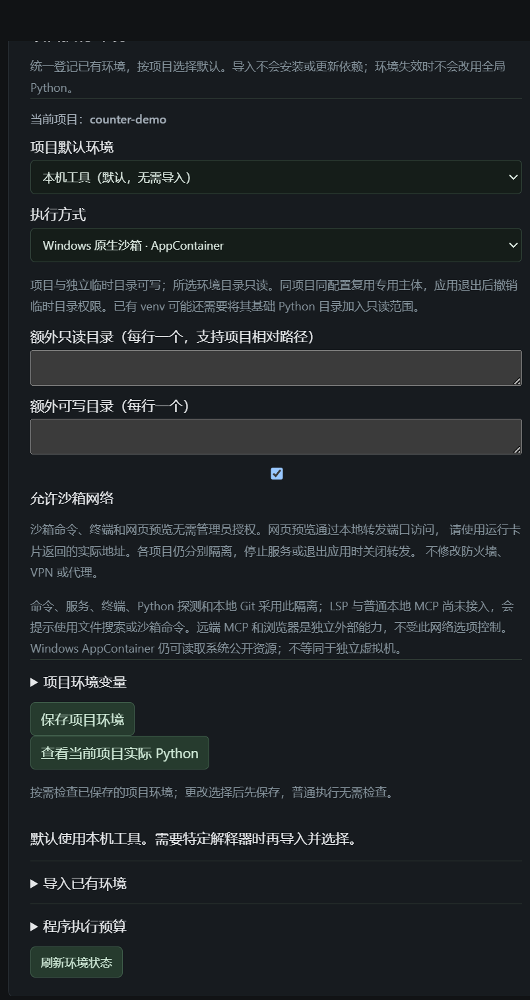
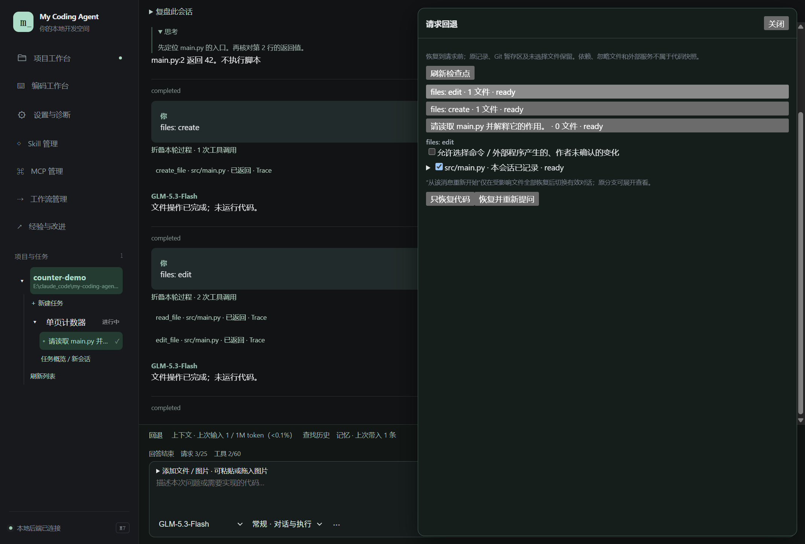

# 06 · 沙箱与请求回退

[返回指南目录](README.md)

## 按项目选择沙箱

默认直接运行适合日常项目。需要限制项目程序的文件访问时，到「设置与诊断 → 项目执行环境」：

1. 「执行方式」选择「Windows 原生沙箱 · AppContainer」。
2. 按需填写额外只读目录／可写目录。项目本身与独立临时目录可写；所选环境目录只读。venv 可能还需其基础 Python 目录。
3. 按需调整「允许沙箱网络」，默认开启。
4. 点「保存项目环境」，后续启动的已支持程序采用该方式。

此图只展开配置，没有在本次截图采集中启用沙箱或修改 ACL。既有真实普通权限验证见[M6 进度](../progress/m6.md)。

日常沙箱命令、终端和预览不需要反复 UAC。HTTP 预览使用运行卡片中的**实际转发地址**，不一定是程序打印的原端口；退出应用清理相关进程与临时授权，不恢复旧服务。

当前覆盖命令、终端、HTTP 预览、Python 探测和本地 Git。LSP 和普通本地 stdio MCP 尚未接入此执行方式；远程 MCP、临时浏览器是独立外部能力，不受这里的网络开关统一控制。

它不是虚拟机或资源配额系统，没有 CPU／内存／磁盘限额与域名白名单。沙箱真实启动失败不会自动改用直接执行；先看失败原因，确需改变模式时由你在设置里选择。

## 从某条消息前恢复代码

入口在会话输入框上方「回退」。这使用应用请求检查点，**不要求 Git**。

1. 先停止本会话正在执行的工作。
2. 点「回退」，选择要回到其执行前状态的请求。
3. 展开文件看差异和来源，勾选本次要恢复的文件。根据“覆盖范围说明”检查遗漏或不可恢复项。
4. 选择「只恢复代码」或「恢复并重新提问」。

截图中的 `files: create`／`files: edit` 是离线示例的请求标题，不是应用内置命令；正常使用选择你自己的提问即可。

| 操作 | 文件 | 会话 |
| --- | --- | --- |
| 只恢复代码 | 恢复本次选中的可恢复文件 | 对话继续保留，不改变有效对话分支 |
| 恢复并重新提问 | 恢复受影响文件；未完整恢复时不会切换对话 | 回到该请求之前，将原提问放回输入区，等你修改并发送；原分支保留可查看 |

恢复后看逐文件实际结果；需要撤销这次恢复时点「预览撤销这次恢复」。恢复本身不重放模型请求，也不重新启动命令。

## 哪些内容不在恢复范围

- Git 暂存区与未选文件保留；请求检查点不等于整个 Git 仓库恢复。
- 依赖目录、忽略文件、数据库、网页账号与外部服务状态不是系统备份。
- 命令／外部程序造成的“作者未确认”变化需在预览明确选择；含其他会话修改或当前冲突的文件会显示对应状态。
- 旧版本没有的检查点不会补造；快照大小与范围在「上下文 → 材料加载、压缩参数与计量详情 → 代码回退覆盖范围」调整。

恢复前后的差异和状态比“任务已撤销”的一句提示更可靠。发生部分失败时查看具体文件，不要连续重复点击覆盖。
