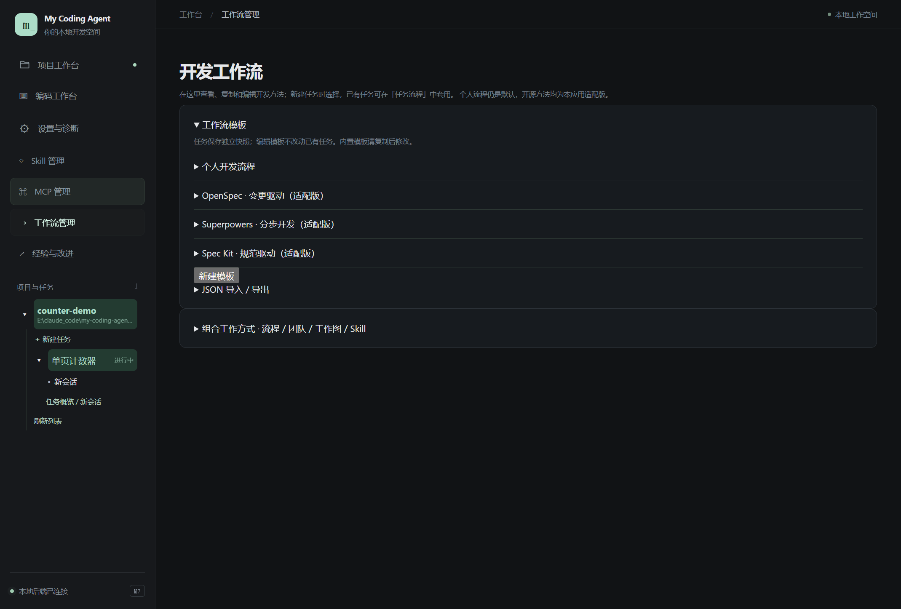
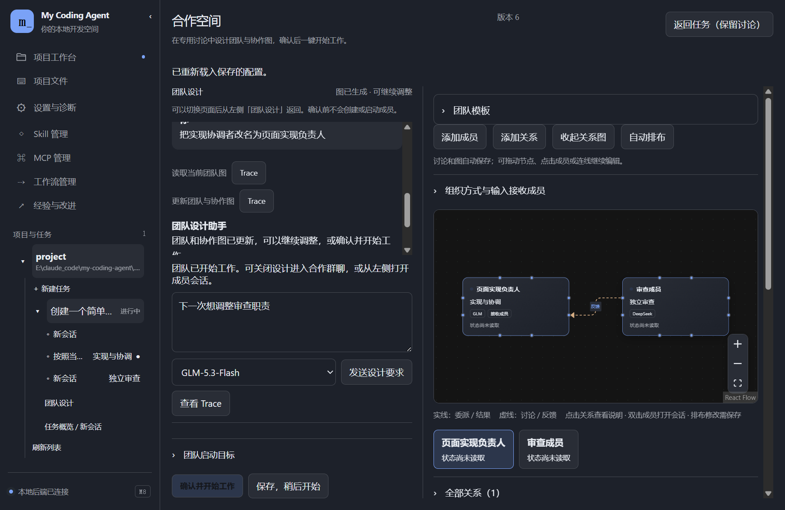
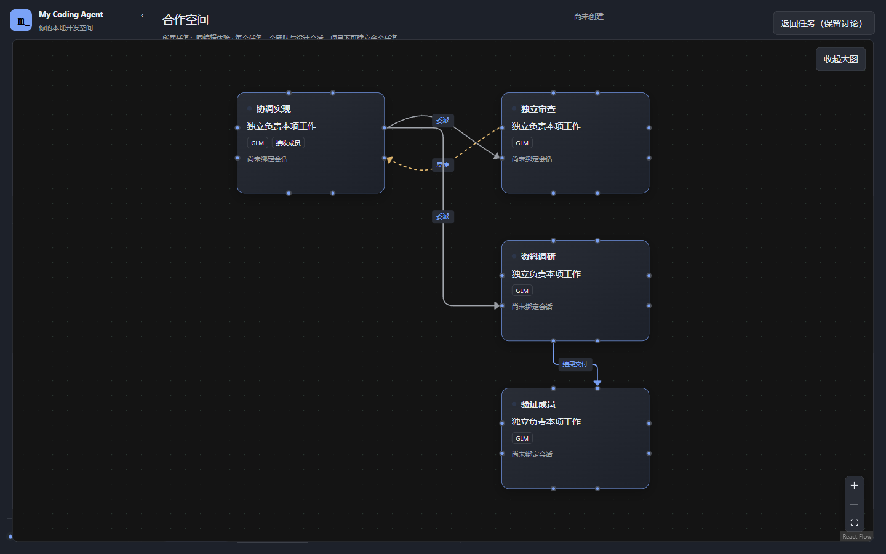
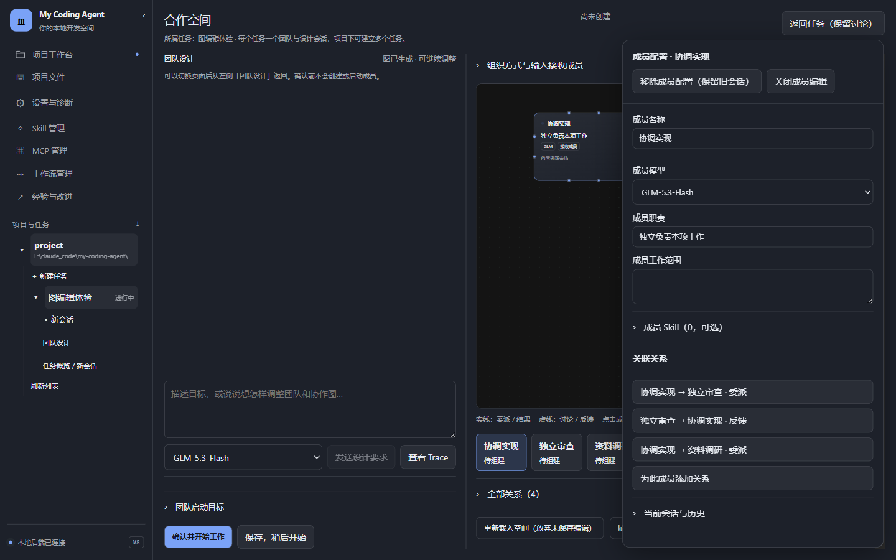
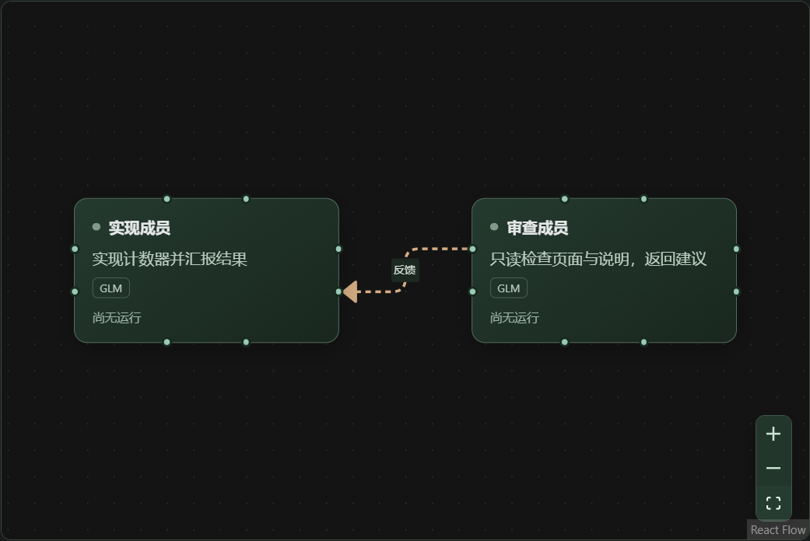
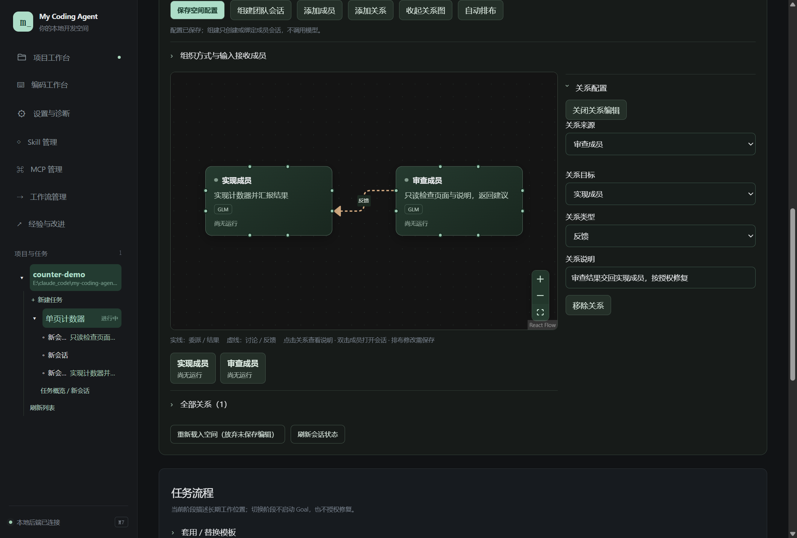
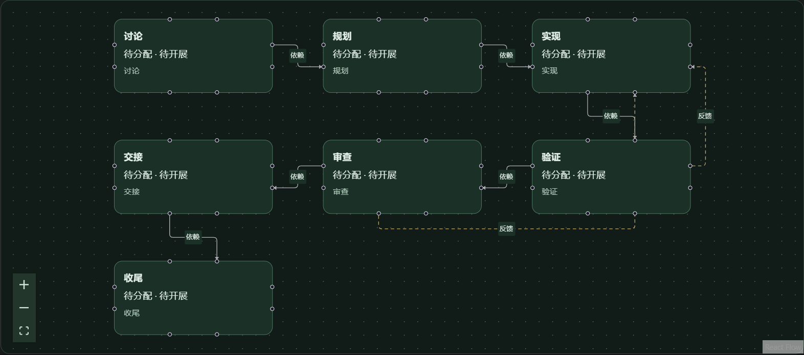

# 07 · 工作流与合作空间

[返回指南目录](README.md)

## 先分清三层

| 层 | 保存什么 | 何时生效 |
| --- | --- | --- |
| 工作流模板 | 阶段、方法、依赖与反馈建议 | 新任务选择后复制快照；修改模板不追改旧任务 |
| 任务合作空间 | 本任务的成员、角色会话、团队关系图和工作图 | 保存到当前任务；可以继续编辑 |
| 会话运行 | 一次请求或局部 Goal | 你实际发送或派发工作后才调用模型 |

项目容纳多个任务；具体图属于任务，模板提供可复用的结构。阶段切换不会自动启动 Goal，也不等于授权修复。

当前每个任务有一份合作空间和一个专用团队设计会话；项目本身不共用一张团队图。需要另一支独立团队时在同项目新建任务，需要复用结构时保存团队模板。

## 选择或改一个工作流

左侧「工作流管理」查看个人流程、OpenSpec、Superpowers、Spec Kit 适配版。展开模板查看阶段；需要更改时「复制后编辑」，调整阶段名称、说明、Skill、依赖和反馈，保存模板。也可使用 JSON 导入／导出。

这些是本应用的适配模板，不代表安装或运行了对应上游 CLI。内置个人流程仍是默认；阶段产物是工作提示，不是必须填完才能运行的闸门。

创建任务时选模板；已有任务在「任务流程」中套用／替换或修改当前任务流程。按工作需要直接进入实现、返回规划或重复审查，流程不会强迫每个任务从头走完。

## 通过独立讨论设计团队并开始工作

创建任务后，在任务页的合作空间点「打开团队设计」，也可从左侧展开任务后点「团队设计」。这是该任务专用的设计会话，原开发会话不会被设计提示占用。

1. 输入目标，例如：“做一个计数器页面，设一个实现协调者和一个只读审查者，生成协作图，先不要执行。”
2. 左侧持续显示讨论和工具动作，右侧出现可编辑图。继续说“把实现者改名为页面负责人”或调整分工、交接关系；也可直接拖动节点、点击成员或关系编辑。
3. 展开「团队启动目标」检查本次执行范围。满意后点「确认并开始工作」：一次保存图、创建或复用成员会话，并交给协调成员的 Goal 按分工执行。依赖结果的工作等待交接，不会把同一任务同时交给全部成员。
4. 点「返回任务（保留讨论）」查看合作群聊，从左侧打开具体成员。再次点「团队设计」可回到原讨论继续修改。

截图来自真实 Electron 与隔离模型样本，展示界面和持久化链路；不是截图中模型的真实回答质量评测。在线设计需要已配置的模型服务，讨论区可选择下一请求使用的模型。

切换设置、项目或会话不停止设计；未发送输入和图自动保存，重启后可从同一入口恢复历史。正在运行时可「追加要求」或「停止设计」。退出应用会中断运行，重启不会自动重放；可发送新要求接续。只想保存时用「保存，稍后开始」，不需要先创建成员。

重复确认同一配置不会重复启动；需要新一轮工作时从合作群聊发起。组建中途出错会保留已创建成员，可在修正原因后重试；已接纳的执行失败按原运行规则保留结果，由你决定接续。

## 查看与编辑协作图

- 模型生成成员和关系，前端负责排布。首次生成自动展开可读布局；恢复旧图时修复重叠。后续改名、职责调整保留人工位置，新增节点避开已有卡片。「自动排布」会重新排列整图。
- 图偏小时点右上角「展开大图」，完成后「收起大图」回到讨论。双向关系分开走线，箭头指向接收成员；点击成员可突出关联线，在编辑器中看明确的“来源 → 目标”。
- 点击节点或连线，侧面板显示属性；顶部直接提供删除和关闭，Escape 也可关闭。删除成员配置会移除其关联线，已经存在的成员会话和历史仍保留。
- 「添加关系」先选来源和目标，再点「创建关系」。目标默认空；只有主动将两端设为同一成员才建立自环。也可从成员的关联关系区发起，或拖动图上的连接点。
- 设计页自动保存；普通任务页编辑后仍点「保存空间配置」。收起详情和大图不会创建成员、运行模型或改变协作授权。

两张图来自真实 Electron 的隔离四成员样本，展示恢复后的排布和实际编辑界面；没有调用真实模型，不代表模型团队设计质量评测。

## 手动建立两个成员的空间

进入「任务概览 → 合作空间」。简单体验可以使用「用首会话建立工作空间」复用现有会话；需要明确角色时：

1. 点「创建合作空间草稿」。也可使用上面的独立设计入口让模型生成。
2. 添加“实现成员”，职责“完成计数器”，范围 `index.html`。
3. 添加“审查成员”，职责“只读检查页面与说明，给出问题”，范围 `index.html、README.md`。模型、Skill 按成员实际需要选择。
4. 添加关系，设来源“审查成员”、目标“实现成员”、类型“反馈”，填写反馈说明。
5. 点「保存空间配置」。
6. 明确点击「组建团队会话」创建／绑定成员会话。**保存图与组建会话都不会自行开始模型工作**。

该图是手动配置的真实示例；“尚无运行”表示会话已组建，但没有派发工作，不是协作失败。

## 生成完的图仍能编辑

点击成员修改职责、范围、模型与绑定；点击关系修改方向、类型、说明。拖动节点调整布局，从连接点拖线建立关系，选中后可删除；「自动排布」重新整理位置。独立设计页自动保存草稿；任务页的手动编辑仍用「保存空间配置」，不要用「重新载入空间（放弃未保存编辑）」代替保存。

双击已绑定成员可打开会话，也可从左侧树进入。空间显示成员状态和关联运行；想知道“谁是谁”，用[右键信息](02-projects-tasks-sessions.md)查看名称、角色和 ID。

## 从工作图实际执行

1. 切到「工作视角」，点「从流程补充骨架」，或「添加工作」。
2. 选择节点，填写标题、工作范围、阶段、方法和负责人。依赖箭头是前置 → 后续，反馈箭头是当前 → 返回。
3. 保存工作图。节点、分工与关系是同一份任务配置，不另起一套执行器。
4. 在下方「执行工作」勾选本次范围，选择已有“执行 / 协调成员”，补充本次执行说明。
5. 选择单次执行，或「持续推进所选工作」。前者做完一轮返回，后者使用 Goal 持续推进；需要更多修复时写清授权范围。

图中节点“待分配 · 待开展”只是骨架；需要上述分配与执行步骤。已有未结束的 Goal 不会被新委派静默替换。持续轮次、节点结果与历史都能打开对应会话／Trace；停止所选成员后查看实际状态，再决定接续。

Loop 的循环推进体现在持续执行与反馈接续；Graph 表达完整工作与协作关系。反馈环不会因为存在箭头就自动获得修改权限。

## 独立 Review 与交接

最简单的做法：实现完成后，打开已绑定的审查会话，发送：

> 只读审查 index.html 的计数、持久化和可访问性，列出具体位置与问题，不修改文件。把结果交回实现成员。

实现会话收到结果后，再明确要求修复所选问题。群聊用于统一发布要求并查看成员结果；普通补充消息和工作委派不同，**消息投递不等于完成**。会话「···」的分工／协作入口也可配置已有对等会话、读取历史、请求工作和查看结果。

共享项目默认没有副本。交接写清目标、负责文件、已做修改、当前程序和下一步；避免同时改同一位置。子 Agent 在会话输入区上方单独开关，关闭时不委派内部 worker；正式会话仍由用户安排或明确组建。

子任务实际失败时，原安排按既有规则停止，成果与历史保留。M8 点击输入区附近的「子 agent · 查看」打开独立工作空间：左侧选子任务，右侧看目标、最近工具、累计用量、失败来源与部分输出，继续展开公开记录或 Trace。关闭返回原对话；详细布局见[第 13 篇](13-appearance-and-reading.md)。

原安排仍在运行时，可以在工作空间输入补充并继续；原安排已结束时，在主会话明确要求继续并引用 Worker ID。之后也可直接让主会话“查看各个子任务的状态并总结”，读取历史失败不会再次中止查询，也不会自动重跑。旧记录可从对应子运行补读原始原因，未保存的服务详情不会猜测补齐。

新运行累计预算默认不限，有限设置仍由父子共同使用。运行「详情」显示父／子／总计与余额；子任务页的请求和工具数是该子会话累计数，部分输出属于最近一轮。取消和预算停止后不额外调用模型编造总结，已经保存的输出与工具事实可继续回读。

## 把习惯保存下来

任务页与「工作流管理」的「组合工作方式」可保存流程、团队图、工作图与 Skill 的组合，再在新任务选择，或设为项目默认。保存的是可复用配置，不是复制当前成员的聊天历史与运行状态。

如果空间工具提示“当前会话尚未归属任务”，先检查会话归属；如果成员显示未绑定，先组建或绑定；如果图保存了却没动，检查是否真的发起了执行。不要把这三种状态都当作模型故障。
