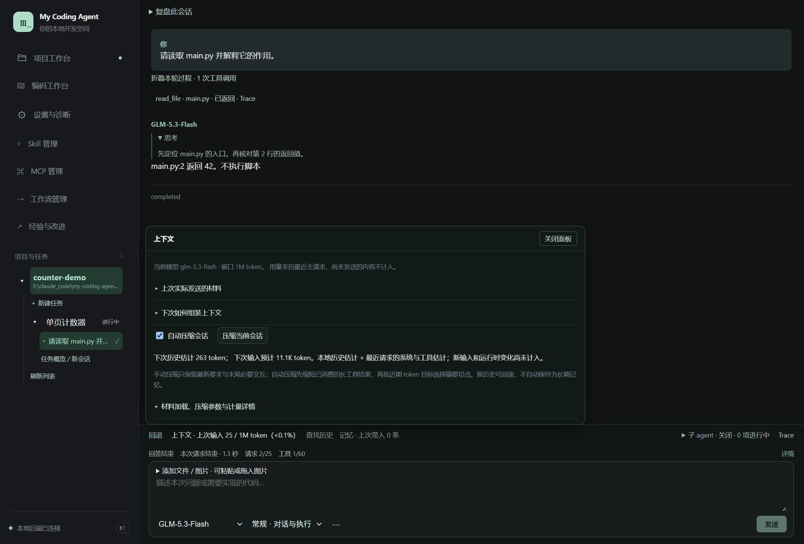
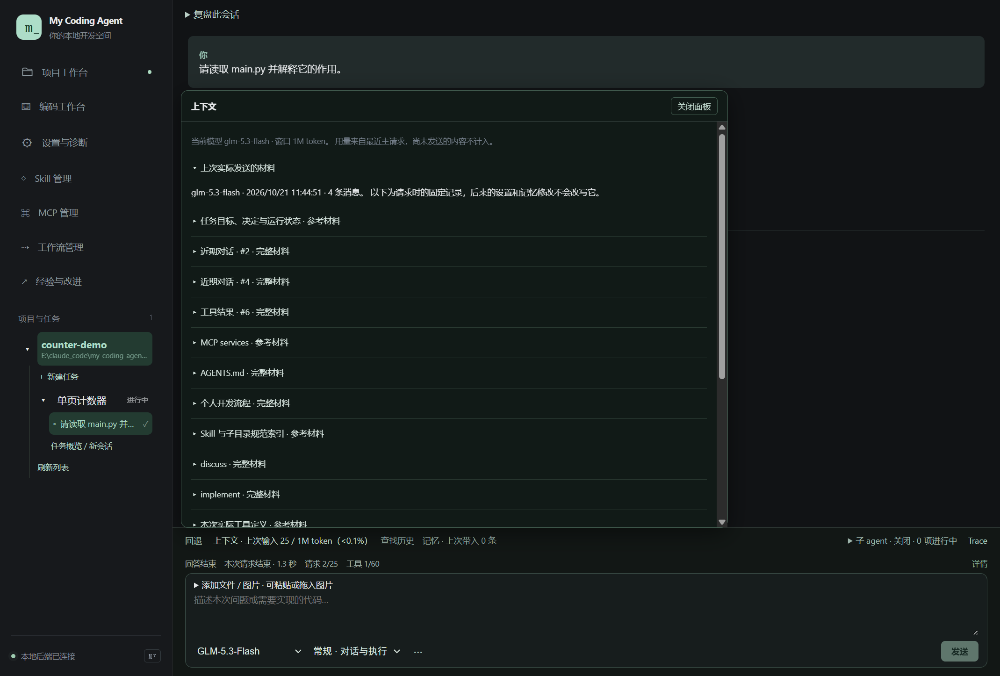
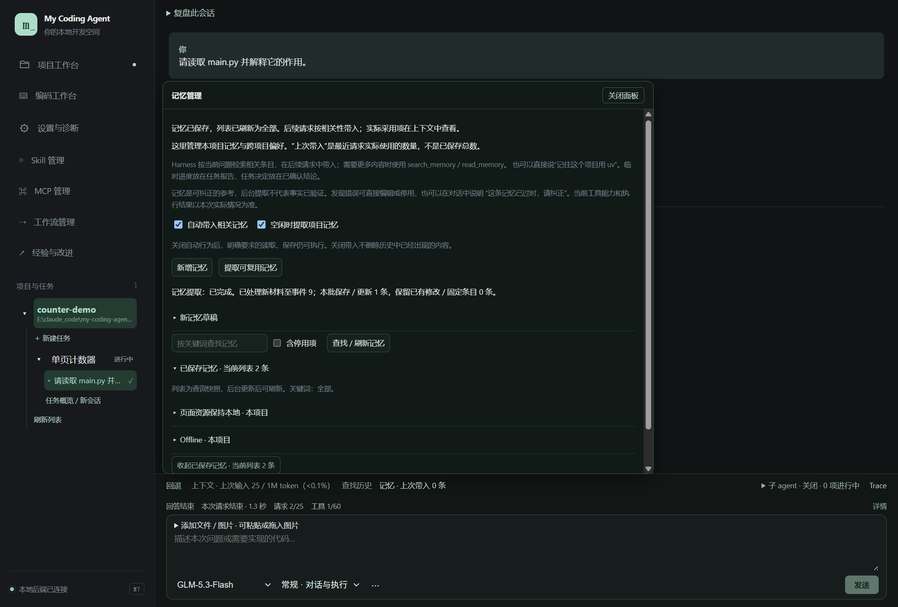

# 08 · 上下文与记忆

[返回指南目录](README.md)

M8：上下文与记忆面板都能「展开到工作区」。记忆采用左侧列表、右侧正文／来源／编辑布局；关闭保留搜索和未保存草稿。「有误 · 停用」保留原文并停止召回，「已过时」标为待更新，「无关 · 取消优先」撤销优先召回但仍参与相关性检索。更正后保存，必要时重新启用；这些操作不会改写过去请求已经使用的材料。新版截图见[外观与阅读空间](13-appearance-and-reading.md)。

## 模型到底收到了什么

会话输入区上方点「上下文」，展开「上次实际发送的材料」。这里是最近一次主请求的固定材料记录，之后改设置不会倒改该记录。

逐项展开可看任务信息、近期对话、工具结果、规范、Skill 和实际工具定义等；关注“全文／摘要／参考材料”的标识。并不是仓库所有文件都会随请求发送，也不是 UI 看到多少聊天就发送多少。

“完整材料”指**该项**在当次请求中的内容；面板清单或有限预览不应被当成网络原始请求报文。多个模型请求属于同一轮时，状态栏显示最近一次主请求，不是全会话累计总量。

## token 怎么读

| 显示 | 含义 |
| --- | --- |
| 上次输入／窗口 | 优先使用服务返回的输入 token；本应用当前两模型配置 1M 窗口 |
| 本地估计／下次预计 | 尚未发出的内容估算，可能不含正在输入和运行时新变化 |
| 输入用量未返回／未知 | 服务没有提供可用数字，不按 0 处理 |
| 作业累计输入／输出 | 压缩、记忆等作业的累计消耗，与主对话输入不同 |

截图 token 来自离线模型样本，不用于衡量真实 tokenizer 准确性。`1M` 是窗口配置，`34K` 等是当前用量；不代表已经把 1M 内容全部发给模型。

## 使用压缩

保留「自动压缩会话」即可。默认自动起点 800K，可在「材料加载、压缩参数与计量详情」修改。也可以随时点「压缩当前会话」，等待作业结果，再展开摘要查看。

自动处理先缩短已消费的长工具结果，再按对话／工具完整边界选择切点，用模型生成接续摘要；近期保留使用绝对 token 预算。手动压缩偏向保留最新需求与末尾必要交互。历史原文归档可回读；没有变小的结果不会冒充有效压缩。

高级区可以选择按需能力加载、近期预算、后台压缩与相关容量。保存后影响后续组装。选择后台压缩时，窗口允许可先继续前台，下次请求采用已完成结果；容量确实不足时仍需要等待或处理。失败保留原历史，显示具体错误，不等于原对话丢失。

**压缩不是长期记忆提取**，也不删除已经发生的工具事实。折叠面板、思考或 Trace 只是界面操作，不能缩减上下文。

## 查历史并带入一次提问

1. 点输入区附近「查找历史」，输入关键词或按归档线索查找。
2. 点「查询历史」，展开命中项；需要时从头查看、继续展开原文或加载更多结果。
3. 确认相关后点「加入这次提问」，在输入区检查本次材料，再发送问题。
4. 不需要的条目从本次材料移除。查看完成可折叠结果或点「关闭面板」。

**仅查看历史不会发送给模型**。加入提问后才随该次请求带入；模型自己也能通过历史工具按需回读。

## 记忆在哪里维护

点击输入区上方「记忆」，展开「已保存记忆」。这里管理项目记忆与跨项目偏好。

手动新增：点「新增记忆」→ 填标题与正文 → 选作用域、类型 → 保存。例子：

> 标题：页面资源保持本地。正文：本项目演示页不依赖 CDN，优先使用浏览器和项目已有能力。

需要所有项目复用的个人习惯选个人范围；项目事实留在本项目。临时执行进展放任务报告，已确定决策放任务结论，不必全部写成长期记忆。

展开条目可查看来源、编辑或停用；错误内容也可以在对话明确要求纠正／替代／忘记。检索不到停用项时勾「含停用项」。自动提取只是候选知识整理，模型猜测不能因此成为真实能力证明。

## Harness 怎样使用记忆

「自动带入相关记忆」按当前问题检索和排序，选相关条目进入后续请求；不是每次塞入全部记忆。Agent 可继续通过 `search_memory`／`read_memory` 取更多内容。开启「空闲时提取项目记忆」会做独立维护；也可手动「提取可复用记忆」。

“上次带入 0 条”表示最近请求没有带入，不代表库为空。新存记忆不改写已发出的请求，在下一次请求后到上下文材料核对。关闭自动带入不删除历史中已经出现的内容；明确要求保存或读取仍可执行。

当前以本地词法匹配与相关性排序为主，尚未引入向量检索。长期事实、工作方法与工具说明的改进，也可进入[经验与改进](12-experience-and-improvement.md)形成可检查候选。

历史上由模型保存或后台提取的 `capabilities` 类能力自述，未被用户固定时仅供查找，不自动注入请求，记忆页标明「仅供查找」及原因。例如旧条目声称无法读取 token，不能盖过现在可调用的用量工具。原文与来源仍保留；你可编辑纠正、加入这次提问或固定。用户手动维护的内容、固定项及普通项目知识继续按原设置召回，不需要逐条审批。此调整不会删除已经出现在旧会话历史里的文字。
