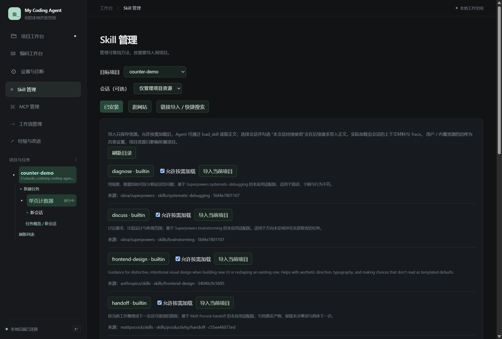

# 09 · 项目规范与 Skill

[返回指南目录](README.md)

规范说明“这个项目遵守什么”，Skill 说明“这类工作怎样做”，记忆保存可复用事实或偏好。导入 Skill 不等于安装了一个新工具，也不等于立即执行它附带的脚本。

## 找到并启用 Skill

左侧「Skill 管理」，先选择**目标项目**，需要固定给某会话使用时再选会话。



1. 「已安装」列表查看名称、描述、来源与启用状态，点击名称查看正文和附属资源信息。
2. 勾「允许按需加载」，让 Agent 在相关任务中发现／加载。
3. 希望当前会话持续使用时，选择会话后勾对应「本会话持续使用」，后续请求会带入正文。
4. 「导入当前项目」把资源复制进项目 `.agents/skills/`，便于随项目管理；只查看不会写项目。
5. 外部修改后点「刷新目录」。正文可关闭，不需要一直占用屏幕。

| 来源 | 用法 |
| --- | --- |
| builtin 内置 | 随应用提供；先“复制为可编辑版本”再改，不直接改原版 |
| user 用户 | 数据根的个人资源，可跨项目使用 |
| project 项目 | 项目 `.agents/skills/`，跟随项目；同名优先于用户和内置 |

用户／内置资源的启停是共享设置；项目资源只影响所属项目。看清实际来源和被覆盖项，避免以为改了 A，却加载了同名 B。

## 从网站下载到项目

「Skill 管理」提供两个不同入口：

- **逛网站**：选择腾讯 SkillHub 或 skills.sh 后才加载网站；直接用站内搜索、翻页和详情。
- **链接导入 / 快捷搜索**：已有受支持来源链接时直接解析，或用集成搜索定位资源。

一个常用流程是：

1. 选网站，搜索所需方法，例如前端设计或调试。
2. 进入具体 Skill 详情，点应用工具栏的「导入本页 Skill」；有多个来源时选择对应项，再进入下载预览。
3. 在预览中看 `SKILL.md` 正文、来源和附属文件，不只看标题。
4. 选择安装到个人资源库，或导入当前项目。SkillHub 原生 ZIP 支持下载、预览并直接导入项目。
5. 回「已安装」确认新条目与来源，再决定按需加载或会话持续使用。

这不是任意网址的通用安装器。当前支持的网站、公开 GitHub 来源和 SkillHub 包由专门适配处理；其他站点能浏览，不保证可解析为 Skill。遇到不支持来源，下载合法资源后用「从本地文件夹导入」。导入保存资源，不会自动运行下载包内的脚本。

## 本地导入与自己写一个

展开「从本地文件夹导入」，选择包含 `SKILL.md` 的 Skill 目录；如果已有在项目的 `.agents/skills/` 下，刷新目录即可。标准结构示例：

```text
.agents/skills/counter-review/
  SKILL.md
  references/
  scripts/
  assets/
```

`SKILL.md` 的最小内容可以是：

```markdown
---
name: counter-review
description: 审查单页计数器的交互、持久化与可访问性。
---
检查按钮加一、刷新后保留数值、键盘操作和标签；给出具体位置与建议。
用户只要求审查时先汇报，不自行修复。
```

也可点「新建 Skill」直接编辑。附属文件由 Agent 按需读取／执行，Skill 目录本身不是新的权限或环境。Hooks、内联 shell 展开、自动切模型不属于首版支持行为，不能因为包里有这些字段就认为会生效。

## 规范和实际加载在哪里看

项目根 `AGENTS.md` 会进入请求；子目录规范按路径索引，在处理相应目录前按需读取。「资源目录与项目规范」查看发现结果。应用不会在打开项目时自动写一份规范。

Agent 的 `discover_skills`／`load_skill` 与会话固定选择使用同一资源目录。正文按需加载，同版本不反复堆叠；压缩后可依据当前引用重新组装。是否真的带入，以**上下文的实际材料**与 **Trace 的加载事件**为准；“已导入”“允许加载”都不是“已调用”的同义词。
