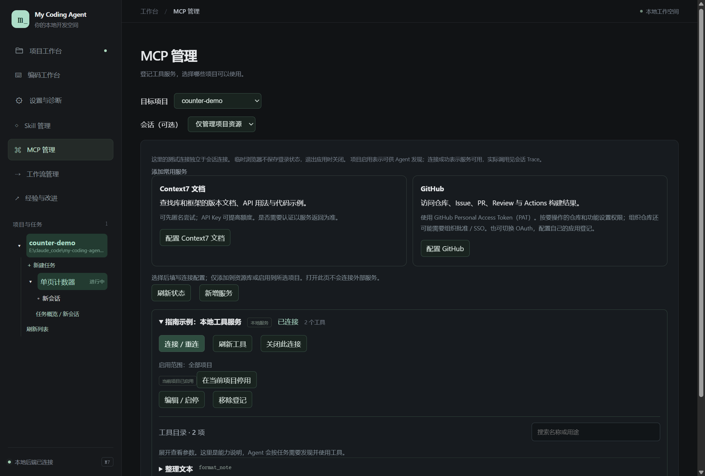

# 10 · MCP 与浏览器

[返回指南目录](README.md)

MCP 连接外部可调用能力；一个服务器通常提供多个工具。列表里的“25 个工具”可能都来自同一个浏览器服务，不是 25 个独立插件。Skill 则是方法文本，两者用途不同。

## 添加与测试服务

左侧「MCP 管理」，先看目标项目和可选会话。未选会话时的测试连接独立于正式会话；选了会话则查看它自己的连接。



截图中的两工具服务是本地演示 MCP，实际完成了 stdio 连接；不是已登录 GitHub，也不是浏览器真实联网证明。

1. 已有 URL／JSON 时点「从 URL / JSON 导入」（见下文）；也可用「配置 Context7 文档」「配置 GitHub」预填常用参数，或点「新增服务」。
2. 选择本地 **stdio** 或远程 **Streamable HTTP／旧 SSE**。前者填程序与参数，后者填服务 URL。
3. 需要凭据时填写「服务令牌」以本机加密保存，或设置明确的环境变量引用／OAuth 配置，不把真实 token 写成普通命令参数。
4. 保存，确认在当前项目启用。
5. 展开服务，点「连接 / 重连」。成功后「刷新工具」，按名称／用途搜索目录，展开查看参数。
6. 回到会话提出实际任务；在 Trace 验证模型最终发现、加载并调用了哪个工具。

目录默认展示功能说明；原始 JSON 在「高级 · 原始工具定义」中，普通使用不需要编辑 schema。项目启用只表示可供模型发现，连接成功只表示服务可用，都不保证某次工具调用已经成功。

停用范围和断开连接也不同：前者影响该项目后续发现，后者关闭当前持有的连接。可选服务缺失不阻断普通聊天；真实调用失败保留具体原因，不自动重放有副作用的请求。

## 直接粘贴 URL 或 JSON

在左侧「MCP 管理」顶部点 **「从 URL / JSON 导入」**。可直接粘贴完整服务 URL，也可以原样粘贴服务商给的这种配置：

```json
{
  "mcpServers": {
    "my-service": {
      "url": "https://example.com/mcp",
      "type": "streamableHttp",
      "headers": {
        "Authorization": "Bearer xxx"
      }
    }
  }
}
```

1. 点「识别并预览」，检查服务名称、地址和认证。`xxx` 是占位符，换成该 MCP 服务商提供的令牌；不是应用的 OpenCode Go 密钥。只粘贴 URL 时可在预览中补填 Bearer 令牌，无需认证则留空。
2. 「启用范围」默认选择当前项目，也可选其他项目、所有项目或「仅加入资源库」。多项配置可分别勾选。
3. 点「导入所选…项」。`Authorization: Bearer …` 自动拆成认证方式和只写令牌，由已有 Windows 加密设施保存到应用数据根，不写入普通 `mcp.json` 或项目。相同名称也会建立独立身份，不覆盖之前的服务。
4. 关闭导入，展开下方服务卡片，点「连接 / 重连」，查看真实连接状态和工具目录。仅导入不会自动访问服务；在项目启用后，Agent 可沿现有发现流程使用。

同样支持单个 `{ "url": "…", "headers": { … } }` 对象，以及 `servers` 容器。HTTP 类型可写 `http`、`streamableHttp`、`streamable-http` 或 `streamable_http`，省略时按 URL 识别；旧 SSE 使用 `"type": "sse"`。只有 URL 时可在预览中选择连接方式，不按域名或 `/sse` 后缀猜测。不修改服务商给出的 http／https 地址、路径或查询参数。

本地服务可粘贴 `mcpServers`／`servers` 下的 `command`、`args`、`env`、可选 `cwd`，省略类型时按 command 识别 stdio。例如：

```json
{
  "mcpServers": {
    "local-tools": {
      "type": "stdio",
      "command": "python",
      "args": ["E:/tools/my_mcp_server.py"],
      "cwd": "${workspaceFolder}",
      "env": { "SERVICE_TOKEN": "xxx" }
    }
  }
}
```

示例路径和令牌需要换成自己的；程序按本机实际 PATH／路径定位，应用不自动安装任意服务包。`args` 保持逐项参数，不拼成 shell 字符串。cwd 留空跟随项目，无项目时使用应用数据根；相对 cwd 基于该目录，`${workspaceFolder}` 在 cwd 中指向该目录。所有导入的 env 字面值和附加 headers 通过现有 DPAPI 加密，普通配置只保留名称；「编辑 / 启停 → 高级连接选项」可以替换或移除已保存变量，密码框留空保留原值。

导入兼容 `disabled` 布尔值与 `timeout` 毫秒值，预览显示启停和换算后的超时；未支持字段明确显示，不静默丢弃。不兼容的一项不妨碍导入其他可用项；部分成功后再次导入只处理未保存的所选项。

环境引用支持 env／完整请求头值 `${NAME}`／`${env:NAME}`，以及 `Authorization` 的 `Bearer ${NAME}`；连接时才读取环境。多个独立认证头可同时导入。服务要求 OAuth 时，导入 URL 后在「编辑 / 启停」中选择 OAuth，再按下节登录。关闭导入会丢弃未保存草稿。

## SDK 1.x／2.x 与协议兼容

SDK 包的版本不是 MCP 协议版本。当前锁定的官方 Python SDK 2.x 使用 `Client(mode="auto")`：现代服务使用新协议，旧服务回落至 initialize 握手；现有 stdio／HTTP 链路复用该逻辑，新增 SSE 也交给 SDK。遇到不接受探测的旧服务，可在「高级连接选项 → 协议兼容方式」显式选择旧版握手。依据：[官方 SDK 更新说明](https://github.com/modelcontextprotocol/python-sdk/blob/main/docs/whats-new.md)、[迁移说明](https://github.com/modelcontextprotocol/python-sdk/blob/main/docs/migration.md)。

标准工具发现／调用、资源列表／模板／读取沿现有能力接入，与 SDK 语言或平台名称无关。兼容不等于测试过所有平台、SDK 补丁或私有扩展；自定义 WebSocket、其他客户端的 inputs／内联脚本、MCP prompts／sampling／elicitation 等未接入能力不会被伪装成完整支持。项目沙箱尚未支持的普通本地 stdio 仍按原规则显示兼容性，不自动改成无隔离执行。

只提供资源的服务也能连接，工具目录为空不等于连接失败。可在项目会话中让 Agent「列出该 MCP 服务的资源，再读取指定资源」；资源读取沿现有 `mcp_resources` 能力执行。桌面当前以连接状态和工具目录为主，没有另做资源文件管理器。

## OAuth 怎么操作

需要 OAuth 的远程服务，在服务编辑中选相应认证方式；如果服务要求 Client ID、注册信息或特定权限，按服务商配置填写。

1. 在服务的 OAuth 区点「登录授权」，系统浏览器打开服务商页面。
2. 在服务商页面登录并选择授权范围。
3. 授权回到本机后，查看应用中的认证状态，再测试连接／工具。
4. 浏览器没有打开时用「打开授权网页」；需要时「取消登录」，或「退出本机登录」后重新开始。退出清除本机令牌并关闭连接；服务商账户内的应用授权需在其网站撤销。

网页账号密码交给服务商，应用通过授权回调换取令牌并按协议刷新；Windows 受信加密保存令牌，不写进项目。浏览器出现空白回调页时，先看应用是否已完成授权，不把页面空白直接等同于失败。个人账号、组织限制和服务端兼容仍以真实连接结果为准。

## 让 Agent 用临时浏览器

1. 在浏览器服务中「安装浏览器运行包」，或配置已有运行包。没有安装只影响浏览器功能。
2. 在目标项目启用；选择实际会话后查看连接状态。
3. 先让 Agent 启动你的页面服务，取得运行卡片中的实际 URL。
4. 对话中说：

   > 用浏览器打开刚才的预览地址。读取页面快照，点击 +1，确认数字从 0 变为 1；保存截图并说明你实际检查了什么。

5. 在主对话看动作摘要，在 Trace 看导航、快照、点击及结果；「截图产物」中查看已保存图片。

网页理解优先使用结构化页面快照，可读取控制台与网络信息。保存截图成功只表示产物存在；模型是否完成视觉检查，要看它是否实际收到并分析图片，不能只凭“已截图”判断。

## 生命周期与隔离范围

每个正式会话和内部 worker 独立拥有浏览器实例，同会话多轮复用。切换会话、回复结束、停止 Goal 后保留；用户关闭或退出应用时清理。重启不恢复登录、Cookie、站点存储或自动打开旧页面。

临时浏览器与「逛 Skill 网站」的内嵌网页视图是不同用途；它也不是项目执行沙箱。不要为了让 Agent 操作你的普通浏览器而假定它已经接管现有日常标签页。

更详细的认证实现与兼容边界见[MCP OAuth 方案](../plan/mcp-oauth.md)。本指南截图未重新执行外网 OAuth 或浏览器安装。
