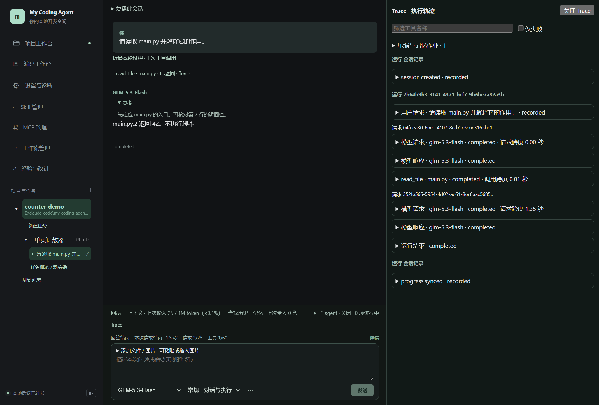
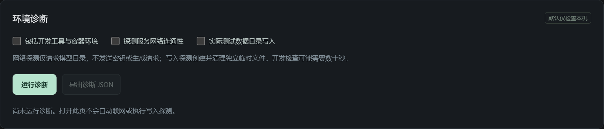

# 11 · Trace 与诊断

[返回指南目录](README.md)

## 查看一次工具实际做了什么

会话中点工具动作后的「Trace」，或输入区上方「Trace」打开右侧执行轨迹。窄窗口使用覆盖面板，可关闭恢复对话空间。

1. 从对应 Run 找到模型请求和工具记录，点击展开。
2. 查看参数、返回结果、状态、耗时与来源；长输出按需读取归档。
3. 需要排错时按工具名称筛选，或勾「仅失败」。
4. 复制需要的参数／结果，或把具体记录送到「经验与改进」作为反馈来源。
5. 点「关闭 Trace」返回对话。关闭不删除记录，也不改变模型上下文。

工具调用和结果合并关联，Goal 可以关联多个 Run。独立压缩／记忆作业有自己的区域，不与主请求混算。历史缺少的用量、来源或耗时显示未知，不凭界面补猜。

需要知道模型当时收到什么，打开对应请求材料；有限预览不等于完整原始报文。Trace 是既有事件的视图，不是另一份独立执行日志。

## 首字很慢时怎么看

先区分连接／等待数据、正在收到思考、收到工具参数、正文输出和工具执行。**思考已经流出，不代表正文应该同时出现**；工具参数分片也不是回答正文。

1. 打开当前运行「详情」，看最后收到数据、当前阶段及请求时序。
2. 到 Trace 找具体模型请求；查看失败的 phase／底层原因，而不只看故障前最后显示的状态。
3. 如果卡在程序，查看程序卡片输出及是否等待输入；如果卡在协作，查看对应成员状态。
4. 排查后再明确接续。应用不会因为超时就静默切换模型或无限重试。

## 环境诊断与连接池

入口「设置与诊断」。环境诊断默认检查本机；可选增加开发工具、网络目录探测或数据目录写入探测，然后点「运行诊断」，需要时导出诊断 JSON。

截图显示尚未诊断，不代表任何服务通过。网络目录探测和实际带密钥的模型调用是两种检查。

同页的模型连接池列表按模型显示状态，选对应模型执行测试、查看结果，按需开启／关闭复用或重置连接。该操作服务于模型客户端，不需要修改 VPN 配置。

连接池在后端应用进程内复用可复用连接，不只限一条会话；不是启动后永久占住一条不失效的连接。模型来源、服务端关闭、空闲时长与网络切换都会影响复用；状态未知时以新测试为准。实际模型测试可能产生请求与费用。

## 给排错或改进保留什么

有用的信息是：项目／会话名称与 ID、Run 或工具记录、具体时间、稳定错误码、失败阶段、你期望的结果。左侧右键可复制名称与 ID；不要把 key 或整份环境变量粘进反馈。

结构化诊断在数据根 `logs/diagnostics/`，保存脱敏原因和关联信息。普通会话 Trace、独立维护记录和 Electron 启动日志不是同一范围；[经验与改进](12-experience-and-improvement.md)允许选来源，但不会默认读尽所有日志。

发现可选服务不可用，只处理它对应的能力；应用本地后端连接、模型凭据存在、认证成功、真实工具回合成功也要分别判断。
