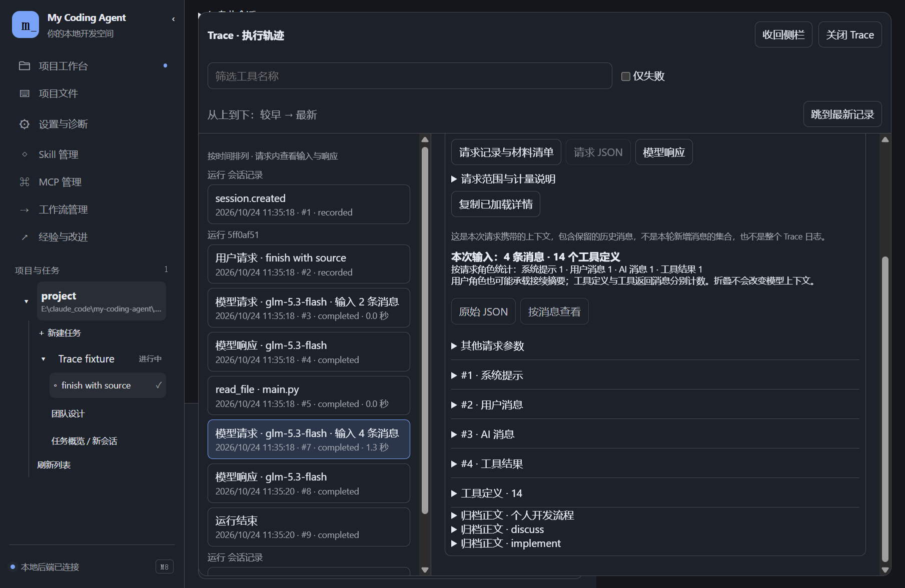
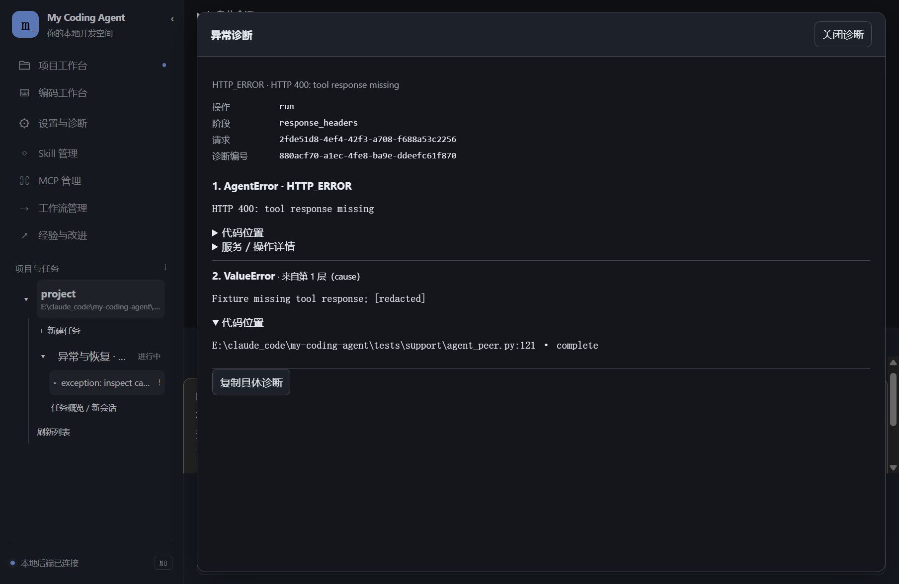

# 11 · Trace 与诊断

[返回指南目录](README.md)

## 查看一次工具实际做了什么

会话中直接点工具动作摘要，或输入区上方「Trace」打开右侧执行轨迹。动作行显示真实对象，例如「读取 · src/main.py」「运行 · python main.py」，不再每行重复 Trace 字样；状态单独显示。窄窗口使用覆盖面板，可关闭恢复对话空间。

M8 可点「展开到工作区」，左侧选择时间线记录，右侧阅读参数、结果和关联材料；关闭保留筛选与已展开内容。子任务自己的 Trace 从子 Agent 工作空间进入，不与父会话混淆。

记录从上到下由旧到新排列，显示本地日期／时间与事实序号；「跳到最新记录」定位当前范围最新一项，开启筛选后定位最新匹配项。实时更新不会自动切走你选中的旧记录。

1. 从对应 Run 找到模型请求和工具记录，点击展开。
2. 查看参数、返回结果、状态、耗时与来源；长输出按需读取归档。
3. 需要排错时按工具名称筛选，或勾「仅失败」。
4. 复制需要的参数／结果，或把具体记录送到「经验与改进」作为反馈来源。
5. 点「关闭 Trace」返回对话。关闭不删除记录，也不改变模型上下文。

工具调用和结果合并关联，Goal 可以关联多个 Run。独立压缩／记忆作业有自己的区域，不与主请求混算。历史缺少的用量、来源或耗时显示未知，不凭界面补猜。

## 查看模型当时收到的完整上下文

在 Trace 选中「模型请求」，切换三个入口：

- **请求 JSON**：新版本会话请求的最终发送正文，包括完整 `messages`、当时实际加载的 `tools`、模型和生成参数。默认分段读取；「加载全部正文」读取剩余部分后可复制完整 JSON。直接点「按消息查看」也会按需读完正文，再分别展开系统提示、用户消息、AI 消息、工具结果和工具定义。
- **模型响应**：已解析并保存的回答、可见思考、工具调用与用量；失败时保留已取得的失败记录。它不是原始 HTTP／SSE 字节流。
- **请求记录与材料清单**：请求身份、状态、时序、材料来源及有界预览。这里的预览仍不等于全文。

快照在适配器发出请求前保存，不从最新会话状态重建；失败请求也可以有请求正文，是否成功发送／收到响应应结合真实状态判断。普通会话、Goal 与 worker 的新主模型请求均走这条路径；独立压缩／记忆等维护作业仍展示已有状态与计量，不宣称已具备同样的完整报文。

**一次请求通常会携带多条历史消息**。请求正文是“系统提示＋有效摘要／保留历史＋本次输入＋已加载工具定义”，并不是本轮新消息的集合，也不是把整个 Trace 日志送回模型。请求标题显示输入消息数；完整加载后可看按角色统计，其中 user 角色也可能包含接续摘要。实际 token 以该请求服务返回的用量为准，字符数不是 token 数。

请求、响应与记录 JSON 默认收起，点击对应「展开…JSON」查看，再点「收起…JSON」关闭正文。长 JSON 在有界区域内滚动，折叠保留已加载内容和阅读位置；折叠和查看不会改变请求或自动触发压缩。

旧版本没有保存完整请求的记录会明确提示缺失；快照不可读或保存失败不会使普通会话停止。快照不包含认证头，保存于应用数据根下对应会话的 `requests/`，不进入项目目录；会随新请求占用磁盘空间。正文只在查看时读取，不加入首屏／历史列表或模型上下文。Trace 继续复用执行事件，快照只是请求检查产物，不另存一套执行日志。

上图来自隔离 Electron 与离线模型样本，实际 HTTP 请求体一致性另由模拟 HTTP 下的真实 Go 客户端定向验证；不是线上模型验收。

## 首字很慢时怎么看

先区分连接／等待数据、正在收到思考、收到工具参数、正文输出和工具执行。**思考已经流出，不代表正文应该同时出现**；工具参数分片也不是回答正文。

1. 打开当前运行「详情」，看最后收到数据、当前阶段及请求时序。
2. 到 Trace 找具体模型请求；查看失败的 phase／底层原因，而不只看故障前最后显示的状态。
3. 如果卡在程序，查看程序卡片输出及是否等待输入；如果卡在协作，查看对应成员状态。
4. 排查后再明确接续。应用不会因为超时就静默切换模型或无限重试。

## 失败后如何恢复

错误卡片先显示原因、可能影响与处理建议，技术详情保留阶段、根因码、诊断编号及会话／运行身份；可复制给排查者。已收到但未完整结束的回答标作部分输出，不伪装成成功回合。

常见配置或调用问题给出对应入口，例如子 Agent 未开启、Plan 不允许写入、本地 Git 未启用／未初始化、文件位置或编辑原文变化。会话失败卡片可直接打开「设置与连接诊断」；错误码收在可折叠详情中。子 Agent 关闭等尚未派发的配置反馈不会冒充模型／执行故障，也不因此结束整个 Run。

点「具体原因与调用位置」打开完整诊断页。每层异常分别显示消息、代码位置及可用的服务／操作详情；HTTP 错误可以包含状态、服务说明和请求标识，Windows 程序错误包含系统操作与实际错误码。长内容可展开、复制，点「关闭诊断」返回原位置。

截图来自真实 Electron，错误由离线测试模型注入，不是某次真实 Go 故障。诊断只保存已取得并脱敏的信息，不保存完整请求、环境或局部变量；正文截断、详情未取得或诊断保存失败均单独说明。旧记录没有逐层原因时明确显示缺失，不推测补齐。

旧诊断清理失败与本次诊断保存失败分别报告。前者不会让已保存的新诊断失去查看入口，也不会替换原来的工具或模型错误；提示会保留具体脱敏原因，便于排查文件占用等问题。

普通工具／模型失败会停止本次运行，但仍可以在原会话发送新消息。2026-10-22 已修正辅助网页搜索失败后误报 `SESSION_DAMAGED` 的问题：重启当前源码后，磁盘历史有效且只缺运行终态的会话可以直接继续，不需要新建会话，不自动重放搜索。真正的历史文件损坏仍须按具体错误处理。

- **读取重连**：后端实际退出后尝试恢复读取。单个读取超时不再终止仍在执行的后端；持续失败会暂停自动恢复，可手动重读。不自动恢复 Goal、不重复发命令。
- **准备接续**：在当前输入框为空时填入接续提示，保留已有草稿，仍由你发送；可先打开相关 Trace、查看实际成果或回退点。
- **模型临时重试**：在运行设置显式设置次数，默认 0。只重试临时网络／服务／限流错误，每次计账并保留失败记录；不自动重放工具。认证、余额和请求格式拒绝需处理原因。
- **MCP**：服务断开后只读目录／资源请求可以恢复连接；此前有副作用的工具调用不会自动再执行。

工具操作结果未知时先核对记录与实际文件。重连成功不意味着原操作成功；过去未保存的 HTTP 详情也不能通过升级补出来。

原生网页搜索通过 Go Messages 接口使用 `deepseek-flash`，主对话仍可以使用 `deepseek-v4.1-flash` 或 GLM。Trace 中辅助请求会显示实际搜索模型，二者不是同一请求。2026-10-22 更换搜索别名后已用公开查询取得原生来源；短样本成功不保证外部服务一直可用。

## 环境诊断与连接池

入口「设置与诊断」。环境诊断默认检查本机；可选增加开发工具、网络目录探测或数据目录写入探测，然后点「运行诊断」，需要时导出诊断 JSON。

截图显示尚未诊断，不代表任何服务通过。网络目录探测和实际带密钥的模型调用是两种检查。

同页的模型连接池列表按模型显示状态，选对应模型执行测试、查看结果，按需开启／关闭复用或重置连接。该操作服务于模型客户端，不需要修改 VPN 配置。

会话运行状态中的「等待服务响应（尚无响应头）」表示请求已经发出，但还没有收到 HTTP 响应头，不代表模型正在思考。展开「详情」可查看本次请求总时限、剩余等待时间和真实收包量；停止后仍可输入新消息。总时限采用本次已保存设置，改设置不会追溯改变在途请求。

超时诊断保留发生位置（如 `tls`、`response_headers`、`response_stream`）、单请求时限、已等时长及收包信息，错误码仍区分总时限／连接／读取故障。长时间无响应头本身不能确定是网络、网关还是上游处理；可先停止并在诊断中测试所选模型，再显式重试。重置本地连接池不保证改变服务端路由，增加超时也不保证恢复。

连接池在后端应用进程内复用可复用连接，不只限一条会话；不是启动后永久占住一条不失效的连接。模型来源、服务端关闭、空闲时长与网络切换都会影响复用；状态未知时以新测试为准。实际模型测试可能产生请求与费用。

## 给排错或改进保留什么

有用的信息是：项目／会话名称与 ID、Run 或工具记录、具体时间、稳定错误码、失败阶段、你期望的结果。左侧右键可复制名称与 ID；不要把 key 或整份环境变量粘进反馈。

结构化诊断在数据根 `logs/diagnostics/`，保存脱敏原因和关联信息。普通会话 Trace、独立维护记录和 Electron 启动日志不是同一范围；[经验与改进](12-experience-and-improvement.md)允许选来源，但不会默认读尽所有日志。

失败卡片的「调查这次失败」带入该轮 Run 和诊断；Trace 的「调查此故障」只带入所选事件。进入改进页后可调整关注点，再「开始改进」，无需先保存反馈或指定工具。关联诊断先作为索引，调查按需读取正文，实际阅读仍记在材料中；不会因此自动加入整个项目历史。

也可以在会话中要求 Agent 分析指定诊断编号。`read_diagnostic` 经现有能力发现加载，读取的就是桌面同一份记录；调查专用的 `read_review_diagnostic` 读取本次材料关联的原因。诊断是证据，外部服务错误不等于 Harness 代码有错，生成候选也不等于已修复或已采用。

发现可选服务不可用，只处理它对应的能力；应用本地后端连接、模型凭据存在、认证成功、真实工具回合成功也要分别判断。

原生搜索失败会保留实际取得的辅助模型、搜索次数、停止原因、返回块类型或服务错误码。没有搜索结果块只能说明服务没有交付原生结果，不能据此断言网络、余额或模型能力根因；已有明确网页地址时可改用 `web_fetch`，不会自动切换服务或重放调用。
