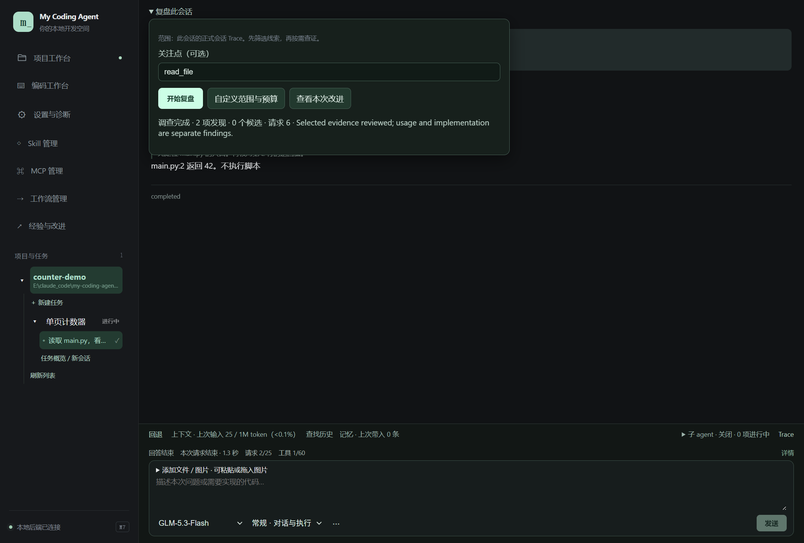
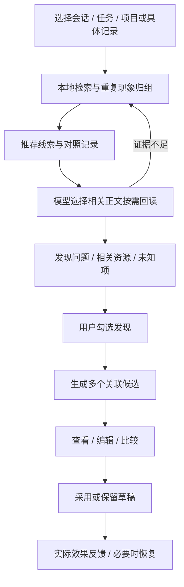
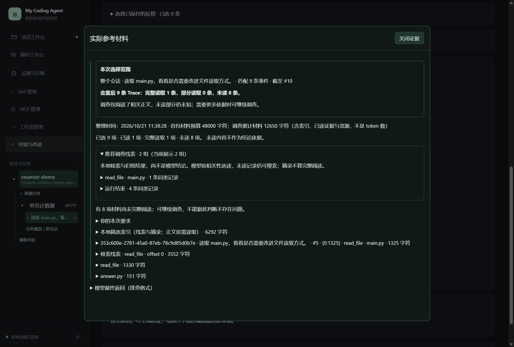
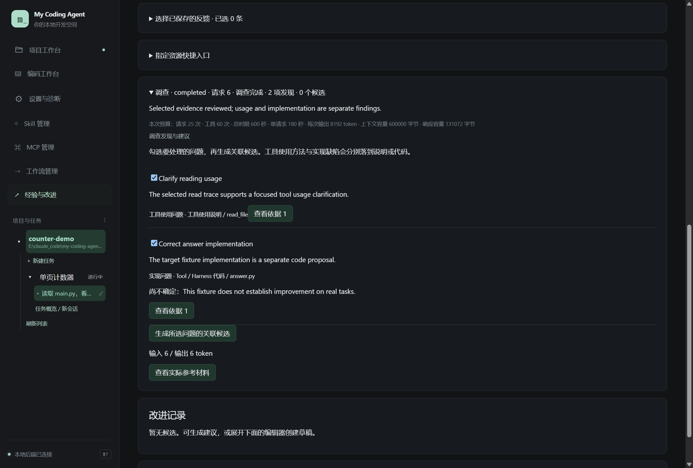
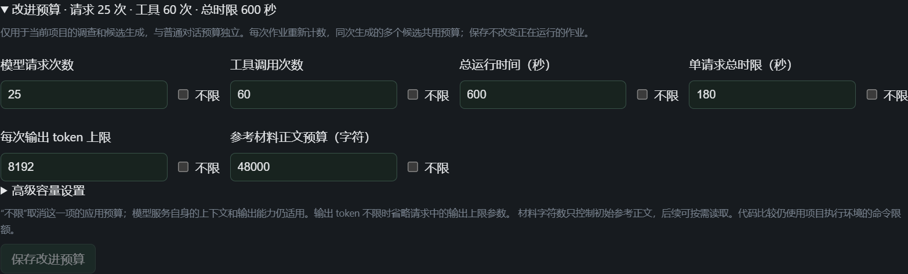

# 12 · 经验与改进

[返回指南目录](README.md)

这个模块从真实工作记录中筛选问题，找出相关规范、Skill、工具说明或代码，再生成可检查的修改候选。**先调查，再决定改什么**，不需要事先把所有 Trace 绑定到某一个工具。

## 最方便：在当前工作位置开始

会话、任务、项目各有「复盘此…」入口。想处理刚才的一次体验，就从对应范围开始：

1. 展开「复盘此会话」（或任务／项目）。
2. 关注点可留空，也可写“工具反复读取相同内容，请找重复原因”。
3. 点「开始复盘」，当前入口显示进度与请求数。
4. 完成后点「查看本次改进」，进入同一个作业，不重新发起。

现场范围是该对象下的**正式会话 Trace**，不自动包含所有 worker、独立压缩／记忆作业或系统日志。启动时冻结已有范围与截止位置，之后新发生的对话不会悄悄混进本次调查。

这张图的调查结果来自离线模型样本；它演示入口与状态，不代表真实模型发现了两个产品缺陷。

## 需要自己选材料：用独立页

左侧「经验与改进」顶部「新建改进」可直接输入要求并「开始改进」。要精确选择时：

1. 核对当前项目——这是候选的写入项目。
2. 在来源选择中选「参考记录所在项目」，按名称／角色找会话。
3. 选择「整个会话：所有已记录的 Trace」「指定运行：多选完整轮次」或「指定事件：多选具体步骤」。可搜索更早运行、翻页、多选和移除。
4. 按需添加已保存反馈或异常诊断；无需先保存反馈才能开始。
5. 可先「预览本次参考材料」，再点「开始改进」。

从现场入口进入时，顶部提示继承范围；需要完全手动选材，用「清除继承范围，手动选材」。切换同一会话的选材模式会清除它原来的选择，最终以页面显示的来源与截止位置为准。

业务项目的 Trace 可以用于改进 Harness 源码项目，**来源项目和写入项目可以不同**。先核对两者，避免将候选写到业务项目。

## 为什么不会再遍历全部全文

本地筛选利用文字相关、失败、用户纠正、重复现象和对照结果；排序只是线索，不是根因结论。模型可以扩查，但不以读完整个会话或提高覆盖率为目标。没有值得修改的结论也是正常结果。

## 区分“选了多少”和“实际读了多少”

作业中点「查看实际参考材料」，证据浮层在当前视窗打开；可进入原 Trace，关闭或 Esc 返回原位置。

图中“选择 9 条，完整读 1 条，未读 8 条”表示只回读了相关正文。短摘录和索引不算完整阅读；未读材料不能作为“没有问题”的证据。材料字符数也不是模型 token 数。

“预览”显示准备选取的范围／线索；运行后的“实际参考材料”才记录作业真正读取的内容。调查后的候选沿原调查接续，不重新收集后来追加的整个会话。

## 从发现生成候选

调查结束后，在「调查发现与建议」：

1. 查看发现的理由、相关资源与尚不确定的部分；「查看依据」打开对应材料。
2. 勾选需要处理的问题，点「生成所选问题的关联候选」。
3. 在「改进记录」中选择候选，查看修改前和建议内容，按需编辑并保存。
4. 看效果证据，再决定采用、保留草稿或恢复。

| 目标 | 实际会改变什么 |
| --- | --- |
| 项目规范 | 项目的规范资源 |
| 个人偏好／记忆 | 原记忆服务中的对应条目与作用域 |
| Skill | 对应资源；内置内容先形成可编辑副本 |
| 工具使用说明 | 模型看到的使用方法，**不会修改工具代码** |
| 组合工作方式 | 流程、团队图、工作图与 Skill 的可复用配置 |
| Tool／Harness 代码 | 当前首版单文件代码候选，需要明确采用 |

已经知道具体资源时，展开「指定资源快捷入口」，勾选已确定资源，选择类型和已有条目／文件路径。该路径仍先筛选证据；不必为了普通调查强行指定工具。也可读取当前内容后手动编写候选。

## 比较、采用与恢复

指定资源后，候选保持在该资源；其他文件可以用作参考，不会因此扩大修改对象。多个候选先分别保存，一个候选遇到外部修改冲突不会丢掉后面的候选，冲突项可打开查看原因。

切换页面后，已勾选的发现仍保留。需要重试生成，用原调查下的「沿原调查重新生成候选」，沿用冻结范围与已读材料；正在运行的相同请求会复用原作业。失败、取消或上次退出中断的作业可点「接续本次调查」，不会自动重放曾经采用过的修改。历史超过一页时用「更早的调查与候选生成」；已有进度链接也能直接打开旧作业。

材料准备阶段同样有作业状态和「停止复盘」入口，并计入总时间预算。保存现场反馈时，其项目／任务／会话范围一并冻结，自动复盘和以后复用反馈都沿用该范围。

代码候选可展开「独立代码实验」，填写检查命令，例如项目已有的 `python check_example.py`，再「比较原版与候选」。同一命令分别在独立副本执行，结果、退出码与输出可以查看；不会自动替你安装依赖。

比较绑定候选当时的版本。编辑候选后，旧比较不再代表新版本；没有比较就如实显示未验证，不拿生成成功冒充效果提升。其他资源可记录实际反馈或比较说明。

「采用候选」才把修改写入目标。代码不会自动采用；其他资源可在「复盘与采用设置」配置项目策略，使用前看清当前设置。采用后需要重新启动对应应用才生效的代码，手动重启；不强制关闭正在使用的程序。

采用后可「恢复修改前版本」。代码采用会保留独立恢复脚本／`Restore.cmd`，应用启动失败时按记录位置使用；它恢复代码，不回滚数据库或所有业务数据。发生外部修改时看实际冲突说明，不重复覆盖。

## 让记忆参与调查，并把结论带回记忆

调查根据关注点或指定资源检索现有记忆，提供短目录；没有关注点时由模型发现问题后再搜索。检索覆盖正文、标题、标签和适用对象，遵守原记忆的作用域、启停与失效状态。目录命中不等于阅读正文，模型按需读取相关条目，作业材料记录实际资源与版本。

调查也可以按问题、资源、采用状态和实际比较结果检索历史改进，按需阅读候选。**采用成功只表示内容已修改，不代表效果已改善。**旧版本的比较仍可查看，但不作为新版本已改善的依据。

想从某项改进沉淀经验，在「改进记录」中点「提炼为经验候选」。它使用同一个调查服务，先检索已有记忆，再决定是否有值得保存的新经验；允许没有新候选。生成后沿用项目的记忆采用策略，不增加额外审批。不会自动把每项修改、全部 Trace 或整份比较日志复制成记忆。

采用的经验进入原记忆系统，之后按已有召回设置用于对话。记忆的「来源与知识页选项」可查看来源改进、正文版本及对应效果记录。自动派生经验的来源记忆被纠正，或所据改进版本／效果发生变化时，会标为来源待更新；人工确认条目保持原有语义。多项发现分别关联其实际证据，不能确定的关联保留未知，不作为生成门槛。

## 改进预算在哪里

顶部「新建改进」内展开「改进预算」，与普通对话预算独立，按项目保存。改值后点「保存改进预算」，下一次调查／生成采用；正在运行的作业保留接纳时快照。

| 选项 | 控制什么 |
| --- | --- |
| 模型请求次数 | 本次作业请求模型的累计次数 |
| 工具调用次数 | 本次调查／生成使用工具的累计次数 |
| 总运行时间 | 作业总体时限 |
| 单请求总时限 | 一次模型请求的等待时限 |
| 每次输出 token 上限 | 单请求输出约束 |
| 参考材料正文预算（字符） | 初始参考正文容量；后续仍可按需读取 |
| 高级：累计调查上下文容量（字节） | 包含继续读取材料的累计上下文容量 |
| 高级：单次模型响应容量（字节） | 单次响应的本地容量 |

八项均可单独选「不限」，不是把数字改成一个很大的数。不限只取消该项应用预算，模型服务自身的窗口／输出能力仍适用；代码比较还受项目执行环境的命令时限约束。同次生成多个候选共用该作业预算。

## 实用习惯

遇到具体卡顿或错误，先从当前会话复盘；要找整个任务重复模式，再扩大到任务；需要跨项目或精确事件时用独立页。第一次先看发现和依据，选少量确实相关的候选采用，再用后续任务验证效果。

复盘是独立维护，不暂停原任务、不自动创建正式会话，也不把维护失败改写成原任务失败。当前未提供长期效果自动评估或多文件整库无人值守升级；本轮能力边界与真实模型证据见[M7 进度](../progress/m7.md)。
