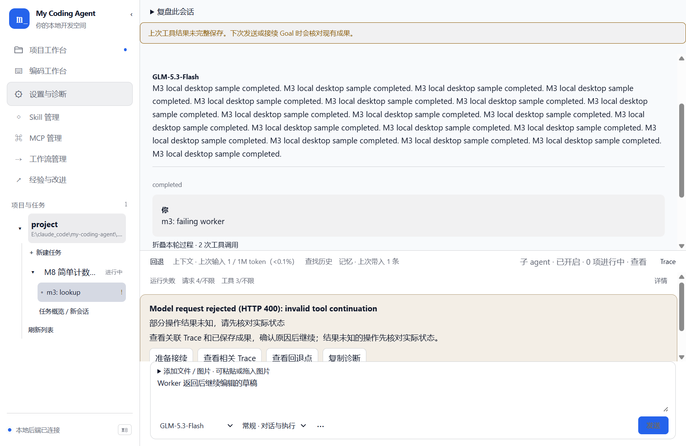
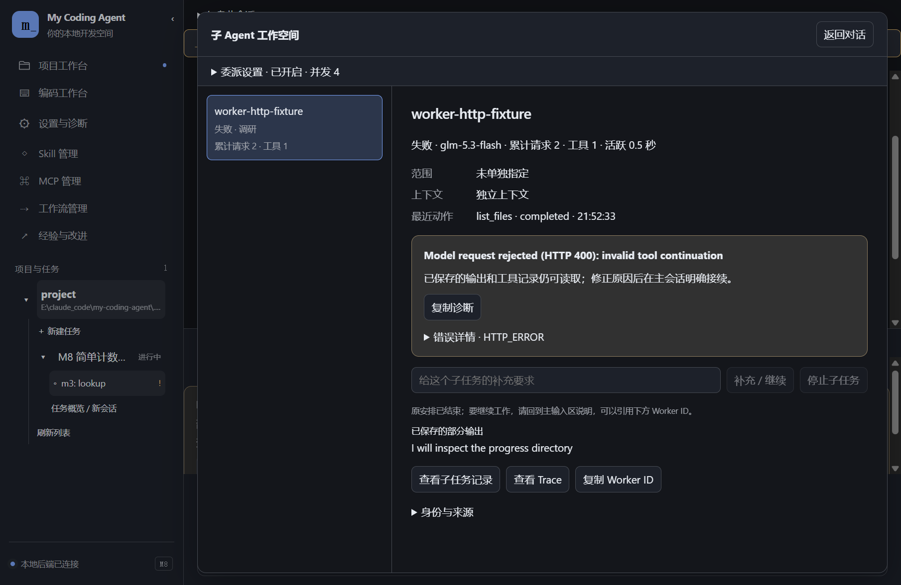
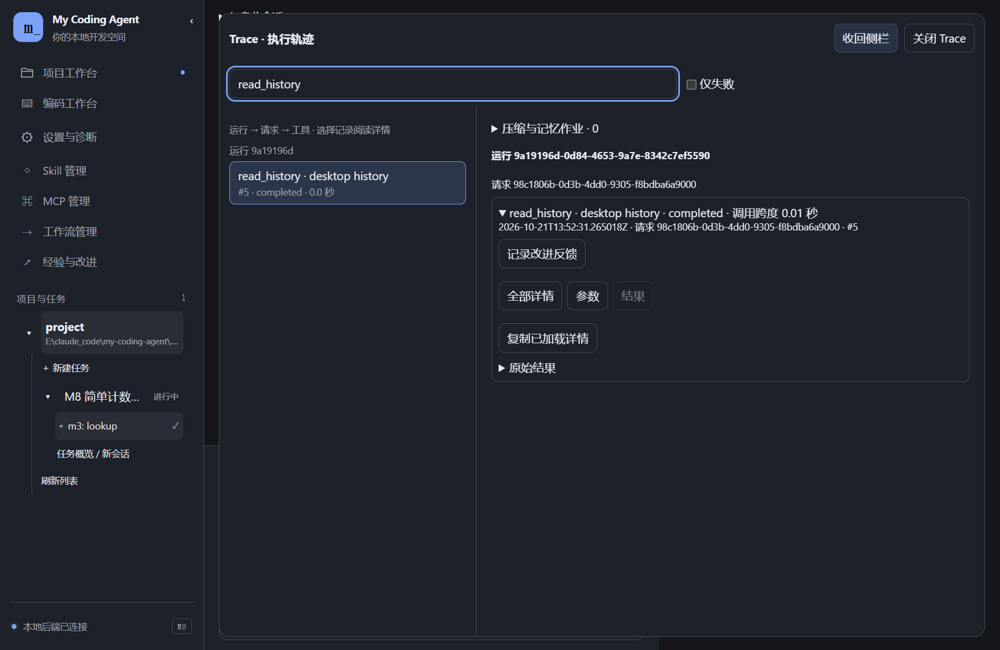
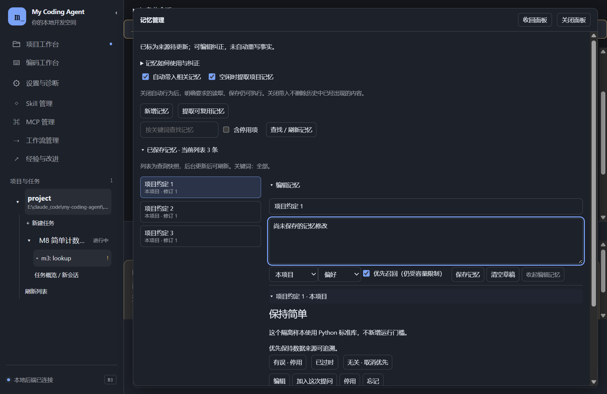

# 13 · 外观与阅读空间

[返回指南目录](README.md)

M8 将长材料从小折叠框移到可关闭的完整阅读空间。下面截图来自真实 Electron 界面和隔离模型样本；错误、回答和 token 用于演示，不代表线上服务当前状态。

## 配色和侧栏

打开「设置与诊断 → 外观」，选择石墨蓝、经典浅色、北欧灰蓝、暖纸米色或深灰薄荷。点击即预览；「保存外观」才写入当前数据根的 `electron/appearance.json`。可以用取色器或 HEX 改主色，也可以恢复预设主色、取消预览。

主色过于接近面板时显示阅读提示，仍允许保存。主题不会重启后端或中断工作，编辑器、终端和图使用同一套浅深色设置。外观读取失败会报告并临时使用默认外观，不重置会话。

侧栏右边缘可以拖动调宽；右上角箭头收起或展开。宽度与收起状态自动保存。键盘聚焦边缘可用左右键调宽。窄窗口里的长详情使用覆盖布局。

## 子 Agent 工作空间

点击输入区附近「子 agent · 查看」。左侧是当前会话的子工作，右侧看目标、分工、最近动作、部分／最终结果、失败原因及原运行身份。可复制 Worker ID、读取历史或打开该子任务自己的 Trace。

「委派设置」控制后续是否允许分工及并发数。原安排结束后，接续通过主会话明确发起；查看历史本身不会重跑。返回对话保留输入，切换子任务保留各自阅读位置。

## Trace、记忆和上下文

Trace 先侧面打开，再用「展开到工作区」切换到时间线／详情布局。选择一条记录后才加载长材料；参数、结果与完整记录分别查看。关闭保留筛选，过去请求的实际材料不会因折叠而改变。

记忆也是列表／正文布局：查找后选择一条，查看来源或编辑。纠错按钮直接复用已有保存／失效操作，不需要额外审批。未保存草稿在关闭面板后仍保留。上下文面板可同样展开；本次用过的记忆与库内所有记忆是不同范围。

长详情有独立滚动区和关闭按钮；退出详情不停止任务。异常处理与接续见[第 11 篇](11-trace-and-diagnostics.md)，预算设置见[第 03 篇](03-chat-and-goal.md)。
