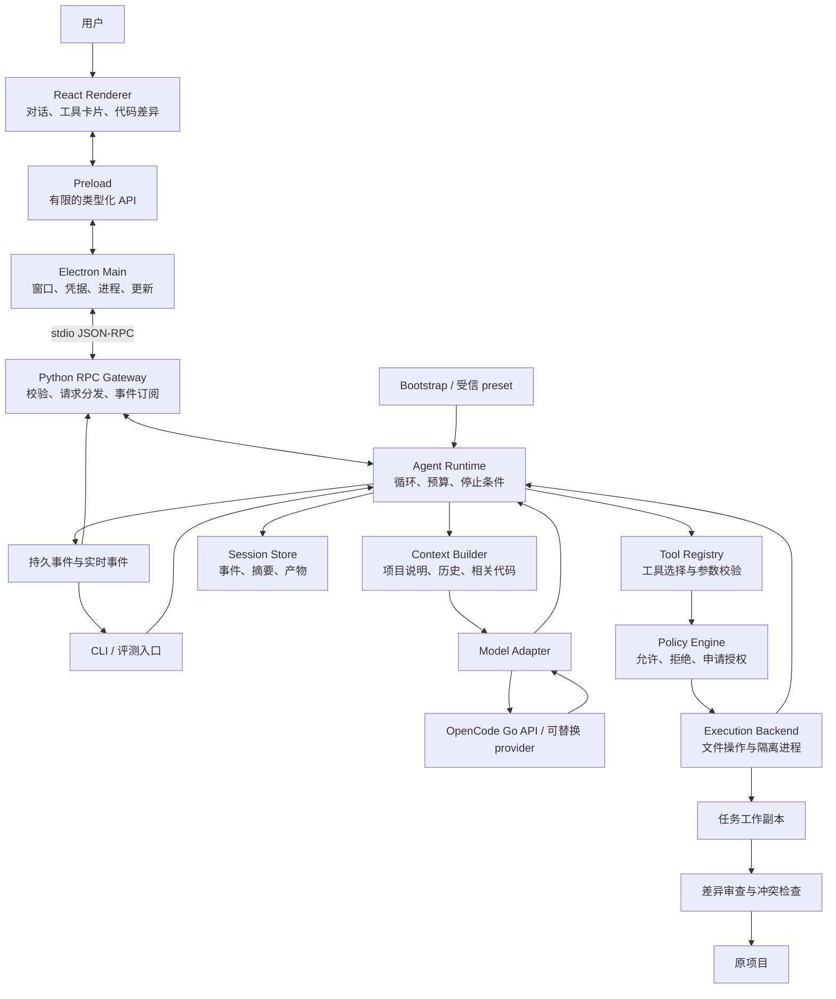

# 从零构建自己的 Coding Agent 桌面应用：调研与实施规划

> 调研日期：2026-09-14  
> 项目目录：`E:\claude_code\my-coding-agent`  
> 核心语言：Python，按你的选择制定；桌面方案经比较后推荐 Electron + React / TypeScript。  
> 最终交付：优先面向 Windows 的本地桌面应用，CLI 保留为开发调试和自动化入口。  
> 默认模型服务：OpenCode Go，读取本机已有的 `OPENCODE_API_KEY`；默认 GLM-5.3-Flash，可切换 DeepSeek V4.1 Flash。  
> 调研起点：最初目录为空，没有已有代码或项目约束；随后已初始化 Git 并将本文上传至私有仓库。
>
> 实施进度：统一记录在 [进度总览](../progress/README.md) 与各阶段进度文件中；M0 的实际状态见 [M0 进度](../progress/m0.md)。本文所列能力和里程碑是设计与验收定义，不代表已经实现。

最终产品是一款**能打开本地项目，通过对话完成小型代码修改、执行验证、审查并应用差异的单 agent 桌面应用**。实施上先用 CLI 验证 Python 核心，尽早验证桌面窗口与打包后的 Python 进程通信；随后把完整任务流程接入界面。

推荐组合为 **Python 3.13 + uv + Pydantic + asyncio 的 agent 核心，Electron + React / TypeScript 的桌面界面，以及 stdio JSON-RPC 通信**。模型默认通过 **OpenCode Go API** 调用；自己实现核心循环、工具接口、权限与会话状态，界面负责展示和用户操作，Python 负责实际任务。首个完整版本聚焦 Python 仓库，但文件工具和运行器不绑定被修改项目的语言。

架构参考的主线是：**mini-SWE-agent 的最小循环 → PI 的分层与扩展接口 → DeepSeek Harness 的组件装配、会话事件与桌面边界**。Aider、Gemini CLI、OpenCode、Codex CLI 和 goose 补充编辑、执行和产品工程设计。快速阅读可先看第 1–5 节、第 11 节的桌面流程和第 14 节的路线图；具体实施再查工具、恢复、打包和验收细节。

代码实现与工程化统一遵循根目录 [AGENTS.md](../../AGENTS.md)，其中明确模块职责、编码规则、数据与凭据边界、测试要求、Git 操作和本地进度记录约定。本文记录产品与架构设计，各阶段按对应实施细化验收。

## 1. 目标、假设与成功标准

### 1.1 第一版应该解决什么问题

用户安装应用、配置模型、选择一个本地项目后，在桌面对话框输入：

> “找到配置解析器中的边界条件问题，修复它，补上回归测试，并告诉我验证结果。”

Agent 应能完成：

1. 读取项目说明、文件列表和已有测试入口。
2. 搜索相关代码，按需读取具体文件。
3. 提出简短的修改步骤，使用工具实施修改。
4. 运行相关测试，读取退出码与失败信息，必要时继续修正。
5. 给出修改差异、验证证据和未解决项。
6. 在用户停止、预算耗尽或需要授权时，保存状态并明确退出原因。

这六步构成 agent 的能力闭环。桌面产品还必须把项目选择、模型配置、运行状态、必要授权、取消、差异应用和历史查看串起来。模型负责判断下一步，程序负责真实执行、边界检查、状态保存和结果核验；用户不需要通过开发者终端才能完成日常操作。

### 1.2 规划假设

| 项目 | 本文采用的假设 |
| --- | --- |
| 使用者 | 先服务你自己的开发流程，后续再考虑对外发布 |
| 实施分工 | 由 Codex 主要承担架构、编码、联调、测试、打包与文档；你提供产品取舍、实际体验反馈和需要使用的模型账号配置 |
| 推进方式 | 不设固定周数或硬性工期；按依赖关系和可验证的阶段成果推进，出现真实阻塞时调整范围或顺序 |
| 开发与首发平台 | 当前使用 Windows；计划先验收 Windows 11 x64，macOS / Linux 的安装包另排阶段 |
| 项目执行环境 | 首个隔离命令执行后端采用 Linux 容器，可由 Windows 上可用的 WSL2 / 容器环境提供 |
| 模型 | 默认 OpenCode Go；GLM-5.3-Flash 初始选中，DeepSeek V4.1 Flash 可切换；凭据引用本机 `OPENCODE_API_KEY` |
| 数据与状态 | 本地保存会话；模型请求按需发送相关代码片段 |
| 交付形态 | 本地桌面安装包；同一 Python 核心兼容 CLI 与 JSON 输出，无须登录自建云服务 |
| 首版并发 | 可以保存多个项目和会话，但整个应用同时只运行一个 agent 任务；暂不做多窗口并行任务 |

2026-09-14 已盘点本机环境：默认 Python 为 Anaconda 3.8.8，uv 已管理 3.12 / 3.11，尚未发现 3.13；Node.js 24.16.0、npm、uv、Git 和 ripgrep 已安装。WSL2 已有 Ubuntu 与 docker-desktop，当前均停止，Docker daemon 未连接成功。详细版本、检查上下文及 M0 处理方式见 [M0 环境盘点](m0-implementation-plan.md#21-环境盘点)。Python / Node.js 是开发机依赖，正式桌面包携带应用所需运行时；容器执行环境在 M4 验收前准备。

本次已确认 `OPENCODE_API_KEY` 在当前进程和 Windows 当前用户环境中均非空，只记录变量名和配置状态。尚未用密钥执行认证或模型调用；本机读取公开模型目录的请求未成功，网络与模型连通性留在 M0–M1 验证。环境变量存在不代表账户权限或具体模型已经验证通过。

### 1.3 调研边界

本文参考上游公开仓库、部分源码和官方文档，**没有安装运行这些 agent，也没有做同条件性能对比**。项目事实与本项目设计建议分开描述。引用的是调研时的公开页面及可变分支，未固定到 commit；正式复用源码时应记录具体版本、提交和相应许可证。

## 2. 八个参考项目，以及各自值得学习的部分

选择这些项目是为了覆盖不同设计方向，而非按热度或排行榜排名。

| 项目 | 已核实的设计特点 | 本项目吸收的思路 | 建议研究阶段 |
| --- | --- | --- | --- |
| [mini-SWE-agent][mini-repo] | Python 实现；核心类分离模型与执行环境，维护线性消息历史，并记录步数、成本和执行轨迹。[核心源码][mini-loop] | 用小而清楚的循环串起模型和工具；让每一步可检查、可复现 | 最小核心阶段，主要参考 |
| [PI / Pi Agent Harness][pi-repo] | 分离模型 API、agent core 与 coding CLI；默认向模型提供 read、write、edit、bash 四个工具，并通过扩展增加能力。[CLI 说明][pi-coding]、[运行时说明][pi-core] | 精简核心、模型无关的数据结构、事件流和扩展接口 | 核心、事件与扩展阶段，主要参考 |
| [DeepSeek Harness / DSH][dsh-repo] | 基于 Cordis 组合能力；模型、工具、会话、循环等可通过插件替换，profile 负责装配。[架构文档][dsh-architecture] | 显式组件装配、可替换服务、持久事件与实时事件分离 | 架构起步、桌面连接与恢复阶段 |
| [Aider][aider-repo] | 用 repository map 提供代码符号与依赖上下文；支持整文件、搜索替换等编辑格式。[上下文][aider-map]、[编辑格式][aider-edits] | 按需检索；让编辑协议简单、确定；后续补充代码结构摘要 | 编辑与上下文阶段 |
| [Gemini CLI][gemini-repo] | `packages/cli` 与 `packages/core` 分工；核心管理模型交互、工具编排和会话，工具通过 registry 管理。[架构说明][gemini-core]、[源码][gemini-registry] | UI、运行时、工具、配置分层；工具错误也作为反馈进入循环 | 工具与运行时集成阶段 |
| [OpenCode][opencode-repo] | TUI 与服务端分离，服务端提供 HTTP API 和事件流；当前桌面目录注明使用 Electron。[服务端设计][opencode-server]、[桌面说明][opencode-desktop] | 同一个运行时服务多种入口，桌面端消费明确的任务事件 | 桌面连接与会话阶段 |
| [Codex CLI][codex-repo] | Rust workspace 中分离 core、exec、protocol、tui、sandboxing 等模块；沙箱和审批承担不同职责。[模块清单][codex-workspace]、[权限说明][codex-sandbox] | 把权限判断、进程执行和 UI 分开；对文件与命令使用真实执行边界 | 执行与权限阶段 |
| [goose][goose-repo] | Rust 核心，桌面工程使用 Electron / React；扩展通过 MCP 接入。[桌面依赖][goose-desktop]、[扩展说明][goose-extensions] | 借鉴桌面与核心的职责划分，后续统一扩展接口 | 桌面阶段；v0.3 看扩展 |

goose 的当前仓库是 `aaif-goose/goose`；早期资料可能仍使用 `block/goose`。OpenCode 本文引用的是 `anomalyco/opencode`，避免与同名项目混淆。

PI 的历史入口是 `badlogic/pi-mono`，调研时对应的当前仓库是 `earendil-works/pi`，当前包使用 `@earendil-works/*` 命名。[PI 仓库][pi-repo] DeepSeek Harness 采用官方 `deepseek-ai/deepseek-harness`，处于开发者预览阶段，版本之间可能存在不兼容变化。[官方仓库][dsh-repo]

### 2.1 从参考项目得到的设计判断

以下是面向个人开发的取舍，不是上游项目的共同规范：

- **先把主循环写清楚。** 能解释“一次模型响应怎样变成一次工具执行，再怎样返回模型”，比一开始引入复杂编排更有学习价值。
- **工具质量直接影响修复能力。** 搜索结果要有路径和行号；编辑失败要可解释；命令结果要包含退出码和截断提示。
- **上下文需要管理。** 优先读取任务相关内容，随着任务变长再引入摘要和代码符号索引。
- **状态、权限、预算应属于程序。** 模型可以提出请求，但不能通过输出文字修改授权或宣布测试通过。
- **先保留接口，按证据增加复杂度。** MCP、LSP、多 agent、远程服务都可以在核心稳定后引入。

mini-SWE-agent 的 README 强调以 shell 为主要行动接口。[设计说明][mini-repo] 本项目为了便于在个人机器上审查读写行为，首版采用结构化文件工具，加一个受控的命令执行工具。

### 2.2 PI 与 DeepSeek Harness 怎样影响本项目

这里的 **harness** 指让模型持续工作的运行环境与控制程序：工具执行、上下文组织、状态、权限、预算和交互都属于它。你的主要开发对象就是这一层。

**PI 是学习精简运行时的重要参考。** 它把应用消息转换为模型消息的过程独立出来，运行时发出回合、消息和工具事件，扩展可以注册工具与监听生命周期。[运行时设计][pi-core]、[扩展文档][pi-extensions] 这支持本项目把业务状态、模型协议和用户界面分开，也支持先用少量工具建立可运行版本。

**DeepSeek Harness 是学习可组合架构的重要参考。** 官方架构将组件装配交给 profile/bundle，并把持久会话事实、运行中的 agent 事件、能力接口事件分开；模型历史由会话日志投影得到。[架构文档][dsh-architecture] 这支持本项目采用显式装配入口，以及可由日志重建的状态，而不让多个模块各自维护一套事实。

据此，本项目作如下取舍：

| 设计问题 | Python 首版决策 | 后续演进 |
| --- | --- | --- |
| 核心规模 | 一个循环、五个主要接口、显式传入依赖 | 有第二种实现时再提炼公共抽象 |
| 组件装配 | 在 `bootstrap.py` 创建模型、工具、策略、存储和后端 | 用受信 preset 选择不同组合 |
| 扩展 | 首版只预留上下文处理、工具前检查、工具后观察三个位置 | 稳定后注册自定义工具和命令 |
| 会话 | 持久事件为事实来源，模型消息和 UI 视图由它生成 | 再实现分支、压缩和多种存储后端 |
| 权限 | 作为不可绕过的运行时执行环节 | 扩展不能将已拒绝的请求重新变为允许 |
| 代码编排工具 | 首版使用常规结构化工具调用 | 只有任务评测显示多步调用开销明显时，再评估 code mode |

PI 官方 README 明确说明默认按启动进程的权限运行，没有内置的文件、进程、网络和凭据访问限制系统。[权限边界][pi-repo] 因此，借鉴 PI 的精简设计时，本项目仍保留第 9 节的独立权限和隔离后端。

DeepSeek Harness 已有 Python SDK，但它通过 stdio JSON-RPC 驱动所附带的 `dsh` 运行时。[Python SDK][dsh-python] 它适合作为快速集成或对照实验路线；使用该 SDK 意味着核心运行时来自 DSH。本文按“自己实现 Python harness”的目标推进，可在评测阶段单独接入 SDK 作为比较对象。

### 2.3 从现有桌面 agent 补充产品设计

CLI 调研解决“agent 怎样工作”；桌面调研还要解决“用户怎样管理一个持续运行的任务”。以下事实来自调研时的当前源码，不能用旧文章中的技术栈代替核实。

| 参考 | 已核实的桌面设计 | 本项目采用的做法 |
| --- | --- | --- |
| DeepSeek Harness | Electron 桌面壳包装 WebUI，独立启动捆绑的 Node 后端，通过管道通信；桌面、后端和插件组合按一个版本单元验证。[桌面架构][dsh-desktop] | Python 核心独立进程；启动握手；前后端成套打包；后端失败时仍能显示诊断页 |
| OpenCode | 当前 `packages/desktop` README 明确注明 Electron，桌面工程使用 Electron 构建工具。[桌面说明][opencode-desktop]、[包配置][opencode-desktop-package] | 学习桌面入口与已有核心衔接，UI 通过接口订阅会话状态 |
| goose | `ui/desktop/package.json` 包含 Electron、React 和桌面打包、测试依赖。[源码][goose-desktop] | 借鉴 Web UI 的工程组织、设置页、扩展入口与安装包流程 |
| PI | 重点参考 agent core、模型消息转换和扩展事件，与选用哪一种桌面壳无关。[运行时][pi-core] | 让核心保持可独立测试；CLI 与桌面共用同一套工具和状态语义 |

DSH 对本项目尤其有价值：它展示了桌面壳与 harness 可以独立演进，又通过版本和接口约束一起交付。本项目吸收这些边界；具体采用较简单的 JSONL 消息帧与 Python 模块装配，无须一开始复制它完整的插件图和通信实现。

## 3. 版本范围

| 版本 | 能力与交付物 | 验收重点 |
| --- | --- | --- |
| v0.0：核心原型 | CLI 只读闭环、OpenCode Go 双模型最小调用、事件与预算；另做桌面窗口、RPC 和 Python 打包实验 | 真实文件回答可追溯；两个模型的工具回合可验证；安装目录中的后端可与窗口通信 |
| v0.1：桌面 MVP | 项目选择、模型设置、聊天、工具卡片、授权、取消、编辑与隔离测试、差异审查与应用、历史查看、Windows 安装包 | 从桌面完整完成一次小型 bug 修复；不需要开发者终端；状态与失败原因明确 |
| v0.2：个人日常使用 | 保守恢复任务、上下文压缩、双模型兼容性完善、长日志与大差异优化、安装升级和诊断完善 | 中断后能继续或明确说明待处理状态；两个模型的状态语义一致；升级不破坏会话 |
| v0.3：按需求扩展 | MCP、代码符号索引、LSP、外部 IDE 接入、worktree、其他桌面平台 | 每项增强有实际使用需求和独立验收 |

首版以“小规模、有明确验收条件的修改”为目标，例如：修复边界条件、补充参数校验、增加一个 CLI 参数、调整配置读取、补回归测试。

v0.1 支持查看代码与 diff、在外部编辑器打开文件；内置完整代码编辑器、交互式终端、调试器、大型仓库全面重构、长期无人值守、多 agent 并行写入、浏览器自动操作和云端多租户，放入后续独立阶段。核心闭环通过只是中间检查点，桌面流程和安装验收一起通过后才算交付 v0.1。

## 4. 技术选型：Python 核心与桌面界面

### 4.1 三种桌面路线的比较与推荐

以下取舍是根据个人开发、Python 核心和 coding agent 界面需求作出的判断，尚未进行本项目的体积、内存或性能实测。

| 路线 | 适合本项目的地方 | 需要承担的成本 | 结论 |
| --- | --- | --- | --- |
| **Electron + React / TypeScript + Python 子进程** | 聊天、流式工具卡片、Markdown、代码与差异视图可以统一使用 Web 组件；Electron 主进程负责系统集成。[进程模型][electron-process] | 引入 TypeScript / React，维护前端和 Python 两套依赖；捆绑浏览器运行时，安装包和内存必须测量 | **首选**：先做出完整交互，核心保持 Python |
| Tauri 2 + Web UI + Python sidecar | Web UI 可复用；使用系统 WebView，Python 可打包为外部可执行文件。[进程模型][tauri-process]、[sidecar][tauri-sidecar] | 同时涉及 Python、TypeScript、Rust 和跨平台 WebView；sidecar 按目标平台打包；Windows 需处理 WebView2 部署。[安装文档][tauri-windows] | 若后续确认壳体资源占用是主要瓶颈，且愿意维护 Rust，再评估迁移 |
| PySide6 / Qt + Python | 核心与 UI 都能主要用 Python；适合偏原生控件的工具；官方提供基于 Nuitka 的部署工具。[部署文档][pyside-deploy] | 本项目的富文本、流式聊天、代码差异与网页组件整合需额外实现；采用 WebEngine 后仍需处理 Web 层 | 若“尽量只写 Python”成为首要要求，可改选；当前需求下优先 Web UI |

推荐 Electron 的主要依据是交互实现与维护路径，而非上游项目数量。Tauri 的系统 WebView 可以减少捆绑浏览器的负担，但 Python 运行时、模型 SDK 和 UI 资源仍需分发，不能直接推断整包必然有多小。在早期桌面连接阶段用最薄原型记录实际体积、启动和内存，再确认资源成本可接受。

**首版固定 Electron 路线，不同时维护三种桌面壳。** Python 与界面的协议边界保留下来，今后即使换壳也主要调整系统集成和打包部分。

### 4.2 具体工程组合

| 层次 | 首版选择 | 原因及边界 |
| --- | --- | --- |
| Python 版本 | 以常规 CPython 3.13.x 为开发基线 | 固定经验证的补丁版本并记录在 `.python-version`；M0 先验证依赖，M2 尽早验证打包；关键兼容阻塞时再评估 3.12。[版本状态][python-versions]、[兼容性方案](m0-implementation-plan.md#22-python-313-是否足够稳定) |
| 项目与依赖 | uv、`pyproject.toml`、`uv.lock` | 依赖声明和锁定结果一起进入版本管理；使用可重复的开发环境。[uv 文档][uv-projects] |
| 桌面宿主 | Electron，主进程与 preload 使用 TypeScript | 管理窗口、文件选择、凭据、后端进程和更新；不实现 agent 决策 |
| 界面 | React + TypeScript + Vite；M0 使用 electron-vite 组织三个入口 | 一个桌面包与锁文件；先用简单状态管理，持久任务状态来自后端 |
| 代码展示 | Monaco 的只读代码 / diff 视图，长日志分页或虚拟化 | Monaco 提供浏览器编辑器能力；需正确管理 model 和 worker 生命周期。[官方仓库][monaco-repo] |
| 本地通信 | Electron IPC + stdio JSON-RPC 2.0 | preload 暴露有限方法；主进程与 Python 通过管道交互，首版不启动 HTTP 服务。[Electron IPC][electron-ipc] |
| CLI | Typer，普通终端输出 + JSON 模式 | 用于核心开发、评测和脚本，不另外建设完整 TUI。[Typer][typer-docs] |
| 数据校验 | Pydantic | 定义配置、工具输入输出和事件 schema；开启严格校验，拒绝未知字段。[Pydantic][pydantic-docs] |
| 模型调用 | OpenCode Go + Python `openai` SDK 的兼容接口 + 自己的薄适配层 | 首条路径使用 Chat Completions；显式设置 Go 的 base URL、密钥与会话请求头，其他协议按模型能力逐步加入。[Go 接入][opencode-go]、[Python SDK][openai-python] |
| Agent 编排 | 自己实现异步循环 | 便于理解停止条件、工具调度和错误处理；暂时无须引入通用 agent 编排框架 |
| 组件装配与扩展 | `typing.Protocol`、显式依赖注入、少量受信回调 | 吸收 PI 和 DSH 的职责边界；v0.1 用普通 Python 对象装配，动态插件加载留到后续 |
| 文件与搜索 | `pathlib`、标准库、ripgrep 子进程 | 开发环境检查 `rg`；发布时随包携带固定版本并记录许可证，使用受信绝对路径 |
| 命令执行 | `asyncio.create_subprocess_exec` + 执行后端抽象 | 默认传程序和参数数组，区分显式 shell 模式；负责超时、输出和取消。[Python 文档][python-subprocess] |
| 持久化 | JSONL 事件 + JSON 会话快照 + 文件产物 | 易检查和调试；有多会话查询、索引或并发需求后再评估 SQLite |
| 测试 | pytest；异步集成测试按需要加入 pytest-asyncio | 工具测试使用临时目录，模型侧使用固定响应，集成评测才调用真实 API。[临时目录][pytest-tmp] |
| 代码质量 | Ruff + mypy；前端使用 TypeScript 检查 | 校验重点是工具协议、状态迁移和异常路径 |
| 后端与整包构建 | PyInstaller `onedir` + electron-builder / Windows NSIS | 先分别验证 Python 可执行文件和 UI，再组合为一个可安装产品；详见第 12 节 |
| 本地凭据 | 默认读取 `OPENCODE_API_KEY`；手动保存才使用 `safeStorage` | 环境变量中的密钥不自动复制落盘；UI 只显示来源和配置状态，详见第 9.5 节。[加密存储 API][electron-storage] |

需要区分四件事：**agent 核心是 Python；桌面 UI 使用 TypeScript；被修改项目可以使用其他语言；模型服务可以替换。** 例如未来在 Node 项目中执行 `npm test`，需要准备对应执行镜像和项目配置，不需要重写桌面壳。

开发机固定一套兼容的 Node.js、Electron、构建工具版本，并提交 `package-lock.json`；Python 使用 `uv.lock`。以所选 Electron / Vite 版本声明的要求为准，升级通过构建与集成验收后再进入日常分支。版本锁定比在规划中写一个很快过期的“最新版本”更有用。

首版先把 OpenCode Go 下选定的两个模型跑通；它们共享同一 provider 和 Chat Completions 路径。其他 provider 或协议有实际需求后再扩展。兼容某种 HTTP 请求格式，不代表工具流、取消、用量统计和上下文延续语义完全一致。

### 4.3 默认模型接入：OpenCode Go

这里采用的接入方式是 **Python ModelAdapter 直接请求 OpenCode Go 的模型 API**。桌面和 CLI 仍使用本项目自己的运行时；OpenCode 的源码继续作为架构参考。Go 官方支持其他 coding agent 接入，并要求客户端使用自己的 User-Agent 和稳定的会话标识。[官方接入说明][opencode-go]

| 配置项 | 本项目约定 |
| --- | --- |
| 默认 provider | `opencode-go` |
| API base URL | `https://opencode.ai/zen/go/v1`；SDK 在此基础上拼接对应接口路径 |
| 凭据来源 | 已有环境变量 `OPENCODE_API_KEY`，不是假定本机存在另一个变量名；仅保存变量引用 |
| 默认模型与协议 | `glm-5.3-flash`，Chat Completions |
| 可切换模型 | `deepseek-v4.1-flash`，同样使用 Chat Completions |
| 模型目录 | `https://opencode.ai/zen/go/v1/models`；缓存并标记更新时间，目录可读与账户可调用分别验证 |
| 客户端标识 | `User-Agent: my-coding-agent/<app-version>`，使用自己的名称和真实版本 |
| 会话标识 | 每次模型请求携带 `x-opencode-session: <session_id>`；同一会话的后续回合、重试和上下文整理保持一致 |
| 配置优先级 | 用户明确选择的凭据来源优先；默认环境变量模式，缺失时显示配置入口，不自动换用其他 provider 的密钥 |

两个日常模型按以下名称与 API ID 固定映射；官方 Go 表将二者均列在 `/chat/completions` 路径。[模型与接口][opencode-go-endpoints]

| 界面名称 | API `model` 值 | 默认行为 |
| --- | --- | --- |
| GLM-5.3-Flash | `glm-5.3-flash` | 首次启动选中 |
| DeepSeek V4.1 Flash | `deepseek-v4.1-flash` | 用户可切换并保存为个人默认 |

首版模型选择器只显示这两项。刷新服务目录用于确认可用性与元数据，不自动加入其他模型。API 直接使用上表 ID；只有在 OpenCode 自身配置中才使用 `opencode-go/<model-id>` 形式。[模型命名][opencode-go-endpoints] 模型切换在完整回合结束或任务停止后生效，并记录新的模型 ID；认证失败、限流或额度不足时不静默切换模型。

本项目的受信配置示例，字段属于待实现的配置 schema：

```toml
[model]
provider = "opencode-go"
base_url = "https://opencode.ai/zen/go/v1"
api = "chat_completions"
model_id = "glm-5.3-flash"
allowed_models = ["glm-5.3-flash", "deepseek-v4.1-flash"]
api_key_env = "OPENCODE_API_KEY"
```

`session_id` 在创建会话时生成并持久化，由运行时注入请求头；不使用项目路径、密钥片段或每次都变化的 RPC ID。所有主调用和辅助模型调用共用这一请求构建路径，避免某条路径遗漏标识。不得把默认 Go 端点悄悄改为 `/zen/v1` 的按量入口，也不伪装成其他客户端。

Python 端使用 `AsyncOpenAI` 显式传入解析后的密钥和 `base_url`，按请求传入会话头；SDK 支持自定义地址、额外请求头和重试设置。[SDK 文档][openai-python] 计划关闭 SDK 隐式重试，由第 10 节的预算与退避统一管理。SDK 名称不决定服务商，实际请求仍发往配置的 OpenCode Go 地址。

## 5. 总体架构



桌面应用采用 **渲染进程、Electron 主进程、独立 Python 后端** 的职责划分；项目命令再进入隔离执行环境。Electron 自身还可能创建 GPU 等辅助进程，图中只画业务边界。模型调用在 Python 后端中进行，密钥不传给项目子进程。Electron 的进程模型和 preload 用于组织桌面 UI 与系统能力。[官方说明][electron-process]

v0.1 一个应用实例启动一个 Python 后端，由后端限制全局只有一个活动 run；切换会话只是切换视图。CLI 和桌面 RPC 都装配同一套 Python Runtime，不复制两套循环。CLI 独立运行时应使用独立数据目录，或在桌面占用同一目录时明确拒绝启动第二个写者。

`bootstrap.py` 是创建并连接核心组件的入口。借鉴 PI 的包分层和 DSH 的组合思路，运行时只依赖协议，不直接创建具体 provider、不导入 CLI、RPC 或桌面模块，也不在工具代码中读取全局会话变量。所有 agent 逻辑保留在一个 Python 包中；Electron 主进程只承担桌面宿主职责。

推荐的数据流是：**原项目当前内容 → 任务工作副本 → 修改并验证 → 展示相对任务起点的差异 → 用户确认应用或使用预先授权的应用模式。** 这样便于保留用户已有修改，也方便观察 agent 到底改了什么。

### 5.1 建议目录

以下是待创建的目录结构：

```text
my-coding-agent/
├── pyproject.toml
├── uv.lock
├── .python-version
├── README.md
├── apps/desktop/
│   ├── package.json
│   ├── package-lock.json
│   ├── src/main/              # 窗口、后端进程、凭据、系统集成
│   ├── src/preload/           # 有限 API 的 contextBridge
│   ├── src/renderer/          # React 页面、组件、事件视图
│   └── src/generated/         # 从协议 schema 生成的 TypeScript 类型
├── src/my_agent/
│   ├── cli.py                  # 参数、交互、退出码
│   ├── bootstrap.py            # 显式装配模型、工具、策略与后端
│   ├── config.py               # 配置加载与信任来源
│   ├── storage.py              # 数据根、元数据、原子写入与进程锁
│   ├── projects.py             # 项目身份、路径检查与最近项目
│   ├── rpc/                    # stdio 服务、DTO、方法、订阅
│   ├── runtime/
│   │   ├── loop.py             # 核心循环
│   │   ├── state.py            # 状态迁移
│   │   ├── events.py           # 稳定的事件类型
│   │   └── budget.py           # 步数、时间、token、成本
│   ├── models/
│   │   ├── base.py             # Provider 协议和能力声明
│   │   ├── opencode_go.py      # 默认 Go 适配器，先实现 Chat Completions
│   │   └── fake.py             # 固定响应，供本地测试
│   ├── tools/                 # 注册表、文件工具、搜索、执行
│   ├── context/               # 项目说明、检索、压缩
│   ├── policy/                # 授权判断，独立于模型
│   ├── execution/             # 容器后端；后续本地后端
│   ├── workspace/             # 工作副本、基线、差异、应用
│   └── sessions/              # JSONL、快照、恢复
├── tests/                     # 按 Python、桌面、契约、网关、启动分组
│   ├── fixtures/              # 共用测试样本
│   └── evals/                 # 后续按需加入评测器；报告放 .artifacts/tests/
├── examples/                  # 可复现的小型演示仓库
├── schemas/                   # 导出的 JSON Schema 与协议版本
├── packaging/                 # PyInstaller spec、安装包配置、资源清单
└── scripts/                   # 类型生成、分平台构建与统一检查入口
```

应用数据默认保存到用户指定的 `E:\MyCodingAgentData`，该空目录已创建。桌面与 CLI 按“`--data-dir` → `MY_AGENT_DATA_DIR` → E 盘默认目录”选择数据根；桌面将解析后的路径显式传给 Python。开发入口使用其下独立的 `dev` 数据根，测试使用临时目录。配置、项目记录、会话、日志及 Electron 状态与缓存均归入所选数据根；E 盘不可用时明确报错，不回退 C 盘。具体布局与写入归属见 [M0 存储方案](m0-implementation-plan.md#54-agent-数据默认保存到-e-盘)。

项目目录由用户通过系统目录选择器打开，普通文件夹和 Git 仓库都可登记。M0 即实现项目验证、稳定标识、最近项目与重启恢复；选择动作不修改项目代码，也不在项目里创建 agent 数据目录。项目与应用数据根不能重叠，切换项目保留其他项目记录；后续任务绑定启动时的项目身份。项目工具只能访问被授权的任务目录，会话和数据根不能由模型指定。

### 5.2 界面与 Python 怎样通信

首版采用 **主进程启动 Python 可执行文件，stdin 发送请求，stdout 返回响应与事件，stderr 输出诊断日志**。JSON-RPC 2.0 定义请求、响应与通知格式；本项目另约定 UTF-8、每行一个完整 JSON 的帧格式、方法名和业务错误码。[协议规范][jsonrpc-spec]

界面通过 `contextBridge` 调用有限的桌面 API，主进程校验后再转为 Python 请求；不把通用 `ipcRenderer` 或任意 RPC 转发函数暴露给网页。Electron 官方 IPC 文档展示了 preload、`invoke` 与主进程 handler 的分工。[参考][electron-ipc]

| 契约 | v0.1 约定 |
| --- | --- |
| 启动握手 | `initialize` 交换 `protocol_version`、应用/后端版本、数据 schema 版本与能力列表；不兼容时显示修复提示，禁止启动任务 |
| 身份 | `session_id` 是持久会话，`run_id` 是一次运行；RPC `id` 只配对请求响应，`tool_call_id` 只标识一次工具调用，不能混用 |
| 请求方法 | `projects.open/list`、`sessions.create/list/get/attach`、`runs.start/cancel`、`approvals.respond`、`inputs.respond`、`diffs.get/apply`、`diagnostics.get`、`shutdown`；模型配置通过受信设置入口管理 |
| 长任务 | `runs.start` 持久接纳后立即返回 `run_id`，后续通过通知推送进展；模型流与命令执行不能阻塞取消、授权答复和事件读取 |
| 事件 | 事件至少带 `session_id`、`run_id`、`type`；持久事件带单调递增 `seq`；文本增量另带 `message_id` 和增量序号，不作为持久事实 |
| 重复提交 | 启动、应用、授权答复携带 `client_request_id`；后端保存请求摘要和处理结果，同一标识不同参数直接拒绝，同一请求返回原状态 |
| 业务错误 | JSON-RPC 的 `error.code` 保持整数；`error.data` 保存业务码、重试提示和关联 ID，例如 `STALE_FILE`、`RUN_BUSY`；主进程将断管转换为 `RUNTIME_UNAVAILABLE`，不把 Python 堆栈直接当用户文案 |
| 数据形态 | Pydantic 定义 DTO 并导出 JSON Schema，生成 TypeScript 类型；两端仍执行运行时校验，CI 检查生成结果是否过期 |

刷新界面时调用 `sessions.attach(last_seq)`。后端先建立有序订阅，再交付指定序号后的记录或带水位的快照，随后发送新事件；客户端按序号去重并在发现缺口时重新同步。这样避免“先查历史、再订阅”之间丢事件。后端重启还需要新的 `process_epoch`，清除旧进程的未完成请求；事件重放只重建显示，不能重新触发工具。

尚未落盘的文本增量只是临时展示。刷新时可显示“正在生成”并等待完整模型消息，提交后以完整内容替换临时文本；不能把缺少部分实时增量判断成持久事件损坏。

消息按字节累积到换行后解析，不能假定一次 pipe 读取就是一条 JSON，也不能在 UTF-8 字符的中间解码。初始单帧上限可设 1 MiB，大 diff 和日志按页读取或返回产物 ID；限制队列、合并文本增量，避免输出洪泛占满内存。stdout / stderr 持续并行消费；持久状态和取消消息优先于可合并的进度更新。

这是本项目的精简协议，不要求与 DSH、PI 或 OpenCode 的协议兼容。DSH 的桌面管道通信可作为边界参考，具体传输实现不同。[DSH 桌面说明][dsh-desktop] 后续若出现远程连接需求，再单独增加有鉴权与版本协商的网络传输。

为使 M0 的项目选择、设置与记录恢复使用同一套 Python 服务，`initialize`、`projects.open/list`、`config.get/update`、`diagnostics.get`、`shutdown` 的最小 stdio 连接提前到 M0，包含开发环境中的启动、超时与退出清理。M0 桌面接入模型保存、诊断、JSON 导出与下次启动目录设置，详见 [M0 桌面方案](m0-implementation-plan.md#81-设置与诊断页面)。测试与回归源码集中在根目录 `tests/`，本地与 CI 共用 `scripts/check.py`，产物归入 `.artifacts/tests/`。M2 在此基础上增加任务事件、假任务及打包后的运行验证。

### 5.3 后端生命周期属于桌面宿主

主进程使用固定安装路径下的 Python 可执行文件，传参数数组并连接管道；开发模式才使用 uv 启动入口。Windows 使用隐藏子进程窗口选项，同时保留标准输入输出。Electron 的 `utilityProcess` 面向 Node.js 子进程；本方案启动 Python 应使用 Node 的 `child_process.spawn`。[Node 文档][node-spawn]、[utilityProcess][electron-utility]

启动顺序为：单实例检查 → 显示可独立工作的窗口与启动页 → 启动后端 → 握手与诊断 → 载入会话 → 可开始任务。启动设超时，失败时允许查看脱敏日志和重启后端；不能无限展示加载动画。

关闭窗口时，若仍有运行或等待中的任务，提供“停止任务并退出”和“返回应用”。停止需等待命令后端清理并写入终态；超时则记录中断状态并清理已登记的子进程/容器。v0.1 不依赖关闭窗口后静默保活的托盘守护进程。

Python 崩溃时，UI 立即进入后端不可用状态并保留已展示结果；重启后先核对日志、工作副本和已登记执行资源，再由用户决定是否继续。主进程不自动重发旧的写入请求。渲染器刷新或切换项目不终止后台任务，也不创建第二个后端。

## 6. 核心循环与接口

### 6.1 用五个接口隔开主要职责

| 接口 | 输入 | 输出 / 职责 |
| --- | --- | --- |
| `ModelAdapter` | 历史、上下文、工具 schema、输出预算 | 规范化的模型回合、工具调用、用量；保留 provider 所需的原生上下文信息 |
| `Tool` | 已校验参数、执行上下文、取消信号 | 结构化结果、错误码、产物引用 |
| `PolicyEngine` | 工具、参数、授权状态、真实执行目标 | `allow`、`deny` 或 `ask`，附原因和授权范围 |
| `ExecutionBackend` | 工作副本、程序、参数、cwd、环境、限制 | 执行结果；管理隔离环境及子进程生命周期 |
| `SessionStore` | 有序事件、状态、文件产物 | 追加记录、保存检查点、恢复任务视图 |

运行时管理这五个接口，CLI 与桌面只展示事件和传入用户操作，RPC 只做协议适配。文件工具、搜索和执行工具都经过 policy 层，不保留绕过检查的快捷通道。

以上是完整产品的职责划分。M1 只装配模型、只读工具策略和会话存储；不为尚未进入的项目命令阶段创建空的执行后端框架。当前阶段的具体范围见 [M1 实施细化](m1-implementation-plan.md)。

### 6.2 执行流程示意

下面是控制流程伪代码，用于说明职责，不能直接作为可运行实现：

```text
load trusted configuration; load or create the session
create a run with its task baseline; append run_started

while run is active:
    check cancellation, deadline and remaining budget
    build context; compact completed history if necessary
    request one model turn
    assemble and validate the complete response
    persist the model turn and account for usage

    if the model proposes completion:
        check required validation evidence
        finish, or return missing evidence within remaining budget
        continue

    for each tool call in order:
        check cancellation and budget again
        validate arguments and resolve real targets
        evaluate policy; request approval only when needed
        persist intent and authorization before execution
        execute, or produce a structured denied result
        persist a terminal tool result, including errors
        append the result to model history

persist run_finished, diff and validation report
```

v0.1 工具顺序执行，先把依赖和错误路径做对。后续只对确认独立的只读操作开放并发；同一工作副本中的写入与命令执行继续串行。

### 6.3 运行、等待与终止状态

运行中的 `running`、等待中的 `needs_input` / `awaiting_approval`、清理中的 `stopping` 与终态 `completed` / `budget_exceeded` / `cancelled` / `failed` 必须区分。异常退出后还有待核对的 `interrupted` 状态。等待用户是可继续状态，不能在 UI 上显示成“任务已完成”；每次状态变更由后端发布。

- 模型说“完成了”只代表提出完成请求。需要验证的代码任务，要有本次任务的命令结果和变更记录作为证据。
- 没有可执行验证时，可以交付未验证结果，必须列明未验证项，不能写成“测试通过”。
- 无进展判断应结合工具结果与任务进展，阈值通过配置和实际使用调整。M1 先用请求 / 工具 / 时间预算保证有界，可提示重复调用；不把“相同调用出现 3 次”写成不可调整的全局停机条件。完整修复阶段再按失败证据细化暂停策略。
- 授权被拒绝时向模型返回具体原因；不能靠改写命令绕过同一项拒绝。
- 超时、用户取消、费用不足都应停止新调用，完成已启动操作的清理并保存状态。

### 6.4 模型适配的关键细节

首个真实 provider 是 OpenCode Go，先验证 Chat Completions 路径下的结构化工具调用、文本流式输出、超时/取消、用量统计，以及客户端/会话请求头。工具名、参数和 call ID 必须完整校验，部分流式 JSON 不能触发执行。

Chat Completions 路径按 `tool_calls[].id` 与工具结果的 `tool_call_id` 配对，保留完整 assistant 工具调用消息。按目标模型协议保留需要回传的额外字段，流式组装也要覆盖它们。后续若接入 Responses 路径，工具结果使用其 `call_id` 和对应输出项规则，不能混用两套格式。[工具调用流程][openai-functions] 兼容层需要真实工具回合验证，普通文本能返回只证明连接的一部分。

内部可定义统一的 `ModelTurn`，同时保留仅供适配器使用的原生 continuation 数据。切换 provider 应在回合结束后重新建立兼容的历史，不能把上一个 provider 的内部状态直接交给另一个。

参照 PI 的消息转换边界，区分 `SessionEvent`、内部任务上下文和 provider 请求三种数据结构。[参考][pi-core] UI 通知、审批记录、费用事件可以进入会话，但只有筛选和转换后的内容进入模型请求；实际发送的上下文记录来源及版本，便于排查模型为什么作出某次操作。

### 6.5 扩展位置与执行顺序

首版只保留少量明确的位置：构建模型上下文、工具执行前的受信检查、工具结束后的观察记录。PI 的扩展机制和 DSH 的工具流水线都适合作为接口设计参考。[PI 扩展][pi-extensions]、[DSH 工具流水线][dsh-tools]

本项目规定：参数变换完成后重新校验、授权，再执行；观察型回调不能改写原始退出码或把失败变成成功。权限判断、预算检查、关键日志写入和取消处理属于必经环节，不受普通扩展启停影响。

动态 Python 插件与宿主程序拥有相同执行权限，注册表本身不提供代码隔离。v0.1 仅装配随程序发布的组件；以后加载用户指定的扩展时，单独确认来源和能力范围。

## 7. 工具系统：先实现七个工作工具

| 工具 | 主要参数 | 必需的行为 |
| --- | --- | --- |
| `list_files` | 相对路径、glob、limit | 遵守忽略规则；限制深度和条目数；返回是否截断 |
| `read_file` | 路径、起始行、行数 | 返回内容、行号、文件版本/hash、编码和换行信息；拒绝二进制大文件 |
| `search` | query、glob、limit | 用 ripgrep 查找；返回文件、行号、匹配片段；明确区分无匹配与执行错误 |
| `edit_file` | 路径、旧文本、新文本、预期文件 hash | 精确匹配且唯一时替换；内容过期或多处匹配时拒绝写入 |
| `create_file` | 路径、内容 | 只创建不存在的文件；受大小限制和路径策略约束 |
| `run_command` | program、args、cwd、timeout | 通过执行后端启动进程；返回 stdout、stderr、退出码、耗时和终止原因 |
| `inspect_changes` | 可选路径过滤 | 展示相对任务起点的修改，包含新文件；无需仓库已经存在 Git commit |

再提供两个控制能力：`ask_user` 用于必要澄清；`finish` 用于提交最终说明与验证引用。它们可以实现为工具，但需要进入明确的状态迁移，不承担任意文件或进程操作。

每个工具结果使用统一封装，例如：

```json
{
  "call_id": "tool_007",
  "tool": "edit_file",
  "status": "error",
  "code": "STALE_FILE",
  "message": "文件已发生变化，请重新读取后生成修改。",
  "data": {"path": "src/config.py"},
  "retryable": true,
  "truncated": false,
  "artifact_id": null
}
```

`retryable` 表示允许制定新的恢复动作，不表示程序应立即重跑同一请求。

### 7.1 编辑协议

首版采用结构化的精确搜索替换。Aider 的编辑格式文档可以用来理解局部替换与整文件生成的取舍。[参考][aider-edits]

建议约束：

1. 先读取，编辑时提交读取所得的文件 hash。
2. 旧文本必须唯一匹配；零匹配或多匹配时给出可操作错误，不做模糊猜测。
3. 同一文件的多项修改先全部预校验，再生成新内容，使用同目录临时文件和替换操作落盘。
4. 保留原有编码约定、LF/CRLF 和文件权限；首版对无法可靠处理的编码明确拒绝。
5. 多文件写入使用操作日志记录进度；不要宣称跨文件具备数据库式原子事务。
6. 原项目应用变更前再次检查 hash；用户在运行期间改过的文件进入冲突处理。

文件 hash 能检测多数并发修改，但不能单独解决恶意进程导致的检查与使用时差。首版通过私有工作副本和单写者运行模式缩小并发范围；遇到不确定状态时停止应用。

### 7.2 命令执行

优先使用 `asyncio.create_subprocess_exec(program, *args, ...)`。需要管道、重定向时，以显式 shell 调用表达，完整脚本进入审查，并使用相同隔离与权限策略。

Python 的异步子进程接口需要在外层设置超时；只等待进程退出而不读取管道可能堵塞。固定小输出可用 `communicate()`，长输出实现同时消费 stdout/stderr 的读取任务，并限制内存和产物大小。[Python 子进程文档][python-subprocess]

建议初始限制：普通命令 120 秒，显式允许的较长测试最多 600 秒；模型可见输出最多约 4,000 tokens，其余保存在有大小上限的产物中。前后片段和截断提示同时返回，错误退出码不能被截断丢失。

取消任务必须终止执行环境中的整个任务进程组或容器，并验证子进程已退出。只取消 Python 协程或杀掉最外层 shell 都不够。首版不支持需要交互输入的命令和长期后台服务。

`args` 数组可以减少 shell 字符串拼接问题，但 `python`、测试脚本、包管理器仍能执行任意项目代码，因此仍然需要隔离。`cwd` 也只是工作目录，不是文件访问边界。

## 8. 上下文与项目理解

### 8.1 上下文来源

| 内容 | 使用策略 |
| --- | --- |
| 产品规则、用户当前目标与约束 | 每轮稳定保留；不能被历史摘要挤掉 |
| 已信任的项目说明 | 读取项目根目录及相关子目录中的 `AGENTS.md` 等约定，记录路径和作用范围 |
| 项目结构 | 初始化只读取有限文件列表、README、依赖声明与测试入口 |
| 代码片段 | 用户指定文件优先，其次搜索命中和被引用文件，按需读取 |
| 工具结果 | 保留最近相关结果；大日志用截断片段和可回读的产物引用 |
| 任务历史 | 保留近期完整回合，较早完成的回合压缩为结构化摘要 |

首版使用文件名、关键词和错误信息检索。出现“经常找不到跨文件定义”的评测证据后，再借鉴 Aider 的 repository map 添加符号摘要；有明确语义导航需求时再接 LSP。[Aider 代码上下文设计][aider-map]

默认排除 `.git`、`.venv`、`node_modules`、构建产物、缓存、二进制文件和密钥文件。`.gitignore` 只描述版本管理习惯，不能代替独立的敏感文件策略。

### 8.2 压缩策略

设模型上下文上限为 `C`，预留输出为 `O`，安全余量为 `H`，则输入预算为 `B = C - O - H`。输入估算需要包括系统规则、工具 schema、provider 额外项、历史和代码，而不只是用户文本。

预计下一轮输入超过 `0.8 × B` 时触发整理，这个阈值是本项目的初始参数，不是模型规范。优先移除重复输出，再摘要已完成回合；最后重新计数，仍超限则缩减代码片段或停止请求。

摘要至少记录：目标、约束、完成项、相关文件与版本、当前失败、已执行验证、下一步。文件内容和测试结果引用原始产物，关键判断需要时重新读取。摘要视为可能有损，不能升级为新的用户授权。

压缩只发生在完整工具回合之间，保留调用与结果的配对关系。在 v0.2 的长任务阶段先做普通文本与工具历史压缩；provider 的原生 continuation 和特殊输出项由适配器单独处理。桌面只显示“正在整理上下文”和结果摘要，不把压缩过程伪装成新的用户指令。

## 9. 权限、工作副本和执行环境

### 9.1 将三种机制分开

| 机制 | 解决的问题 | 不应承担的职责 |
| --- | --- | --- |
| 权限策略 | 某次动作是否在用户授权范围内 | 不能靠字符串规则保证任意程序不会越界 |
| OS / 容器隔离 | 进程实际能读写什么、是否能联网 | 不能替用户判断一次产品动作是否符合意图 |
| 差异审查与文件基线 | 改了什么、怎样应用、是否与用户改动冲突 | 不能隔离进程，也不能撤销外部 API 的副作用 |

Codex 的公开文档也将 sandbox 与 approval 区分为执行边界和授权控制。[参考][codex-sandbox] 本项目采用同样的职责划分，具体实现从一个平台开始。

### 9.2 v0.1 的默认运行方式

1. 宿主程序读取原项目的允许文件，记录任务起点内容、hash 和已有 Git 状态，建立工作副本；包含允许的未提交修改与未跟踪文件。
2. 工作副本排除 `.git` 元数据、密钥、私有环境文件和宿主虚拟环境。扫描并拒绝越界符号链接；Windows junction 等也需要处理。
3. 内置文件工具仅操作这个副本；命令在容器中操作同一副本，避免“读到 A，执行却改 B”。
4. 容器使用非特权用户、资源限制，只挂载任务需要的路径；不挂载宿主 HOME、SSH 目录或 Docker socket，默认关闭网络。
5. 模型 SDK 在宿主调用 API；传给项目命令的环境变量使用白名单，剔除模型和云服务密钥。
6. 使用预先准备的依赖镜像或经用户授权的安装步骤。任务执行默认不能为了通过测试而自行打开网络。
7. 结束后先审查差异，再将授权修改应用到原项目。应用前若原文件改变，保留结果并报告冲突。

工作副本清理和权限策略不能保证扫描出所有秘密。因此默认只纳入允许文件；项目确实依赖敏感配置时，使用明确授权的测试配置或临时凭据。

Git worktree 可作为以后准备工作目录的方式，但它不隔离进程，而且从某个 commit 创建的 worktree 不会自动包含当前未提交内容。首版基线以**任务开始时实际文件内容**为准。

### 9.3 授权交互

首次建立项目任务时，在桌面展示根目录、执行后端、网络策略和变更应用方式。授权后，范围内的读取、工作副本编辑和隔离测试自动继续；跨界时才单独申请授权。CLI 与桌面读取同一种授权对象，不能因切换入口改变执行权限。

授权请求展示具体动作、目标、原因和范围，默认提供“允许此次”和“拒绝”；只有确实可定义边界的操作才提供本次任务内授权。授权绑定规范化参数、文件基线、工作目录和策略版本；目标变化后重新评估。响应携带审批 ID，重复点击和过期答复不会再次执行。拒绝时记录工具终态结果；非交互批处理遇到待审批动作，以 `awaiting_approval` 和对应退出码返回。

仓库内容、命令输出、MCP 工具描述都视为外部输入。项目配置只能调整明确开放的字段，例如测试命令和风格；不能自动更改 API 目标地址、读取凭据、放宽网络权限或启动插件进程。

### 9.4 Windows 的实施顺序

首版保证 Windows 桌面安装、模型配置、文件读写、中文路径和 CLI 正常；完整自动执行先在 Linux 容器后端通过验收。找不到可用隔离后端时默认进入只读模式，设置页列出缺失项和可操作指引。后端不可用时，不能在界面显示为可自动修改并验证。

Windows 的路径、CRLF、盘符大小写、junction、中文与空格路径，在当前文件层和容器路径映射中就需要处理。后续单独增加原生 Windows 项目命令后端时，再验收 PowerShell 语义、权限限制和进程树终止。Python 异步子进程在 Windows 上需要支持子进程的事件循环，官方文档说明默认 Proactor 支持这一能力。[参考][python-subprocess]

WSL2 本身不等于已经把宿主目录和网络隔离；必须验证具体容器挂载与权限。只有通过专门验收后，才把某后端标记为可执行模式。

### 9.5 桌面界面、系统能力与密钥边界

Electron 的 renderer 使用 `nodeIntegration: false`、`contextIsolation: true`、`sandbox: true`，配合限制性的 CSP 和 IPC 来源校验。preload 仅暴露项目选择、任务控制、查看产物等明确方法；主进程检查发送窗口与参数，Python 再检查工作区和策略。[Electron 安全建议][electron-security]

代码、模型输出、工具日志和将来接入的 MCP 内容都按不受信数据渲染。Markdown 禁止原始 HTML 和可执行脚本；外部链接只经受控系统打开入口处理，默认不加载远程图片或把仓库 HTML 当应用页面。发布版从打包资源提供 UI；若使用 `app://` 自定义协议，只映射白名单资源和受控产物 ID，不能暴露任意本地路径。

这层保护的是桌面界面访问宿主能力的边界。**Electron renderer sandbox 不会自动隔离 Python 工具或项目测试命令**；第 9.2 节的工作副本、执行后端和环境白名单仍然必需。

密钥默认复用环境变量，手动录入作为可选配置方式：

1. 桌面受信宿主优先读取进程中的 `OPENCODE_API_KEY`；Windows 进程未继承时，按该固定变量名读取当前用户环境。CLI 的凭据解析器采用相同的来源规则，不扫描其他服务的密钥。
2. 设置页只显示“来自环境变量 OPENCODE_API_KEY”和“已检测到 / 未配置 / 验证失败”等状态；不会把现有明文传回 renderer，也不自动复制到配置文件、`.env` 或加密凭据文件。
3. 用户明确选择手动保存凭据时，主进程才使用 `safeStorage` 加密落盘；保存后清空输入框。优先采用所选 Electron 版本支持的异步 API，失败时明确提示。[官方 API][electron-storage]
4. 桌面主进程通过私有父子进程管道向 Python 凭据处理器提供密钥；使用经过筛选的后端子进程环境，避免再从整份宿主环境继承密钥。凭据消息不进入通用 RPC 日志、会话事件、命令行参数或项目文件。
5. Python 只在受信模型适配器中使用密钥，项目命令环境白名单排除 `OPENCODE_API_KEY` 等凭据；导出日志、错误堆栈和网络诊断统一脱敏。HTTP 客户端保持 TLS 校验，凭据仅绑定选定的受信 API 目标。

Windows 上 `safeStorage` 的 DPAPI 保护不能防止同一登录用户下其他应用读取凭据；未来 Linux 版本还需检测不安全的存储回退。[平台语义][electron-storage] 产品应准确表达为使用系统设施加密本地凭据，不宣称应用能防住同用户权限下所有恶意程序。

## 10. 会话、故障恢复与成本

### 10.1 事件记录

至少记录 `session_started`、`run_started`、`user_message`、`model_turn`、`tool_intent`、`approval_requested`、`approval_decision`、`tool_started`、`tool_finished`、`run_state_changed`、`checkpoint`、`run_finished`。一次会话可以包含多次 run，关闭会话与结束某次运行分开表示。

事件包含 `schema_version`、`session_id`、适用时的 `run_id`、会话内递增序号、时间、工具调用 ID 和必要元数据。模型用量、命令退出码、修改前后 hash、产物引用要可追溯。密钥不写日志；调试内容保存在本地，导出时单独脱敏。

关键状态先持久化再执行；恢复时处理 JSONL 尾部不完整记录，使用单写者锁。快照保存目标、摘要、待办、预算、工作副本位置和最后已提交事件序号。

借鉴 DSH 的会话记录与循环设计，本项目把已接纳的用户消息、完整模型回合、工具终态等写入持久日志，逐 token 更新和进度条作为实时展示事件。[DSH 循环设计][dsh-loop] 模型历史和最终报告从同一组已提交事实生成；展示中的部分文本不能被误认为已经完成的工具请求。v0.1 的快照只是日志的缓存视图，恢复时以已提交日志为准。

### 10.2 恢复不是重跑

| 中断位置 | 恢复策略 |
| --- | --- |
| 模型生成过程中断，未执行工具 | 丢弃未完成的工具参数；允许在剩余预算内重新请求，并计入已知或预留费用 |
| 工具已有明确完成结果 | 重放已记录结果，不再次执行 |
| `tool_started` 后没有终态结果 | 标记执行结果未知，先检查文件和进程状态；有副作用的命令不自动重跑 |
| 原项目或工作副本被用户修改 | 校验基线，重新读取上下文；冲突交给用户处理 |
| 会话数据损坏 | 从最后完整检查点恢复可读部分，明确缺失范围 |

不能承诺任意 shell 命令严格执行一次：进程完成与结果写入日志之间存在崩溃窗口。v0.2 目标是保守地继续任务，避免重复副作用。

桌面中应区分三种恢复动作：“重新连接视图”只同步状态，“重启后端”只恢复服务，“继续任务”才可能产生新的模型或工具调用。v0.1 保证重开后可查看历史与中断原因；v0.2 才把校验后的继续执行做完整。刷新聊天页不能等同于重发用户请求。

执行资源使用应用和 run 的唯一标签登记。正常取消清理整个任务环境；父进程管道关闭时 Python 停止接新任务并尝试清理。断电或强制结束所有进程仍可能留下资源，下次启动先核对归属和状态，只清理本应用登记的资源，再开放继续操作。

### 10.3 建议的初始预算

每任务可先设：最多 25 次模型请求、60 次工具调用、10 分钟主动执行时间，以及可配置的费用上限。等待用户答复单独计时。所有数值都是待用评测校准的设计初值。

按量计费或估算模型调用成本时，按每次请求累加：

```text
任务费用 = Σ[(非缓存输入 token × 对应单价
            + 缓存读取 token × 对应单价
            + 计费输出 token × 对应单价) / 1,000,000
            + 该 provider 的其他计费项]
```

缓存 token 从总输入中拆分，避免重复计费；推理等用量字段按 provider 的计费定义归一化。价格表记录来源和更新时间，不在代码中写死某个“最便宜模型”。

默认使用 OpenCode Go 时，区分 token 用量、服务计量的估算值、已知额度状态与实际额外支出。订阅内的一次请求不能直接显示成同额现金扣款，未知额度也不能显示为无限。Go 支持在账户中启用超额使用余额，真实限制和余额状态以服务端及控制台为准。[Go 用量说明][opencode-go-usage] 应用不自动修改该账户设置，也不通过切换 provider 或轮换会话 ID 回避限额；达到明确限制时暂停并说明原因。

调用前检查预算并为单次最大输出预留空间，调用后按实际用量结算。部分 API 失败或流中断可能无法获得精确费用，因此本地限额是估计控制；需要硬性支出约束时，结合 provider 账户预算。未知用量不能当成零。

429、可恢复网络错误采用有上限的退避；认证失败和无效参数直接报错。重试也消耗请求、时间与费用预算。

### 10.4 桌面数据目录与可诊断性

Windows 首版默认数据根为 `E:\MyCodingAgentData`；自定义根与开发隔离规则见第 5.1 节。Electron 也显式重设自身状态、缓存与日志位置，不使用另一套默认 C 盘数据位置。

| 数据 | 保存位置与所有者 |
| --- | --- |
| 模型等非敏感配置、项目登记、最近选择 | 数据根下 `config.toml`、`projects.json`，由 Python 服务统一管理 |
| 窗口偏好、Electron 自身状态与缓存 | 数据根下 `electron/`、`cache/electron/`，由主进程管理；窗口状态不混入模型历史 |
| 会话事件、快照、工作副本、产物 | 数据根目录下分开存储，由 Python 单写者管理；UI 只经接口访问 |
| 凭据来源 | 默认只保存环境变量引用；用户手动保存时才产生独立加密凭据文件，由主进程管理 |
| 日志 | 主进程、renderer、Python 分文件且带关联 ID；限制大小与保留周期，支持用户检查后导出 |
| 构建与数据版本 | 应用版本、后端版本、协议版本、数据 schema 版本分别记录，诊断页统一展示 |

开发、自动化测试、正式应用使用不同的数据根目录，测试绝不能默认连接日常会话。项目登记文件保存项目身份与选择；会话的原始事件是任务事实来源，会话列表先用可重建的轻量索引。需要更复杂查询时再加入 SQLite，避免 JSONL 与数据库各保存一份互相竞争的任务状态。

跨版本数据迁移必须有 schema 检查、迁移前备份和失败说明。应用可执行文件回退与数据回退是两件事；旧版本遇到不支持的数据应停止写入。会话清理在 UI 中预览范围，不能把卸载应用或删除历史顺带变成删除原项目。

## 11. 桌面产品交互与调试入口

### 11.1 第一次使用到完成任务


| 步骤 | 用户看到和能做的事 | 验收要求 |
| --- | --- | --- |
| 首次打开 | 启动页预选 OpenCode Go / GLM-5.3-Flash，自动检测环境变量；可切换 DeepSeek V4.1 Flash 并测试连接 | 已有凭据无须重复输入；凭据无效、网络失败和缺少执行环境有不同提示 |
| 选择项目 | 原生目录选择器、最近项目；展示项目路径、运行方式及允许范围 | 选择目录不自动执行仓库代码；开始任务前说明相关代码将发送到配置的模型服务 |
| 输入任务 | 多行输入、粘贴错误日志、只读/修改模式、两个默认模型与预算设置 | 内容与当前项目绑定，避免切换项目后误发；活动回合中锁定模型，允许保存草稿和取消 |
| 观察执行 | 文本流、简短步骤、工具卡片、耗时、预算、停止按钮 | 用户能区分正在生成、执行命令、等待授权和正在停止 |
| 处理授权 | 显示具体动作与目标，允许此次或拒绝 | 不重复询问已覆盖的范围；点击答复后等待后端确认，刷新仍可看到待处理请求 |
| 审查结果 | 文件列表、并排/行内 diff、验证命令和退出码、未验证项 | 把“已生成修改”“已验证”“已应用”分别表达，不因模型说完成就标成全部成功 |
| 应用修改 | 明确目标是原项目；v0.1 先支持整次变更应用，冲突时保留产物 | 后端重新验证差异版本和原文件 hash；重复点击不会再写一次；运行中的差异只预览 |
| 返回历史 | 查看原会话、报告与产物；v0.2 可继续已核对的中断任务 | 关闭再打开后记录仍在；继续任务不重复执行已完成工具 |

### 11.2 首版工作区布局

采用一个主窗口，优先做好三个区域，日志按需展开：

| 区域 | 内容 | 首版取舍 |
| --- | --- | --- |
| 左侧：项目与会话 | 最近项目、会话标题、运行/等待/完成状态、新建任务 | 不做复杂项目管理；切换会话不取消当前任务 |
| 中间：任务对话 | 消息、简短步骤、可折叠工具卡片、授权卡片、输入区 | 长消息与日志按需渲染；不要求模型展示完整内部推理 |
| 右侧：代码与结果 | 修改文件、只读代码、diff、验证结果 | 使用 Monaco 展示；先支持文本文件，超大或二进制文件给出摘要 |
| 辅助入口 | 模型与预算、执行环境、诊断、应用版本 | 放在设置或状态区；正常任务流程不暴露 RPC、进程路径等实现细节 |

默认展示与任务有关的工具摘要，展开后再看参数、输出、截断和错误。用户主动滚动阅读时不强制跳回底部。中文输入法组合输入期间不能误触发送；支持键盘操作、复制路径、清晰焦点、浅色/深色主题与 Windows 缩放。

Monaco 的 model、editor 和 worker 要随文件切换正确复用或释放。官方仓库说明其浏览器 worker 对加载方式有要求；发布环境的自定义资源协议和打包后的 worker 路径必须在早期原型中实测，不能只验证 Vite 开发服务器。[Monaco 说明][monaco-repo]

### 11.3 失败和中断也是界面的一部分

| 场景 | 产品行为 |
| --- | --- |
| 后端启动失败 | 显示可读原因、脱敏诊断和重启入口；设置与帮助页面仍可打开 |
| 模型认证/连接失败 | 保留用户输入；引导修正相应配置，是否重试由错误类别决定 |
| 工具失败 | 卡片显示真实退出码或业务错误；运行时在预算内决定下一步，失败不会自动等同于整个任务结束 |
| 点击停止 | 立即显示“正在停止”；结束后显示已完成动作与剩余修改，不能提前声称进程全部退出 |
| 窗口刷新、系统休眠或后端崩溃 | 显示重新同步或中断状态；按第 10 节核对后恢复，不凭旧动画推断仍在运行 |
| 应用差异发生冲突 | 标出冲突文件，保留工作副本和报告，允许重新读取或在外部编辑器处理 |

只读或离线可查看已有历史；需要模型的操作明确显示不可用原因。v0.1 没有完整离线 coding 能力，也不要求为首版自建账号系统或云同步。

### 11.4 保留 CLI 作为同一核心的调试与自动化入口

以下命令是拟定的产品接口，尚未实现：

```text
my-agent doctor
my-agent chat --root .
my-agent run "解释配置加载流程" --root . --mode read-only
my-agent run "修复超时参数为 0 时被错误替换的问题，并运行测试" --root .
my-agent run "检查本次修改" --root . --json --approval never
my-agent sessions
my-agent resume <session-id>
my-agent diff <session-id>
my-agent apply <session-id>
```

默认任务生成和验证工作副本中的变更，`apply` 将经过检查的变更应用到原项目。交互模式可以在展示差异后直接进入同一应用流程；用户预先选择自动应用时，也必须通过文件版本和路径检查。

桌面状态区和 CLI 都显示当前目录、模型、执行后端、当前动作、已用预算。两个入口使用同一份结果数据和权限语义。

最终报告采用固定结构：完成内容、修改文件、运行的验证及结果、未解决项、是否已经应用原项目、会话位置。

`--json` 模式的 stdout 只输出 JSONL 事件，人类日志进入 stderr；不能混入进度条或颜色控制字符。无交互授权时返回明确状态，不能因为无人应答而自动放宽权限。

建议退出码：`0` 完成当前请求，`2` 需要输入或授权，`3` 达到预算限制，`4` 运行失败，`130` 用户取消。生成补丁成功与应用补丁成功分别在结果字段中表达。

## 12. 打包、安装与更新

### 12.1 最早验证的交付链路

打包从薄原型阶段就开始验证。开发环境中 `uv run` 和 `npm run dev` 正常，不能说明安装后的应用正常。

```text
固定依赖与协议版本
  → 构建 React / Electron 代码与 Monaco worker
  → PyInstaller 构建 Python 后端目录
  → 加入固定版本 rg、必要数据文件和第三方许可证
  → electron-builder 组合桌面与后端资源
  → 生成 Windows x64 安装包
  → 在干净环境检查启动、通信、模型调用和文件操作
```

PyInstaller 可以捆绑 Python 解释器和所需依赖；本项目先选 `onedir`，便于检查缺失模块和资源。[运行原理][pyinstaller-mode] Python 可执行文件及其依赖目录通过 electron-builder 的 `extraResources` 放在 ASAR 外，由主进程从安装资源目录定位。[资源打包][builder-contents]

**后端不能因为“不要黑窗口”就使用 PyInstaller `--noconsole` / `--windowed`。** 官方文档说明 Windows 下这会使标准输入输出对象不可用；stdio 通信需要保留它们，再由父进程隐藏控制台窗口。[PyInstaller 注意事项][pyinstaller-pitfalls] 同时验证冻结后启动外部工具的库搜索路径与环境清理，不能将打包环境意外带给 Git、容器客户端或项目程序。

发布包应包含模型 SDK 所需模块、证书资源和搜索工具，禁止首次打开应用时临时执行 `pip install`。按目标操作系统与架构使用独立构建环境，产物记录应用、Python、Electron、协议版本、依赖锁文件摘要和资源清单。

### 12.2 开发机依赖与用户依赖分开

| 对象 | 依赖与交付方式 |
| --- | --- |
| 开发机 / CI | Python、uv、Node.js 与 npm、所选构建工具；由锁文件固定依赖 |
| 桌面应用自身 | 捆绑 Electron、Python 后端、UI、rg 和运行必需资源；用户无须另装 Python / Node.js / uv |
| 被修改项目的测试环境 | 容器运行时、执行镜像、项目依赖；由环境检查引导配置，不与应用自带 Python 混淆 |
| 可选 Git / 外部编辑器 | 通过环境检查和用户设置发现；缺少 Git 不应阻止无仓库的文件差异与基线功能 |

先验证 Windows 11 x64 的普通用户安装、含中文与空格路径、卸载与重新安装。开发/测试数据与正式用户数据分离；安装器不清理原项目，卸载默认保留会话数据，并说明如何单独删除。

容器环境缺失时应用仍能启动、配置模型和完成只读任务；完整修改与验证能力必须等执行后端通过诊断。安装包不自动替用户启用 WSL、安装容器产品、请求管理员权限或更改系统网络配置。

### 12.3 从自用安装包到可更新产品

v0.1 先交付可手动安装、可验证的本地测试包和使用说明。v0.2 再完善更新路径；公开分发时将代码签名纳入发布验收，macOS 版本另验收签名与公证。[Electron 签名文档][electron-signing]

Windows 更新采用 electron-builder / electron-updater 支持的完整 NSIS 安装包方案，配置受控的 HTTPS 更新源并校验更新签名，不能仅依靠下载成功或普通 hash 判断来源。[更新安全机制][builder-security]

本项目的更新规则：

1. UI、Python 后端、协议和资源作为一个经过验证的版本组合更新；不能只替换后端或在用户机器上随意更新 Python 依赖。
2. 运行、等待授权或应用差异时，不替换可执行文件；提示有更新，任务结束后由用户选择重启安装。
3. 更新前保存会话状态、备份需要迁移的数据；启动握手失败时保留诊断入口，拒绝继续写入不兼容数据。
4. 保留上一版本安装包和恢复说明；迁移不可逆时明确限制，不承诺任意版本都能无损自动回退。
5. 测试更新通道与正式通道分开；构建、签名、验收和发布是不同步骤，构建脚本默认只生成产物。

DSH 将桌面与运行时作为整体发布的设计支持这种取舍；本项目不复刻其插件升级流程。[DSH 桌面发布边界][dsh-desktop]

## 13. 如何判断它真的好用

### 13.1 分层验证核心、协议和产品

| 层次 | 验证内容 | 是否调用真实模型 |
| --- | --- | --- |
| 工具与状态契约 | 路径检查、编辑冲突、工具 ID 配对、预算、终态、日志恢复 | 否，固定输入与临时目录 |
| 运行时集成 | 固定模型响应下，完整跑通搜索、编辑、执行、失败反馈与取消；检查 Go 客户端与会话头、重试计数、密钥不进入工具环境 | 否，使用 FakeModel、假 HTTP 传输和受控执行环境 |
| RPC 与桌面流程 | 握手、分帧、事件续接、去重、授权、取消、后端重启；项目选择到差异应用 | 否，固定事件与 FakeModel，避免 UI 回归依赖模型随机性 |
| 真实任务评测 | 读懂仓库、修复代码、补测试、多文件修改 | 是，记录模型、配置、费用与完整轨迹 |
| 安装与升级 | 干净 Windows 环境、资源完整性、凭据、数据迁移、应用退出后资源状态 | 大部分不调用；保留一次真实模型连接和最小工具调用检查 |

OpenCode Go 的真实接入检查分别覆盖 `glm-5.3-flash` 与 `deepseek-v4.1-flash`：流式文本、完整工具参数、工具结果续接、取消和用量读取。每个模型至少完成一条真实工具闭环；“检测到环境变量”和“公开目录中存在模型”都不能代替该检查。模型不可用时明确标注，并保留已验证项，不能把两个模型的状态混在一起。

重点覆盖会损坏文件、失去进程控制、重复副作用或错误报告成功的路径。文案、颜色和简单格式调整直接检查。关键 UI 流程可用 Playwright 驱动 Electron，但其官方支持仍标记为实验性，需要固定兼容版本并补充安装包与原生对话框检查。[官方文档][playwright-electron]

### 13.2 建立一个小而固定的评测集

先准备 20 个自建或有明确使用许可的小任务：

| 类型 | 数量 | 验收方法 |
| --- | --- | --- |
| 仓库理解与定位 | 4 | 人工检查答案引用的文件/符号是否存在、关键事实是否正确 |
| 单文件 bug 修复 | 8 | 固定输入输出断言和回归测试 |
| 跨文件小功能 | 4 | 单元测试 + 相关集成测试 + 修改范围检查 |
| 补测试与错误恢复 | 4 | 测试能在缺陷版本失败、修复后通过；执行错误能正确反馈 |

评测器放在 agent 无法修改的目录中，最终判定使用可信测试。不能只采信 agent 自己新写的测试，也不能靠它输出“通过”判断成功。记录任务开始前的测试基线，区分已有失败和新引入失败。

每个任务从固定版本和独立副本开始，在统一执行镜像、时间与预算下运行。记录 prompt 版本、工具 schema、模型 ID、SDK 版本和依赖锁定信息。

首版可以只实测自己的实现。之后用 mini-SWE-agent、PI 和 DeepSeek Harness 的适当配置作为候选基线，在相同模型、任务、隔离边界和相近预算下比较。记录工具组合差异，区分默认配置与定制配置；不同配置下的公开排行榜不能直接说明本项目实现优劣。DSH 可使用官方 Python SDK 从同一个评测脚本启动。[SDK 入口][dsh-python]

### 13.3 v0.1 发布门槛

下列都是**计划目标，尚未实测**：

- 先用初始默认的 `glm-5.3-flash` 对 20 个任务各独立运行 3 次，共 60 次单次尝试，成功率目标至少 70%；按任务类型分别报告。`deepseek-v4.1-flash` 完成双模型接入与关键修复回归后，按实际预算安排同样评测；结果按模型分开，不能混成一个成功率，也不能从 3 次中挑最好结果冒充单次成功率。
- 正确产生工具结果、状态和错误码的契约测试全部通过。
- 专项用例全部通过：目录穿越、越界链接、敏感环境变量、网络关闭、超时杀进程、取消、文件 hash 冲突、预算停止、拒绝授权、部分流式参数、输出洪泛、未知执行状态。
- 任何失败任务都能找到终止原因；不会把“测试没执行”报告成“测试成功”。
- 应用变更不覆盖用户任务前已有修改，也不覆盖运行期间新产生的冲突修改。
- 桌面端走通“配置模型 → 打开项目 → 输入任务 → 必要授权 → 验证 → 查看 diff → 应用 → 重开查看历史”，无须开发者终端。
- 安装到未预装 Python / Node.js 的目标环境后能启动；缺少容器时正确降级只读，配置执行后端后完整修复流程通过。
- 刷新、重复点击、关闭窗口、后端崩溃、畸形 IPC、中文分帧和日志洪泛不会导致重复执行、越权文件访问或 UI 永久卡死。

其中 70% 是初始能力目标，后续可依据任务难度重新校准并记录原因；文件正确性、权限与副作用控制不能用较高平均成功率抵消。核心测试通过但桌面流程或安装包未通过，不能标为桌面 MVP 已完成。

专项测试通过代表覆盖到的行为符合要求，不代表不存在新的越界方式。执行后端的允许范围应与实际测试的平台和能力一致。

### 13.4 持续跟踪的指标

记录任务成功率、人工介入次数、首次编辑成功率、工具错误率、每任务费用、耗时中位数/P95、上下文压缩次数和失败分类。

优化时一次改变一个主要因素，例如模型、编辑格式或上下文策略。预算分配优先使用“每个成功任务的成本”，避免只比较单次请求单价。

桌面另记录：窗口可见耗时、后端可用耗时、安装包与安装后体积、整个应用进程树的空闲/运行峰值内存、长日志渲染响应和崩溃次数。首次原型建立基线，再确定可接受范围；不预设未经测量的毫秒数或内存数字。模型响应延迟与界面/后端启动延迟分开统计。

### 13.5 关键桌面验收场景

按功能所属阶段执行这些检查：启动、通信、取消和安装属于 v0.1；继续中断任务、数据升级与自动更新随 v0.2 的相应能力一起验收。

| 场景 | 必须观察到的结果 |
| --- | --- |
| 同一启动/授权/应用请求重复发送 | 同一标识返回同一处理状态，不执行第二次副作用 |
| 流式 JSON 被任意分块，包括中文字符中间 | 能完整重组；非法和超限帧被拒绝；stderr 不污染协议 |
| 窗口刷新时恰好收到工具终态 | 续接后记录完整且不重复；不会再次触发工具 |
| 模型等待、命令运行、审批等待时分别取消 | 不启动新操作；正确清理当前环境；状态和报告符合实际 |
| 后端在写入后、写终态前崩溃 | 重开显示待核对状态，不自动重跑；可查看已有变更与日志 |
| 两个应用实例或 CLI 同时打开相同存储 | 单写者约束生效，用户看到明确提示 |
| 中文、空格路径，CRLF，Windows 125% / 150% / 200% 缩放 | 文件定位与 diff 正确；关键按钮、中文输入法和键盘操作可用 |
| 长日志、多次切换代码文件、较大 diff | 输出有上限和分页；资源可释放；取消与授权仍响应 |
| 打包资源与开发服务器不同 | Monaco worker、图标、证书、rg 和 Python 依赖均可用，无隐含开发环境依赖 |
| 更新、安装中断和旧数据 | 能说明失败并保留用户数据；版本不兼容时停止写入 |

## 14. 实施路线：按依赖和验收推进

**不预设固定工期。由 Codex 主要实现，每个阶段以可运行成果、验证证据和可供你体验的行为作为完成标准。** 以下顺序表达依赖关系，可根据实际反馈拆分、合并或交错推进；遇到某个模型账号或执行环境暂不可用时，继续完成不依赖它的 FakeModel、UI、协议或打包工作。

后续阶段是可调整的路线，不提前逐一编写详细工作包和进度文件。接近某阶段时结合上一阶段结果与用户最新需求细化方案，确定当次范围和验收后再创建记录、按授权实施；用户仍在调整或只要求规划时，不自动开始实现。

2026-09-15 复核调整：M0 已具备项目、设置和诊断的桌面基础，建议 M1 同时交付最小桌面对话、工具记录、停止与历史查看，M2 聚焦打包，M5 整合后续编辑 / 执行流程。详细取舍、实施顺序与最小验收见 [M1 实施细化](m1-implementation-plan.md)。此次只更新规划，不表示 M1 已开始实现。

| 阶段 | 前置条件 | 主要实现工作 | 可交付结果 / 完成标准 |
| --- | --- | --- | --- |
| M0：工程基线 | 本规划已形成，环境已盘点，Git 已初始化 | 独立 Python 环境、配置、诊断；E 盘数据根与项目记录；DTO / 最小 stdio；桌面目录选择与重启恢复；锁文件、CI、示例 | CLI 与前端可构建；项目选择与默认保存位置真实可用；最小开发连接通过；认证错误映射用模拟测试，真实模型在 M1 验证；见 [M0 细化](m0-implementation-plan.md) |
| M1：桌面只读 Agent | M0 | 参考 PI / DSH，实现共享循环、Go 双模型与三个只读工具；长任务 RPC、流式桌面对话、停止、预算和基础会话历史 | 桌面与 CLI 能基于真实文件回答问题；两模型各通过最小工具闭环；取消生效，重启可读历史，项目不被修改；见 [M1 细化](m1-implementation-plan.md) |
| M2：桌面打包薄原型 | M0 连接与 M1 任务契约；可先用替身隔离模型依赖 | 打包 Python 与桌面资源，验证安装后进程、目录、中文消息、故障与资源定位；包含代码视图时再验证 Monaco worker | 从安装目录启动窗口与后端、完成握手和一轮明确标注的假任务；数据仍进入所选目录；补核 M1 只读体验，与 M1 一起构成 v0.0 |
| M3：可审查编辑 | M1 | 工作副本、文件基线、精确替换、创建文件、差异生成、冲突检查与应用日志 | 能准确生成与应用小型变更；旧 hash、重复匹配和用户并发修改不会被覆盖 |
| M4：隔离执行与修复闭环 | M3 | 容器执行、环境与网络约束、测试反馈、权限、超时与清理；建立 20 个任务的评测集 | 在隔离环境完成一次 bug 修复；核心专项用例通过，失败有可追溯原因 |
| M5：完整桌面 MVP | M2 + M4 | 在 M1 聊天 / 历史与 M2 打包基础上整合编辑、执行、授权、代码与 diff、变更应用及完整诊断 | 从安装包完成第 11.1 节流程，通过第 13.3 节门槛，交付 v0.1 |
| M6：长任务与恢复 | M5 的事件与状态稳定 | 上下文整理、检查点、异常恢复、订阅续接强化；核对 PI / DSH 的消息与事件边界 | 窗口重载和后端重启语义清楚；已完成工具不重跑，未知副作用先核对 |
| M7：双模型兼容与日常体验 | 现有适配器契约明确，真实使用已有反馈 | 完善 GLM / DeepSeek 的工具流、上下文和用量差异处理；改进模型切换、长日志、大差异和常见错误 | 两个默认模型的状态、验证与取消语义一致；高频失败有针对性改进，不为版本号强行增加 provider |
| M8：稳定安装与升级 | M5–M7 主要功能验收通过 | 个人项目使用反馈、安装与数据迁移、资源占用优化、诊断导出；完善更新测试通道与发布说明 | 交付 v0.2 日常自用版本；公开分发或自动更新所需签名和渠道按实际发布目标配置并验证 |

M2 应尽早完成，避免界面全部写完才发现后端无法打包。M3–M4 的核心工作和 M2 后的界面组件可以交错实施，通过 FakeModel 与协议样本联调。完整闭环打通后，优先修复实际失败，再选择第 15 节的增强方向。

### 14.1 第一批可以直接实施的任务

以下清单跨越 M0–M2，是依赖方向而非当前待办。M0 的具体范围、文件、诊断行为、Python 兼容策略与验收命令，以 [M0 实施细化](m0-implementation-plan.md) 为准；重新评估后的 M1 工作包与最小验证以 [M1 实施细化](m1-implementation-plan.md) 为准，实际完成情况只在进度文档记录。

| 顺序 | 任务 | 验收 |
| --- | --- | --- |
| 1 | 初始化 Python / CLI / uv 与桌面工程，加入 E 盘存储及项目服务 | CLI 可运行；窗口可选择并记住项目，显示实际数据目录 |
| 2 | 定义核心类型及项目、存储、诊断 DTO，接通最小 stdio | 非法输入被拒绝；类型可生成；开发模式真实握手、保存与读取项目 |
| 3 | 实现 FakeModel 和最小循环 | 固定的“调用工具 → 返回结果 → 完成”流程稳定运行 |
| 4 | 加入 JSONL 事件、模型请求数限制、取消 | 可检查每步事件；到限或停止后没有新调用 |
| 5 | 接入 OpenCode Go 与两个默认模型 | 读取 `OPENCODE_API_KEY`，分别完成真实结构化工具回合；请求头完整，流中断不会执行残缺参数 |
| 6 | 实现三个只读工具和项目过滤 | 能定位、读取小仓库中的相关文件，并显示路径和行号 |
| 7 | M1 接入桌面聊天、停止与会话历史，复用最小只读场景 | 能在桌面基于文件提问、追问并重启查看；模拟与真实证据分开，不强制先铺一批重复评测 |
| 8 | M2 打包现有桌面与 Python，完成安装环境检查 | 双击可执行文件启动窗口与后端；已有中文流、取消与错误行为在打包环境可用 |

M0 已建立 Python 包、CLI 入口与检查依赖，进入 M1 不重新初始化工程。按实际适配需求选择正式版本的异步兼容客户端，由 uv 更新依赖及锁文件；异步测试优先使用现有设施，需要新包时说明具体用途，不先增加一套测试框架。

计划使用 `openai` 兼容客户端时，显式传入第 4.3 节的地址与凭据，并关闭隐式重试。默认读取现有 `OPENCODE_API_KEY`，项目配置只保存变量名；初始模型为 `glm-5.3-flash`，另一可选项为 `deepseek-v4.1-flash`。此处是实施设计，不表示本轮已安装依赖或调用模型。

### 14.2 MVP 的演示任务

准备一个小型 Python 配置库，约定“缺少 timeout 时默认 30，显式传入 0 表示不超时”。缺陷实现错误地使用真假值判断，导致 0 被替换为默认值。

给 agent 的任务：

> 修复 timeout=0 被覆盖的问题；保持缺省行为；增加回归测试；运行相关测试并给出 diff。

成功结果应同时满足：显式 0 被保留、缺省仍为 30、既有测试通过、新测试在缺陷版本能失败、变更仅涉及必要文件、最终报告引用本次真实验证结果。

桌面验收从安装后的主窗口开始：选择演示项目、输入任务、查看工具卡片和测试结果、审查 diff、应用变更、关闭再打开查看历史。另安排一次运行期间修改原文件的冲突演示，以及一次取消演示。这样可以同时暴露 agent 能力与产品操作是否连通。

### 14.3 实施中的协作与完成定义

| 参与方 | 主要职责 |
| --- | --- |
| Codex | 将里程碑拆成可实现的小步，完成代码、必要测试、联调、安装产物和说明；发现不合理设计时基于证据调整，并同步当前状态 |
| 你 | 体验关键交互，决定产品优先级、可接受的资源占用与发布范围；在需要时配置你选择的模型服务和外部账号 |

每个阶段交付四项内容：可运行代码或安装包、已通过的验证、已知限制、下一步最有价值的工作。日常实现细节由 Codex 处理；涉及产品方向的取舍在有具体原型、对比或失败证据后再与你讨论。

开发模型按 [AGENTS.md](../../AGENTS.md) 执行；M0 将其中可自动检查的规则落实到配置、测试和 CI。后续修改规范必须说明对应需求或事实变化，不能为了掩盖实现问题而降低完成标准。

完成标准随功能走：核心阶段有真实工具证据，桌面阶段有端到端操作证据，打包阶段有安装环境证据。测试暂时使用 FakeModel 的部分明确标注；没有真实执行环境时，不能把模拟通过写成完整 agent 修复已通过。

实施状态和实际交付统一写入 [进度总览](../progress/README.md) 与对应阶段文件。开始工作前读取，工作项、验证或阻塞变化后更新，结束或交接前保存；会话回复不替代本地记录。创建目录、模拟通过与功能验收分别记录，规划文档不维护另一份动态完成清单。

## 15. 后续增强的触发条件

| 增强方向 | 什么时候值得做 | 边界 |
| --- | --- | --- |
| Repository map / 代码符号索引 | 大量失败来自跨文件定位，简单搜索无法解决 | 先做小预算符号摘要，按文件变更更新缓存 |
| LSP | 明确需要定义/引用查找或语言诊断 | LSP 提供结构化信息；不能代替运行测试 |
| Preset / 插件装配 | 已有多个模型、后端或工作模式，经常重复修改装配代码 | 参考 PI/DSH 提供命名配置与显式插件注册，保持策略必经 |
| MCP | 需要复用外部工具和数据源 | SDK 固定兼容协议版本；工具命名空间、超时、授权和日志统一接入 |
| Git worktree | 经常并行处理独立任务或分支 | 显式处理未提交修改；每个任务独立目录；保留单目录单写者约束 |
| 外部 IDE / ACP 接入 | 桌面已可用，希望从现有编辑器发起或查看任务 | 复用 Python 核心与事件，独立设计协议适配，避免复制 agent 循环 |
| 远程 HTTP 服务 | 明确需要连接另一台开发机 | 增加鉴权、传输保护、会话所有权、断线与凭据边界，不把 stdio 直接暴露到网络 |
| macOS / Linux 桌面 | Windows 使用稳定，存在实际跨平台需求 | 分别验证安装、签名、系统凭据、执行后端、路径与窗口行为 |
| 换用 Tauri | 原型测量表明 Electron 壳的资源成本成为主要问题 | 比较完整应用的体积与内存，再决定迁移；保留 Python 协议与 Web UI |
| 内置编辑器 / 交互式终端 | 单纯查看 diff 与外部编辑器不能满足日常使用 | 单独处理人工编辑与 agent 写入冲突、PTY 生命周期和终端输入权限 |
| 多 agent | 单 agent 在可独立拆分的任务上出现已测量瓶颈 | 先尝试并行只读研究或独立 worktree，明确总预算和结果合并责任 |
| 本地模型 | 有明确隐私、离线或成本目标 | 用同一评测集测工具调用质量、延迟和硬件占用 |
| 其他 provider / 模型协议 | Go 下的两个模型不能满足某项明确需求，或你指定新的服务 | 保留统一核心，新增薄适配层与真实工具回合验收；不自动扩大默认模型列表 |

MCP 是连接工具与数据的协议，不替代 agent 决策和权限系统。官方架构提供工具发现与调用等能力，区分本地 stdio 和远程 Streamable HTTP；扩展时使用所选 SDK 对应的协议版本。[MCP 架构][mcp-architecture]

## 16. 建议的源码阅读路线

每次阅读都围绕一个问题，并在自己的实现中落成一个小模块。

| 顺序 | 阅读入口 | 带着什么问题看 | 阅读后的产出 |
| --- | --- | --- | --- |
| 1 | mini-SWE-agent 的 [核心循环][mini-loop] | 模型输出怎样变成环境操作？异常与停止怎样返回？ | 画出自己的循环，写出 FakeModel 原型 |
| 2 | PI 的 [agent core][pi-core]、[agent-loop.ts][pi-loop] 与 [扩展接口][pi-extensions] | 模型消息、应用消息、工具执行、事件订阅如何拆开？ | 定义 Python 运行时协议、消息转换和扩展位置 |
| 3 | DSH 的 [架构][dsh-architecture]、[agent-loop][dsh-loop] 和 [工具流水线][dsh-tools] | 组件怎样装配？会话事实怎样投影成模型上下文？ | 写出 `bootstrap.py` 装配方案和持久/实时事件边界 |
| 4 | DSH 的 [桌面架构][dsh-desktop]、OpenCode 的 [桌面目录][opencode-desktop]、goose 的 [桌面工程][goose-desktop]，结合 [Electron IPC][electron-ipc] | 窗口、后端进程、版本和用户数据分别归谁管理？ | 完成桌面壳、Python RPC 与打包薄原型 |
| 5 | Aider 的 [编辑格式][aider-edits] | 模型怎样准确描述一次局部修改？ | 实现唯一匹配、冲突返回和文件版本检查 |
| 6 | Gemini CLI 的 [核心职责][gemini-core] 与 [工具注册][gemini-registry] | UI、工具元数据、执行和错误怎样分工？ | 明确 Tool、Policy 和 Runtime 的依赖关系 |
| 7 | Codex 的 [Rust workspace][codex-workspace] 与 [沙箱说明][codex-sandbox] | 哪些职责需要独立模块？技术边界如何与授权配合？ | 编写执行后端契约和专项验收用例 |
| 8 | OpenCode 的 [会话处理器][opencode-processor] 与 [服务接口][opencode-server] | 流式文本、工具结果和状态如何形成事件？ | 确定 JSONL、桌面订阅与会话事件的映射 |
| 9 | Aider 的 [repo map 说明][aider-map]、[源码][aider-map-code] 和 goose 的 [扩展说明][goose-extensions] | 如何在已有核心上增加上下文和工具能力？ | 按实际失败分布决定 v0.3 优先级 |

源码阅读以理解职责和边界为目标。若复用实现片段，记录来源、版本和许可证；若选择直接 fork 某个项目，应单独评估升级维护成本。本文主路线仍是自己实现 Python 核心，并用上游设计验证取舍。

## 17. 实施与进度入口

实施时按以下顺序接续工作，具体状态和下一步只在进度文件中维护：

1. 阅读 [AGENTS.md](../../AGENTS.md) 和 [进度总览](../progress/README.md)，确认本次范围、阶段依赖和未完成工作。
2. 进入对应阶段进度；起步基线见 [M0 进度](../progress/m0.md) 与 [M0 实施细化](m0-implementation-plan.md)。下一阶段见 [M1 进度](../progress/m1.md) 与 [M1 实施细化](m1-implementation-plan.md)，规划完成和功能实施分别记录。
3. 后续阶段先参考第 14 节的路线，结合实际结果与用户的新要求逐个细化；按需创建该阶段进度文件并加入总览，不提前固定所有阶段的工作项，也不自动从规划进入实现。
4. 每次实施后保存代码与验证结果，更新阶段进度和总览，使后续工作可以直接从本地文件恢复，无须依赖会话历史。

## 18. 参考资料

以下链接均来自上游仓库或官方文档；正文中的事实在相应位置引用。检索于 2026-09-14。可变分支链接适合作为阅读入口，后续复用时应固定提交。

| 类别 | 资料 |
| --- | --- |
| 极简核心 | [mini-SWE-agent 仓库][mini-repo]、[DefaultAgent 源码][mini-loop] |
| PI：分层与扩展 | [当前仓库][pi-repo]、[Coding CLI][pi-coding]、[Agent core][pi-core]、[核心循环源码][pi-loop]、[Extensions][pi-extensions] |
| DeepSeek Harness：运行时与桌面 | [官方介绍][dsh-home]、[官方仓库][dsh-repo]、[Architecture][dsh-architecture]、[Agent loop][dsh-loop]、[Tool pipeline][dsh-tools]、[Python SDK][dsh-python]、[Desktop 架构][dsh-desktop] |
| 代码上下文与编辑 | [Aider 仓库][aider-repo]、[Repository map][aider-map]、[Edit formats][aider-edits]、[repomap.py][aider-map-code] |
| 工具与 CLI 分层 | [Gemini CLI 仓库][gemini-repo]、[Core 文档][gemini-core]、[ToolRegistry 源码][gemini-registry] |
| 事件与多入口 | [OpenCode 仓库][opencode-repo]、[Server 文档][opencode-server]、[SessionProcessor 源码][opencode-processor] |
| 权限与执行边界 | [Codex CLI 仓库][codex-repo]、[Rust workspace][codex-workspace]、[官方 Sandbox 文档][codex-sandbox] |
| 扩展 | [goose 仓库][goose-repo]、[Using Extensions][goose-extensions]、[MCP Architecture][mcp-architecture] |
| 默认模型服务与协议 | [OpenCode Go][opencode-go]、[Go 模型与接口][opencode-go-endpoints]、[Go 用量][opencode-go-usage]、[Python SDK][openai-python]、[Function calling][openai-functions] |
| Python 工程 | [Python 版本状态][python-versions]、[uv 项目管理][uv-projects]、[Typer][typer-docs]、[Pydantic][pydantic-docs]、[asyncio 子进程][python-subprocess]、[pytest 临时目录][pytest-tmp] |
| 桌面 agent 源码 | [OpenCode Desktop][opencode-desktop]、[OpenCode 桌面依赖][opencode-desktop-package]、[goose 桌面工程][goose-desktop] |
| Electron 与本地通信 | [进程模型][electron-process]、[IPC][electron-ipc]、[安全建议][electron-security]、[safeStorage][electron-storage]、[utilityProcess][electron-utility]、[Node child_process][node-spawn]、[JSON-RPC 2.0][jsonrpc-spec] |
| 桌面替代路线 | [Tauri 进程模型][tauri-process]、[Python 等 sidecar][tauri-sidecar]、[Windows 安装包][tauri-windows]、[PySide6 部署][pyside-deploy] |
| 代码视图与桌面测试 | [Monaco Editor][monaco-repo]、[Playwright Electron][playwright-electron] |
| 打包与分发 | [PyInstaller 原理][pyinstaller-mode]、[PyInstaller 常见问题][pyinstaller-pitfalls]、[electron-builder 资源][builder-contents]、[更新安全][builder-security]、[Electron 代码签名][electron-signing] |

[mini-repo]: https://github.com/SWE-agent/mini-swe-agent
[mini-loop]: https://github.com/SWE-agent/mini-swe-agent/blob/main/src/minisweagent/agents/default.py
[pi-repo]: https://github.com/earendil-works/pi
[pi-coding]: https://github.com/earendil-works/pi/blob/main/packages/coding-agent/README.md
[pi-core]: https://github.com/earendil-works/pi/blob/main/packages/agent/README.md
[pi-loop]: https://github.com/earendil-works/pi/blob/main/packages/agent/src/agent-loop.ts
[pi-extensions]: https://github.com/earendil-works/pi/blob/main/packages/coding-agent/docs/extensions.md
[dsh-home]: https://deepseek.com/harness/
[dsh-repo]: https://github.com/deepseek-ai/deepseek-harness
[dsh-architecture]: https://github.com/deepseek-ai/deepseek-harness/blob/master/docs/architecture.md
[dsh-loop]: https://github.com/deepseek-ai/deepseek-harness/blob/master/packages/core/agent-loop/README.md
[dsh-tools]: https://github.com/deepseek-ai/deepseek-harness/blob/master/docs/tool-execution-pipeline.md
[dsh-python]: https://github.com/deepseek-ai/deepseek-harness/blob/master/python/sdk/README.md
[aider-repo]: https://github.com/Aider-AI/aider
[aider-map]: https://aider.chat/docs/repomap.html
[aider-edits]: https://aider.chat/docs/more/edit-formats.html
[aider-map-code]: https://github.com/Aider-AI/aider/blob/main/aider/repomap.py
[gemini-repo]: https://github.com/google-gemini/gemini-cli
[gemini-core]: https://geminicli.com/docs/core/
[gemini-registry]: https://github.com/google-gemini/gemini-cli/blob/main/packages/core/src/tools/tool-registry.ts
[opencode-repo]: https://github.com/anomalyco/opencode
[opencode-server]: https://opencode.ai/docs/server/
[opencode-processor]: https://github.com/anomalyco/opencode/blob/dev/packages/opencode/src/session/processor.ts
[codex-repo]: https://github.com/openai/codex
[codex-workspace]: https://github.com/openai/codex/blob/main/codex-rs/Cargo.toml
[codex-sandbox]: https://learn.chatgpt.com/docs/sandboxing
[goose-repo]: https://github.com/aaif-goose/goose
[goose-extensions]: https://goose-docs.ai/docs/getting-started/using-extensions/
[mcp-architecture]: https://modelcontextprotocol.io/docs/2026-07-28/learn/architecture
[openai-functions]: https://developers.openai.com/api/docs/guides/function-calling
[python-versions]: https://devguide.python.org/versions/
[uv-projects]: https://docs.astral.sh/uv/guides/projects/
[typer-docs]: https://typer.tiangolo.com/
[pydantic-docs]: https://pydantic.dev/docs/validation/latest/get-started/
[python-subprocess]: https://docs.python.org/3.13/library/asyncio-subprocess.html
[pytest-tmp]: https://docs.pytest.org/en/stable/how-to/tmp_path.html
[dsh-desktop]: https://github.com/deepseek-ai/deepseek-harness/blob/master/apps/desktop/README.md
[opencode-desktop]: https://github.com/anomalyco/opencode/blob/dev/packages/desktop/README.md
[opencode-desktop-package]: https://github.com/anomalyco/opencode/blob/dev/packages/desktop/package.json
[goose-desktop]: https://github.com/aaif-goose/goose/blob/main/ui/desktop/package.json
[electron-process]: https://www.electronjs.org/docs/latest/tutorial/process-model
[electron-ipc]: https://www.electronjs.org/docs/latest/tutorial/ipc
[electron-security]: https://www.electronjs.org/docs/latest/tutorial/security
[electron-storage]: https://www.electronjs.org/docs/latest/api/safe-storage
[electron-utility]: https://www.electronjs.org/docs/latest/api/utility-process
[node-spawn]: https://nodejs.org/api/child_process.html
[jsonrpc-spec]: https://www.jsonrpc.org/specification
[tauri-process]: https://v2.tauri.app/concept/process-model/
[tauri-sidecar]: https://v2.tauri.app/develop/sidecar/
[tauri-windows]: https://v2.tauri.app/distribute/windows-installer/
[pyside-deploy]: https://doc.qt.io/qtforpython-6/deployment/deployment-pyside6-deploy.html
[monaco-repo]: https://github.com/microsoft/monaco-editor
[playwright-electron]: https://playwright.dev/docs/api/class-electron
[pyinstaller-mode]: https://pyinstaller.org/en/stable/operating-mode.html
[pyinstaller-pitfalls]: https://pyinstaller.org/en/stable/common-issues-and-pitfalls.html
[builder-contents]: https://www.electron.build/docs/contents/
[builder-security]: https://www.electron.build/docs/features/security/
[electron-signing]: https://www.electronjs.org/docs/latest/tutorial/code-signing
[opencode-go]: https://opencode.ai/docs/go/
[opencode-go-endpoints]: https://opencode.ai/docs/go/#endpoints
[opencode-go-usage]: https://opencode.ai/docs/go/#usage-beyond-limits
[openai-python]: https://github.com/openai/openai-python
