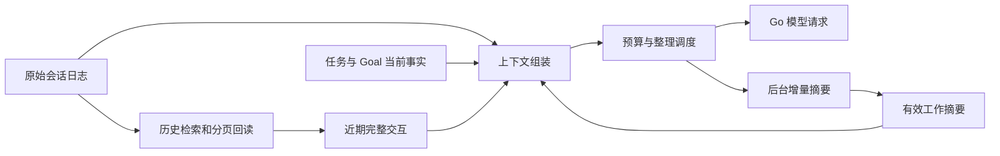

# 下一阶段上下文管理方案

> 2026-09-18，研究后设计稿。依据：[上下文压缩专项调研](../research/12-context-compaction.md)。当前仅完成设计，未实施本方案；既有 M2 功能和验收记录保持。

> 同日范围接续：用户已将压缩、长短期记忆和多会话协作共同纳入 M3。当前阶段安排以 [M3 总体方案](m3-implementation-plan.md) 和 [压缩模块计划](m3-context-compaction-plan.md) 为准；本文保留原压缩设计推导。记忆与可选子 agent 已进入 M3，不再整体后置，但压缩本身不依赖委派子 agent。

## 1. 要交付的体验

用户在同一会话内持续讨论和编码，Agent 接近可用上下文预算时自动整理；用户也可以主动整理。整理后继续当前任务、Plan 或 Goal，保留新输入、近期工具状态和已确认决定。会话历史仍可查看，模型能补查被压缩区间。

首批采用 **规则减量 + 可读增量摘要 + 近期完整交互 + 按需回读**。提前生成摘要以减少前台等待，现有 GLM / DeepSeek 与 OpenCode Go 保持。无需新 API Key，不启动自动子 Agent，不将摘要视为独立正式会话。

用户已经确定的行为继续有效：任务 → 会话结构；中途提问先回答再继续 Goal；模型切换从下一请求生效；正常工作直接推进；实际调用 / 执行失败停止；测试正常运行但未通过先报告，不自行扩大修复范围。

## 2. 五类数据各司其职

| 数据 | 保存内容 | 是否交给摘要模型改写 |
| --- | --- | --- |
| 原始会话事实 | 用户输入、工具调用 / 结果、模型输出、运行状态 | 否，只追加事实 |
| 当前任务与 Goal | 用户确认的目标、约束、决定、状态 | 否，采用现有更新入口 |
| 工作摘要 | 较早交互的进展、纠正、失败尝试、未决事项、接续点 | 是，是派生材料 |
| 产物索引 | 文件改动、命令、程序、网页和历史范围的现有身份 | 由宿主从事实建立 |
| 请求窗口 | 当前规则、必要方法、任务状态、摘要、近期交互和本次补查 | 由宿主每次装配 |

摘要丢失一个细节，不会删除原始事实或重写用户目标。摘要提到“已完成”，也不直接使 Goal 完成；仍使用现有工作报告与状态更新路径，不额外叠加审核。

## 3. 与已有代码怎样连接

保留 `sessions/store.py` 的原始事实重放职责；不把它改成只返回压缩后的历史，以免影响工具配对、中断恢复和用户查看旧记录。

在运行时增加一个实际请求的组装入口，输出消息、工具定义、占用估计和组成说明。首次实现复用已有 `runtime/context.py` 的职责划分；只在文件已经承载不相干职责时拆分模块，不提前建立通用插件层。

稳定系统规则与工具定义尽量保持相同前缀。变化中的任务状态使用明确的数据区段，避免每次请求重写整个稳定前缀；用户新纠正仍按时间和既有指令优先级生效。

## 4. 一次整理的流程

1. 新用户输入先写入会话事实，再考虑是否整理。压缩失败不能吞掉已发送内容。
2. 组装器识别已完成交互单元，估算输入压力；较早且已归档的大块工具结果可以先换成状态与引用。
3. 压力达到软触发点时，捕获待总结的前缀、当前模型和切点，启动一次摘要请求。近期尾部与在途工具不进入待替换范围。
4. 主运行在预算仍足够时继续；如果下一请求已容纳不下，等待正在进行的同一份摘要，并显示“等待上下文整理”。
5. 摘要完成并保存后，在下一模型请求边界采用：旧前缀换成摘要，切点之后的所有新事实继续保留。
6. 如需被压缩细节，模型通过历史入口补查。读回内容仍受正常单次输出预算约束，不一次性恢复全部长历史。

用户手动整理共用此流程。没有值得整理的历史时直接说明；已有摘要作业时复用其状态，不重复发送。同会话同时只有一个摘要作业，其他会话不因这个锁被串行化。

## 5. 确定性减量做什么

优先处理早期重复文件正文、较长命令输出、搜索结果和网页摘录；保留工具名称、目标、成功 / 失败 / 运行中状态、必要短结果以及可回读引用。错误信息不能一律裁成“执行完成”。

不机械删掉早期所有消息，也不只保留最后 N 条。切分单位包含 assistant 工具调用及对应结果，不能留下孤立 tool 消息；用户尚未得到处理的新请求保持原文。仍在运行的程序保留准确 program_id 与当前状态。

“可回读”必须落实存储：新工具输出先按已有采集边界归档，再做上下文截短。工具本身没有采集到的字节明确标识；历史已截短内容不能补造成完整记录。读取当前磁盘文件与读取当时的工具输出是两个不同动作。

首批复用应用数据根，在其中保存会话产物；不写入用户项目，不要求项目初始化 Git。元数据记录已采集字节、是否完整和截短原因。普通会话 / 项目切换不清除这些产物。

产物保留随会话数据管理；空间不足时报告实际保存失败，不为了腾空间悄悄删除原始历史。暂不增加一套自动清理服务。

## 6. 模型怎样总结

### 6.1 请求与缓存

采用 DSH 可迁移的请求方式：尽量复用实际对话的稳定 system / tools 和待总结前缀，在末尾附加接续摘要要求。首次输入较早交互；后续输入已有摘要加新进入较早区间的交互，不反复加载已经压缩的全部原始历史。

摘要使用作业开始时当前选定的 Go 模型，同一 `x-opencode-session`、连接池和请求计时路径，标记 `purpose=compaction`。用户随后切换模型，已经发出的摘要请求不变；后续主请求用新选择。摘要请求不能顺便发送到新 provider 或静默换成便宜模型。

摘要服务只消费返回文本，没有工具执行器；即使模型返回工具调用，也不会执行。是否传 `tool_choice: none` 要在 Go 实际兼容性明确后决定，不凭 OpenAI 兼容名义假定支持，也不先发送额外探测再允许正常对话。保留工具定义是为复用前缀，不是授予摘要新的执行动作。

只要请求正常结束并有可用摘要文本，就可保存；不强制标题齐全、固定 JSON 或语义评分通过。只有工具调用而没有摘要、协议损坏、网络失败等按真实失败处理。

### 6.2 摘要内容

提示模板引导以下内容，但不是运行时逐项必填表：

- 当前要继续完成的工作；用户后续纠正和已经失效的旧方案。
- 已完成动作与实际结果，区分已实现、已运行、未验证和失败。
- 重要决定及其理由；引用任务事实，避免重新创造目标和约束。
- 未决问题、当前卡点、尝试失败的方向，避免无意义重复。
- 接下来应执行的具体动作，以及需要补查的文件、程序或历史入口。

产物索引由宿主生成，不要求模型靠记忆完整列出每一个文件。摘要长度设可调输出预算，按已有内容规模生成，不要求短会话填满模板。

### 6.3 切换模型与思考字段

工作摘要使用普通可读文本，适用于两个默认模型的接续。近期 provider 原生字段继续按实际模型适配规则处理，历史归档保留其原始来源；不把跨模型可见文本兼容扩大为“所有 reasoning 字段天然兼容”。

压缩不会为了节约 token 直接删除用户界面中的已保存思考。模型内部续接字段与前端思考展示保持分开，是否继续发送旧字段由模型适配层处理。

## 7. 阈值与预算

### 7.1 区分三个量

| 量 | 用途 | 来源 |
| --- | --- | --- |
| 模型有效输入容量 | 避免发出已知无法容纳的请求 | 路由能力资料与明确覆盖值，预留输出空间 |
| 期望工作窗口 | 控制冗长输入带来的成本与注意力负担 | 应用集中配置，可按模型调整 |
| 字节 / 传输预算 | 控制本应用请求大小、日志与管道占用 | 现有可配置 limits |

当前 `max_context_bytes=600000` 是 UTF-8 序列化字节预算，不能直接显示为模型 token 容量。不能按模型名中的 “Flash” 或宣传窗口推导本路由一定接受多少输入。

用真实 usage 的已有输入量结合新增内容估计下一请求；中文、代码与工具定义必须计入。没有准确 tokenizer 或路由容量时显示估计值 / 未知，并沿用字节预算整理，不能阻止应用启动或正常短对话。

### 7.2 初始配置建议

| 配置 | 初始处理 |
| --- | --- |
| 自动整理 | 默认开启，允许关闭；手动入口一直可用 |
| 后台摘要软触发 | 约达到当前可用工作预算的 80% 时准备 |
| 整理后目标 | 约降到 55%，避免刚整理就再次触发 |
| 近期原文 | 约保留 20% 的工作预算，并向完整交互边界调整 |
| 摘要输出 | 复用集中模型输出预算，并提供独立可调上限；不写死在提示字符串 |

这些比例是工程起始值，**不是模型合法输入的硬门槛，也不是研究证明的最优值**。它们按可用的 token 或字节预算工作，UI 必须说明单位。具体输出长度在最小实测后确定，不增加按固定条数停止的规则。

没有新可压缩内容时不重复总结同一前缀；单个巨大输出先外部化。必要输入确实无法容纳时，报告具体占用来源和调整入口，不反复自动请求直到耗尽预算。

每个真实摘要请求计入请求 / token / 费用记录；运行与 Goal 的既有预算分别累计。作业开始前为该次请求计数，不能与前台并发各自通过检查后共同超额。空闲手动整理也创建可追踪操作记录，不隐瞒其费用。

## 8. 后台运行与持久化

摘要记录需要的最小信息：`compaction_id`、会话身份、父摘要 ID、覆盖区间、最后保留原文切点、实际模型、生成文本、时间、usage 和状态。沿用现有事件序号即可，不增加模型传 hash、完整会话 hash 或多重版本闸门。

后台作业针对不可变的前缀快照。完成时检查该前缀仍属于当前会话接续路径，而非要求整个会话版本没有变化；正常追加用户消息不会使摘要作废。未来如果支持历史回退 / 分叉，再按分支身份扩展，首批不提前创建这些产品能力。

只有完整摘要保存成功后才将其标为可采用。中断时旧上下文仍有效，下一次启动能区分未完成摘要与已完成 checkpoint；不把启动恢复变成自动再次请求模型，也不重放历史工具。

复用现有单写者和原子保存设施，不建立独立数据库事务框架。原始日志始终保留，UI 的“查看历史”与发送给模型的当前窗口分开。

## 9. 失败、取消和等待

- 实际摘要调用 / 保存失败按既定产品规则停止关联运行与 Goal；保存错误和原始历史，等用户明确接续，不自动重试、换模型或假装已经整理成功。
- 手动整理发生在空闲会话时，只结束本次整理操作，不改变无关会话或已完成任务。
- 主运行停止或应用退出时，取消关联后台摘要并完成清理；已保存 checkpoint 可以保留，但不继续偷偷发送辅助请求。
- 摘要格式欠漂亮、章节不齐或没有写满长度不算故障，不增加模型 Review 或人工确认。
- 状态分别显示正在生成、后台准备好、等待采用、整理失败；不混入“正在思考”或伪装成网络连接问题。

这一规则保留了用户已明确的失败停止行为。后台化降低的是等待重叠，不能承诺消除故障或把摘要失败隐藏为成功。

## 10. 回读与界面

首批提供当前会话历史检索与按 seq 范围分页读取，可合并为一个有明确操作参数的工具；使用已有项目 / 会话身份。支持用户安排的跨会话访问时沿用已有角色协作范围，不另设一套摘要审批。

回读返回文本、来源与完整性，区分当时记录和当前状态。模型不能通过历史读取直接取得密钥、完整 provider 私有对象，或者重新执行命令来“恢复”日志。

输入区附近放一个紧凑入口：当前上下文占用、是否为估计值、整理状态和手动按钮。展开后查看摘要、覆盖范围、最近一次耗时 / token / 缓存信息以及自动整理设置；不再在会话上方加大面积置顶卡片。

Trace 记录 `context.measure`、`context.trim`、`compaction.request`、`compaction.saved`、`context.adopted` 和历史回读的实际事实，并关联现有 session / run / request ID。先复用现有活动事件，不以完整 Trace 页面实现作为上下文闭环前置条件。

缓存数据只有 Go 返回时才展示；无法获得时写未知。首字指标分别统计主请求首字和用户发送至可见回复的等待，不将后台摘要的字节误算作主回答首字。

## 11. 实施顺序与最小验证

按可验收结果推进，不设固定工期：

| 批次 | 交付 | 最小验证 |
| --- | --- | --- |
| A 上下文组装与回读 | 请求窗口与原始日志分离；产物索引、必要输出归档、旧观察减量、当前会话回读 | 工具调用 / 结果配对；截短历史不冒充完整；不重放副作用 |
| B 摘要闭环 | 同模型增量摘要、手动 / 自动整理、checkpoint、重启接续 | 压缩前后的新用户消息不丢失；失败保留旧状态；双模型接口形状兼容 |
| C 后台体验 | 提前准备、边界采用、预算计数、紧凑 UI 与活动事件 | 摘要期间用户纠正和切换模型；停止 / 退出清理；记录前台等待 |

后台方式属于本阶段交付，不作为永远后置的优化；先把同一套摘要和保存接口做通，再增加重叠调度，避免同时调试两套逻辑。

集中在已有 `tests/` 增补真正缺失的行为用例，产物进入 `.artifacts/tests/`。不新增独立评测平台、不默认运行全量回归。

后续真实验证可用空白项目中的一个简单任务：生成计数器页面，用户中途改一个显示要求，做一次实际搜索和简短本地运行，再在整理后继续修改。人工核对“最新需求、改过的文件、运行结果、下一步”四个接续问题即可；测试规模保持小。这里没有发起该任务或真实模型请求。

比较时记录整理额外耗时、主回答等待、请求 / token / 缓存量、历史回读次数和是否重复已完成工作。短任务用于验证闭环，不能由一次成功宣布长任务质量已被充分证明。

## 12. 采用范围与暂缓内容

压缩模块完成后，应用应具备可观察、可恢复的会话上下文管理；任务事实仍在现有任务系统中。跨任务长期记忆已纳入同阶段的 [M3 记忆计划](m3-memory-plan.md)，实际协作接续与可选子 agent 见 [M3 协作计划](m3-collaboration-plan.md)。向量数据库、通用知识图谱、摘要训练、原生 Claude / OpenAI 接口以及自定义压缩插件仍暂缓。

后续若发现两个默认模型的摘要质量存在具体不足，先根据真实失败调整摘要内容、近期保留和回读，再讨论额外模型或训练。不能只因商业产品具备专有能力，就预先增加 provider、确认流程或运行限制。

本方案不授权立即实现。M3 已创建 [阶段进度](../progress/m3.md) 保存研究与计划，功能未实施；后续按用户实施要求逐批记录实际变更与验证。本专项的历史研究记录保存在 [专项调研进度](../progress/context-compaction-research.md)。
