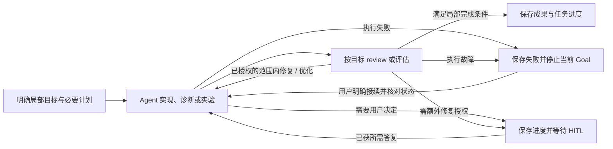
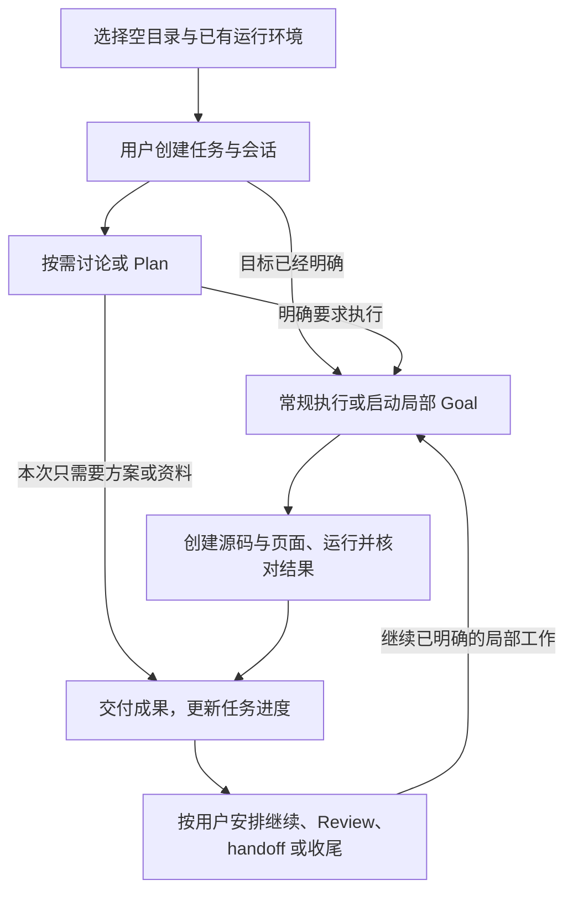

# 初始版本 Harness 产品设计（讨论稿）

> 更新：2026-09-17。状态：设计推进中，尚未开始实施。
>
> 用户要求暂时沿用任务与会话的信息交互方案，继续初始版本设计；另一个会话正在深入调研相关组件，后续可据研究结果修订。
>
> 本文描述初版整体使用体验。用户已明确首批交付就要能完成一次简单而完整的代码任务；开发可内部拆分，但任务界面或只读模式不能单独算首批目标达成。不直接定义新 M2、不预写所有后续阶段。已确认需求见 [需求讨论稿](harness-requirements-discussion.md)，实现事实见 [进度总览](../progress/README.md)，原工程路线与边界见 [总规划](coding-agent-from-zero-plan.md)。

## 1. 初版目标与设计依据

建议初版交付一种完整体验：用户围绕一个阶段性任务，在多个会话中讨论、规划和执行局部目标，得到可查看的成果，并能暂停、换会话和继续。它同时服务日常编程与大模型应用开发。

下列方向已确认或作为当前可调整基线：

- 项目 → 任务 → 会话；任务保存阶段性长期目标，会话处理局部目标。
- 桌面左侧使用项目 → 任务 → 会话的可展开 / 折叠树，任务和会话都在对应项目下导航；点击会话后在主工作区显示内容。
- 会话暂按常规（对话与执行）、Plan、Goal 三种模式设计；Goal 可自动跨多个回合推进，直到完成、用户停止、执行故障或需要介入。
- Goal 运行中插入普通问题且未要求停止或换目标时，先回答，再继续原 Goal；用户明确的暂停、停止或目标调整优先。
- 独立 Code Review 会话由用户主动启动；当前会话内的必要自查按任务需要进行，不默认在每个实现类 Goal 后自动创建 Review 会话。
- 首批交付能够从桌面完成一次简单而完整的代码任务，覆盖实际读取、修改、必要执行验证、结果处理与变更交付。
- 默认直接在用户选择的原项目目录工作，创建任务或会话不自动创建代码副本；独立副本只作为用户可选的工作方式。
- 会话范围以简短、可编辑的分工说明表达当前负责的工作、完成程度和协作关系；可随讨论调整，不是固定文件白名单。Handoff 传递已完成内容、文件与接口变化、未决事项和下一步。
- 正式会话由用户创建，Agent 不自主新建；已有会话提前设定角色与协作关系后，可以读取彼此信息并发送职责范围内的协作请求。临时子 agent 与正式会话分开，以独立开关控制按需拆分，避免无实际收益的委派；具体判定建议见 4.4.1–4.4.2。
- 正常工作在既有目标与授权范围内直接推进，需要额外沟通时进入 HITL；执行失败停在当前进度，若处于 Goal 中，同时停止该 Goal 自动续跑，等待用户明确接续。
- 测试正常执行但未通过时先报告结果，不自动修复；只有当前请求 / Goal 已明确包含修复或优化，且问题在该范围内时才继续处理。测试结果与调用 / 执行故障分开。
- 用户补充实际执行任务还需要文件编辑、代码运行、联网搜索等工具，现有只读能力不足；这三项纳入需求，其他补充能力与分批范围见 5.4 节建议，尚未冻结接口或接入服务。
- 执行环境已确定 Windows 本机优先，复用项目已有 Python / Conda / uv 等，在设置中统一管理；Docker 可选，WSL 直接执行后置。选定项目默认本机直接运行，沙箱按项目选用；2026-09-18 补正：不增加独立信任开关，没有环境绑定也可使用本机工具。具体管理界面与沙箱实现见 5.5 节建议。
- 用户倾向允许互不冲突的会话并发。本轮按独立工作可并发、实际冲突局部协调的方向细化；资源识别与并发机制仍是设计建议，不能只凭写入文件名不同就保证互不影响。
- 用户的做法成为默认工作流；后续允许其他工作流，自定义编辑入口可以延后。Loop / graph 以完整 Agent 工作单元为主体。
- 任务与会话双向更新先沿用需求稿 4.6 节：任务提供共同背景，会话写回有来源的成果、事实和建议；用户已明确作出的决定不重复确认。
- Python 核心、Electron 桌面、OpenCode Go 双模型、数据目录和既有工程边界继续有效。

除上述已标为用户确认的方向外，具体界面细节、字段、默认步骤和范围划分仍是设计建议。用户暂时采用信息交互方向，不等于所有存储格式、调度算法或完成规则都已最终确定。

## 2. 从创建任务到交付的默认体验

| 用户所处位置 | 建议操作与应用行为 | 留下的结果 |
| --- | --- | --- |
| 已打开的项目 | 创建任务，描述本阶段希望达成什么；名称可选，约束和完成条件可后补 | 独立任务身份与初始目标 |
| 任务工作区 | 使用默认工作流，开始首个会话；起始模式建议为常规，不因创建任务自动发模型请求 | 可以继续澄清或直接提出明确请求 |
| 需要比较方案 | 在当前会话使用 Plan，按需理解代码、调研并形成方案 | 计划、取舍和待决定项 |
| 已有明确局部目标 | 使用常规模式完成一项操作，或用 Goal 连续推进目标范围内的工作 | 执行记录、成果、实际检查结果与未完成项 |
| 需要审查或实验评估 | 使用相应 skill 复核成果，必要时在新会话开展独立 review | 有依据的发现、评估结论及修正工作项 |
| 需要换会话继续 | 从任务中创建会话，选择继续、独立复核或接手指定工作；按需生成 handoff | 接续所需简报与历史入口 |
| 本阶段结束 | 对照任务目标整理成果和遗留事项，明确任务完成状态 | 可追溯的交付与后续事项 |

名称可由用户填写或先采用目标的简短显示，不为了创建任务强制增加一次模型调用。任务类型暂作可选推荐，不作为创建前置条件；初版先采用一个默认工作流，编辑和新增模板后置。

这些环节可按工作需要跳过、重复或返回。明确要求直接修复一个问题时，可以直接处理；纯调研任务也可以以一份结论结束。Plan、Goal 与工作流阶段不绑定，进入实现环节后仍能讨论或规划局部问题。

### 2.1 任务与首个会话怎样建立

建议从左侧项目行提供“新建任务”，创建时只要求描述本阶段目标；任务名称、约束和完成条件可以同时填写，也可以在讨论中完善。所属项目来自明确选择，默认工作流来自应用设置，不再要求用户为继续创建先理解全部任务类型。

保存后展开对应项目与新任务，打开一个空的首个会话。任务目标作为共同背景显示，用户可以先补充内容，也可以直接发送第一个请求；创建动作本身不触发模型生成或代码操作。“新建任务”与“新建会话”放在各自层级，避免误把局部追问建成另一个任务。

同一任务内的新会话可以选择继续当前工作、处理另一项局部工作或独立 review。这些是本次会话的用途，不将会话永久锁定为固定类型；以后仍可使用不同模式与工作方法。

### 2.2 任务状态与会话活动分开

建议任务使用待开始、进行中、暂停和已完成等清楚状态；归档是收起已不常用记录的显示方式，不等于删除或完成。任务下面某个会话正在运行、需要输入或发生错误，在任务上汇总提示，但不因此把其他工作都标为失败或阻塞。

第一版建议由用户在任务页或对话中明确表示任务结束，再保存最终状态；Agent 可汇总满足情况、提出收尾建议，不因某个局部 Goal 完成而关闭任务。用户已明确要求收尾且实际符合要求时直接记录，不增加一次重复确认。自动按条件关闭整项任务保留为未来工作流规则的可选行为；这一默认完成方式仍是设计建议。

暂停任务意味着暂停其自动推进工作，保留已有结果；恢复不自动重放结果未知的命令。正在运行的任务若被归档，必须清楚显示运行处理方式，不能用隐藏导航代替停止。删除数据不作为归档行为附带执行。

## 3. 左侧树形导航与任务工作区

**用户已明确**：项目、任务、会话都依托项目组织在左侧，通过展开 / 折叠逐层导航；不沿用“点击项目，再到右侧会话列表选择”的布局。

```text
左侧导航
▾ 项目 A
  ▾ 任务：完成记忆功能初版
    · 会话：需求与方案
    · 会话：摘要保存实现
    · 会话：独立 Review
  ▸ 任务：改进模型诊断
▸ 项目 B
```

项目与任务行提供展开 / 折叠，具体会话是可选择的叶节点。展开、折叠与选择内容分别表达；收起父节点不结束当前会话或 Goal。建议保留展开状态，并在收起的任务 / 项目上提示其中存在运行中的工作，具体样式后续确定。

在这一导航要求下，用户已接受以下工作区方向；具体尺寸、标签与切换样式在界面实施时细化：

| 界面区域 | 内容与用途 |
| --- | --- |
| 左侧项目 → 任务 → 会话树 | 项目下展开任务，任务下展开会话；展示必要状态，并在相应层级提供新建入口 |
| 主会话区域 | 对话、工具与成果卡片；输入处选择常规 / Plan / Goal，清楚显示当前目标、实时活动和停止入口；状态不依赖正文流式输出 |
| 任务概览 | 阶段目标、工作项、已确认决策、相关成果、未决问题与最近更新；可回到对应会话 |
| 右侧可收起工作区 | 按需打开方案、文件、diff、运行日志、搜索来源、review 或实验报告，保留中间会话上下文 |
| 设置与诊断 | 沿用模型、预算、数据路径与连接诊断，避免本轮另建一套设置 |

优先把任务、当前会话和当前 Goal 的归属显示清楚。第一版可以用工作项与依赖提示表达工作流；任意图画布不是这一使用体验的前置条件，也不能用画布代替真实运行状态。

点击会话直接进入其内容；点击任务本身可显示目标与进度概览，这是建议交互。任务和会话的完整导航始终留在左侧，主工作区不再承担必须经过的二级会话列表。切换选中的会话不自动停止其他会话的工作；哪些工作同时执行由其依赖与资源占用决定，不由当前选中哪个会话决定。

已有项目下的历史会话需要继续可见。建议在左侧所属项目下提供明确的历史 / 未归属过渡入口和用户选择的归入操作，保留原会话身份、历史和模型会话标识；不凭内容猜测，将旧会话自动混入新任务。过渡入口不冒充已有任务，具体迁移在相应实施方案中确定。

### 3.1 Goal 中的普通插话

已确认对仍在正常运行的 Goal，默认先回答普通问题，再继续原 Goal，不因一句查询状态或技术解释就要求用户手动恢复。已经失败停止或等待 HITL 的 Goal 不因普通插话而自动恢复。建议保留当前局部目标、执行进展和累计用量，在可处理的交互边界优先响应问题；不把回答插话当作另开一个同名 Goal，也不为了抢答盲目终止具有副作用的在途工具。

回答后按照最新有效约束接续原工作。明确要求暂停、停止、取消或替换目标时，以该指令为准；停止整个 Goal 不能只结束当前 run 后又被续跑机制启动。需要用户决定的问题仍保持等待，不将普通插话默认当作缺失授权的答复。具体运行队列与安全响应边界由后续实现设计确定。

### 3.2 三种模式的具体行为建议

| 模式 | 开始与允许的工作 | 本次结束后的行为 |
| --- | --- | --- |
| 常规（对话与执行） | 处理当前明确请求，既可以问答，也可以在授权范围内用工具完成操作 | 完成本次请求后返回用户；不会为了任务中其他未完成项自动产生新一轮工作 |
| Plan | 理解代码、讨论目标、比较方案，形成计划；可保存计划到应用数据或用户明确指定的文档位置 | 展示方案、范围、待定项与可执行的下一步；不因方案形成而自动改业务代码 |
| Goal | 用户设置局部目标后，按目标性质使用讨论、规划、实现或评估方法，跨完整 Agent 回合持续推进 | 达成目标则交付；需输入时等待 HITL，执行失败则连同 Goal 自动续跑一起停止；用户停止与运行边界分别保存原因 |

三种模式共用工具权限和任务范围，Goal 不等于默认允许所有写入。Plan 也可为纯分析目标的工作方法：当 Goal 的目标是“形成比较报告”时，无须先切成实现流程。

建议模式选择器控制下一次请求；只切换到 Goal 而未给出目标，不启动后台工作。用户在 Plan 中明确要求“按这个方案实现”，可以将当次请求转为常规执行并在界面显示变化，无需重复询问已经明确的实现意图；持续推进整个局部目标则由 Goal 选择或同等明确的自然语言意图表达。用户只是表示“方案可以”时，不据此推断已经要求实施。

### 3.3 主动切换与暂停 / 恢复

普通插话的自动接续已经确认；下表进一步提出主动操作的默认规则，尚可调整：

| 用户动作 | 建议行为 |
| --- | --- |
| Goal 运行中主动切到 Plan 或常规 | 在可处理边界暂停原 Goal，保留进展，显示已暂停；新请求使用所选模式，不在回答后暗中恢复旧目标 |
| 点击停止或明确说“先停下” | 停止后续自动推进，清理或标明在途工作状态；保留可恢复的进度，不当作失败或完成 |
| 明确说“取消这个目标” | 结束该局部目标，保留历史和已发生的成果；不自动撤销代码或外部操作 |
| 对暂停的 Goal 点击继续或明确要求接续 | 核对相关任务信息和执行结果后继续，保持已有进度与累计用量 |
| 明确提出替换当前目标 | 显示新目标与旧目标的关系，保留原记录；范围已经明确时直接调整，只有相互冲突或含义不清才澄清 |
| 折叠导航、查看另一个会话 | 只改变所看的内容，保持后台真实状态；仍能看到运行提示和停止入口 |
| 退出应用并重新启动 | 保留已保存的进度，显示被中断的工作；建议由用户选择接续，避免启动应用就意外恢复副作用 |

恢复和手动重试均保留已用预算；预算范围变化必须可见，不通过新建一次 run 将已用额度归零。具体 Goal 预算入口与现有运行预算怎样合并展示，放到运行设计中细化，不在此设置新的固定回合数。

### 3.4 正常推进、HITL 与失败停止（已确认主规则）

用户已明确正常工作直接推进，只有需要额外沟通时才引入 HITL（Human-in-the-loop，用户介入）。已有明确范围与授权时，读取、编辑、执行和必要的日常步骤直接进行，不为每次工具调用或文件变化重复确认；模式与执行权限仍按各自职责生效。

| 情况 | 运行与 Goal 的处理 |
| --- | --- |
| 目标清楚、条件满足且操作在既有范围内 | 直接推进；常规请求完成后返回，Goal 可持续进行尚未完成的工作 |
| 缺少会影响结果的决定、必要输入或已有授权未覆盖的操作 | 发起具体 HITL，说明缺少什么、影响和可选处理；保存等待状态，只暂停依赖该答复的工作 |
| 用户答复了当前 HITL | 按答复核对并接续相关工作；答复本身已经明确允许时不再次确认，普通插话和等待超时不算答复 |
| 测试 / 检查正常执行并返回未通过结果 | 先报告结果与影响；未获本次修复授权时不自动改代码，已有明确修复 / 优化范围时按范围继续 |
| 模型调用、工具执行或运行状态保存等实际失败 | 停止当前运行和后续自动动作；若属于 Goal，同步停止该 Goal 的续跑，不自动重试、另开 run 或改换工具绕过失败 |
| 失败后用户明确要求继续、修复或重试 | 先核对已有结果与当前文件 / 进程状态，再按新指令恢复相应范围；保留原失败记录和累计用量，不重放结果未知的副作用 |

“停在原地”指保留当前代码、任务进度、历史和失败位置，并显示失败原因、已发生动作及未完成事项。仍需完成必要的停止 / 资源清理和状态保存，不把停止理解为遗留失控进程；不能确定清理结果时明确标为待核对。已写入修改不自动回滚，任务不因此标记完成；其他无关会话继续按自身状态工作，依赖失败成果的工作等待。

失败后会话仍可用于询问原因或发起新请求，但不能仅因查看状态、普通问答、界面重连或重启应用而恢复旧 Goal。HITL 等待与失败停止分别展示；用户明确继续的自然语言已构成接续指令，不额外制造一次确认流程。

**用户已确认测试结果边界**：命令正常运行但测试未通过时，先报告哪些检查未通过、实际依据和对当前目标的影响，不自行启动修复。只有当前请求 / Goal 已明确要求修复或顺带优化，且问题属于该范围，才在说明结果后继续处理；该授权可以来自本次原始请求，不额外要求用户再说一遍。

例如“运行测试并报告”在命令正常完成、结果如实交付后可以完成该请求，即使报告包含未通过项，也不把测试结果标绿；“修复该缺陷并验证”可以根据测试结果继续修复这个缺陷。若更大的 Goal 仍未满足，下一步修复又不在已有授权内，报告后进入 HITL 等待，不自动扩大目标、不假报完成。与当前目标无关的问题只记录其影响，不顺带修复。

运行结果需要分别表达工具是否完成调用、命令退出码和业务检查是否通过。搜索无匹配、有效空结果、测试断言未通过等按工具本身的结果语义处理，不能只看非零退出码或“失败”关键词就判定运行故障；无法启动、超时 / 中断、协议或持久化错误等实际执行故障仍适用失败停止规则。

### 3.5 执行活动分类与即时状态（2026-09-17，已确定需求）

用户接受上述工作区方向，并要求执行长任务时明确显示正在做什么，例如发送网络请求、调用工具和执行代码，不能只等待模型正文。这里分类的是运行中的**活动**，由实际动作自动确定，不新增创建任务时必须选择的任务类型。

初版按以下用户可理解的活动展示，具体名称可以调整，不将分类写成禁止新增工具的封闭名单：

| 活动类别 | 状态示例 | 可展开的实际信息 |
| --- | --- | --- |
| 准备上下文 | 正在恢复任务进度 / 准备本次请求 | 正在处理的任务记录或已选文件；只显示真正发生的准备步骤 |
| 请求模型 | 正在连接 Go / 发送请求 / 等待 DeepSeek 响应 / 正在生成回答 | 模型、当前请求耗时、已有网络阶段与首字指标；连接复用时不虚构重新连接过程 |
| 读取项目 | 正在读取 `src/app.py` / 搜索代码 | 工具名、相对路径或查询、结果与截断状态 |
| 修改文件 | 正在创建文件 / 修改 `src/app.py` | 文件列表、实际写入结果与 diff 入口；生成工具参数不等于已经写入 |
| 执行程序 | 正在启动脚本 / 运行命令 / 等待程序输出 / 服务已就绪 | 项目环境、命令、工作目录、日志和停止入口；已启动、已就绪、已退出分别表达 |
| 联网资料 | 正在搜索官方文档 / 读取网页 | 查询或目标 URL、搜索 / 读取进度与结果；Go 辅助请求作为搜索活动的详情呈现 |
| 整理成果 | 正在整理改动结果 / 保存任务进度 | 实际成果入口、已保存的更新、检查结果与未完成项；只有确实执行了对应操作才显示 |

“调用工具”是统一入口：能够识别用途时显示上表的具体动作，同时保留工具名；其他工具使用“调用工具 · 名称”和可信参数摘要，不统一退化成无内容的转圈。高层工作项与当前动作分别显示，例如“实现配置导出 → 运行导出脚本”；没有真实计划时只显示当前动作，不为界面完整而额外调用模型编造阶段。

**活动与运行状态分别表达。** 同一活动可以正在运行、等待、停止中、完成、失败或中断。等待需要说明对象：等待模型响应、等待程序输出属于仍在执行；等待用户选择提供明确答复入口，已知依赖未满足时说明依赖。程序确需输入时按执行后端已支持的输入能力提供入口，未支持时明确提示，不因此要求首版实现完整交互终端。实际失败按 3.4 节停止当前运行及 Goal；测试正常执行但未通过仍显示“检查完成，结果未通过”，不混成启动故障，也不自动开始修复。

展示与更新遵守以下约定：

- **正文之外常驻当前活动。** 会话中保留简短状态行，包含动作、对象、当前动作耗时与停止入口；展开卡片查看时间线、日志和详情。任务 / Goal 累计耗时与当前动作耗时区分，不把每秒计时写成一条新消息。
- **先发状态，再等待工作结果。** 模型请求、工具调用与程序启动开始时由后端事件更新 UI，不等第一段正文、工具完成或日志输出才提示。接收工具参数阶段显示“正在接收工具请求”，参数完整并通过校验、真正开始执行后才显示对应工具正在工作。
- **只展示有依据的阶段。** 网络发送、响应到达、程序启动 / 退出等由实际事件驱动。按用户 2026-09-18 的决定，provider 明确返回的思考文本独立流式展示、默认展开且可折叠；不猜测未返回的内部内容、不把原生续接对象整体公开。没有新事件时显示实际等待对象与“暂无新输出”，不能把耗时自动解释为服务端排队、卡死或仍有有效进展。未知总工作量不显示伪造百分比或剩余时间。主界面的具体收拢方式见 [主界面与运行轨迹](main-interface-and-trace.md)。
- **长时间安静仍可观察。** 基于开始时间刷新耗时，展示最后事件距今多久；本地计时不新增模型请求或持续落盘。进程仍在运行必须有实际状态依据，服务等待连接可以是正常状态。连接丢失 / 应用重启后读取保存的状态并核对，无法确认时显示状态待核对，不继续展示虚假的运行或完成。
- **并发活动不互相覆盖。** 状态归属具体项目、任务、会话和运行；一次运行内同时执行多个工具时各自保留卡片，上层可汇总“正在执行 2 项”。迟到事件不能覆盖新运行，查看其他会话不改变执行状态；停止范围沿既有规则，不因一个全局状态栏误停其他工作。
- **完成后保留依据。** 结束时记录真实结果、耗时与来源，当前动作结束不代表 Goal 或任务完成；任务进度只在有事实更新时改变。状态与参数摘要同样脱敏，前端不接收认证头、密钥或未经清洗的底层异常。

显示示例（设计示例，时间不是实测）：

```text
当前工作：实现配置导出
正在执行：运行 export_config.py · 已运行 23 秒 · 暂无新输出 8 秒
[展开输出]  [停止]
```

当前 M1 已有模型阶段与计时基础，见 `ModelProgress` / `RequestTiming`；本节将可观察性扩展为后续工具、命令与任务活动的一致体验，不把现有模型指标写成全套能力已经实现。产品实施时复用现有事件与可折叠卡片，不另建强制诊断页面或为了显示状态新增常驻模型调用。

## 4. 默认工作流与内置 skill

建议先内置以下工作方法，初期清单仍可调整：

| 工作方法 | 解决的问题 | 可交付结果 |
| --- | --- | --- |
| 目标澄清与项目理解 | 讨论需求、理解现有代码、核实约束，必要时调研 | 明确目标、已有事实、待决定项 |
| 规划与拆分 | 比较方案、安排工作与依赖 | 计划和可推进的局部目标 |
| 实现、诊断与实验 | 实现变更、定位问题，或进行大模型应用原型 / 对照实验 | 代码、诊断依据、配置与实验结果 |
| Review 与结果评估 | 检查具体成果和实际目标的差距 | 可定位的发现与是否需要修正的依据 |
| 进度整理与 handoff | 交付中间成果、保存未决事项、准备下一会话 | 任务更新、交接内容与历史入口 |

Skill 提供方法与预期成果，模式控制当前怎样推进，工作流表达工作关系。它们分别承担职责，不把三者合并成一个封闭的类型枚举。

初版建议落实的一条真实反馈路径：



这条路径是默认工作流候选，不要求每次普通问答执行整张图。评估结果先报告；图中的修复返回边只在当前目标已经明确授权修复 / 优化时使用，不能把检查请求自动升级为修复。实际执行故障停止优先于反馈路径，不能改名为反馈来绕过停止。Review 的范围由目标决定，不强制每项工作跑全部测试；纯方案 Goal 的成果可以是可供决定的方案。工作流不能自行扩大用户目标或凭内部节点名增加工具权限。

初版的 loop 应实际保存局部目标、推进进展并根据结果继续或停止。Graph 至少要能表达上述工作单元、依赖 / 返回关系、产物与交接，按条件决定下一项是否可推进；实现时不能只有一张示意图或几条提示词。是否同会话完成、何时使用另一个会话，以具体工作方式为准，不固定节点和会话一对一。

用户已允许独立会话并发，替代此前默认先将会话执行串行的建议；进一步明确正式会话不能由 Agent 自主创建，但预设角色的已有会话可相互读取信息和发送协作请求。需要自动拆分时使用开关控制的临时子 agent，不能通过委派绕过正式会话创建边界，详见 4.4.1。Graph 的工作单元可以关联已有会话或获准的临时子工作，不要求图节点自动生成正式会话。资源协调沿用 5.2 节，复杂动态图与自动分支汇合仍可后续细化。

### 4.1 工作方法怎样参与默认流程

用户可明确指定讨论、实现、诊断、实验、review 或 handoff；没有指定时，Agent 根据当前请求选择需要的方法，并在有帮助时显示当前正在做什么。选择工作方法不强制切换会话，也不自动扩大工作范围。

默认推进建议如下：

1. 读取当前目标、任务已确认信息与相关材料；只有缺失信息会改变结果或执行边界时才向用户提问。
2. 简单明确的请求直接处理；复杂工作先形成足够指导执行的局部计划，已确认的方案继续复用，不在每个回合重复规划。
3. 在明确范围内进行讨论、实现、诊断或实验，保存有意义的成果与进展。
4. 按目标核对成果并报告真实结果；测试未通过先报告，已有明确修复 / 优化授权时才在范围内处理。实际执行故障按 3.4 节停止当前运行与 Goal；需要额外决定时进入 HITL。常规请求以本次请求的完成范围为准。
5. 当前目标完成后交付结果；任务还有其他目标时记录下一步，不自动将整个任务剩余工作都加入这个 Goal。

内置 skill 的初版展示建议为名称、用途、所需上下文与产物说明。用户可以了解当前使用的方法；编辑 skill 或工作流模板后置，不因此在初版增加一套配置语言。项目约定作为上下文与规则来源，与 skill 的工作方法分别处理。

### 4.2 工作单元、反馈与完成证据

每个完整 Agent 工作单元至少需要表达本次目标与范围、采用的上下文 / 输入、当前状态，以及结果和下一步；其产物可以是文档、代码变更、实验结果或 review 发现。任务中记录依赖关系和成果入口，会话记录实际交互与执行过程，具体字段留待数据设计。

Goal 的每次续跑都应有未完成事项或允许继续的反馈作为理由，并且当前没有失败停止或未解决的 HITL。应用读取结果并结合完成条件选择继续、等待、停止或结束；不能只因模型没有说出某个固定短语就无限续跑，也不能只因模型说“完成了”就把所有工作标绿。实际失败不因还有预算而继续重试；持续无进展时保存已尝试方法与问题并请求所需介入。

必要自查根据本次变更和风险选择；文案、说明或简单可逆调整可以只做差异审阅。真实验证未做就说明未做，不能为提高“完成可信度”默认添加全量测试。证据应能指向实际产物或执行记录，进程退出成功、文件修改成功、功能满足目标分别表达。

工作流进入下一个工作单元时，应有上一步结果和有效输入；只有已允许的目标范围才可自动推进。分支失败或等待不等于无关工作全部失效。初版先验证一条实际反馈与交接路径，再按真实需要增加复杂图能力。

### 4.3 独立 Code Review 与修正

**用户已确认：独立 Review 由用户主动启动。** 实现类 Goal 不默认创建独立 Review 会话，当前会话中的必要自查也不冒充独立审查。

建议在相关成果或任务工作项上提供“新建 Review 会话”。上下文包含任务目标、已确认约束、明确的变更基线与待审成果，详细历史按需读取；不先灌入实现会话的全部推理过程。Review 可以继续使用同一套 Agent 和现有模型，初版不要求额外模型或审查平台。

Review 默认先形成发现，不自动修改被审代码。每个发现说明定位、影响、依据和建议，关联被审版本；“未发现问题”表示在本次范围内没有发现，不能表示全项目无缺陷。

用户要求修正发现后，将相应工作交给原实现会话或新的执行会话。原 Goal 仍未完成且修正属于其范围时可以继续；原 Goal 已结束则建立关联的修正工作，保留原完成记录，不悄悄重写历史。修正后只复核受影响的问题与必要检查，记录已解决、待解决或用户决定不处理的状态。

独立 Review 的结果可以汇入任务进度，但启动 Review 不等于暂停整个任务；后续新增发现也不自动撤销用户已完成的任务状态，应显示待处理事项并由当前请求决定如何接续。

### 4.4 多会话接续与 handoff

**用户已接受会话分工与交接的表达方式**：用一小段可编辑说明记录“当前负责什么、做到什么程度、与其他会话怎样衔接”。用户用自然语言说明即可，Agent 按明确要求整理；不要求创建时填写复杂表格或提前列完文件，也不把会话永久绑定为某种工作类型。

分工说明可以从任务已确认目标中取得初始内容，在用户调整工作时更新；简单问答不为了补齐字段而阻塞回复。会话可以读取授权范围内其他模块来理解依赖，发现需要修改其他会话正在负责的部分时先协调或更新分工。该说明服务于协作，不代替实际工具权限，也不意味着能够自动避免全部代码冲突。

例如“本会话负责记忆的保存和读取，提供可供检索调用的接口；检索由另一个会话处理”就足够表达初始分工。涉及的具体文件与接口随实际工作补充，不把示例固化成必须填写的模板。

建议先支持三种由用户发起的会话操作；用户的明确新建 / 接续指令可以由应用执行，不要求 Agent 为已有明确要求再询问一次：

| 操作 | 传递内容 | 原会话与目标 |
| --- | --- | --- |
| 新会话继续一项未完成工作 | 任务简报、该项目标、已完成成果、当前进度、未决问题和下一步 | 真正移交执行责任时暂停原目标，避免两边重复推进同一工作 |
| 新会话处理另一项工作 | 共同目标与相关依赖、已有成果入口 | 原工作保持状态，新工作有自己的局部目标 |
| 新会话做独立 Review | 任务要求、变更基线、具体成果和审查范围 | 不接管原目标；独立输出发现 |

已接受的 handoff 内容包括接手目标、已完成工作、改动文件、接口约定 / 变化、未解决事项和下一步；附必要的成果与验证依据入口。具体内容按本次工作填写，没有接口修改时不强制制造接口记录。保留关联原会话和任务工作项的入口，不复制完整聊天或 provider 原生续接数据作为新的上下文。下述交接触发、目标暂停与失败恢复细节仍为实现设计建议，不因本次确认就认定全部调度机制已冻结。

用户发起 handoff 后可查看和修改交接内容，已有明确的移交要求不强制再弹一次确认。新会话建立并保存交接关系后才显示已交接；失败时保留原目标和成果，清楚说明是否仍在原会话中可继续。

移交给已有会话时不能覆盖其正在处理的目标；需要安排在当前工作之后，或根据用户明确指令切换。交接到不同工作副本时，必须说明代码版本和未整合成果；任务信息已共享并不意味着代码自动同步。

当实际资源冲突或容量不足时，相应操作进入等待，显示原因和所等待的工作；独立操作仍可继续。不能把等待显示为已经执行，也不能为了启动新会话就隐式取消正在进行的工作。资源协调不要求用户预先准确列出所有涉及文件，具体影响在工具准备执行时解析与复核。

#### 4.4.1 预设角色的会话协作与可选子 agent（2026-09-17）

用户明确禁止 Agent 自主新建正式会话；已有会话可以通过应用能力相互访问，但必须提前制定角色。经进一步确认，“访问”包含读取状态 / 结论 / 历史，以及向已有会话发送协作请求，让它在空闲时按职责处理并返回结果。用户另提出可按需拆出子 agent，但能不用就不用，并以开关控制是否允许自动拆分。

| 对象或能力 | 谁决定建立 | 用途与边界 |
| --- | --- | --- |
| 正式会话 | 用户新建或明确要求新建 | 位于项目 → 任务 → 会话树，有持续上下文和独立目标；Agent 不为推进任务自行新增 |
| 跨会话协作 | 用户预先确定角色与协作关系，Agent 在范围内按需访问 | 读取必要信息、提问、请求指定职责的工作并等待结果；不覆盖对方目标、改角色或借消息扩大范围 |
| 临时子 agent | 开关允许时，由当前 Agent 判断是否需要 | 承接当前请求 / Goal 内的有限子任务，向父 Agent 返回结果；不自动变成左侧正式会话，也不获得任务所有权 |

**角色采用已有的简短分工说明。** 例如“会话 A 负责实现导出功能，会话 B 负责接口资料调研；A 可以向 B 查询资料，B 返回来源和结论”。提前记录负责什么、与谁协作及能处理什么请求即可，可用自然语言更新，不增加复杂角色表单或固定角色枚举。Agent 可以提出角色建议；缺少协作约定时先补齐，不能自己给其他会话指定职责或全局浏览任意历史。一次协作关系已明确后，范围内的访问不重复要求用户确认；普通单会话工作不因没有协作角色而受阻。

跨会话访问按下列方式设计：

- 读取优先返回角色、当前状态、结论、成果与必要历史入口，详细记录按需读取；记录来源会话和结果对应的版本 / 时间，不能将尚未交付或已过时的信息冒充当前事实。
- 读取已有记录本身不唤醒模型。协作请求另行记录发送方、接收方、目的与结果；接收会话空闲且符合预设职责时处理，忙时保留待处理请求，双方显示状态。具体消息结构与队列在实施方案中设计，不将一次投递成功显示为任务完成。
- 消息不覆盖对方当前 Goal，也不作为用户对既有 HITL 的答复；已失败停止、暂停或等待用户决定的工作不会被普通协作消息自动恢复。不能处理时返回或展示具体原因，只有依赖该结果的工作需要等待。
- 请求对方提供信息与 handoff 移交执行责任分别表达。协作结果回到发起方并关联任务成果，不自动改变已确认决策。独立 Review 仍遵守由用户主动安排的既有规则，不因会话互访能力而自行启动。
- 协作状态复用 3.5 节的活动展示，例如“读取调研会话结论”“等待调研会话回复”；不为了等回复反复调用模型，也不制造互相催问的循环。

**子 agent 开关的具体默认建议**：在会话执行设置中提供“允许子 agent”，默认关闭；用户开启后表示可以按需拆分，不要求每次必须创建，也不为每个已在范围内的子任务再次询问。该开关不影响用户已创建会话之间的并行和协作。位置与是否需要任务级默认值可在界面细化时调整，不增加多层配置作为首版前置。

开启后按 4.4.2 判断收益和代价；主 Agent 自己也能完成某项工作，不足以单独否定有价值的委派。每个子 agent 携带具体目标、必要上下文、工作范围和返回要求，沿用原目录、基线检查、已有权限与失败规则，不因拆分创建工作副本、增加模型或扩大访问范围。子请求计入所属工作的统一用量，避免通过拆分绕过预算。

建议子工作以父会话中的可折叠记录显示职责、当前活动、结果和停止入口；执行结束后仍保留来源与结果，“临时”不等于删除记录。父 Agent 负责汇总真实结果并说明尚未完成项，不把已分派当作已完成。关闭开关后不再新建子工作，已有工作的停止通过明确入口处理；停止所属运行 / Goal 时一并处理其在途子工作。实际执行故障按既有规则停止所属运行及 Goal，正常检查未通过则按已有修复授权处理；无关正式会话不被一并停止。

初版建议由父 Agent 统一分派，不默认开放递归创建子 agent；具体分派、取消和恢复契约随首批范围确定。这里确定产品边界与默认建议，尚未实现跨会话访问或子 agent，也不构成要求本仓库开发过程立即启动其他会话 / 子 agent 的指令。

#### 4.4.2 如何判断值得拆分子 agent（2026-09-17，判定方向已接受）

用户要求对可并行性、效率等因素作具体判断，随后接受本节判定方向并要求进入下一项讨论。“尽量少用”据此落实为减少无收益的拆分：开关决定是否允许委派，父 Agent 在允许范围内比较收益和成本。本节作为初版可调整的设计基线，具体并发默认值与工具契约继续随实施范围细化；尚未实现或验证提速效果。

**先判断工作能否交接，再判断是否值得交接。** 可交接的工作需要有明确目标、足够的起始信息、可返回的成果，以及能说明的依赖与职责。独立不要求完全没有联系：可以共用已确定接口，也可以先交付必要信息后再启动后续工作；但不能把必须频繁共同决策、反复交换中间状态的步骤硬拆成并行任务。新发现的独立问题可以在运行中按同一原则委派，不要求任务开始时画完所有分支。

| 判断维度 | 值得考虑委派的依据 | 更适合当前 Agent 处理的情况 |
| --- | --- | --- |
| 并行效率 | 父 Agent 有另一项可独立推进的工作，或多个子工作可同时进行，从而缩短整项任务的等待路径 | 下一个动作完全依赖该结果，且没有其他上下文或质量收益；只是把原来的顺序工作搬到另一个 Agent |
| 上下文负担 | 需要阅读大量日志、代码或资料，主线只需要一份带来源的结论，独立上下文能减少干扰 | 子工作必须反复同步主会话的大部分历史，或最终仍需把大量原始内容全部传回 |
| 专项处理与结果质量 | 当前目标确实需要独立调查某个问题，聚焦的工作方法、工具范围或不同分析路径能带来有用结果 | 只是换一个角色名字，或在当前会话加载相应 skill 就能完成；无任务需要却额外加一轮审查 |
| 交接与整合成本 | 输入能清楚交代，输出能直接支撑下一步，父 Agent 能依据来源、变更或实际结果检查交付 | 拆分后需要反复解释、重复阅读或重新实现，整合成本接近直接完成的成本 |
| 依赖与共享资源 | 接口、修改负责人和已知共享资源已协调，现有服务并发能力与预算允许有效推进 | 并发争用同一不稳定接口、文件修改、端口或运行资源，或共享服务排队抵消了收益 |

至少应有一项具体的并行、上下文或质量收益，且预期足以抵消额外模型请求、上下文传递、等待、整合与核对成本。这里采用有依据的定性判断，不要求 Agent 虚构精确节省时间或生成加权分数；任务字数、文件数、持续时间和角色名称都不是自动拆分阈值。用户强调尽快完成时，更重视整项任务的完成时间，但仍遵守已有用量设置；无法说明收益时先在当前 Agent 中推进，获得新信息后再判断。

“并行”也需要区分工作层级。几次已确定的独立文件读取、搜索或网络请求，优先用工具并行即可；只有某个分支需要自己根据结果继续判断、调用工具和交付成果，才有单独 Agent 的价值。等待命令结束本身由执行后端处理，无需另开 Agent 专门等待。仅为隔离大量上下文而委派时，即使父 Agent 需要等待，也可能合理；不为了制造并行而编造额外工作。

**初版建议的决策与执行流程：**

1. 当前请求具备足够信息时，父 Agent 结合目标、依赖、已有会话角色 / 成果和在途工作判断。已有负责人正在处理的同一工作优先复用结果或通过已授权协作关系联系，避免重复分派；无需额外调用一个“调度模型”判断每次工具动作。
2. 比较当前 Agent 直接处理、工具并行、已有会话协作与临时子 agent。需要委派时，在正常规划 / 执行回合中提出具体子工作：目标、必要上下文、职责 / 依赖、返回成果与依据、委派理由；以提速为理由时说明哪项工作会同步推进。由 Agent 填写，不新增用户必填表单或日常审批。
3. 运行时校验开关、所属请求 / Goal 状态、模式和工具权限、统一预算及当前可用执行容量，再开始获准工作。Plan 不能因委派获得写入能力。是否“值得”由父 Agent 结合上下文判断；权限、预算和写入前基线复核由程序执行，不假设程序能从自然语言证明语义上绝无冲突。
4. 根据当前可独立推进的工作启动必要数量的子 agent，不按文件或固定阶段一一分配；只做顺序依赖的步骤通常保留在同一 Agent。并发容量是集中、可调整的运行设置，计及共享网关 / 本机资源；具体默认值留待实现时结合证据确定，不把上限当成应当用满的目标。
5. 父 Agent 推进未委派部分或协调结果，不再重复完成相同子任务；收到结果后按来源、实际变更和必要核对整合，保留未解决项。无需等所有分支结束才使用已完成且无依赖的结果。没有找到相关资料等正常结果与调用失败分开；实际失败仍停止所属运行 / Goal，不能通过另派 Agent 自动重试或绕过停止。

本策略纳入内置“规划与拆分 / 协作”工作方法和委派工具说明。只在建立工作计划、发现可独立推进的工作或依赖明显变化时重新考虑，不增加每回合的固定评分流程。现有正式会话的角色协作关系、临时子 agent 开关、用户对独立 Review 的主动安排分别保持。

**具体场景：**

| 当前工作 | 建议判定 |
| --- | --- |
| 已确定接口，分别实现数据导出与设置页，两者修改范围清楚 | 可以委派其中一块，父 Agent 推进另一块；合流时核对接口与成果 |
| 查阅多个方案的资料，比较结果只需来源、适用条件和结论 | 可以按真正独立的问题拆分，或将大量资料阅读交给一个子 agent；不按网页数量分 Agent |
| 定位大型日志中的异常，主会话只需要原因线索和证据位置 | 可以基于上下文隔离委派，即使不能显著提速也可能有价值 |
| 修改一个小函数，读几处调用即可确定做法 | 当前 Agent 直接处理，必要时并行读取，无需委派 |
| 先重设计共享接口，再改调用端；后者无法在接口未定时独立推进 | 先在主线确定接口，之后重新判断能否并行；不把依赖链直接拆成同时执行的工作 |
| 已有调研会话负责目标资料，且已建立协作关系 | 读取其已有结论或发送职责内请求，避免再创建做同样工作的子 agent |
| 多个模型实验共用一个受限推理服务或同一块已满载设备 | 先看实际可用容量，通常顺序运行；增加 Agent 数量不能消除该瓶颈 |

**让用户看得懂这次拆分。** 父会话卡片显示简短理由，例如“子 agent 调查日志异常；主 Agent 同时实现已确定的导出逻辑”，并展示角色、当前活动、成果及实际用量。理由描述任务安排即可，不展示内部推理过程。后续复用运行记录中的实际耗时、用量、重复工作与交付情况改进策略；首字时延和整项任务耗时分开记录，不为证明多 agent 有用强制增加评测或重复模型调用。

参考依据（2026-09-17 核对）：[Anthropic 多 agent 研究系统](https://www.anthropic.com/engineering/multi-agent-research-system) 讨论独立方向的并行、上下文分离，以及 token 和协调开销；[Claude Code 子 agent 文档](https://code.claude.com/docs/en/sub-agents#choose-between-subagents-and-main-conversation) 将大量输出隔离与独立子工作列为适用情形，也说明频繁来回沟通、共享大量上下文或快速小修改更适合主会话。上面的判定流程为结合本项目目标提出的设计，未照搬其模型、数量、递归或故障处理规则。

### 4.5 局部交付与任务收尾

| 层级 | 建议的完成含义 | 不自动推导的结果 |
| --- | --- | --- |
| 一次普通请求 | 本次问题得到回答或所要求操作结束，并说明结果 | 不代表任务完成，也不启动其他目标 |
| 一个局部 Goal | 满足该目标的实际完成条件，已保存成果、验证情况与限制 | 不代表整个任务完成、变更已合并或已经推送 |
| 一项阶段任务 | 整理各项成果与未决事项，按目标和用户收尾意图记录状态 | 不删除会话、不自动归档，也不自动执行 Git / 发布 |

建议每次局部交付展示成果、实际验证、未完成项和任务更新；技术细节可以展开查看。耗尽预算、等待输入、主动暂停、执行失败与目标完成分别展示。任务收尾时保留用户决定延后的事项，后续恢复或新建任务仍可追溯来源。

## 5. 初版能力与现有实现的距离

| 能力 | 当前事实 | 初版整体目标建议 |
| --- | --- | --- |
| 项目、模型、持久会话、只读工具与网络诊断 | M0 / M1 已有 | 继续复用，随新任务归属调整必要入口 |
| 任务与会话归属、任务简报和进度 | 尚未实现 | 能新建任务、恢复状态、在新会话接续已确认信息 |
| 常规 / Plan / Goal | 当前只有只读运行循环，尚无上述模式体系 | 模式职责可见；Goal 真正自动连续推进且可停止、恢复 |
| 内置工作方法与默认工作流 | 尚未实现 | 能指导实际工作，保存工作关系、结果与反馈循环 |
| 可审查代码修改与项目命令 | 尚未实现 | 默认在原项目目录内按授权范围修改、检查并展示结果；独立副本可选，执行边界仍需落实 |
| 项目运行环境与可选沙箱 | 尚无环境登记、项目绑定和项目命令后端 | Windows 复用已有 Python / Conda / uv；可信项目默认直接运行，沙箱按项目选用；Docker 可选，WSL 后置 |
| 联网搜索与网页阅读 | Go 原生搜索已单独实测，产品搜索 / 网页读取工具尚未实现 | 按 5.6 节采用已确定的 Go 原生搜索路线，补齐网页读取与可追溯来源；不把探测成功记为工具已接入 |
| 会话接续、review 与 handoff | 已有独立会话历史，尚无任务内交接 | 交接必要目标、成果和未决项，能追溯到原会话 |
| 桌面完整交付 | 开发入口可用，尚未完成安装验收 | 按原工程要求验证打包和真实启动，不用开发启动代替 |

首批交付现在明确为一条可用的完整代码任务路径。内部可以先做任务和会话基础，但不能以只完成这些入口作为首批完成；需要一起接通本节下方的实际编辑与执行链路。其余高级能力继续分批，不据此重编号里程碑；打包与编辑要求保留，执行默认方式按 5.5 节最新决定调整，沙箱能力按所选模式单独验证。

自定义工作流编辑、用户插件体系、复杂自动分工 / 动态汇合、跨任务长期记忆及复杂图检索暂作为后续候选。基础多会话并发单独设计，不再笼统归入后续高级能力；基础任务信息与会话接续也不以等待高级记忆技术为前置条件。

### 5.1 首批交付：一次简单而完整的代码任务

**已确认的交付目标**：用户在桌面选择项目、创建阶段任务并提出一个小型代码目标，Agent 实际完成工作，最终能查看结果和交付到项目的变更。

首批至少需要贯通：

1. 项目 → 任务 → 会话左侧导航、最小任务目标与进度保存；通过会话发起常规请求或局部 Goal。
2. 使用实际 OpenCode Go 模型理解要求，按需读取与搜索项目，选定一个明确的小范围修改。
3. 默认在原项目目录中真正编辑 / 创建必要文件，保留基线、变更和工具结果；只有用户选择独立副本时才改用副本。不能只返回修改建议或代码片段。
4. 通过执行后端运行与目标直接相关的最小命令或已有验证并报告真实结果；目标已明确包含修复 / 优化时按范围修正，否则报告问题而不自动扩大工作。不能用替身结果代替完整任务验收。
5. 展示差异、实际验证和未完成项；直接模式下修改已经写入原项目，不增加“应用回原项目”步骤。仅独立副本模式需要另行整合并检查目标冲突。保存任务、会话与成果以便重新打开。
6. 过程中可以查看活动和停止 Goal；失败、等待、停止与完成明确区分，不能因异常留下继续自动推进的工作。

用户进一步要求流程能在空白项目中测试，首条主线据此改为从空目录创建并运行一个小应用，具体候选见第 7 节；此前依赖现成项目的边界条件修复不再作为本轮主场景。起始目录不预放源码、依赖清单或检查入口，产物需要由 Agent 在执行阶段实际创建，所需最小样本随实施准备，当前不创建或运行。独立 Review 继续由用户主动启动，不强制加入每次完整任务的自动流程；Git 提交 / 推送也不是“交付变更”自动附带的行为。

默认副本方案已被用户选择的原目录模式替代；文件基线、冲突检查和凭据处理规则继续有效。后续用户又确定可信项目默认 Windows 本机直接运行、沙箱按项目选用，原来的容器前置要求由 5.5 节替代，直接运行不宣称具备系统隔离。副本的差异整合仅用于用户选择该模式的情况。开发入口与正式安装包的验证分别记录；可先经现有桌面入口验证完整路径，但这不等于完成正式安装交付要求。是否同批完成打包由接下来的实施范围安排，不让界面原型或假执行被记成完整代码任务。

### 5.2 多会话并发：以任务拆分、分工与交接为主

用户再次强调，正常工作主要依靠合理任务拆分避免相互干扰。初版据此以目标 / 模块分工、已知接口依赖和 handoff 为主要协作方式，独立工作直接并发；日常文件编辑、基线保存和 diff 展示由应用自动处理，不逐文件要求用户决定或确认。

此前偏重通用资源调度的建议收敛为以下最小兜底，不将复杂锁管理、自动语义冲突分析或穷举文件清单作为首批交付的前置条件：

| 场景 | 初版处理方向 |
| --- | --- |
| 各自推理、读取资料或修改独立模块 | 按已分配范围直接推进，分别记录会话、成果与取消状态 |
| 编辑已有文件或创建新文件 | 自动读取并保存基线，写入前复核版本；新建文件确认目标仍不存在，避免静默覆盖用户或其他会话的修改 |
| 已知需要共同修改的接口、配置或共享资源 | 在拆分时明确负责人和先后关系，通过 handoff 传递变化；确需顺序执行时只协调相关操作 |
| 按需运行检查或构建 | 使用约定环境，记录实际输入和结果；已知会互相改写的操作安排先后，不默认冻结整个项目或创建副本 |
| 实际出现版本变化或工作冲突 | 保留已有成果并停止冲突操作，说明差异与影响；需要额外决定时进入 HITL，不自行覆盖或扩大修复范围 |
| 更新任务与会话元数据 | 沿用 Python 单写者服务，不在等待模型或命令时一直占用数据写入锁 |

基线检查是写入时的内部步骤，不是用户审批流程；diff 是查看和追溯已保存修改的入口，默认原目录模式无需再次“应用修改”。检查采用实际规范路径与版本，必要的应用内检查和写入保持受控；不将路径别名视为不同文件，也不把外部编辑器纳入应用锁的保证。

共同接口与共享运行环境等依赖优先在分工中明确，运行中只处理已知依赖变化和实际冲突。冲突影响相关操作及其依赖，不暂停无关会话；若构成实际执行故障，仍按 3.4 节停止当前运行及所属 Goal，不能借协调机制自动重试。检查结果只对应当时实际检查的内容，不追认随后发生的改动。

这是一项设计简化，未实现并发或运行验证。实施时只保留直接覆盖独立工作与防止丢失修改的最小必要检查，不为假设性冲突扩展一套独立管理系统。

### 5.3 工作目录与新建文件（已确认默认原目录，副本可选）

工作目录是本次实际读取、修改代码的位置；工作副本是在原项目之外准备的另一份可编辑代码，修改先保留在其中，之后再按差异整合回原项目。多个会话可以共用一个工作目录，新建会话不天然要求复制代码。此前“任务各有副本、任务内会话共享”是为了减少不同任务互相干扰的设计建议，不是并发的技术前提。

**用户已明确：默认不创建副本，直接在原项目目录工作；独立副本作为可选项。** 此决定替代此前任务默认各有副本的建议。任务与会话保存自己的目标、范围和历史，但同一项目下默认使用同一个原目录；创建任务 / 会话、并发或 handoff 不自动复制项目、创建分支或切换到另一份代码。

| 工作方式 | 修改与交付 | 适用取舍 |
| --- | --- | --- |
| 共享原项目目录（默认） | 会话直接读写用户选择的目录，变更已经落在项目中；diff 用于审阅与追溯，不再有副本写回步骤 | 便于日常开发与外部编辑器配合，按范围分工和交接，保留必要的并发检查 |
| 独立工作副本（可选） | 用户明确选择时，在另一目录修改，再按授权整合差异；同一副本仍可供多个会话共享 | 便于独立实验、比较方案，代价是额外空间、环境准备与成果整合；不是普通任务的启动条件 |

日常协作先规划各会话的目标、涉及模块与已知依赖；handoff 说明已完成内容、正在处理的文件 / 接口、未决事项和接续范围。范围是帮助协作的工作约定，不要求用户预先穷举每个文件，也不将临时文件清单硬编码为不可调整的业务门槛。相关范围变化时更新任务信息；只有确实改变用户授权边界或产生无法自行协调的冲突才需要用户介入。

直接模式的交付显示“已写入项目”、对应 diff、验证情况和剩余工作；停止后保留已经完成的修改，不因取消一个会话就整体回滚原目录。保存每项操作的来源与前后版本；项目总 diff 可能同时包含用户或其他会话修改，不能全部算作当前会话成果，也不能以恢复任务起点为由覆盖他人的后续修改。

无论哪种方式，都需要区分实际工作目录、变更前基线和会话历史。保存受影响文件的旧内容 / 版本不等于复制整个项目；历史中的任务与会话归属也不让文件成为某个会话的专属财产。工作副本仅分开代码状态，不能代替命令执行隔离。

新建文件作为正式变更记录，规则建议如下：

- 会话 A 在共享目录创建 `src/retrieval.py` 后，共用该目录的会话 B 可以读取、导入或继续修改它，不要求先进行 Git 提交。B 需要重新读取或收到有依据的变更通知，其已有模型上下文不会自动更新。
- 若 A、B 使用不同副本，A 新建的文件只存在于 A 的副本；需要明确整合成果或让 B 改为访问同一工作目录，不能假定任务信息同步会自动同步代码。
- 新文件的基线是“目标路径原本不存在”，成果显示为新增。创建操作必须保证不覆盖已出现的文件；两个会话同时创建同一路径时，后一项应返回冲突并重新读取，不能静默覆盖。副本整合回原目录时也检查目标是否已由用户或其他任务创建。
- 记录新文件的创建来源与后续修改来源；新文件可以被其他会话接续使用。停止或删除会话不自动删除文件；撤销需要核对当前版本及其他工作是否已经依赖或修改它。

会话分工说明与交接内容已按 4.4 节确认。下一项按默认原目录细化实际编辑 / 命令执行、停止恢复和成果记录；独立副本入口和实现顺序按真实需要安排，不阻塞默认路径。当前只调整设计，尚未修改业务代码或实现上述行为。

### 5.4 完成任务所需的工具能力（新增需求与范围建议）

用户指出文件编辑、代码运行和联网搜索是重要能力，清单还可能继续补充。核对当前 `ReadTools.definitions()`，实际只有 `list_files`、`read_file`、`search`，其中 `search` 搜索项目中的字面文本，不是互联网搜索。总规划早期的七工具方案已经包含编辑、创建、命令与 diff，但不是最终能力上限。

建议先按用户能完成的工作划分能力，再决定具体工具名称与数量：

| 能力组 | 初版建议覆盖的工作 | 当前事实与需要补充的设计 |
| --- | --- | --- |
| 项目理解 | 列目录、按路径 / 文本搜索、分段读文件；返回路径、行号、版本与截断提示 | 三个只读工具已有；正则、符号检索和引用导航按真实需要增强，不先建复杂索引 |
| 文件修改 | 新建目录 / 文件、局部编辑、查看差异；补充任务所需的移动、重命名与删除 | 编辑和创建是用户明确需求；其余操作为完整性建议。沿用原目录、读取基线、冲突检查与来源记录；普通范围内操作直接推进，不逐文件重复确认 |
| 命令与进程 | 运行代码、项目已有检查、构建和必要依赖命令；启动后持续读取输出、等待与停止 | 尚未实现。不能只支持一次阻塞调用；建议保存进程身份和所属工作，进一步细化受管服务及必要输入。项目使用的 Python / Node 等环境与应用自带运行时分开 |
| 联网检索 | 搜索公开资料、打开结果 / 用户给定 URL、提取相关正文并引用来源 | 尚未实现。搜索与网页读取分别设计；接入候选、来源记录和使用方式见 5.6 节，具体服务尚未确定 |
| 成果与执行证据 | 查看本次操作形成的 diff、日志、检查结果及后续可打开的产物 | M1 有只读工具记录，尚无变更 / 进程成果。区分当前会话变更与项目总差异；无 Git 项目同样可用，不附带初始化、提交或推送 |
| 任务与协作 | 读取共同目标和进度、按来源更新事实、保存 handoff、提出 HITL、交付局部成果 | 尚未实现任务级接口。统一经过业务服务，模型不直接任意编辑内部数据文件；普通事实持久化不要求每次再调用模型生成摘要 |

这六组是初版能力建议，**不是用户已批准的全部实现清单**。建议编辑 / 创建、最小受控执行与成果记录先贯通第一条真实代码任务；联网搜索与网页读取也进入初版范围讨论，不因最小演示无需联网就遗漏它们。移动 / 删除、交互终端、长期服务等支持程度随下一项执行设计确定，不为了列齐名称一次实现所有变体。

下列能力同样有用，先保留为后续候选：代码符号 / 引用导航；读取图片与页面截图；浏览器打开本地应用、点击和检查页面；更专门的 Git 操作；MCP 或外部工具接入。开发 Web / 大模型应用时，页面观察与交互应在场景需要时纳入，而不是把“命令退出成功”当作界面正确的证据。启用任何外部来源都不改变默认双模型选择，也不因使用 MCP 就绕过现有运行与权限规则。

**工作方法与执行能力分开。** Skill 描述怎样调研、实现或 review；工具提供实际读写、运行和取证能力；运行时落实模式、授权、预算、状态与取消；loop / graph 在这些能力上组织完整工作单元。不能用更长的 skill 文本替代缺失的工具，也不把一个通用 shell 当作绕过文件 / 模式边界的入口。

在上述划分下，还需共同遵守以下行为：

- **模式影响实际可用能力。** Plan 可理解项目、联网调研和记录方案；不因运行脚本“看起来只是检查”就默认允许任意项目执行。常规 / Goal 使用当前目标已授权的能力，只有缺少实际决定、输入或授权才进入 HITL。具体能力矩阵仍待细化，不能只靠 prompt 宣称只读。
- **长命令有生命周期。** 桌面显示运行环境、实际工作目录、命令、实时输出与结束原因；区分进程已启动、服务已就绪和工作已完成。支持等待期间继续交互；停止 / 故障时清理所属进程，不杀掉其他会话工作。stdin 输入与交互终端不是同一能力，服务跨回合的归属和停止时机需明确后再实现。
- **联网有来源与结果。** 显示查询、实际来源 URL 和读取状态，来源时间可得时保留；页面 / 检索结果按资料处理，不变成新的执行指令。不因模型通过 Go 返回回答就宣称联网成功，也不假定 Go 密钥可以用于其他搜索服务。默认公开网页检索与本机应用预览分开设计。
- **结果遵守已确认的执行规则。** 真实调用 / 执行故障停止运行及 Goal；正常无匹配、检查未通过分别报告，按已有修复授权决定后续。能力未配置时显示不可用及配置入口，不阻断无关的文件任务，也不伪造搜索或运行结果。
- **工具限制来自实际能力和资源。** 超时、输出大小与运行容量集中管理并可合理调整；不以任意工具数量、写死的命令名单或必跑完整诊断阻塞正常业务。共享目录和进程仍按 5.2 节协调实际资源。

此前提出先讨论代码运行环境，用户已在下一轮给出 5.5 节的明确选择，替代原总规划容器优先的建议。进程生命周期、编辑操作、联网接入及最小对象 / 状态关系继续收敛；工作副本与执行隔离仍是不同选择，不重新要求默认复制项目。

### 5.5 Windows 本机环境管理与按项目选择沙箱

**已确认**：复用本地 / 项目配置好的环境，先在 Windows 下跑通；设置统一管理 Python、Conda、uv、Docker 等，WSL 的直接执行入口后置。用户随后明确此前“CUDA”指的是 Conda，本轮不增加 CUDA 管理。用户还选择了可信项目默认本机直接运行、沙箱按项目选用。

建议设置分成环境列表、项目绑定、执行权限三部分。导入已有环境只登记工具 / 环境位置和可用状态，不复制或重装；项目保存所选绑定，进程记录实际使用的环境与配置版本。Python / Conda 是运行环境，uv 是管理与运行工具，Docker 是可选后端，不能用一个 PATH 字符串混为一项。移除记录不卸载用户环境，失效绑定不静默退回全局 Python。

用户进一步确认环境交互只需“导入已有环境 → 选择项目默认环境”，任务与会话默认沿用。初版不要求多套命名配置、会话覆盖或额外优先级表；项目默认持久保存，变更仅影响后续新启动的命令。

本机直接模式显示未隔离，继续保留日志、取消、进程管理、环境变量筛选和工具范围；它不能保证任意项目进程只访问项目目录。可选原生沙箱建议验证 Windows AppContainer 等系统机制，再与生命周期管理结合；Job Objects 本身不能当作文件 / 网络隔离。Windows Sandbox 的独立临时系统与直接复用宿主 Conda 的使用方式不同，暂作后续方案。沙箱启动失败不能自动退回无隔离运行。

完整使用过程、来源与限制见 [运行环境与沙箱设计](runtime-environments-and-sandbox.md)。其 4.1 节用“运行脚本”和“启动网页服务”解释程序管理，用户已确认采用简单的可折叠运行卡片：收起显示命令和状态，展开查看输出、环境与目录等详情，运行中提供停止入口；折叠不改变程序状态。回复结束后服务是否保留、取消范围与退出清理仍为建议。默认环境选择与卡片形式已经确定，具体服务规则和原生沙箱技术仍待收敛；没有实施环境导入、命令运行或沙箱，也没有修改本机环境。

### 5.6 联网搜索与网页读取（2026-09-17，搜索接入方式已确认）

用户希望尽量不增加 API key。2026-09-17 Go 原生搜索真实探测通过后，用户明确暂定采用这条路线；后续允许调整。M2 E 随后接通产品工具，真实 GLM → DeepSeek 搜索 → Python 官方网页读取 → 引用回答通过，桌面已显示该次实际来源，见 [M2 进度](../progress/m2.md)。以下保留选型讨论及早期探测依据；“尚未实现”描述对应当时状态。先覆盖查官方文档、核对依赖用法、查公开报错线索和读取用户提供的链接。

| 能力 | 解决什么问题 | 建议返回的内容 |
| --- | --- | --- |
| `web_search` 联网搜索 | 不知道资料在哪，按问题寻找相关页面 | 查询词、标题、URL、相关片段，以及来源提供的日期；不把摘要当作已经完整读过正文 |
| `web_fetch` 网页读取 | 已知 URL，读取其中的文档或文章 | 实际最终 URL、标题、可读正文 / 代码块、读取时间和截断 / 提取状态；长内容可继续分段读取 |
| 浏览器交互（后续按需） | 需要登录、页面交互或检查正在运行的 Web 应用 | 页面状态与交互结果；与公开资料读取分开，初版检索不以浏览器自动化为前置 |

例如“参考某个框架的官方文档实现流式响应”：Agent 搜索对应版本的官方资料，读取关键页面，再结合项目实现并引用依据。用户已经给出链接时可以直接读取；资料已足够时不强制再搜索。Plan 可以用它调研，常规 / Goal 按目标使用，同一套工具不绑定主对话模型。

调用关系为：当前模型提出工具请求 → Python 工具层检索 / 读取 → 将有来源的内容交回当前模型 → 继续当前任务。OpenCode 官方也区分 `websearch` 与 `webfetch`，搜索工具由应用连接托管服务；据此，本项目直接调用 Go 模型接口不能被当作已接入 OpenCode 应用工具的证据。[OpenCode 工具说明](https://opencode.ai/docs/tools/#websearch)

**已确定的搜索方式：复用现有 Go key，通过既定 DeepSeek 模型执行原生搜索。** Go `/messages` 已返回结构化搜索结果，详见 5.6.2。这替代此前优先评估 Exa 的建议；产品由独立工具层将结果交回当前会话，不必切换主对话模型。普通网页由 Python 的独立无凭据客户端直接请求并提取正文；不因此引入完整插件管理界面或额外研究 Agent。

| 候选 | 已核对的能力或证据 | 初版取舍 |
| --- | --- | --- |
| Go 上的 DeepSeek 原生搜索 | 现有 Go key + `deepseek-v4.1-flash` + `/messages`，一次真实请求返回原生工具与来源块 | 用户已暂定采用，无需额外 key；消耗 Go 模型额度，辅助调用需要纳入当前运行预算 |
| Exa 托管 MCP | 支持免登录 / 免密钥的限流使用，并提供搜索与页面提取；也有 OAuth / API key 方式 | 保留后续比较候选，本轮无需接入；限流、可达性和效果要按实际情况验证，不能承诺免费无限使用 |
| Tavily API | 提供独立 Search 与 Extract 接口，使用 Tavily 自己的 API key | 保留为可选方案，适合希望自行管理服务账户与配额时比较；当前不同时实现多个搜索后端 |

来源：[Exa MCP](https://exa.ai/docs/get-started/exa-mcp)、[Tavily Search](https://docs.tavily.com/documentation/api-reference/endpoint/search)、[Tavily Extract](https://docs.tavily.com/documentation/api-reference/endpoint/extract)。Exa / Tavily 仍只核对文档；Go 实测限定当前网络下的一条公开查询，未比较中文检索效果或无 VPN 可用性。

普通网页读取优先保留标题、正文、链接和代码块。遇到依赖脚本渲染、登录或无法提取的页面，如实显示读取限制，不把空正文记成读取成功；托管提取与浏览器能力按真实需要补充，不能在失败后隐式换服务重试。第一版不承诺任意网页、附件格式和整站抓取都可用。

桌面沿用简单可折叠工具卡片：收起显示“正在搜索 / 已读取”和查询或页面标题；展开查看结果列表、来源链接、摘录、时间与失败原因。回答提供对应来源入口，任务成果保存实际用到的依据，不把全部搜索结果灌进每个会话。设置只需已支持服务的启用、凭据（如需要）与主动检查入口，尚未配置的搜索不阻断其他工作。

使用与性能约定建议如下：

- 当前任务需要的普通公开资料查询直接推进，不逐个 URL 询问；用户要求离线时不联网。技术问题优先官方文档与项目源码，记录实际版本，网页结论与本地执行证据分别表达。
- 查询只发送定位资料所需的信息，不自动附带整份项目、会话或密钥。Go 凭据只发给 Go；搜索凭据只发给所选服务。公共网页客户端与模型客户端隔离认证头和会话标识，重定向也不跨来源转发秘密。
- 外部正文是资料，不成为修改权限或执行命令的授权。公开网页工具只处理支持的 HTTP(S) 目标，实施时对重定向与目标地址作必要校验；本机 / 内网服务预览沿已授权的项目运行能力另行接入，不作为公开搜索的隐式目标。
- 普通对话不强制联网；发起工具时立即展示状态，搜索后只按需读取关键页面，不额外调用模型为每个网页做一次总结。可复用已有来源片段，但显示读取时间，时效性要求变化时重新获取；超时、输出与并发边界集中管理，不写死任意搜索次数作为业务限制。
- 搜索无结果是正常结果，可以按当前目标调整查询；网络、认证和限流等实际调用故障沿既有规则停止当前运行及所属 Goal，保存已取得资料，不静默换服务 / 模型或重试。仅凭模型生成了答案，不能标记联网成功。

搜索、网页读取、辅助请求计量与桌面来源已在 M2 E 接通；后续随 F 将其与文件编辑、命令运行及会话协作合入完整任务体验。早期单次探测与产品集成的证据分别保留，均未修改网络配置。

#### 5.6.1 DeepSeek Harness 与 Codex CLI 的搜索实现对照

按用户要求核对两条实际路线。DSH 沿用此前固定提交 `0d1f50007f9bca3f52b06e1c3074fa14d5fb0720`；Codex 核对 2026-09-17 读取的官方说明与公开 `main` 源码，后者本次未取得固定提交 SHA。以下是源码 / 文档事实，不是搜索质量、网络可达性或延迟对比实测。

**DSH：统一工具入口，配置独立搜索后端。** 模型调用 `dsh-tool-web` 的 `web_search`，经 `ctx.web.search()` 选择搜索 provider，再由适配器发出请求。搜索服务与主对话模型分开；配置可以固定 provider，未固定时仅在恰有一个可用后端时自动选择，不能只凭正在使用的对话模型判断搜索路线。[工具层](https://github.com/deepseek-ai/deepseek-harness/blob/0d1f50007f9bca3f52b06e1c3074fa14d5fb0720/packages/web/tool-web/README.md)、[服务层](https://github.com/deepseek-ai/deepseek-harness/blob/0d1f50007f9bca3f52b06e1c3074fa14d5fb0720/packages/web/web/README.md)

| DSH 后端 | 实际调用 | 凭据与结果 |
| --- | --- | --- |
| Exa | 直接 `POST https://api.exa.ai/search` | 使用 `EXA_API_KEY`；把结果转成 URL、标题、摘录和日期，没有额外模型生成答案。这里是 Exa API，不是上一节的免密钥托管 MCP 候选 |
| DeepSeek 原生搜索 | 向独立配置的 Anthropic-compatible `/messages` 发送辅助模型请求，携带原生 `web_search_20250305` 工具 | 默认引用 `DEEPSEEK_API_KEY`，可配置兼容网关与凭据；从 `web_search_tool_result` 等结构化块提取来源，不从模型普通文字猜链接；每次搜索增加一次模型请求的延迟和 token 开销 |
| Perplexity | 调用其 `/chat/completions`，由搜索模型返回答案及引用 | 使用 `PERPLEXITY_API_KEY`；保留生成答案与结构化来源，属于另一条可选模型搜索路线 |

来源：[Exa 实现](https://github.com/deepseek-ai/deepseek-harness/blob/0d1f50007f9bca3f52b06e1c3074fa14d5fb0720/packages/web/web-search-exa/src/provider.ts#L96)、[DeepSeek 实现与限制](https://github.com/deepseek-ai/deepseek-harness/blob/0d1f50007f9bca3f52b06e1c3074fa14d5fb0720/packages/web/web-search-deepseek/README.md)、[Perplexity 适配说明](https://github.com/deepseek-ai/deepseek-harness/blob/0d1f50007f9bca3f52b06e1c3074fa14d5fb0720/packages/web/web-search-perplexity/README.md)。主对话使用 Go 并不意味着上述独立搜索端点接受 Go key；本次没有读取用户安装的 DSH 配置，不能据此断言其实际选中了哪条路线。

DSH 的 `web_fetch` 另走 `ctx.web.fetch()` 与 HTTP 抓取后端，不需要搜索服务密钥。它读取公开 HTTP(S) 内容，返回实际状态、正文和截断信息；工具层过滤 HTML 中的活动 / 隐藏内容并转换成 Markdown。多条搜索可并发、去重并合并来源；这类工具组织方式可借鉴，不照搬其固定默认数量或整个插件运行时。[HTTP 后端](https://github.com/deepseek-ai/deepseek-harness/blob/0d1f50007f9bca3f52b06e1c3074fa14d5fb0720/packages/web/web-fetch-http/README.md)、[结果组织与转换](https://github.com/deepseek-ai/deepseek-harness/blob/0d1f50007f9bca3f52b06e1c3074fa14d5fb0720/packages/web/tool-web/README.md)

**Codex CLI：声明模型服务原生搜索工具，由 OpenAI 服务侧执行。** 源码 `ToolSpec::WebSearch` 序列化为 Responses 工具 `type: web_search`，携带外网访问、索引约束和过滤等配置；模型服务返回 `web_search_call` 与引用。官方接口还区分搜索、打开页面和页内查找等动作，具体支持取决于模型 / 服务能力。OpenAI 标准接入不要求用户另外配置 Exa 或 Tavily key。[工具声明源码](https://github.com/openai/codex/blob/main/codex-rs/tools/src/tool_spec.rs)、[原生搜索与返回结果](https://developers.openai.com/api/docs/guides/tools-web-search)

Codex 当前官方配置说明包含 `cached`、`indexed`、`live` 和 `disabled`；普通本地会话默认缓存搜索，完全访问等配置可改变默认值。这里的缓存是 OpenAI 维护的索引，不是用户电脑上已打开过的网页；`--search` 可选择实时搜索。[配置说明](https://learn.chatgpt.com/docs/config-file/config-basic#web-search)

从这条调用链可以得出的结论是：复制 Codex CLI 的工具声明与界面不能获得独立搜索服务；兼容普通模型请求的网关也不因此具备原生 `web_search`。本项目目前的 Go Chat Completions 接入仍需自身联网工具，不能只增加一个字段就宣称搜索可用。

**对本项目的影响**：沿用独立工具层的建议与 DSH 的可替换检索路线一致；Exa 直连 API 与托管 MCP 是不同凭据方案。随后按用户“尽量不增加 key”的偏好完成 Go 实测，5.6.2 的结果使既定 DeepSeek 辅助搜索成为优先接入建议；其完整模型回合仍有延迟与 token 开销，不是直接检索的速度优势证明。不增加 DeepSeek 官方 / Perplexity / OpenAI 模型接入，不改变既定双模型。

#### 5.6.2 OpenCode Go key 与 DeepSeek 原生搜索的兼容性

2026-09-17 按用户要求完成真实请求，结论更新为：**现有 OpenCode Go key 可以通过 Go `/messages` 调用 `deepseek-v4.1-flash` 的原生网页搜索，无需额外 DeepSeek key**。此前“仅凭公开资料还不能确认”的结论由本次实测补齐；验证的是这条实际路线，应用工具尚未接入。

- **直连 DeepSeek 官方服务**：DSH 原生搜索后端默认访问 `https://api.deepseek.com/anthropic/v1/messages` 并解析 `DEEPSEEK_API_KEY`。Go key 是 Go 的凭据，不能直接作为 DeepSeek 官方凭据使用。DSH 允许单独配置搜索 `baseURL` 与凭据引用，因此上一节的默认凭据说明不代表该适配器只能连接官方地址；换成网关仍要求网关实际支持原生搜索语义。[DSH 配置与返回约定](https://github.com/deepseek-ai/deepseek-harness/blob/0d1f50007f9bca3f52b06e1c3074fa14d5fb0720/packages/web/web-search-deepseek/README.md)
- **经 Go 网关调用**：Go 官方列表为 `deepseek-v4.1-flash` 公布的是 `/zen/go/v1/chat/completions`。公开源码另有 `/zen/go/v1/messages` 路由，并可转发到独立推理服务；文档本身没有给出搜索保证，本次另用真实请求取得支持证据。[模型接口表](https://opencode.ai/docs/go/)、[Messages 入口](https://github.com/anomalyco/opencode/blob/dev/packages/console/app/src/routes/zen/go/v1/messages.ts)、[推理转发](https://github.com/anomalyco/opencode/blob/dev/packages/console/app/src/lib/inference-proxy.ts)
- **成功判定**：本次收到 `server_tool_use` 与 `web_search_tool_result`，后者包含 10 条 Python 官方文档检索结果（含同文档的多语言版本），没有搜索错误；不是按 HTTP 成功或模型文字中的 URL 推断支持。

实测入口为 `tests/models/go_native_search.py --enable-real-models`，通过生产凭据解析器读取现有 Go key，复用公共请求标识与 HTTP 装配；只向 Go 发送凭据，无重定向、重试、项目内容或额外模型。脱敏报告：`.artifacts/tests/go-native-search-79dbae9aa6d0/report.json`，详细执行记录见 [M1 进度](../progress/m1.md)。

| 实测项 | 结果 |
| --- | --- |
| 请求 | `POST https://opencode.ai/zen/go/v1/messages`，既定 DeepSeek 模型，`web_search_20250305` |
| 请求 / 搜索次数 | 1 次模型请求；`max_uses: 1`，收到 1 个搜索结果块 |
| HTTP / 结束状态 | `200` / `end_turn` |
| 完整请求耗时 | 9.079 秒，包含传输、模型处理与搜索，不是首字时延 |
| 服务返回的用量 | 输入 39,898、输出 948 token；无需额外 key 不等于不消耗模型额度 |
| 验证范围 | 当前账户、模型与网络下的一条公开查询；未做质量排名、无 VPN 对照或产品桌面闭环 |

接入时保持主对话现有 Chat Completions 路线，搜索工具单独使用经验证的 Messages 请求，再将来源交回当前会话。此方式可设计为供 GLM / DeepSeek 会话共用，但 GLM 会话触发完整搜索工具回合尚未实现或实测。辅助请求同样计入预算、沿用发起会话标识与失败停止规则，不将本次一次搜索的诊断预算硬编码为产品限制。公开源码当日未固定提交；线上能力结论来自上述实测，不扩展到其他模型或端点。

## 6. 与组件调研保持兼容的职责划分

本节约定需要解决的问题，不提前建立接口、数据表或新框架：

- **任务管理**维护目标、决策、工作项、会话归属、成果和变更记录，统一接受信息更新。
- **会话与上下文装配**保留交互历史，按当前局部目标和模式读取必要的任务信息。
- **模式与 Goal 推进**记录当前意图、续跑与停止条件；单次运行预算和整个 Goal 的资源边界分别表达，不能通过重复启动 run 绕过预算。
- **默认工作流**组织完整 Agent 工作单元、依赖、反馈和 handoff；默认做法与共同执行能力分开，供以后其他流程使用。
- **已有运行核心及工具 / 执行边界**负责真实模型与工具操作，继续复用服务、取消与结果记录；按 5.4 节补充编辑、进程管理、联网与成果能力，具体工具契约和后端随范围设计。
- **桌面与 CLI 入口**使用同一组业务服务；renderer 只展示事实并传达操作，不直接维护任务文件或模型凭据。

任务持久化格式、摘要生成方式、检索策略、skill 表达方式、图的具体表示与调度机制，可以等组件调研后比较。暂不引入向量库、图框架、插件加载器或常驻管理 Agent；其必要性由具体场景和研究证据决定。

原有项目内容、已有会话与本机数据必须在后续变更中保留。数据与协议迁移、写入失败和中断恢复在实施方案中给出直接覆盖风险的最小验证，不用产品讨论稿冒充迁移设计已完成。

## 7. 用实际场景核对初版设计

本节按用户要求，将已确定的行为与前文明确标注的设计建议串成完整流程。用户已纠正必须能从空白项目测试，原“给已有 RAG 应用增加来源展示”的主场景由下述从零创建应用替代。它是产品走读，尚未实际运行；具体演示应用、任务创建交互、部分模式切换细节和任务收尾方式继续作为可调整建议。讨论、Plan、协作与独立 Review 按需使用，不能把下面的完整示例变成每次请求都必须走完的流程。

### 7.1 示例目标与流程主线

**已确定的起点是一个真正的空项目目录。** 没有源码、README、依赖清单、Git 仓库、数据库或预置测试，也不靠我们提前搭好脚手架让 Agent 只补几行。空目录本身是合法项目；打开目录仅登记，不因缺少工程文件报错，也不自动初始化代码或 Git。磁盘上的应用记录与界面里的任务另行建立。

**当前场景：从零创建一个单页计数器。** 按用户 2026-09-17 的最新要求，示例只需点击加一、刷新后保留数字，后续接手只改标题。原待办清单及筛选候选被替代；工具和工作流程通过围绕同一小页面的短操作覆盖，不增加业务复杂度或刻意拉长 Goal。

示例采用一个原生 HTML / JavaScript 页面和浏览器 localStorage，使用已选择 Python 的标准库静态 HTTP 服务预览；通常只生成 `index.html` 和简短运行说明，无须安装依赖或构建后端 API。文件组织可按实际调整，不把示例文件数变成工具限制。空目录可直接登记，运行时用用户为项目选择的已有环境，不静默借用 Agent 自己的解释器。

手动体验时，在既定测试位置 `E:\claude_code\my-coding-agent-test` 下选择一个新的空子目录，例如 `counter-from-zero`；该路径只是场景示例，不是新增的产品默认路径。保留既有目录内容，不能为制造“空白”而清理已有测试项目。自动化仍在 `.artifacts/tests/<run>/project` 的隔离目录执行，验证代码归 `tests/`；此示例调整只修改文档，没有预先生成页面。



已有同一阶段任务时直接复用，不为每次追问、模式变化或新的局部 Goal 重建任务。一次请求完成、局部 Goal 达成和整项任务结束是三个不同的结果；预览服务是否仍在运行也单独表达。完成第一轮从零创建后，由接手会话做一次标题修改即可检查文件编辑和接续。

### 7.2 一次代码任务从开始到交付

| 环节 | 用户与 Agent 怎样推进 | 界面反馈与保存的结果 |
| --- | --- | --- |
| 1. 进入空项目 | 用户选择一个空目录，绑定已有 Python 环境；未绑定时可先讨论，在确需运行前选择 | 左侧显示真实项目；文件数为零是正常状态，不要求先有 Git、README 或依赖清单；Agent 自身记录进入应用数据根 |
| 2. 建立任务与会话 | 用户创建“单页计数器”。沿 2.1 节建议，新建任务操作同时打开空的首个会话；以后正式会话仍由用户创建 | 保存阶段目标，左侧显示项目 → 任务 → 会话；创建本身不发模型请求、不初始化源码 |
| 3. 讨论需求与起始条件 | 用户提出从零创建计数网页，点击加一并保留数字。Agent 查看空目录、项目环境与约束 | 显示实际目录 / 模型活动；查官方资料时按既定搜索路线获取来源，读到什么就引用什么 |
| 4. 形成初始计划 | Plan 说明页面、服务、数据保存怎样配合，准备创建哪些模块、怎样启动以及如何判断可用；计划关联任务 | 右侧可查看方案；在明确要求实现前保持项目为空，除非用户另要求把计划文档写进项目；形成方案不自动建工程 |
| 5. 发起从零实现 | 用户在 Goal 中明确要求按已定方案创建应用、完成必要检查并修复本目标内的问题，最后启动供其使用 | 显示局部目标、实际活动与停止入口；环境、权限、模型和预算沿既定配置使用，已明确实现不重复确认 |
| 6. 创建并完善文件 | Agent 创建单页和简短运行说明；后续按需读取、查找并修改标题 | 文件从空变为真实产物，初始 diff 显示新增；新建不覆盖已有文件，后续修改复核基线，不依赖 Git |
| 7. 运行与核对核心行为 | 使用选定 Python 启动静态服务，实际点击加一、刷新并核对数字；按目标做一项短命令检查即可 | 运行卡显示真实命令、环境、输出与结果；HTTP 与按钮操作分开记录，不虚构浏览器验证 |
| 8. 交付可使用的服务 | 获得实际就绪依据后交付访问地址，用户打开页面操作；如检查期间停过服务，在明确的预览要求下重新启动供其使用 | 显示服务状态、地址与独立停止入口；已交付服务在回复结束、切换会话或停止 Goal 后继续运行，真正退出应用时停止 |
| 9. 交付代码与运行方式 | 说明产物、启动方式、实际检查及未完成项，保存本次 Goal 的结果和任务进度 | 新建文件、后续 diff、日志与说明可打开；满足条件才结束 Goal，不自动结束任务、提交 Git 或推送 |

内置 skill 在相应环节提供项目理解、规划、实现、评估或交接方法，可以按请求切换和复用；不要求每一环节另开会话或另调模型总结。任务中已明确的决定继续复用，方法切换不能改变用户目标和工具权限。

**Goal 在第 5–9 步怎样持续推进。** 一个执行 Run 可以包含多次模型请求和工具调用，不等于单次 HTTP 请求。Goal 可以组织多个完整 Run：每次接续前读取有关进展，核对未完成项、授权和预算；有明确下一步且未遇停止条件才继续。已完成则交付，需要决定则等待 HITL，实际故障则停止。没有新进展时整理问题并请求所需介入，不能靠无意义续跑维持“工作中”。常规模式完成本次请求后就返回，不自动启动任务里其他待办。

#### 7.2.1 实际体验时怎样发起，以及应该得到什么

下面是后续在桌面中试用的示例输入，本轮只记录到文档，不发送模型或实际执行。具体应用与文件组织属于建议，不要求用户照抄固定模板。

先创建任务“单页计数器”，在 Plan 中提出：

> 这是一个空目录。我想做一个单页计数器，只有数字和“加一”按钮，刷新后数字还在。使用浏览器 localStorage 和项目已选 Python 的静态服务。先看看目录、查一条官方使用资料，给出几句话方案，暂时不写业务代码。

明确方案后，在 Goal 中提出：

> 按方案创建页面和简短运行说明，做一项直接相关的短命令检查，启动预览供我点击。可以修复本目标内发现的问题；真实调用故障按原规则停止。告诉我访问地址、计数保存位置和下次启动方式，不扩展其他功能。

一种预期产物示例如下，文件名可随实现调整；它们由本次执行创建，不能作为预先准备好的测试前提：

```text
counter-from-zero/
  index.html            # 简单样式和脚本可直接放在本页
  README.md             # 几行启动 / 使用说明
```

核心结果是从空目录生成页面，点击后计数加一、刷新后数字仍在，并给出可用的预览和启动说明。显式停止 / 重启服务时沿用同一浏览器和地址，核对计数仍在。接手修改只改变标题；这些是本例的完成条件，不变成所有项目的固定流程。

程序 / HTTP 检查与页面上的实际点击分别记录。Agent 尚无浏览器自动化能力时，只报告已经取得的页面 / 程序结果；由用户体验或开发验收中的实际浏览器操作补齐按钮与刷新证据。

计数保存在该浏览器、该来源地址的 localStorage；任务 / 会话 / Goal 保存在 Harness 所选数据根。它们是两份不同的数据，更换浏览器或端口不当作相同 localStorage。退出 Harness 后服务停止；重新打开找回任务和进度，用户明确启动预览后再查看计数，不自动拉起旧服务。

主线跑通后可按需要追加以下体验，不把全部分支设为首次必测条件：

- **文件修改与 handoff**：用户手动新建会话，明确“接手把标题改为‘我的计数器’，可读取前一实现会话的相关成果；先查看任务进度”。只编辑已有文件，保留计数与保存行为；不通过增加功能复杂度来验证交接。
- **独立 Review**：用户主动新建 Review 会话，指定审查成果与角色，只报告发现；根据用户后续要求决定是否修复。
- **联网工具**：Plan 中查阅 Python 静态服务或 MDN localStorage 官方资料，真实读取并展示来源；已有真实联网证据可复用，不能把复用描述为新请求。
- **预设角色协作**：让已由用户创建的资料会话确认一句启动方法并回传来源，足够覆盖读取与请求；不增加业务模块。自动子 agent 在当前 M2 后置，不计作已实现功能。

全部现有工具与主要功能的短操作对应关系见 [实施方案 8.1](next-stage-implementation-plan.md#81-空目录主场景)。HITL、失败停止与预算等条件性行为沿用已有直接证据，不为让小应用“足够长”而制造等待、故障或重复确认。

### 7.3 执行中的插话、中断与异常

下面沿用 3.3–3.4 和服务生命周期的规则；主动切换模式等尚未冻结的界面细节仍按前文建议处理。

| 遇到的情况 | 当前工作如何处理 | 用户仍能看到什么 |
| --- | --- | --- |
| 正常 Goal 中插问“为什么这样设计” | 在可处理边界回答，再按最新有效约束继续原目标 | 原 Goal、累计用量和进度仍在，不因插问创建新目标 |
| 明确要求暂停、取消、替换目标或切换到 Plan 重新讨论 | 按明确意图停止 / 暂停相关推进，处理在途工作；重新规划后不暗中恢复旧执行 | 保存已发生改动与停止位置，显示当前模式和目标；不会自动回滚文件 |
| 缺少会改变结果的输入、决定或授权 | 发起具体 HITL，仅等待依赖该答复的工作；用户答复后按有效意图接续 | 缺少什么、影响和可选处理，不用普通“运行中”隐藏等待 |
| 模型、工具、执行或状态保存发生实际故障 | 停止所属 Run 和 Goal 自动续跑，完成必要清理；不自动重试、改用另一模型或另派子 agent 绕过故障 | 失败原因、已完成结果、未同步项与明确恢复入口；普通问答不恢复旧 Goal |
| 命令正常运行，但业务检查未通过 | 先报告；本示例已经授权修复本次改动的问题，可继续该范围内的修正。若请求仅为“检查并报告”，则不自动修改；超出范围的问题记录影响，确需额外决定时 HITL | 哪项未通过、实际证据及修复范围；不将断言失败笼统当作启动故障，也不把失败项显示为通过 |
| 写入前发现基线变化或新文件已存在 | 停止覆盖并保留结果，按实际差异处理；需要决定时 HITL，构成执行故障时仍停止所属 Run / Goal | 冲突对象与相关来源，无关会话不因共享项目而全部停止 |
| 请求 / 工具 / 时间预算到达边界 | 不再自动增加工作，保留累计用量与进度；后续按用户调整或接续处理，接续仍须满足所配置预算 | 哪个边界已到、已用额度和未完成项；不得换个 Run 或子 agent 归零规避 |
| 只切换导航、折叠卡片或查看别的会话 | 只改变显示；独立工作保持自身状态 | 项目 / 任务的活动提示与各自停止入口 |

用户明确恢复失败或中断的工作时，先核对任务更新、文件基线、实际执行结果与仍在运行的程序，再从合适位置继续。记录含糊的副作用不能直接重放；成功记录的已完成工作也不重复执行。停止 Goal 后保留已经交付的服务，取消尚在准备中的临时执行，具体范围沿运行环境稿 4.2。

### 7.4 多会话、子 agent 与 handoff 怎样进入流程

普通任务可以在一个会话内走完前述主线。需要分工时按三种明确方式加入，不自动将每个工作环节变成一个新会话：

| 方式 | 如何开始与协作 | 结果怎样回到主线 |
| --- | --- | --- |
| 已有正式会话协作 | 用户已创建会话，并提前明确角色 / 协作关系；按职责读取结论或发送请求，忙时排队，已有状态读取本身不唤醒模型 | 返回带来源的成果与状态，发起方按依赖使用；不覆盖接收方的 Goal、不替代 HITL 或恢复失败工作 |
| 临时子 agent | 用户开关允许，父 Agent 判定可交接且收益值得成本后分派，继续处理未委派部分 | 子工作在父会话卡片显示，结果汇入父目标；权限与预算继续受控，实际失败仍遵守停止规则 |
| 用户要求 handoff | 用户创建 / 选择接手会话并明确交接；整理目标、决策、进度、改动 / 接口、运行记录、未决项与下一步 | 接手方先核对当前事实，承接指定工作；移交同一目标时暂停原推进，避免重复执行，原会话的无关工作不因交接消失 |

独立 Review 另由用户主动启动，带入明确的待审成果、基线与相关约束，先产出有位置和依据的发现；发现问题不自动获得修复授权。用户明确要求修正时，再由指定会话在该范围内处理。Review 与后续修正不是每个 Goal 的固定收尾步骤。

### 7.5 信息在哪里积累，怎样供后续工作使用

下表表达职责和归属，暂不冻结数据库表、DTO 或类名；M1 已有会话与 Run 基础不等于表中整套对象关系已实现。

| 层次 | 保存什么 | 在本例中的意义 |
| --- | --- | --- |
| 项目 | 真实目录、项目身份、默认执行环境与相关配置 | 决定操作哪份代码、运行时选用哪套已有环境 |
| 任务 | 阶段目标、约束、已确认决策、工作项 / 分工、成果索引和未决问题 | 汇总“单页计数器”做到哪里，不复制所有工具输出 |
| 会话 | 对话、模式、负责范围、目标关联和详细历史入口 | 保留为什么选这个方案、实际怎样执行，支持后续追溯 |
| 局部 Goal | 局部目标、完成条件、进展、累计用量和停止 / 等待原因 | 解释为什么继续、为什么停下，以及这次到底完成了什么 |
| Run 与工具记录 | 实际模型请求、工具调用、活动、结果及所属目标 | 支撑实时状态、用量与失败定位；一次 Run 可有多个请求和工具回合 |
| 成果与程序记录 | 文档 / 代码变更 / 来源 / 检查结果的入口与适用版本，程序状态和来源 | 后续会话可核对结果，持续服务可单独停止；不会把进程存在等同于功能完成 |

用户明确作出决定、发生有意义的执行结果、产生可交接成果、工作等待 / 结束或进行 handoff 时，保存相关变化并同步任务；只有成功保存后界面才宣称更新完成。流式 token 和没有新事实的闲聊不触发整份任务摘要重写。模型建议、用户决定和实际验证分别记录，不能把“模型说完成”直接写成已验证事实。

新建 / 恢复会话时自动带入任务目标、相关进度、已确认结论、未决项和成果入口，本会话历史可恢复，详情按需读取。任务共同信息可供任务内会话接续；直接访问其他正式会话的详细历史或发送协作请求，仍遵守 4.4.1 的预设角色 / 协作关系，不能借任务接续全局浏览会话。用户明确 handoff 时，其接手范围可形成相应分工，不重复要求复杂角色表单。

运行中其他会话的变化在下次装配上下文及受影响动作前核对，不假装能改写已经发出的模型请求；收到新信息也不等于收到一个新目标。互相矛盾的决定保留依据并处理相关冲突，不以最后一次写入静默覆盖。具体同步仍沿需求稿 4.6 的可调整基线。

业务代码和用户要求的项目文档保存到项目；Agent 自身任务、会话、记录与缓存仍归所选应用数据根。展示计划或任务进度不等于默认向每个用户项目写入 Agent 私有文件，也不要求项目先配置 Git。

### 7.6 阶段收尾、退出与下次接续

建议局部交付总是包含本次成果、实际检查及其范围、未完成项和来源入口。用户明确表示这个阶段结束，且结果符合实际时，按 2.2 节建议整理任务总结并保存完成状态；仍有未达目标时如实记录，不将暂停、预算耗尽、归档或一次 Goal 完成误当作任务完成。Git 提交、推送、发布和删除均不随任务收尾自动发生。

真正退出应用时停止应用管理的程序；再次打开恢复任务、会话和已有结果，旧 Goal 与服务不自动重新开始。异常退出后不能仅凭历史“运行中”标签推定进程状态，必要事实先核对。用户继续原任务或新建会话时，沿 7.5 带入共同信息；若转入新的阶段目标，再由用户创建新任务并带入相关前置成果。

从空目录创建应用是本轮主线，日常局部修复和已有项目功能扩展可后续另用场景覆盖；纯调研任务可以在方案 / 资料交付处结束，大模型应用实验则以配置、实际结果与条件说明作为成果。独立 Review、跨会话接续和安装后的真实入口仍需按实际交付范围验证，不能以开发界面走读替代。

**本次走读产物与后续边界**：已将正常路径、分支、协作和信息归属合在一条可解释的流程中，没有新增必跑测试、固定审批节点、后台守护或框架。2026-09-17 随后整理的 [下一阶段实施方案](next-stage-implementation-plan.md) 已细化对象关系、首批范围与 A–F 实施顺序；范围属于当前建议，不把流程中的全部能力自动纳入首批，也未据此重编号或开始实现。具体自动化、真实模型和安装验证随实施范围安排，本轮未执行。

## 8. 下一项设计取舍与调研合流

本轮已补齐默认流程的产品行为建议，独立 Review 手动启动另由用户明确。当前决策状态如下：

| 范围 | 当前状态 |
| --- | --- |
| 任务长期目标、会话局部目标、Goal 连续推进 | 已确认方向，内部实现待设计 |
| 左侧项目 → 任务 → 会话折叠树 | 已确认导航方式，具体视觉待细化 |
| Goal 普通插话先回答再继续 | 已确认适用于正常运行；不会恢复已失败停止或未解除 HITL 等待的 Goal |
| 独立 Review 手动启动 | 已确认；发现与修正衔接方式为本轮建议 |
| 首批完整代码任务 | 已确认需要实际读取、修改、执行验证和交付，不能只交付任务管理入口 |
| 多会话并发 | 以合理任务拆分、会话分工与 handoff 为主，独立工作直接推进；保留最小写入检查与实际冲突处理，具体实现待设计 |
| 正式会话创建与互访 | Agent 不自主新建正式会话；先设角色与协作关系，再允许读取信息和发送职责内协作请求，忙时不覆盖对方工作 |
| 临时子 agent | 已接受按独立性、并行 / 上下文 / 质量收益与交接成本判定的方向，详见 4.4.2；会话级开关默认关闭仍为建议，具体并发值未定，不与正式会话混同 |
| 工作目录方式 | 已确认默认原项目目录，独立副本可选；创建任务 / 会话不自动复制项目 |
| 会话分工与交接内容 | 已确认使用简短可编辑说明、自然语言调整；handoff 交接成果、文件 / 接口、未决事项与下一步 |
| 正常推进、HITL 与失败 | 已确认正常直接推进、需沟通时 HITL、执行故障停止运行及所属 Goal |
| 测试正常执行但未通过 | 已确认先报告，只有当前请求 / Goal 明确包含修复或优化时才处理相应问题；不按退出码笼统判定执行故障 |
| 文件编辑、代码运行与联网搜索 | 用户已明确其必要性；六组能力划分、补充工具、接入方式和分批范围为建议，见 5.4 节 |
| 运行环境与沙箱默认方式 | 已确认统一导入后选择项目默认环境、任务 / 会话沿用；Windows 本机可信项目默认直接运行、沙箱可选，Conda 为用户更正，WSL 后置 |
| 运行记录展示与服务生命周期 | 已确认简单的可折叠运行卡片；已交付服务在应用内保留，切换会话 / 停止 Goal 不结束服务，真正退出应用时停止，重启不自动拉起；具体管理入口见运行环境稿 4.1–4.2 节 |
| 工作区与执行可观察性 | 用户接受会话卡片、右侧可收起工作区和任务概览；长任务须按实际活动即时展示动作、对象与状态，不依赖正文流式输出，见 3.5 节 |
| 联网工具接入 | 用户暂定复用现有 Go key 的 DeepSeek 原生搜索，真实探测已通过；网页直接读取仍为建议，产品工具尚未实现 |
| 任务与会话的信息更新 | 暂用设计基线，可根据研究结果修订 |
| 创建任务、状态、任务收尾、handoff 的调度与恢复操作 | 已给出默认建议，未最终冻结；与已确认的交接内容分开 |
| 数据格式、记忆检索、skill 表达与具体图调度 | 结合组件调研后细化，不提前选框架 |

首批交付目标已经收敛为默认在用户选择的项目目录完成一次完整代码任务，主场景按用户最新要求从空白目录开始；会话分工、handoff、执行主规则、测试结果处理、项目默认环境、运行卡片与服务保留已有确定方向，搜索路线也已暂定。第 7 节已将从零创建、程序生命周期、HITL / 停止和成果记录串成完整任务流程；[下一阶段实施方案](next-stage-implementation-plan.md) 进一步整理对象关系、存储兼容、运行控制、桌面入口、实施批次和验收。原生沙箱技术结合专项验证再选。当前产物仍是规划，未启动实现。

组件研究在 [独立调研进度](../progress/research.md) 中跟踪；本轮不重复该项检索或修改其文件。研究结果回来后，按影响修订对应职责和默认行为，并注明替代的旧建议；没有用户明确调整前，已确认的产品目标、技术基线与权限边界继续有效。

### 8.1 工作区方向已接受，继续收敛完整任务体验

搜索路线确认后，用户已接受会话卡片、右侧可收起工作区和任务概览的方向，并补充长任务需要明确显示当前动作。本稿第 3 节与 3.5 节据此记录布局和活动分类，具体视觉细节保持可调整。

- 会话内继续用简短记录与可折叠卡片呈现执行过程；文件改动、运行输出和来源都有可点击入口。
- 使用按需打开、可收起的右侧工作区查看文件 / diff、Markdown 与运行日志，切换内容时保留中间会话上下文；任务概览与成果共用空间还是分别打开，在界面设计中收敛。
- 成果保留所属任务、会话与执行记录，任务层汇总有意义的结果和未完成项，不复制所有工具输出。原目录编辑即时保存的规则保持，diff 用于查看实际变更，不增加逐次“应用修改”流程或 Git 前置条件。
- 第 7 节已按最新要求改用“确认空目录 → 按需讨论 / Plan → 明确执行 → 从零创建文件 → 必要运行 / 预览 → 交付”，再以用户安排的功能追加检查已有文件修改与接续；以此收敛首批实现范围和顺序。已确认的正常推进、失败停止和手动 Review 不重复征求决定。

程序生命周期的默认方式已确定：供用户使用的服务在应用内保留，真正退出应用时停止，重启不自动拉起；详见 [运行环境稿 4.2](runtime-environments-and-sandbox.md#42-停止-goal-与退出应用时程序怎样处理默认保留方式已确认)。第 7 节完整流程已纳入预览、停止、退出和信息接续；具体协议、状态字段与组件拆分随首批范围细化。当前仍是初版设计讨论，不开展应用代码实现或新的模型探测。

### 8.2 下一阶段实施草案已整理（2026-09-17）

用户询问下一阶段怎样实现、是否仍有需求未讨论清楚。核对现有源码后，建议以 [下一阶段实施方案](next-stage-implementation-plan.md) 为实施讨论入口：任务与接续 → 真实编辑 → 项目运行 → Goal / 默认工作流 → 联网 → 跨会话协作与交付。各批包含桌面入口，最早在项目运行接通后体验常规模式的完整代码闭环，阶段完成仍以完整范围验收为准。

本阶段建议保留最小角色互访、请求队列、独立会话并发和手动 handoff / Review；自定义工作流编辑器、自动临时子 agent、复杂记忆及可选沙箱执行后端后置。原打包要求保留，先用现有启动入口体验。这些分批和范围为本轮建议，不变更已确认的最终产品方向。字段、状态和模块边界由实施细化，无须再要求用户决定内部数据库或通用框架；没有必须重新讨论的产品前置问题。
