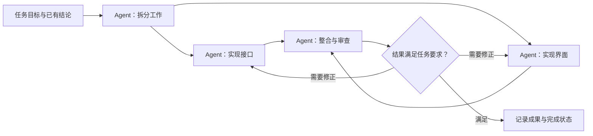
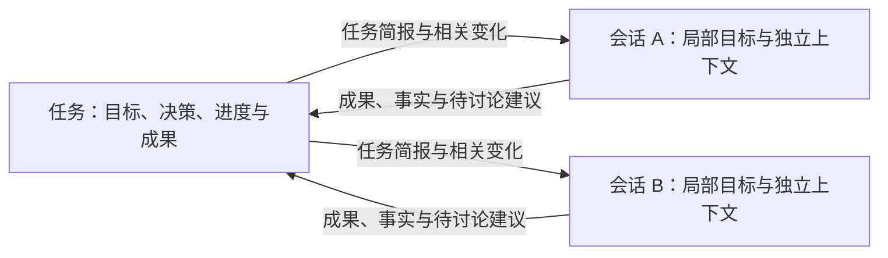

# 个人开发 Harness：需求讨论与 Loop / Graph 调研

> 更新：2026-09-17。状态：需求澄清中；本文记录已确认方向、调研证据与待讨论取舍，不是下一阶段实施方案，也不表示功能已实现。
>
> 已有成果见 [进度总览](../progress/README.md) 和 [M1 进度](../progress/m1.md)；原阶段依赖见 [总规划](coding-agent-from-zero-plan.md)。本轮不新增框架、模型、后台任务或多 Agent 实现。
>
> 最新接续：用户同意任务与会话的信息交互先大致沿用，后续结合另一会话的组件调研修订；当前继续 [初始版本产品设计](harness-initial-design.md)，不再以细化完全部信息同步机制作为设计前置条件。

## 1. 已确认的产品方向

- 产品是符合用户个人习惯的大模型应用开发 harness，日常 AI 编程与开发 / 调试大模型应用同等重要；继续采用自己的 Python 核心与桌面界面。
- 产品组织方式希望采用 **项目 → 任务 → 会话**。
- 桌面导航已明确为左侧项目 → 任务 → 会话可展开 / 折叠树；会话在所属任务下选择，主工作区显示选中会话内容，不通过右侧会话列表再找会话。
- 任务承载阶段性目标，作为相对于会话内工作的长期目标；同一任务的会话中仍可用不同模式处理用户当次对话级目标。用户提出 Plan、Goal、常规对话与执行，称为三种模式；暂按 Plan / Goal / 常规（对话与执行）理解，具体行为边界仍需讨论。
- Goal 模式已确认：在会话中设定局部目标后，Agent 自动连续推进多个回合，直到目标完成、用户停止或确实需要用户介入。局部目标与任务长期目标的完成范围分开。
- Goal 中普通插话默认先回答，再继续原目标；用户明确要求停止、暂停或改变目标时遵循新指令。
- 独立 Code Review 会话由用户主动启动；当前会话内的必要自查按任务需要进行，不默认在每个实现类 Goal 结束后创建独立 Review 会话。
- 首批交付就应能实际完成一次简单而完整的代码任务，包含读取、修改、必要执行验证和结果交付；只交付任务管理界面或只读能力不足以达到这一目标。
- 默认直接使用用户选择的原项目目录，不为任务 / 会话自动创建代码副本；独立副本只作为可选工作方式。日常协作依靠明确范围、已知依赖和 handoff，保留写入基线与局部冲突处理。
- 会话分工采用简短、可编辑的说明，表达当前负责什么、完成程度和协作关系，允许通过自然语言调整；handoff 交接已完成工作、文件和接口变化、未决事项与下一步，不要求复杂表格或固定文件白名单。
- 正常工作在既有范围内直接推进，需要额外沟通时引入 HITL；执行失败停在当前进度，Goal 中途失败时同时停止 Goal 自动续跑，待用户明确接续。
- 测试命令正常运行但未通过时先报告结果，不自动开始修复；只有当前请求 / Goal 已明确包含修复或优化，且问题在相应范围内时才继续处理，不重复询问已有授权。
- 用户补充文件编辑、代码运行、联网搜索等实际工具的重要性，现有只读工具不足以执行完整任务；工具清单保持开放，具体实现与分批范围继续讨论。
- 执行先使用 Windows 本机 / 项目已有环境，设置统一管理 Python、Conda、uv、Docker 等；用户已将 CUDA 更正为 Conda。WSL 直接执行后置，可信项目默认本机直接运行，沙箱按项目选用。
- 使用入口已确定为先新建任务，再围绕任务开展工作；创建时的具体字段尚未确定。
- 应用提供分阶段的内置 skill，覆盖任务讨论、具体实现、code review、多会话协作和 handoff，帮助用户按自己的习惯推进工作。用户将多会话分工与交接视为多 Agent 协作方向。
- 上述环节是用户给出的重要示例，清单保持开放。需要结合日常 AI 编程和大模型应用开发补充遗漏，再通过逐项讨论确定完整需求；不能把示例列表直接冻结为最终范围。
- 产品以任务为工作单位，用户习惯作为其中一个工作流或默认工作流；未来可自定义其他流程，定制入口可以延后。工作流需包含完整 coding agent 层面的 loop / graph 能力，默认流程细节与实施范围继续逐步讨论。
- 同一任务的新会话自动带入任务目标、进度和已确认结论，历史详情按需读取。
- 希望逐步实践记忆、上下文管理、loop engineering、graph engineering 等方法，先讨论需求，再制定下一阶段计划。
- 用户明确补充：本轮所说的 loop / graph，其工作主体是完整 coding agent，关注 Agent 层面的持续工作和组织方式。

前一轮问答曾把 graph 拆成“执行图 / 知识关系图”供选择，用户当时表示都可探索。随后明确了上述 Agent 层级，因此不能把这次 graph engineering 需求理解为已决定建设知识图谱或细粒度模型调用图。知识关联仍可作为后续记忆研究方向，具体范围未定。

## 2. 七月社区讨论的核对结果

2026-06-07，Addy Osmani 的 [Loop Engineering](https://addyosmani.com/blog/loop-engineering/) 已把关注点放在围绕 coding agent 组织持续工作：由系统发现与分配工作、检查结果、保存进度并决定后续动作。这里的讨论超出了单次模型调用中的工具循环。

2026-07-22，LangChain 的 [3 Years of Graph Engineering with LangGraph](https://www.langchain.com/blog/3-years-of-graph-engineering-with-langgraph) 回应了当时的 graph 话题，并链接 Peter Steinberger 关于 loops / graphs 的帖子。文章也讨论了完整 agent run 作为节点的变化。它是这波讨论的一篇回应，不能据此把概念起源归给 LangChain，或直接确定本项目使用 LangGraph。

这支持用户记忆中的“七月那波讨论”。本轮未直接读取到 X 原帖正文，不认定某条帖子是术语首创，也不把“graph 取代 loop”当成已确立的技术结论。

更贴近本次需求、有公开源码的实例：

| 项目原始资料 | 与本次需求有关的设计 | 阅读边界 |
| --- | --- | --- |
| [GraphCode](https://github.com/scgopi/GraphCode) | 节点对应真实 coding-agent 会话中的工作单元，边表示交接、消息或启动其他工作；能进入会话干预 | 参考其产品组织与交接表达；不因此采用它的外部 CLI 包装路线 |
| [Graphroom / AI-GraphAgent](https://github.com/Akshay-a/AI-Agents/tree/main/AI-GraphAgent) | 外层图调度完整 Codex 工作循环，给各节点组装上下文并记录结构化产物；其 README 说明当前示例逐个激活节点 | 证明粗粒度工作单元与实现框架是两个问题；其使用 LangGraph 不代表节点必须细化成单次 LLM 调用 |
| [geng / graph-engineering](https://github.com/AdityaIndoori/graph-engineering) | 一次 agent 命令执行作为节点，产物文件连接依赖，展示独立上下文与工作交接 | 只借鉴边界；进程成功退出不能直接等价为用户目标已完成 |

以上为 2026-09-16 阅读项目公开说明所得，未安装或运行这些项目，不作为其性能、隔离或恢复能力已经通过本项目验证的证据。后续若复用源码，再固定具体提交并评估许可证。

同日产品对照补充核对：GraphCode 的 app / daemon 当前采用 FSL-1.1-MIT，部分组件 MIT，应称源码可用，替代此前笼统的“开源”归类。详见 [任务工作流产品对照](task-workflow-products-review.md)。

## 3. 本项目讨论采用的层级

| 层级 | 工作单元与关注点 | 当前情况 |
| --- | --- | --- |
| Agent 内部循环 | 一次运行中的模型请求、工具结果与继续生成 | M1 已实现只读版本 |
| Loop engineering | 围绕明确目标驱动完整 coding agent，根据结果和进度决定继续、纠偏、暂停或结束 | 本轮研究方向；不把已有工具循环算成已经交付这一能力 |
| Graph engineering | 组织多个有明确职责的 Agent 工作单元，表达依赖、上下文交接、分支、汇合与反馈关系 | 本轮研究方向；尚无图调度器或多 Agent 功能 |

这里采用的是针对本产品的工作定义，不主张整个社区只有一种定义。节点可复用同一套 coding agent 核心，以不同目标、上下文和工作范围承担职责；不要求每个节点对应不同模型或长期存活的独立进程。

下面是未来可能支持的一种开发方式，**仅作概念示例**，不是每项任务都必须经过的固定流程：

图中的实现节点内部仍可多次调用模型、读写代码并根据反馈修正。是否能并行由真实依赖和工作区写入关系决定；是否需要检查、检查什么，由本项工作的验收目标决定，不默认执行全量测试。图可以包含回路，DAG 只是部分实现采用的形式。

LangGraph 等属于实现选择；先明确 Agent 工作和交接语义，再评估是否需要引入框架。当前“自己的 Python harness + OpenCode Go 双模型”的基线保持有效。

## 4. 与项目、任务、会话及记忆的关系

以下是基于已确认方向的**设计建议，尚未成为已批准的字段或实现清单**：

- **项目**提供代码与项目约定的归属。
- **任务**承载阶段性长期目标、约束、当前进展、已确认决策、待解决事项和产物索引，生命周期可以跨多个会话。这里的长期是相对于会话内的局部工作，不要求一个任务覆盖项目的全部生命周期。
- **会话**承载具体交互与上下文历史，并在其中处理对话级目标、使用相应模式；新会话按用户已确认要求读取任务信息，再按需查看历史证据。模式与任务类型、工作流阶段分别表达。
- **对话级目标与模式**描述当前要解决什么、怎样推进；目标可以需要多轮交流或多次运行，不机械等同于单条消息。详细状态与持久化结构尚未定稿。
- **Agent 工作单元**表示本次承担的具体工作。未来图节点如何关联会话和运行记录，需要另定；不要提前固定成一个节点等于一个会话或一次工具调用。
- **运行记录**继续标识一次实际执行，供事件归属、停止与用量追踪。现有 `run_id` 不应直接改名成持久任务身份。
- **记忆与上下文管理**负责保存哪些结论、给当前工作哪些信息、何时读取证据以及如何纠正过期内容。图中的交接需要这些能力，但它们也服务于普通单 Agent 使用。

自动接续仍需区分用户确认与模型推断。建议让任务摘要可查看、可修正，并能找到对应历史或产物；详细的写入规则、跨任务共享范围及失效机制继续讨论。

### 4.1 任务入口与内置阶段 skill（2026-09-16）

**本轮已确认**：用户选择先新建任务，并希望应用内置 skill，指导任务讨论、实现、code review、多会话协作和 handoff。这些是初始举例，用户明确要求共同补充后再逐步确定完整版本。这里的 skill 是本应用的产品能力；当前只记录需求，没有创建开发助手技能或安装插件。

**由此提出的职责划分，等待继续讨论**：

| 对象 | 建议职责 |
| --- | --- |
| 任务 | 持续保存目标、进度、已确认结论及成果的归属 |
| 阶段 skill | 描述当前工作的开展方式、需要哪些输入以及应产出什么 |
| 会话 | 承载连续交互与上下文，可围绕不同对话级目标使用相应模式和 skill 推进任务 |
| 协作与 handoff | 在参与同一任务的会话之间分工、传递必要上下文、交付结果和接续未完成工作 |

建议把 skill 做成用户可理解的工作指引，同时给 Agent 明确的行为指导。下表是讨论中的初步职责与产物示例，不是已经确认的模板字段或验收门槛：

| 内置 skill | 初步工作方式 | 预期沉淀 |
| --- | --- | --- |
| 讨论 | 逐个澄清问题，提出取舍，区分已确认结论与建议 | 目标、约束、决策和待讨论项 |
| 实现 | 读取任务结论，确定本次范围，实施并说明结果 | 变更、实际验证结果、剩余问题与进度 |
| Code review | 基于明确的变更和任务目标检查问题，给出依据 | 可定位的发现、影响和修正建议 |
| 多会话协作 | 明确参与会话的职责、依赖、输入输出及工作范围 | 分工、待交付成果和协调状态 |
| Handoff | 整理下一会话需要的目标、已完成工作、未决事项和历史入口 | 可核对的交接说明及下一步 |

建议允许按需要选择、重复或返回某个阶段；协作与 handoff 可以在讨论、实现和审查中使用，不必只放在流程末尾。每个阶段是否新建会话、多会话是否并发、Agent 能否主动分工与切换阶段，均未确定。

多会话协作需要表达分工和成果交接，不能仅凭存在多个聊天窗口就视为协作已实现。参与者可以复用同一套自有 Agent 核心；具体上下文共享、工作区关系与调度方式在后续讨论中确定。

Skill 负责行为指导；应用仍负责加载正确上下文、保存事实并执行已有权限边界。尚未选定 skill 文件格式、存储位置、自定义 / 版本机制或图编排框架。

**保留的待讨论项**：阶段由用户主动选择、Agent 提议后由用户决定，还是在用户给定目标与工作范围后由 Agent 自主推进。后续用户补充了任务与对话级目标的区分，当前优先澄清 4.5 节的会话模式；任务阶段切换不能直接等同于切换模式或创建会话。

### 4.2 开放的工作环节清单（候选，尚未定稿）

用户要求通过持续讨论补全需求。本节按从想法到交付及后续迭代的实际工作补充候选项，用于发现遗漏；表内新增能力尚未批准进入下一阶段，也不要求每个任务走完全部环节。

| 候选环节 | 需要解决的使用问题 | 与已有举例的关系 |
| --- | --- | --- |
| 需求讨论 | 澄清目标、约束、用户取舍及完成条件 | 用户已提出 |
| 项目理解与调研 | 理解现有代码、复现已有行为，必要时查证外部资料 | 补充建议 |
| 方案与工作拆分 | 比较实现方案、确定范围和依赖，形成可推进的工作项 | 补充建议 |
| 实现与原型实验 | 修改代码，或先用小型原型验证技术假设 | 实现由用户提出；原型实验为补充建议 |
| 问题诊断与修复 | 定位运行失败、性能或模型行为问题，保留原因与处理结果 | 补充建议 |
| 大模型应用效果评估 | 针对明确目标比较 prompt、模型配置、检索、记忆或 Agent 策略，记录输入、配置与结果 | 补充建议，服务于用户同等重视的大模型应用开发 |
| Code review 与结果验收 | 审查实现，核对结果是否满足任务目标，处理发现的问题 | Code review 由用户提出；结果验收为补充建议 |
| 交付与任务收尾 | 整理成果、运行说明、变更记录、遗留问题与后续任务 | 补充建议；实际 Git / 发布行为另按任务授权 |

建议把以下能力贯穿各环节，而不是全部排成必须依次执行的阶段：

- 用户已提出的多会话协作、handoff、记忆与上下文管理；可进一步讨论暂停 / 恢复、分支探索和成果汇总如何工作。
- 运行状态、工具权限、用量与耗时，以及失败后怎样继续；沿用既有能力，按实际新需求补充。
- Skill 的查看、调整和后续扩展方式；是否允许用户修改内置版本、保存自己的做法，尚待讨论。

大模型应用效果评估是一类可选择的业务工作，不自动成为每次代码变更的回归门槛；范围与证据由任务目标决定。也不据此引入数据平台、额外 provider 或全量评测设施。

接下来先明确这些 skill 如何参与任务推进，再逐项确定输入、输出、人与 Agent 的分工及需要的持久状态。候选清单用来检查完整性，不作为一次性实施清单。

### 4.3 创建任务时的分类（建议，等待用户取舍）

用户提出是否应在创建时确定任务类型，并举出应用开发、日常编程、会话和局部细化。本轮是分类方式讨论，尚未确认必填类型或最终分类清单。

**建议**：创建时提供可选的任务类型，默认允许通用 / 暂不分类，后续可调整。类型表示本次工作的主要目标，用来推荐起始 skill、上下文重点和预期产物。类型不锁定全部阶段，也不自动赋予写文件、执行命令或发布的权限；改变类型不能静默改变已确定的范围与历史事实。

用户举例涉及几个不同维度，建议先分清职责：

| 例子 | 建议放置方式 |
| --- | --- |
| 应用开发 | 开发目标的一种，既可能从零构建，也可能改造现有应用 |
| 日常编程 | 覆盖开发、修复、重构等多种目标的使用场景，不单独与它们并列 |
| 会话 | 已确定的交互与上下文容器；用户随后确认任务内会话可做常规对话，纯问答不应强制另建一种任务；独立长期咨询是否单独分类仍待确认 |
| 局部细化 | 工作范围大小，可发生在方案、代码或界面中；范围先在任务说明中表达 |
| 大模型应用、前端、后端等 | 项目或任务涉及的领域；后续可用标签 / 模板细化，暂不增加必填项 |

按主要目标划分的第一版候选：

| 任务类型 | 典型场景 | 起始 skill 建议 |
| --- | --- | --- |
| 探索与咨询 | 理解代码、技术问答、需求探索、调研和方案设计 | 讨论、项目理解、调研 |
| 开发与修改 | 从零做应用、增加功能、编写脚本、局部细化 | 根据目标清晰度选择讨论 / 设计或实现 |
| 诊断与修复 | 定位报错、复现异常、修复不符合预期的行为 | 诊断、修复 |
| 重构与优化 | 改善结构、可维护性、性能或资源消耗 | 分析、方案、实现 |
| 审查与评估 | 独立 code review，比较 prompt、检索、记忆或 Agent 策略的效果 | Review 或实验评估 |
| 文档与工程维护 | 更新文档、维护依赖 / 构建配置、整理交付材料 | 文档、工程维护或交付 |

“通用 / 暂不分类”作为兜底入口，不要求用户在创建时理解全部类型。此列表尚未批准，也不是封闭枚举；混合任务按当前主要目标选择，必要时改类或在任务内组织不同工作。

同一名称可能用于不同层级：独立提交一份 review 报告时，主要目标可归入审查任务；开发过程中进行 review 时，它是开发任务里的一个工作环节。任务类型、当前阶段、已启用 skill 和会话身份应分别表达，不能用一个 `type` 字段包办它们。

创建流程建议仅要求足以识别任务的基本输入；具体字段另定。分类可由用户直接选择，也可在开始讨论后再建议，不为分类强制新增一次模型调用或阻塞创建。改变类别继续保留同一任务及已有会话；是否另建任务应由工作目标是否已经变成另一件事决定，而非分类字段变化自动触发。

例如“给 RAG 应用增加引用来源”可归入开发与修改，以 RAG 为领域、引用显示为范围，先讨论再实现和审查；“比较两种检索策略”可归入审查与评估，以实验结论为本次产物。这两种工作都属于大模型应用开发，但适合不同的 skill 组合。

**待确认**：是否接受这种可选、可调整、按主要目标分类的方式；用户所说的“会话”是否包含可以长期保持纯讨论 / 技术咨询、不要求最终产出代码的任务。此前 skill 选择与阶段切换的控制方式仍未确定，保留为后续问题。

### 4.4 任务级工作流（产品方向已确认，细节讨论中）

用户进一步提出将产品做成“以任务为单位的自定义工作流 agent”，要求评价并调研相近产品。随后明确：其个人习惯可成为其中一个或默认工作流，未来支持其他自定义流程，定制功能可以延后；工作流内部应有 loop engineering / graph engineering 的实现。该产品方向已确认，最终架构、流程细节及自定义的形式仍待定；此前任务类型、skill 控制方式与纯讨论场景的问题继续保留。

已完成官方资料对照，记录于 [任务工作流产品对照与设计讨论](task-workflow-products-review.md)。相近参照包括 Aperant / Auto Claude 的任务桌面流程、GraphCode 的 Agent 工作图、Devin Dynamic Workflows 的多会话编排，以及 Vibe Kanban 的任务工作区和 Dify 的工作流编辑。维护与许可证差异按来源记录，未安装或试运行。

当前建议将任务目标与成果、可复用工作流模板、任务内实际执行状态、skill 和会话分别表达。任务类型可用于发现模板，节点以完整工作单元为主；模板改动不静默覆盖运行中的任务。这些是建议，未批准进入实现。

当前建议把共同执行层、用户习惯对应的默认工作流、后续定制入口分开。目标循环、依赖 / 条件转移、工作成果与 handoff 要在默认流程需要的范围内真实运行；具体业务顺序属于默认流程定义。还未决定模板格式、并发方式或通用图框架。

用户补充后，优先事项已由“选择自定义编辑方式”调整为“逐步明确默认工作流”。最新补充进一步区分任务的阶段性长期目标与会话内目标，当前先澄清会话模式，再讨论其成果如何推进任务工作流，以及 review 反馈循环、分支、多会话协作与恢复；定制入口延后。本轮不直接开始编写执行引擎或预定新阶段范围。

### 4.5 任务的阶段性目标与会话模式（2026-09-16）

**已确认**：任务以阶段性目标作为长期目标；任务内的一个会话仍能使用不同模式实现用户的对话级目标。用户另行确认 Goal 能围绕局部目标自动连续推进多个回合，直到目标完成、用户停止或确实需要用户介入。任务目标、工作流阶段、会话上下文和当前交互方式需要分别表达。

初版设计中进一步确认：Goal 运行时普通插话先得到回答，然后继续原目标，不要求用户额外手动恢复。停止 / 暂停 / 换目标等明确指令另行处理；保留原目标的进展与累计用量，具体调度见 [初版设计稿](harness-initial-design.md) 的交互说明。

用户表述为“Plan、Goal、常规对话和执行三种不同的模式”。当前暂按 **Plan、Goal、常规（对话与执行）** 三种理解；没有把执行擅自确定为第四种模式。Goal 的持续推进方向已经确认，下表其余具体行为是待讨论建议：

| 模式 | 用途 | 结束与范围边界 |
| --- | --- | --- |
| 常规（对话与执行） | 建议用于回答问题，或按本次明确请求完成一项操作；可按需调用工具 | 建议完成当次请求后返回用户，不因任务仍有未完成工作而自动继续下一个目标 |
| Plan | 建议用于理解当前情况、澄清要求、比较方案，形成当前局部目标的计划 | 输出计划与待定项；建议不因生成计划就自动开始改业务代码。允许哪些读操作与计划文档保存仍需明确 |
| Goal | 已确认用于会话内局部目标的持续推进；建议同时记录进展、完成条件和证据 | 自动跨多个回合推进直到目标完成、用户停止或需要介入；底层请求预算与自动续跑的计费、停止和恢复规则仍需细化 |

模式决定当前的推进方式，不另行扩大工具权限、任务范围或 Git / 发布授权。Goal 的局部目标与任务的阶段性长期目标分别保存；完成前者只更新相关成果和进度，不直接把整个任务标为完成。建议切换模式时保留已有上下文与结果，进行中的目标怎样暂停或继续需明确表达，不能悄悄丢弃。

例如任务目标是“交付项目记忆功能初版”，同一个会话可以先用常规模式讨论现有问题，再用 Plan 比较持久化方案，然后用 Goal 推进“实现已确定的摘要保存行为”这一局部目标。完成摘要保存只代表相关工作完成，任务是否结束还要核对其余阶段性要求。该例不要求固定的三步顺序，也不预定下一阶段开发记忆功能。

与工作流和 loop / graph 的关系建议如下：

- 工作流记录任务中各工作单元的依赖、成果和交接；会话模式控制当前交互怎样开展。任务处于实现环节时，仍可使用 Plan 重新设计一个局部问题，或用常规模式询问进度，不必先修改整个任务的阶段。
- Goal 可成为会话内围绕局部目标的完整 Agent 循环；任务级工作流也可能组织跨工作单元的反馈循环。两者的目标、停止和完成范围分别表达，不共用一个完成标记。
- 图中的工作单元与会话、局部目标之间可以关联，但暂不固定一对一。一次模式选择不是自动启动整张图的授权，也不意味着必须创建一个新节点。
- 计划、回答和局部执行结果如何转为任务的已确认结论、进度与下一步，需要继续讨论；模型的临时提议不能直接成为任务事实。

**后续讨论**：局部成果如何更新任务进度的建议见 4.6 节；普通插话的默认接续已经明确，任务完成判断和用户主动切换模式时进行中的 Goal 怎样接续仍需取舍。三种模式的详细权限、局部目标持久化与工作流联动尚未定稿，未开始实现。

### 4.6 任务与会话之间的信息更新（2026-09-16，暂用设计基线）

用户询问任务和任务内会话如何交互、更新信息。本节提出默认行为建议，继续沿用已确认的任务长期目标、会话局部目标和自动带入任务信息；以下同步策略、界面和完成规则尚未确认，不构成实施授权。

后续用户表示这一部分先大概沿用，另一个会话正在对 Coding Agent 组件深入调研，未来可能据此修订。本节作为初版设计的临时基线继续使用；方向暂采用，不等于所有实现细节、任务完成规则或并发策略已经定稿。

建议任务保存所有参与会话可共用的信息，会话保存各自的详细过程；每次只同步有意义的变化，保留来源和状态。任务不依赖某个聊天窗口存活，也不要求先增加一个持续调用模型的“任务管理 Agent”。

#### 信息分别保存在哪里

| 位置 | 建议保存的内容 | 作用 |
| --- | --- | --- |
| 任务 | 阶段性目标与完成条件、约束、已确认决策、工作项与依赖、各会话当前负责的工作、成果索引、未决问题 | 为各会话提供共同背景和当前进度 |
| 会话 | 对话历史、当前模式、局部目标及进度、探索过程、尚未采纳的方案、执行与工具记录 | 保留当前工作的具体上下文，支持继续讨论、Goal 循环和追溯 |
| 任务变更记录 | 谁更新了哪一项、依据的消息或执行结果、适用版本和原值、是否待讨论或已被取代 | 解释当前状态的来由，支持纠正与跨会话交接 |

任务摘要是这些信息的可读视图；记录项、原始消息与成果仍可定位，不能只剩一段无法核对的自动摘要。某会话的局部假设可以供其他会话按需查询，但要保留其未确认状态。

#### 任务向会话提供什么、何时更新

- 新建或恢复会话时，自动带入任务目标、约束、已确认结论，以及与当前局部目标有关的工作项、成果和未决问题；完整历史与大文件保留按需读取入口。
- 普通模式下一轮开始前、Goal 准备继续一个工作回合时，以及即将使用共享接口或重要决策前，核对是否有相关更新；没有变化就复用已知任务信息。
- 其他会话产生的变化先保存并通知当前会话，在下一次准备上下文时明确提供新增、修订或失效内容。已发出的模型请求不假装能被原地修改；影响下一步副作用的目标 / 接口变更在动作前复核，不把无关更新当作全任务暂停理由。
- 收到信息不等于自动获得新的工作目标。是否开始下一项工作仍由当前请求、局部 Goal 和已授权的工作流规则决定；跨任务共享与全局记忆不在本次默认范围内。

#### 会话向任务写回什么、何时写回

| 产生的信息 | 建议的默认处理 |
| --- | --- |
| 局部 Goal 开始、等待、暂停、完成，以及实际工具 / 执行结果 | 运行系统自动记录相应工作项的真实状态和结果来源；成功写文件仅证明文件修改发生，不直接证明整个功能可用 |
| 用户在会话中明确决定了目标、约束或方案 | 直接同步到相关任务记录，关联用户原话；含义明确且范围相符时不要求再次确认 |
| 模型形成的方案、判断或完成声明 | 可自动登记为建议、会话报告或待核对结论；不能仅因重复出现就升级为用户决定或已验证事实 |
| 已完成的局部成果与实际验证 | 保存产物入口、适用代码版本 / 工作区、检查范围和结果；未验证就照实记录，不为同步进度强制新增测试 |
| 模型提出改变长期目标、扩大范围或推翻已有决定 | 作为任务变更建议呈现；已有用户明确授权的变更按授权处理，不能要求重复批准，也不让模型自行覆盖决定 |

明确决定发生、产生可供其他会话使用的成果、完成工作项、遇到阻塞、Goal 暂停 / 结束或进行 handoff 时写回。持续 Goal 可以在中途交付局部成果，不必等整个会话结束；普通闲聊和没有新事实的回复不强制触发一次摘要生成。

日常状态与来源由应用保存，必要时由模型提取语义结论，避免每条消息都额外调用一个模型做全量总结。待同步内容要能在中断后找回并避免重复应用；任务写回失败需显示未同步状态，不能因此丢弃会话已有成果或冒充任务已更新。具体持久化格式与恢复机制留给实施方案。

#### 多会话更新与冲突

每项任务信息保留身份、来源和修订记录。不同会话更新不同工作项可以分别合入；涉及同一项且互相矛盾时显示冲突和依据，不采用最后发言者覆盖前者的规则。共享信息的版本变更只要求复核实际受影响的内容，不能因任意计数变化阻断所有工作。

例如会话 A 中用户已确认使用 SQLite，会话 B 在探索中建议另一种存储，B 的建议可以进入待讨论区，但不会替换当前决定。如果用户随后明确改选，保存新决定及其来源，并将旧决定标为被取代；正在依赖旧决定的会话在继续相关工作前得到提醒。

元数据更新统一经过 Python 业务服务，参与会话不各自改写整份任务文件。任务信息一致性与项目文件并发是不同问题；未来若使用不同工作副本，某会话的分支成果必须保留工作区 / 版本信息，不能把未整合成果描述为所有会话都已拥有的代码。

#### 桌面使用方式与工作流衔接

建议任务页显示目标、工作项、已确认结论、成果、未决问题及所属会话；会话旁提供精简任务信息和本会话局部 Goal。发生同步时展示简短变化与来源入口，允许用户直接修正或将选中的结论记入任务。撤回信息记录不等于回滚代码或撤销已经发生的操作。

导航位置随后已由用户明确：项目、任务与会话统一放在左侧折叠树，主工作区展示所选会话或任务内容；本节的任务概览与旁栏不替代左侧会话导航。详细说明已进入 [初版设计稿](harness-initial-design.md)。

例如任务是“完成记忆功能初版”：会话 A 确定方案后将已确认决策和待实现项写回；会话 B 创建时带入这些内容，用 Goal 实现其中一项并交付成果；会话 C 按需读取成果做 review，把发现关联到对应工作项。各会话无需复制另外两个会话的完整聊天，任务也不会因 B 的局部 Goal 完成而自动结束。

这些成果可作为 loop 继续或修正的依据，也可满足 graph 中后续工作单元的输入条件；登记信息本身不自动调度新会话。是否满足依赖、是否允许启动以及需要何种证据，由工作流的具体规则决定。

建议第一版自动记录日常进度和有依据的成果，将任务整体完成单独展示；是否需要用户收尾，或可按预先约定的条件自动完成，继续讨论。这里没有要求所有任务必须完成同一组测试、按固定步骤推进或得到额外审核。

**后续接续**：当前先沿用“事实自动同步、建议保留状态、用户已作决定直接记录”的方向，不再重复询问是否暂用；具体实现与任务整体完成规则可在研究后修订。接下来推进 [初始版本产品设计](harness-initial-design.md)，本节机制尚未实现。

### 4.7 默认流程、模式切换、Review 与交接的初版细化

用户要求继续推进初版设计稿，本轮在 [初版设计稿](harness-initial-design.md) 补充任务创建 / 状态、三种模式、主动切换与暂停恢复、工作方法选择、Goal 反馈依据、独立 Review 与修正、三种会话接续方式，以及局部交付和任务收尾。新增行为按默认建议记录，没有把所有细节写成用户已批准规则。

本轮另行确认独立 Review 由用户手动启动；与原会话中的必要自查分开。普通插话后继续 Goal 的既有选择保持；用户主动切换到 Plan / 常规时暂停原 Goal、任务由用户明确收尾，以及 handoff 的细节均为待调整建议。

设计稿包含从创建任务、Plan、Goal、插话、模式切换、手动 Review、修正 / handoff 到任务结束的桌面行为走读。这是设计核对，不是功能实现或测试证据。下一项建议明确最小业务对象、历史会话归属与首批可交付范围；组件实现继续结合另一会话的调研修订，不据此开始新阶段。

### 4.8 首批完整代码任务与多会话并发

用户明确首批交付要完成一次简单而完整的代码任务，替代此前先把任务导航与接续作为首批交付终点的建议。已在 [初版设计稿](harness-initial-design.md) 5.1 节定义从桌面目标、实际模型读取 / 编辑、最小执行验证、必要修正到差异审阅与持久成果的路径；开发可分步，验收不能停留在任务界面或假执行。

用户同时提出文件不冲突时可并发的判断。本轮按允许独立会话并发的方向设计，说明只看写入文件名不足以判断共享接口、读写依赖、运行环境及 Git / 端口等资源的影响；5.2 节提出操作级资源协调、基线复核和结果版本记录，替代笼统将会话整体串行的建议。具体机制仍为方案，不能声称已经自动检测全部冲突或实现并发。

2026-09-17 补充：用户再次强调合理任务拆分足以支撑正常协作。此前偏重通用资源调度的建议已在初版稿 5.2 节收敛，以分工、已知依赖和 handoff 为主；正常编辑直接推进，基线与 diff 自动记录，只在实际冲突时处理相关工作。不要求逐文件审批或默认冻结整个项目，不把复杂冲突管理列为初版前置；保留防止静默覆盖及已有故障停止规则。

工作目录按下一节的用户新决定默认使用原目录，副本可选；执行隔离、实际验证、文件基线与冲突检查继续有效。不会因允许多个会话就将未经隔离的宿主命令视为安全。当时尚未决定自动启动协作 Agent；后续 4.16 已明确区分禁止自主新建正式会话与开关控制的临时子 agent，以该新决定为准。复杂动态分工与图汇合仍可结合调研后置。当时仍在设计，没有运行真实模型、编辑用户项目或开始下一阶段实现。

### 4.9 默认使用原目录，独立副本可选

用户明确不默认创建副本：规划会话范围并做好 handoff 后，日常工作直接在原项目推进；独立副本作为可选项。这替代此前任务默认各有副本的建议，不再把副本准备与差异写回作为普通任务的必经步骤。

同一项目的任务与会话默认引用同一个实际工作目录，新建文件直接成为该目录中的项目文件，共用目录的会话可以接续读取和修改。模型需获取最新文件与有关任务更新；新建会话、并发或交接不自动复制代码，也不自动创建分支。任务数据、会话历史、基线记录与日志仍保存到应用数据根。

日常协调以目标、模块范围、已知依赖和交接信息为主，运行时保留写入前的基线复核、新文件不得覆盖已有路径、实际共享资源的局部协调。不强制用户预先列完所有文件，也不因一次冲突自动复制整个项目。直接模式修改保存后已经进入原项目，diff 用于审阅、追溯和后续修正；仅用户选择副本时才增加成果整合。停止会话不自动撤销已写入内容，任务成果需与用户及其他会话的修改区分。

本轮同步初版设计、总规划及工程约定；仅记录设计决定，没有实现编辑、复制、命令执行或新的并发调度。

### 4.10 会话分工说明与 handoff 内容已接受

用户在解释后表示采用当前方案。会话范围指当前工作分工：负责什么、做到什么程度、怎样与其他会话衔接。初版以一小段可编辑说明展示，来自用户自然语言与任务已确认内容，后续可调整；不要求创建时填写复杂表格，不限制为固定类型，也不将涉及文件列表当作不可调整的权限白名单。

Handoff 交接已完成内容、改动文件、接口约定 / 变化、未决事项和接续起点，必要时关联实际成果与验证记录。需要触及其他会话正在负责的工作时协调分工；共享原目录与写入基线检查的既有选择保持。没有新事实的闲聊不触发机械更新，用户已经明确的调整不重复确认。

此次确认针对分工表达和交接内容，不扩大为允许 Agent 自动创建其他会话，不视为已确定所有调度、存储字段或失败恢复机制。已同步 [初版设计稿](harness-initial-design.md) 4.4 节；下一项讨论编辑与执行的授权、停止 / 恢复及成果记录，仍未开始业务实现。

### 4.11 正常推进、HITL 与失败停止

用户明确正常操作直接推进，需要额外沟通时引入 HITL，失败停在原地，Goal 中途失败也停止 Goal。本轮在初版稿 3.4 节记录为执行主规则：已有范围与授权不重复确认；HITL 保存待解决问题，得到对应答复后接续；实际失败停止当前运行与所属 Goal 的自动动作，不因还有预算就重试或另开 run。

保留已经写入的代码、执行历史、进度和失败位置，不自动回滚或标记任务完成；必要的资源清理与保存仍需执行。用户明确要求继续、重试或修复时先核对实际状态，普通问答、页面刷新或应用重启不能唤醒已经失败的 Goal。无关会话不被同一个业务失败一并停止，依赖该成果的工作等待。

用户随后明确测试结果边界：运行正常但未通过时先报告结果，不自行开始修复，除非原请求已经要求顺带优化或修复问题。因此“运行测试并报告”可在如实报告后完成，失败项依旧标为未通过；“修复该问题并验证”可按既有范围根据结果继续修复，不重复确认。若 Goal 尚未满足且需要额外修复授权，报告后进入 HITL 等待，不能将未达成目标标为完成。

新的失败规则不能被泛化的 feedback loop 绕过，也不能仅用命令非零退出码将正常无匹配或断言未通过误判为执行故障。调用是否完成、退出码和业务检查结果分别记录；真正的调用 / 执行故障停止运行及 Goal。本次仅更新产品设计，不改变本仓库开发检查的修复流程，未开始实现。

### 4.12 实际工具能力与执行环境（2026-09-16，讨论中）

用户询问下一项讨论，并补充文件编辑、代码运行、联网搜索是执行任务的重要能力，可能还需要其他工具。当前代码核对只有 `list_files`、`read_file` 和项目字面文本 `search`；原总规划另列的编辑、创建、命令与 diff 均不能当作已有实现，模型服务联网也不等于具备搜索工具。

已在 [初版设计稿](harness-initial-design.md) 5.4 节建议按项目理解、文件修改、命令与进程、联网检索、成果证据、任务协作六组讨论。用户点名的三类是明确需求，其余补充和具体工具组合仍为建议；没有把清单直接记成下一阶段全部验收项。联网进一步区分搜索与实际网页读取；命令进一步考虑启动、输出、等待、输入与停止，stdin、交互终端和长期服务的支持程度不混为一谈。

Skill 提供工作方法，工具提供实际能力，运行时控制授权 / 模式 / 预算 / 取消，loop / graph 组织完整工作单元。浏览器交互、图片查看、代码导航、专门 Git 操作与 MCP 等列作候选，未决定立即接入服务或框架。现有原目录、可选副本、正常推进 / HITL、故障停止和检查结果先报告的规则保留。

当时建议下一项先讨论代码怎样使用项目自身的运行环境，以及宿主机 / 隔离环境和进程生命周期；单纯提出工具需求尚未替换原容器方案。随后用户已在 4.13 节明确改为 Windows 本机优先，后续以新决定为准。继续收敛编辑与联网接口、状态 / 成果 / 对象关系及已有会话归属，尚未实施工具。

### 4.13 Windows 本机环境与可选沙箱（已确认默认方向）

用户选择使用本地 / 项目已配置好的环境，希望设置中统一导入管理 Python、Conda、uv、Docker 等；先在 Windows 下跑通，WSL 可以后置。用户明确更正此前 CUDA 为 Conda，因此不引入 GPU / CUDA 管理需求。进一步回答确认：可信项目默认本机直接运行，沙箱按项目选用。

该决定替代此前必须先有 Linux 容器才能执行完整任务的设计。应用自身的 CPython 3.13 + uv 不变，目标项目可以使用已选择的 Conda / venv 等环境。原目录、可选副本、明确授权、失败停止与结果报告要求保持；直接模式不被描述为操作系统隔离，沙箱不可用不静默降级到直接运行。

新增 [运行环境与沙箱设计](runtime-environments-and-sandbox.md)，提出环境列表、项目绑定、执行权限分开的方案，区分登记与安装、环境发现与实际运行验证。以 Conda / uv / Microsoft / Docker 官方资料核对调用与原生沙箱候选；AppContainer、Job Objects、Windows Sandbox 各自用途明确，未将产品默认选择视为接受全部技术细节。环境路径、权限和安装状态本轮均未实际改变。

用户随后进一步明确：环境导入后，选择项目默认环境即可。设计据此收敛为一个项目默认项，任务与会话默认沿用；撤回将多套命名配置、会话覆盖与多层优先级作为初版要求的建议。此处是界面和默认使用方式的简化，不将默认解释器变成只能调用单一程序的硬限制。

用户同时表示不理解“程序启动管理”。已在运行环境稿 4.1 节用运行脚本、执行已有检查、启动网页服务和停止程序解释，并提出轻量运行卡、服务保留与退出清理建议；没有将解释过程记成用户确认全部进程规则。下一项从这些实际行为收敛执行契约，再合入工具和对象状态设计。沙箱按项目选用已确认，具体原生隔离技术仍待验证。

2026-09-17，用户确认使用简单的可折叠运行卡片。设计据此明确收起显示命令与状态，展开查看输出和运行详情，运行中提供停止入口；折叠本身不停止程序。此次确定展示形式，服务在回复结束后保留、停止范围和应用退出清理继续保留为建议，未开始实施。

### 4.14 联网搜索与网页读取（2026-09-17，搜索接入方式已确认）

用户要求说明联网能力。已在 [初版设计稿](harness-initial-design.md) 5.6 节区分发现资料的搜索、读取已知 URL 的正文提取，以及按需后置的浏览器交互；用查官方文档后实现功能的场景说明，保留当前双模型与自身工具层。直接调用 Go 模型接口不能视为自动获得 OpenCode 应用内置搜索能力。

核对 OpenCode、Exa 和 Tavily 官方资料后，建议搜索先评估 Exa 免密钥但限流的托管入口，普通页面由 Python 直接请求和提取；Tavily Search / Extract 作为独立凭据方案候选。来源、可折叠展示、按需联网和失败停止见初版稿；尚未确定服务，不把建议或资料核对记作用户确认、实际网络效果或已有实现。未调用候选服务 API、注册账户、读取凭据或变更网络。

用户随后要求对照 DeepSeek Harness 与 Codex CLI。初版稿 5.6.1 节记录 DSH 的统一工具 / 独立 provider、Exa 直连 API、DeepSeek 辅助模型原生搜索、Perplexity 与独立 HTTP 抓取；Codex 则通过模型服务原生搜索工具接入，公开客户端代码不包含可直接移植的完整搜索服务。特别区分 DSH 的 Exa API key 与前述免密钥 MCP 候选，以及 Go 对话凭据与独立搜索凭据。仅完成源码 / 官方说明核对，没有确定搜索服务、修改模型范围或运行联网效果测试。

2026-09-17 用户进一步授权实测，希望避免额外 API key。一次 Go `/messages` + 既定 `deepseek-v4.1-flash` 请求返回 `server_tool_use`、`web_search_tool_result` 和 10 条官方文档结果，确认可以复用现有 Go key；完整请求 9.079 秒，服务报告输入 39,898 / 输出 948 token。此前仅资料核对的“待验证”结论由本次证据补齐，设计建议调整为优先 Go 原生搜索，Exa / Tavily 留作后续候选。测试未实现产品工具，未切换主对话协议或修改网络；请求与验证边界见初版稿 5.6.2 和 M1 进度。

用户随后明确“搜索先暂时敲定用这个方式接入”。当前决定据此记录为：复用现有 Go key，通过既定 DeepSeek 模型的 Messages 原生搜索完成检索；不再将该路线列作等待用户选择的候选。网页正文读取的独立实现、成果呈现与工具契约继续细化，当前确认不构成立即实现全部联网能力的指令。

### 4.15 执行过程与成果展示（2026-09-17，工作区方向与可观察性已确认）

用户询问下一步讨论什么。建议从初版稿第 3 节已有的成果区域入手，确定会话中的改动 / 运行 / 搜索入口怎样打开文件、diff、文档与日志，以及任务怎样汇总有意义的成果；右侧按需打开、可收起的工作区是建议，尚未获得用户确认。再以一次小型完整代码任务串起工具使用、停止 / 接续与交付，收敛首批实施范围。既有执行权限、失败停止、原目录和 Git 可选等决定保持，避免重复讨论。

用户随后接受上述初步工作区建议，并强调长任务不能只让用户等待流式正文：应显示发送网络请求、调用工具、代码执行等当前动作。本次确认替代上一段布局尚待确认的状态。初版稿 3.5 节据此按准备上下文、请求模型、读取项目、修改文件、执行程序、联网资料、整理成果分类；它们由实际运行事件决定，不新增任务创建时的必选类型。

状态在动作开始时展示，包含具体对象、耗时、最后事件与详情 / 停止入口；工具参数仍在接收时不能宣称已执行。等待模型、等待程序输出、等待用户和真实失败分别表达，不用无依据的“思考中”、百分比或估算剩余时间填补空白。并发活动按所属会话 / 运行分别记录，模型指标、工具日志和任务进度分层关联，不因某个工具完成就标记任务完成。具体布局和措辞继续细化，尚未实施新的产品能力。

### 4.16 会话协作角色与子 agent 开关（2026-09-17，方向已确认）

用户明确正式会话不能由 Agent 自动创建，但已有会话可通过某种方式互相访问，协作前需提前制定角色。进一步回答确认，访问既包括读取状态、结论与历史，也包括发送协作请求，由对方空闲时处理并返回结果。初版稿 4.4.1 将其落实为沿用简短分工说明的角色 / 协作关系、按需读取、请求与结果关联；忙时排队、不覆盖现有 Goal，消息不恢复失败停止或替代 HITL 答复。独立 Review 的既有用户主动安排规则保持。

用户另提出，Agent 自行拆分当前工作时可以使用子 agent，但能不用就不用；提供开关，开启后才按需要委派。产品设计将正式会话与临时子工作分开：前者由用户管理，后者归属发起请求 / Goal、向父 Agent 返回结果，不自动加入左侧正式会话树。开关默认关闭、放在会话执行设置，子工作在父会话卡片展示、由父 Agent 统一分派且首版不默认递归，是本轮具体建议，并非用户已逐项确认的 UI / 调度细节。

关闭子 agent 不影响已有会话并行协作；开启也不要求每次强制拆分。已有范围内的角色访问 / 获准委派不反复审批，权限、预算、原目录、基线检查与失败停止规则继续适用。尚未实现会话消息或子 agent，此项产品设计不授权当前开发会话实际创建其他 Codex 任务或子 agent。

用户进一步要求把子 agent 的拆分判定具体化，以可并行性和效率为例，但不限于这两个因素。初版稿新增 4.4.2：先判断工作是否能够独立交接，再比较并行、上下文隔离或专项质量收益与额外调用、交接和整合成本；主 Agent 能自己完成不构成自动否决条件。区分工具并行、已有角色会话协作和临时子 agent，采用有依据的定性判断，不以任务长度、文件数或固定评分触发。父 Agent 在正常工作回合中判断并说明分工，运行时落实开关、模式 / 权限、预算和写入检查；具体默认并发值留待实现依据确定。本项为回应用户要求提出的策略建议，尚未获得逐项确认或完成性能验证。

用户随后接受上述判定方向并要求继续下一项。独立性、实际收益与交接成本的判断据此作为初版设计共识，替代上一段“尚未获得逐项确认”的总体待确认状态；具体并发默认值、工具契约，以及此前未单独确定的开关位置 / 默认值继续按建议处理。未实施子 agent 或进行性能验证。

### 4.17 程序保留、停止与退出应用（2026-09-17，默认方式已确认）

接续运行环境稿 4.1 的未定项，新增 4.2，用“修改页面并启动给我看”讨论程序生命周期。建议临时命令随所属工作取消清理；已经交付用户使用的网页 / API 服务在回复结束、切换会话和停止 Goal 后继续运行，通过各自卡片停止；真正退出应用时明确处理本应用管理的活动工作与服务，重启只恢复记录，不自动重启程序。应用外部启动的程序不纳入清理。

用户随后明确选择“按建议：应用内保留，退出时停止”，确认切换会话或停止 Goal 时保留已交付服务，真正退出时停止，重启不自动拉起；替代上一段的默认行为建议状态。项目活动汇总入口、具体退出提示和清理契约继续细化。初版稿第 7 节走读已加入预览、停止与重启场景，下一步合流工具、成果与对象关系，再细化阶段范围；本项尚未实施。

### 4.18 完整代码任务流程（2026-09-17，设计整合）

用户要求梳理完整流程。初版稿第 7 节以已有 RAG 应用增加来源展示为例，整理项目 / 环境、任务与用户创建的会话、按需讨论 / Plan、常规执行 / Goal、文件修改、必要运行 / 预览和局部交付，随后接入用户安排的 Review、协作、handoff、任务收尾与重启接续。明确请求完成、Goal 达成、任务结束和服务退出各自独立，不将示例变成固定必经阶段。

流程同时整理插话、主动改目标、HITL、真实故障、业务检查未通过、写入冲突和预算边界，沿用既有决定。示例执行请求明确包含本次改动问题的修复，所以可以报告检查结果后继续相应修正；只要求检查时仍不自动修复。正式会话仍由用户创建，临时子 agent 按开关与收益判定使用，独立 Review 不默认启动。

新增信息归属表说明项目、任务、会话、局部 Goal、Run、成果 / 程序记录分别保存什么。任务共同信息自动带入后续会话，其他会话详细历史和协作请求仍需要预设角色 / 协作关系，handoff 中明确的接手范围可用于分工；不把任务摘要接续变成任意会话访问许可。尚未确定的数据格式、任务完成交互、模式切换细节等仍按既有建议处理，不因本次整理变成已获逐项确认。

本次是文档流程走读，没有实际运行该示例或开展验收。下一步从连贯流程中收敛对象关系、最小契约与首批范围；不自动将所有协作、记忆和图能力加入下一阶段，不改变已明确的完整代码任务交付目标。

### 4.19 流程必须从空白项目开始（2026-09-17，起始条件已确认）

用户指出上一节使用已有 RAG 项目的例子不合适，要求能在空白项目中测试流程。该要求替代本轮原有主场景：不能依赖提前搭好的源码、接口、依赖清单、数据库或测试入口；打开空目录是合法起点，实际初始化文件应由 Agent 在用户明确要求执行后完成。原目录、项目默认环境、权限、失败停止、协作与服务生命周期等既有决定保持。

初版稿 5.1 与第 7 节据此改写，提出“从零创建本地待办清单网页”作为具体候选，包含新增、完成、删除、本地持久化和启动服务。建议使用已有 Python 环境、原生页面与 SQLite，不引入额外业务 API key；这些应用细节和技术选型是本轮建议，用户已确定的要求是空白起步。手动体验在默认测试位置下选新的空子目录，保留原有内容；自动化仍使用 `.artifacts/tests/` 的隔离目录，不改变全局路径默认值。

补充可直接使用的 Plan / Goal 示例请求、预期产物与可观察结果，明确首轮从零创建、后续在用户新建会话中接手增加筛选功能，可以分别覆盖初始化和已有文件编辑 / handoff。页面人工体验、程序 / HTTP 检查、演示应用业务数据持久化及 Harness 任务记录持久化分别表达；联网、Review 和子 agent 作为按需追加体验，不强迫小应用跑完所有工具。

本次仍是设计修订，没有创建脚手架、清空目录、启动服务或执行流程测试；当前 M1 只读能力尚不能完成该场景。具体实施与验证在文件编辑、执行等必要能力接通后进行，不把文档中的输入或目录树记成已创建的真实产物。

### 4.20 下一阶段实施范围与顺序（2026-09-17，方案已整理）

用户要求评估下一阶段如何实现，以及是否还有必须讨论的缺口。已核对现有源码：空目录登记可复用；运行循环固定只读，会话服务全局只有一个活动 Run；Task / Goal、写入工具、项目执行和角色协作尚未实现。Go 模型、HTTP 池、会话存储与协议基础继续复用。

新增 [下一阶段实施方案](next-stage-implementation-plan.md)，以空目录完整代码任务为目标，提出 A–F 批次：任务与接续、真实编辑、项目运行、Goal / 默认工作流、联网、跨会话协作与交付。每批带桌面入口；第三批可体验常规模式闭环，不能把仅有任务管理的第一批当作完整交付。旧会话兼容、任务信息来源、真实执行与服务生命周期、独立会话并发、最小验证均纳入方案。

自动临时子 agent、自定义工作流编辑器、复杂记忆和可选隔离后端建议后置；角色会话读取 / 请求、手动 Review / handoff 保留在本次范围建议中。安装包要求仍在路线内，暂不重编号里程碑。上述分批属于当前实施建议，未宣称用户已逐项接受；现有需求足够继续，尚需处理的主要是数据 / 协议兼容、进程清理与状态衔接等工程细节。本轮未开始产品实现、创建演示项目、运行模型或提交 / 推送。

## 5. 已有代码与下一阶段的取舍

核对 [会话对象](../../src/my_agent/sessions/types.py)、[历史上下文装配](../../src/my_agent/sessions/store.py) 和 [只读循环](../../src/my_agent/runtime/loop.py)：当前是项目直接关联会话，运行属于会话；没有独立任务实体，也没有任务摘要驱动的跨会话接续。当前模型上下文来自该会话的完整消息与配对工具结果。

任务层与跨会话上下文连续性已进入当前初版设计，是外层 loop / graph 可复用的基础。用户进一步要求首批即能完成真实代码任务，文件编辑、命令执行和成果验证因此一并进入下一阶段范围建议；不能仅通过增加任务列表就宣称完成 coding loop。

原路线中的 M2 是桌面打包，M6 才集中处理长任务与上下文。当前 [实施草案](next-stage-implementation-plan.md) 建议重组这条依赖顺序，先形成可体验的代码任务闭环；暂不重编号、不删除打包验证要求，也不提前为所有后续阶段建立文件。

此前等待讨论的模式、Review、协作、handoff、恢复和空目录主场景，现已在第 4 节后续记录与初版设计中收敛。4.6 的信息更新仍可结合调研调整，实施草案先采用可追溯任务事实、按需历史读取和最小工作项依赖，不要求预先决定全部记忆或图技术。

下一步从实施草案 A 批的任务 / 会话关联与桌面导航开始细化和实现；实际实施按用户届时明确的任务范围推进。本轮仅完成方案，不视为已授权代码实现。
