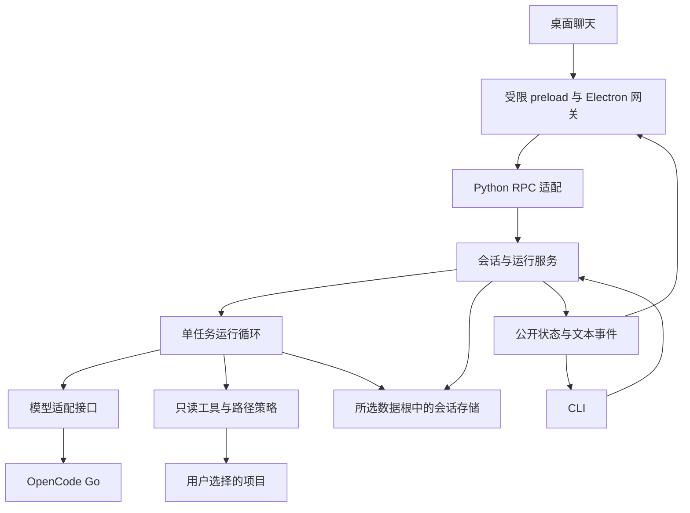

# M1 实施细化：桌面可用的只读 Agent

> 编写日期：2026-09-15
>
> 本文定义 M1 范围与验收；2026-09-15 已按用户要求进入实施。下面的 M0 差距描述保留为设计基线，实际完成情况以进度为准。
>
> 实际执行状态见 [M1 进度](../progress/m1.md)，工程规则见 [AGENTS.md](../../AGENTS.md)。

## 1. 这一阶段要交付什么

**从“能打开项目的桌面应用”推进到“能阅读项目、说明代码并支持追问的桌面 Agent”。** 用户双击现有 `StartAgent.cmd`，选择项目，输入问题；应用通过 OpenCode Go 调用模型，按需要列目录、搜索和读取文件，显示过程与回答。可以停止运行，关闭重开后可以查看历史。

典型体验：

> 找到这个项目的启动入口，解释配置是怎样加载的，并标出相关文件和行号。

或者在已有缺陷样本上提问：

> 为什么 timeout 传入 0 后仍然变成默认值？先分析原因和建议修改位置。

回答应依据本次实际读取的内容；工具记录可供核对。M1 不修改项目、不运行项目命令，完成一次回答不等于完成修复或测试。

CLI 共用同一核心，作为独立使用和排错入口。阶段交付包括桌面上的实际交互，不能只验收 CLI 后把桌面聊天继续推迟。

## 2. M0 已经提供什么，还缺什么

以下是对本地 `dev` 源码及 [M0 进度](../progress/m0.md) 的核对，不是重新运行 M0 验收。

| 现状 | 对 M1 的影响 |
| --- | --- |
| 项目选择、最近项目、配置、诊断、E 盘数据与双击入口已实现 | 直接复用，不再搭一套入口或个人目录配置 |
| `models/types.py`、`runtime/events.py` 只有类型草案 | 仍需实现模型适配、完整循环、预算、状态与事件存储 |
| Python `serve` 按请求串行处理 | 长模型请求不能占住读循环；否则取消、查询和关闭会排在模型之后 |
| Electron 网关仅识别已配对的 RPC 响应 | 需要真正增加事件通知分流、校验与订阅，不能把无请求 ID 的事件当作坏响应 |
| 普通 RPC 8 秒，诊断 60 秒 | 保留短控制请求；模型执行、等待输出与任务总预算单独配置 |
| 项目与配置已持久化，会话尚未实现 | M1 要补充会话保存及重启查看，不能以项目列表恢复代替聊天历史恢复 |
| 最新已补齐双语注释并修正两处过度限制 | 新模块继续遵守；重点复查长请求、搜索依赖和上下文限额，避免新增固定条件阻断业务 |

原路线的 M1 主要验收 CLI，任务事件与桌面对话分散在 M2 / M5。考虑现在已具备桌面基础，本次建议把最小聊天、工具记录、停止与历史查看提前到 M1；M2 聚焦打包与安装环境，M5 在此基础上整合编辑、执行和审查。总路线仍可调整，不展开后续阶段的详细工作包。

## 3. 范围与边界

| M1 包含 | 本阶段完成标准 |
| --- | --- |
| 自己的 Python 运行核心 | 模型提出调用 → 参数与权限检查 → 工具执行 → 结果回传 → 模型回答；一次只运行一个任务，工具按顺序执行 |
| OpenCode Go 两个模型 | 初始 `glm-5.3-flash`，可选 `deepseek-v4.1-flash`，各有真实结构化工具回合证据 |
| 三个只读工具 | `list_files`、`read_file`、`search`，共用路径与过滤规则，返回真实内容及截断信息 |
| 桌面最小聊天 | 发送、流式文本、工具过程、错误说明、停止、按项目查看会话 |
| 运行控制 | 请求 / 工具 / 时间预算、取消清理、稳定终态、可操作的失败原因 |
| 本地会话历史 | 完整事实落盘，重启查看；同模型的正常已结束对话可显式追问 |
| CLI 对等核心入口 | 发起只读任务、查看会话、Ctrl+C 停止；共用 Python 服务和事件 |

后续边界：M2 处理独立桌面包、Python 资源与安装后启动；M3 处理原目录文件编辑、diff、冲突与操作记录，工作副本和成果整合为可选能力；M4 对应项目环境与命令执行，2026-09-16 用户进一步确定 Windows 本机优先、可信项目默认直接运行、沙箱按项目选用，详见 [运行环境与沙箱](runtime-environments-and-sandbox.md)；M6 强化长上下文整理、检查点与中断任务继续。阶段组合仍待新设计收敛，不改变 M1 已有实现与验收。M1 不引入插件、MCP、多 Agent、仓库向量索引、通用终端或新的 provider。

基础历史查看属于 M1。模型 / 工具中断后从半途继续属于后续恢复能力；重新打开会话只恢复视图，不自动再次调用模型。

## 4. 核心结构与实施依据

计划按实际职责增补模块，名称可随实现微调：

| 位置 | 责任 |
| --- | --- |
| `src/my_agent/bootstrap.py` | 显式装配配置、模型适配器、工具和存储；运行时不自行创建 provider |
| `src/my_agent/models/` | 适配器契约、OpenCode Go 请求、流组装、用量和错误转换；provider 原生状态只在 Python 内使用 |
| `src/my_agent/runtime/` | 循环、预算、取消与事件；不导入 CLI / RPC / Electron |
| `src/my_agent/tools/` | 三个文件工具、共同的项目读取策略及必要搜索执行辅助 |
| `src/my_agent/sessions/` | 会话、运行服务、持久事实与历史投影；扩展现有存储设施 |
| 现有 `cli.py`、`rpc/` | 两种适配入口，不复制业务规则 |
| 现有桌面 main / preload / renderer | 长任务网关、明确的会话 API 和聊天展示 |

只创建当前真正需要的模块。模型替身放入根目录 `tests/` 的相应分组，通过依赖注入供验证使用，不在产品设置里提供假模型来冒充真实回答。

本次重新查阅了以下官方资料，日期为 2026-09-15。以下“采用方式”是本项目的设计判断，没有复制上游源码或安装其运行时。

| 参考 | 核对内容与本项目采用方式 |
| --- | --- |
| [PI Agent core](https://github.com/earendil-works/pi/blob/main/packages/agent/README.md) | 上游区分应用消息、模型消息转换和 UI 事件。本项目据此分开持久事实、模型上下文与公开 DTO，CLI 和桌面共享循环 |
| [DeepSeek Harness 架构](https://github.com/deepseek-ai/deepseek-harness/blob/master/docs/architecture.md) | 上游区分持久会话事件和运行期事件，并从会话记录派生上下文。本项目使用最小显式装配与事实投影，不引入完整插件体系 |
| [DeepSeek Harness agent-loop](https://github.com/deepseek-ai/deepseek-harness/blob/master/packages/core/agent-loop/README.md) | 上游说明了持久写入、流式请求、工具与取消的关系。本项目据此明确提交完整回合、关闭资源、再发布终态的顺序 |

这些链接使用可变分支；后续如果确实复用实现片段，须另记具体提交与许可证，不能把本次阅读日期当成固定源码版本。

2026-09-16 补充：[M1 网络与响应体验对照](m1-network-response-review.md) 已固定 DSH 提交。按用户“不绑定连接方式”的要求与后续实施授权，已落地共享连接池、响应结束 / 取消清理、真实阶段与首字指标，并移除桌面固定快照等待；保持既有超时 / 重试预算，未引入统一代理解析。复用连接后的双模型首字已实测，冷 TLS 抖动仍存在；具体结果见进度，不改变既定 provider / 模型或 VPN 配置。

同日补充连接管理：在诊断页集中查看池状态、最近模型请求和手动目录探测，持久化复用开关及探测期限，支持安全释放现有连接；活动响应正常结束，新请求使用最新策略。打开页面不联网，客户端存在不等于网络在线；详细交互与边界见上述对照文档第 7 节。

## 5. 一次任务怎样运行

### 5.1 核心循环

1. 用户明确选择项目并发送问题。后端重新验证目录，固定本次 `project_id`、真实根、`session_id` 和预算快照，接纳用户消息并保存运行开始事实。M1 初版固定运行模型；M2 按用户 2026-09-18 的要求改为每个模型请求接纳时固定模型，输入区切换影响下一请求，见 [主界面与运行轨迹](main-interface-and-trace.md)。
2. 从有效会话事实构建上下文，包含必要项目说明、用户问题和允许使用的工具 schema；不自动上传全仓库。
3. 检查取消、剩余时间和请求预算，通过适配器请求一轮模型输出。文本增量可以展示，工具参数在这一刻仍不可执行。
4. 收齐本轮后校验名称、调用 ID、完整 JSON 和各工具参数，保存完整模型回合。被截断、流中断或不完整的工具调用不能进入执行队列。
5. 逐个检查工具预算与目标策略，保存执行意图，执行并保存结构化结果，再把与调用 ID 对应的结果交给下一轮模型。非法调用返回明确错误，不能被当成成功内容。
6. 模型给出最终回复后保存终态；失败、取消、到预算也保存各自原因。所有结束路径释放网络流、搜索子进程及订阅资源。

运行状态采用 `running → stopping → cancelled`，以及 `completed`、`failed`、`budget_exceeded`；后端异常退出后未结束的运行显示为 `interrupted`。终态只能确定一次。`completed` 表示本次回答结束，不表示修复或测试已完成。

M1 不单独实现通用 `ask_user` / `finish` 工具。缺少信息时模型可正常提出问题并结束本轮，用户下一次发送形成新的 run；不需要为了只读问答引入审批状态机。

### 5.2 项目、会话与模型

- 一个会话绑定一个已登记项目和一个模型；每条用户输入创建一个 run。模型设置作为新会话的默认值，已有会话保留自己的模型。M1 的聊天模型切换创建新会话，避免把未验证兼容的原生续接数据交给另一模型。
- 一个 Python 后端同一时刻只有一个活动 run。运行时切换项目或会话只切换视图；界面保留全局运行提示与停止入口。第二个发送请求明确返回忙碌状态，不做隐藏排队或自动重试。
- `runs.start` 使用客户端生成的操作标识，把输入、运行身份和该标识保存在同一条接纳事实中，再确认接纳。同标识、同输入重复到达返回原 run；同标识、不同输入拒绝。RPC 的响应 ID 不能代替这个标识，窗口重载不能触发重发。
- 历史完整的同模型会话可追问，普通请求失败后可显式重试；是否允许新 run 按历史完整性判断，不把所有失败状态一律锁住。取消、失败或中断留下的未配对工具调用不能直接作为有效历史发出；这类会话在 M1 保留可读记录并提供新会话入口，半途修复与继续留给 M6。
- CLI 必须使用明确的项目参数或已明确选择的项目，不把启动 cwd 当成默认项目。与桌面使用同一数据根时遵守既有单写者约束；独立 CLI 可以显式选择自己的数据根。

### 5.3 上下文与代码依据

先使用工具逐步读取。项目文本是数据，不能授予执行、越界访问或凭据权限；M1 不增加自动加载项目插件或执行项目启动脚本的入口。代码中的指令性文字也不能改变工具策略。

返回文件相对路径、行号、读取时间和文件版本信息。界面只把能匹配真实工具结果的引用显示为可核对依据，不凭模型写出的路径创建任意本地链接。历史读取得到的是当时的文件内容；需要判断当前代码时重新读取。

上下文从完整消息及成对工具记录构建，预留输出空间。M1 不静默丢弃用户目标、不对半段工具调用做压缩；超过可配置容量时明确说明，并允许调整预算或新建会话。模型的真实上下文上限与 tokenizer 尚未验证，字符 / 字节估计必须标为估计。

## 6. OpenCode Go 接入

维持既定 provider 与模型。官方接口表当前仍列出这两个模型使用 Chat Completions，并要求客户端标识及稳定会话头；这是文档核对，不能替代本账号真实工具调用验证。[OpenCode Go 官方文档](https://opencode.ai/docs/go/)

| 项目 | 计划行为 |
| --- | --- |
| 地址 | `https://opencode.ai/zen/go/v1`，请求 `/chat/completions` |
| 模型 | 初始 `glm-5.3-flash`；另一项为 `deepseek-v4.1-flash` |
| 客户端 | 实施采用正式版 HTTPX 0.28.1 自有兼容适配器：有界解析 SSE、保存需要的原生续接字段、无隐式重试；依赖和锁文件由 uv 管理 |
| 凭据 | 复用现有解析器：进程非空 `OPENCODE_API_KEY` 优先，再按现有 Windows 用户变量规则解析；不落盘、不进入 renderer |
| 请求标识 | 自有 `User-Agent: my-coding-agent/<app-version>`，`x-opencode-session` 使用持久会话身份；正常调用与重试走同一请求构建入口 |
| 流式调用 | 文本可逐步展示；工具 ID / 名称 / 参数按调用位置组装，结束后统一校验；使用独立限制保护流和累计输出 |
| 续接与用量 | 保留实际协议需要的 provider 字段，仅公开必要回答和用量；未返回用量时标为未知，不伪造为 0 |
| 失败 | 区分缺失凭据、认证、限流 / 额度、网络、超时与协议错误；普通文本成功不标为工具回合通过 |

SDK 的隐式重试关闭。M1 初始不自动重试；用户可显式重新发起。2026-09-16 新设计已确认实际调用 / 执行故障停止当前运行，Goal 实现后也停止所属 Goal 续跑；后续显式重试必须计入统一预算，核对已有输出 / 工具结果，不自动换模型或 provider。此处更新后续约定，不表示本轮已改动 M1 运行时。

适配实现首先验证“一次工具请求 + 回传结果 + 最终回答”，尽早发现两模型的流和原生续接字段差异。遇到不兼容只记录对应模型状态，继续其他模型与不依赖网络的工作；不通过丢弃必要字段或编造文本解析器来掩盖协议问题。

## 7. 三个只读工具

| 工具 | 最小输入 | 输出与行为 |
| --- | --- | --- |
| `list_files` | 项目相对目录、可选 glob、数量限制 | 返回过滤后的相对文件路径；限制深度 / 数量，明确是否截断 |
| `read_file` | 项目相对路径、起始行、行数 | 返回带行号内容、编码 / 换行、版本标识；有文件与输出容量限制，二进制或无法可靠解码时解释原因 |
| `search` | 字面查询、可选 glob、数量限制 | 返回相对文件、行号、片段；无匹配、截断与执行失败分别表达，M1 不接受任意 shell 或用户拼接的 rg 参数 |

三者共用候选文件和路径规则：

- 访问限于已选择项目；拒绝绝对路径、越界 `..`、驱动器 / 设备等特殊目标。解析链接、junction 后再按真实组件判断；拒绝指向项目外的内容，不能只做字符串前缀判断。
- 遵守项目忽略规则，不要求项目存在 Git commit。默认排除 `.git`、依赖 / 缓存 / 构建产物和常见凭据文件；三工具不能各维护一套互相矛盾的过滤。
- 项目过滤可在受信配置中调整，例如读取被忽略的普通源码；模型调用参数不能关闭保护。真实凭据文件的保护不能被普通 glob 覆盖，示例配置与真实密钥分开处理。
- 工具读取前核验目标，分块读取并检查取消与总容量；目录损坏、文件消失或单个编码问题返回局部错误，不能把整个项目一律判为不可用。该机制不宣称能隔离主动恶意的宿主进程或识别任意源码内的秘密。
- `search` 优先复用本机 rg，通过固定程序与参数数组处理经过筛选的候选文件，输出仍复核目标；没有 rg 时允许使用相同字面语义、过滤和限额的 Python 有界扫描，并报告实际后端。Git / rg / Docker 均不作为只读应用的全局启动门槛。
- 扫描产物和会话数据都保存在应用数据根或测试隔离目录，读取用户项目时不在其中创建索引、日志或 agent 配置。

搜索只需要专用执行辅助，不提前开放 `run_command`，也不把调用 rg 包装成已经具备项目命令沙箱。

## 8. 长任务通信与桌面

### 8.1 RPC 改动

新增 `sessions.create/list/get/attach/detach`、`runs.start/cancel/active` 及严格的任务事件通知。会话列表与历史分页；`get` 提供当前运行状态，`attach` 负责视图同步及订阅，`active` 支持跨项目 / 设置页的全局停止入口。DTO 由 Pydantic 定义和生成，不手写两套协议。

`runs.start` 在验证、接纳与必要落盘后尽快返回 run 身份；持续输出走无请求 ID 的 JSON-RPC 通知。任务不能放在一个等待最终答案的普通 RPC 中。取消确认表示“已接纳停止”，清理完成后才发送取消终态。

Python 读入、运行任务和写出解耦，用有界队列及单一协议写出路径保持 JSONL 帧完整；业务状态和持久写入仍归一个受控写者。阻塞诊断、文件操作不得占据取消通道。Windows 管道读取与异步任务、EOF 清理方式要在最小连接中先验证，再扩展功能；不能只包一层后台线程就声称完成取消。

Electron 分别校验响应和通知，preload 只增加逐项定义的会话操作与可注销订阅。原有 8 秒请求等待只约束控制响应；任务预算、模型等待和关闭清理分别管理。通知、队列、单帧和累计输出都有界，终态及已提交事实不能静默丢弃。

这会改变握手和通知契约，实施已同步升为协议 v2，并更新生成物及对应样本。现有 M0 配置 / 项目数据保留版本 1；新增会话格式单独版本化。新增预算配置在装配时补默认值，既有合法配置可继续读取，未知字段和不支持的值仍拒绝。

### 8.2 展示与重新连接

- 使用现有项目区与设置页，新增最小会话列表、聊天记录和输入框。已选项目但未建会话时展示真实空状态；发送前显示会话模型与只读范围。
- 展示流式回答、工具名称 / 参数摘要 / 执行结果、剩余预算或已用次数、错误与停止入口。M1 先用安全文本或禁用原始 HTML / 远程资源的 Markdown；代码片段即可，不依赖 Monaco 才能交付。
- 会话 / 运行 / 消息分别有 ID；持久事件带会话递增 `seq`，实时文本带消息 ID 和增量位置，连接带 `process_epoch`。界面按归属更新，旧视图的迟到响应不能覆盖新选择。
- `attach` 在一致边界订阅并取得带水位的有界快照 / 事件页，后续只接纳该水位之后的事件；其间有界缓冲。历史分页与实时订阅交接不能漏事件，重复事件去重；发现缺口或缓冲溢出明确重新同步，不猜测完成。
- 同一后端仍运行时，窗口重载可恢复当前运行视图和内存中的部分文本；后端换代则加载持久历史并显示中断。重新订阅、打开历史和切换项目均不产生新模型调用。
- 停止或关闭时，停止新模型 / 工具调用，关闭 HTTP 流并清理自有搜索进程；用户看见 `stopping` 直到实际退出。已有设置、目录配置和离线历史仍可访问。

## 9. 会话保存与预算

### 9.1 保存在现有应用数据根

沿用现有优先级与默认根 `E:\MyCodingAgentData`，开发入口仍使用 `E:\MyCodingAgentData\dev`；参数、环境变量和本机路径文件按已有入口规则覆盖。原生体验的项目选择器仍从 `E:\claude_code\my-coding-agent-test` 开始，自动化使用独立隔离副本，不污染其中内容。

计划在 `<data-dir>/sessions/<session-id>/` 下保存版本化 `events.jsonl`。会话首条事实包含身份、项目、模型与创建时间，列表由记录投影获得，必要索引仅作为可重建缓存，避免用多个可变文件声称跨文件事务。

最小持久事实包括会话创建、用户输入 / run 接纳、请求开始与用量、完整模型回合、工具意图 / 结果、运行终态。provider 续接信息仅作为内部记录，不通过通用日志或直接序列化暴露给 UI；公开视图显式投影。实时 token 不逐个 fsync，完整事实提交后再发布对应已保存事件。

沿用单写者；关键记录 flush / fsync，快照或索引使用既有原子替换设施。保存失败时停止本次 run，不继续发请求却只在 UI 假装成功。重启遇到合法但未结束的记录时标为中断；不自动执行遗留工具。

损坏或残缺尾部保留原文件，只显示可确认的完整前缀并说明限制；M1 不自动删行、重置或向不完整尾部继续追加。受影响会话保持只读，其他正常会话仍能打开或新建。精细修复和继续执行在后续恢复阶段处理。

### 9.2 可配置的限制

沿用总规划的普通任务候选初值：**25 次模型请求、60 次工具调用、10 分钟总运行时间**。它们是本地预算初值，不是对模型能力的断言；真实模型验收使用第 11 节更小的独立预算。

实施时在集中运行配置中管理请求次数、工具次数、总时间、单请求等待、输出 token、上下文 / 文件 / 工具结果容量。桌面“设置与诊断”的高级区域和 CLI 参数提供相同业务预算覆盖入口；运行开始后使用快照，后续设置变更只影响新 run。上下文未知用量保留标记，不能以 0 绕过限制。

循环只在实际预算耗尽、取消或明确错误时终止。重复工具调用可以给出无进展提示；M1 不把“相同调用刚好出现三次”单独写成不可调整的全局停机条件。总规划的完整修复任务预算与费用估算不全部提前实现：M1 先显示真实返回的 token / 请求次数与明确额度错误，未知现金费用显示未知，不展示伪精确价格。

## 10. 实施顺序

不设固定工期。工作包按依赖推进，每完成一项保存本地进度，发现协议差异或实际体验问题时调整后续包。

| 顺序 | 工作包 | 当步可核对的成果 |
| --- | --- | --- |
| 1 | 共享运行服务与最小读文件闭环 | 明确模型 / 工具 / 存储契约，接 FakeModel 与 `read_file`，完成循环、基本预算 / 取消和事实保存；CLI 走同一服务 |
| 2 | 尽早打通 Go 与两个模型 | 在上述闭环接真实适配器，检查工具结果回传、流与续接字段；不先堆完整 UI 后才发现模型不兼容 |
| 3 | 补齐项目读取与长任务协议 | 加入目录 / 搜索、共同过滤与上下文组装，扩展 RPC / 网关；取消不被模型或诊断阻塞 |
| 4 | 桌面对话与历史 | 发送、流式回答、工具记录、停止、预算设置、会话列表和重启查看；仅通过受限 API 访问事实 |
| 5 | 收尾与体验调整 | 复用前面证据补最小缺口，核对真实代码引用、旧数据兼容、取消和重启；记录限制与下一阶段建议 |

建议下一次实际实现先做工作包 1，随后尽早接工作包 2，避免只增加抽象而一直没有模型闭环。阶段中间可提供可运行体验，M1 完成仍需覆盖桌面与真实双模型证据。

## 11. 最小验证与完成标准

遵守“能省则省，关键行为做最小核对”。已有证据可以复用，变更没有影响的测试不重跑；不为注释、配置显示或简单组件新建整套测试。正式用例与脚本集中在根目录 `tests/`，产物进入每次独立的 `.artifacts/tests/` 子目录，清单登记到 `tests/README.md`。

| 风险 / 成果 | 最小直接证据 |
| --- | --- |
| 循环和协议关键行为 | 用少量 FakeModel / 假 HTTP 覆盖完整工具回合、残缺参数不执行、预算 / 取消后无新请求；按实际修改运行相关 Ruff / mypy / 类型检查 |
| 真实双模型接入 | 两模型各完成一次“读取已有文件 → 回传结果 → 回答”的 coding 工具回合；不另叠加无关聊天探测 |
| 只读目标与过滤 | 集中的隔离样本验证正常读取及越界 / 链接 / 凭据文件拒绝，搜索无匹配和截断可区分；按实际实现覆盖最高风险分支 |
| 桌面长任务 | 同一条场景检查发送、文本流、工具记录、停止、错误显示；涵盖超过原 8 秒的等待，控制请求仍响应 |
| 历史和旧数据 | 隔离副本保留已有 M0 项目 / 配置，新增会话后重启能读；重连无重复请求，坏会话不被重置、不阻塞正常会话 |
| 交付一致性 | DTO / schema / 生成类型同步；桌面类型与一次必要构建；统一入口仅在阶段收尾按实际影响使用，不要求每个工作包全量执行 |

真实验证建议先设每模型最多 3 次请求、总计 6 次、每模型最多 3 分钟；复用一次场景核对请求头、工具结果及回答。它是显式验收预算，可以按具体失败原因调整，不能自动无限重试。样本使用不含秘密的隔离项目，模拟验证使用哨兵凭据；真实请求只在进入对应实施工作时显式启用。规划时未调用，实施结果与兼容修正见 [M1 进度](../progress/m1.md)。

M1 的通过条件：桌面与 CLI 共用核心，三个工具能基于真实文件给出可核对回答，两模型工具回合通过，停止 / 预算生效，历史在选定数据根重启可读，项目未被修改，验证及限制写入进度。某一真实模型不可用时，其他工作可继续并分项验收，但不能把该模型记为通过或宣布 M1 全部完成。

硬编码复查随工作包进行：检查是否把 8 秒当作模型超时、是否要求可选 rg / Git / Docker 才能启动、是否写死模型上下文能力、是否又引入本机仓库路径、是否将预算初值当成唯一允许值。实际保护边界继续保留，发现及处理写入 [M1 进度](../progress/m1.md)；不新增常驻扫描器，也不因扫描而无理由停下业务。

## 12. 实施确定的细节与后续观察

- 使用 HTTPX 0.28.1 自有 SSE 适配器；真实 GLM 回答流可能发送 `tool_calls: null`，按无新增片段处理，非空调用仍须完整校验。provider 额外续接字段保存在内部完整事实中，不进入桌面公开投影。两模型实测及 GLM 的一次显式续答记录在进度中。[HTTPX 异步接口](https://www.python-httpx.org/async/)
- 持久变更通知提示视图重新取得有界快照，文本另用增量通知；水位 / 消息位置校验发现缺口时重新同步。重载只重建订阅，不重发任务。Windows 采用专用输入线程、有界控制队列、异步任务和单一输出通道，取消绕过普通控制和诊断。
- 默认单模型回答有效载荷 128 KiB、工具结果 32 KiB，可分别调至 256 KiB / 128 KiB；上限保护 1 MiB 协议 / 事实帧，不代表模型上下文能力。单会话日志当前限 64 MiB，达到后保留历史并提示新建；历史页最多 40 项并控制字节容量。运行次数、时间、上下文与扫描限额通过受信设置覆盖。
- 文件读取支持可靠 UTF-8 / UTF-8 BOM，返回行号、hash、换行信息和时间；嵌套忽略采用 pathspec 1.1.1。未知编码、二进制、过大文件和不可访问目标返回局部工具结果，不因此禁用整个项目。文件大小、扫描深度和结果容量仍需结合实际项目反馈调整。[pathspec](https://pypi.org/project/pathspec/)
- 当前会话列表按稳定 ID 分页，尚未加入全文搜索、自动压缩或损坏修复；这些不改变 M1 的历史可读与完整对话追问范围。安装包、编辑和项目命令依各自后续阶段推进。

实际命令、模拟与真实证据、未验证项均以 [M1 进度](../progress/m1.md) 为准。已有技术栈、双模型与 E 盘目录选择继续沿用。
