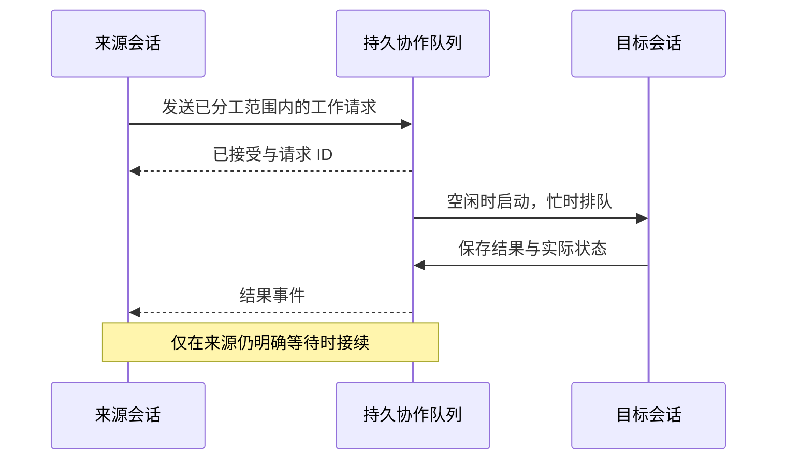

# M3 模块计划三：多会话协作与可选子 Agent

> 日期：2026-09-18。状态：待实施。属于 [M3 总体方案](m3-implementation-plan.md) 的 D 批，复用 A–C 的任务概览、历史回读与记忆。
>
> 研究依据：[联合调研](../research/13-m3-context-memory-collaboration.md) 中的 Claude Projects / Agent Teams、Codex、DSH、Pi、Cursor、OpenHands。本文扩展 M2 协作，不重建 agent 核心。

> 技术修订：结合前期 Harness / 上下文专题，补齐独立与继承两种子上下文、专门检索角色和工作包的输入 / 结果关系。对应 [M3 技术吸收](m3-technology-adoption.md)，不引入 Deep Agents 框架或 SWE-grep 专用模型。

## 1. M3 要补什么

M2 已经有任务内角色连接、持久化协作请求、目标会话执行、结果读取、handoff 和用户启动的独立 Review。它并非完全没有协作；主要缺口是来源会话结果接续、持续交流、成员进度汇总及临时 worker。

| 已有 | M3 补齐 |
| --- | --- |
| 有角色与范围的会话可以相互访问 | 一处可查看角色安排，避免每条消息重复配置 |
| 请求排队并保留状态 | 区分交流、工作请求、结果和宿主通知；清楚显示是否送达 / 执行 |
| 结果可被来源主动读取 | 来源明确等待时由结果事件接续，模型无需循环轮询 |
| handoff / Review 提供来源简报 | 使用最新任务概览、历史 / 产物引用，交接后结果可回传 |
| 最新工作报告与工作项 | 按成员保留进展，列表呈现实际依赖和等待 |
| 普通用户会话 | 增加可选内部子 agent、独立 / 继承上下文和检索角色，不自动创建用户会话 |

三个可见结果是：**两个人工创建的会话能分工并收回结果；一个会话能把后续工作交给另一个；单会话确实需要并行时可使用临时子 agent。**

## 2. 主体与权限范围

### 2.1 用户会话和内部 worker 分开

- 用户会话是项目 → 任务下持久存在的交互入口，由用户创建、归属和安排角色。
- 内部 worker 是用户开启子 agent 能力后，为一个具体子任务启动的执行单元；有自己的上下文、日志和结果，挂在来源调用卡下，不伪装成用户新建的侧栏会话。
- 两者都复用同一个运行循环、模型服务和工具执行实现，避免出现两套文件 / 程序规则。

worker 可以在本次任务内按 ID 接收补充说明或继续工作；它不是自动升级为常驻的另一个用户会话。其历史随父任务保留，重启可查，不自动续跑。

### 2.2 角色安排只做一次

任务详情中指定已有会话的角色与范围，例如 A 负责页面，B 负责说明。复用 M2 的连接安排保存哪些会话可读取和请求协作；用户在角色界面可一次建立相应关系，不要求每次通信再勾确认。

范围以目标、文件 / 目录提示和交接说明表达，是减少冲突的工作约定，不引入必须先声明所有未来文件名的锁表。新文件按分工自然创建；发现重叠后用消息协调即可。

无角色的其他会话不会被模型自行拉入任务；需要扩大人员 / 任务范围时再由用户安排。已有范围内的实现细节、进度交流与结果读取直接推进。

## 3. 任务工作流与协调角色

默认工作习惯仍是讨论目标、形成计划、实现、必要自查、用户选择独立 Review、按需 handoff。阶段是协作提示和当前任务信息，不是必须逐格通过的状态机。

用户可以指定已有会话负责协调。它可以分配清晰任务、收取结果、更新自身进展，也可以直接写代码；不额外创建一个每次用户发言都先调用的中央 LLM。

没有协调角色时，两会话照常按角色直接合作。用户可以自己决定下一步，不要求先画完整 DAG。工作项、依赖和消息记录自然形成可观察的协作图，符合以完整 coding agent 为节点的 graph engineering；每个节点内部继续使用现有 agent loop。

工作包继续复用协作请求的目标、范围、输入、预期结果与关联请求；本轮为它补充上下文方式和必要来源快照。节点是一次有边界的完整 Agent 工作，边是已发生的委派、结果等待或 handoff，宿主据记录展示。没有完整工作图也可执行，不要求模型先填图才能发出普通工具调用。

Review 保持用户主动发起；模型不得因为某次实现结束就自动新建独立 Review 会话。子任务中的局部自查按本次用户范围进行。

## 4. 消息模型与送达

### 4.1 区分四类内容

| 类型 | 用途 | 是否启动目标执行 |
| --- | --- | --- |
| 普通协作消息 | 问题、补充、进度、对既有安排的提醒 | 忙时下一边界提供；空闲时展示，不把任意 FYI 都变成新运行 |
| 工作请求 | 指定目标、输入、预期结果 | 在已安排角色范围内，目标可执行时启动 |
| 工作结果 | 回答某个请求，附必要产物 / 来源 | 只接续对应的显式等待，不复活已停止任务 |
| 宿主通知 | 已排队、已启动、失败、中断、结束 | 更新实际状态，本身不是模型结论 |

宿主填写发送者、接收者、任务、关联请求、顺序和来源类型。借鉴 DSH 的做法，区分 agent 自己写的 relay 与宿主发出的 settled 通知。消息不能通过正文自称“用户要求”来取得更高优先级。

模型输入尽量简单：目标会话、内容；工作请求增加目标与期望结果。当前来源、任务和关联运行由宿主带入，避免要求模型回填一串容易猜错的 ID。

### 4.2 从接受到处理

先保存接受事实，再向 UI 返回已发送。已送达表示目标能看见，不等于目标已经理解、执行或成功；这些状态分别记录。

目标正忙时，同一会话的模型与工具仍顺序执行。与当前请求直接相关的补充可以在下一请求边界进入；新的工作请求排队，不把用户正在处理的另一个目标悄悄替换。

## 5. 等待、结果接续与用户插话

来源可以提交请求后继续独立工作，也可以通过等待操作明确依赖某个结果。等待由宿主事件驱动，不让模型反复调用 `read_collaboration` 消耗请求预算。

等待记录保留来源 Run / Goal、请求 ID 和接续原因，区分“等待协作”与“等待用户”。UI 可以显示等谁、等什么，用户能取消等待或改变安排。

| 来源当前状态 | 结果到达后的行为 |
| --- | --- |
| 仍在等待这个请求 | 把结果加入下一次请求，接续原运行目标 |
| 仍在处理其他独立步骤 | 在下一请求边界交付，不中断正在执行的工具 |
| 用户已停止 / 取消 / 原 Goal 已失败 | 保存结果并显示收件；不自动重新运行 |
| 原任务已经结束，没有等待 | 通知可查看，不自动创建新 Goal 或新会话 |
| 应用重启 | 恢复结果与待办状态；未完成运行由用户明确接续 |

Goal 工作中用户插入普通问题，按已确定规则先回答再继续原 Goal；用户明确停止或换目标则服从新要求。等待协作时也不丢失这种区别。

等待不产生模型请求；时间预算沿用现有运行 / Goal 的定义，UI 区分活动与等待时间。后端不能用固定“等了几秒”就宣称对方失败；超时应来自明确的请求设置或真实执行故障。

若形成 A 等 B、B 又只能等 A 的实际循环，返回可调整的等待反馈并显示依赖，让会话补充信息或改变顺序；不要求所有任务先通过一个完整图校验器才能开始。

## 6. 共享状态与上下文

### 6.1 不互相灌入全文

发送内容以任务当前目标、具体安排、范围、必要输入、预期结果和产物入口为主。目标获得任务工作记忆及自己的近期上下文，需要细节再读来源历史。

使用 [记忆计划](m3-memory-plan.md) 的按成员进展投影。返回结果不会覆盖用户目标 / 约束，也不会把某一成员“我做完了”自动升级成整项任务完成。

项目长期记忆提供共用背景，协作消息提供本次安排，checkpoint 提供各自会话的接续。三者可引用同一事件，但不互相复制成三份无法判断新旧的总摘要。

### 6.2 最新状态与发送快照

工作请求保留发送时的简报及来源事件位置，便于解释当时安排。目标真正开始或发出下一模型请求时，另读取最新任务状态；新的用户纠正不能被旧 brief 覆盖。

已经在途的模型请求不强制重写。用户需要立即制止旧方向时使用停止；否则更新在下一边界生效。简报不是全局版本锁，其他会话产生新事件不导致安排作废。

### 6.3 独立与继承两种上下文

| 模式 | 适合工作 | 输入 |
| --- | --- | --- |
| 独立 isolated，默认 | 检索、独立 Review、边界清楚的模块工作 | 当前共同事实、明确目标、范围、所需材料引用；不继承父会话全部猜测 |
| 继承 inherit，借鉴 fork | 接续已完成的诊断、继续整理已有调查 | 父会话某一完成边界的有效 checkpoint 与近期完整交互，再附子目标及当前共同事实 |

这两个方式都进入 M3，不是只预留字段。主 Agent 按任务性质选择；用户安排 handoff 时可选择继承诊断，独立 Review 默认用独立输入。模式不需要在每次调用前重新询问用户。

继承快照由宿主固定父会话位置。末尾正在发起委派的工具调用不直接带入，不能产生无结果的工具消息，也不能引导孩子重放父工具。新子目标明确替代父会话当前执行目标；旧 Goal 文字只属于来源背景，worker 不继承父 Goal 控制权。

这里继承有效模型上下文而非无条件复制全部原始历史；被压缩细节仍能按授权范围回读。旧 provider 私有字段按实际模型适配，不把缓存命中作为接纳前提。上下文继承不创建 Git 分支或磁盘副本。

已有用户会话的 handoff 只接收来源快照作为材料，不覆盖目标自己的历史。内部 worker 可以以该快照初始化，然后独立追加事件；子输出回到父会话只提供必要结果与引用。

## 7. Handoff 与 Review

复用 M2 的 `ArrangeSessionWorkParams`、`SessionWorkBrief` 和既有来源停止选项。交接内容包括当前目的、已完成 / 未完成、决定、文件与运行结果入口、尚待澄清事项，以及接续建议。

用户选择“交接并停止来源”时，按已指定的来源 Run / Goal 停止；只发送 brief 不等于已经暂停来源。目标开始后按最新任务状态继续，不自动恢复来源运行。

Review 仍由用户选择已有目标会话发起；可获得差异和工作上下文，不要求项目先初始化 Git。评审结果作为结果送回，是否修复按用户本次请求范围决定，不因发现问题就自动扩展工作。

不新增必须准确填齐的交接表。brief 中已知事实由宿主生成，用户 / 模型只补充工作意图与必要说明；不完整的旧历史按可用范围显示。

## 8. 原目录协作与文件冲突

默认共享用户选定目录，工作副本仍是可选项。角色分工、不同文件和先后依赖通常足够处理个人任务；不为多会话额外要求独立分支、仓库复制或提交合并。

对于真实重叠，沿用文件工具当前内容读取、唯一原文匹配和写入前变化反馈。冲突属于可修正工具反馈，交回模型协调 / 调整，不让整个 Goal 因旧 hash 或预读证明失败。

新文件创建不覆盖已有文件；两个执行者碰巧创建同一路径时，后到者读取实际结果再决定如何继续。不要给未创建文件预先建立全仓锁。

工作范围是调度依据，不能宣称它隔离了进程的磁盘访问。程序工具继续使用已有运行环境和项目设置；应用内预览服务继续按原生命周期保留，不因普通会话 handoff 自动全部停止。

## 9. 可选子 agent

### 9.1 开关与运行方式

默认关闭，在会话输入区附近可开启并持久保存选择。任务可提供默认值，但新任务默认仍关闭。关闭后不再接纳新委派；已经运行的 worker 在卡片中单独停止，不静默杀掉用户仍在使用的结果生成。

开启后由主 Agent 判断是否值得委派，宿主负责执行与可见状态。内部 worker 复用既有 session 存储 / loop，可增加 worker 类型区分；不另建与现有会话无关的执行系统。

初版支持创建有边界的子任务、读取结果、发送补充、等待和停止。继续已有 worker 不等于新建用户会话。子任务的进一步拆分交回主协调者决定；M3 不实现递归自组织团队。

子任务调用可选择上述上下文模式，未指定则独立输入；应继承时使用已有快照接口，不让模型把数千行父历史手工塞进工具参数。

### 9.2 怎样判断值得拆分

| 考虑项 | 更适合委派 | 更适合主会话完成 |
| --- | --- | --- |
| 独立性 | 输入与结果清楚，可以单独做 | 每一步都依赖主会话刚得到的结论 |
| 并行收益 | 主会话同时有其他必要工作 | 主会话只能空等，任务本身很短 |
| 角色需求 | 有明确独立分析 / 文档 / 模块职责 | 只是换一个模型重复读相同材料 |
| 上下文成本 | 大量局部探索不必污染主会话 | 需要复制几乎全部历史才能理解 |
| 文件范围 | 不同文件或清晰的先后交接 | 同时改同一段代码，合并成本高 |
| 结果汇合 | 简洁结果和产物可直接使用 | 输出难以核对，需要完整再做一遍 |

这些是模型决策提示，不是固定分数、最少文件数或预估秒数门槛。UI 展示简短委派目的即可，不要求先填写收益证明。能直接做好的一步操作不拆；开关开启也不意味着必须使用子 agent。

### 9.3 模型、工具、并发和预算

worker 默认继承创建时主会话选定的模型，只能使用现有双模型；使用自身稳定会话身份，共享应用模型客户端 / 连接池，不继承父请求的 provider 私有续接对象。

工具根据具体子任务与既有模式提供。需要写文件的明确子任务可以使用已有编辑工具，不把所有 worker 强制变成只读；范围和执行方式仍沿用项目设置。

并发量集中配置，建议先默认 2 个活动 worker；超过时排队，主会话继续独立工作，不以队列已满中止整个任务。这个值是可调资源默认值，不是判定代码业务是否合法的硬门槛。

父安排有共享请求 / 工具 / 时间预算时，委派采用共同账本接纳，不能每个子任务重新获得一份完整额度。子卡显示自身用量，父卡显示累计；不重复计数。没有预算限制则沿用用户配置，不暗设另一套无法调整的限额。

### 9.4 结果与停止

worker 返回结论、完成 / 未完成、必要产物和实际失败；完整中间历史按需读，不全部塞回主会话。来源字段由宿主生成，不要求模型自行证明自己是哪一个 agent。

父运行停止时，取消它的待执行 worker 和依赖该父目标的在途 worker；其他用户会话中不相关的工作不受影响。取消与完成竞争时，已保存结果仍可查，但停止优先于自动接续。

依赖子任务发生真实调用 / 执行故障时，来源收到失败并按用户既定规则停止该安排及关联 Goal；不能悄悄再派一个同任务 worker 重试。可修正参数 / 文件反馈仍由执行中的 worker 处理；测试正常运行但不通过先报告，修复需已在范围内。

### 9.5 检索工作单元

在同一套 worker 能力中提供检索角色，学习 SWE-grep 将探索过程移出主会话、返回可用位置的方式；不下载其模型，也不承诺同样的推理速度。

它使用文件 / 历史 / 记忆 / 归档读取工具，按需要搜索不同位置，返回文件和行 / 符号、相关原因、必要片段与未找到部分。检索角色本身只需要读取工具；通用实现 worker 仍按任务使用编辑 / 执行能力，二者不混用规则。

独立的查找可以并发，依赖上一步结果的探索仍顺序推进。不能照搬论文固定“几轮、几路”作为任务硬上限，预算使用既有设置，用户可看到额外请求。

当主会话可同时推进其他必要工作、或探索量足以影响主上下文时才委派；一次直接搜索能解决的问题仍在主会话完成。子 agent 开关关闭时不会因为调用了检索入口而偷偷建立 worker。

## 10. 持久化、异常与重复执行

复用既有 operation ID、协作队列和单写者。保存请求接受、目标运行绑定、结果和来源是否消费；应用重启后能区分未开始、进行中断、已有结果和已取消。

已保存的同一结果不会因为重复通知再次触发模型请求。启动接纳与目标运行绑定在现有日志恢复范围内保持一致；如果崩溃留下不确定的外部副作用，显示中断，由用户明确接续，不声称实现任意外部命令的 exactly-once。

目标会话被用户关闭或移出角色范围时，对相关未开始工作给出明确状态；不阻断整个项目其他会话。普通历史缺失不要求所有会话补齐证明后重新开始。

## 11. 桌面交互

左侧树显示已有会话的运行 / 排队 / 等待协作状态，仍直接从左侧进入会话。任务详情以紧凑成员列表显示角色、范围和最近进展；依赖先用列表和关联链接表达，不先制作完整图编辑器。

会话正文使用折叠卡片显示“请谁做什么”“结果是什么”“是否正在等待”；点击可进入已有目标会话或查看内部 worker 的记录。消息正文不冒充用户气泡，宿主状态与模型结论分开展示。

输入区子 agent 开关显示实际设置；worker 卡可读日志、发送补充或停止。没有启用时界面不提示用户必须开启才能继续普通任务。

worker / handoff 卡显示角色、独立 / 继承方式、来源范围和实际结果。继承只展示摘要与回读入口，不在主界面重复铺开父历史；检索卡直接列位置与缺口，方便进一步打开材料。

## 12. 实施与最小验收

| 步骤 | 交付 | 直接必要验证 |
| --- | --- | --- |
| D1 邮箱 | 消息类型、送达、角色界面与事件 | 忙时顺序接收；空闲 FYI 不启动任意工作；已安排请求可执行 |
| D2 接续 | 等待记录、结果唤醒、取消和恢复 | 结果只接续一次；迟到结果不复活取消 Goal；不靠模型轮询 |
| D3 任务级交接 | 成员进度、当前简报、上下文快照、handoff / Review | 新任务状态优先；目标历史不被覆盖；无需 Git |
| D4 临时 worker | 开关、独立 / 继承上下文、检索角色、调度与卡片 | 关闭不新增；继承不重放工具；独立 Review 不复制父判断；预算与停止生效 |
| E 联合体验 | 页面 / 说明两会话及可选独立检查 | 分工文件不冲突；回读、记忆与协作贯通；记录实际成本 |

复用现有协作用例，只补齐结果接续、取消竞态和委派预算等真实缺口。先用可控模型事件验证状态，再用简单空白项目做必要的真实体验；不堆大量并行 agents 或复杂长任务证明功能存在。

本模块完成意味着 M2 的协作能够形成可观察的工作闭环，不代表已实现通用组织管理、任意工作流编辑、云端 worker 或自动协调所有仓库修改。
