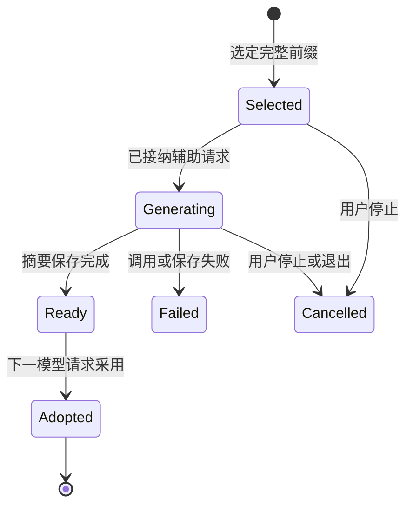

# M3 模块计划一：上下文压缩与历史回读

> 日期：2026-09-18。状态：待实施。属于 [M3 总体方案](m3-implementation-plan.md) 的 A / B 批；后台准备、桌面入口和恢复都在本模块内。
>
> 研究依据：[压缩专题](../research/12-context-compaction.md)、[三模块联合调研](../research/13-m3-context-memory-collaboration.md)。本文细化并接续 [原上下文方案](context-management-plan.md)，不表示已有相关功能。

> 技术修订：本模块吸收 OpenViking 分层材料与 RLM 外部输入访问的思路，新增层级展开、归档筛选 / 统计；采用边界见 [M3 技术吸收](m3-technology-adoption.md)，不是部署上述运行时。

## 1. 目标和选择

采用 **确定性减量 + 同模型增量摘要 + 近期完整交互 + 历史回读**。规则负责长度、切点、去重复和产物索引；模型负责语义总结。原始事件保留，压缩只改变下一次请求发送的材料。

不使用摘要替代任务目标，不让模型总结当前运行程序是否仍在运行，也不要求模型记住每个修改文件的清单。当前任务、活动 Goal、角色、程序状态由现有服务在请求边界提供。

本阶段不接入 Claude / OpenAI 原生 compaction，不新增摘要专用模型。默认使用整理开始时当前会话选定的 `glm-5.3-flash` 或 `deepseek-v4.1-flash`，通过既有 OpenCode Go 客户端调用。

## 2. 现有基础与需要改变的地方

| 当前事实 | 调整方式 |
| --- | --- |
| `SessionLog.context()` 从事件恢复会话 | 保持完整重放语义；新建请求组装入口读取它的必要范围 |
| `runtime/context.py` 目前只有共享任务结构 | 增加窗口表示及组装职责，不把任务状态塞进摘要字符串后失去独立来源 |
| 会话已保存模型 / 工具事件与修改结果 | 用事件 seq 选区间；通用长输出补充归档，修改 diff 沿用现有记录 |
| 工具 / 程序输出已存在长度限制 | 在可取得原内容的边界先归档、再缩短发给模型的展示；已被上游截断的内容注明不完整 |
| 当前有上下文字节配置与请求预算 | 字节防护与 token 窗口分开；辅助请求纳入真实用量，不把 `max_context_bytes` 当 token 上限 |
| UI 已有流式正文、思考与活动 | 增加紧凑整理状态，不新建占满会话顶部的诊断区 |

## 3. 数据与生命周期

### 3.1 三种新增对象

**请求窗口**是一次请求的派生结果：稳定说明、有效 checkpoint、完整近期消息、最新任务事实、相关记忆和协作消息，以及发送量估计。它不作为新的权威历史。

**Checkpoint**至少保存宿主 ID、所属会话、父 checkpoint、摘要覆盖到的事件位置、首个保留位置、摘要正文、生成模型 / 路由类别、创建时间、用量和状态。归档索引可单独引用，不需要全部塞进摘要。

**归档产物**保存工具来源、内容位置、类型、实际大小和完整性。使用不透明 ID 读取，由后端定位文件；不把任意内部路径暴露为前端可加载资源。

它们位于配置的数据根，复用原子保存。只对完整保存的 checkpoint 发布可采用状态，写一半不会替代此前的有效记录。索引可重建；原始内容与已保存摘要分别保留。

材料读取以 L0 短索引、L1 可选概览、L2 原文表达粒度。L0 来自元数据，L1 复用已存在 checkpoint / 任务报告或按需生成，L2 沿原始来源读取；不为每份材料建立三套权威副本，也不要求生成 L1 后才准许访问 L2。

### 3.2 状态流

一个会话同时只需要一个有效的摘要准备作业。重复点击显示当前作业，不再发送相同请求；这不是限制普通代码任务的全局锁。

## 4. 请求窗口怎么组成

### 4.1 先减少冗余，再决定是否总结

1. 当前任务与活动 Goal 单独刷新；相同旧快照不反复发送。终态 Goal 的历史只作为发生过的事情。
2. 保留最新用户输入、最新明确纠正及尚未完成的工具交互。模型工具调用与结果必须保持协议允许的配对。
3. 旧的大段工具观察可缩为简述、来源和归档 ID；最近仍在使用的输出保留必要正文。
4. 修改文件、运行结果和产物清单尽量由宿主索引表达。读取一次历史不能触发原来的程序再次执行。
5. 仍然接近请求容量时，选取已经结束的前缀做模型摘要，保留近期尾部。

压缩发生前先确保新用户消息进入原始历史；并发到来的新消息属于摘要切点之后的尾部，不能因采用 checkpoint 被覆盖。

### 4.2 切点约束只服务协议正确性

普通切点放在完整交互结束后。长时间单回合可以在一组完整工具调用 / 结果之后切开，保留后续完整步骤；不强制等到整个 Goal 结束才允许整理。

不在半个 JSON、未完成工具调用或未保存事件中间切断。也不要求模型先报告验收项、证明原文正确或补齐固定章节才能选择切点。

摘要输入包括旧 checkpoint 和它之后需要折叠的新事件；已经被总结的原始前缀不必每次重新发送。原始材料仍能按来源读取，减少“摘要再摘要”积累错误的影响。

### 4.3 超长单条内容

长工具结果可归档，模型按关键词或范围读取。用户自己发来的长要求不能悄悄丢尾部或改成一个未经确认的新目标：保留原文并提供可回读入口，当前窗口保留足够说明；确实超过服务接纳能力时具体说明哪一部分过大。

模型生成的内容若没有正常完成，只保留为诊断，不把残缺 checkpoint 标为成功。避免在同一超长内容上自动反复总结或重试。

### 4.4 从材料索引逐步展开

先按当前问题选择材料，再选择概览或原文粒度。例如定位运行错误时先看输出索引、搜索错误附近记录；回顾设计时先读已有主题概览。选中的 L0 / L1 显示可回读来源，预算不足可降低非关键材料粒度，而非直接截掉最新需求。

日志归档增加本地搜索、范围读取；有明确记录结构时支持字段筛选和计数，返回实际覆盖范围及完整性。宿主确定性处理这些操作，无需模型先通读整份日志。它们是已有归档读取接口的扩展，不新增应用内部通用 REPL 或自动递归模型调用。

项目知识页、经验手册和记忆正文通过同一材料接口读取；其权威来源仍由记忆服务管理。可选概览缺失时用原始片段继续，过期则标明或不注入，前台不以等待知识页生成作为前置条件。

## 5. 何时触发与怎样度量

容量按当前模型的配置管理，输出预留、自动触发比例、压缩后目标和近期保留量集中定义。实现时核对 Go 可用元数据 / 官方公开说明，不从模型名称猜窗口，也不把某个旧库的默认值当作双模型真实上限。

计量优先使用实际返回的输入 usage，再估计新增尾部和工具定义。没有精确 tokenizer 时明确标为估计；中文、代码与英文不能一律声称“四字符就是一 token”。服务元数据缺失时可使用用户覆盖的本地容量估计；仍未知时沿用已有可调字节预算触发减量 / 整理并显示其单位，不把字节换个标签冒充 token。无法在线刷新目录不禁止普通请求。

沿用原方案的起始调优方向：约 80% 提前准备，整理后约 55%，近期尾部按约 20% 规划。它们是待验证的工程参数，受工具配对、最新输入和输出预留影响，不是唯一合法阈值或质量结论。手动整理不要求先达到阈值；关闭自动触发也不删除已有 checkpoint。

无需为了获得精确占用先额外调用模型做 token 计数。超限防护负责触发整理或说明具体请求过大，不以固定字符长度拦截所有任务。

## 6. 摘要生成与缓存

### 6.1 模型看到什么

总结提示引导保留当前工作、用户纠正、已完成动作与真实结果、决定、失败尝试、未决问题和下一步。区分已实现、已运行、未验证，避免把测试计划写成测试通过。

这些是内容提示，不是必填标题表。接受正常完成的非空文本，不增加 JSON 形状、章节评分、证据覆盖率或第二个审核模型。宿主附加来源范围和产物索引，模型不需要生成这些控制字段。

总结过程只读取给定材料，不执行返回的工具调用。必要历史查找在整理准备阶段由宿主按区间提供；摘要任务不会因旧消息说“继续执行命令”而产生副作用。

### 6.2 同模型与前缀复用

学习 DSH 的思路，尽量保持 system、工具定义和历史前缀稳定，在总结请求末尾增加明确要求。是否保留完整工具定义，由模型适配验证决定；即使带定义也不装配执行器。

复用既有客户端、请求头、连接池和会话 `x-opencode-session`，记录 `purpose=compaction`。这有利于连接 / 前缀缓存复用，但是否命中缓存以服务返回为准；没有缓存 usage 就显示未知。

准备期间用户改模型不取消已发出的请求。普通文本摘要可跨默认双模型使用，下一主请求使用最新保存的选择；provider 原生字段由适配器处理，不把一个模型的不透明续接对象强塞给另一个模型。展示用思考文本不成为跨模型恢复依据。

## 7. 后台准备与采用

1. 前台继续运行时，宿主固定一个已完成的事件前缀和当前有效 checkpoint。
2. 对该前缀生成摘要，后续新事件继续追加到日志。
3. 摘要保存成功后标为 ready；不会立刻改写正在发送的请求。
4. 下一次主请求采用它，并拼接切点之后的全部必要尾部、最新任务状态和消息。

新尾部增长不导致整份摘要作废；不用整会话 hash 或“版本必须完全没变”来反复拒绝结果。若旧有效 checkpoint 已被另一项明确操作替代，只处理这份候选的父链关系，不停止代码任务。

自动准备晚于需要整理的时间时，主请求等待同一作业并显示原因。前台无剩余请求预算时不能偷偷发摘要；显示预算状态，按现有设置调整 / 接续方式处理。

## 8. 失败与取消

| 情况 | 行为 |
| --- | --- |
| 活动 Run 所需摘要请求连接失败、超时或保存失败 | 停止该 Run 及所属 Goal；保留原始历史和旧 checkpoint，报告具体阶段，不自动重试 |
| 空闲时用户手动整理失败 | 只结束本次整理，不更改无关会话状态 |
| 用户停止活动运行 / 退出应用 | 取消相关准备请求，完成资源清理；不在退出后继续发送 |
| 摘要章节不齐但正常有内容 | 正常采用，不追加格式审查 |
| 某条旧输出从未完整保存或现已不可读 | 明示可读范围 / 该项错误，继续使用其余历史，不重跑旧命令 |
| 应用重启发现未完成整理 | 标为中断，保留已保存的完整结果；不自动发新模型请求 |

后台作业关联到哪个 Run 必须持久化。不能用“后台失败不影响用户”的笼统说法违反用户既定的失败停止规则，也不能把一个空闲整理失败传播给整个应用。

## 9. 历史回读、记忆和协作如何配合

提供当前会话的历史搜索及按事件范围分页读取，可使用同一个工具的不同操作；归档工具支持读取选定产物的必要片段。返回来源与完整性，不返回模型凭据或整个 provider 内部状态。

跨会话读取沿用 M2 的角色安排，在协作计划中扩展；压缩工具不建立另一套授权流程。新会话首先获得任务工作记忆，只有需要细节才读旧会话。

长期记忆由组装入口独立注入，不成为 checkpoint 的权威内容。自动注入的记忆快照不作为新的永久知识重复提取；条目被纠正 / 忘记时，下一请求移除旧注入。若摘要确实吸收了相关旧结论，标记该摘要需避开或更新对应内容，优先从原历史和最新纠正重建，而不是静默保留“已经忘记”的信息。详见 [记忆计划](m3-memory-plan.md)。

## 10. 桌面与观测

输入区附近显示小型“上下文：估计占用 / 已整理”入口。展开后可查看当前摘要、覆盖范围、历史入口、自动开关、手动整理、最近耗时 / 用量和错误；默认折叠。

详情增加本次材料清单：来源类型、采用 L0 / L1 / L2 哪一层、为什么被选中、是否可展开。只展示实际选择记录，不为解释每个条目再请求模型。归档筛选在工具卡中显示过滤条件与返回范围。

活动分别显示“准备整理”“发送摘要请求”“接收摘要”“已保存，等待采用”“正在采用”。总结流不混入主回答正文；详细活动卡可查看整理输出，主回答首字与思考首字仍分别计量。

记录实际 `context.measure`、`context.trim`、`compaction.request`、`compaction.saved`、`context.adopted` 和回读事件，复用现有事件 / trace 接口。完整 Trace 页面不成为压缩功能前置条件。

既记录模型请求至首字，也记录用户提交至主回答的端到端等待；后台隐藏了多少等待不能仅从模型首字判断。报告压缩额外请求、估计发送量变化和历史补读次数，不用压缩比例代替任务质量。

## 11. 实施与最小验证

| 步骤 | 产物 | 直接必要检查 |
| --- | --- | --- |
| A1 窗口与归档 | 分层组装接口、区间引用、输出筛选 / 回读 / 简单统计 | 工具配对；保留最新用户消息；旧截断内容不会假装完整；无概览可读原文 |
| B1 同步闭环 | 同模型摘要、checkpoint、手动入口与重启读取 | 整理后接续；真实调用失败保留原状态；原始事件未改写 |
| B2 后台化 | 固定前缀、ready / adopt、预算与停止 | 摘要期间新纠正 / 换模型不丢；取消不发新请求；同次请求不重复计费 |
| B3 体验 | 占用与活动、材料层级、历史搜索、实际 Go 兼容 | 双模型必要接口；长材料局部读取与占用可见，使用小场景而非灌满窗口 |

不为低影响 UI 文案补测试；只在现有 `tests/` 中覆盖确实缺失的行为，产物进入 `.artifacts/tests/`。真实验证实施时显式启用，当前未执行。

本模块完成的判断是：能说明当前请求从哪些材料构成；整理后继续满足最新要求；旧细节可查；失败和停止准确；两个现有模型可用。不能据一次计数器任务成功宣称已经验证任意超长工程任务。
