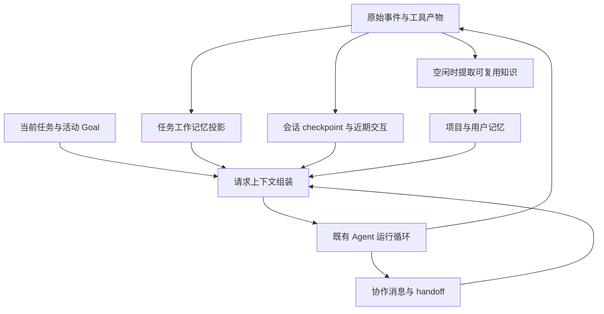

# M3 实施方案：上下文、记忆与多会话协作

> 日期：2026-09-18。状态：设计完成，功能尚未开始实施。本轮用户授权为调研和规划；本文不构成自动开始实现的指令。
>
> 依据：[联合调研](../research/13-m3-context-memory-collaboration.md)、[当前进度](../progress/README.md)、[M3 进度](../progress/m3.md)。模块细节分别见 [上下文压缩](m3-context-compaction-plan.md)、[长短期记忆](m3-memory-plan.md)、[多会话协作](m3-collaboration-plan.md)。

> 同日技术修订：结合前期专题加入分层材料、独立记忆单元、时间 / 关联检索、增量经验手册，以及子上下文继承。关联记忆、知识页自动整理在 M3 内提供可选实验；采用粒度与依据见 [技术吸收说明](m3-technology-adoption.md)。

## 1. 这一阶段交付什么

M3 的目标是让同一项工作在长会话、换会话和多人分工时能够接着做。三个模块都在本阶段形成实际可用的桌面闭环，不把长期记忆或协作继续列为无限后置的概念。

| 模块 | 用户可见结果 | 复用 M2 | 本阶段新增 |
| --- | --- | --- | --- |
| 上下文压缩 | 长会话可以自动 / 手动整理，按需展开材料；知道整理是否正在进行、花了多少请求 | 会话事件、模型适配、预算、工具事实、活动显示 | 分层材料、归档过滤 / 回读、模型摘要、checkpoint、后台准备与边界采用 |
| 长短期记忆 | 新会话理解进度，新任务使用相关知识与经验；用户能改、停用和忘记记忆 | 任务字段、工作报告、项目身份 | 独立记忆单元、时间 / 替代关系、多路检索、增量经验手册；可选关联记忆与知识页 |
| 多会话协作 | 有角色的会话能交流、接续结果；必要时委派并选择独立 / 继承上下文 | 角色连接、请求队列、handoff、独立 Review、工作项 | 邮箱、等待与唤醒、按成员汇总、可选 worker、上下文模式与检索角色 |

保持当前 Python 核心、Electron 桌面、OpenCode Go 与双模型。不新增服务账号、记忆 API key、向量服务或另一套 agent 框架。默认继续在原项目目录工作，不要求 Git 或工作副本。

## 2. 已确定的边界与本方案建议

| 项目 | 本轮采用方式 | 依据 |
| --- | --- | --- |
| 用户会话 | 由用户创建；不会因为需要协作而自动生成侧栏会话 | 用户已确定 |
| 任务与会话 | 任务维持阶段目标；会话中的 Plan / Goal / 常规模式处理局部目标 | 用户已确定 |
| 协作角色 | 用户先安排角色和范围；已有安排内的请求直接执行，不逐条再确认 | 用户已确定 |
| 子 agent | 提供默认关闭的开关，开启后按独立性与收益判断是否委派 | 用户已确定方向，本阶段补齐实现 |
| 独立 Review | 由用户主动发起；普通工作不自动新增 Review 会话 | 用户已确定 |
| 自动压缩 | 建议默认开启，支持手动整理和关闭自动触发 | 本方案建议，可调整 |
| 记忆 | 建议默认使用已有记忆、贡献项目记忆；用户范围的长期偏好由明确表达或手动保存产生 | 本方案建议，可调整 |
| 项目记忆存储 | 存到应用数据根，不默认在用户项目中创建记忆目录 | 沿用数据约定 |
| 协调角色 | 可以指定某个已有会话负责协调，不建立必须常驻的协调 agent | 本方案建议 |
| 记忆实验 | 关联记忆、知识页自动维护默认关闭，M3 内交付可用入口；手动整理知识页可直接使用 | 本次技术修订 |

建议值是正常产品默认行为，不是唯一合法配置。没有协调角色、没有记忆条目或子 agent 关闭时，普通单会话任务仍完整可用。

## 3. 共用事实，分别管理生命周期

### 3.1 六类内容的事实来源

1. **原始历史**回答发生过什么。日志不因压缩而删改；新增长输出归档只承诺保存实际收到的内容，不能恢复旧版本已经截断的数据。
2. **任务当前状态**回答现在以什么为准。目标、约束、用户确认的决定来自任务系统；活动 Goal 来自 Goal 服务。摘要不能恢复已取消的 Goal。
3. **会话 checkpoint**缩短当前会话的旧上下文。它是派生材料，不是任务状态或永久记忆。
4. **任务工作记忆**汇总各会话最近进展、未决事项、可用产物和交接。它尽量从现有事实投影，不新增一个必须填写的进度表。
5. **长期记忆**保存跨任务仍有用的项目知识或偏好，可以被纠正和忘记。它不自动升级为项目规则。
6. **协作邮箱**记录请求、交流、结果与送达状态。消息身份和来源由宿主填写，不能被模型文本伪装成用户指令。

用户新消息与当前任务事实优先于旧摘要和记忆。发生矛盾时，呈现必要差异并采用最新明确要求；只有确实需要用户取舍才进入 HITL，不增加逐条语义审查。

### 3.2 共用引用，不新增证明门槛

复用现有 `EventRef(session_id, run_id, seq)`、修改记录和程序 ID。历史范围、归档产物和记忆条目补充各自的宿主 ID；模型只需要获得可读取的引用。

来源用于解释、定位和纠正，不要求模型手写准确 hash、列齐证据或通过评分才能继续。某个旧产物不可读时返回该项真实错误；其余上下文和正常代码工作继续。当前执行或保存真的失败，仍按既有规则处理。

### 3.3 材料层级与轻量关系

请求组装统一理解材料的短索引 L0、可选概览 L1 和原始正文 L2。复用 checkpoint、任务概览和产物引用；L1 不存在可直接读原文，不为每个文件强制生成多层摘要。历史 / 记忆 / 程序输出仍各有自己的权威存储。

记忆条目可保存明确替代关系和事实适用时间；开启关联实验后增加可撤销的相关条目引用。项目知识页是来源可追踪的派生概览，经验手册是局部可更新的操作经验。它们都进入同一个上下文组装入口，避免独立模块各自重复注入。

任务分工图与记忆关系分开：前者表达谁在处理哪个工作和等待谁，后者辅助找知识。M3 不用一个通用图数据库混合承载两者。

## 4. 在现有代码中怎样接入

以下是拟新增 / 调整的职责，不表示这些组件已经存在，也不要求一次建立全部空目录。

| 位置 | M3 调整 |
| --- | --- |
| `sessions/store.py` | 保持原始事实重放；增加定位历史区间所需接口，不把 `context()` 改造成破坏性裁剪 |
| `runtime/context.py` 与运行循环 | 在现有 `SharedContext` 基础上形成请求组装入口；按层级接入 checkpoint、近期尾部、当前事实和相关记忆 |
| `sessions/artifacts.py` 及工具结果保存处 | 复用现有成果入口，补充输出归档、范围 / 条件读取与统计；区分修改成果与通用输出 |
| 拟新增上下文服务 | 度量、选择切点、生成 / 保存 / 采用摘要；前台与后台共用同一套逻辑 |
| `tasks/`、`workflow/` | 增加按会话保留的最新进展投影，避免一个新报告覆盖其他成员的工作状态 |
| 拟新增记忆服务 | 本地语义条目、结构 / 关系索引、多路检索、增量经验、可选知识页、纠正与遗忘 |
| `collaboration/` | 扩展既有队列；补齐消息、等待、结果接续与 worker，按角色装配独立 / 继承上下文 |
| `models/` | 继续使用 Go 客户端与连接池；辅助请求标记 purpose，不另建一套网络栈 |
| DTO / RPC / Electron | Python 持有业务状态；按新增接口生成 schema 和 TypeScript 类型，桌面与 CLI 使用相同服务 |

只提取实际共享的请求调度、引用和组装职责，不创建通用图引擎、事件总线框架或抽象数据库层。

## 5. 一次请求如何构成

稳定的系统说明与工具定义保持稳定。其后由适配器组装有效 checkpoint、保留的完整交互；最新任务事实、所需记忆与尚未消费的协作消息在请求边界刷新，并明确标为当前工作上下文。最新用户输入必须保留，工具调用及结果保持合法配对和顺序。

组装时不把每个成员的全文、整个记忆库或整条旧工具输出都加入请求。材料不足时，模型通过历史 / 记忆 / 协作读取工具补查。普通问题不强制进入跨会话检索。

新材料先提供短索引，必要时展开概览或原文；长日志先按问题筛选。记忆召回结合关键词、对象 / 时间等结构条件和已启用关系，按 ID 去重再装载；复杂检索仍在现有 Agent 循环内按需展开，不在每次回答前串行调用一个隐形规划模型。

当前任务状态、所用记忆与邮箱消息有各自 ID；下一请求重新组装，而不是不断追加重复快照。摘要以会话事实为输入，不把每次自动注入的同一记忆再次提炼成新记忆。过期记忆对旧摘要的影响按记忆计划处理。

## 6. 辅助请求、并发与成本

- **压缩请求**使用启动该整理时选定的 Go 模型、同一会话路由与连接池，记录 `purpose=compaction`。属于活动 Run / Goal 的整理计入该 Run / Goal 预算，发出前预留额度，不能和前台同时越过余量。
- **记忆整理**是独立的空闲维护作业，显示 `purpose=memory`、来源会话、耗时和用量；与主回答分开统计，同时计入应用 / 会话的实际总消耗。用户可以关闭自动贡献、取消当前整理或设置维护额度。达到活动 Run 预算不能通过转成后台作业继续原任务。
- **协作和子 agent**使用明确的目标会话 / worker 身份。同一请求只计一次实际用量；来源安排显示整个委派累计成本，目标会话保留自身账本，不因两个视图展示而重复收费统计。
- 前台交互优先；空闲记忆作业避免与新前台争抢并发额度。压缩可提前准备，但必要整理未完成时要显示等待。连接复用降低握手开销，不保证模型推理或队列加速。
- 不新增为了填写摘要、验收表或打分而调用的审核模型。不静默换第三个模型，不启用 SDK 重试。

语义提取、经验修订和可选关联尽量合并在既有记忆整理批次；知识页刷新沿相同调度和维护额度，不另起无界常驻循环。查询直接读取已有索引 / 概览无需模型调用；选择进一步语义分析时显示真实调用和用途。

运行关联的真实模型 / 执行 / 保存失败停止对应 Run 与 Goal；已经独立运行的空闲维护作业失败，只结束该作业。失败归属显示清楚，不把所有后台问题广播成所有会话失败。

## 7. 本地存储与恢复

新增数据全部跟随已有数据根解析，默认仍为 `E:\MyCodingAgentData`，开发入口继续使用独立 `dev` 根。路径不硬编码仓库位置。

建议按职责组织：会话目录下的 context / artifacts 保存 checkpoint 与输出；任务已有记录产生工作记忆投影；数据根下的 memory 保存项目 / 用户条目；协作沿用已有日志与队列。具体文件名在实施时随现有存储结构确定，避免为了目录美观迁移全部旧数据。

索引和汇总可以重建；原始事件、用户记忆编辑、已接受的协作请求与结果需要持久化。复用现有单写者和原子替换，不新增 Git 自动提交、全局文件占用表或跨目录事务框架。

旧会话没有 checkpoint 时沿用原始历史，旧项目没有记忆目录时按空库打开，不要求用户先迁移或重新建项目。新增协作元数据尽量从已有身份补齐；无法确定的进行中状态保留为中断。DTO 改动从 Python 导出 schema / TypeScript，并按实际兼容影响调整协议版本；不手工改生成文件，也不以整理数据为由清空旧记录。

应用重启加载已保存内容，不自动重新调用模型、重放工具或恢复已经取消的 Goal。未完成作业显示中断，用户可以明确接续；已保存的完整结果可重新投递，避免重复执行。

## 8. 桌面交互

| 位置 | 新增内容 |
| --- | --- |
| 输入区附近 | 紧凑上下文占用 / 整理入口，记忆使用提示，可选子 agent 开关；详情默认收起 |
| 会话正文 | 整理、记忆变更、协作请求 / 结果、子任务使用可折叠活动卡片；保留原流式正文和思考显示 |
| 左侧项目 → 任务 → 会话 | 等待协作、正在执行等状态；点击进入已有会话，不另加占据正文的会话入口栏 |
| 任务详情 | 目标、各成员最新进展、角色范围和交接；首次以列表表达依赖关系，不强制画布 |
| 设置 / 记忆管理 | 条目、替代关系、经验与知识页的查阅 / 编辑 / 遗忘；使用与贡献分别控制；关联 / 知识页实验及实际维护成本可见 |

不恢复大面积置顶 Goal，不把所有后台活动统一显示为“思考中”。只有确实发起 / 接收 / 保存的事件才更新状态。

## 9. 分批实施顺序

不规定日历工期。每批交付能使用的服务和桌面入口，进度按事实记录。

| 批次 | 交付 | 完成边界 |
| --- | --- | --- |
| A 共同输入与回读 | 分层材料、归档筛选 / 回读、按成员汇总任务进展 | 原始记录与发送窗口分离；普通 M2 任务继续可运行 |
| B 会话压缩 | 手动 / 自动摘要、checkpoint、后台准备、层级装载与界面 | 压缩后接续、最新纠正保留、重启可读；同模型 Go 双模型路径兼容 |
| C 长短期记忆 | 独立条目、时间 / 替代关系、多路检索、增量经验、空闲提取、可选关联与知识页 | 新任务复用相关知识；修订 / 遗忘生效；两个实验均有实际入口，可关闭比较 |
| D 协作闭环 | 消息接续、handoff、分工、可选 worker、独立 / 继承上下文与检索角色 | 用户会话可分工，接续诊断少重复探索；停止与迟到结果语义准确 |
| E 联合体验收尾 | 用简单空白项目串起三模块，修复实际发现的问题 | 没有失活 Goal 复活、重复执行或记忆覆盖新要求；证据与剩余限制落盘 |

模块计划中的步骤是这张表的细分，不是额外四套阶段验收。后台压缩、自动项目记忆及可选子 agent 都属于 M3 范围；先后次序不表示取消后面的交付。

## 10. 用一个简单空白项目验证

保持示例简单：**一个无依赖的计数器页面 `index.html` 与一份 `README.md`**。实现时在 `.artifacts/tests/` 的独立空目录验证，不污染用户默认测试项目。

1. 用户创建任务与两个会话，A 负责页面，B 负责说明；默认不建立 Git / 工作副本。确认一次角色与范围即可。
2. A 创建计数器。任务要求写明“离线可打开，不依赖 CDN”；用户中途补充“增加重置到 0 的按钮”。手动整理一次上下文，继续完成修改和一次简短本机运行。
3. A 把已实现功能和运行方式交给 B。B 根据共享任务状态和必要文件编写说明，把结果送回；A 正在等结果则接续，已停止则只收件。
4. 在用户明确要求记住后保存项目偏好。由用户新建任务 / 会话，验证按需使用此偏好；随后修改或忘记它，下一次请求采用更新结果。
5. 可选打开子 agent，让它独立检查说明与页面按钮是否一致，主会话处理用户的简短追问。关闭开关时同一检查由主会话直接完成。

这是交付流程验收，不是性能排行榜。自动压缩边界、消息竞态等用现有测试设施做少量定向验证；真实模型验证限于本阶段受影响路径，记录实际请求和首字等待，不为了把上下文塞满而进行长时间付费聊天。

新技术对照使用相同简单项目或少量隔离材料，具体见 [技术吸收说明第 8 节](m3-technology-adoption.md#8-m3-内怎样试用并判断效果)。页面功能不增加复杂度，只观察材料展开、替代决定、经验复用和继承上下文是否实际有效。

## 11. 保留与后置

M3 不包含自定义工作流编辑器、通用图 / 向量数据库服务、自动修改正式 skill / 运行核心、训练摘要模型、云端 worker、跨项目自动调度、新 provider 或安装发布。轻量记忆关联、时间关系、增量经验手册和可选知识页已纳入 M3，不属于这里的后置内容。角色工作流和任务工作项支撑本阶段的 loop / graph。

后续是否扩展，依据真实失败：检索经常漏召回再考虑向量；多个项目长期协作困难再讨论跨项目编排；摘要反复丢失具体信息先改善窗口、事实索引和回读。不用未发生的问题提前增加阻断条件。

开始实施时先更新 [M3 进度](../progress/m3.md) 的本次范围，再从 A 批进入；每批只运行直接必要检查。当前这些内容均为方案，不是实现或验收记录。
