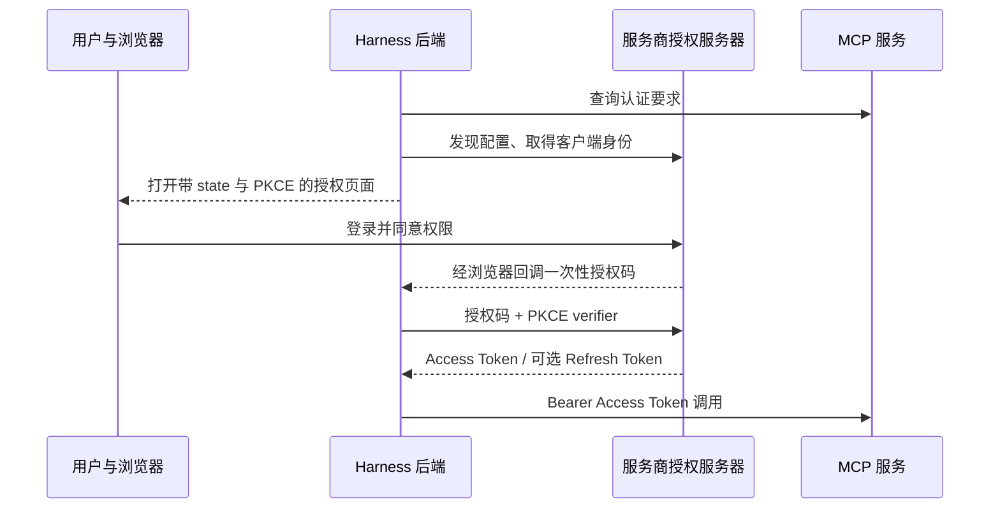

# MCP OAuth：桌面授权与凭据接续

> 2026-09-22，用户授权实施并要求解释认证原理。先保存本方案，再修改代码；承接已有 MCP 服务与凭据管理。

## 交付与使用

- 远程 HTTP 服务增加 OAuth 认证方式，在左侧 MCP 管理中提供开始登录、打开授权网页、取消、本地退出与连接测试。普通列表读取不联网，模型调用不弹登录网页。
- Context7 使用官方 OAuth 地址 `https://mcp.context7.com/mcp/oauth`；匿名 / API Key 地址仍为 `/mcp`。预设切换给出明确的地址变更，不覆盖自定义地址。
- 通用接入使用已锁定 MCP SDK 的授权发现、客户端注册、授权码与 PKCE。支持服务器动态注册，以及用户填写已登记的 Client ID / 可选 Client Secret 环境变量。支持填写已托管的客户端元数据 URL，不为此部署网站。
- GitHub 远程 MCP 需要自己的应用登记信息；不借用 VS Code、官方 stdio 服务或其他产品的 Client ID。表单说明 GitHub Client ID、Secret 引用和回调地址；缺少登记信息不影响 PAT 方式。实际账户授权由用户在服务商网页完成。

## 原理与实现边界

OAuth 严格说是授权协议：服务商负责确认你是谁，再询问是否允许这个应用访问哪些资源。我们拿到的是应用被授予的访问权限，账号密码留在服务商网站。

| 名称 | 在这里的作用 |
| --- | --- |
| API Key | 通常由服务账户生成，用户手动填入或引用环境变量 |
| PAT | Personal Access Token，用户生成的访问令牌；例如 GitHub 可限定仓库和权限 |
| Client ID | 标识“哪个应用申请授权”，不等于用户身份，也不是秘密 |
| Client Secret | 某些服务用于认证应用；本版支持指定环境变量，不复制环境秘密到配置或授权记录 |
| 授权码 | 浏览器回调的一次性结果，后端还要用它换令牌 |
| Access Token | 后端调用 MCP 时使用的访问凭据，不进入模型上下文 |
| Refresh Token | 服务商提供时用于获取新的访问令牌；并非每个服务都会提供 |

API Key / PAT 是用户手动交给客户端的凭据。OAuth 将这一步改为服务商网页授权：应用发现授权服务器 → 取得客户端身份 → 生成本次 state 与 PKCE → 浏览器登录并同意权限 → 回调交付一次性授权码 → 后端用授权码和 PKCE verifier 换令牌。

Client ID 标识应用，不是账号密码；授权码不是访问令牌。PKCE 将授权码绑定到发起本次登录的客户端。state 匹配本次登录；这些是认证协议本身的要求，不是代码执行审批或文件 hash 门槛。

- Python 管理授权作业与临时 `127.0.0.1` 回调；Electron 只负责用户点击后打开系统浏览器，renderer 不接触授权码、verifier、访问 / 刷新令牌。授权 URL 仅用于管理界面，不进入模型或 Trace。
- 回调默认使用系统分配端口；服务要求固定登记时可配置端口。页面明确显示“回调已收到，正在换取令牌”，最终成功以应用内状态为准，避免空白页面或提前宣称成功。
- SDK 用于独立授权握手；正常 MCP 请求只带当前令牌，令牌已知到期时先刷新。实际工具请求遇到 401 / 403 不自动重放、不自动启动交互授权。多个会话共用同一服务身份的令牌和刷新锁，连接本身仍按会话独立。
- 令牌、注册得到的客户端秘密与刷新所需元数据使用已有 Windows DPAPI 加密写入应用数据根的独立 OAuth 目录；记录绝对到期时间，重启不重置寿命。端点 / OAuth 客户端配置变更不向新端点转交旧令牌。
- 授权等待与普通调用超时分开，可配置、可取消。取消 / 退出清理回调与待办作业。取消新登录不删除原有令牌；本地退出删除该服务 OAuth 记录并关闭相关连接。界面说明本地退出不是服务商撤销授权，提供官方账户入口。
- 保留匿名、环境变量、手动令牌、stdio 与浏览器原路径。不新增依赖、OAuth 代理服务器、逐工具审批或自动账号迁移。

## 首版具体操作

1. 重启 `StartAgent.cmd`，进入左侧 **MCP 管理**，配置一个 HTTP 服务。
2. 认证方式选择 **OAuth · 浏览器登录**。Context7 预设会将标准 `/mcp` 地址切到 `/mcp/oauth`；自填地址保持原样。默认使用服务声明的权限，也可填写 scope。
3. 点击 **保存并登录**，应用打开系统浏览器；只在服务商网页输入账号密码并同意授权。未自动打开时可展开服务，再点击 **打开授权网页**。取消按钮会关闭本次回调监听。
4. 回到应用查看 **已登录**，随后应用自动握手、查询工具目录。两者状态分别显示：授权成功不等于 MCP 服务一定可连接。再将服务启用到需要的项目，模型按需发现工具。
5. 同一服务身份的不同会话共享登录和串行刷新，MCP 连接仍各自持有。想使用不同账号可以新增另一个服务实例。重启恢复加密登录，不恢复上次未完成的浏览器授权。

GitHub 的本 Harness 远程方式需要自己的 OAuth App / GitHub App。到官方登记页创建后填 Client ID；服务要求 Secret 时，设置自己的 `GITHUB_OAUTH_CLIENT_SECRET` 环境变量并在表单引用名称，令牌端点认证选表单方式（或服务要求的 Basic）。本版回调路径是 `/oauth/callback`，通常登记 `http://127.0.0.1/oauth/callback`；如果所用服务要求固定端口，将表单和登记地址设成一致。GitHub App 的资源权限 / 安装范围由 GitHub 侧配置，MCP 工具组开关不能扩大账号权限。

**退出本机登录**清除该服务的本地 OAuth 记录并关闭连接；若要在服务商端撤销应用访问，应进入对应账户的已授权应用页。网站 Cookie 与应用保存的令牌是不同状态，不应以浏览器仍登录或已退出推断 Harness 的授权状态。

当前支持授权码 + PKCE、动态登记、预登记身份和已有客户端元数据 URL。Device Code、嵌入式登录窗口、自动创建 GitHub App、托管授权代理与远程撤销调用尚未实现；需要上述方式的服务可继续使用原 PAT / Key 接口。实现与真实验收记录以 M4 进度为准。

## 最小验证

在 tests 集中维护本地 OAuth + MCP 服务样本，真实走发现 / 注册 / PKCE / 回调 / 加密落盘 / MCP 调用 / 到期刷新 / 重启 / 取消 / 退出；覆盖错误 state、拒绝授权、端点变更与失败调用不重放。桌面验证配置、登录状态与控制。外网只核实官方服务公开发现信息，真实个人账户登录未发生时如实标注；不代替用户授权账号。

## 官方依据

- [MCP 授权规范](https://modelcontextprotocol.io/specification/2026-07-28/basic/authorization)：HTTP 授权、资源发现、客户端登记、PKCE、刷新与作用域。
- [MCP Python SDK](https://github.com/modelcontextprotocol/python-sdk)：复用本项目已锁定的 OAuthClientProvider / TokenStorage，不复制整套实现。
- [Context7 认证](https://context7.com/docs/security/auth-and-access-control)、[客户端接入](https://context7.com/docs/resources/all-clients)：OAuth 专用端点与 API Key 方式。
- [GitHub 认证发现](https://docs.github.com/en/apps/github-authentication-discovery-endpoints)、[官方 stdio OAuth 说明](https://github.com/github/github-mcp-server/blob/main/docs/oauth-login.md)：区分远程客户端登记与官方二进制自带身份，不混用。

执行记录见 [M4 进度](../progress/m4.md)。
