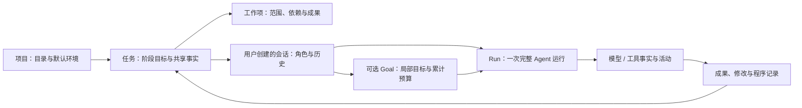

# 下一阶段实施方案：从空白项目到桌面代码任务闭环

> 日期：2026-09-17。状态：用户已要求启动 Goal 实施，作为当前 M2 的 A–F 实施基线；进度见 [M2](../progress/m2.md)。
>
> 本文将已讨论的产品行为收敛为下一阶段的范围、工程顺序与验收依据。交付范围和分批方式是本轮建议，不把建议写成用户已经逐项确认的决定。只细化这一阶段，不预写全部后续阶段，也不设固定工期。
>
> 2026-09-18 界面补充：[主界面与运行轨迹](main-interface-and-trace.md) 明确左侧统一会话入口、输入框内切换模型、底部折叠 Goal 和思考流；trace 仍为后续设计，实施与证据以 M2 进度为准。

## 1. 结论与阶段目标

需求已足够进入实施规划，没有必须再开一轮广泛讨论才能继续的问题。下一阶段建议交付一个**以任务为单位、能实际创建和运行代码的桌面 Harness**：

用户在桌面选择真正的空目录，绑定已有运行环境，创建任务与会话；按需讨论或 Plan，明确执行后通过常规 / Goal 完成小应用，看到真实文件改动、执行活动和可访问的程序；再由用户创建新会话接续修改。退出后任务与历史仍在，程序与 Goal 不自动重启。

按用户 2026-09-17 的最新要求，主体验简化为 [初版设计稿第 7 节](harness-initial-design.md#7-用实际场景核对初版设计) 的**单页计数器**：点击加一、刷新保留数字，接手会话只改标题。原待办清单 / 筛选示例被替代；用简短操作覆盖工具和已实现流程，不靠复杂业务或刻意拖长任务体现 Harness 能力。空目录起步、真实模型、桌面操作与会话接续的要求保留。

本阶段组合原路线中的编辑、执行与部分长任务能力，实施名称为 **M2：桌面任务与代码执行**。历史 M2–M8 表保留供追溯，原 M2 的安装与打包验证继续作为后续交付要求；本阶段首先通过已有 `StartAgent.cmd` 体验，不宣称完成安装包或原 v0.1 的全部验收。

依据：[项目守则](../../AGENTS.md)、[初版设计稿](harness-initial-design.md)、[需求讨论](harness-requirements-discussion.md)、[运行环境设计](runtime-environments-and-sandbox.md)、[M1 实际进度](../progress/m1.md)。[独立调研](../research/README.md) 作为组件选择的参考，具体采纳时核对相关专题；不把研究建议整体当作已确认架构。

## 2. 现有基线与需要改变的地方

以下保留 2026-09-17 开始实施前的源码基线；实际完成范围以 [M2 进度](../progress/m2.md) 为准，不把本表作为当前功能清单。

| 当前事实 | 下一阶段的处理 |
| --- | --- |
| [项目登记](../../src/my_agent/projects.py) 已允许空目录，不要求 Git 或已有源码 | 直接复用；不提前生成脚手架，不增加 Git 初始化前置条件 |
| [核心循环](../../src/my_agent/runtime/loop.py) 使用固定只读系统提示；[会话服务](../../src/my_agent/sessions/service.py) 直接装配 `ReadTools` | 改为显式装配模式、上下文、skill 和工具能力；保留现有模型 / 工具回合核心 |
| 会话服务只有一个 `self.active`，整个后端同时只能运行一个会话 | 按会话管理活动 Run、取消与事件，去除全局独占；同一会话仍有一个顺序化执行入口 |
| [会话存储](../../src/my_agent/sessions/store.py) 保存 JSONL 事实并恢复配对消息；没有 Task / Goal | 保留历史格式兼容与原会话身份，新增任务共享信息和 Goal 状态，不重建旧历史 |
| [只读工具](../../src/my_agent/tools/read_only.py) 已有文件内容 / hash 与本地搜索 | 增加创建与精确编辑；新文件不能套用仅适用于已存在文件的路径校验 |
| [进程模块](../../src/my_agent/processes.py) 面向短时可信诊断 | 单独建立项目执行服务，不把诊断探测函数扩大为项目终端 / 长服务后端 |
| [装配入口](../../src/my_agent/bootstrap.py) 已提供模型工厂和共享 HTTP 池 | 继续复用 Go 双模型、凭据解析、取消和连接池，保留首字优化成果 |
| 桌面按项目展示会话，页面与后端都含单活动运行假设 | 改左侧三级树，任务概览、各会话运行状态和可折叠成果卡片一起接通 |

不在这一阶段更换 Python / Electron 技术栈、模型供应商、全部存储方案或引入通用编排框架。

## 3. 首批范围与后置能力

| 能力 | 本阶段建议交付的最小版本 |
| --- | --- |
| 任务与会话 | 左侧项目 → 任务 → 会话树；任务目标、简短约束、进度、决策与成果；用户创建会话，旧会话可查看并归入任务 |
| 常规 / Plan / Goal | 共用执行内核；常规完成当前请求，Plan 形成方案，Goal 按局部目标连续推进；插话、停止、HITL 和真实故障各有明确状态 |
| 内置工作方法 | 讨论、规划、实现 / 诊断、Review、交接的最小 skill；按当前需要加载，不强制每个请求经过全部阶段 |
| 文件与成果 | 原目录读 / 搜索、创建文件及必要父目录、精确编辑、保存基线与 diff；现有文件编码 / 换行有明确处理，不盲目覆盖 |
| 环境与执行 | 统一登记已有 Python / venv、Conda、uv 环境，项目选一个默认；Windows 本机执行命令和启动预览服务，运行卡片可查看输出与停止 |
| 联网资料 | 同一 Go key 的 DeepSeek 原生搜索；独立 HTTP 网页正文读取；显示来源、用量和真实失败，不引入额外搜索 key |
| 过程可见 | 网络请求、读写文件、运行程序、联网与整理成果在开始时展示；右侧可查看文件 / diff、文档、日志与来源 |
| 接续与合作 | 任务摘要接续、用户发起 handoff / 独立 Review；按已设角色读取会话与发送协作请求，空闲时处理；独立会话能并行工作 |
| 持久化与恢复 | 保存任务、Goal、成果和执行事实；重启恢复界面与记录，已结束动作不重放，在途状态核对后由用户接续 |

**本阶段建议后置**：可视化自定义工作流编辑器、自动拆分临时子 agent、复杂长期记忆 / 向量或知识图谱检索、自动自进化、完整 IDE、浏览器自动操作、Git 工作副本管理、Docker / WSL 和未经验证的原生沙箱执行后端。已讨论的子 agent 开关和判定保留在设计中；未接通前不显示可用开关来冒充实现。

原生直接执行明确显示未隔离。用户选择的沙箱若尚不支持，相关执行说明不可用，不回退为直接执行；未选沙箱的项目照常工作，无需另行确认信任。上述后置不取消已确认需求，只限制本次实现范围。

## 4. 对象关系、职责与落盘

普通请求可以没有 Goal；一个 Run 包含若干模型请求和工具回合。工作项是完整工作单元，可以由同一会话完成多个，也可以交接给已有会话，不等同于单个工具调用，不要求每项都建立 Agent。

| 职责 | 最小事实与约束 |
| --- | --- |
| Task 服务 | 项目归属、目标 / 约束、状态、决策、工作项 / 依赖、成果入口、会话关系；区分用户决定、模型建议与实际执行证据 |
| 会话与 Run 协调 | 会话模式、角色 / 范围、当前运行、用户输入队列、取消；事件始终带项目 / 任务 / 会话 / Run 关联 |
| Goal 控制器 | 目标与完成条件、关联工作、状态、运行记录、累计用量和停止原因；只推进当前已授权目标 |
| 上下文与 skill 装配 | 当前请求、任务摘要、相关事实、本会话有效历史及按需读取的成果；方法指导不授予额外权限 |
| 工具与执行服务 | 文件基线、明确参数、实际结果、命令 / 服务所有权；不把模型文本直接视为执行指令 |
| 成果索引 | 文件 / diff / 文档 / 运行 / 搜索的引用、来源、适用版本与验证范围；大输出按需加载 |

### 4.1 沿用现有存储，不先做全量数据库迁移

保留会话 JSONL 作为运行事实来源；每任务日志保存共享决策与工作项，会话归属追加为原会话日志的元数据事实，成员视图由其投影，避免跨文件维护两份归属。环境登记沿用版本化 JSON 与单文件原子保存。先按实际查询需要建索引，能从事实重建的索引不作为另一份事实来源。Goal 与程序状态归属相应会话 / 运行记录，任务只引用有意义的结果。

所有新路径由数据根统一装配。应用数据继续使用现有优先级与 E 盘默认值；目标应用自身的数据库属于用户项目，不能与 Harness 元数据混用。

- 新建任务及首个空会话使用关联的操作 ID：任务保存成功、会话创建失败时保留真实的空任务并提供接续，不宣称跨文件创建已经全部完成；相同操作重复提交不生成重复任务。
- 新会话关系使用新增元数据关联；旧日志和会话 ID 不被改写，既有 `x-opencode-session` 不变。旧项目会话先放“未归属会话”，用户可归入任务；不由模型猜测目标并自动批量迁移。
- Run 事实先保存，再以来源事件 ID 幂等同步任务。任务摘要同步失败时显示未完成状态并按故障规则停止；恢复只补同步已保存事实，不重跑文件写入或命令。
- 单写者锁不长时间包住网络 / 程序等待。同目录临时文件与原子替换仅提供单文件保证，不宣称跨文件事务。
- 协议由 Pydantic DTO 导出 schema / TypeScript，沿现有 Ajv 和 IPC 校验路径接通；需要升级协议时显式处理版本，旧业务数据保留。

### 4.2 接续信息先做可靠、可追溯的最小版本

新会话自动获得任务目标、当前进度、已确认决定、未决项与成果入口；完整历史和文件按需读。任务共同事实可以共享，其他正式会话详情仍按角色关系控制。

用户作出明确决定、工作产生成果、运行等待 / 结束和 handoff 时更新任务。建议由正常工作回合提交带来源的结构化进度，宿主写入已经发生的执行事实；不在每次回复后额外调用一个“摘要 Agent”。界面能查看来源并纠正结论，修改后保留替代关系。

上下文装配保存采用的任务版本，在下一次模型请求时刷新；不在每次工具前比较共同字段版本并中止正常动作。不能修改已发出去的模型请求，需要立即停止时使用停止入口。输入 / 输出规模通过集中配置和实际模型能力管理；上下文字节预算只计实际输入，不用输出 token × 4 提前拒绝；旧历史超出可用上下文时明确处理，不静默截断工具配对。

## 5. 运行控制：让 loop / graph 有实际状态

默认工作流先实现为**有来源的工作项、依赖、成果与反馈关系 + Goal 连续推进**。例如“实现初版 → 必要检查 → 启动供用户使用”，检查结果进入下一次工作判断；只有原目标包含修复，才产生相应修正工作。纯问答或很小修改无须先生成完整依赖图。

内置 skill 是可版本管理的方法资源，由装配层按模式和工作内容选择；一次正常 Agent 运行完成一个有意义的工作单元。外层 Goal 控制器接收结构化结果，决定继续、交付、等待或停止。先用现有 Python 服务实现，不依赖通用图框架、固定阶段数量或逐动作调度模型。

### 5.1 模式、完成与失败

| 情况 | 产品行为 |
| --- | --- |
| 常规请求 | 在已有范围内执行并返回；不继续领取任务中其他未完成工作 |
| Plan | 可以读取 / 搜索与形成方案，保存应用内计划；写业务代码、项目执行不因 Plan 自动获准。明确要求保存的计划文档可按范围写入 |
| 用户明确要求“按方案实现” | 根据明确意图进入常规执行或 Goal 并在 UI 显示；“方案可以”本身不启动执行 |
| Goal 一次 Run 完成 | 保存实际结果；目标仍有可执行工作则继续，已满足完成条件才结束 Goal；任务不会因此自动完成 |
| 需要用户信息 / 决策 | 保存 HITL 问题、影响范围与可选项，等待对应答复；闲聊不能代答 |
| 实际模型 / 工具 / 执行 / 保存故障 | 停止当前 Run 与所属 Goal 自动续跑，保留进展和失败原因、清理在途临时工作；无隐式重试 |
| 检查正常运行但未通过 | 先报告实际结果；目标已包含该问题修复时按范围处理，否则结束本次报告并让 Goal 等待用户接续，不伪装为程序启动故障 |
| 用户停止 / 模式切换 / 退出 | 保存相应停止或暂停原因；恢复需用户明确接续，不自动撤销已写入的代码 |

2026-09-18 按用户要求对照 DSH 后，模型报告与真实执行事实分别保存。报告本身的来源由宿主记录，模型附带的引用不等于宿主验证通过；不再重复审查引用、成功状态或逐项证据。未知结果、未做验证和等待用户验收仍应如实说明。完整对照与保留依据见 [运行校验审计](runtime-checks-dsh-review.md)。

`report_work` 最小输入为 `summary / outcome`。Goal 可选 `continue / complete / wait`，常规 / Plan 的 schema 仅提供 `return / wait`。`criteria`、工作项、下一步与模型引用按需填写；缺引用、依赖尚未齐全、完成项前置状态未更新不阻断报告。共同工作项按最新报告更新并保留全部历史，用户维护的字段保持原值。没有可选工作项可运行或一个完整回合没有报告时，继续原 Goal，由模型判断下一步 / HITL，不转成运行故障。wait 仍需具体问题，完成仍通过显式结果表达，不从自然语言猜测。

### 5.2 插话、预算与恢复

- Goal 正常运行时的普通问题进入本会话输入队列，在完整模型 / 工具记录边界处理，先回答再继续原目标；界面即时显示已收到和当前等待的动作。不能执行残缺工具调用，也不能为了插话悄悄丢弃一个仍在写入的操作。
- 同一会话保持一个执行入口；普通插话不是另开一个并发写代码 Agent。已失败或未解除 HITL 的 Goal 保持停止 / 等待，不因回答问题而恢复。
- Run 预算与 Goal 累计预算分开显示，沿用可编辑设置。Goal 内全部主模型、辅助搜索请求和工具消耗归入同一账本；恢复或新 Run 不清零。实际调用前核对余额，SDK 隐式重试继续关闭。
- 时间预算区分请求超时、一次命令时限和 Goal 活跃时间；HITL / 用户暂停不持续消耗活跃时间，已交付服务的运行时间不占据 Goal 的执行时限。具体默认值集中配置，不因 UI 计数引入新的固定轮次门槛。
- 活跃耗时从宿主单调时钟保存。崩溃导致某次 Run 的最终耗时未知时，单独列出该 Run，并按启动时记录的有效时限预留预算；预留不是实际耗时，也不采用包含离线时间的 UTC 差值。后续 Run / 用户接续不清零已发生用量；用户可调整累计预算。Goal 的剩余时间小于 Run 设置时，实际启动时限随之缩短并保存。
- 重启恢复已保存记录，将无法确认结果的在途动作标为中断 / 待核对；文件写入、命令、联网副作用不自动重放。重试前重新校验权限、预算与现实状态。
- 用户发送新消息、创建 / 接续 Goal 时，内部核对中断工具的相关成果并追加已知 / 未知观察，直接执行本次输入；没有独立恢复按钮或额外确认。普通新消息不恢复已停止的 Goal，自动续跑也不能借此绕过故障停止；仅用户明确接续 Goal 才恢复目标工作。外部修改作为事实保留，不重放旧工具，不增加观察令牌或全量成果扫描。文件实际写入仍按最新读取基线核验。
- HITL 用于缺失的关键信息、超出既有授权的范围变化或确需用户作出的选择。正常文件编辑、项目内执行、进度保存、内部核对等已经授权的步骤直接推进；内部校验失败显示具体原因，不再叠加“确认已确认”的审批。

## 6. 工具、环境与桌面怎样接通

### 6.1 文件编辑与差异

首版以创建文件、当前内容上的精确替换覆盖空项目与局部修改，不先造通用补丁语言。2026-09-18 按用户确认进一步简化：模型仅提供 `path / old_text / new_text`，工具读取当前内容并唯一匹配替换，保留其他位置的改动、编码 / 换行。普通读取 / 搜索不再计算摘要；读取 / 搜索及写工具均不向模型返回版本 hash，不要求连续编辑之间重复读取。写入前直接比较本次准备的内容；若期间发生变化，本次不覆盖，交回模型读取当前内容再调整，不结束整个 Run / Goal。旧输入中的 hash 仅兼容接收。宿主保存的摘要只用于中断后的状态辨认，不作为工具执行门槛。新文件仍不覆盖已有目标。

应用内对同一规范目标的基线检查与写入作短时协调；不同文件不因整个项目被锁住而排队。外部编辑器不受应用锁约束，因此不能宣称完全消除所有外部竞争；检测到变化停止覆盖并提供差异。多文件操作按实际成功项记录，不声称全部原子成功或失败后自动回滚。

准备阶段先将基线和预期写入字节连同来源原子保存到应用数据中的单个修改记录；写入成功后保存 `applied`，失败保存 `failed`。项目文件与成果记录不构成事务；仅剩 `prepared` 时结果尚未确认，不能推断未执行或自动重放。diff 由这两端快照生成，成功时表示当次提交的内容，失败时表示未完成的预期修改，不冒充当前磁盘内容。Git 可选，写入成功即在原项目，桌面提供右侧审阅，不再强制“应用回项目”。

历史 diff 读取不再复算摘要校验；无法解码或缺失的单条记录显示不可用，保留原记录，不影响继续编辑项目。模型的 `list_changes / read_change` 只返回成果事实与差异，不返回摘要字段；坏历史的工具错误保留在轨迹中，但不终止任务。宿主记录结构继续兼容已有数据，不为这次简化迁移或重写个人历史。

B 批的模式入口是桌面选择器及 CLI `--mode`：新会话常规、旧只读历史保持 Plan。Plan 默认不开放写入，仅用户填写本次 `plan_document` 相对路径后开放该唯一目标，且不跟随链接别名；运行时仍核验权限，不依靠工具 schema 隐藏来防止越权。口头确认方案不会自动切换方式；更完整的工作方法和自然语言模式协调随 D 接续。

参数缺项、原文缺失 / 不唯一、写入前的文件变化、目标已存在、类型不符或未知工具等反馈交回模型修正，仍计入预算。单条历史读取问题也作为局部反馈继续任务。实际模型调用 / 执行 / 保存故障结束当前 Run，尚未执行的同批调用保存 `tool.skipped`；结果不确定不自动重放。文件发现仍可忽略目录，显式访问不被忽略规则或文件名拦截；读取支持绝对路径 / 项目外明确目标 / 硬链接，项目写工具保持真实目标在项目内。默认发现不自动遍历项目外目录。

### 6.2 运行环境与项目程序

设置页先提供导入已有环境、查看解释器 / 启动器位置、按需验证与移除登记；项目选择一个默认环境。Python / venv 直接使用选定解释器；Conda 按安装身份与 prefix 解析；uv 明确区分使用已有环境和同步 / 下载依赖。具体命令参数在实现时核对本机帮助和官方资料，不从版本字符串推断不可运行。

导入 / 检查不安装或重建环境，失效绑定不静默换成全局 Python 或 Agent 自身环境。通用程序执行接受明确程序、参数、cwd 与按所选环境构建的变量；shell 模式单独表达。项目进程不继承 Go 凭据，不修改用户全局 PATH、代理、Conda 或 VPN 设置。

C 的落地采用 `execution/` 单独服务，环境与项目绑定在 `environments.json` 保存，程序在 `programs/` 保存有界快照。所选项目无绑定、无环境配置文件时直接使用本机工具，无需额外信任确认或先保存设置；旧 `trusted` 字段只保留兼容，不参与执行。Python / uv 显式绑定沿用登记解释器，uv 同步仍是明确命令；Conda 使用 `run --prefix ... --no-capture-output`。环境 / 执行方式在接纳启动时取快照，不在写入启动记录后再次检查；设置变更影响下一次启动。变量继承采用 DSH 的继承后筛除方式，保留普通工具配置、剔除凭据形名称与应用自身变量。失效项目仍可清除绑定。

Windows 创建进程时限定句柄继承，并在恢复线程前建立 Job 所有权，输出始终消费。服务启动前检查端口占用，就绪要求匹配的实时监听器均属自有 Job，随后实际取得 HTTP 响应头；不停止外部服务、不跟随重定向、不改变 TLS 验证。就绪、HTTP 状态和业务结果分开呈现。基于标准库实现生命周期，不将它宣称为沙箱。设置、状态与手动停止经逐项 RPC / preload；Plan 工具端仍拒绝执行，取消与环境探测走独立控制通道。

项目执行服务异步持续消费 stdout / stderr，输出有可配置上限与截断说明。每个命令 / 服务有独立身份、所属任务 / 会话、环境、启动记录、状态和停止入口；非零退出与启动失败分别解释，不能统一视为需要重跑。

Windows 进程树管理优先验证 Job Object 等所有权方案，核对附加、取消和退出清理实际效果；它用于生命周期管理，不是文件 / 网络沙箱。无法建立承诺的管理边界时，停止相关启动并说明，不假装已经接管。只管理本应用创建的进程，不能凭旧 PID 结束外部程序。

| 程序类型 / 操作 | 生命周期 |
| --- | --- |
| 在途临时命令 | 随所属工作取消 / 故障清理；已完成结果保留 |
| 已交付预览 / API 服务 | 回复结束、切换会话、停止 Goal 后继续运行；可以在卡片中单独停止 |
| 真正退出应用 | Electron 与后端协调停止活动工作和所管理的服务，再退出；不结束用户外部程序 |
| 再次启动 / 服务异常退出 | 恢复事实、显示中断或退出；不自动重启程序，也不自动续跑 Goal |

“进程已创建”“HTTP 已响应”“业务可用”分别显示。地址与端口取实际启动结果，不能固定一个端口并把启动文字当作预览成功。最小服务卡片先提供可访问地址，无须先开发内嵌浏览器。

### 6.3 搜索与网页读取

复用已验证的 Go `/messages` + `deepseek-v4.1-flash` 原生搜索；正常主对话保持 `/chat/completions` 和当前选定模型，GLM 会话也可显式调用这一辅助搜索工具。辅助调用共用会话请求标识、HTTP 池、取消、预算与脱敏策略，前端能看出搜索所用模型，不形成静默模型切换。

搜索卡片返回查询、实际原生搜索次数、来源、摘要 / 引用和实际用量。辅助请求以独立事实记录，和主请求一起计入当前 Run / Goal 的请求及 token 账本；没有额外总结请求。原生响应含不透明来源数据，其下载容量复用可调的文件读取上限，可见结果再按工具输出上限裁剪，不将主对话文本容量误当原生响应容量。2026-09-17 已完成 GLM 驱动真实搜索、读取官方页面及回答的集成验证，见 [M2 进度](../progress/m2.md)；一次通过不代表长期稳定性或首字性能验收。

网页读取先处理公开 HTTP(S) 文本 / HTML，明确内容类型、重定向与大小限制，返回来源和截断信息；不携带模型密钥、浏览器 Cookie 或执行页面脚本。URL 与重定向经过目标校验，网页正文按不受信数据进入上下文；项目本地服务检查使用独立执行 / 预览路径。浏览器登录和 JS 自动操作后置。

正文提取返回实际 HTTP 状态、最终 URL、时间、截断与分页位置；404 等状态和空正文作为观察结果返回，不直接终止整轮，二进制附件仍不支持，结构化 `+json / +xml` 文本可读取。继续读取会重新取得网页，不保证版本相同。直连保留 DNS 预检，HTTPX 实际选用代理时不再要求本机先解析目标，NO_PROXY 沿用同一客户端规则；不选择或修改 VPN / 代理。该预检不是系统网络隔离。

### 6.4 协作、并发与桌面状态

正式会话由用户创建，角色和可访问关系沿用简短分工说明。共享任务事实无需复制完整历史；按范围读取会话详情或发送请求才使用协作接口，读取本身不调用模型。

协作请求保存发起方、接收方、目标 / 范围、输入成果和返回要求；按请求 ID 保存结果。接收方有活动工作时排队，只有处于可接单的空闲状态才运行；失败、暂停、HITL 不是可被消息自动恢复的空闲。请求不会替换接收方已有 Goal，也不通过自动往返委派产生无人负责的循环。失败影响依赖该结果的运行 / Goal，无关会话不一起停机。

独立会话可并发，各自拥有活动 Run 与取消信号；共享持久化仍是单写者，文件写入只协调真实共同目标。资源容量若需限制，集中配置并显示排队原因，不采用文件数、任务长度或固定评分决定能否执行。首次实现不要求同一 Run 内所有工具并行，避免把这项优化变成可用性的前置条件。

F 已将会话 / Goal 句柄按会话保存；`runs.active` 返回活动会话列表，桌面左侧树显示状态并进入会话，当前输入区提供停止入口。当前会话的发送不受其他会话是否运行影响；相同会话的 Goal 插话仍经原输入队列处理，取消按精确 Run ID 路由。切换视图和窗口重载不重新发起请求，退出等待全部自有运行清理。并发的实现与证据见 [M2 进度](../progress/m2.md)，不代表下面的角色协作 / handoff 已完成。

F 随后接通了用户定向协作约定和持久请求：在会话的“会话协作”卡片选择同任务已有会话，填写一句分工并选择只读 / 可执行范围。保存约定后，范围内读取和发送不再逐次确认；反向访问需有相应约定，模型不能自授角色或创建正式会话。Agent 使用 `list_collaborators`、`read_session`、`request_collaboration`、`read_collaboration`；等待由本地状态事件唤醒，不靠模型反复催问。Plan 不能通过协作获得写入能力。

2026-09-18 上传前收尾：双向投递不再按请求图或祖先关系拒绝，仅在实际等待闭环时返回当前状态，保留请求让模型调整顺序；Goal 插话可唤醒协作等待并先答后续。`read_collaboration` 支持正文偏移，`read_session` 支持固定条目的分段读取，列表与投递回执不重复携带整份结果。持久化等待状态、被动等待单独计时及更完整的结果自动接续仍属于 M3，不在 M2 宣称完成。详见 [上传前审查](m2-release-review.md)。

请求记录来源会话 / Run、接收会话、任务、目标、输入、返回要求以及精确结果 Run / 序号；接收方使用自己的会话模型和 Run 账本，结果不会自动替换来源 Goal 或触发一次来源模型调用。接收方忙时排队，非终结 Goal、上次失败 / 停止和不完整历史保持原状态；当前不自动跨这些状态接单。用户可查看原因、安排接收方工作或停止请求。故障结果由等待它的工具返回失败，停止相应运行，保留无关会话。应用重启只核对已存在的运行，尚未启动项暂存，用户明确继续后才重新进入队列；已启动请求不能一键重放未知副作用。真实模型端到端体验仍待后面的计数器场景验证。

handoff 保存目标、进度、决策、改动 / 接口、未决项和接手范围；转移同一推进责任时停止原方继续该项工作，保留无关活动。独立 Review 由用户安排，默认产出可定位发现，不自动修改。

专用入口与普通协作共用卡片和持久队列。用户选择已有接收会话、目标和可选补充后，宿主生成有来源水位的简报并赋予接收方读取来源的关系，不另请求确认或调用摘要模型。交接可选择转移精确 Goal / Run；同会话其他工作和已交付预览服务不受影响。Review 使用 Plan 的只读工具集和审查工作方法；`list_changes` / `read_change` 提供自己的或获准来源会话的历史 diff，实际编辑仍须读取当前文件。界面简报可展开，后续明确消息可调整接手要求，原安排记录保留。已实现与真实验证范围分别见进度文件。

桌面左侧维护项目 / 任务 / 会话选择；主区显示会话与真实活动，右侧按需打开成果。前端以所属 ID 与事件顺序更新各运行，迟到响应不能覆盖新选择。首版使用现有组件补齐可折叠卡片，不以 Monaco 或图形画布为前置条件；renderer 继续不访问文件系统、密钥或命令。

## 7. 实施分批与可体验结果

每批包含对应的后端、DTO / 生成协议与桌面入口。中间批次可以体验，但只有完整交付达到第 8 节才能宣布本阶段完成；不以 CLI 实现或替身演示代替桌面能力。

| 批次 | 主要改动与依赖 | 完成后能直接看到什么 |
| --- | --- | --- |
| A：任务骨架与接续 | Task 存储 / 服务；旧会话兼容；左侧三级树、任务概览；最小共享上下文 | 新建任务和会话，保存 / 重启仍在，旧会话不丢失；新会话知道任务目标。仍为只读中间成果 |
| B：真实编辑 | 模式 / 工具装配；创建、精确编辑、基线与成果；右侧 diff | 常规执行可以从空目录写出文件，Plan 不误写业务代码，变更能审阅；尚未等同应用已运行 |
| C：项目程序运行 | 环境登记 / 绑定、异步执行、进程所有权、卡片与退出清理；依赖 B | 在桌面用所选环境启动实际小应用、查看输出与地址、停止；形成第一个常规模式完整代码闭环 |
| D：Goal 与默认工作流 | 持久 Goal / HITL / 用量、最小工作项依赖与 skill、插话及恢复；依赖 A–C | 同一个会话持续完成局部目标，解释当前动作和停止原因；空目录场景可用 Goal 走完 |
| E：联网资料 | 原生搜索辅助适配、网页读取与来源卡片；沿用运行和预算契约 | 根据需要真实联网获取资料；不为所有任务强制联网 |
| F：跨会话协作与阶段交付 | 活动 Run 按会话隔离、角色互访、协作队列、handoff / Review；在 A 中预留正确归属，至此接通 | 用户新建接手会话追加功能；独立会话可并行，成果和故障归属明确；完成统一体验与证据整理 |

**实现起点建议为 A**。开始实现时先写对应阶段 progress 的本次范围，再改任务服务 / 关联契约及桌面导航；不是先投入复杂图调度器。B–D 是达到主要代码目标的连续路径，不能只做完 A 就宣称交付了 coding harness。

## 8. 验收与最小必要验证

### 8.1 空目录主场景

1. 选择默认测试位置下一个新的空子目录，确认不存在预置源码、README、依赖清单、数据库或 `.git`。不清空已有目录；自动化继续用 `.artifacts/tests/<run>/project`。
2. 在设置导入已有 Python 环境并设为项目默认，创建“单页计数器”任务。Plan 简述一个页面怎样实现，业务目录此时仍未被自动初始化；按需真实检索一条官方资料并读取。
3. 用户给出设计稿 7.2.1 的明确 Goal，Agent 创建 `index.html` 和简短运行说明，使用已有 Python 的静态 HTTP 服务预览，不要求数据库、后端 API、依赖安装或多文件脚手架。本目标内的相关功能问题可修复，真实调用故障仍停止。
4. 实际点击加一并刷新，核对数字保留；显式停止 / 重启同一地址的服务后再次核对。计数保存在该浏览器的 localStorage，与 Harness 元数据分别记录；更换浏览器或端口不作为相同存储来源。显示实际地址、diff、命令 / 程序结果和下次启动方式，HTTP 成功不冒充按钮操作证据。
5. 验证普通插话后继续、用户停止和已交付服务保留；真正退出后服务停止，重启恢复 Harness 任务 / 会话记录，Goal / 服务均不自行拉起。
6. 用户新建接手会话并明确角色与历史访问范围，只把标题改为“我的计数器”；证明共享进度、按需历史读取与基线编辑。用户主动安排独立 Review，只核对这次变更和原有计数 / 保存行为，不新增业务功能。

这是一条集中场景，随实现分批积累证据，不要求每次小改动重跑全部。检查业务应用的数据持久化与 Harness 元数据持久化时分别记录；完整 UI 与真实模型体验也分别说明。

工具与能力按下表覆盖，实际证据注明本次执行或复用既有记录。每项只需能直接说明能力的短操作，不要求固定工具顺序、重复调用或最少运行时长。

| 工具 / 能力 | 计数器场景中的最小动作 |
| --- | --- |
| `list_files`、`read_file`、`search` | 看空目录；创建后读页面并查找计数 / localStorage 相关代码 |
| `create_file`、`edit_file`、`list_changes`、`read_change`、diff | 创建页面 / 简短说明；接手时按读到的基线修改标题，Review 读取历史差异及当前文件 |
| `execution_environment`、环境设置 | 使用项目已经导入 / 选定的 Python，查看实际绑定 |
| `run_command` | 一次短命令检查生成文件或选定解释器，不搭测试工程 |
| `start_service`、`read_program`、`stop_program` | 启动静态预览、读实际输出，显式停止 / 重启一次 |
| `web_search`、`web_fetch`、来源卡片 | 查一条官方使用资料、读取实际页面并引用；已通过的 E 证据可复用，不能写成再次执行 |
| `read_work_status`、`report_work`、任务进度 | 保存简短方案 / 实现结果及真实成果引用，结束当前工作单元 |
| Plan、常规、Goal、活动 / 预算 | Plan 讨论、Goal 创建和预览、常规一句问答或小修改；观察实际运行状态与累计用量 |
| 多会话、协作请求、handoff、独立 Review | 角色分工只需“确认启动方法”“接手改标题”“检查改动”；入口和模型实测证据分别记录，不加新的业务模块 |
| `list_collaborators`、`read_session`、`request_collaboration`、`read_collaboration` | 查看已有资料会话约定，按需读其结果，请求确认一句启动方法并等待实际回复；普通协作可复用已有定向证据 |
| 插话、停止 / 接续、HITL、失败停止、历史恢复 | 主线可插问一次并查看保存结果；HITL / 故障等条件性行为优先复用已有直接证据，不为制造演示而增加确认或故意破坏环境 |

设置、连接诊断等已有独立证据仍保留，不要求计数器业务承担这些职责。后置的自动子 agent、沙箱或自定义图编辑器不列为本次已实现能力。

### 8.2 直接覆盖关键风险，避免扩成测试工程

- 旧数据兼容、部分保存失败、写入基线冲突 / 同名新建、项目凭据隔离、取消 / 退出清理和协议变化，保留直接覆盖风险的最小检查，优先复用已有入口。
- Goal / HITL / 故障状态与跨会话取消优先使用确定性模型替身；服务清理使用短小本地进程。相关检查通过后不重复扩大回归。
- 真实空目录主流程先用默认 GLM 验证；第二模型复用产物做必要兼容检查，不无理由重复搭同一个应用。搜索沿用已有真实能力证据，产品集成需要时再做有预算的完整回合。
- 联网卡片、协作请求、手动 Review 若未在主场景出现，按上表复用已有证据或补一个短操作；不用增加计数器业务复杂度来凑流程。安装包、可选沙箱与浏览器自动化未验收，不计为本阶段已完成能力。
- 测试源码统一 `tests/`、产物统一 `.artifacts/tests/`，可重复入口进入 `tests/README.md`；依影响选择 `scripts/check.py` 已有检查或相关子项，完整聚合只用于相应验收。
- 每批涉及的源码遵守中英文定义注释；阶段开始 / 收尾和集中提交前检查相关路径、默认值、时限和版本条件，不引入固定文件数、固定阶段或可选工具缺失阻断启动的条件。

## 9. 还需要讨论什么

**没有必须由用户重新决定才能继续的产品问题。** 下面先给出可调整的实施默认值；若实现证据证明会影响已确认体验，再带具体问题讨论。

| 事项 | 当前建议 / 后续处理 |
| --- | --- |
| 下一阶段大小 | 采用第 3 节最小版本，按 A–F 可体验推进；自动子 agent、自定义图和复杂记忆后置，不一次实现全部研究方向 |
| 创建任务的必填项 | 目标即可，名称可以编辑；类型 / 详细模板不作为门槛，用户创建动作可一并打开首个空会话，不发模型请求 |
| 模式切换、Goal 预算 | 按第 5 节建议落地；执行设置清楚显示作用范围，可调整，不另设无法修改的连续回合数 |
| 数据与协议兼容 | 由实现处理旧历史、幂等与事件归属；无需用户决定数据库字段，但迁移不得破坏旧数据 |
| 环境 / Windows 清理兼容性 | 实施 C 时核对实际工具命令和子进程清理，不预先许诺所有环境均通过；可选环境的问题不阻断其他环境 |
| 任务完成 | Goal / Run 的完成不自动结束阶段任务；用户明确收尾且事实符合时记录任务完成，保留未验证项与成果 |
| 组件研究如何合流 | 实施相应模块时阅读相关专题，优先采纳能解决当前问题的设计；若调整核心取舍，说明具体收益与兼容影响 |
| 安装包与阶段编号 | 本阶段先保证现有启动入口可完整体验；原打包验收保留，进入实施时同步路线编号，不从路线中静默删除 |

本文初稿制定时没有实施产品功能；用户随后启动 Goal，当前实现与验证见 [M2 进度](../progress/m2.md) 和 [总览](../progress/README.md)。方案本身不代表功能完成，Git 仍按每次明确授权处理。
