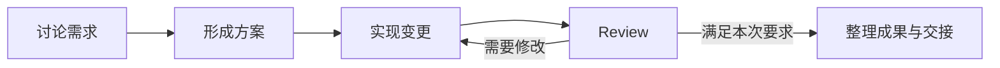

# 以任务为单位的自定义工作流 Agent：产品对照与设计讨论

> 调研日期：2026-09-16。
> 状态：用户已明确以任务为单位、内置默认工作流并支持后续其他工作流的方向；默认流程细节与实施范围仍在讨论，不是实施授权。
> 关联：[需求讨论稿](harness-requirements-discussion.md)、[总规划](coding-agent-from-zero-plan.md)、[进度总览](../progress/README.md)。

## 1. 本轮问题与判断

用户提出将应用做成“以任务为单位的自定义工作流 agent”，并询问是否已有类似开源或商业产品。此前已经明确先创建任务、通过内置 skill 推进，并支持多会话协作与 handoff；本次是在这些需求上探讨更完整的组织方式。

随后用户明确：个人习惯作为其中一个工作流，或产品的默认工作流；其他自定义工作流的功能可以稍后实现。工作流要包含完整 coding agent 层面的 loop engineering / graph engineering 能力。因此当前优先讨论默认工作流实际如何推进，以及可承载不同流程的共同执行能力；自定义编辑入口后置。

最新补充区分了目标层级：任务保存阶段性长期目标，同一会话内使用 Plan、Goal 与常规对话 / 执行处理局部目标，Goal 已确认可自动连续推进多个回合。下文流程步骤属于任务组织方式，不能据此将一个会话固定为单一阶段；模式具体语义见 [需求讨论稿](harness-requirements-discussion.md) 第 4.5 节，仍在讨论。

本轮判断：这一方向适合继续细化。它可以把任务目标、阶段 skill、会话、成果、交接和未来 loop / graph 放到同一套工作流程中。已有多个相近产品，不能将它描述为无人探索的新类别；本项目的价值取决于是否更贴合用户自己的开发方式、可调整的上下文 / 记忆策略及本地使用习惯。

调研重点是完整 coding agent 的工作编排。通用 LLM 工作流产品仅作为编辑、数据传递和状态展示的参考。下文“与本项目的关系”是基于产品资料作出的设计判断，不是产品性能排名。

## 2. 相关产品与边界

只查阅官方文档、项目仓库说明及维护公告，未安装、运行或进行账号付费验证。仓库默认分支说明与正式发布版本可能不同；后续复用源码仍需锁定提交并核对许可证。

| 产品 | 形态 / 源码情况 | 公开资料能确认的相近能力 | 与本项目的关系 |
| --- | --- | --- | --- |
| [Aperant，原 Auto Claude](https://github.com/AndyMik90/Aperant) | 桌面应用，AGPL-3.0 | 用户创建任务，Agent 负责规划、实现和验证，提供任务看板及多会话能力；官方说明当前 2.x 维护中，3.0 正在重建 | 很适合参考“任务作为桌面产品中心”；不能仅凭阶段流程就认定它提供任意工作流编辑器 |
| [GraphCode](https://github.com/scgopi/GraphCode) | macOS 应用；app / daemon 使用 FSL-1.1-MIT，部分组件 MIT，属于源码可用，不能笼统称整套宽松开源 | 将真实 CLI coding-agent 会话中的工作单元连成图，支持交接、消息与启动其他工作 | 贴近 Agent 粒度的图；其外部 CLI 组织方式与我们自己的 Python 核心不同 |
| [Vibe Kanban](https://github.com/BloopAI/vibe-kanban) | Apache-2.0 | 看板 issue、Agent workspace、diff 审查、反馈和 PR 流程 | 适合参考任务 / 工作区 / 会话管理；任务看板本身不等于自定义执行图。官方已宣布由社区继续维护，见下方公告 |
| [Devin Dynamic Workflows](https://docs.devin.ai/work-with-devin/dynamic-workflows) | 商业产品 | Python 脚本组织多个完整 Devin 会话，支持并行和分阶段执行、结构化结果传递、进度查看与恢复；可将流程保存为 skill | 是本轮很接近的商业参照；参考工作契约与运行记录，不因此改用云端 Devin 作为本项目核心 |
| [Dify](https://github.com/langgenius/dify) | 可自托管并提供云服务；Dify Open Source License，基于 Apache-2.0 附加条件 | 可视化 AI 工作流、RAG、Agent、模型管理与观测 | 适合参考流程编辑与变量 / 结果展示；其主要定位是构建和部署 LLM 应用流程 |

维护状态依据：[Vibe Kanban 官方公告](https://www.vibekanban.com/blog/shutdown) 日期为 2026-04-10，说明 bloop 公司关闭，项目以开源、社区维护形式继续；不能把它列成仍由原公司正常维护的推荐依赖。Aperant 的状态按上述仓库公告记录，3.0 尚未有公开发布日期，本轮不推断其计划功能已经发布。

Devin 另有 [Playbook](https://docs.devin.ai/product-guides/creating-playbooks)，官方将其描述为可共享复用的任务提示与过程指导。它与 Dynamic Workflows 的程序化编排是不同机制：前者适合参考可复用做法的表达，后者适合参考多个 Agent 工作的组织。

GraphCode 许可范围以其 README 的 Credits & license 为准，本轮纠正此前讨论中对它笼统使用“开源”的说法。此处仅记录产品资料，不涉及复制源码或作出再分发方案。

## 3. 对本项目架构的建议

默认工作流与后续可定制方向已经确认；以下职责划分和具体机制是为承载该方向提出的设计建议，仍不作为已实现能力或最终数据结构。

### 3.1 区分可复用做法与本次执行

| 概念 | 建议负责的内容 |
| --- | --- |
| 项目 | 代码、资料与项目约定的归属 |
| 任务 | 阶段性长期目标、范围、已确认结论、进度和成果，可跨多个会话推进 |
| 工作流模板 | 可复用的步骤、依赖、skill 组合与交接方式 |
| 本任务的工作流与执行记录 | 本次采用的流程版本、实际步骤状态、执行尝试、等待输入及输出；与模板修改分开保存 |
| 工作步骤 | 一个完整工作目标，例如形成方案、实现接口或审查变更，可由完整 Agent 或明确的人工 / 工具操作完成 |
| Skill | 指导一种工作的做法、所需输入和预期成果 |
| 会话内目标与模式 | 表达当前局部目标及其推进方式，暂按 Plan / Goal / 常规（对话与执行）理解；Goal 连续推进方向已确认，详细切换语义待定 |
| 会话与运行 | 会话保存连续交互与上下文，运行保存具体执行事实；一个局部目标可涉及多次运行，步骤与会话不提前绑定成严格一对一 |

任务内的进度独立于聊天窗口，也独立于模板当前版本。修改模板不能悄悄改变进行中的任务；是否将改动应用到任务、如何影响已完成步骤，要能查看和追溯。任务暂停 / 恢复与单次运行停止也需分别表达，现有 `run_id` 不直接承担整个工作流身份。

任务与会话的信息交互建议见 [需求讨论稿](harness-requirements-discussion.md) 第 4.6 节：任务提供共同背景与相关变化，会话交付有来源的成果、事实和待讨论建议；真实状态、用户决定和模型推断分别保存。写回任务记录与启动下一个工作单元分开，具体策略尚未确认。

### 3.2 工作流组织完整工作，步骤内保留 Agent 的判断空间

例如一个任务可以采用以下做法，步骤按实际目标调整：

节点内部可以有多轮对话和工具调用。跨步骤交接需要记录成果、证据位置、未解决问题和下一步，不把整段聊天机械复制给每个参与者。是否复用会话、新建会话、并行或单独安排人工决定，都需继续讨论。

图中讨论、方案、实现表示工作关系，不直接对应会话模式。实现环节仍可在同一会话中规划局部问题、查询进度或持续推进一个局部 Goal；局部目标完成不会自动结束整个任务，切换模式也不自动转移任务阶段。

如果只有一项简单工作，可以只有一个步骤。讨论、实现、审查是可组合的方法，完成条件与验证深度按任务目标约定，不把每个模板都变成强制测试流水线。工作流提供的指令继续受现有运行时权限、数据与凭据边界约束。

### 3.3 任务分类可以转为模板发现方式

上一轮的六类任务只是候选。如果采用本方向，创建时可以优先选择“功能开发流程”“故障排查流程”“模型实验流程”等模板，也可以为当前任务生成或编辑流程；类型可用于筛选和整理。

这样无需先把业务类型做成封闭分类，新的工作方式可以通过模板表达。内置 skill 提供方法，工作流组合这些方法；具体是否支持模板参数、自定义 skill 和可执行脚本，分别取舍，不默认全部实现。

### 3.4 后续定制入口候选（用户已要求延后）

先前提出“模板起步 + 自然语言调整 + 可编辑步骤列表”作为定制方案：用户描述目标，Agent 推荐本次做法，用户可增删步骤、调整顺序或交接，再在约定范围内推进。适用的流程可保存为自己的模板。按用户最新要求，这只是后续候选，不作为当前首先要解决的问题。

图画布可以是后续展示与编辑方式，不用来定义全部核心语义。无论采用列表、自然语言或图，应用都需要同一份可检查的流程定义和实际执行状态。此建议尚未由用户确认；也未决定 Agent 可自主修改流程的程度。

### 3.5 当前优先：默认工作流及其共同执行基础

建议将职责分为三部分：

1. **共同执行层**：管理工作单元的启动 / 停止、依赖和条件转移、运行事实、上下文交接、暂停 / 恢复，以及资源预算。它不把某个固定业务阶段顺序写成唯一合法流程。
2. **默认工作流定义**：承载用户习惯，包括何时讨论、怎样实现 / review、何时返回修正或等待用户、怎样分工及 handoff；组合已有或后续内置 skill。
3. **后续定制入口**：让用户创建、调整或保存其他工作流；编辑器、配置格式及导入导出按后续需求确定，不提前建立复杂插件系统。

默认流程按实际需要使用以下能力，不以创建一组阶段按钮视为实现完成：

- **目标循环**：围绕一个工作目标驱动完整 Agent 执行，根据结果和实际证据决定继续、修正、完成或暂停；循环进展需落盘，并遵守可调整的运行边界。
- **工作图**：记录工作单元的依赖、条件分支、返回路径、交接和汇总；节点可以包含完整 Agent 的循环。是否并行、哪些会话承担哪些职责以及工作区关系，继续讨论。
- **可接续状态**：跨会话保存当前步骤、成果、未决事项与执行尝试；恢复时核对未知结果和副作用，不能简单重跑所有步骤或仅靠聊天摘要宣称完成。

这里是架构方向，尚未承诺一次性实现任意动态图或通用调度平台。先从用户默认工作流中确定真实需要的语义和验收，再决定下一阶段范围。M1 已有模型 / 工具循环、会话与运行记录可作为基础，不等于上述外层能力已经完成。

## 4. 下一项讨论

按最新目标层级补充，Goal 已确认可自动持续推进局部目标；任务与会话的信息更新先按现有方向暂用，后续结合组件调研修订。当前进入 [初始版本产品设计](harness-initial-design.md)，继续串起任务工作区、模式切换、默认工作流、review 和 handoff。此前“讨论 / 方案何时进入实现”的问题保留，但不再等同于任务必须整体切换阶段。自定义编辑入口延后，不要求先选图画布或配置格式。

已有 Python / Electron、OpenCode Go 双模型及数据根约定保持有效。本轮未选定流程框架、引入其他运行时、安装产品或开始实现；M0 / M1 仍是现有基线，下一阶段范围继续待定。
