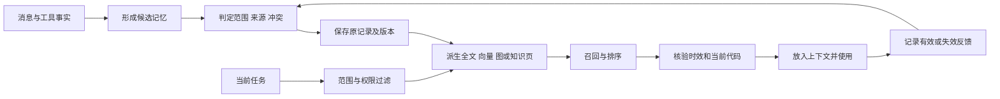

# 长短期记忆：从会话历史到可验证的持续经验

> 调研截止与访问日期：2026-09-16。性质：公开资料研究与架构分析，未运行所列项目。相关内容：[上下文与检索](08-context-engineering.md)、[自进化](03-self-evolution.md)、[评测](09-evaluation-observability.md)。

## 阅读起点：为什么保存了全部聊天，Agent 仍然会“忘记”

设想今天让 agent 修复导出功能，明确要求保留已有文件；它读了代码、排除了一个假设，最终修改并验证。明天新开会话说“继续做批量导出”。即使昨天的聊天完整存在硬盘上，新会话仍需要回答：当前目标是什么，哪些规则还有效，昨天改到了哪里，哪些检查真的执行过，什么做法值得复用。

这五个问题需要不同形式的信息。逐字历史擅长保存发生过什么，却不直接给出现行状态；摘要便于快速阅读，却可能遗漏关键反例；检索能找相关片段，却不保证找出来的是最新版本；知识页便于综合，却可能把模型推断写成事实。记忆系统的工作就是让这些表示协同，并管理它们随时间发生的变化。

本文先用这一自拟跨会话例子解释基础结构，再讨论具体系统。向量是把文本转成可比较的数值表示，方便查找语义接近内容；知识图谱把对象及其关系显式保存，方便沿关联查询；知识页则是人和模型都能阅读的综合文档。它们都是存储和组织手段，不能单独决定一条记忆是否可信。

## 1. 核心判断

Coding agent 最先需要的通常不是向量数据库，而是**任务事实能够跨会话保留、重新使用时仍然正确**。聊天记录、当前上下文、任务状态、项目知识、用户偏好和可复用做法应分别管理。把它们全部放进一个“记忆库”，容易把已撤销的方案当成现行要求，把模型猜测当成用户偏好，把一次成功脚本当成通用方法。

截至调研日，可观察到三条并行路线：数据库式记忆继续发展混合检索与时间语义；文件 / Git 式记忆强调可见、可编辑与可追溯；学习型记忆开始把写入、整理和使用本身作为优化对象。没有证据支持一种表示已经全面替代其他表示。本项目更适合先建立任务事实与来源，再用真实问题决定是否增加检索、图结构或后台整理。

## 2. 先把“记忆”拆开

以下是面向本项目的工作分类，不主张它是统一学术标准。

| 类别 | 内容与寿命 | 事实来源 | 典型误用 |
| --- | --- | --- | --- |
| 工作记忆 / 短期上下文 | 当前消息、正在操作的文件片段、最近工具结果；一个运行或会话 | 当前事件与工具输出 | 把上下文窗口扩大当成持久化 |
| 任务状态 | 目标、范围、已确认结论、当前步骤、阻塞、产物；跨会话 | 用户决定与执行事实 | 让摘要覆盖真实状态或授权 |
| 情景记忆 | 某次排错、审查、失败和解决过程 | 有时间与关联 ID 的轨迹 | 只存成功结果，丢失失败条件 |
| 语义记忆 | 项目接口、约定、环境事实、概念关系 | 可定位的代码 / 文档证据 | 把旧分支的事实用于新分支 |
| 程序性记忆 | 可复用操作方法、skill、有效排查顺序 | 多次经验及验证结果 | 将偶然成功自动升级为规则 |
| 用户偏好 / persona | 用户明确选择、沟通方式、稳定习惯 | 明确声明优先；推断应单独标记 | 从一次选择推断永久性格 |
| 参数记忆 | 模型权重或适配器中的学习结果 | 训练过程 | 把写 Markdown 宣称为模型训练 |

短期 / 长期描述的是保存及调用的时间范围；情景 / 语义 / 程序描述的是内容性质。二者不是同一维度。检索索引是派生数据，事件和原始证据才是可重建它的基础。KV cache、prompt cache 主要复用计算，不能直接承担“记住用户改变了需求”的业务语义。

### 2.1 短期记忆、长期记忆与任务状态如何配合

当前模型调用看到的上下文相当于工作台：保留正在处理的需求、片段和观察。工作台再大，也不适合一直堆积所有历史。长期存储相当于档案：保留原始消息、结果和可复用知识，但档案中的内容必须被选择并放到工作台上才会影响本轮回答。

任务状态则像一张持续维护的工单，它不是从历史里随意检索出的某段话。用户撤销了方案 A、改为 B 后，“现行方案是 B”应成为明确事实；查找 A 的历史用于解释原因，不应导致 A 重新成为默认。长短期的衔接因此包含两条不同路径：直接装载当前任务事实，按需检索历史和项目知识。

一次新会话可以先读取目标、约束、已完成项、未决项和产物索引，然后只在需要时回查原始片段。若任务状态与代码不一致，以当前文件和可靠执行记录核实；不能为了让摘要显得正确而忽略新改动。

### 2.2 一条记忆的完整生命周期

下面是本文归纳的通用架构，不代表所有项目都按此实现：



写入时先问“是否值得以后使用”。一次失败的临时命令可能只需留在轨迹；稳定的接口约束才适合成为项目知识。接着区分是谁说的：用户明确要求、工具观察、文档声明、模型推断，其证据强度不同。再确定范围：一个任务中的临时选择不应自动变成所有项目的永久偏好。

读取时先过滤范围，再做相关性排序。否则把不同客户或不同项目的记录全部做向量搜索，即使最终答案未显示越界片段，也可能已经污染模型判断。排序之后还要检查当前性：“当时使用库版本 X”与“现在应使用 X”不是同一个结论。

最后记录使用结果。某条经验三次被检索却三次被当前代码推翻，应该降低其适用性或修订，而不是因为访问频繁就不断提高重要性。访问频率和正确性不能混作一个分数。

### 2.3 冲突不是简单的“新覆盖旧”

假设 9 月 1 日用户说“先只做 CSV”，9 月 10 日说“本轮增加 JSON，但默认仍为 CSV”。如果抽取器只保存“使用 JSON”，就会误删默认格式；如果把两句话原样并列，模型可能误以为需求冲突。正确表示需要区分支持格式、默认格式和任务范围。

另一类冲突来自时间：今天导入了去年文档，写入时间最新，事实却最旧。因此要分开记录观察时间、事实有效时间、来源版本。图和数据库能保存这些字段，但有效时间的判定仍可能需要模型或业务逻辑，不能把字段存在当成自动推理正确。

## 3. 概念沿革与近期进展

| 时间 | 原始材料 | 主要贡献及证据边界 |
| --- | --- | --- |
| 2023-04 | [Generative Agents](https://arxiv.org/abs/2304.03442) | 经验记录、反思与规划形成循环；实验是交互式模拟环境，并非企业 coding agent 验收 |
| 2023-10 | [MemGPT](https://arxiv.org/abs/2310.08560) | 用分层内存和主动换入换出管理有限上下文；“类似操作系统”是设计类比，不等于无限准确记忆 |
| 2025-01 | [Zep 论文](https://arxiv.org/abs/2501.13956) | 用时间知识图谱组织会话与业务事实；提供有明确设定的实验结果 |
| 2025-04 | [Mem0 论文](https://arxiv.org/abs/2504.19413) | 研究抽取、整合、检索的长期记忆管线；旧论文不能代表 2026 平台算法 |
| 2026-01-15 | [GitHub Copilot memory 工程文章](https://github.blog/ai-and-ml/github-copilot/building-an-agentic-memory-system-for-github-copilot/) | 仓库级记忆带代码引用，在使用时核验；公开实际产品与 A/B 实验 |
| 2026-02-12 | [Letta Context Repositories](https://www.letta.com/blog/context-repositories/) | 用文件系统和 Git 管理 agent 的记忆，支持版本与分支合并 |
| 2026-04-04 | [Karpathy LLM Wiki 原始 gist](https://gist.github.com/karpathy/442a6bf555914893e9891c11519de94f) | 提出由 LLM 维护持久、互相链接的知识页；原文明确是 idea file，不是已交付产品 |
| 2026-05-12 | [LongMemEval-V2](https://arxiv.org/abs/2605.12493) | 把评估推进到环境状态、工作流、常见陷阱等长期经验；预印本标明 work in progress |
| 2026-06-03 | [PersonaTree](https://arxiv.org/abs/2606.04780) | 用证据到人物理解的分层支持路径、保守写入与置信整合研究 persona 生命周期 |
| 2026-08-06 | [Hindsight 0.9.0](https://hindsight.vectorize.io/blog/2026/08/06/hindsight-0-9-0) | 将 Knowledge Pages 和 coding-agent 集成结合，反映服务式记忆与可读知识页正在靠拢 |

时间线表示本轮可核实的代表性节点，不认定术语首创。对比材料时尤其要辨别访问时间、论文首版时间与仓库当前内容：搜索结果中“刚抓取”的页面可能仍在介绍一年前的算法。

## 4. 主要实现路线与落地代价

| 项目 / 路线 | 当前公开定位 | 值得借鉴的能力 | 本地桌面 agent 的实际代价 |
| --- | --- | --- | --- |
| [Letta](https://github.com/letta-ai/letta) / Letta Code | 状态化 agent 与记忆管理；另有托管服务 | 让记忆成为 agent 可操作的资源；Context Repositories 的版本与渐进读取 | 引入完整运行时与服务会重叠本项目职责；Git 冲突解决不等于语义正确 |
| [Mem0](https://github.com/mem0ai/mem0) | 可嵌入记忆库与托管平台 | 抽取 / 检索 API、用户与 agent 范围、混合检索 | 平台与 OSS 行为需分别核对，不能用平台新版文档承诺库的同等能力 |
| [Graphiti](https://github.com/getzep/graphiti) / Zep | 开源时间图框架与商业 context 服务 | 实体、关系、有效时间、原始 episode 来源 | 图存储、抽取模型与索引维护增加运维；Zep 当前专有引擎不等于 Graphiti 自托管 |
| [Hindsight](https://github.com/vectorize-io/hindsight) | MIT 记忆系统及 Cloud | retain / recall / reflect、运维与观测、知识页 | 独立服务与存储；README 性能主张不等于本项目工作负载结果 |
| LLM Wiki / Markdown + Git | 一种组织模式，可由不同 agent 实现 | 人能审阅、链接原始资料、合成结论可重复使用 | 增量更新、并发写入、来源撤回和错误传播要另行设计 |
| [Persona](https://github.com/saxenauts/persona) → Syke | Persona 的图向量方案及作者后续方向 | 区分 episode / psyche / entity / note；复盘检索与推理失配 | 原仓库说明后续开发转至 Syke，不能作为持续新增功能的主产品选型 |

许可证需要按准备采用的具体组件与提交重新核对；本轮不复制源码，不把“GitHub 能看到”一概称为自由开源。项目托管服务的条款、数据处理和可用性也不由其 SDK 许可证决定。

### 4.1 MemGPT / Letta：让 Agent 主动管理有限工作台

MemGPT 的关键类比来自内存层次：模型上下文容量有限，长期内容放到外部，通过受控操作换入和换出。它研究的不只是检索相似句子，还包括 agent 何时决定保存、读取和更新状态。[原论文](https://arxiv.org/abs/2310.08560)

在教学例子中，当前修复需要保留取消约束、相关函数和最近检查结果；数百条旧日志可以留在外部。若下一步要解释之前排除了什么假设，再按指针读取。主动管理的收益是工作台围绕当前任务变化，代价是记忆操作本身会消耗调用，而且模型可能忘记保存、保存错误重点或读错范围。

Letta 的 Context Repositories 将可读文件和 Git 版本引入记忆维护，强调渐进访问与独立修改再合并。[2026-02 原文](https://www.letta.com/blog/context-repositories/) 这说明“数据库里的状态化 agent”和“文件式记忆”并非互斥路线：运行器管理会话和调用，文件保存可审阅的知识，Git 提供变更记录。

工程迁移时应分别检查三种能力：能否恢复同一 agent 状态；能否由人修改记忆；能否在多会话下正确合并事实。Git 对文本冲突的处理不自动理解“新需求取代旧需求”，需要语义核验。以 Git 为底座也不意味着必须为每次对话创建大量提交，提交粒度应服务可审查的知识变化。

### 4.2 Mem0：记忆服务将哪些复杂性移到了幕后

Mem0 路线让业务应用围绕写入和搜索接口接入记忆。调用方提供消息及用户 / agent 等范围，系统抽取可复用内容，建立索引，查询时返回相关记忆。这个接口形状适合已有应用增加个性化，不要求应用先换成一个完整 agent 运行时。[项目入口](https://github.com/mem0ai/mem0)

它的抽象也容易掩盖重要差异：请求被接收不等于抽取和索引已经完成；搜索分数不是“事实正确概率”；同一条文本重复出现不等于获得多个独立证据。业务层仍需管理操作结果、身份范围和来源可信度。

#### 访问日的平台算法变化

[平台迁移说明](https://docs.mem0.ai/migration/platform-v2-to-v3)描述的新算法采用单次 ADD-only 抽取、内置实体关联与多信号检索，取代旧版部分更新 / 合并路径。其平台分数和性能变化是厂商报告。这里有两个工程问题：追加保存是否能明确表达事实已被取代；把 agent 生成事实作为输入后，怎样避免错误反复自我强化。“底层不覆盖记录”也不能被误读为用户无法删除数据，业务删除和内部记忆整合是不同接口问题。

新版本写入可返回 event_id 与待处理状态，搜索分数采用多信号，旧阈值不应机械沿用；平台与 OSS 需要分别确认迁移范围。[平台迁移文档](https://docs.mem0.ai/migration/platform-v2-to-v3) 对接时可保存写入事件身份，在完成后再宣布记忆可用；若 UI 立即展示“已记住”但后续抽取失败，用户会形成错误预期。

ADD-only 的选择把一部分冲突解决从写入阶段推迟到读取阶段。它有利于保留历史，却要求检索正确选出当前事实。对于“默认格式仍是 CSV”这样的精细约束，应在代表性查询中验证；不能只因为新旧句子都保存了，就认为更新语义得到保证。

### 4.3 Graphiti：实体、关系、证据与时间怎样连接

当前仓库将事实的有效窗口、来源 episode 和随时间变化的实体关系作为核心。它适合回答“当时适用哪条规则”“后来为什么改变”等问题。代码工作中也有对应需求：一个约定在旧版本成立，在当前分支失效。若只有单项目少量稳定事实，先用结构化记录的 `supersedes` 和来源引用即可；出现频繁多跳、时间查询需求后，才有依据承担图基础设施成本。

#### 从源码对象看其实际结构

访问日源码中，EpisodicNode 保存原始 episode 内容、来源和 valid_at；EntityNode 保存实体名称、摘要、属性及名称向量。它们继承包含 UUID、group_id、创建时间的基础节点。[nodes.py](https://raw.githubusercontent.com/getzep/graphiti/main/graphiti_core/nodes.py)

EntityEdge 则保存关系名称、事实文本、向量、来源 episodes，以及 valid_at、invalid_at、expired_at 等时间信息。[edges.py](https://raw.githubusercontent.com/getzep/graphiti/main/graphiti_core/edges.py) 这里至少存在两个问题维度：事实在现实中什么时候成立，以及系统什么时候判定它失效。源码字段让这种区别有表达位置，但并不证明每次抽取都能正确判定时间。

可用教学例子理解：原始消息说“本项目默认导出 CSV”，episode 是消息本身；项目和格式是实体；“默认使用”是关系。之后默认改为 JSON，应保留历史关系及有效范围，并使当前查询不再将旧事实当作默认。用户问“上周为什么生成 CSV”，又需要历史关系。

#### 图检索何时比纯相似度更有价值

如果问题是“哪些工具受某项接口变更影响”，它涉及接口、调用方、工具封装、使用任务的多跳联系。文本相似度可能找到接口说明，却漏掉名称不同的调用方；显式关系可以沿影响链查询。反之，如果只是找一句用户偏好，小规模全文搜索可能已经足够。

图的质量取决于实体消歧。同名的 ExportService 出现在两个仓库，不能因名称相同合并；同一组件改名后又不能永远拆成两个无关对象。group_id、来源路径和版本可辅助，但具体业务身份仍需定义。错误实体合并会把很多正确关系接到错误对象上，比漏召回更难察觉。

成本也不仅是图数据库：抽取、实体对齐、关系失效判断、向量生成和后续查询都要计算与维护。采用前应挑选真正需要时间或多跳关系的问题，比较图增强与简单结构化记录的边际收益。当前 Graphiti 与 Zep 商业引擎不是同一个部署承诺。

### 4.4 Hindsight：保留事实、召回证据、形成反思三条路径

Hindsight 用 retain、recall、reflect 区分写入、检索和更高层综合，并提供 bank 作为记忆范围；开源实现和托管服务应分开评估。[官方仓库](https://github.com/vectorize-io/hindsight) 2026-08 的 Knowledge Pages 更新则将可读的整理结果带到 coding 工作中。[0.9.0 发布](https://hindsight.vectorize.io/blog/2026/08/06/hindsight-0-9-0)

这个接口划分的重要意义是：检索出过去记录与形成新的结论不是同一操作。前者回答“记了什么”，后者回答“这些记录支持什么判断”。如果将反思结果再次写入，需要保留它是派生结论及其证据，否则系统会把自身总结当成新的独立观察。

例如三次排错都发现取消没有传到子进程，可以形成“本项目检查取消时优先追踪执行句柄”的经验；不能形成“所有取消故障都由子进程导致”。反思应该产生有适用条件的策略，而不是更强语气的事实。本文未审查其全部后端实现，也没有独立复现其榜单结果。

## 5. LLM Wiki 的深入分析

原始模式将原始资料、LLM 维护的 Wiki、组织约定分开，并围绕 ingest、query、lint 形成持续工作。它把部分跨文档综合从提问时移到入库与维护时，允许研究成果沉淀为下一轮的输入。它没有定义统一协议、唯一存储、可靠性保证或企业权限系统。[原文](https://gist.github.com/karpathy/442a6bf555914893e9891c11519de94f)

**本研究的工程推论**：它和 RAG 可以互补。Wiki 是派生的知识视图，检索负责从 Wiki 或原始资料找证据；遇到更新、冲突和高影响决策仍应回读原文。把 Wiki 看成可重新生成的物化视图，比把它看成新的唯一真相更可靠。

落地需要处理六个容易被演示掩盖的问题：

1. **写入放大**：一个来源影响多个主题页，部分成功会留下相互矛盾的页面。需要变更集、失败状态和恢复说明。
2. **来源失效**：网页撤回或项目改变协议后，要能找到所有依赖它的结论，而不是只改一条链接。
3. **归因丢失**：二次摘要引用一次摘要，最后不知道原始证据。事实应始终带原始引用及版本。
4. **推断升级**：模型解释写入知识页后，被下一次当成事实。页面需要区分观察、来源主张和推论。
5. **并发写入**：两个会话同时改索引，最后写入覆盖前者；Git 只能帮助审查差异，不能替代单写者 / 冲突检查。
6. **维护收益**：很少重复访问的文档不一定值得预先综合；应记录后续复用与维护成本，而非以页面数量衡量价值。

对本项目，最可取的起点是项目知识页和研究成果索引，按需从任务产物中提炼。自动维护任意用户目录、默认导入聊天或隐式扫描其他项目，都不属于该模式天然授权的范围。

### 5.1 用一次资料更新说明 ingest / query / lint

设想知识库研究 MCP。原始资料区保存 2025 年协议和 2026-07-28 规范；Wiki 区保存“发现机制”“任务执行”“身份认证”等主题页。入库时不是复制摘要，而是识别新资料影响哪些已有结论，把旧版本结论保留为历史，并更新现行描述。

查询“新版是否还需要旧初始化握手”时，可以先看主题页快速定位，再回到具体版本规范核查。lint 检查断链、无来源结论、版本混用和彼此矛盾；它不能靠“所有页面互相一致”判断外部事实正确。以上是本文依据原始模式设计的教学过程，不是原 gist 已实现的软件功能。

要让这条链可维护，可以给结论分配稳定 ID，记录依赖的原始来源和页面。一次来源变更先计算受影响结论，再产生待审阅变更集。这样是维护知识的依赖关系，而不只是遍历目录让模型“润色所有页面”。

### 5.2 为什么它类似物化视图，又不能照搬数据库假设

数据库物化视图保存查询计算结果，源数据变化后刷新；Wiki 也把跨文档综合提前保存。收益发生在重复查询时：不必每次重新读几十份资料。但 LLM 综合不是完全确定的 SQL，重建可能改变解释、遗漏条件或引用，因此需要保存来源、版本和差异。

适合提前整理的是多次使用、跨来源综合成本高、变化相对可控的知识。一次性问题或快速变动价格不一定值得建页。可以衡量一次维护费用、后续复用次数、检索节约和错误修正成本，不能用生成页数证明知识系统有效。

### 5.3 多会话维护的具体一致性问题

两个会话同时读到索引 revision 8，分别新增主题 A、B，如果最后写入者直接保存自己的完整索引，就会丢掉另一个新增项。解决方式可以是单写者整理、比较版本后合并，或分支变更集经过统一发布。仅在写完后做 Git commit 无法阻止先前覆盖。

更隐蔽的是语义冲突：会话 A 更新“正式支持”，会话 B 根据旧资料继续写“仍在预览”。文本位于不同文件，Git 没有冲突，知识却已经矛盾。因此需将现行版本和发布状态作为共享事实，并在发布时做相关结论核验。这也是 Wiki 从演示走向长期使用的主要工程量。

## 6. Persona 的两种含义与一个重要反例

这里同时覆盖通用的 persona 建模，以及用户可能指的 `saxenauts/persona` 项目，不将二者混为同一技术。通用 persona 至少包含 agent 的工作角色、用户明确偏好、从长期证据推断的用户特征；这三类应采用不同来源和信任级别。

Persona 仓库的复盘具有参考价值：作者报告其工具使用没有达到设计预期，检索到信息也不意味着模型能正确判别；后续 Syke 改用更简单的存储和更强的 agent 循环。这是特定系统的作者经验，不能推出“图检索全部无用”。仓库开头的同条件比较表述，与后文部分项目使用已发表分数、不同子集的说明并不完全等价，因此本文不复制其优胜排名。[项目原始说明](https://github.com/saxenauts/persona)

PersonaTree 的研究重点更接近“哪些观察支持哪个人物结论”，而不是单纯扩充偏好列表。对个人 coding agent，最小可行对应物是“用户明确要求默认先讨论”和其来源；不应为了个性化推断用户心理、职业能力或永久风险偏好。[论文](https://arxiv.org/abs/2606.04780)

### 6.1 四类对象为什么不能压成一段“人物简介”

Persona 项目把 episode、psyche、entity、note 作为不同组织对象，曾采用 Neo4j 与向量检索；作者说明后续开发转向 Syke。[项目说明](https://github.com/saxenauts/persona) 用通用含义解释：episode 记录一次经历，entity 表示出现的人或项目，note 保存可阅读知识，psyche 尝试表达更持久的人物理解。

对个人开发助手，“这次先不要运行测试”可能只是时间受限的临时要求；“默认优先最小必要检查”才可能是明确长期偏好。如果把两者揉进一句“用户不喜欢测试”，后续行为会持续偏离需求。越高层的人物结论越需要证据链、适用范围和撤回机制。

PersonaTree 的分层可以帮助理解这一点：观察是底层证据，跨观察的模式属于中间概括，再往上才是人物结论。[原论文](https://arxiv.org/abs/2606.04780) 层级结构的价值是让上层结论可追问“依据什么”，不是为敏感推断提供更复杂的包装。

### 6.2 检索成功后仍答错，应该检查哪一层

作者复盘中，工具使用和答案判别未达到架构预期。这提示一个重要诊断顺序：先看正确证据是否被存下，再看是否被召回，再看是否进入当前上下文，最后看模型是否正确使用。只有第一、二层有问题时，增加索引或图结构才直接对症。

若证据已经出现却被旧摘要压过，问题是优先级和冲突表达；若模型没有调用记忆工具，问题可能是发现、触发或成本；若推断缺少时间条件，问题是信息表示。将这些全部归因于“模型记性差”会使优化无目标。具体数字来自作者设置，不在此推广为所有记忆系统的失败比例。

## 7. 企业落地：GitHub 的使用时核验

GitHub 2026-01 的工程文章描述了仓库级、带代码引用的记忆，在 coding agent、CLI 和 review 之间共享，使用时重新检查当前代码。文章报告 coding-agent PR 合并比例从 83% 到 90%，是 **7 个百分点**的绝对变化，不是统一意义上的“准确率提升 7%”。这属于厂商 A/B 报告，样本构成、使用行为与本项目不同。[工程文章](https://github.blog/ai-and-ml/github-copilot/building-an-agentic-memory-system-for-github-copilot/)

它提供了比“记住所有东西”更具体的产品经验：优先保存未来动作会用到的事实；把代码引用带进记忆；把验证推迟到使用时。2026-01 的发布记录说明当时为 public preview 并有自动过期规则；此处不据旧发布稿保证当前所有套餐和账号的开通状态。[发布记录](https://github.blog/changelog/2026-01-15-agentic-memory-for-github-copilot-is-in-public-preview/)

本轮没有访问客户私有部署。Mem0、Zep 和 Hindsight 的生产接口及企业服务说明可证明产品化方向，不能独立证明任一客户取得了可重复收益。

## 8. 推荐的数据与操作语义

以下为待讨论设计，不是已批准 DTO。

| 字段 / 操作 | 必须解决的问题 |
| --- | --- |
| `scope` | 用户、项目、任务、会话各自边界；跨项目默认不共享 |
| `kind` / `status` | 区分事实、偏好、经验、推断；候选、确认、失效、撤回分开 |
| `source_refs` | 指向消息、文件版本、工具结果或外部来源，能回查原始证据 |
| `observed_at` / `valid_from` / `valid_to` | 观察时间与事实有效时间分开；不简单用最新写入覆盖 |
| `supersedes` | 新决定替代什么；保留历史但默认不召回失效版本 |
| `revision` | 防止多会话拿旧内容覆盖新内容 |
| `retrieve` | 先按权限与范围筛选，再排序；召回后进行当前代码核验 |
| `promote` | 将有支持证据的候选变成可复用经验；不让模型置信分自动完成升级 |
| `forget` | 删除原记录、索引和派生页中的相关内容；日志保存最小必要审计信息 |

摘要写入宜与消息事实分开。摘要失败不能使已经完成的工具执行消失；摘要成功也不能使未完成工作变成完成。先将事实可靠落盘，再派生任务视图和可检索知识。

## 9. 怎样判断记忆真的有用

LongMemEval-V2 不再只问用户历史，而要求恢复环境中的工作流与常见陷阱。作者报告的 agent 文件检索路线有较高准确率，也有明显延迟成本。这意味着“记忆效果”必须在准确率、上下文量、总延迟与更新成本上共同衡量。[论文](https://arxiv.org/abs/2605.12493)

本项目未来最小实验可以使用同一任务集，比较：无跨会话记忆、人工任务摘要、带来源的结构化记忆、增加检索后的版本。不要一次同时更换模型、prompt 和记忆后宣称记忆有效。

关键任务包括：旧方案已撤销；相同名称出现在两个项目；文件换分支后约定改变；工具运行结果未知；用户只临时调整表达方式。观察正确恢复率、过期记忆采纳率、跨项目误召回、用户纠正次数和每个完成任务的增量成本。对简单任务，没有记忆同样正确且更快是有价值的负结果。

## 10. 社区争论与未解问题

- **文件还是数据库**：Letta 的 Context Repositories、Karpathy 的 Wiki 与 Persona 转向纯文本反映了可检查性的价值；Graphiti 仍在发展时间关系。它们优化的工作负载不同，不能从几篇作者文章宣布路线终结。
- **保存还是推理**：Persona 的失败复盘说明读对内容还可能答错；需要检查上下文冲突和模型判别，不能不断加检索层。
- **自动整理还是写时克制**：自动反思可能节约后续 token，也可能把错误写得更稳定。对长期事实，需要可撤回和来源验证。
- **一致性还是准确性**：LLM Wiki 原始 gist 的评论已出现对来源、时效、证据状态的质疑。页间一致并不能证明结论真实；评论是参与者的经验与主张，不是受控实验。[原始讨论](https://gist.github.com/karpathy/442a6bf555914893e9891c11519de94f)

## 11. 对本项目的采用顺序

1. 先讨论独立 Task 事实，提供目标、确认结论、进度、未决项与产物索引；复用现有事件来源。
2. 新会话只载入必要摘要和指针，允许按需回查；显示摘要生成时间与失效提示。
3. 对反复遇到的项目知识提供候选记忆与当前代码核验；明确用户修改和删除入口。
4. 有规模和召回缺口后再试全文检索 / 混合检索；时间多跳成为真实瓶颈后才评估图。
5. 有可靠任务评测后再试程序性记忆与自动整理；参数学习属于另一个成本与验证层级。

当前 M1 具备历史事实、只读工具和会话基础，没有交付上述任务层、自动记忆或 Wiki 维护能力。本文不改变现有 Python / Electron、E 盘数据与双模型约定。

## 12. 证据与后续核验

文内已链接原始论文、仓库、厂商工程材料；日期明确的材料见第 3 节。仓库与产品文档按访问日的移动版本理解，未锁定源码快照、未安装运行，采用前需固定提交。下一次优先核验：Mem0 平台与 OSS 算法差异、Persona 后继 Syke 的实际状态、Letta memory-model 方向的公开实现、LongMemEval-V2 完整评估协议以及记忆撤回在派生页面中的传播成本。

## 13. 补齐算法层：记忆不只是存储架构的选型

前面的平台与知识库分析仍遗漏了一层：同样使用向量库，**写入什么、怎样组织、何时改写、哪些结果进入当前上下文**，可能完全不同。本节按 2026-09-16 复查的原始论文和项目文档补足这一层。以下例子是本研究的设计推演，不是运行这些项目所得的结果。

### 13.1 A-MEM：让新经验改变旧经验的组织方式

[A-MEM](https://arxiv.org/html/2502.12110v11) 首发于 2025-02，本文核对的是 2025-10 的 v11。它借鉴 Zettelkasten：一条记录不只保存原文，还保存时间、关键词、标签、解释性描述、向量和连接。新记录先找近邻，再由模型判断连接；模型还可更新旧记录的描述与标签。检索因此可以沿关联访问邻接记录，超出单次相似度命中的集合。论文实验仓库 [WujiangXu/A-mem](https://github.com/WujiangXu/A-mem) 与面向使用的实现入口应分别核查，不能把复现实验脚本视为成熟记忆服务。

假设先记录“Windows 上取消命令后窗口消失”，后来记录“孙进程仍占用端口”。两者字面差异较大，但关联后可以形成“界面结束不等于进程树结束”的经验。下次分析端口占用时，系统有机会找到这条跨事件认识，而不只是最近一次日志。

这也引出一个实现问题：模型生成的关联是解释，未必是事实。若第二次失败实际上来自另一个进程，把它合并成固定因果关系就会污染后续判断。适合 coding agent 的落地方式，是保留不可变的原始事件，把可更新的解释和连接作为派生层；连接记录依据与版本。重新组织记忆不应销毁被重新解释的证据。这是本研究的采用建议，并非论文已实现的全部审计保证。

### 13.2 SimpleMem：版本变化已经影响到架构描述

[SimpleMem v3](https://arxiv.org/html/2601.02553v3) 的流程是语义结构化压缩、在线语义合成、意图感知检索规划。压缩把指代和相对时间还原成可独立理解的事实，再结合语义、词法、结构化索引检索。需要特别纠正：早期 v1 的“异步递归合并”不能继续当成最新版架构；2026-01-29 的 v3 改为写入阶段的在线合成。[论文版本记录](https://arxiv.org/abs/2601.02553)

例如“下周还是用上次那个路径”不能直接成为长期偏好。写入器需要先解析“上次”指向哪个项目、时间以哪次发言为准、这是一项临时决定还是长期默认。结构化不是把一句话放进 JSON 就结束了，而是消除离开原对话后会失效的依赖。对代码问题，稀有标识符适合词法命中，目录与版本适合结构化筛选，故障现象则可能需要语义召回。三者负责不同失配，增加向量数量不能替代它们。

在线合成减少重复经验累积，但让写入路径承担更多模型成本和失败处理。工程上可以将“原始事件已保存”与“记忆索引已更新”分成两个状态，避免模型提炼失败导致事实丢失；这属于可采用的设计，不是论文性能结论。评估时还应把写入成本摊入整个使用周期，不能只比较最终回答的输入 token。

[当前 SimpleMem 仓库](https://github.com/aiming-lab/SimpleMem) 已扩展为文本、OmniSimpleMem 多模态和 EvolveMem 优化方向的统一入口。因此“2026 年 1 月论文的方法”“当前仓库包装了什么”“多模态与优化分支分别验证了什么”是三个问题。本文没有把文本论文的实验收益转移给全部新模块，也未安装核实这些模块的集成质量。

### 13.3 SAGE 与 MemGate：写入门控和读取门控是不同决策

2026 年的新研究开始更明确地控制记忆进入系统的两个位置。[SAGE，2026-05-29](https://arxiv.org/html/2605.30711v1) 研究写入侧的新颖性判断；[MemGate，2026-06-04](https://arxiv.org/html/2606.06054v1) 研究查询条件化的候选重排。本轮已进一步读取两篇方法章节，未审计实现或复现实验。

SAGE 用单位向量上的密度估计综合已有记忆的支持程度，再按随存储几何变化的阈值路由：明显新增直接 Add，明显冗余 Noop，不确定区间交给模型 Update。它节约的是部分决策调用；前面的事实提取仍可能调用模型，不能写成记忆写入已经不需要 LLM。自适应阈值也不是事实冲突的裁判——“周五改成周四”可能非常相似，却是必须保存的更新。

MemGate 则将查询、候选向量及交互特征送入小型神经网络，生成连续维度掩码，再用门控后的相似度重排已有候选；训练使用适用与冲突记忆的偏好对。最终进入提示的仍是所选记忆文本，不是把危险词从文本中逐个删掉。它也无法找回初始召回完全漏掉的记忆。其落地条件包括合适的训练偏好、嵌入接口与分布验证，不能只在向量搜索后随意加一个阈值就称为 MemGate。

它们指向两类不同错误。十次相同构建失败都写入，会让某个偶发问题占据长期记忆；另一个项目的数据库迁移经验即使检索得分很高，也可能不适合当前只读分析。前者应在写入阶段处理，后者应在使用阶段处理。仅调节统一相似度阈值，很难同时控制重复、适用性和不同项目的隔离。

本研究建议把一次记忆使用解释为以下过程：

```text
原始事件 → 是否值得记住 → 提炼与关联 → 可追溯存储
当前问题 → 范围过滤 → 多路检索 → 适用性判断 → 带来源的上下文
```

这里“范围过滤”应由项目、主体和有效期等事实决定；模型门控负责相关性，不能替代访问控制。即使某条记忆被允许读取，也不代表其中的历史决定仍然适用。衡量门控时，必须同时看错误记忆进入率和必要记忆遗漏率，否则“什么都不注入”也可能显得非常安全。

### 13.4 从研究机制到产品结构

| 路线 | 最有价值的能力 | 必须保留的工程事实 | 更适合的工作负载 |
| --- | --- | --- | --- |
| A-MEM 式关联 | 跨事件发现联系，重新组织经验 | 原始事件与派生解释分开，关联可撤回 | 长期故障排查与经验复用 |
| SimpleMem 式压缩 | 把依赖原对话的内容变成独立记忆 | 时间、指代和版本不能在压缩中消失 | 长期交互中事实密集、重复较多的场景 |
| 写入 / 读取门控 | 控制冗余和不适用信息 | 记录被排除的原因，评估遗漏代价 | 多项目、多主体、长期运行 |
| OpenViking 式上下文管理 | 将记忆、资源和技能统一寻址并按预算组织 | 地址不等于内容版本，类型不等于权限 | 多个 harness 共享上下文基础设施 |

最后一条的具体分层、服务端上下文组装和当前 API 限制见 [上下文工程](08-context-engineering.md)。这些路线可以组合，但组合的收益需要单独验证：检索更广可能提高召回，也可能把更多错误关联交给门控；压缩更强可能降低费用，也可能删掉判断适用范围所需的细节。
