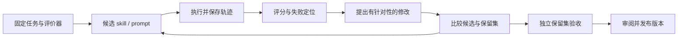

# Agent / Skill 自进化与 RSI：反馈、搜索、递归改进与可控更新

> 2026-10-20 产品落地补充：针对 M7 必填单目标的问题，已进一步核验 Hermes `/learn`／桌面入口／后台复盘／Curator，以及 GEPA 执行反馈与候选组件选择的实际源码。固定提交、可借鉴机制与本项目 9 项审查结论见[独立审查与实现对照](../progress/m7-usability-review-2026-10-20.md)。单资源采用粒度不应强迫用户在复盘前完成归因；此次没有运行上游模型实验，不能把源码机制称为已验证的学习质量。

> 调研截止与访问日期：2026-09-16。覆盖文本经验、skill 优化、harness 修改和参数学习；区别论文实验、开源功能与产品宣传。本文未运行优化实验。关联：[记忆](01-memory.md)、[Harness](06-harness.md)、[评测](09-evaluation-observability.md)。

## 阅读起点：一次“下次别再犯”怎样变成可验证的改进

假设 agent 在同一仓库里多次直接修改生成的 TypeScript 文件，后来又被生成器覆盖。用户纠正：“应修改 Python DTO，再生成类型。”下一次它正确执行了，是否说明 agent 自进化？需要看究竟发生了什么：它可能只是还记得本轮聊天；可能把经验存成长期记忆；可能更新了 skill；也可能修改了运行器，使编辑生成文件时自动检查来源。

这些变化都可能改善表现，但持久性、适用范围和验证成本不同。若改进器随后还修改了“如何发现这类错误、如何提出和评价改进”的方法，才进入 RSI 要讨论的递归关系。**RSI 应当纳入本课题，而且必须解释清楚；不能把它遗漏，也不能把任何重复运行都称为 RSI。**

本文沿这条链解释从反思、技能学习到 harness 演化，并在第 12 节单独分析 RSI 的定义、算法和最新研究。后面的仓库例子均来自公开材料；贯穿的 DTO 例子是本文自拟，用于解释工程机制。

## 1. 先定义到底在“进化”什么

一个 agent 写了一份经验总结，只能证明它保存了文本。要称为改善，至少要说明：更新了什么、依据什么反馈、是否在未参与更新的任务上变好、付出了多少成本、有没有损害其他能力。自进化不是单一算法，而是不同对象上的“提出候选—获得反馈—选择—保留”过程。

| 层级 | 改变的对象 | 典型路径 | 主要验证问题 |
| --- | --- | --- | --- |
| 单任务自纠正 | 当前答案或补丁 | 执行失败后修正 | 是否真正解决本次目标 |
| 经验记忆 | 跨任务的事实、教训 | 反思与检索 | 是否将偶然现象泛化为永久规则 |
| Prompt / Skill | 可复用操作方法 | GEPA、gskill、ACE 类文本更新 | 新方法是否泛化、是否越界 |
| Harness | 工具、上下文策略、运行流程 | DGM、AHE | 如何归因、隔离、回滚，评估是否被篡改 |
| 学习机制本身 | 选择器、改进流程 | meta-agent / hyperagent | 优化器是否也在追逐错误指标 |
| 模型参数 | 权重 / LoRA | RL、持续微调 | 训练数据、算力、遗忘和部署兼容性 |

对本项目，近期最有价值的是从真实任务沉淀可审阅经验，以及有独立评估的 skill 候选更新。自动改运行核心和在线改权重属于不同风险、成本和成熟度层级。

### 1.1 改进闭环的五个部件

一个可检验的系统至少需要被改进对象、经验来源、修改算子、评价器和选择机制。被改进对象可以是 prompt、skill、记忆策略、工具接口或运行代码；修改算子可以是模型提出差异，也可以是搜索算法；评价器决定怎样看效果；选择机制决定采用、保留、回滚还是继续探索。

把它写成概念过程：当前版本 S 在任务集 D 上产生轨迹 T，改进器 U 根据 T 形成候选 S′，评价器 E 比较 S 与 S′，选择器决定下一版本。此处符号只是本文解释方式，不是某篇论文专有公式。

最容易缺失的是最后两步。让模型写一句“以后注意生成文件”只完成候选生成；若没有在新任务中检查是否更少犯错、有没有误阻止正常编辑，就不能证明有效学习。反过来，一次评估分数上升也不能证明可迁移，还需看独立任务。

### 1.2 三种收益必须分别测量

**本任务修复收益**：同一个失败任务重跑后成功。它可以来自越来越了解这个样本，不代表学会了通用能力。

**同分布迁移收益**：对未见过但相似的仓库任务也有改善。例如在另一 DTO 变更中识别生成链路。这才支持 skill 的复用价值。

**跨分布收益**：换仓库、框架或模型后仍有效。这是更强主张，需要单独证据。“在另一个 agent 产品里运行同一仓库”与“迁移到陌生仓库”不是同一种迁移。

同样，改进所开发的软件、改善 agent 本身、改善 agent 的改进机制，是三个不同对象。Autoresearch、长期开发循环与 RSI 之间应沿这个对象关系比较，不能只因都使用 while 循环就视为相同技术。

## 2. 代表性发展节点

| 时间 | 原始结果 | 应怎样理解 |
| --- | --- | --- |
| 2023-03 | [Reflexion](https://arxiv.org/abs/2303.11366) | 将语言反馈存为后续尝试的经验；不需要每次更新模型权重 |
| 2023-05 | [Voyager](https://arxiv.org/abs/2305.16291) | 自动课程、执行反馈和可复用程序技能库；验证环境是 Minecraft |
| 2025-05 | [Darwin Gödel Machine](https://arxiv.org/abs/2505.22954) | 通过候选 agent 档案和经验评估探索自修改，不是数学证明保证每次改进 |
| 2025-07 | [GEPA](https://arxiv.org/abs/2507.19457) | 利用轨迹的语言反馈与候选搜索优化 prompt |
| 2025-10 | [ACE](https://arxiv.org/abs/2510.04618) | 对 playbook 做结构化增量更新，避免反复重写造成信息塌缩 |
| 2026-02 | [gskill](https://gepa-ai.github.io/gepa/blog/2026/02/18/automatically-learning-skills-for-coding-agents/) | 从仓库生成可验证任务，用 GEPA 学习仓库级技能 |
| 2026-04 / 05 修订 | [AHE](https://arxiv.org/abs/2604.25850) | 将可编辑组件、经验和预期效果关联起来，支持可归因的 harness 演化 |
| 2026-09-01 | [Harness-of-Harness](https://arxiv.org/abs/2609.01481) | 在已有 coding-agent 外组织持续改进的软件开发回合；刚发布的预印本，不能视为成熟企业通用方案 |

早期反思、程序库、进化搜索与现代 skill 系统有连续关系；不能把 2026 年新命名当作所有方法都从零出现。

## 3. Reflexion 与 Voyager：可复用经验为什么不等于训练

Reflexion 把执行反馈转成语言经验，帮助后续尝试调整策略；Voyager 将可执行程序技能累积进库，并配合课程选择与环境反馈。这些原始工作说明，外部状态的积累就可能改变行为，不必先改模型参数。[Reflexion](https://arxiv.org/abs/2303.11366)、[Voyager](https://arxiv.org/abs/2305.16291)

**工程分析**：对 coding agent，类似经验可能是“这个仓库的协议类型由生成器产生，应修改源 DTO”，或者“一类测试需要额外环境”。经验的关键不在表达成第一人称反思，而在保留适用范围、触发条件与证据。失败原因不明确时，应存“观察到超时，原因未定”，不应固化为“此工具不可用”。

程序性技能还涉及执行接口版本。即便脚本曾通过，如果依赖、工作目录或目标项目不同，原样复用也可能失败。技能库应能保留多个候选和适用条件；用一次成功覆盖此前全部实现，容易在看似学习中遗忘。

### 3.1 从经历到程序性技能：需要保留哪些条件

在 DTO 例子里，一条有用经验应说明：触发条件是文件被标为生成物；先查生成来源和命令；修改源定义；重新生成并检查受影响契约。它还要说明例外：第三方分发产物或缺失生成链路时不能机械运行任意命令。

如果只保存“永远不要编辑 TypeScript”，经验会严重过度泛化；如果保存整段失败聊天，后续检索成本又很高。程序性记忆的价值在于提炼可执行的决策过程，同时保留范围与证据。

Voyager 的技能库可理解为把成功动作序列沉淀成可调用程序，其课程机制再决定尝试什么新任务；Reflexion 则更偏向把失败反馈转换为后续可用的语言经验。[Voyager](https://arxiv.org/abs/2305.16291)、[Reflexion](https://arxiv.org/abs/2303.11366) 从模拟环境迁移到软件开发时，需要补上依赖版本、文件基线、外部副作用和用户约束，不能把一次可执行代码片段直接当成通用技能。

## 4. GEPA：从“再想一想”变成有目标的搜索

### 4.1 数据如何流动

GEPA 的核心是用完整或部分执行轨迹解释失败，提出文本候选，再用评估选择；论文中的 Pareto 思想用于保留对不同样本有优势的候选，而非只盯一个全局平均分。当前官方库也提供 `optimize_anything`，让用户提供候选文本与 evaluator，评分之外的诊断信息可进入反思。[论文](https://arxiv.org/abs/2507.19457)、[官方实现入口](https://github.com/gepa-ai/gepa)



它与普通模型自评的区别在于：候选必须走同一评估接口，预算明确，失败原因是修改输入，最终结果仍由任务表现决定。评分器越接近真实工作，搜索越有价值；评分器有漏洞时，搜索只会更有效地找到漏洞。

### 4.2 用一次 Skill 优化走完整个过程

以下是本文教学实验设计，未实际运行，也不代表 GEPA 固定要求这些数据格式。

基线 skill 只说“按照任务修改代码并检查结果”。准备一组任务，其中有生成文件、普通手写文件、第三方代码和生成器缺失四类。第一次运行发现生成文件类经常直接改产物，正常文件类表现尚可。改进器读取具体轨迹，而不是只读一个总分，提出候选：“编辑前识别生成标记，找到源定义和生成入口。”

评价器重新运行候选，可能发现生成文件任务改善，但所有普通任务都额外进行长时间全仓搜索。于是第二个候选将规则收窄为“仅在文件有生成标记或项目文档声明生成关系时追踪来源”。这展示语言反馈比一个标量分数多提供了什么：它解释失败机制，从而支持针对性修改。

候选比较不能只看训练集平均分。某个版本在生成任务强、另一个版本在低延迟普通任务强，可以暂时保留多个候选，再按目标任务分布选择。GEPA 的反思与候选保留机制提供这类搜索思路；当前库也将可优化对象扩展到更一般的文本或代码目标。[官方实现](https://github.com/gepa-ai/gepa)

输出不应只有“最优 prompt”。应保存基线、候选差异、任务划分、模型和工具版本、预算、逐任务结果、失败轨迹以及采用理由。否则数周后模型升级，无法判断旧 skill 是否仍有价值。

### 4.3 gskill 如何把静态仓库变成训练环境

2026-02 的 gskill 实验用 SWE-smith 生成可验证的软件任务，划分训练、验证与保留测试，然后优化仓库级 skill；报告覆盖 Jinja、Bleve，并尝试迁移到另一种 coding agent。这是比“让模型读仓库后写最佳实践”更具体的学习流程。[研究团队原文](https://gepa-ai.github.io/gepa/blog/2026/02/18/automatically-learning-skills-for-coding-agents/)

**价值分析**：真实仓库的命名、测试入口、错误模式能压缩为有效指引，减少 agent 反复发现同一事实。最适合重复面对同一技术栈或仓库的团队。若每天都是完全不同项目，制作任务集的成本可能大于复用收益。

**限制分析**：任务由一种生成器产生，skill 可能学会该生成器常见故障，而非真实需求分析和重构。迁移到不同模型也不意味着迁移到不同仓库。原文开头的部分迁移分数与图示文字存在差异，本研究不据此给出精确优胜排名；采用前应核对完整结果与提交版本。

### 4.4 怎样做一个可信 evaluator

以“review skill”优化为例，不能简单用评论数量或另一模型给的总体好评作为分数。任务应包含已知缺陷与无需报告的正常变更，评分至少区分发现真实问题、误报、证据完整、重复意见与时间成本。原作者的实现方案不应直接出现在给候选的上下文里。

以“需求讨论 skill”为例，测试全部通过不是相关指标。更合适的是关键需求是否澄清、已确认与建议是否分开、是否重复询问已明确选择、交接能否让新会话继续。不同 skill 需要不同评价对象，不能套同一 coding benchmark。

## 5. ACE：更新的是可解释的操作手册

官方 ACE 实现将 Generator、Reflector、Curator 分工，playbook 条目有稳定 ID 和 helpful / harmful 信息，通过增量修改合并知识。这针对的是反复让模型“重写更简洁的 prompt”会丢失细节的问题。[论文](https://arxiv.org/abs/2510.04618)、[实现与 playbook 结构](https://github.com/ace-agent/ace)

**架构拆解**：Generator 使用当前版本完成任务；Reflector 面向本次结果提取支持或反驳某条策略的证据；Curator 将证据映射为新增、修订、合并或淘汰条目。三个角色可以由同一个模型按不同输入执行，不意味着必须部署三个长期 agent。

**落地价值**：条目 ID 可以把错误追溯到具体建议，也能做局部禁用和版本比较。它适合“需要保留复杂领域例外”的场景，例如项目某些目录不使用默认工具链。**代价**是 playbook 会增长、不同条目可能冲突、计数也可能被错误归因。多次被调用不等于有帮助，任务成功也不等于每条被载入策略都正确。

对本项目可借鉴增量和来源，而不复制大上下文默认预算。最初只需少量规则：条目来源、适用范围、替代关系和人工修正入口；没有真实信号时，不必建立看似精密的“技能评分系统”。

### 5.1 增量 Playbook 的一轮更新

用自拟条目解释 ACE 思路：规则 R17 是“编辑协议对象时更新生成类型”，R23 是“优先最小相关检查”。Generator 在一次任务中采用 R17，轨迹显示正确找到生成入口，但生成命令失败。Reflector 不应简单把 R17 标为有害，而要识别失败来自环境缺少依赖；Curator 可以新增一个有范围的说明，避免把环境问题误归因于策略本身。

如果每次让模型重写整份手册，它可能为了简洁删掉 R23 的限定，或将一个例外升级为全局规则。稳定条目 ID 与增量修改允许追踪哪一条变了、为什么变、能否局部撤销。官方 ACE 将 Generator、Reflector、Curator 与 playbook 更新明确分开。[实现入口](https://github.com/ace-agent/ace)

工程中还要处理同时发生的学习：两个会话分别基于版本 8 提交更新，不能最后写入覆盖前者。可以先产生变更建议，再由统一合并步骤检查条目版本、冲突和证据。这里的“合并”需要理解适用范围，文本无冲突不等于规则无冲突。

### 5.2 在线经验与离线优化怎样分工

在线路径适合记录用户纠正和明确环境事实，要求低延迟、可撤回；离线路径适合生成多个候选、比较任务集、消耗较多预算。将每次用户纠正立即变成自动发布的全局 skill，既容易过拟合，也难以解释突然改变的行为。

一个合理组合是在线形成带来源的候选经验，离线整合成策略差异，独立评估后发布版本。反例和无效经验同样应保留，它们说明策略边界。并非所有用户习惯都需要自动优化；明确用户要求可以直接成为受管理的配置事实。

## 6. Hermes：产品里的学习循环与独立优化项目

Hermes 主项目公开描述了技能、长期记忆与历史搜索；当前技能文档又对项目拥有的 skill 和 profile 内技能作区分，明确自动维护不会修改项目技能。来源与可编辑范围是这类产品的关键语义。[主仓库](https://github.com/NousResearch/hermes-agent)、[技能系统文档](https://hermes-agent.nousresearch.com/docs/user-guide/features/skills/)

另一个独立仓库 `hermes-agent-self-evolution` 使用 DSPy + GEPA。其 README 总体描述覆盖 skill、工具说明、系统提示和代码，但状态表只把第一阶段 skill 标为已实现，其余阶段仍为 Planned。本文按状态表理解，不把标题中的全部目标算成交付。[独立优化项目](https://github.com/NousResearch/hermes-agent-self-evolution)

**流程解析**：经验来源可以是合成任务或真实 session；优化器生成候选，先检查约束，再评估，最终形成可审阅变更。核心产品问题不是“模型能否写 `SKILL.md`”，而是写到哪里、谁拥有它、什么时候生效、失败时恢复哪个版本。

**迁移判断**：本项目可以学习“用户固定规则与可学习经验分开”，但不应直接引入其完整渠道、定时任务和 provider 框架。当前用户要求的是调研，不能把这份研究当成启用自动学习和读取其他会话的授权。

## 7. DGM 与 AHE：当被修改对象变成运行系统

### 7.1 Darwin Gödel Machine

DGM 从候选 agent 档案中选出一个基础版本，由模型产生修改，并用编程任务验证，保留有价值的不同版本。它用经验评估替代理论 Gödel Machine 对改进的严格证明；名称不能被理解为已经证明递归修改永远有益。[Sakana 原始说明](https://sakana.ai/dgm/)、[技术报告](https://arxiv.org/abs/2505.22954)

**实现上的难点**：候选不仅改变 prompt，还可能修改工具与控制逻辑，因此评价必须在隔离副本中执行；评估器、隐藏任务和预算计量不能由候选任意修改。需要区分 agent 实现、候选补丁、任务代码、评估脚本四种对象。若它们共享可写目录，优化器可能无意间改善“分数生成方式”，而不是改善任务结果。

**落地边界**：它适合有强验证器的研究与离线 harness 搜索。对个人桌面 agent，自动升级自身正在运行的核心会引入兼容、凭据和恢复风险；更合理的是输出候选补丁，在另一环境验证后决定是否采用。

#### 候选 Agent 档案与普通代码版本库的区别

普通版本库通常沿主线保存已采用实现；演化档案还保存暂未最佳、但在某些任务上有独特能力的候选。未来的修改可以从不同父候选出发，避免所有搜索过早收敛到同一局部方案。DGM 的核心研究价值在于把 agent 实现本身作为经验搜索对象。[原始技术报告](https://arxiv.org/abs/2505.22954)

例如候选 A 更擅长定位生成链路，候选 B 改善工具结果压缩；合成候选不一定自动继承两者优点，因为压缩可能删掉 A 需要的生成标记。需要实际评估组合，而不是将各自增益相加。档案保存多样性可以提供搜索素材，评价成本则随候选增长。

运行层至少要隔离四类内容：被解的任务代码、被改的 agent 代码、评估器、试验记录。候选能修改前两类的哪些部分需明确；如果能同时修改裁判或读取隐藏答案，分数提升就失去意义。即便没有恶意，依赖安装或工作目录混乱也可能污染比较。

### 7.2 AHE 的可观测性贡献

AHE 2026-05 修订版区分组件可观测、经验可观测和决策可观测：改什么有明确表示，失败轨迹能分层读取，每项修改带预期效果并对照后续结果。作者报告在指定 benchmark 和模型组合上的改善及迁移实验；本文不将其改写成所有 agent 的普遍收益。[论文 v4](https://arxiv.org/abs/2604.25850v4)

**值得借鉴的不是再加一个反思 prompt，而是可证伪的修改记录**。例如“将工具结果分页预计减少超长上下文导致的失败”，应关联目标任务、成本预测、实际结果和反例。若一次同时改工具、模型、预算和检索，几乎无法知道是谁起作用。

对本项目，应先有运行事实、失败分类和可复现任务；再考虑自动提出改进。没有这些条件时，所谓 harness 自进化很可能只是一次次无法归因的大改动。

## 8. Autoresearch 与 HoH：持续工作不总是在改善 agent

Karpathy 的 autoresearch 将固定数据 / 评估环境、agent 可编辑训练代码、人编辑的 `program.md` 分开，以固定时间预算和验证指标循环比较实验。它是明确受限的研究环境，README 说明不同硬件的结果不直接可比。[仓库](https://github.com/karpathy/autoresearch)、[实际任务指令入口](https://github.com/karpathy/autoresearch/blob/master/program.md)

**工程分析**：这一设计的力量来自可比较实验、较小可编辑面和保留 / 丢弃机制。它优化的是训练程序及产出的模型；驱动实验的 coding agent 不一定同步变好。将它移植到业务开发时，要先找到真实评价函数。需求完整性、交互可用性和维护性无法全部压成一个验证损失。

2026-09 的 HoH 则将完整 coding-agent 执行组织成规划、开发、测试与改进循环，区分实施时测试和独立评估，并维护版本化项目历史。论文展示多轮乃至多日软件开发，证据仍是作者在特定任务上的实验。[预印本](https://arxiv.org/abs/2609.01481)

两者对本项目默认工作流的启示是：任务目标、产物和评估可以保持连续，内部会话与模型运行可以更换。但“软件产品经过多轮变好”不等于“agent 获得了可跨项目迁移的新能力”。这两种收益应分别记录。

## 9. 企业落地究竟到了哪一层

可直接核实的产品化能力主要是持久经验、技能创建 / 更新、版本化上下文，以及离线优化工具。GitHub 已公开跨 agent 仓库记忆的实际 A/B 结果，说明经验积累有可测价值，但它不是允许 agent 任意改宿主代码。[企业工程案例](https://github.blog/ai-and-ml/github-copilot/building-an-agentic-memory-system-for-github-copilot/)

Sakana 的 DGM 和 AHE 等提供研究证据，Hermes 提供产品与开源接口，GEPA 提供可嵌入优化器。它们不能共同拼接成“企业已普遍部署全自动递归自进化”的结论。本轮没有找到足够公开、独立、长期的生产证据证明这种强结论。

## 10. 一个可实际评审的 skill 演化方案

以下是未来候选方案，不是本轮实施内容。

1. **记录问题**：保存触发任务、skill 版本、具体失败、来源和用户修正；排除凭据与无关个人历史。
2. **判断是否应学习**：一次临时选择只进入当前任务；多次重复且有清晰边界的经验才成为 skill 修改候选。
3. **提出差异**：只改最小相关规则，附“解决什么、可能破坏什么、何时不适用”。
4. **冻结基线**：保留旧版、模型、工具、评估任务与预算；禁止候选修改评估规则。
5. **比较与反例**：同时测目标故障、正常场景和负触发；少量预算优先，不能把全部日常任务变成持续回归。
6. **采用与回滚**：通过后形成版本；进行中任务继续引用既有版本，后续任务可采用新版本；用户能恢复旧版。
7. **检查长期漂移**：观察过度触发、规则冲突、token 成本和用户纠正；收益不成立就停用。

最小候选记录应包含 `base_version`、`candidate_diff`、`evidence_refs`、`expected_effect`、`evaluation_set`、`observed_result` 和 `status`。这些信息属于产品记录，不能用模型的一句“优化成功”代替。

## 11. 主要失败模式与社区问题

| 失败模式 | 为什么出现 | 可行处理 |
| --- | --- | --- |
| 奖励投机 | 指标比实际目标窄 | 保护评估器，审阅异常高分，加入独立证据 |
| 自我确认 | 同一模型提出方案又给自己打分 | 使用执行证据、不同评价路径和人工抽查 |
| 知识污染 | 外部文字被提升成常驻指令 | 保留来源与信任级别，权限规则不能由经验更新 |
| 技能退化 | 反复压缩抹掉例外 | 局部增量、来源与版本，保留负面案例 |
| 成本失控 | 每次任务都做多轮反思 | 根据重复收益触发，独立预算与停止条件 |
| 更新冲突 | 用户和 agent 同时编辑 | 基于版本 / hash 应用差异，冲突停止覆盖 |
| 分数不可比 | 更换模型、数据、预算却只报结果 | 记录完整配置与等预算基线 |

Hermes 社区存在“自动学习是否真正改变后续行为”的质疑，维护者公开讨论也涉及固定用户技能与可学习技能的边界。这类经验提示应测触发与后续使用，不是只检查文件是否生成。[用户原始反馈](https://www.reddit.com/r/hermesagent/comments/1upvfe7/hermes_agents_selfimprovement_does_it_actually/)、[维护者 AMA](https://www.reddit.com/r/LocalLLaMA/comments/1sz2y76/ama_with_nous_research_ask_us_anything/)

## 12. RSI：必须追问“下一轮改进由谁执行”

### 12.1 定义分歧与概念沿革

RSI 即 Recursive Self-Improvement，递归自我改进。广义说法包含系统反复修改自身；更有区分力的工程定义要求：某次更新改善了系统，而更新后的系统参与产生下一代改进，形成可继承的能力反馈。更强的主张还要求改进效率提高、跨任务迁移，以及在人类不不断提供新方法的情况下持续产生进展。这几个强度不能互相替代。

历史上，Good 关于机器参与设计更好机器的讨论，与 Gödel Machine 对自修改效用的形式化研究，构成两条相关思想线索；现代 LLM 实验通常采用经验验证，并不具有后者所要求的证明保证。STOP 的预印本始于 2023-10，2024 年发表于 COLM，已经把一个调用固定 LLM 的程序优化器应用于自身。作者明确限制了“完整 RSI”的说法，不能把这条研究线写成 2026 年才出现。[STOP 原文与版本记录](https://arxiv.org/abs/2310.02304)

“必须更新权重才叫 RSI”也不是统一定义。可以分别讨论模型级 RSI、软件系统级 RSI、技能优化器级 RSI；如果文章只改外部软件，应明确其冻结的基座模型。争论术语时必须先给系统边界，否则一方谈参数学习、另一方谈 scaffold 递归，两者没有在评价同一个对象。

本文采用以下检查，而不凭项目名称认定 RSI：

| 检查 | 所需证据 | 常见的替代性表象 |
| --- | --- | --- |
| 持久性 | 更新进入后续任务实际读取的版本 | 只生成总结或候选文件 |
| 自指性 | 被优化对象包含执行改进的能力或机制 | agent 只是反复修用户应用 |
| 递归继承 | 第 n+1 代改进确实由更新后的系统参与生成 | 每轮都重置到同一个固定优化器 |
| 改进效果 | 独立任务、等预算比较与负面结果 | 只显示最好的训练分数 |
| 持续性 | 多代收益、饱和位置、失败概率与成本 | 单轮大幅改善薄弱基线 |

前三项描述循环的性质，后两项决定它是否有用。具有递归结构但性能下降的系统，仍可以是失败的 RSI 实验；不能在定义中把“递归”直接等同于“成功”。

### 12.2 用状态与算子把三种循环分开

下面是本文的分析模型，不是某篇论文的统一符号。设系统状态为 `S = (M, H, K, U)`：`M` 是模型，`H` 是 harness，`K` 是知识 / skills，`U` 是改进策略；外部评价器为 `E`，预算为 `B`。

```text
答案自纠正：answer[n+1] = revise(answer[n], feedback)
固定优化器：S[n+1] = select(U_fixed(S[n], traces, B), E)
递归候选： S[n+1] = select(U[n](S[n], traces, B), E)
          U[n+1] 从被采用的 S[n+1] 中继承
```

第三种关系才显式打开“改进机制也发生变化”的可能。但软件层总会留下某些固定设施，例如运行器、选择协议、资源计量或最终评价；有限系统不需要无限套娃才值得研究。关键是报告可变部分与固定部分，不将一个可改 Markdown 文件的机制宣传为可以无约束地重新设计全部学习过程。

例如，agent 把“失败后再试一次”改成“先比较环境故障和逻辑故障，再选择最小复现”，这一更新若只用于用户开发任务，是工作 skill 改进；若用于下一轮分析自身失败并提出更好的 agent 修改，就是对改进机制的更新。两个文件都可能叫 `SKILL.md`，递归性质取决于调用关系。

### 12.3 STOP 与 SICA：软件层递归如何形成

STOP 的起点是一个能根据效用函数改进输入程序的 improver，再让 improver 改进自身。新版本需要在下游程序优化上接受评价，而不是仅证明新源码能够运行。其核心贡献是把“生成改进策略”作为可执行对象；冻结 LLM、少量任务和实验中的安全问题都限制了外推范围。[STOP](https://arxiv.org/abs/2310.02304)

SICA 于 2025-04 提出，让具备编码工具的 agent 修改自己的实现，并通过 benchmark 比较保存版本。论文报告了特定 SWE-bench Verified 子集及其他任务的改善；子集结果不能当作完整榜单成绩。[SICA 论文](https://arxiv.org/abs/2504.15228)

**工程推演**：落地这类系统至少需要三个独立执行上下文。父版本读取历史并提出补丁；候选版本在可丢弃环境里完成任务；外部控制器读取验证结果、维护版本谱系并决定下一轮起点。若候选直接覆盖父进程正在使用的文件，会出现进程内旧模块与磁盘新源码混合，失败时也难以恢复。新版本应作为独立进程启动，显式引用依赖和配置快照。

DGM 的档案搜索与只保留当前最高分版本有不同取舍：某个当代分数较低的分支可能带来后续可组合的新机制；保留多样性可以避免过早收敛，但会增加评估开销与选择噪声。对于个人 agent，首先需要的是可重现候选比较，而不是立即实现庞大种群。

### 12.4 MetaSkill-Evolve：一层可执行的“学习如何改 skill”

2026-07-06 的 MetaSkill-Evolve 给每个分支保存任务 skill、meta-skill 和历史。meta-skill 分别控制失败分析、经验检索、候选预算、修改提案和落盘执行；任务 skill 快速更新，meta-skill 隔若干轮更新。其递归范围是有界的一层：用同一类过程改写控制该过程的技能，基座模型冻结。[论文第 3 节及附录](https://arxiv.org/html/2607.05297v1)

这个设计有两个不同的评价对象：当前 skill 的任务表现，以及某套 meta-skill 产生更好子代的能力。作者在 OfficeQA、SealQA、ALFWorld 上比较静态 skill、单层进化与 meta 更新；这是特定实验的证据，不是 coding agent 生产部署报告。[实验设置与消融](https://arxiv.org/abs/2607.05297)

**架构分析**：把优化策略变成文件，会同时带来可观察性和耦合风险。若失败分析器把问题错误归因于检索，提案器可能围绕错误解释反复优化。因此需要将失败原始轨迹、诊断、候选差异和评估结果分别保存；只保留“改进理由”会丢失反证。

**为何采用两个时间尺度**：task skill 每轮变化后，短期分数可能只是任务抽样噪声；立即据此改 meta-skill，会让策略与被优化对象同时漂移。慢一些更新优化策略，可以积累多个子代的结果。反过来，过慢也可能长期维持错误诊断方法。这个间隔应按方差、评估成本和任务异质性选择，不能将论文中的默认轮数直接固化为产品要求。

**一个具体例子**：review skill 连续漏报异步取消缺陷。快速更新可增加“检查取消后子进程是否清理”的检查点；meta 更新则可能改变失败分类，使分析器今后先按资源生命周期而不是代码文件聚类，并从其他项目召回相关失败。这才是在改变“怎样从错误中学习”。如果新诊断方式只擅长当前几条样例，在新类型缺陷上反而误报，则 meta 更新应拒绝。

**不能忽略的开销**：五个逻辑角色不一定需要五个不同模型，但其调用、上下文与子代评估均消耗预算。声称优于单层进化时，应该问是否匹配总模型调用、候选数和评估耗时。元策略多写几段“更认真分析”带来的收益，不能直接归因为递归结构本身。

### 12.5 DarwinX / Beagle：从算法走向演化实验基础设施

Salesforce 于 2026-09-02 开源 Beagle，初始实现包含 DarwinX。它把 agent harness 当作可版本化实验对象，区分被演化 agent、提出修改的 agent，以及基于 benchmark 原生环境的 rollout / 验证。仓库采用 Apache-2.0，公开版本仍很新。[官方仓库与发布记录](https://github.com/SalesforceAIResearch/Beagle)

**对研发的价值**在于统一环境、任务、版本和结果，使“改了哪个 harness、在哪些任务上变好”成为可追查事实。**边界**是演化平台本身不保证递归：如果 evolver 固定，只更新 evolvee，就是 harness 优化；只有后续改进能力从新版本继承，才满足这里较强的递归定义。

**部署成本分析**：此类平台适合离线研发基础设施，需要容器环境、任务缓存、模型费用和实验副本。一个桌面助手的在线请求不宜等待大批候选完成 rollout。更合理的连接点是脱敏的失败样例与可审阅升级包，而不是将实验平台直接嵌进日常工具循环。仓库中任何 GitHub token、环境转发和容器权限示例也不能照搬成本项目权限规则。

### 12.6 AI4AI-Bench：评价“改善 AI 的能力”，而不是只看会写代码

2026-08 的 AI4AI-Bench 将训练算法设计放进受限计算预算，候选代码再从头运行，并由隐藏评价器与原始算法比较。它把“算法是否真正有效”与“agent 是否写出貌似合理的代码”分开。[原论文](https://arxiv.org/abs/2608.20318)

**意义分析**：如果一个 coding agent 只会对当次短训练提速，却在重新训练或更长训练时失败，不应算作可靠的 AI 研发改进。独立重跑还可以发现缓存、偶然种子和只优化短期曲线造成的假象。但这个 benchmark 测的是 RSI 所需的一类能力；单次算法改进并未证明被改进模型随后更擅长产生下一代算法，更不等于完成全部递归链。

### 12.7 RSI 的收益为什么不会自动指数增长

最容易遗漏的是信用分配：某代表现更好，可能因为模型升级、更多 token、挑选更容易的任务或复用了答案，而非继承了更强改进机制。要证明递归有额外价值，应比较至少四组：固定原始系统、固定优化器持续搜索、允许优化器更新、允许更新但随机选择；预算和可见数据应一致。

评估可以进一步分三层：当前任务得分、单位预算产生合格候选的概率、在新任务分布上连续几代维持收益的能力。第二层才接近“改进能力”，第三层用于检验持续性。若总成本翻倍而最高分略涨，可能只是搜索更多样本；若平均候选变差但极少数幸运样本高分，发布策略要反映这种风险。

还有三个实际瓶颈：独立验证往往比生成昂贵；软件任务的目标会随人类需求改变；改进到一定程度后剩下的问题可能依赖基座模型没有的知识、可靠性或算力。外部实验、真实用户反馈和新数据提供了新的信息，封闭地重复自己的解释无法保证产生有效知识。2026-07 的 RSI 综述也把评价信号与闭环程度作为关键分析轴。[综述](https://arxiv.org/abs/2607.07663)

### 12.8 对本项目的具体定位

RSI 应保留为研究主线，但近期产品价值来自可验证的局部更新：先让任务历史能准确定位失败，让候选 skill 能被独立采用和撤销。以后若做有限 RSI 实验，可选择“改进 skill 的诊断 skill”作为元对象，固定宿主权限、预算和评价器，只允许提交版本化候选。

验收不能写“agent 能自我进化”。应写成类似：“在固定任务分组和相同调用预算下，更新后的诊断策略能在未见样例上产生更多合格修复建议，未增加越权或误报，并能回滚”。这条验收可证伪，也能说明收益来自哪里。当前没有执行上述实验；公开论文与框架均不能替代本项目自己的结果。

## 13. 本项目建议与后续观察

采用顺序应为：可靠任务事实 → 可审阅经验 → skill 版本 → 小规模离线比较 → 候选更新；自动改 harness 或在线权重学习后置。当前先把用户默认流程和交接产物定义清楚，能够为未来优化提供真实目标。

后续重点跟踪 GEPA 的反馈接口与可复现实验、Hermes self-evolution 的状态表、AHE / HoH 的独立复现，以及长期使用时的失效 / 回滚证据。对新论文，至少分别核实“提出方法”“开放代码”“作者实验”“独立复现”“生产实践”，不以一个 GitHub 链接一次性满足全部层级。

## 14. 补齐优化器：从提示词到可变程序结构

此前对 RSI 和 harness 演化的分析，仍缺少应用开发者较容易直接使用的优化层。优化器是“用样本和评价自动产生候选”的系统；它本身未必会被修改。因此不能把采用优化器、自动写 skill、递归改进三者混为一谈。

### 14.1 DSPy MIPROv2：优化的是模块配置

[MIPROv2 官方实现文档](https://dspy.ai/api/optimizers/MIPROv2/) 描述了三个阶段：从成功运行中构造示例、结合程序和数据提出指令候选、搜索模块指令与示例的组合。搜索使用小批次评价并周期性执行更完整的验证。其结构仍由开发者提供；自动变化的是结构中的可优化参数。

以“定位故障 → 建议修复 → 输出依据”的程序为例，手写提示词通常只针对眼前失败加一句要求。优化器会用一组任务判断：新增要求是否帮助其他任务，是否让简单任务变慢，示例是否诱发固定答案。落地价值在于把局部直觉变成可比较的候选，而不是承诺自动发现正确需求。没有明确评价目标时，搜索只会更有效地追逐错误指标。

### 14.2 TextGrad：把反馈沿计算图分配

[TextGrad 原始论文，2024-06](https://arxiv.org/abs/2406.07496) 将模型产生的文本反馈沿计算图传递，用于改进其中的文本或程序变量。“梯度”在这里是对改进方向的语言化反馈，不具有数值微分自动带来的精确性保证。本轮核对了论文摘要和官方仓库的具体用法，未逐模块审计实现。

[官方示例](https://github.com/zou-group/textgrad) 将待改进内容表示为 `Variable`，用评价函数得到 loss，再经 `backward()` 和 `TGD.step()` 产生更新。参数可是一条回答，也可是一份系统提示：前者优化当前实例，后者可能迁移到其他输入。两者的评价责任不同，不能用一个答案修好了证明通用提示已经提升。

它与仅给最终回答写一句“再认真一点”的差别，可以用本研究的例子说明：最终修复错误，原因可能来自检索漏文件、假设不成立或补丁表达错误。若反馈都落到最终生成器，生成器可能通过更自信的解释掩盖检索缺陷。按依赖传播反馈，有机会把问题定位到该调整的变量；但评判者归因错误时，也会系统地优化错位置。评价记录因此需要同时保留结果判定和归因理由。

### 14.3 DSPy Flex：2026-09 当前文档已支持优化整段模块代码

[Flex 官方文档](https://dspy.ai/diving-deeper/flex/) 是本轮发现的重要遗漏。它将模块源码 `module_src` 作为优化对象，GEPA 可以改变模块内部的预测器、控制流与 Python 计算。评价面对整段程序的输入输出；内部预测器由当前源码构造，不能再同时当成独立稳定参数优化。官方明确标为 experimental，接口与序列化格式可能变化。

这让搜索空间从“同一流程怎样问”扩展到“是否应该换一种流程”。例如，候选 A 每次都调用模型分类错误；候选 B 先用代码识别已知退出码，只把未知情况交给模型。B 的潜在收益来自计算分工发生变化，单独比较提示词长度无法解释这一改进。

需要额外保存的是结构变更的证据：候选使用哪些工具、哪些分支新增、调用成本如何变化、失败样例是否被遗漏。可执行并返回正确类型，只证明候选满足接口，不能证明语义正确。当前默认解释器与自定义解释器的边界也不同；默认桥接出去的工具仍有各自权限。本文未执行生成代码，也不把 experimental 能力当成已证明可直接在线改生产 Agent。

对 RSI 的归类应明确：Flex 改写求解程序，可属于程序或 Agent 自改进；只要 GEPA 的候选生成、评价和选择机制仍固定，就没有自动满足“改进改进器”的递归条件。只有后续迭代把这些改进机制本身作为受评估对象，才进入本文前述更强的 RSI 讨论。

## 15. Agent Lightning v1：训练必须看见真实 Harness 的行为

### 15.1 为什么旧架构介绍已经不够

[2026-08-19 的 v1 技术报告](https://arxiv.org/html/2608.17528v1) 和 [当前仓库](https://github.com/microsoft/agent-lightning) 展示的主线是 Trainer、API Gateway 与 Rollout Controller。训练器负责参数更新，网关记录实际模型请求，控制器管理任务运行。早期围绕 LightningStore / tracer 的说明不能无版本标注地继续充当 v1 全貌。[基础文档](https://microsoft.github.io/agent-lightning/stable/05-basics/) 页面也带有开发中提示，不能因 URL 含 stable 就推断全部接口已经稳定。

为什么需要独立网关？现实 coding harness 会压缩历史、切换子任务、生成不同提示前缀。同一个任务并不总是一条不断追加的 token 序列。训练系统若只保存最后一份对话，可能无法还原中间每次调用实际看到的输入；事后重新分词也未必恢复原始 token 身份。报告把训练对象对齐到实际调用，保留现有 harness 对工具与上下文的控制，而非先把所有应用改写成某种固定训练循环。

### 15.2 回合奖励如何分给多次调用

以下为本研究的简化推演。任务甲成功，经过四次模型调用；任务乙失败，只调用一次。如果训练统计把五次调用视为五个等权独立任务，甲会获得四倍表示机会。这既可能是合理的 token 权重，也可能是意外偏差，取决于优化目标。任务成功率、每次调用收益和每 token 收益不是同一指标。

因此接入这类系统不能只完成“把请求发到代理地址”。还要定义任务结束、奖励出现的时刻、取消是否有奖励、多个调用如何归属于一次 rollout，以及上下文转换如何被记录。对带外部副作用的工具，训练轨迹重放也不意味着可以重新执行工具。

其落地门槛与 prompt / skill 优化不同：需要可训练模型、训练基础设施、任务分布和稳定奖励。使用闭源托管模型的应用可以借鉴调用记录和评价结构，却不能据此声称能训练供应商的模型权重。当前项目更接近先积累可审阅轨迹与任务反馈，暂不具备自动开始权重训练的依据。

### 15.3 四种改进对象的实际选择

| 改进对象 | 典型方式 | 部署产物 | 何时值得采用 |
| --- | --- | --- | --- |
| 指令与示例 | MIPROv2、GEPA 指令优化 | 版本化提示与示例集 | 流程合理，但表达和示例仍影响稳定性 |
| 求解程序结构 | Flex、工作流搜索 | 可评审程序或图 | 固定分解方式成为瓶颈 |
| 模型策略 | Agent Lightning 等训练系统 | 权重及训练配置 | 有可训练模型、足够反馈和计算资源 |
| 改进机制本身 | 前述 RSI 路线 | 新提议器、评价或搜索机制 | 已能检验改进过程是否产生可迁移增益 |

这张表补充的是采用条件，不是成熟度排行榜。增加自修改范围会同时扩大评价责任；只有衡量对象、反馈和部署产物明确，“自进化”才从愿景变成可验证的系统。
