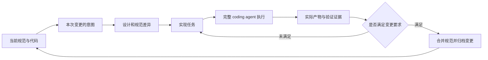

# 编程与 AI Coding 工作流：规范、执行图和持续交付循环

> 调研截止与访问日期：2026-09-16。本文研究工作流如何组织完整 agent、任务状态和工程产物；没有安装任何框架。关联：[能力组织](02-skills-tools-mcp.md)、[Coding Agent](05-coding-agents.md)、[Harness](06-harness.md)。

> 2026-10-19 增补：第 12 节核对主流开发方法的采用信号与当前 M5 的可选流程接入方向。前文保留原调研日期，候选未安装、未实测。

## 阅读起点：从“写个功能”到可持续推进的工程过程

假设要给已有桌面应用增加批量导出。用户最初只说支持多个文件，讨论后补充不能覆盖旧文件，还需要取消。即使模型能写出代码，工程仍要解决：哪份需求是当前版本，谁负责发现遗漏，完成标准是什么，执行中断后从哪里继续，用户临时提问会不会丢掉原目标。

工作流就是把这些协作关系组织起来。它可以是一套方法，也可以是运行中的程序。OpenSpec 一类工具主要让需求和变更成为可管理产物；LangGraph 一类框架让节点、状态和条件成为可执行结构；Temporal 一类系统处理跨进程的持久运行。理解各自保存什么、控制什么，比比较谁提供更多命令更重要。

全文使用批量导出的自拟例子帮助解释。例子不是已经在本项目实施的功能，也不是第三方框架保证自动完成的流程。

## 1. 三类工作流解决三个不同问题

“先计划再编码”是一种协作约定；“节点 A 成功后调用节点 B”是一种控制程序；“隔夜继续完成目标”则需要持久执行、环境恢复和外部事件处理。一个项目可能覆盖其中多类，但不能因为画出流程图就宣称全部具备。

| 层次 | 被组织的对象 | 主要产物 | 中断后依赖什么恢复 |
| --- | --- | --- | --- |
| 开发方法与规范 | 需求、方案、任务、验证 | Markdown、规范变更、检查清单 | 重新读取文档并核对代码 |
| Agent 执行编排 | 完整 agent、函数、条件与并行分支 | 节点结果、状态、事件 | checkpoint、节点状态与外部环境 |
| 长期任务控制 | 多次 agent 运行与人的反馈 | 连续任务、成果、阻塞与交接 | 目标版本、持久事件、工作副本、重试策略 |

本项目用户所说的 loop / graph 应放在第二、三层：节点可以是完成一次讨论、实现、review 或调研的完整 agent，内部仍包含多轮模型和工具调用。把每一次 `read_file` 都提升为用户工作流节点，会把产品变成低层工具调用编辑器，偏离其需要。

历史上，CI、工作流引擎和状态机早已负责确定性过程；LLM agent 引入的是在节点内部处理开放问题的能力。规范驱动开发又将人的意图保存为长期产物。2025–2026 的变化更多是这三者结合，而不是“工作流”概念本身刚出现。

## 2. 代表方案的结构比较

| 方案 | 核心抽象与公开形态 | 更适合的需求 | 不能自动替代的部分 |
| --- | --- | --- | --- |
| OpenSpec | MIT；变更目录、规范 delta、artifact schema | 既有项目中持续修改需求与代码 | 任意副作用的可靠恢复 |
| GitHub Spec Kit | MIT；流程模板、skills、扩展与规范产物 | 让需求、计划、任务和完成判断有共同依据 | 真实运行结果、授权与代码质量 |
| Superpowers | MIT；可组合开发 skills 与宿主集成 | 强化讨论、计划、实现和 review 习惯 | 独立调度器、宿主权限与隔离 |
| GSD 系列 | 规划、上下文和任务执行体系 | 控制长任务上下文及阶段交接 | 仓库迁移前后的接口兼容保证 |
| LangGraph | 图状态、节点、checkpoint、store | 需要条件、循环、暂停和可见状态的 agent 应用 | 工具副作用天然 exactly-once |
| Temporal | workflow history、worker、activity | 多服务、长时间等待和崩溃恢复 | LLM 任务本身是否正确 |
| Pydantic Graph / AI | 类型化状态与图、agent 能力 | Python 系统中明确输入输出与组合 | 业务工作流定义与部署运维 |
| Microsoft Agent Framework | agents、harness、workflow、集成 | 企业模型与工作流应用 | 不同语言实现功能完全一致 |
| GitHub Agentic Workflows | Markdown 编译为 Actions workflow | 仓库内事件驱动的维护、分诊、报告 | 通用桌面任务与任意本地交互 |

许可与功能范围依据访问日官方入口，采用源码时仍需核对固定版本及各子包。以下重点展开机制；表格不是选型结论。

## 3. OpenSpec：把需求变化建模成可合并的产物

### 3.1 数据模型，而非命令列表

OpenSpec 区分描述当前行为的主规范与尚未归档的 change。change 中的 proposal 解释动机和范围，design 描述技术选择，任务清单推动实现，delta specs 表示规范改变；归档将已完成变更收敛到长期规范。要求描述可观察行为，设计描述内部做法，避免把二者混为一份 prompt。[官方概念文档](https://github.com/Fission-AI/OpenSpec/blob/main/docs/concepts.md)

**架构分析**：主规范类似“当前共识的物化视图”，change 是待处理的变更集。这样新会话可以先读当前事实，再读本次差异，而不是扫描全部旧讨论。代价是必须维持规范与代码同步：归档过早会把计划写成事实；永不归档会导致多个版本并存，新 agent 不知道哪个有效。

一个实际数据流可表示为：



此图是本文对其使用方式的分析，不表示 OpenSpec CLI 独自运行所有箭头。实际 coding 和语义判断通常由宿主 agent 完成。

### 3.2 Schema 如何控制“下一步可做什么”

自定义 schema 用 artifact 的 ID、输出路径、模板和 `requires` 表达产物依赖；apply 还指定所需产物及任务跟踪位置。项目配置可以注入上下文和各类产物规则。schema 选择具有显式优先级，适合让团队版本化自己的开发流程。[自定义 schema](https://github.com/Fission-AI/OpenSpec/blob/main/docs/customization.md)

**实现分析**：依赖图能判断某份输入是否存在，从而决定下一份产物是否 ready；它不能仅凭文件存在判断内容正确。`design.md` 完整但已经被新需求推翻，依赖仍可能形式上满足。因此用于产品时应增加“输入版本—输出版本”关系：当需求版本改变，与其相关的设计和任务需要重新确认，不能只检测文件名。

这也解释了为什么工作流状态不宜只放在 Markdown 复选框中。复选框方便人读，但缺乏完成依据、执行尝试和并发版本。可以保留 Markdown 作为产物，同时用结构化记录表达 `based_on`、`result_refs`、`verification_state`。这属于本项目未来设计建议，并非声称上游已实现该模型。

### 3.3 一次真实变更应如何推进

假设既有应用需要增加“任务可以关联多个会话”。先读当前项目 / 会话规范和代码，明确这是新增 task 身份还是仅增加 UI 分组。proposal 要说明用户得到什么；design 才讨论 Task DTO、存储和迁移；delta 应覆盖创建、关联、恢复、删除边界；任务清单再拆实现工作。

实施到一半用户补充“普通插话不终止 Goal”，应判断它是否改变任务状态机和验收。若改变，就回到受影响设计与规范，而不是只在最后总结里附一句。已验证的其他改动不必整体作废，工作流需要局部失效传播。

完成时核对规范、代码和证据三者：有实现但没验证的需求明确标记；没有实现的约定不能并入“当前事实”。这种闭环比必须按固定顺序输入多少条命令更有价值。

### 3.4 并行变更与归档不是无冲突合并

OpenSpec 的工作流支持并行 change 以及批量归档时检查重叠，其 verify 关注完整性、正确性和一致性。[官方工作流](https://github.com/Fission-AI/OpenSpec/blob/main/docs/workflows.md)

**限制分析**：不同目录只隔离了变更草稿，两个 change 仍可能修改同一条主规范或同一模块。应区分文件冲突、语义冲突和验证失效。Git 没有冲突标记也可能出现“一个变更要求自动继续，另一个要求每步暂停”的语义矛盾。归档时需要读取当前主规范与代码，不能拿启动时的快照无条件覆盖。

当前默认 profile 与旧教程的命令集合也有差异；应以访问日 README 与生成的宿主集成为准，不把 `/opsx:*` 当作所有工具统一的 shell 接口。[当前项目入口](https://github.com/Fission-AI/OpenSpec)

### 3.5 从产物内容看一次 OpenSpec 变更

一个教学目录可以包括现行 export 规范与 add-batch-export 变更目录。现行规范描述目前单文件导出的可观察行为；变更目录中的 proposal 说明为什么需要批量能力，design 解释任务模型和输出策略，delta specs 描述新增或改变的行为，tasks 将它们转成实施单元。

| 产物 | 批量导出例子应写什么 | 不应混进去什么 |
| --- | --- | --- |
| Proposal | 用户一次选择多个输入，减少重复操作；本轮范围与非目标 | 尚未核实的内部类名细节 |
| Requirement / scenario | 已存在目标文件时保留原文件并报告冲突 | 仅写“体验良好”“性能优秀” |
| Design | 输出命名、取消传播、部分成功如何表示 | 将未来选择伪装成已实现事实 |
| Tasks | 实现相关输入、状态、执行与最小必要验证 | 只有“完成后端”“完善前端”等不可核查项 |
| 完成证据 | 实际变更、验证条件、未覆盖范围 | 模型自称已完成 |

这种表示让下一个会话能恢复意图，而不是只见到一堆实现文件。OpenSpec 的贡献在于将变更产物和依赖组织起来；表中的内容示例是本文设计，不是上游固定模板全文。[概念文档](https://github.com/Fission-AI/OpenSpec/blob/main/docs/concepts.md)

### 3.6 Artifact DAG 与 Agent 执行图有何区别

Artifact 的 requires 表示“生成这份产物需要哪些已有产物”。它约束输入准备顺序；agent 执行图则表示某次运行中调用哪个求解器、怎样汇合结果和处理失败。两者可以关联，但不能视为同一张图。

例如 design 依赖 proposal，表示设计需要知道范围；并不意味着每次读取 design 都要重新运行 proposal agent。反过来，一次实现失败可能回到设计分析，而不需要删除已经有效的 proposal。需要根据失败影响范围进行局部修订。

采用时可让产物标明依据的需求版本，把“文件存在”“内容已确认”“实现已验证”分开。OpenSpec 自定义 schema 提供 artifact、模板和依赖的配置能力；额外的业务状态与版本失效传播是否实现，应在具体宿主中核对。[Schema 文档](https://github.com/Fission-AI/OpenSpec/blob/main/docs/customization.md)

### 3.7 归档的价值与失败机制

归档应使长期规范反映已经交付的行为。若批量导出只完成输入界面，后台仍逐个手工处理，却已将“完整批量取消”并入现行规范，后续 agent 会在错误前提上继续开发。

所以归档是一项知识更新：检查实现、确认适用范围、合并规范差异、保存历史。它不是把目录移动到 archive 就自动实现语义收敛。并行变更尤其要在当前主规范上检查，避免用旧快照覆盖别人的已完成内容。

## 4. Spec Kit：统一工程产物，而不是只能走瀑布

当前 Spec Kit 把功能开发、缺陷修复、想法评估作为独立入口。SDD 核心围绕项目原则、specify、plan、tasks、implement、converge；缺陷与评估流程通过按需扩展提供。不能继续引用其他项目早期对照，把当前 Spec Kit 描述成“所有小任务都必须走完整瀑布”。[官方 README](https://github.com/github/spec-kit)

**架构分析**：此类工具的价值在于约束信息转换：自然语言需求转为可验收规范，规范转为技术方案，方案转为实施单元，最后将现实与规范对齐。每一次转换都会丢信息，因此模板应保留需求标识、约束来源和未决问题，而不只是漂亮段落。

**落地成本**主要在维护规范。对于长寿命功能、跨团队接口或合规审计，额外文档可能减少反复解释；对于两行文案修改，生成多份长文档会增加净成本。正确比较应测返工率、需求遗漏、接续成本和交付时间，不能只比较“有没有规范文件”。

**与 OpenSpec 的选择关系**：重视已有行为的增量规范与归档语义，可以优先研究 OpenSpec；重视多种工程过程模板与项目原则，可以研究 Spec Kit。二者也可组合，但应指定哪个拥有规范事实、哪个拥有执行状态，避免双份 `tasks.md` 互相漂移。

### 4.1 规范驱动为什么可能减少返工，也可能增加负担

规范驱动的价值不在增加文档，而在编码前暴露不同解释。例如“取消批量导出”可能指停止剩余任务、终止当前任务、删除半成品、保留已完成结果，这些行为并不等价。若实现后才发现分歧，修改会跨 UI、存储和执行层；提前用场景表达可以更早发现。

但不是所有未知都应该前置解决。性能瓶颈、第三方库行为或平台取消语义可能需要小规模验证后才能设计。好的流程允许探索结果反过来修订方案，而不是为维持文档顺序假装一开始就知道全部答案。

对于小改动，保留需求、实施结果和直接检查可能已足够。模板数量应该随协作复杂性变化。若团队维护了一整套规范，却从不在实现和验收时引用它，规范只是额外维护面。

## 5. Superpowers 与 GSD：把开发经验编码成执行习惯

Superpowers 将讨论、计划、实施、调试和 review 等方式组织为可组合 skills，通过不同宿主集成加载。它强调先形成设计再推进，并提供子 agent 开发方式。[项目入口](https://github.com/obra/superpowers)

其当前 subagent-driven-development skill 还包含 review 反馈归并、修复循环和处理未决意见的逻辑。这表明“多个角色”之外，如何避免 reviewer 与 implementer 无限互相返工也是具体产品问题。[实际 skill 文件](https://github.com/obra/superpowers/blob/main/skills/subagent-driven-development/SKILL.md)

**机制分析**：技能层通过自然语言影响 agent 决策，宿主提供模型、工具、会话和权限。它容易迁移，因为不要求更换底层模型服务；但遵循程度依赖宿主加载、上下文预算和模型行为。用固定测试观察 skill 是否触发、是否被后续指令覆盖，比只检查安装成功更有意义。

**项目适配**：其 TDD、子 agent、固定审查回合等默认偏好不能覆盖本仓库用户已经选择的最小必要验证和当前授权。借鉴应拆成可选择的能力与产物契约。用户要一条适合个人习惯的默认流程，未要求每个任务都启用全套角色。

GSD 的旧 `gsd-build/get-shit-done` 仓库在 2026-06-26 归档，入口明确指向 `open-gsd/gsd-core`。这个迁移本身就说明，选型不能只看历史星数或旧教程。[归档说明](https://github.com/gsd-build/get-shit-done)、[后续仓库](https://github.com/open-gsd/gsd-core)

**可借鉴的问题定义**是长任务如何拆分、每阶段加载哪些上下文、完成后保存什么。不能仅凭同属 GSD 名称，就把旧 prompt 包、后续 CLI 和第三方派生工具当作同一实现。本文不据未核实的旧命令提供安装步骤。

GSD Core 当前明确用阶段循环和新上下文执行器承接较重工作，让主会话保留协调信息；并行以任务依赖划分 wave。[当前机制说明](https://github.com/open-gsd/gsd-core)

**进一步分析**：重置上下文会降低旧推断污染，却也丢掉未写入产物的隐性知识。因此 planner 必须把实现所需的接口、边界和验证方式交给 executor，结束后 executor 又要返回可信成果。若交接过简，执行器反复探索；若全量复制历史，又失去新上下文的价值。README 中固定上下文容量的说法是其使用假设，不能推广到所有宿主和模型。wave 并行还需要识别共享文件与接口，不是把任务清单均分就能加速。

## 6. LangGraph：持久化的是图状态，不是整个世界

LangGraph 区分 thread 内图状态的 checkpointer 与跨 thread 数据的 store。前者适合恢复、暂停和分支，后者存应用定义的长期事实；纯内存实现不会跨进程保存。[官方 persistence 文档](https://docs.langchain.com/oss/python/langgraph/persistence)

**一个完整 agent 节点的输入输出**可以是：输入包含任务目标、产物引用、工作副本标识和预算；节点内部运行模型与工具；输出是完成状态、产物位置、验证结果和未决问题。图决定将这些结果送往实现、review、人工反馈或结束节点。节点不必只是一次 LLM 调用。

设计图状态时应避免三个错误：

1. 把全部历史消息当成状态，导致 checkpoint 增长和跨节点上下文污染。
2. 把大文件正文塞进图状态，造成重复存储；可以保存受控引用与内容 hash。
3. 把“节点重跑”当作“操作可安全重放”。节点内可能已经创建远程 PR、执行数据库迁移或写入用户文件，checkpoint 不能自动撤销这些副作用。

**恢复分析**：如果实现节点已经写完代码，尚未持久化成功状态就崩溃，恢复后不能直接再次执行同一写入。需要先比较工作副本和产物，再决定复用、补验证或重新尝试。若 review 节点只读取不可变 diff，重跑通常容易；若部署节点改变外部系统，就需要业务幂等键与外部状态核对。

**采用成本**：图框架有助于条件路由、可见状态、并行汇合和中断；但只有一条线性默认流程时，简单显式状态机可能更容易维护。先设计节点契约，再决定用现成图框架或自有实现；不能由框架现成 API 反推用户产品必须有哪些步骤。

### 6.1 图状态应该描述事实，而不是只累计消息

一个教学状态可保存 requirement_revision、design_ref、workspace_ref、implementation_result、review_findings 和 unresolved_questions。模型消息是证据的一部分，未必需要全部进入所有节点。实现节点需要完整接口和约束；review 节点需要目标、差异和检查结果；交接节点只需要可继续工作的事实。

如果多个节点都返回同一个字段，必须定义是覆盖、追加还是合并。两个 reviewer 同时更新 findings，可以按稳定问题身份合并；两个 implementer 同时更新 current_revision，则需要明确的集成步骤，不能以最后写入胜出。

检查点使图状态可恢复，但保存策略仍影响故障窗口。示例中的内存 checkpointer 只能跨调用保留，进程退出后会消失；需要跨重启时使用持久后端，并确认数据库写入和外部产物之间的关系。[当前持久化文档](https://docs.langchain.com/oss/python/langgraph/persistence)

### 6.2 一次中断恢复如何避免重复工作

设实现节点已写完三个文件，但状态保存前进程崩溃。重启看到节点未完成，应先对照基线、当前文件和已记录操作，判断哪些修改发生了，再补验证或继续。直接重新执行整段生成可能覆盖用户随后修正的文件；直接标成功又可能遗漏未完成动作。

因此节点结果至少需要产物引用与版本，恢复过程需要核对环境。只读审查不可变 diff 比较容易重跑，外部发布则需要业务幂等或状态查询。图框架能管理控制位置，不能自动替用户设计所有副作用的恢复。

### 6.3 Loop、DAG 与带环 Graph 怎样选择

线性任务可以使用明确状态机；多个独立材料收集后汇合适合 DAG；实现与审查反复交替需要带环图；长期目标通常还要一个外层循环接受新输入。它们不是从低级到高级的排名。

判断标准是能否清楚表达真实依赖、失败范围和完成条件。把每个文件读取画成节点会使图复杂而没有业务意义；把数小时全部工作塞进一个节点又会使恢复粒度过粗。完整 agent 节点与内部可观测事件可以同时存在。

## 7. Temporal、Pydantic 与 Microsoft：从函数调用走向可恢复系统

Temporal 将 Workflow Execution 作为持久执行单位，worker 根据历史继续工作；外部交互通过活动等机制组织。这类引擎服务的是跨进程、长时间运行的可靠性。[执行模型](https://docs.temporal.io/workflow-execution)

**适配分析**：LLM 请求有随机性且可能收费，不应在重放时被无意重复调用；Git、邮件、发布也需要明确的活动边界。可靠恢复依赖历史、重试策略、幂等业务操作与 worker 版本兼容共同成立，不是“引入 Temporal”即可让每个工具具备恰好一次语义。

Pydantic Graph 使用显式类型来描述状态与控制流，并与 Pydantic AI 的 agent 能力配合。对已有 Python / Pydantic 项目，它提供值得参考的边界设计；具体持久执行后端仍应独立判断。[图文档](https://pydantic.dev/docs/ai/graph/graph/)

Microsoft Agent Framework 当前将 agent、harness agent、workflow 和集成分开，官方称其承接 AutoGen 与 Semantic Kernel；不同语言版仍有功能差异，Go 预览并不具有所有能力。[官方概览](https://learn.microsoft.com/en-us/agent-framework/overview/)

**工程选择**：企业可能需要跨服务治理、现成观测与身份集成，个人桌面首先需要单机恢复、取消和数据一致性。不要为未来可能分布式部署，提前把每个讨论节点做成网络服务。也不要将“Python 类型安全”与“外部模型输出可信”混为一谈；边界仍需运行时校验。

### 7.1 Temporal 的 History / Activity 分工

Temporal 的 Activity 是执行明确外部工作的函数，由 worker 接收任务并执行；失败可依据策略重试，长活动可通过 heartbeat detail 保存进度。官方建议活动具有幂等性，因为重试可能发生。[Activity 文档](https://docs.temporal.io/activities)

把批量导出接到这类引擎时，工作流负责顺序、等待和结果路由，活动负责模型调用、构建、执行或外部存储操作。工作流恢复可以复用历史中已经记录的结果；尚未确认完成的活动仍可能重新执行。模型调用既不确定又收费，必须明确放在哪个被记录的边界，避免恢复时无意重复消耗。

幂等不是重复执行函数后“通常没事”。比如输出到唯一操作 ID 的临时文件，再核对结果后发布，可能比每次直接追加同一目标文件更容易恢复。实际方案仍需考虑同一操作重复请求、不同操作目标重叠，以及用户在恢复前修改文件。

采用收益在长等待、多 worker、跨服务和故障恢复中更明显；代价是服务部署、历史兼容、活动粒度和运维。个人桌面上的一条短工作流不一定需要立即承担这些成本，可以借鉴执行语义而不直接引入分布式引擎。

### 7.2 类型化框架能约束什么

Pydantic 类工具适合让节点输入输出有明确字段，并在模型返回边界验证形状；Microsoft 的框架提供企业集成和多语言路径。它们不能仅凭类型通过证明“修复正确”。一个结构合法的 review_result 仍可能含错误判断。

因此要分开结构验证、领域校验和行为验收。结构验证确保结果可被下游读取；领域校验检查引用的文件、问题身份和版本存在；行为验收检查用户需求是否满足。类型化能够减少前两层的一部分错误，但最后一层仍需实际证据。

## 8. 企业与托管落地：在灵活节点外保留确定性约束

GitHub Agentic Workflows 将 Markdown 描述编译为 Actions 的锁定工作流，结合事件触发、引擎选择、隔离运行和受限的 safe outputs；外部写操作可经过独立路径处理。[官方架构说明](https://docs.github.com/en/copilot/concepts/agents/about-github-agentic-workflows)

**机制分析**：编译时固定触发条件与权限，运行时让 agent 处理自然语言和仓库内容，写出时再校验成果。灵活性被限定在受控执行区域，减少模型同时决定目标、权限和副作用的空间。这适合 issue 分诊、定期报告、维护建议等有清晰输入输出的仓库任务。用户若需要本地 GUI、未提交文件或个人长期任务，则还需要桌面运行层。

Stripe Minions 是自建的无人值守编码流程，结果仍由人审查。2026-09-16 补充复查时，通过官方页面的浏览器正文解决了此前提取不完整的问题。以下分析依据 2026-02-19 的第二篇工程文章；它解释当时的生产设计，不代表 9 月所有内部版本仍然相同。[企业原文](https://stripe.dev/blog/minions-stripes-one-shot-end-to-end-coding-agents)、[第二篇](https://stripe.dev/blog/minions-stripes-one-shot-end-to-end-coding-agents-part-2)

从上述模式可作的**设计推论**是：确定性设施负责环境准备、权限、预算、验证入口与成果提交，agent 负责不确定的问题分析和实现。真实收益还取决于任务选择、环境准备成本、review 负担以及失败后的接管效率；一个优秀内部系统的公司级统计不能直接当作个人项目预期。

### 8.1 Stripe Blueprint：节点内部可以是一整个 Agent

Stripe 将 Blueprint 定义为代码描述的工作流：有些节点运行完整 Agent 循环，有些节点直接运行确定性程序。实现任务、修复 CI 属于前者，执行指定 linter、推送变更属于后者。其 Agent 来自对 Block Goose 的内部改造，执行环境复用已有的隔离 devbox。这里最有价值的组合是**已有开发基础设施 + 有边界的自主求解节点**，不是某种新的提示词格式。[Blueprint 与运行环境原文](https://stripe.dev/blog/minions-stripes-one-shot-end-to-end-coding-agents-part-2)

下面是根据这种分工构造的教学流程，不是 Stripe 私有 Blueprint 的源码：

```text
准备环境和输入版本
        ↓
Agent 节点：分析问题 → 检索 → 修改 → 局部验证，可内部多轮
        ↓
程序节点：执行本次变更对应的确定性检查
        ↓
结果路由：通过 → 形成待审成果
          失败 → 将失败证据交给修复 Agent
          环境异常 → 标记异常并按策略恢复
```

这种结构解决一个常见误解：把工作流“图节点”理解成一次 LLM 调用，会迫使开发者提前画出每次读文件、每次重试；把全部工作交给一个自由循环，又会让已知必做的步骤依赖模型记忆。完整 Agent 可以封装为粗粒度节点，外层只接收版本化产物与明确终态。

以一次 API 迁移为例，模型适合识别语义差异、选择不同调用点的替代方式；代码适合枚举必须处理的目标、检查覆盖、收集未成功项。输出应包含实际修改集合和未处理集合，不能只是一句“迁移完成”。程序节点也不是天然正确：如果目标枚举漏掉动态加载路径，外层流程仍会稳定地遗漏它，所以确定性保证的是执行方式，不是需求理解的完备性。

### 8.2 把企业能力拆成可迁移部分与前提条件

原文还说明：Minions 按任务选择集中工具库的子集，复用按目录生效的规则，并限制 CI 修复轮次，之后交还人审。这些都是特定生产环境的取舍，不能把原文轮数、规模或免确认方式复制成本项目默认值。[上下文与反馈机制](https://stripe.dev/blog/minions-stripes-one-shot-end-to-end-coding-agents-part-2)

**工程分析**：无人值守的前提之一是环境和凭据已经受限。个人电脑通常同时存在工作资料、个人凭据和用户正在修改的文件，权限条件不同。可迁移的是清楚的节点契约、定向工具集、快速局部反馈和有成本上限的修复；需要重新设计的是环境准备、用户接管、并发写入和交付方式。

评价这种系统，应至少区分任务被接受、Agent 生成成果、检查通过、审查通过和最终合并。一次 Agent 运行可能在交付前执行许多模型与工具回合；“one-shot”描述的是用户无需逐步陪跑，不能直接解释成单次模型调用。PR 产出证明系统投入使用，却没有自动提供审查耗时、线上缺陷或净生产率的反事实比较。

## 9. 给本项目的一份可评审工作流契约

以下是研究建议，不是已决定的产品方案。任务是长期对象，session 是交互上下文，run 是一次执行；工作流步骤引用完整 agent 执行及其产物。每一步至少需要：

| 字段 | 用途 | 省略后的问题 |
| --- | --- | --- |
| 目标与输入版本 | 明确本次做什么、依据哪次用户决定 | 用户改需求后继续旧计划 |
| agent / skill 版本 | 明确采用哪种处理方式 | 更新 skill 后无法解释差异 |
| 产物与证据 | 支持下游读取和用户审阅 | 用一段成功宣告代替成果 |
| 完成 / 失败 / 等待语义 | 决定继续、重试还是交还用户 | 将没回答当作失败或授权 |
| 预算与停止条件 | 限制循环和重试 | 无进展地反复 review |
| 副作用与恢复方式 | 判断能否安全重放 | 中断后重复发布或覆盖 |

默认路径可以允许讨论、实施、验证、review、交接等活动，但不把它们全部强制成为每个任务的固定阶段。普通插话先回答再继续目标；需求纠正更新目标版本并重新评估受影响步骤；取消停止活动执行；新会话通过任务事实恢复。这几种事件需要独立语义。

选择 loop 还是 graph，取决于真实分支和汇合需求。一个外层循环足以表达“读取目标—选择当前行动—运行完整 agent—核对成果—继续”；出现两个独立审查、并行调研或条件路径后，再引入明确图节点。内部 agent 的多轮 tool loop 与这个外层循环分别计量和取消。

## 10. 如何验证工作流确实有价值

不要以生成文档数、agent 数量或执行轮数评价工作流。用几类真实任务比较：小缺陷、跨模块功能、需求中途变化、环境失败、暂停后续接。记录完成质量、用户重复解释次数、返工、恢复成功率、模型费用和 review 时间。

尤其要保留负样例：规范写得很完整但实现错误；review 反复给同一误报；失败恢复重复产生外部副作用；不同任务同时改同一文档。它们分别检验语义验证、评审裁决、幂等恢复和并发控制，无法由“模板存在且图能运行”替代。

本项目优先学习 OpenSpec 的产物关系、Spec Kit 的过程可选择性、skill 框架的经验封装和持久图的状态边界。先建立一条能局部推进、可核对成果、能交接的默认流程，再判断哪些复杂框架值得引入。

## 11. SDK 的当前演进：运行循环、图与状态恢复不能只按品牌比较

### 11.1 OpenAI Agents SDK：Runner 管理一轮求解，业务任务仍由应用定义

[官方运行说明](https://developers.openai.com/api/docs/guides/agents/running-agents) 将 Runner 描述为模型调用、工具执行、handoff 与结束条件之间的循环。历史既可由应用传入，也可采用 SDK session 或服务端续接；这些方式需要选择和正确组合，重复提交同一历史会产生上下文重复。等待审批后恢复运行，也应使用对应状态，而非把审批文本当作全新任务重新开始。

以“更新接口并等待发布批准”为例，代码变更已经完成后，Runner 的暂停点可以保留到后续续接；产品还需要保存成果版本和批准对象。用户回来时若代码已被另一个任务改动，旧运行状态不能独自证明批准仍适用。这解释了为什么 SDK 的 session 不能直接替代产品 Task。

它与托管 Agents API 的控制权差异见 [Harness 专题](06-harness.md)。本节讨论应用内执行框架，没有把两个产品合并为一个方案。

### 11.2 Google ADK 2.0：应更新对框架的旧认识

[ADK 2.0 官方说明](https://adk.dev/2.0/) 给出明确 GA 日期：Python 2026-05-19、Go 2026-06-30、TypeScript 2026-08-21。2.0 引入 Workflow Runtime，从层级式执行拓展到图引擎，Event 增加相关字段；自定义事件存储和既有集成需要核查迁移影响。仅介绍早期 Sequential / Parallel / Loop Agent，已经不能代表当前全貌。

[当前图工作流文档](https://adk.dev/graphs/) 允许把 Agent、工具、函数与其他工作流组成节点，通过边与类型化输入输出衔接。一个节点可以包含完整 Agent，另一个节点也可以只是确定性函数。因此“采用图”不意味着必须把所有内部模型 / 工具调用拆成节点。

对“读规范 → 生成补丁 → 运行检查 → 汇总”的例子，图层适合表达必须执行的检查和结果路由，生成补丁节点内部仍允许探索和重试。节点返回值直接传给下一节点，有助于减少依赖松散全局状态的隐式耦合；但若工具已经改变外部文件，类型化返回值仍无法代替副作用记录。

### 11.3 CrewAI Flows：状态恢复和分叉已经有具体语义

[当前 Flows 文档](https://docs.crewai.com/v1.15.21/en/concepts/flows) 以事件驱动方法、路由和状态组织执行，`@persist` 保存状态。按既有 ID 恢复会延续原历史，`restore_from_state_id` 则从已有快照初始化新状态身份。文档还说明找不到恢复源时的回退行为，需要产品自己决定是否接受这种语义。

本研究的分析是：分叉很适合比较两个方案，但复制状态不等于复制世界。两个 Flow 从相同状态启动后，若指向同一个仓库路径，仍可能互相覆盖；若从不存在的快照静默开始，界面却显示“已恢复”，用户会误判先前进展。应用可在启动前核验恢复源和工作区身份，而不只透传框架参数。

### 11.4 在同一层面上比较

| 机制 | 提供的主要约束 | 仍由产品负责的部分 |
| --- | --- | --- |
| SDK Runner | 一轮中的调用、交接和结束 | 跨会话目标、用户插话与成果归属 |
| ADK 2.0 / LangGraph 的图 | 节点依赖、路由、状态推进 | 外部副作用、任务验收与环境事实 |
| CrewAI Flow 快照 | 方法状态持久化与分叉 | 恢复源有效性、文件与资源隔离 |
| Temporal History / Activity | 可恢复编排与活动执行边界 | Activity 的幂等性、业务补偿 |
| OpenSpec / Spec Kit | 规范、设计和变更产物关系 | 实际运行与代码正确性 |

选择时应先问产品缺少哪一种约束。把它们排列成单一“框架强弱”榜，会掩盖采用成本：有的系统缺少规范，有的缺少持久状态，有的只是无法准确判断运行是否结束。

## 12. 2026-10-19：把常见开源开发方法作为可选流程

用户明确不限定 SuperSpec 这个名字，希望选择已经被广泛实际采用的方式。以下以公开分发、集成、维护及社区信号筛选；没有可比的跨产品活跃用户统计，因此不宣称精确使用量排名，也不把 Star 或安装次数当作成功交付数。这里只核实候选并提出接入建议，未替换默认流程。

### 12.1 候选与采用证据

| 候选 | 已核实的机制与信号 | 对本项目的建议 |
| --- | --- | --- |
| [Superpowers](https://github.com/obra/superpowers) | 以可组合 Skill 提供讨论、规划、实施、调试和审查；有多个宿主的安装集成。[skills.sh 的 brainstorming 页面](https://www.skills.sh/obra/superpowers/brainstorming) 本次显示约 397K installs，仅代表该平台这一项技能的安装统计 | 优先适配日常开发与调试，明确与原版的差异；不能只加一个阶段名称就声称完整支持 |
| [OpenSpec](https://github.com/Fission-AI/OpenSpec) | 组织 proposal、design、tasks、规范 delta 及归档；当前官方仓库约 72.3K Star / 4.9K Fork，提供 npm 安装与宿主接入 | 优先用于现有项目的功能迭代；沿用其变更产物结构，避免重复生成另一套任务文档 |
| [GitHub Spec Kit](https://github.com/github/spec-kit) | 规范、技术计划、任务、实现与收敛；另有独立缺陷修复入口。[官方站](https://github.github.com/spec-kit/index.html) 公布 270+ 贡献者、38 项集成，属于生态信号而非用户数 | 作为规范驱动开发选项；为较大需求保留完整流程，小修复选择相应简短入口 |
| [BMAD Method](https://github.com/bmad-code-org/BMAD-METHOD) | 组织产品、架构和交付方法；当前仓库约 54.3K Star / 6.1K Fork，README 区分稳定 v6.12 与 v7 preview alpha | 适合作为空间中的角色 / 协作预设后续候选；应核定实际稳定发布，不能根据预计发布日期宣称已 GA |
| [GSD Core](https://github.com/open-gsd/gsd-core) | [原仓库](https://github.com/gsd-build/get-shit-done) 已归档并明确迁移至 Open GSD；新仓库仍有独立宿主集成、状态和命令体系 | 保留长任务与上下文接续研究价值，先核实版本与现有任务 / Goal 职责重叠，暂不整套嵌入 |

以上数值为访问时页面显示，不用于自动选型或产品内门槛。npm 下载页面和统计接口本次未成功读取，未记录下载量。SuperSpec 有多个同名项目，其中 [danielhanold/superspec](https://github.com/danielhanold/superspec) 是 OpenSpec schema 与 Superpowers 的组合；其默认 worktree、TDD 与 Git 推送收尾不能直接替代本项目个人约定。按用户最新要求，不将特定同名组合项目设为首选。

### 12.2 当前已有基础与实际缺口

已读 `workflow/templates.py`、`skills/service.py` 与桌面 `Workflows.tsx`：当前支持可编辑模板、阶段关联 Skill、依赖与反馈说明，以及任务创建时的模板快照；当前阶段的技能也参与请求组装。因此无需另建工作流引擎。

仍需补齐的能力是：开源方法的可运行适配内容、来源 / 版本 / 许可证与差异说明、项目默认选择、关联技能的准备与加载，以及原生文档产物与本地 WorkItem 的对应关系。仅保存一个 JSON 模板不等于已经接入上游方法；直接导入 Skill 也不等于具备其宿主 Hooks、CLI 或子 agent 调度能力。

建议先提供「个人流程」「OpenSpec 适配版」「Superpowers 适配版」「Spec Kit 适配版」，BMAD 作为后续协作预设。选择优先级为任务显式选择 → 项目默认 → 现有个人流程；这是待实施设计，当前没有新增该设置。

### 12.3 使用与适配方式

1. 在左侧工作流管理中查看方法说明、适用场景、阶段、关联技能与来源；可复制修改。在项目设置选择默认流程，创建任务时可以覆盖。已有任务保持自身快照，更新模板不悄悄迁移正在进行的任务。
2. 每种方法带实际阶段指引和必要模板，相关 Skill 按当前阶段加载。规范与任务清单使用一份明确的文件事实源，本地状态关联其路径和条目，不维护两套独立可编辑清单。
3. 流程决定怎样讨论与交付；合作空间决定谁承担和怎样交接。建议角色可映射到用户选择的已有成员，方法本身不自动创建正式会话。单会话也应能使用相同方法。
4. 原版 Superpowers 的 TDD、worktree 和 review 约定在官方 README 中有明确语义。适配时展示保留和改变了哪些规则；需要严格 TDD 的用户可以明确选择相应方法，而不是暗中删去原方法核心再标为原版支持。
5. 普通模式完成一次请求后返回；Goal 在原授权范围内继续。项目已有确认、测试结果报告、子 agent 开关及本地 Git 规则仍适用。模板不新增文件存在门槛、自动推送或每阶段额外审批。

第一步可先完成 OpenSpec 的一个小变更闭环，验证选模板后确实影响指引、产物和接续，再扩展 Superpowers / Spec Kit。上游代码或 Skill 真正复用时固定版本并保留许可证；本轮只读研究，没有安装依赖、修改产品或执行真实模型测试。

## 13. 2026-10-19：开发方法与 Agent 层级的 Loop / Graph 结合

本节是三个适配流程交付后的设计讨论，替代第 12 节中对其尚未实现的时态；实施证据见 [M5 进度](../progress/m5.md)。三个模板、方法 Skill、桌面入口和阶段接续已交付，项目默认继承仍未实现。本节新增建议不代表已经进入实施。

沿用用户已明确的层级：Loop 围绕完整 Coding Agent 的工作回合组织接续，Graph 组织完整工作单元之间的依赖、交接、并行与反馈。[Addy Osmani 的原文](https://addyosmani.com/blog/loop-engineering/) 讨论外层的工作发现、分配、检查、持久记录和下一步；[graph-engineering 实现](https://github.com/AdityaIndoori/graph-engineering) 则展示独立 Agent 调用通过产物连接。这是不同实现的共同启发，并非统一标准，也不要求把模型和每个工具调用拆成图节点。

建议将三者组合：方法模板定义阶段与做法，Loop 定义何时继续完整工作回合，Graph 定义工作之间如何配合。三个方法共用后两种能力，不为每个模板另建调度器。

| 已有适配方法 | 可融入的 Loop | 可融入的 Graph |
| --- | --- | --- |
| OpenSpec | 围绕一个变更推进任务；发现需求变化时返回澄清或更新相关规范 | 变更拆为独立工作项，以规范、实现和核对结果交接；需要时并行实现 |
| Superpowers | 计划项逐项推进；已授权的调试按观察、假设、修改和检查循环 | 实现与已安排的独立 Review 分开，结果返回原执行者；不要求每个小任务都拆 Agent |
| Spec Kit | 围绕规范与实现的一致性逐步收敛 | 从任务依赖安排完整工作单元，独立部分并行，集成部分等待实际结果 |

当前代码已有部分执行基础：`goals/service.py` 跨完整 Run 推进；`workflow/scheduling.py` 参考本 Goal 工作项及共享依赖事实选择下一单元；合作空间已有成员会话、消息、结果与协同轮次。模板里的 `depends_on`、`feedback_to` 和建议角色目前主要是流程材料，不能宣称选择模板后就具备自动阶段路由、通用并行汇合或反馈调度。成员关系图也不等于每次任务的实际执行图。

后续优先补齐三个连接点：阶段关联具体 WorkItem 与现有执行成员；真实结果决定接续、等待、返回或结束；合作图与 Trace 展示这次执行的节点、依赖、等待对象和反馈轮次。工作单元可以由同一会话连续承担，也可以委派给已有角色会话或已开启的内部 worker。交接传递目标、约束、已确认结论、成果引用和未决问题，历史详情按需回读，复用现有上下文与任务存储。

普通请求仍在本次工作结束后返回，持续推进由用户已启动的 Goal 驱动。测试失败先报告，授权已含修复时才进入修复循环；真实调用故障停止受影响 Run / Goal。模板不自动创建正式会话，不自动开展独立 Review，不新增文件齐全、评分、报告或阶段审批门槛。无需引入另一套图框架，也不直接照搬参考实现的退出码判定、强制隔离或缓存复跑规则。初次落地宜先让一个小变更贯通上述连接点，再复用到其余方法。

### 13.1 工作流与团队工作图的结合草案（待用户确认）

状态更新（2026-10-19）：用户后续已授权初步实现，见 [任务工作图方案](../plan/task-work-graph-initial.md) 与 [M5 最新进度](../progress/m5.md)。以下保留讨论时的取舍；是否交付以进度中的实际验证为准。

用户要求先讨论，确认后再实施，并纠正概念：要结合的是工作流模块、Loop Engineering / Graph Engineering 与既有团队工作图。Goal 只是可能复用的持续执行入口，不等同于 Loop Engineering。本小节没有实施授权。

建议以任务内的同一个合作空间承载运行：工作流模板提供阶段、方法与可选协作建议；当前任务把它实例化为具体工作项，并关联已有成员。阶段可以包含多个工作项，一个成员可以承担多个阶段，工作节点执行时使用完整 Agent 能力，不按模型 / 工具调用拆节点，也不按节点自动新建会话。

保留同一空间的两种视角：团队视角显示成员与委派、讨论、结果和反馈关系；工作视角显示阶段下的具体工作项、负责成员、实际状态及依赖。两种视角引用同一份工作与运行事实。成员之间存在反馈线不代表每次都重新执行；工作依赖表示本次实际需要哪个结果。讨论线不成为阻塞条件，工作中的反馈可以形成循环，不将整个关系图强制限制为 DAG。

Loop 的设计包括读取任务目标和新反馈、选择当前工作、安排完整 Agent 执行、汇集结果、保存进度，再决定接续 / 等待 / 返回 / 结束。语义上的拆分和建议由当前执行或协调成员完成，宿主处理运行状态、投递、等待和停止；小任务由原会话承担，不默认增加专职调度 Agent。统一接续决策，避免现有 Goal 和协作轮次同时独立续跑同一工作。

图在已有范围内按需要细化；反馈生成可追溯的新尝试，保留旧结果，不将历史完成节点全部清空重跑。用户修改目标或流程后，后续工作采用新内容，在途执行不伪装成已按新目标完成。交接只带相关目标、约束、结论、成果引用及未决项，不复制所有会话历史；已保存的任务状态不自动升级为长期记忆。

交互建议：选择流程并输入任务 → 生成可编辑的阶段、成员分工和工作图草案 → 用户采用并选择此次执行范围 → 工作在既有范围内推进、图上显示真实状态；点击节点查看对应会话、交接材料和 Trace。采用草案可以与开始操作合并，不增加每节点审批。独立 Review 仅在用户已安排时执行，修复遵守已有范围，真实故障按现行规则停止。首次实现范围宜为阶段与工作项 / 成员关联、一个完整反馈接续环、图状态投影；不先建设通用可视化编排引擎。
