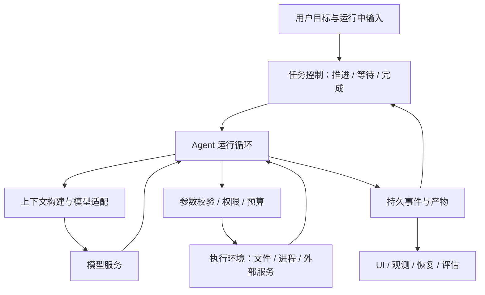

# Harness：让模型在真实环境里持续、可控地完成工作

> 调研截止与访问日期：2026-09-16。重点分析控制循环、状态事实、上下文、工具执行、扩展生命周期和长任务。关联：[Coding Agent](05-coding-agents.md)、[工作流](04-workflows.md)、[自进化与 RSI](03-self-evolution.md)。未运行第三方 harness。

## 阅读起点：为什么同一个模型换个运行系统表现会不同

模型可以提出“读取配置、修改函数、运行检查”，但它自己并不拥有用户文件，也不知道进程真的退出没有。需要外部程序把请求转换成动作，把真实结果送回，并在超时、中断和重启时保持一致。这个围绕模型运转的系统，就是本文讨论的 harness。

用一个自拟情景说明：模型已经生成补丁，应用写入了文件，此时桌面进程崩溃。重启后应该再次写补丁、直接说成功，还是先检查文件？答案依赖运行器保存了哪些事实、文件有没有被别人修改、检查是否真正完成。这些问题无法只靠模型更聪明来解决。

本篇因此从一次运行的时间顺序进入架构，重点讲状态、执行和恢复。模型推理策略见[推理模式](07-reasoning-modes.md)，长期工作如何编排见[工作流](04-workflows.md)。

## 1. 定义与边界：Harness 不是一份系统提示词

软件领域的 test harness 原本指围绕被测对象提供输入、环境和结果收集的设施。Agent 语境下，harness 通常指围绕模型建立的运行系统：组织上下文、调用模型、执行工具、维护状态、处理失败，并判断何时继续。不同团队边界不完全一致，不宜声称有一个统一标准定义或唯一提出者。

狭义 harness 是一次 agent 运行的控制与执行设施；广义还包括长期目标、跨会话恢复、评估和外部调度。Agent 是在任务中的行为主体，harness 是使行为发生的设施，workflow 是任务之间的组织方式，skill 是可复用方法，MCP 是能力连接协议。一个产品可以同时实现多者，但分清职责有助于定位失败。

例如，补丁错了可能是模型推断问题；模型读了过期代码可能是上下文问题；文件被另一个任务覆盖可能是写入一致性问题；模型已答复但目标未完成可能是外层控制问题。只通过修改 system prompt 修复全部问题，会把可靠性寄托在模型持续记住操作细节上。

## 2. 一套可分析的分层架构

这不是要求照图创建七个服务。个人应用可以在一个 Python 进程中实现这些职责；关键在于依赖方向与事实来源。UI 不应自行判断某个 tool 是否成功，模型不能直接修改权限，执行环境不能绕过统一预算。

| 子系统 | 输入 / 输出 | 应由程序保持的不变量 |
| --- | --- | --- |
| 任务控制 | 目标、事件 → 下一次完整运行 | 一次普通插话不丢失原目标；完成有依据 |
| 运行循环 | 输入、观察 → 模型请求 / 工具请求 | 不执行残缺参数；终态明确 |
| 上下文构建 | 事实、历史、检索 → 请求快照 | 记录依据、预算、来源与版本 |
| 工具管线 | 已校验请求 → 执行结果 | 首次 / 重试 / 恢复采用同一策略 |
| 执行后端 | 明确命令与路径 → 进程 / 文件事实 | 取消能清理进程，路径边界真实有效 |
| 事件存储 | 运行事实 → 持久日志 / 查询视图 | 保存成功后才确认，失败不伪造成功 |
| 观测与评估 | 轨迹、产物 → 诊断 / 验收 | 指标可追溯，不由自述代替实际结果 |

这些职责的可靠性属于不同层面：追加日志不等于恢复外部世界；JSON schema 不等于授权；worktree 不等于沙箱；模型停止生成不等于目标完成。

## 3. 从一次输入到一次完成：需要控制哪些时刻

下面是本文的参考流程，用于比较实现，不是某个框架的逐字算法。

1. 接纳输入并绑定 task / session / run 身份，区分新目标、补充、纠正与取消。
2. 从权威状态构建输入快照，选择当前可用工具和相关 skill；记录目标版本。
3. 核对预算及 provider 能力，发起模型请求；流式片段只作为暂态展示。
4. 模型输出完整工具参数后，进行 schema、路径、权限和副作用检查。
5. 记录执行意图与调用身份，再交执行后端；连续消费输出，处理取消与超时。
6. 保存成功、失败或“结果未知”，将适量观察送回模型；必要时进入下一轮。
7. 运行结束时保存事实与产物；外层检查目标完成条件，决定继续、等待或完成。

最复杂的往往是第 5 步：如果外部操作成功，进程却在保存结果前崩溃，本地只能知道“曾发起”，不能知道是否成功。恢复逻辑必须查外部状态或要求人工处理，不能简单重放。对于文件修改，可以通过基线与结果 hash 核对；对于发邮件或发布，可能需要服务端幂等键和操作查询。

运行中输入也有时序问题。用户在工具执行期间纠正目标，不应把已发生动作写成“从未发生”；应保存纠正版本，在下一个可接纳点调整后续工作。模型请求发出后又悄悄修改其上下文对象，则会使轨迹无法解释实际请求；请求快照应稳定，取消信号可以独立变化。

### 3.1 同一个动作至少经过五种不同状态

一个 edit 请求可以经历 proposed、validated、started、settled、published：模型提出动作；程序确认参数和目标；执行实际开始；结果被记录；结果被展示和送回模型。这里的名称是本文教学状态，不是上游统一协议。

如果将它们全部压成“工具调用中 / 成功”，会失去故障恢复需要的信息。执行已成功但 UI 通知失败，应重发结果；执行未开始，应安全取消；执行开始但结果未知，应核查环境。三者的处理完全不同。

| 故障时刻 | 可以确认的事实 | 合理恢复方向 | 不应做的推断 |
| --- | --- | --- | --- |
| 参数尚未完整 | 只有模型流片段 | 丢弃未完成动作或重新生成 | 已获合法执行请求 |
| 校验后、执行前 | 动作准备好但未发生 | 重新检查当前权限和基线 | 旧校验永远有效 |
| 写入后、结果保存前 | 操作可能已经发生 | 核对文件内容与操作身份 | 直接再次覆盖 |
| 结果已保存、UI 未收到 | 执行结果可恢复 | 按游标补发事实 | 再执行工具以便展示 |
| 模型结束、目标未完成 | 本轮结束 | 由任务控制决定继续或等待 | 自动把 goal 标完成 |

这不是要求每个读取动作建立复杂分布式事务，而是要求状态能表达事实。低影响只读操作重跑较容易；写入和外部请求则需要更谨慎的结果核对。

### 3.2 一个请求快照为何值得保存

用户在运行中追加限制时，已发送的模型请求不会自动包含新消息。如果程序直接修改同一个内存列表，日志又只保存修改后的版本，就无法解释模型为什么没有遵循新要求。

请求快照应记录当时的目标版本、消息引用、工具集合、skill 版本和必要参数；新输入在明确的接纳点形成下一版本。这样可区分模型忽略已知要求，与要求实际上尚未进入该请求。私有 reasoning 续接状态则按 provider 语义单独保存，不混入公开日志。

### 3.3 取消、超时与预算是三种信号

用户取消表示不再继续当前执行；超时表示本次等待超过限制；预算耗尽表示不能再投入某类资源。它们都可能终止运行，但恢复选择不同：用户重新授权可以继续取消的任务；网络超时可能需要核对远端结果；预算耗尽应保存已完成成果及剩余工作。

取消信号还必须穿过模型请求、工具协程、子进程和子任务。仅取消等待协程可能留下后台进程继续写文件。反过来，杀死进程也不能撤销此前已完成动作。UI 应展示执行事实，而不是把取消按钮变灰就声称全部清理完成。

## 4. DeepSeek Harness：全插件架构真正复杂在哪里

### 4.1 配置组合与生命周期

DeepSeek Harness 的公开架构基于 Cordis，模型适配、工具注册、会话日志和默认 agent loop 都是插件。profile 组合 bundle，再叠加配置 patch；不同运行入口的热更新方式有区别。项目仍明确处于 developer preview，存在兼容性变化。[项目与状态](https://github.com/deepseek-ai/deepseek-harness)、[架构入口](https://github.com/deepseek-ai/deepseek-harness/blob/master/docs/architecture.md)

**架构分析**：这类体系的重要对象不是插件名称，而是资源所有权。插件注册服务、事件监听器或定时任务时，都需要一个生命周期范围；卸载时必须撤销注册并清理资源。否则热更新后可能出现两套工具、重复事件或孤儿子进程。依赖插件暂时不可用时，消费者也不能继续持有已经失效的服务引用。

“一切皆插件”的收益是替换策略和运行入口时不必改特殊核心；代价是依赖图、配置优先级、初始化顺序、异常传播和卸载顺序都成为基础设施问题。对于只有一个 provider 和少数工具的项目，过早复制这种结构可能让简单功能经过多层注册才能理解。

### 4.2 持久事件、活动事件与能力事件

DSH 将需要恢复的 session 事实、只在运行时有效的 agent 事件，以及挂接文件 / 工具 / 观测策略的 capability 事件区分开来；会话日志又用于投影模型历史。[事件与会话设计](https://raw.githubusercontent.com/deepseek-ai/deepseek-harness/master/docs/architecture.md)

**为何值得研究**：一个 token chunk 适合快速刷新 UI，却不一定适合成为长期业务事实；工具最终结果、用户输入和运行终态则必须保存。若所有 UI 片段都写入主业务日志，数据量和恢复复杂度会增加；若只留最终总结，失败定位和中断恢复又缺证据。持久层与实时层需要通过稳定 ID 对齐。

DSH 当前设计也明确存在持久化边界：尚未结算的流在硬进程丢失时不保证完整保留。**推论**是研究任何系统都要问“最后一次已确认保存是什么”，不能因为它采用 event log 就宣称每个瞬时片段都能恢复。

### 4.3 日志作为模型输入事实来源

若模型看到的上下文可由事件日志投影，恢复、审计、fork 和评测就能共享同一事实基础。反过来，插件绕过日志偷偷塞入 prompt，会导致 UI 展示、存档和实际请求不一致。DSH 的设计对此施加显式约束。[会话投影与模型可见性](https://github.com/deepseek-ai/deepseek-harness/blob/master/docs/architecture.md)

**本项目推演**：不必立即采用完整 event sourcing，但至少要区分三份内容：用户可见历史、模型实际输入快照、provider 不透明续接状态。前两者可以有关联但不相同，第三者还涉及服务商语义与敏感性。压缩、检索和 prompt 更新应有可追溯记录；私有 provider 数据不应直接暴露给 renderer。

### 4.4 插件化执行环境的一致性

**设计分析**：如果 filesystem 工具读本机，shell 却在远程容器执行，模型会看到互相矛盾的世界。同一个 workspace 的文件、进程、LSP、工作目录和产物应指向同一执行环境，或显式表达跨环境传输。替换后端应替换一组相关能力，而不只是更换 `bash` 函数。

这对 Windows 尤其重要：本机盘符、容器路径和 WSL 路径不是可随意拼接的字符串。环境映射需要受信实现，不能让模型通过猜测转换。当前本项目仅做本地只读能力，未来执行后端的设计应先保持这条一致性。

### 4.5 沿 DSH 的调用边界理解“提交”

公开架构描述了组装上下文、pre-step、prepare-call、模型流、结算和工具执行之间的边界；模型可见历史由持久事实投影，失败尝试与成功消息的处理不同。其取消与重试设计也区分准备前、请求中和结算后。[架构原文](https://raw.githubusercontent.com/deepseek-ai/deepseek-harness/master/docs/architecture.md)

这些划分的意义可以用自拟场景解释：用户输入接纳后，还需加载相关工具和约束；如果准备阶段失败，不应生成一条看似已送给模型的完整 assistant 回答。流式片段用于实时展示，成功结算后才形成稳定消息；失败记录用于诊断和费用，未必适合直接作为正常对话再次喂给模型。

这也解释为何持久事件和 live events 要分开：前者回答“恢复时有哪些确定事实”，后者回答“用户现在看到什么进展”。两者通过 ID 关联即可，不必每个 token 都成为一个业务实体。

### 4.6 Provider、工具与执行环境的替换必须保持语义

所谓可插拔模型，不只是替换 URL。不同 provider 对消息顺序、工具结果、reasoning 续接、流事件和费用的要求不同；适配器需要把这些差异封装成内部明确行为，未知能力不能默认为支持。

所谓可插拔工具，也不只是同名函数。read_file、shell、搜索、语言服务若指向不同工作副本，模型将无法建立一致世界。远程后端应把相关能力作为同一 workspace 的组成部分切换，并明确文件如何进入和离开该环境。

DSH 的插件设计为这些替换提供接缝；实际采用仍要检查语言运行时和部署边界。其 Python 接口并不等于整个核心天然为 Python 实现，包名与架构不能混用。对本项目，更重要的是理解接口责任，而不是因有 Python 入口就替换现有核心。

## 5. Pi 与“少即是多”：不同扩展策略的取舍

Pi 把 extensions 与 skills 分开，前者可通过程序接口改变行为，后者主要提供方法指导；扩展文档描述了运行事件和工具等可挂接点。[扩展接口](https://raw.githubusercontent.com/earendil-works/pi/main/packages/coding-agent/docs/extensions.md)

**比较分析**：小核心方案倾向将基础循环固定，留少量明确接缝；全插件方案把更广泛组件都纳入依赖生命周期。前者容易理解和调试，但定制到核心假设时可能需要修改上游；后者灵活，却需要更强的兼容治理。不存在脱离团队规模、产品目标和真实替换需求的统一优胜者。

一个实用判断方法是列出过去三次需要定制的需求：若只是改变讨论 / 实施 / review 的方法，skill 或工作流配置可能足够；若要改变存储、执行后端或模型协议，才需要代码级接口。不要把每条 prompt 偏好升级为运行时插件，也不要让 skill 承担必须由程序保证的权限与原子性。

### 5.1 扩展点应以不变量为边界

可以允许扩展提供额外上下文、注册工具或改变显示，但不应让它们各自建立互不知情的执行通路。例如自动重试扩展必须重新进入宿主策略；上下文扩展必须留下版本和来源；审查扩展只能提出意见，不能直接伪造工具成功。

一个扩展可拥有自己的生命周期资源：监听器、临时目录、进程和缓存。卸载时要解除其注册，运行中的资源要按约定完成或取消。若升级扩展后旧回调仍存活，就会出现重复动作，这与 prompt 质量无关。

少量稳定接缝适合个人产品；大量可替换组件适合平台化需求。评估时应画出一个常见定制的实际路径，看需要改多少层、失败由谁处理，而不是只数插件 API 数量。

## 6. Anthropic 长任务研究：从交接产物到独立验收

### 6.1 2025-11：为什么压缩仍不能解决接续

Anthropic 的早期长任务实验采用初始化阶段建立功能清单和环境入口，后续 agent 每次做增量工作并留下进度与版本记录。观察到的失败包括试图一次完成全部功能、交接不清以及过早宣布完成。[2025-11 原文](https://www.anthropic.com/engineering/effective-harnesses-for-long-running-agents)

**机制分析**：上下文压缩只缩短历史，不建立可信的完成判据。任务文件应表达尚未实现的行为，进度应记录实际结果，环境入口减少下一次重复发现启动方式。这三种信息不能混成一个“摘要”。此外，论文示例中的固定文件名、Git 提交和浏览器工具只是具体实施选择，不意味着本项目每轮必须提交或跑完整 UI 回归。

### 6.2 2026-03：验收者与实现者为何分离

后续文章将 planner、generator、evaluator 分工，并在实现前协商一段工作的完成契约；evaluator 使用运行中的应用而非仅看作者总结。作者也发现更新模型后，原来必要的某些上下文重置可以移除。[2026-03 架构与实验](https://www.anthropic.com/engineering/harness-design-long-running-apps)

**关键分析**：增加 reviewer 并不自动带来独立性。如果 reviewer 只读实现者的自述，没有原始需求和实际产物，它只是在重述相同偏差。更好的输入是固定需求、当前 diff、必要运行证据和具体评价维度；发现问题必须给复现条件，而非模糊地要求“更专业”。

作者给出的一个对照是更长、更贵的完整 harness 产生更丰富的应用；由于预算和产物范围不同，不能据此算出单纯架构增益。本文也不将视觉审美评分等同于用户满意。**工程推论**：应该同时比较等预算质量和满足质量门槛的最小成本，并保留中间版本，避免默认最后一轮一定最好。

### 6.3 模型升级后需要重新删减 harness

一个为旧模型补短板的机制，可能在新模型上变成额外限制。例如强制逐步确认、过细计划、频繁重置和重复总结，可能增加延迟与信息损失。harness 不应只会堆叠补丁；每个特殊机制最好关联原始失败与回归样例，条件改变时重新判断是否仍有用。

这与 [RSI](03-self-evolution.md) 有联系，但普通工程团队通过测量删除无效机制，不必被包装成全自动递归进化。自动化程度与工程价值是两个独立维度。

### 6.4 从公开实验到可迁移设计，哪些部分可以借鉴

长期应用开发通常有两个不同瓶颈：下一轮不知道上一轮做到哪里，以及实现者把自己的输出评价得过于乐观。前者需要稳定交接产物，后者需要独立证据。将 feature 状态、代码基线、失败记录和验证入口保留下来，有助于新会话快速恢复；独立评估则从用户目标重新检查结果。

但交接不能只写“已经完成大部分”。一条可继续工作的记录应说明已满足哪些判据、尚缺什么、相关文件在哪里、哪些检查未执行，以及当前环境是否仍可用。评估也不能只做另一轮语言好评，要使用与需求相关的实际观察。

这种设计可用于文档研究：完成应由覆盖范围、来源核查、解释深度和证据限制共同判断，而不是写完几个文件就结束。它不要求所有任务都增加复杂角色，只要求完成标准独立于执行者的一句自述。

### 6.5 2026 年混合模型 Harness 对边界设计的影响

Devin Fusion 的近期公开材料进一步表明，模型组合会让上下文、缓存和交接成本成为架构问题，具体机制见[Coding Agent 的 Fusion 分析](05-coding-agents.md#67-devin--fusion近期闭源产品里的双-agent-分工)。[2026-09-11 官方更新](https://cognition.com/blog/local-fusion)

一个系统若在同一任务中引入多个执行主体，需要知道谁拥有当前计划、谁有权写入、谁处理用户新约束、子任务如何反馈，以及总体预算怎样累计。简单把不同模型放进不同函数，不能自动解决这些问题。

对本项目，这是一项研究方向，不能越过已确认 provider 与模型范围。可以先设计与模型数量无关的任务、运行和结果契约，以后有真实证据再决定是否增加组合策略。

## 7. 长期 Goal 的外层控制器应该做什么

内层 tool loop 回答“下一次模型 / 工具动作是什么”；外层 Goal loop 回答“目标是否完成、下一段完整工作是什么”。完整 agent 的一次 final answer 可以只结束当前运行，外层仍可根据目标事实发起接续。

建议将停止理由至少区分为：完成、用户取消、预算达到、等待输入、环境故障、无进展、内部错误。不能把“当前没有工具调用”一概解释为完成；也不能让模型一句“任务太难”自动永久阻塞。

**无进展检测的难点**：同一文件重复修改未必无效，调试可能需要多次实验；而不同文件不断新增也可能毫无价值。更好的信号组合是目标覆盖变化、产物变化、验证结果、重复失败原因和新增信息。最初可以让模型给简短证据、程序统计运行事实、必要时请求用户取舍，不必假装存在一个通用精准分数。

普通插话、目标修订和新目标也要区分：问“进展如何”不改变目标；说“不要支持云端了”使部分设计失效；说“停止这个任务”需要取消；完全不兼容的新目标应另行明确。用户控制应成为事件事实，不依赖压缩后模型猜测会话意图。

### 7.1 Goal、会话和运行的三个时间尺度

Goal 保存持续目标，session 保存一次交互上下文，run 保存一次实际执行尝试。一个 goal 可以经历多个 session，一个 session 可以包含多次 run。用户问进度时，回答可以形成新消息，却不应自动替代原 goal；用户改变验收条件时，则应更新目标版本并使受影响结论重新待核查。

外层控制器读取运行结果后，应区分完成、仍有可做工作、等待必要输入、预算受限和真实阻塞。不同状态需要不同下一步，不能都靠模型一句“是否继续”交给用户。用户已经授权的剩余工作应继续，缺失的必要决策才需要询问。

### 7.2 完成判据如何做到可审查

可以为任务保存预期产物与证据类型，而不是预设所有实现步骤。例如文档任务需要指定主题文件、足够的概念引入、架构和运行解释、可靠来源、时间范围与已知缺口；代码任务需要实际变更、相关行为验证和限制说明。

运行器未必能完全自动判断内容质量，但至少可以发现明显缺项：目标要求十篇而只有七篇，声明已验证却没有证据记录，存在未解决高影响失败却标完成。语义审阅仍然必要，不能只用字符数和链接数代替质量。

### 7.3 无进展循环怎样识别

连续运行使用相同输入、重复相同动作、没有新产物或证据，是无进展的信号。仅输出不同措辞不算改进。控制器可记录最近动作、失败类别和目标变化，决定补信息、换方法、保留局部成果或明确请求必要输入。

这不同于用固定很小轮数一刀切停止所有难任务。应将预算限制与无进展判断分开：前者控制资源，后者判断当前策略是否仍有意义。长任务需要持续推进，也需要知道何时重复已经不能带来新信息。

## 8. Harness 评估：如何证明改进来自设计

至少固定模型、任务初始状态、工具权限、时间 / 费用预算、验证器与随机设置，然后一次改变一个主要机制。评估对象应覆盖结果质量、成功概率、成本、首个有价值成果时间、接管负担和恢复。

| 假设 | 直接观察 | 可能误导的指标 |
| --- | --- | --- |
| 新摘要改善接续 | 重启后能否准确继续未完项 | 摘要长度更短 |
| 新工具减少失败 | 相同任务下参数 / 操作错误下降 | 工具调用总数下降 |
| reviewer 有价值 | 真实缺陷增加且误报可控 | 评论更多、更长 |
| 外层 loop 改善完成 | 用户目标覆盖与中断恢复提高 | 连续运行更久 |
| 新缓存策略更省钱 | 同质量下总费用与延迟下降 | 某一请求命中缓存 |

公共 benchmark 可帮助比较某些能力，但桌面产品必须加入 Windows 路径、并发变更、流中断、部分写入和用户纠正等关键场景。具体评测方法在[评测专题](09-evaluation-observability.md)。

## 9. 适合本项目的最小路线

本项目已有自己的只读 loop、CLI / 桌面、工具证据、取消和持久预算。应保留这一可运行基线，先定义任务事实与目标状态，然后将未来写入 / 进程执行接到统一策略。不要因上游把一切设计为插件，就在当前阶段创建庞大注册框架。

值得保留的扩展接缝是模型适配、工具执行、上下文构建、存储和未来完整 agent 节点。这些都是已经存在或即将面对的职责；暂时没有真实替换需求的部分可以是普通模块。应用数据、项目产物和工作副本分开，权限与凭据由受信层掌握。

下一轮若进入实现，应以一个具体目标验证闭环，例如“同一任务跨两个会话继续，用户插话后仍保持目标，重启后展示真实未完成状态”。这种小而完整的垂直能力，比一次搭齐插件、图、多 agent、自进化更能证明架构是否合适。本轮只提出研究结论，未实施上述能力。

## 10. Deep Agents：把通用循环装配成有状态的工作系统

Deep Agents 是此前遗漏的主要路线。它以 LangGraph 为运行基础，将文件系统、上下文管理、子 Agent 等常见能力组合为现成 harness。需要按当前版本描述：2026-09-16 的文档中，规划与 skills 等能力可选，不能继续沿用早期“创建即必带全部功能”的印象。[概览](https://docs.langchain.com/oss/python/deepagents/overview)

### 10.1 沿实际装配顺序理解 Middleware

本轮读取了固定提交 `7f9e8ed3a555933902045792da9bb184950ee7b2` 的 [graph.py](https://raw.githubusercontent.com/langchain-ai/deepagents/7f9e8ed3a555933902045792da9bb184950ee7b2/libs/deepagents/deepagents/graph.py)。`create_deep_agent` 组合文件系统、子 Agent、摘要与工具消息修补等 middleware，并按配置增加技能、异步子任务、缓存、记忆和人工中断。排序会影响动态记忆注入与稳定提示缓存前缀的关系。

以下是本研究对装配方式的解释。模型调用前，middleware 可能更改可见工具与上下文；工具执行时，后端决定读写落在哪里；调用后，摘要与消息整理影响下一轮输入。新增插件不只是注册一个函数，还可能改变其他插件依赖的消息结构。因此审阅扩展应关注“在哪个阶段改了什么”，而不是只看扩展名称。

### 10.2 文件系统接口后面可能是不同的状态

[Backend 文档](https://docs.langchain.com/oss/python/deepagents/backends) 区分 StateBackend、跨线程 StoreBackend 和本地 / 远端文件后端；CompositeBackend 可以按路径路由。默认线程状态中的虚拟文件是否能跨进程恢复，还依赖 checkpointer；本地 shell 后端本身不提供执行隔离。

考虑 Agent 写入 `/notes/plan.md` 后应用重启。文件可能只是图状态的一项值，也可能已写入真实磁盘，还可能位于另一个持久 Store。界面看起来都像“写文件”，恢复结果却由后端与持久化装配共同决定。统一路径语法没有统一这些生命周期。

可采用的划分是：草稿进入会话状态，跨任务经验进入共享存储，代码进入用户选定工作区。这样便于分别回收和备份，但路径路由不是跨后端事务。一次任务同时更新三处，仍需要任务事实记录说明哪些写入真正完成。

### 10.3 2026 年 9 月的子 Agent 上下文变化

[9 月 8 日的设计文章](https://www.langchain.com/blog/organizing-context-in-a-multi-agent-harness) 区分 isolated 和 fork：前者接受专门委派内容，后者继承父任务上下文。当前 [子 Agent 文档](https://docs.langchain.com/oss/python/deepagents/subagents) 将 Python fork 标为 `>=0.7.13` 的 beta 能力。两者影响缓存、重复探索和判断独立性，详见 [上下文专题](08-context-engineering.md)。

对“继续实现”而言，保留先前调查可能节省成本；对“独立检查是否满足需求”而言，完整继承实现者的解释可能产生锚定。委派契约应明确目标、事实、允许假设与返回成果。fork 复制上下文，也不自动创建隔离代码副本。

## 11. DeerFlow 2：长任务平台的难点进入运行所有权

[DeerFlow 当前仓库](https://github.com/bytedance/deer-flow) 已将自身定位为包含 sandbox、skills、memory 和 subagents 的运行系统。2.0 的 [变更记录](https://raw.githubusercontent.com/bytedance/deer-flow/main/CHANGELOG.md) 与 [2026-06-25 社区公告](https://github.com/bytedance/deer-flow/discussions/3795) 应分别理解：代码版本、公告日期和早期预告不是同一个时间点，也不能把 1.x 的研究流程图直接视为 2.0 架构。

### 11.1 从单进程循环到多 Worker 的变化

当前 README 对取消和租约的说明尤其重要：取消请求可能到达非拥有者 Worker，系统先持久记录请求，再由当前 owner 在续租时观察和执行；旧版“落到别的 Worker 即 409”的描述已经过时。租约确认失效后，旧 Worker 停止本地运行并抑制后续完成记录，避免失去所有权的进程继续宣布完成。[当前运行语义](https://github.com/bytedance/deer-flow/blob/main/README.md)

用一个场景理解其价值：Worker A 执行任务，用户的取消命令经负载均衡到了 B。B 不应仅凭自己没有进程句柄就回答“任务不存在”，也不应假装已经杀死 A。共享运行记录负责转交控制请求，租约负责确认谁仍有资格推进。取消延迟因此与续租周期有关，不等于 HTTP 请求处理时间。

租约解决运行所有权，不会自动撤销已发往远端的工具副作用。本研究建议把“取消已接受”“本地执行已停止”“外部结果已核验”分别记录。个人桌面系统不必立即引入分布式租约，但单写者、运行身份与迟到结果拒绝仍是同一问题在更小规模下的表现。

### 11.2 社区 RFC 能说明什么

[持久化与配置重构 RFC #4308](https://github.com/bytedance/deer-flow/issues/4308) 讨论 session、run、feedback、scheduled task 等存储职责。这是架构讨论证据，不是全部重构已经合入的证明。它揭示一个长期成本：图框架管理的状态，与产品管理的任务、反馈和调度实体并不天然一致。

本轮记录了仓库 HEAD，但未读取对应固定提交的全部实现，上述判断限于访问日文档与讨论。没有据此声称审计过竞争条件，也未在 Windows 上运行其服务脚本。

## 12. 托管 Harness：OpenAI Agents API 与 Agents SDK 的不同职责

### 12.1 三个入口对应三种控制权

截至本次访问，[官方 Agents 概览](https://developers.openai.com/api/docs/guides/agents) 区分 Agents API、Agents SDK 和 Responses API。SDK 是由应用运行循环，Agents API 提供托管 Codex harness，Responses 则是更底层的模型集成入口。名字相近不意味着可以互相替换。

| 接入方式 | 循环主要由谁运行 | 应用主要负责什么 | 研究时应核查什么 |
| --- | --- | --- | --- |
| 模型 API | 应用 | 工具、上下文、预算、恢复 | 模型响应与续接契约 |
| Agents SDK | 应用进程中的 SDK | 装配工具、存储、执行与业务状态 | Runner、session、handoff、恢复状态 |
| Agents API | 服务端托管 harness | 应用交互、授权与可选自托管环境 | 会话、环境、事件和资源生命周期 |

托管的价值是减少通用循环维护；代价是部分调度与上下文行为由服务定义。对需要精细研究 harness 的开发者，这个区别比“支持多少工具”更重要。本项目已经确定自己的 Python 核心与服务入口，本节没有提出替换它们的实施要求。

### 12.2 托管循环不等于托管全部环境

[架构文档](https://developers.openai.com/api/docs/guides/agents-api/architecture) 将 harness、执行环境和应用服务器分开。环境可为 hosted、self-hosted 或 none；没有执行环境时仍可使用适合该模式的远程工具，但不能因此拥有工作区 shell。自托管 executor 的机器、文件与清理仍由应用承担。

假设应用启动一台机器完成仓库修改。服务端会话保存对话，不代表机器磁盘已经备份；之后重新连接同一逻辑环境，也不自动恢复文件。应用打开历史时，应区分可读的会话记录与是否仍可用的工作区。

### 12.3 生命周期里的实际集成成本

[生命周期说明](https://developers.openai.com/api/docs/guides/agents-api/environments/lifecycle) 明确：环境断连和回合完成不是等价状态；空闲事件不足以单独证明可立即关机；删除会话也不负责停止自托管计算资源。应用需要按最新状态处理启动与清理，不能把单个事件当成完整事实。

本研究据此建议：接收事件并关联 session / environment，核查当前连接和待处理动作，再启动、续接或清理；中途断连先判断工具结果是否确定，再决定后续动作。重复启动事件不应产生两台机器，重复恢复也不应把仍在等待的任务重新提交一次。

模型循环可以交给服务，但业务任务是否完成、成果保存在哪里、取消后还剩什么资源，仍需应用给出明确答案。
