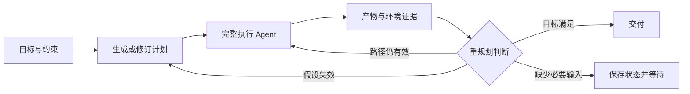

# 推理模式：从问题分解到计划执行、搜索和反馈控制

> 调研与访问截止：2026-09-16。本文研究 agent 如何组织求解过程，同时讨论模型内部推理接口。论文实验、框架功能、厂商部署和本文教学例子分别标注；未在本地复现实验。关联：[工作流](04-workflows.md)、[Harness](06-harness.md)、[上下文工程](08-context-engineering.md)、[评测](09-evaluation-observability.md)。

## 1. 从一个问题开始，而不是从缩写开始

假设用户报告：“取消导出后，后台仍生成文件；再次导出偶尔出现重复行。”模型可以立即猜测漏传了取消信号，也可以读代码、拆出几个问题、制定修复计划、运行复现，再据结果调整。这些做法的区别不只是思考时间不同，而是**信息从哪里来、任务怎样分解、谁决定下一步、错误怎样被发现**不同。

这个缺陷是贯穿本文的自拟教学例子，不是某个项目的公开事故，也不是已经运行的实验。用同一个问题比较不同方法，可以避免把一串论文名称误当成互斥的产品菜单。

“推理模式”至少有五个层次：

| 层次 | 控制对象 | 例子 | 关键区别 |
| --- | --- | --- | --- |
| 内部计算 | 一次模型调用投入多少计算 | reasoning effort、adaptive thinking | 无法据此推断内部使用某种公开树搜索 |
| 问题表达 | 如何形成中间表示 | Self-Ask、CoT、程序、计划 | 写出计划不等于执行和完成 |
| 外部控制 | 何时行动、重规划、回退 | ReAct、Plan–Execute–Replan、ADaPT | 不等于更新模型权重 |
| 求解结构 | 串行、并行、树、图、层级 | LLMCompiler、ToT、子 agent | 多节点未必使用不同模型 |
| 工作契约 | 目标、产物和权限 | 讨论、实施、审查 | 只读任务也可能需要高推理投入 |

实际系统可以组合这些层次：外层 Plan–Execute–Replan，执行节点是完整 ReAct coding agent；局部计算由程序完成，最终用独立检查提供反馈。因此“该选 ReAct 还是工作流”往往不是一个完整问题：工作流可以包含 ReAct 节点，节点也可以再进行问题分解。

## 2. 概念沿革与 2026 年的实际变化

| 时间 | 代表性原始材料 | 引入的机制 |
| --- | --- | --- |
| 2022 | [CoT](https://arxiv.org/abs/2201.11903)、[Self-Consistency](https://arxiv.org/abs/2203.11171) | 中间推导，以及多条推导结果的聚合 |
| 2022-10 | [Self-Ask](https://arxiv.org/abs/2210.03350)、[ReAct](https://arxiv.org/abs/2210.03629) | 后续问题分解，以及行动和观察的交替 |
| 2022-11 | [PAL](https://arxiv.org/abs/2211.10435)、[Program of Thoughts](https://arxiv.org/abs/2211.12588) | 让解释器承担精确计算 |
| 2023 | [Self-Refine](https://arxiv.org/abs/2303.17651)、[Reflexion](https://arxiv.org/abs/2303.11366)、[CRITIC](https://arxiv.org/abs/2305.11738) | 当前输出修订、跨尝试经验、工具支持的批评 |
| 2023 | [ReWOO](https://arxiv.org/abs/2305.18323)、[ToT](https://arxiv.org/abs/2305.10601)、[GoT](https://arxiv.org/abs/2308.09687)、[LATS](https://arxiv.org/abs/2310.04406)、[ADaPT](https://arxiv.org/abs/2311.05772)、[LLMCompiler](https://arxiv.org/abs/2312.04511) | 变量依赖、树图搜索、按需分解与并行调度 |
| 2024 | [CodeAct](https://arxiv.org/abs/2402.01030)、[测试时计算分配](https://arxiv.org/abs/2408.03314) | 可执行代码作为行动，以及按难度分配计算 |
| 2025-02 | [S*](https://arxiv.org/abs/2502.14382) | 结合代码候选生成、执行反馈和区分性测试 |
| 2025-10-27 | [ReCAP](https://arxiv.org/abs/2510.23822) | 层级规划中重新注入父计划，保持长任务意图 |
| 2025-12 至 2026-05 | [Recursive Language Models](https://arxiv.org/abs/2512.24601) | 对外部大输入进行程序化检查与递归模型调用 |
| 2026-06-29 | [Deep Agents 动态子 agent](https://www.langchain.com/blog/introducing-dynamic-subagents-in-deep-agents) | 用脚本编排完整子 agent 的循环、分支与并发 |

Self-Ask 首版是 2022-10-07，会议发表在 2023 年；LLMCompiler 首版为 2023-12-07，ICML 版本在 2024 年。表中时间是所列材料的提出或发布节点，不宣称思想唯一首创。网页最近被抓取，也不表示内容最近发生了变化。

截至访问日，重要进展是这些策略与真实运行系统结合：计划有版本，子任务有上下文边界，结果有结构，调度可以程序化，推理状态跨工具续接，评价器和成本进入设计。不能用一张 2023 年模式表替代这些实现变化，也不能因旧方法提出得早就认为它们已失去价值。

## 3. Self-Ask：先识别不知道什么

### 3.1 原始问题与机制

模型可能分别知道两个事实，却无法正确组合它们。Self-Ask 把这个组合缺口显式化：判断是否需要后续问题，提出可解的子问题，获得中间答案，继续追问，最后合成答案。原始研究还将后续问题连接搜索引擎，作者仓库提供演示 notebook 与数据。[论文](https://arxiv.org/abs/2210.03350)、[原始实现](https://github.com/ofirpress/self-ask)

这里的“问自己”通常是内部组织信息需求，不意味着每一步都问用户。代码事实可以读文件核实；用户意图或未给出的业务规则才可能需要用户回答。把 Self-Ask 实现成频繁请求确认，会把它的信息分解价值变成沟通负担。

### 3.2 在教学例子中运行一遍

| 子问题 | 证据来源 | 对决策的影响 |
| --- | --- | --- |
| 取消的产品承诺是什么？ | 已确认需求、接口契约 | 区分停止显示和停止实际执行 |
| 取消请求传到了哪个进程？ | UI、RPC handler、执行日志 | 找到生命周期断点 |
| 文件由哪个运行实例写出？ | run ID、进程和输出路径关联 | 排除把旧结果误认成当前结果 |
| 重复行来自重复执行还是追加写入？ | 输入样本、写入实现、重试记录 | 决定第二个症状是否同源 |
| 哪条因果链得到证据支持？ | 前述答案及引用 | 合成修复假设 |

如果第二问发现“只取消了等待协程，子进程仍在运行”，调查已经收敛；第四问若发现文件使用追加模式，也不能把重复行错误归因于取消。子问题可能自带错误前提，必须允许答案是“此前假设不成立”。

### 3.3 怎样实现才有工程价值

一个实用的扩展记录可以包含 question ID、依赖问题、答案、证据、状态。状态区分未回答、有证据、冲突、不可核实。合成器只能使用已支持的前提，未知信息不能靠语气补齐。这是本文工程设计，不是原始论文要求的统一 schema。

这样做支持局部失效：如果某段代码变化，只需重查依赖该代码的答案，而不是把全部用户需求一起遗忘。相同机制也适合调研：先确认版本、发布日期和指标出处，再综合判断。

它的局限是分解本身可能不完整：全部已回答问题都正确，最终仍可能遗漏根因。连续追问增加串行延迟，过细拆分丢失整体约束。适用信号是“关键事实依赖不清楚”，不是任何简单任务都必须先列十个问题。

## 4. ReAct：下一步由环境证据驱动

ReAct 交替组织推理、行动和观察：模型选择动作，环境返回结果，模型据此决定下一步。[原论文](https://arxiv.org/abs/2210.03629)

对取消缺陷，一条合理轨迹可能是：搜索入口 → 读取处理函数 → 发现只更新 UI → 沿调用链读取后端 → 找到执行句柄 → 验证取消信号是否传递。Self-Ask 强调“需要回答什么”，ReAct 强调“怎样行动获得答案”，两者可以自然结合。

实现关键不是强制输出 Thought / Action / Observation 标签，而是工具返回是否能支持正确判断。“无搜索结果”可能是没有命中，也可能是目录不可访问、参数错误或截断；这些状态不能统一成空字符串。观察至少需要目标、状态、内容、截断信息和可定位来源。

优势是适应未知环境；代价是反复模型调用和不断增长的上下文。重复读取、局部忙碌、过早结束要分别处理：缓存需绑定文件版本，重复动作检测要允许环境变化后的重读，结束判据要检查目标而非“本轮没有工具调用”。

模型说“已取消”是陈述，执行器确认进程退出才是事实。ReAct 给了获取事实的机会，不会自动保证正确解释事实。强模型加弱工具反馈，依然可能稳定地产生错误结论。

## 5. Plan–Execute–Replan：可修订的计划状态

### 5.1 与静态清单的本质区别

跨模块任务中，纯局部循环容易丢掉原目标。Plan–Execute–Replan 将目标与实施路径分开：先规划，执行一个或一组步骤，收集结果，再决定完成、继续或修改剩余计划。LangChain 的早期文章和后续实现说明了这一分工。[2023 年说明](https://www.langchain.com/blog/plan-and-execute-agents)、[2024 年实现比较](https://www.langchain.com/blog/planning-agents)

把 Markdown 清单放进队列逐条跑完，只实现了静态执行；它没有回答计划是否已过时，也没有证明步骤完成等于用户目标完成。重规划是正式状态转移，不应只是模型偶尔说一句“我换个思路”。

### 5.2 最小状态与运行过程

以下为本文教学契约，不对应某个框架的固定 API：

```text
TaskState = {
  goal, constraints, plan_revision,
  pending_steps, completed_steps, invalidated_steps,
  evidence, open_questions, budget, world_revision
}
```

goal 保存期望结果；constraints 保存已确认边界；completed_steps 必须关联证据；invalidated_steps 保留被推翻的方案及原因；world_revision 表示证据对应哪个代码基线。计划项宜写产物和判据，例如“取消后该运行停止且已有文件不被破坏”，而不是提前指定尚未验证的代码行修改。



执行节点可以自行读、改、运行检查，内部保留完整 agent 循环。外层管理目标、依赖和产物。这与把每次 read_file 都定义成工作流节点是两个粒度，应根据恢复和审查需求选取。

### 5.3 一次真正的重规划

初始计划是定位取消链路 → 传递取消 → 检查重复导出 → 交付。定位结果发现两条独立问题：后台没有停止；文件采用追加模式。

此时应保留第一步证据，把剩余计划拆成两个具有独立判据的修复。不能继续把全部问题当成“取消失效”，也不能用一个取消测试声称重复行得到解决。如果追加语义可能是业务要求，则还需要核实契约，而不是由模型为了消除症状擅自改变它。

用户中途要求“先解释为什么”，控制器应回答问题并保留任务目标和剩余工作；只有明确取消或替换目标，才结束原任务。任务状态因此不能仅寄存在最近几条聊天消息中。

### 5.4 重试、修正与重规划

瞬时网络故障可能只需按预算重试；代码结构与预期不同、验收推翻假设、范围改变才需要修订路径。未知副作用状态则应先核实，不能归入普通重试。

每个工具动作后重规划成本很高，整个任务只规划一次又容易漂移。更合理的触发点是产物边界、关键假设变化或用户新约束，并记录“什么证据导致什么修改”。没有新证据的反复改计划通常不代表进展。

## 6. ReWOO：用变量连接计划与未来证据

ReWOO 将规划、工具执行、最终综合分开，借助变量引用连接未来结果，减少每次工具返回后重复调用大模型处理长历史。Without Observation 主要描述规划与中间观察解耦，不是整个系统不使用观察。[原论文](https://arxiv.org/abs/2305.18323)

在一个自拟的只读分析阶段，可以生成：

```text
E1 = 搜索取消请求入口
E2 = 读取 E1 对应的后端 handler
E3 = 查找输出文件写入模式
结论 = 综合 E2 与 E3，判断两个症状是否同源
```

运行器负责在 E1 完成后绑定 E2 参数。变量应有类型、来源和失败状态，不能将任意文本直接作为可执行模板替换。E1 返回多个候选时，需要选择规则或回到规划，而不是假装下一步无歧义。

收益是对已知数据收集路线减少模型轮次；代价是对意外观察的即时适应能力较弱。固定报表或多个已知资料源适合这种方式；未知仓库排错往往需要加入重规划，或让执行节点内部使用 ReAct。

这个区分也说明为何不能拿论文某个问答任务的 token 节约比例承诺生产 coding 成本：后者的执行分支、错误修复和验证成本可能占主要部分。

## 7. LLMCompiler：依赖图、结果绑定与并行关键路径

LLMCompiler 用规划器生成带依赖的任务，Task Fetching Unit 绑定结果并调度就绪任务，执行器并行运行。论文还讨论流式计划和动态重规划，作者提供公开实现。[论文方法部分](https://arxiv.org/html/2312.04511v3)、[作者仓库](https://github.com/SqueezeAILab/LLMCompiler)

上例中 E1 和 E3 可以同时执行，E2 等 E1，综合等 E2 与 E3。若每项读取均为 1 秒，工具串行时间是 3 秒，理想并行关键路径约 2 秒；模型、队列和环境准备仍需额外计算。这是教学算例，不是实测收益。

模型一次输出多个 tool calls，并不等于已有完整调度器。调度器还需处理引用合法性、循环依赖、ready 队列、上游失败传播、局部取消、汇合和计划版本。流式计划可以让前面的有效任务先开始，但不能执行尚未解析完整的参数。

在 coding 场景，数据依赖之外还有资源冲突。两个逻辑独立任务可能都修改 package.json；图上没有边不代表能安全并发写同一文件。可以隔离副本后合并，或在实际写入边界协调。即使代码合并成功，两个改动也可能语义冲突，仍需检验组合结果。

从落地价值看，这类编排适合有可识别并行部分、调用开销明显的任务。若任务本身是强顺序因果链，调度器只能增加复杂度。应先测关键路径，再决定并行粒度。

## 8. ADaPT 与 ReCAP：按需分解和父子上下文连续性

ADaPT 先尝试执行，能力不足时才递归分解，使细化程度随任务复杂度和执行器能力变化。原研究在 ALFWorld、WebShop、TextCraft 等环境评估。[论文](https://arxiv.org/html/2311.05772v2)

迁移到本例，可以先让执行 agent 定位完整链路；只有跨边界问题确实使当前求解受阻，才按 UI、RPC、进程、存储进一步拆分。简单任务不必预先建立四个代理。这里需要可靠的受阻信号：预算耗尽、验收失败、重复无新信息、关键证据缺失具有不同含义，不能都用“模型觉得困难”代替。

分解也需要完整性检查。所有子任务分别完成，不代表父目标满足。例如 UI 正确显示取消、进程也已退出，但取消时留下的半成品文件仍可能违反产品要求。

ReCAP 研究另一问题：层级执行时如何避免忘记父目标。它生成子任务列表，处理首项后修订余项，从子目标返回时重新注入父计划与相关上下文。其递归描述规划结构，不是 RSI。[2025 年原论文与算法](https://arxiv.org/html/2510.23822v1)

工程上可将其理解为调用栈加产物契约：子任务处理取消进程时，仍需知道父目标要求保护文件；返回时交付结论、证据和未解决事项，而不是全部原始日志。父节点也应能回查原文，避免摘要把关键限制删掉。

层级化并非免费压缩。深度增加会带来摘要损失、重复上下文和预算归属问题；需要限制活跃深度、记录成本、保留父约束引用。论文的复杂度分析不能直接推广成生产端到端费用保证。

## 9. ToT、GoT、LATS：搜索究竟在搜索什么

ToT 将有意义的中间状态作为可评价候选，支持扩展与回退；GoT 允许结果组合和更一般的图关系；LATS 结合语言生成、评价、环境反馈与树搜索。[ToT](https://arxiv.org/abs/2305.10601)、[GoT](https://arxiv.org/abs/2308.09687)、[LATS](https://arxiv.org/abs/2310.04406)

“多想几种方案”不足以构成搜索。必须定义状态、扩展动作、评价函数和停止条件。在 coding 中，状态可能是因果假设、设计方案或代码快照，这三者的成本不同。

先比较三个假设：A 为 UI 接受迟到结果，B 为后台取消未传递，C 为多个运行共用输出路径。选择能够区分假设的观测，通常比立即为三种假设各写补丁便宜。待证据明确，再比较协作式取消和受控终止等实现路线。

评价应看实际目标与约束：停止延迟、清理完整性、文件一致性、平台可行性。语言评分可以提出问题，不能替代行为证据。若评价器只偏爱长解释，搜索会优化长解释；若只检查一组弱测试，可能找到绕过测试的实现。

搜索还要求回退。代码快照能够恢复，不代表已发出的远端请求能够恢复；共享目录中的多个 agent 互相覆盖，也不构成有效候选搜索。需要隔离候选环境、限制副作用，并为失败保留原因。

Self-Consistency 对可归一化答案做聚合相对直接；补丁文字不同却可能行为相同，多数补丁也可能共享错误假设。因此代码候选应按行为而非文本票数比较。没有区分能力的验证器时，更多候选主要增加费用。

## 10. Self-Refine、Reflexion、CRITIC：反馈跨越不同边界

| 方法 | 被修正对象 | 跨越边界 | 在教学例子中的对应 |
| --- | --- | --- | --- |
| Self-Refine | 当前输出 | 初稿到修订稿 | 检查修复说明是否遗漏第二个症状 |
| Reflexion | 尝试策略 | 当前尝试到下一次尝试 | 记下停止等待不等于停止进程的经验 |
| CRITIC | 待核实结论 | 模型判断到工具证据 | 检查取消后进程是否实际退出 |

原始资料：[Self-Refine](https://arxiv.org/abs/2303.17651)、[Reflexion](https://arxiv.org/abs/2303.11366)、[CRITIC](https://arxiv.org/abs/2305.11738)。这些机制不自动更新基础模型权重，跨任务演化与 RSI 见[自进化专题](03-self-evolution.md)。

反馈需要可操作。“不够稳健”没有明确下一步；“取消后某进程仍存活，相关日志和检查结果在此”才有。评审者应获得原始需求、实际产物和独立证据，不能只读作者自述。

如果连续反馈没有新信息，只是在改措辞，继续反思可能无益。应改为补事实、换验证方式或明确停止。关于自纠正能力，旧模型研究和后续研究有条件差异，不能永久断言所有模型都会或都不会自纠正。[2023 年研究](https://arxiv.org/abs/2310.01798)、[后续分析](https://arxiv.org/abs/2405.14092)

## 11. PAL、PoT 与 CodeAct：让程序承担确定性工作

PAL 和 Program of Thoughts 让模型形成程序，解释器承担部分计算；CodeAct 进一步将可执行代码作为行动表达，利用变量、组合和执行反馈组织交互。[PAL](https://arxiv.org/abs/2211.10435)、[PoT](https://arxiv.org/abs/2211.12588)、[CodeAct](https://arxiv.org/abs/2402.01030)

分析十万行导出数据时，不应让模型凭文本扫描计算重复数。可以用只读程序按业务键计数，返回数量、代表样本和输入位置，再让模型解释。收益来自确定性计算和筛选，不能只归因于“模型更会写 Python”。

代价是需要解释器运行时：可访问函数、变量寿命、输出上限、超时、取消、异常、预算都要定义。脚本可能在模型下次介入前调用工具数百次，所以每次受控调用仍需检查权限和费用。仅批准脚本入口一次无法替代这些边界。

程序化行动还会隐藏过程：如果用户只看到“执行脚本”，就很难判断读取或修改了哪些资源。高层脚本与关键外部调用事件应同时保留。工具 schema 提供可验证能力，代码负责组合，两者互补；企业 Code Mode 的实现见[能力组织专题](02-skills-tools-mcp.md)。

## 12. 2025–2026：候选选择、递归上下文与动态子 agent

### 12.1 S* 的启示是寻找区分性证据

S* 结合并行和串行代码生成，以执行反馈和可区分候选的输入辅助选择。研究对象是代码基准，不能直接当作大型应用生产成功率。[论文](https://arxiv.org/abs/2502.14382)、[作者代码入口](https://github.com/NovaSky-AI/SkyThought)

迁移到本例，两种取消实现都通过正常流程时，应检查文件未创建、写入中、执行结束但结果未送达等不同阶段。这是本文的应用分析：重点在找到让候选表现不同的边界条件，而不是重复跑相同样例。

### 12.2 RLM 改变长输入的访问方式

RLM 将大输入放在外部环境，通过程序检查、切分和递归模型调用处理。首版发表于 2025-12-31，2026-05 有修订。[论文](https://arxiv.org/abs/2512.24601)、[作者实现](https://github.com/alexzhang13/rlm)

处理海量日志时，可以先定位时间窗，再对子片段做语义分析，最后汇合。需要保留原始位置、跨片段关联和失败结果，避免局部结论都合理、整体却矛盾。RLM 的递归求解不等于改变自身改进机制的 RSI，详见[上下文专题](08-context-engineering.md)。

### 12.3 动态子 agent 编排的是完整求解器

Deep Agents 在 2026-06-29 介绍动态子 agent：模型编写短脚本，通过解释器调用子 agent，表达循环、分支和并发；文章给出 QuickJS middleware 和可指定结果 schema 的 task 接口。[官方文章](https://www.langchain.com/blog/introducing-dynamic-subagents-in-deep-agents)

每个被调度节点可以拥有自己的模型循环、工具和上下文，主 agent 收到结构化结果。确定性代码负责枚举全部对象，子 agent 负责语义分析，这能缓解模型凭记忆管理大规模覆盖的问题。

但分派了 300 项不等于正确分析了 300 项。必须分开统计分派、成功、失败、结果完整性和质量；超时不能被空结果悄悄替代。并发上限、取消传播、共享写入、父子预算和部分失败仍需 harness 实现。文章的功能演示不能被写成所有复杂工作流已经可靠解决。

## 13. 实际组合、企业证据与社区分歧

| 场景 | 主要不确定性 | 建议组合 | 易浪费资源的做法 |
| --- | --- | --- | --- |
| 解释陌生仓库 | 事实位置 | Self-Ask + ReAct + 检索 | 未读代码先给完整重构计划 |
| 明确小修复 | 正确执行 | 短行动循环 + 直接验证 | 强制多层计划、多轮辩论 |
| 跨模块需求 | 依赖与范围 | Plan–Execute–Replan + 完整执行节点 | 过早固定全部细节 |
| 大量同类检查 | 覆盖和汇合 | 程序化枚举 + 有界子 agent | 依赖模型记得检查了哪些对象 |
| 难定位缺陷 | 多个因果假设 | 有限搜索 + 区分性观测 | 没有验证器的多数投票 |
| 长任务 | 漂移与接续 | 层级计划 + 任务事实 + 持久状态 | 只反复压缩聊天 |

Anthropic 的长任务实验采用规划、生成与评估分工；Cursor 的规模实验使用规划者、工作者和判断者，并报告共享协调的失败经验。它们证明这些机制有具体使用场景，但不证明更多角色在等预算下始终更好。[Anthropic 2026-03 实验](https://www.anthropic.com/engineering/harness-design-long-running-apps)、[Cursor 2026-01 实验](https://cursor.com/blog/scaling-agents)

社区对普通 agent、deep agent 的区别仍有讨论。应检查实际增加了哪些状态、规划、文件、子任务和恢复能力，不能用名称推断实现。[LangChain 原始讨论](https://forum.langchain.com/t/what-are-the-differences-between-ordinary-intelligent-agents-and-deep-intelligent-agents/3095) 是用户问题与意见，不能作为独立性能证明。

## 14. 内部推理 API：独立于外层模式，但影响运行正确性

### OpenAI

访问日官方说明已经不止早期的 low / medium / high：支持集合依模型变化；GPT-5.6 文档区分 standard / pro reasoning mode，并描述 reasoning context 的跨轮控制。可续接 reasoning items 与公开正文不同，不能随意转成普通文本再拼回。[当前官方指南](https://developers.openai.com/api/docs/guides/reasoning)

应用需要按能力表生成选项，保留必要原生状态，独立统计 reasoning 使用量。公开摘要用于解释结果，不能反推完整内部算法。模型升级后应重新核查支持值与默认值，而不是固定一个通用 thinking 布尔值。

### Claude

当前文档把相关控制整合到 thinking steering / cost，effort 是行为引导；thinking、工具调用和正文可以交错，部分块需要按协议完整续接，可见输出减少不等于计费计算减少。[官方说明](https://platform.claude.com/docs/en/build-with-claude/thinking-steering-and-cost)

因此流处理要按事件语义解析，不能假设先完整输出 reasoning、再回答、最后调用工具。将所有内容拼成字符串会损失续接与计费信息。

### DeepSeek 与本项目网关

访问日 DeepSeek 官方文档区分带 tools 与纯对话的 reasoning_content 回传规则，同时说明 effort 和采样参数行为。带工具历史的保存要求不能套用旧教程。[官方 Thinking Mode](https://api-docs.deepseek.com/guides/thinking_mode/)

本项目使用 OpenCode Go 的既定模型和 Chat Completions 路由，上游能力只是核查线索，不等于网关完整转发保证。本轮没有新增真实调用、改变模型范围或修改既有续接实现。

## 15. 怎样判断模式有效，覆盖边界在哪里

比较时固定模型、任务、工具、预算和验收方式，分别记录成功率、约束违反、模型与工具费用、墙钟时间、用户介入和恢复结果。并行候选要报告总消耗，不能只展示最快候选；pass@1、pass@k 和实际从 k 个候选中选对的比例也不能互换。

一个有解释力的实验是：同一批缺陷比较直接 ReAct、Plan–Execute–Replan、有限搜索，再按事实缺失、复杂依赖、多个候选分组。若规划仅在跨模块任务有效，就按任务使用；若搜索收益来自更大预算，则需与同预算普通执行比较。

本文覆盖问题分解、行动反馈、重规划、变量依赖、递归层级、树图搜索、反馈修订、程序行动与动态子 agent。本轮进一步补读了 Step-Back、Self-Discover 原始方法，并补充采样、选择与测试时计算的比较，见第 16–17 节。专门的 debate 系统仍未完成逐项实现审计，本文也没有证明某一模式在本项目模型上最好。

对本项目最直接的结论是：保存任务目标和运行状态，允许计划据证据变化，执行节点保留完整 agent 能力，以真实产物与检查判断完成。这里是研究建议，具体实施仍需后续设计。

## 16. 补齐推理结构：抽象、递进分解与结构发现

这些方法提出较早，但其问题定义仍然重要。时效性不意味着只写新名词；应把原始机制与 2026 年模型、工具和运行条件分开评价。

### 16.1 Step-Back：先找到支配问题的原则

[Step-Back 原始方法，2023-10](https://arxiv.org/html/2310.06117v1) 先提出更高层的问题，获得原则或背景事实，再回到具体问题求解。它与 Self-Ask 的侧重点不同：Self-Ask 寻找缺少的子问题答案，Step-Back 改变观察层次，避免被细节带偏。

本研究例子：用户报告“点击停止后按钮已恢复，但端口仍被占用”。直接修补界面状态可能毫无作用。先抽象为“取消请求、进程树终止和 UI 状态分别由谁确认”，会把调查引向进程与事件生命周期，再检查具体实现。抽象本身不提供新事实，仍需读取代码和实际状态；如果抽象错成“网络缓存”，后续推理也会沿错误原则展开。

落地可作为规划前的一次问题重述或故障卡点时的策略切换，不必在每个简单修改前强制多调用一次模型。验证应关注它是否改变调查方向和减少返工，而不是输出是否更像理论分析。

### 16.2 Least-to-Most：前一子问题的答案是后一问题的输入

[Least-to-Most，2022-05](https://arxiv.org/abs/2205.10625) 将复杂问题拆成较简单问题，并逐个求解，后续步骤使用先前答案。它与把任务分给多个独立 Agent 不同：这里的子问题存在明确依赖，盲目并行反而可能丢失必要输入。

例如从一个未知项目新增功能，可以先确定启动入口，再判断数据流，最后确定修改位置。若第二步依赖第一步识别的入口，就不应把三个问题当作无关搜索。但依赖也会放大错误：入口识别错误后，每一步都可能自洽地错下去。本研究建议保存每个中间答案的依据和适用范围，发现新事实冲突时使依赖它的后续结论失效，而不是只修改最终答案。

### 16.3 Self-Discover：先为一类任务设计求解结构

[Self-Discover，2024-02](https://arxiv.org/html/2402.03620v1) 先从推理模块中 SELECT，再针对任务 ADAPT，最后 IMPLEMENT 为结构化推理步骤，然后用该结构处理任务实例。论文主要讨论任务级结构发现，不应直接改写成每次工具反馈后都重规划的系统。

以一批数据迁移审查任务为例，可以先形成“识别不变量 → 检查旧数据兼容 → 找回滚条件 → 评估验证证据”的结构，再用于各个迁移。这比给所有任务固定套用通用“逐步思考”更有针对性。它与 skill 的相邻关系是：发现的结构可成为方法模板；与自进化的相邻关系是：模板若继续经过数据集评价和版本选择，可以进入优化流程。但一次模型自己写出结构，仍不足以证明模板更优。

采用时应看结构发现成本能否被多次使用摊薄，任务分布变化是否使模板失效，以及固定结构是否遗漏非常规情况。原论文旧模型上的收益不能直接转写为当前 coding agent 的预期提升。

### 16.4 这些模式分别改变什么

| 模式 | 改变的决策 | 典型触发条件 | 主要失败方式 |
| --- | --- | --- | --- |
| Self-Ask | 哪个知识缺口先填 | 不知道关键事实 | 自问自答但没有证据 |
| Step-Back | 用哪个原则理解问题 | 陷入局部细节 | 抽象与实际系统不符 |
| Least-to-Most | 子问题怎样顺序依赖 | 组合依赖明显 | 早期错误传播 |
| Self-Discover | 一类任务采用什么结构 | 相似任务可重复处理 | 模板过拟合或僵化 |
| Plan–Execute–Replan | 当前剩余工作怎样调整 | 环境反馈改变前提 | 只改文字计划，不改变执行 |

这些模式可以组合，但每增加一层都应说明它解决哪个实际错误，避免形成只有流程长度增加、证据没有增加的系统。

## 17. 2026 年的重点：怎样分配测试时计算，怎样判断选择器有效

### 17.1 三种计算分配不能混成“多想一会儿”

[2026-08-04 的测试时扩展研究](https://arxiv.org/html/2608.04001v1) 区分单轨迹顺序计算、完成候选的生成与聚合、未完成前缀上的搜索，并强调评价对象应是整个推理系统。本文采纳这一分类作为分析框架，不将新预印本当成已经统一行业的标准。

在 coding 场景中，三者可分别理解为：让同一个 Agent 继续调查；从同一基线生成若干完整补丁后选择；在调查或补丁形成到一半时保留分支并继续扩展。第三种的状态管理最复杂，因为分支可能包含文件、进程和工具结果，不能只复制一段文本就声称复制了搜索节点。

### 17.2 Self-Consistency 与选择器的责任

[Self-Consistency，2022-03](https://arxiv.org/abs/2203.11171) 通过采样多条推理路径并聚合答案，减少单一路径偶然错误。对答案可规范化的题目，投票较直接；对代码，两个正确补丁可以在文本上完全不同，文本多数票不再是自然的正确性指标。

本研究的例子：三个候选分别重试网络请求、修正连接池状态、延长超时。其中只有第二个真正解决资源泄漏，但三个都通过了一个过于简单的测试。候选集合中存在正确答案，不代表选择器能找到它。需要新的区分性证据，例如复现长时间运行后的资源增长，而不是让三个候选互相评价措辞是否合理。

因此必须分别报告：生成阶段有没有正确候选，实际选择阶段选中了什么，最终交付是否通过完整验收。把有真实答案可用的 oracle 最佳候选结果写成部署系统成功率，会掩盖选择器这个主要瓶颈。

### 17.3 多 Agent Debate 的适用边界

这里将 debate 作为设计模式分析，不宣称完成各专门实现的源码调研。常见结构是独立提出观点、交换异议、再由裁决者或聚合器决定。其可能价值在于主动寻找反例；主要风险是多个模型共享相同遗漏，以及后发意见被先发解释锚定。

对于代码审查，可以让不同参与者检查不同约束，并要求提交可定位的证据；让每个参与者读同一段解释后给总分，未必产生有用独立性。冲突最好回到可执行检查、规范或代码事实。若没有可获得的新证据，增加辩论轮次可能只是增加语言一致性。

### 17.4 预算与复现应记录哪些量

本研究建议为推理实验保存模型版本、输入 / 输出 token、缓存、工具费用、总墙钟时间、并发量和选择成本。多候选方案应把未选中的分支也计入消耗。用户等待时间与总计算费用可以同时改善或相互交换，不能只用一个“调用次数”概括。

精确重放与分布复现也不同：保留原始候选和选择记录，可以重新分析当时为何选择；重新调用同一模型，得到的是新的随机试验。对托管模型和外部环境，通常应报告重复试验分布，而非承诺每次都产生相同补丁。

这使本专题的采用顺序更具体：先识别知识缺口、依赖和反馈需求，再决定是否投入多候选或分支搜索；一旦使用搜索，就把选择器、环境状态和全部预算纳入评价。模型原生 reasoning effort 与这些外层策略可以同时存在，但并不互相替代。
