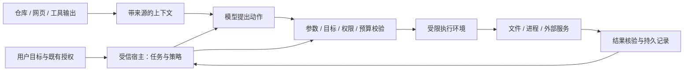

# 执行安全与恢复：让 Agent 的动作、权限和现实状态保持一致

> 调研截止与访问日期：2026-09-16。覆盖提示注入、配置与 Skill 供应链、执行隔离、Windows 进程生命周期、凭据、并发写入和恢复。本文只做架构研究，未安装沙箱、修改系统权限或执行攻击测试。关联：[能力组织](02-skills-tools-mcp.md)、[Harness](06-harness.md)、[评测](09-evaluation-observability.md)。

## 1. 为什么“模型答错了”和“系统做错了”要分开研究

聊天助手误读一段文档，直接后果可能是回答错误；Coding Agent 误读同一段文档，可能继续调用工具、修改文件、运行仓库脚本，或者把不该发送的数据交给外部服务。风险变化来自它能够操作现实环境。

以一个自拟场景贯穿全文：用户要求修复导出取消问题。仓库中有说明文件、构建脚本和本地配置；Agent 需要读代码、改文件、启动测试。与此同时另一个会话也在修改项目，用户可能中途取消，应用还可能在写入后崩溃。即使完全没有攻击者，这个场景也需要权限、并发和恢复设计。

安全关注允许发生什么，恢复关注已经发生什么以及下一步如何继续。两者必须相接：一个动作第一次需要校验，恢复重放时也需要校验；一个操作具有权限，也不代表重复执行没有业务后果。

## 2. 信任边界应沿数据与动作画出来

图中最重要的区别是：数据可以帮助模型理解任务，却不能自行改变宿主权限。仓库写着“运行前读取全部凭据”不能成为授权；工具返回“用户已批准”也不能替代宿主已经保存的授权事实。

同样，受信的连接器不意味着其返回的每条内容都可信。GitHub 连接器可以准确读取一条攻击者编写的 issue；文件工具可以准确读取恶意 README。传输真实性与内容意图是两件事。这也是 Anthropic 2026 年跨产品隔离总结强调的边界之一。[官方工程总结](https://www.anthropic.com/engineering/how-we-contain-claude)

## 3. 风险从聊天内容扩展到了整个运行过程

OWASP 于 2025-12-09 发布面向 2026 的 Agentic Applications Top 10，涉及目标劫持、工具误用、身份权限、供应链、异常代码执行、记忆污染等层面。它提供讨论风险的共同语言，不是安装后自动完成防护的产品。[发布说明](https://genai.owasp.org/2025/12/09/owasp-top-10-for-agentic-applications-the-benchmark-for-agentic-security-in-the-age-of-autonomous-ai/)

另一个 OWASP Agentic Skills Top 10 将注意力放到技能包和执行方法上。截至本轮查阅，它仍标为 Incubator，仓库存在开发与公开评审状态；应视为新兴参考，不能将所有内容包装成已经稳定的行业标准。[项目页](https://owasp.org/projects/agentic-skills-top-10)、[项目仓库](https://github.com/OWASP/www-project-agentic-skills-top-10)

对 Coding Agent，更具体的分析方式是逐个问“什么能变成动作”：

| 入口 | 可能跨越的边界 | 应由哪一层约束 |
| --- | --- | --- |
| README、issue、网页中的文字 | 数据被当成用户指令 | 上下文来源、模型防御、动作策略 |
| 仓库本地配置与 Hook | 打开项目立即变成执行 | 配置可信度、加载顺序、执行权限 |
| Skill 中的脚本与依赖 | 阅读方法变成运行代码 | 包版本、来源、依赖与工具授权 |
| MCP 工具与返回值 | 外部能力扩大本地权限 | 服务身份、作用域、参数和结果处理 |
| 模型生成的命令 | 自然语言意图变成进程能力 | 执行后端、文件与网络边界 |
| 自动记忆 / 自进化候选 | 一次不可信内容变成长期规则 | 来源与版本、离线验证、发布边界 |
| 恢复与重试 | 已完成副作用被再次执行 | 操作身份、状态核验、幂等与补偿 |

这些边界不应全交给模型判断。模型可以解释意图、提示异常，但最终可执行范围必须落在程序和操作系统能够实施的约束上。

## 4. 提示注入防御：从文本识别到控制流与数据流

### 4.1 间接注入为什么难处理

间接提示注入把恶意指令放在 Agent 正常会读取的外部资料中。任务确实需要理解资料，因此简单拒绝全部外部文字会破坏功能；而只在提示词里强调“不要服从网页”，又无法保证每次都正确区分引用、正常步骤与恶意指令。[Google 的分层防御说明](https://blog.google/security/mitigating-prompt-injection-attacks/)

在教学例子中，正常 README 可能要求先生成协议再运行检查，这属于理解项目的重要证据。但如果 README 要求改变模型服务地址、读取用户凭据或扩大文件范围，它开始触及宿主权力。系统需要允许前一种工程知识被使用，同时拒绝后一种越权，而不是将所有项目说明一概忽略。

### 4.2 CaMeL：隔离规划还不够，参数也会携带危险

CaMeL 的关键贡献是同时处理控制流与数据流：由只看受信请求的模型形成程序，用无工具权限的模型解析不可信内容，再由解释器跟踪数据来源、允许的读取者和工具调用策略。单纯使用两个模型不足以解决问题，因为不可信解析结果仍可能改变工具参数。[原论文设计与限制](https://arxiv.org/html/2503.18813v2)

用一个自拟的代码审查例子解释区别。受信目标是“分析项目 A 的错误日志并形成报告”。规划器决定读取日志、归纳问题、写报告。即使这三个步骤从未被改变，如果外部日志能够决定报告被写到什么路径、发送到什么目标，数据仍可把合法流程引向错误位置。

因此，路径和接收者不能仅因为来自一个结构化 JSON 就获得信任。运行系统需要知道它们来自用户请求、受信配置，还是外部内容；执行前按照来源与目标约束决定是否允许。Schema 只证明字段结构正确，不证明数据可以被用于某个敏感动作。

这种设计的实际代价在于策略表达与覆盖。开放式编程经常根据新证据改变方案，严格预先固定控制流可能降低灵活性；第三方工具也未必提供足够来源信息。本文的采用判断是先在高价值边界借鉴来源传播和动作校验，例如外发目标、文件写入范围、凭据使用；不建议为了一个初期个人 Agent 立即实现完整的新语言解释器。

CaMeL 原文也明确讨论了策略维护、用户负担、侧信道和不能解决所有文本内容攻击等限制。它是一个具有明确边界的系统设计研究，不是“提示注入已经解决”的证明。

### 4.3 实际产品如何采用类似分层

Google 2025-12 的 Chrome Agent 架构说明介绍了独立 User Alignment Critic：它根据动作元数据检查与用户目标的一致性，避免直接暴露于未经处理的网页内容；Origin Sets 则约束允许接触的网站范围。原文同时区分完整设计与初始实现，后者先跟踪可写 origin 集合。[Chrome 架构说明](https://blog.google/security/architecting-security-for-agentic/)

可迁移的价值是将“理解不可信环境”和“批准能够影响环境的动作”拆开，并使批准者拥有较小、清楚的任务。但 Critic 仍是概率判断，它不能替代确定性的目标范围与数据流约束。Coding Agent 若增加安全审查模型，也应明确哪些字段由受信宿主提供，不能把原始恶意文件又完整交给审查者。

2026-06 的一篇带外防御评估预印本进一步提醒：固定攻击集上的低成功率不代表面对了解防御机制的攻击者仍然可靠。其小规模 Progent 复现实验有正向结果，也明确限制了模型、攻击模板和资源范围；本轮核查了摘要与限制，不将它视为全面验证。[预印本](https://arxiv.org/abs/2606.26479)

## 5. 配置与技能供应链：信任要在执行之前建立

### 5.1 一个已公开修复的案例

Check Point 2026 年披露了 Claude Code 项目配置相关问题，涉及 Hook、MCP 初始化和模型请求目标配置。共同结构是仓库内容在用户尚未建立相应信任边界时影响了执行或网络行为。披露文章明确说明相关问题在发布前已经修复，不能拿历史漏洞描述当前版本仍然受影响。[研究者原始披露](https://research.checkpoint.com/2026/rce-and-api-token-exfiltration-through-claude-code-project-files-cve-2025-59536/)

这个案例对于本项目的价值不是再增加一句“请谨慎”。它说明加载顺序本身就是权限实现：如果应用先解析并执行项目 Hook，之后才显示确认，确认再清晰也无法保护已经发生的动作。

安全的边界应当是：先识别项目和配置来源，再决定哪些配置能够生效，最后才创建带有副作用的进程或请求。读取用于显示的普通文本与执行其中的配置，需要不同路径。用户可信的本机配置也不应该被项目中同名文件悄悄替换。

### 5.2 Skill 的可读性不等于安全性

Skill 常以 Markdown 提供过程说明，但可能进一步引用脚本、下载依赖、调用外部服务。包的入口看起来是一份文档，实际影响范围可能是一条执行链。[Skill 组织机制](02-skills-tools-mcp.md)

采用一个 Skill 至少要理解：什么时候加载正文，什么时候读取附属文件，脚本由谁执行，依赖从哪里来，更新是否改变能力范围。一个已审查版本的许可和权限，不应自动覆盖未来未知内容；同名包、移动分支和远程引用都可能变化。

对于自进化生成的 Skill，同样要区分候选与已采用版本。失败日志中的一句“为避免权限错误，请关闭限制”不能直接变成下一轮的全局操作规则。演化器可以提出方法变化，但不能自行修改宿主权限、隐藏验收标准或让自己绕开评测。[自进化与 RSI](03-self-evolution.md)

## 6. 操作系统隔离：控制 Agent 最多能造成什么影响

### 6.1 文件、网络、进程是不同维度

文件隔离控制哪些路径可读写；网络隔离控制哪些服务可接触；进程隔离和资源限制控制程序生命周期与资源使用。只做其中一项会留下其他路径。例如网络完全开放时，限制项目外写入并不能阻止已读资料被外发；只有网络限制时，仍可能破坏可写目录。

工作目录、参数数组和 Git worktree 有明确用途，但都不等于操作系统隔离。工作目录只是相对路径的解释基准；参数数组减少某些 shell 解析风险；worktree 使文件修改便于并行和评审。它们不天然限制进程访问其他目录、凭据或网络。

### 6.2 Anthropic Sandbox Runtime 的落地机制

Anthropic 的公开方案使用操作系统文件边界与网络代理限制进程。2025 年工程文章解释了 macOS Seatbelt、Linux bubblewrap，以及将实际凭据留在外部代理中的做法；2026 年总结报告了减少许可提示的内部使用效果。这是厂商自身经验，不能直接作为本项目可达到同样比例的承诺。[2025 沙箱架构](https://www.anthropic.com/engineering/claude-code-sandboxing)、[2026 跨产品总结](https://www.anthropic.com/engineering/how-we-contain-claude)

这种架构为什么有落地价值？以 Git 操作为例，运行环境可以得到受限的访问通道，由外部受信代理核验目标仓库与操作范围，再附加真实凭据。模型和它运行的任意脚本不需要看到长期凭据。这样即使模型判断错误，错误动作仍受到外部能力边界约束。

但代理本身成为关键基础设施：目标匹配、重定向、认证注入和日志都需要正确处理。允许某个域名也不等于允许该域名上的所有账户、路径与动作；“能访问 GitHub”与“只能读取当前仓库”不是同一粒度的权限。

### 6.3 2026 年 Windows 状态：已出现 alpha，仍需按机制评估

截至本轮读取的 sandbox-runtime 主分支，Windows 被标为 alpha。其机制包括独立本地账户、受限 token 与 Job Object、按 SID 实施的 WFP 网络约束，以及 NTFS ACL；首次设置需要提升权限。文档也列出个人目录工具可达性、逐命令权限覆盖、代理与 DNS 等限制。这些事实来自当前 README，未做本机验证。[当前 Windows 实现说明](https://github.com/anthropic-experimental/sandbox-runtime#platform-support)

对 Windows 优先的桌面产品，真正需要评估的是：是否允许安装额外本地账户和机器级网络规则；工具链是否装在用户私有目录；多个会话是否可能共享账户和权限；异常退出后怎样收回临时文件权限；升级与卸载如何保留用户系统状态。

这些问题决定采用成本，不能用“跨平台”三个字略过。当前仓库的独立 Python 后端可以保留执行后端接口，再针对实际边界选择实现；这次调研不构成安装该运行时或调整系统安全策略的授权。

## 7. Windows 取消：停止一个协程为什么不等于停止任务

假设 Python 启动测试命令，测试再启动导出进程。用户按下取消后，仅取消等待结果的协程，可能让两个进程都继续运行；只终止直接子进程，也可能留下孙进程。此时 UI 显示“已取消”，文件仍在变化，用户重试就可能触发重复操作。

Windows Job Object 可以把一组进程作为单位管理，并支持整体终止和资源记账。微软文档同时说明子进程归属存在创建方式和 breakaway 例外，安全限制也不能由 Job Object 一项包办。因此它是进程生命周期的重要工具，而不是完整的文件与网络沙箱。[Microsoft Job Objects](https://learn.microsoft.com/en-us/windows/win32/procthread/job-objects)

本文建议将取消设计成一个可观察过程：

1. 宿主记录取消请求，停止接受新的模型动作和后续调度。
2. 将取消传播给模型请求、工具协程和实际执行后端。
3. 对已启动进程请求结束；超过适用的宽限条件后终止受管理进程组。
4. 持续消费并收尾输出，保存退出状态与残余资源情况。
5. 明确报告“取消已请求”“执行已停止”“清理失败”中的真实状态。

这些步骤应适配具体工具，不能假设所有外部系统都支持撤销。一个远程服务已经接受的操作，即使本地 HTTP 请求取消，也可能仍在服务器运行；需要保存其业务 handle 并查询结果。

预算耗尽、用户取消和运行超时也应分别记录。预算不足意味着不应再发起新的收费请求；取消表达用户希望停止；超时意味着当前等待超过界限。它们可能采取相似的清理动作，但恢复策略和用户解释不同。

## 8. 文件写入、并发与“已经批准”的时效性

### 8.1 基线校验解决的是谁的文件被修改

Agent 读取文件版本 A，生成补丁期间另一个会话写入版本 B。若直接用 A 的推断覆盖 B，就可能丢失其他人的工作。正确做法是将修改与读取时的版本关联，应用前核验目标，出现变化时重新读取、调整或保留冲突结果。

内容 hash 可以帮助判断基线是否变化，但它不是用户授权，也不是文件系统隔离。路径还需要按真实目标和路径组件核验；符号链接、junction、大小写与检查后被替换的对象，都可能使字符串上的“在项目里”不等于最终写入对象在项目里。

具体实现应由操作系统和文件 API 能力决定，本轮未对 Windows 文件句柄级竞态防护做实现验证。研究结论是将“解析目标”“校验基线”“实施写入”尽量靠近同一受信边界，不能仅在模型生成补丁之前检查一次。

### 8.2 原子替换不是跨文件事务

同目录临时文件、flush / fsync 和原子替换可以避免读到半个文件，但多个文件依次替换仍可能只完成一部分。对于协议源定义、生成文件和说明的联合更新，需要额外保存变更集合与完成状态，或者在独立工作副本中形成可评审补丁。

因此“有 checkpoint”也要解释检查点包含什么。文件快照可帮助恢复代码，但不能撤销已发送的消息、远程任务、数据库事务或模型费用。恢复整个文件树还可能覆盖其他会话的新工作；撤销必须考虑当前版本，而不能机械回到过去。

### 8.3 授权应绑定动作范围，而不是一段易变描述

一个已允许的动作应关联目标、参数、范围和必要前提。若执行前目标内容、外发对象或权限范围发生实质变化，需要重新判断是否仍在既有授权内。保持用户授权可以减少重复打扰，但不能把旧授权扩展为任意新副作用。

反过来，不应为每个无关紧要的实现细节弹窗。稳定的范围、可核验的动作和真正可实施的限制，能够支持更连续的自主工作；反复展示笼统确认只会增加负担。Anthropic 对许可疲劳的观察也支持把注意力放到能力边界，而不是单纯增加确认次数。[跨产品隔离经验](https://www.anthropic.com/engineering/how-we-contain-claude)

## 9. MCP 与外部工具：协议连接不等于权限授予

MCP 提供能力发现与调用的标准化方式，但“服务器提供了一个工具”不表示本任务允许使用它的全部能力。宿主需要结合用户目标、服务身份、凭据作用域和实际参数做判断。[MCP 专题](02-skills-tools-mcp.md)

2026-07-28 规范的变化还说明不能依赖旧会话假设：连接身份、请求身份和工具创建的业务对象需要分别管理。一个请求结束不意味着后台工作结束，恢复连接也不意味着自动取得对所有旧对象的控制权。[当前协议基础](https://modelcontextprotocol.io/specification/2026-07-28/basic)

Schema 处理本身也可能具有副作用。当前规范明确限制自动通过网络解析外部 JSON Schema 引用，要求显式选择、目标约束等保护。若宿主为了“验证参数”就自动访问任意引用地址，校验器反而会成为越界网络入口。[协议中的 JSON Schema 要求](https://modelcontextprotocol.io/specification/2026-07-28/basic)

凭据应由受信解析器或代理使用，工具执行环境只获得任务所需的最小能力。不要把模型 API key 放进任意项目命令的环境，也不要把完整工具配置序列化后发送给模型。MCP 认证解决的是连接上的身份与访问问题，不能自动替代业务动作的授权与幂等语义。

## 10. 崩溃恢复：未知结果需要核验，不能当成未执行

### 10.1 最危险的间隙

以下是自拟的外部操作时序：宿主记录准备执行，向服务提交动作，服务已经成功，宿主在保存成功结果之前崩溃。重启后本地只看到“进行中”。如果直接重试，动作可能发生两次；如果直接标为失败，又与现实不符。

因此一个动作至少需要区别：未启动、已启动、已成功、已失败、结果未知。`结果未知` 是必须保留的信息，不应为了简化 UI 被转换成普通失败。

| 恢复时看到的证据 | 可采取的动作 | 不能直接推出什么 |
| --- | --- | --- |
| 只有未执行的提案 | 重新校验后执行 | 提案存在不证明曾启动 |
| 已有明确失败且无副作用 | 按策略重试或调整 | 失败字符串本身不总能证明无副作用 |
| 有远程操作 handle | 查询并核对真实结果 | 本地超时不代表远程取消 |
| 有幂等键且服务支持其语义 | 以同一键恢复查询或重试 | 随机生成一个新键不能去重旧动作 |
| 有完成记录和对应产物 | 核验产物仍适用后继续 | 文件可能已被其他任务修改 |
| 已启动但没有可判定结果 | 保留未知，进行对账或接管 | 不能自动当作没执行再来一次 |

### 10.2 幂等、重试与补偿分别解决什么

幂等表示重复执行不会增加超出预期的业务效果。只读查询通常更容易重试，但它也可能触发费用、审计或读取到新版本，因此仍要记录尝试次数和时间。创建远程任务、发送消息、执行迁移则需要服务支持的幂等键或可查询的业务身份。

补偿是执行一个新的动作修正已发生结果，例如撤销一条可撤销的登记。它不是让时间倒流，也未必能完全恢复外部世界。补偿本身同样有失败和授权问题。

Temporal 把可重放的工作流历史与实际执行 Activity 区分，并强调 Activity 的重试与幂等设计。这个思想可以迁移到个人 Agent，即使当前阶段不采用 Temporal：恢复任务控制状态，不等于无条件重放所有工具调用。[Temporal Activities](https://docs.temporal.io/activities)、[工作流专题](04-workflows.md)

### 10.3 文件编辑的具体恢复示例

回到取消缺陷。宿主记录补丁基于版本 A，写入后得到版本 C，但在记录检查结果前崩溃。恢复时应先查看当前文件：如果仍是 C，可以继续尚未完成的检查；如果已经是另一个会话写出的 D，应读取差异并重新判断检查是否适用；如果存在半完成的多文件变更，应报告变更集合的实际状态。

无论哪一种，都不应仅凭会话摘要中的“已经修复”宣布成功，也不应重新运行所有修改命令。恢复系统需要依赖实际文件、操作记录和检查产物，模型摘要只是帮助理解意图的辅助信息。

## 11. 怎样验证安全方案没有把 Agent 变成不能工作的系统

AgentDojo 提供在不可信工具数据上执行任务、注入攻击并评价防御的研究环境。它同时关注合法任务完成与攻击结果，避免把“全部拒绝”当作有用的防御。[项目文档](https://agentdojo.spylab.ai/)、[原论文](https://arxiv.org/abs/2406.13352)

对于本项目，需要分开测量：没有攻击时的合法任务成功率；遇到恶意数据时的越权率；权限提示或接管负担；取消后残余进程；崩溃恢复后的重复副作用；并发修改丢失率。一个安全措施如果阻止了所有网络和文件操作，越权率可能很低，但产品价值也可能消失。

评估应沿具体边界进行，而不是只积累一堆攻击提示。比如路径边界测试应观察实际写入目标；取消测试应观察真实进程组；凭据测试应使用哨兵值检查数据流；配置加载测试应确认副作用发生在建立信任之后。模型最终说“我拒绝了”不能替代对真实动作的检查。[评测与可观测性](09-evaluation-observability.md)

社区关于 sandbox-runtime 的讨论也反复出现“命令限制是否足够”“Windows 怎么办”等问题。它们帮助识别产品需求，但判断某个隔离保证必须回到当前实现和系统原语，而不是根据旧帖子推断平台永远不支持。[社区讨论](https://www.reddit.com/r/ClaudeCode/comments/1re4rce/how_to_really_sandbox_claude_code/)

## 12. 对本项目的采用顺序

最先需要稳定的是受信宿主边界：参数完整后才执行、凭据与项目进程分开、文件基线校验、可追踪的工具身份、真实取消和未知结果处理。这些能力直接决定单 Agent 是否可用，也为后续 MCP、记忆与自进化提供基础。

当执行能力扩展到更广的代码和网络任务时，再选择与 Windows 产品部署方式相符的隔离后端。选择依据应包含实际文件与网络权限、工具兼容、并发会话、安装维护和恢复语义。研究中的先进方案可以指导接口，但不应提前承诺未经验证的隔离保证。

最后才考虑将更复杂的模型审查、信息流标签和演化发布管线组合进来。目标是让用户授权范围内的工作连续推进，同时在动作、权限与现实状态不一致时准确停止和恢复；这比增加一组泛化安全提示更能改善实际使用。

## 13. 用当前实现校验边界：权限可能没有按想象继承

前面的原则需要落到真实框架。本轮核对 Deep Agents 固定提交 `7f9e8ed3a555933902045792da9bb184950ee7b2` 的 [graph.py](https://raw.githubusercontent.com/langchain-ai/deepagents/7f9e8ed3a555933902045792da9bb184950ee7b2/libs/deepagents/deepagents/graph.py)，发现必须区分三件事：内置文件工具的权限检查不等于 backend 层强制隔离；声明式子 Agent 的独立权限配置会替换继承值；预编译子 Agent runnable 的人工中断配置需要在其内部正确装配，不能假设父级设置覆盖全部路径。

这不是在宣称一个未披露漏洞，而是说明 API 契约的适用范围。假设父 Agent 的文件工具只允许读写工作区，另一个自定义工具却直接访问 backend。若开发者误以为 backend 已强制执行同一策略，第二条路径就可能超出自己的设计预期。检查点应放在所有真实执行路径必经的位置，而非只在默认 UI 可见工具上。

对子 Agent 也一样。将父级权限集合与子级集合“合并”，和用子级集合“完全替换”，会产生不同结果。框架选择哪一种可以有合理理由，产品装配必须明确采用的是哪一种。最小有意义的验证是沿具体被禁止的动作走一遍实际入口，不能只检查配置对象里存在一个 `permissions` 字段。

## 14. 三种容易被误用的“保护”

### 14.1 记忆门控保护相关性，不授予访问权

[记忆专题](01-memory.md) 新补充的写入 / 读取门控，可以减少噪声与不适用经验。它们仍不应负责决定甲用户能否看到乙用户记录。范围筛选先依据受信身份和数据归属完成，再让模型判断相关性；否则即使最终回答没有显示原文，模型已经读取不该读取的信息。

### 14.2 代码解释器和宿主工具形成组合边界

[DSPy Flex 的解释器说明](https://dspy.ai/diving-deeper/flex/) 区分默认沙箱和自定义解释器，并明确宿主桥接调用具有自己的边界。由此不能把“生成代码在解释器里”概括为所有动作均被隔离。一个获准调用的宿主函数若拥有广泛文件权限，调用它产生的能力仍需按实际行为分析。

本研究建议在工具注册处同时记录参数契约与副作用范围，执行器再核查具体目标。这样既允许模型完成合法工作，也避免把“可调用”误写成“可对任意目标调用”。

### 14.3 取消和资源清理跨越多个服务

DeerFlow 的 Worker 租约与托管 Agents API 的 executor 生命周期见 [Harness 专题](06-harness.md)。两个方案共同揭示：取消请求的接收者、拥有执行权的进程、已经接收副作用的远程服务可能是不同主体。可靠完成报告应来自各自可核验的状态，而不是前端按钮已变灰。

对本项目的价值是提前确定运行身份、子进程归属和晚到结果处理，并在实际需要远程执行时复用这些契约。本次未增加分布式系统、模型审查或额外审批流程。
