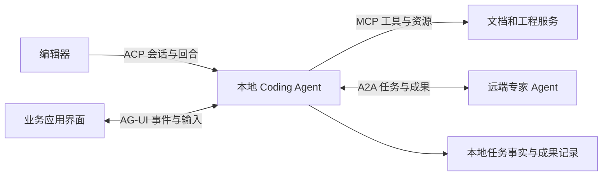

# Agent 互操作协议：MCP、A2A、ACP 与 AG-UI 的不同边界

> 检索与核查截止：2026-09-16。新增专题，补齐此前把跨系统接入集中在 MCP 中造成的覆盖缺口。本文核对原始公告、当前协议正文与公开集成，未运行协议兼容测试。

## 1. 从一个实际需求理解协议为什么不止一种

假设一个桌面 coding agent 要完成数据库升级：用户在编辑器里提出需求，Agent 读取内部文档，把数据库兼容性分析委派给远端专家，最后持续展示计划、工具进展和补丁。这里有四种不同关系：编辑器怎样控制 Agent，Agent 怎样调用资料工具，两个独立 Agent 怎样合作，以及界面怎样呈现运行过程。

如果都用一个自定义 `send_message()`，开始很快，但长任务会暴露歧义：远端回复一句文本算完成吗？工具需要补充输入时由谁暂停？用户关闭界面后任务是否仍运行？取消应发给哪个对象？协议的价值是让这些交互有共同含义，不能只比较消息使用 JSON 还是 SSE。

| 协议 | 主要连接的两端 | 典型交换对象 | 不自动解决的问题 |
| --- | --- | --- | --- |
| MCP | 宿主与外部能力服务 | 工具、资源及相应交互 | 整个业务任务如何验收 |
| A2A | 相互独立的 Agent 系统 | 消息、任务、状态、产物 | 对方内部工具和计划是否正确 |
| Agent Client Protocol，ACP | 编辑器等客户端与 Agent | 会话、prompt turn、工具更新、客户端能力 | 用户工作区隔离与 Agent 求解质量 |
| AG-UI | Agent 后端与应用界面 | 文本、工具、生命周期和状态事件 | 后端持久化、执行授权与业务事务 |

这是职责分析，不是互斥划分。MCP 工具内部可以是 Agent，AG-UI 也可以展示 A2A 任务；选择依据应是需要公开什么语义。[MCP 专题](02-skills-tools-mcp.md)、[AG-UI 官方协议关系说明](https://docs.copilotkit.ai/ag-ui/agentic-protocols)

## 2. 沿革与当前状态：特别注意两个不同的 ACP

[Google 于 2025-04-09 发布 A2A](https://developers.googleblog.com/a2a-a-new-era-of-agent-interoperability/)，面向跨框架、跨组织的 Agent 合作；发布时的合作伙伴名单说明生态参与意向，不是全部企业已经完成生产部署的证据。当前规范入口标注最新正式版本 **1.0.0**，继续把 0.3 当最新版会遗漏接口和版本语义变化。[当前规范](https://a2a-protocol.org/latest/specification/)

[Zed 于 2025-08-27 介绍 Agent Client Protocol](https://zed.dev/blog/bring-your-own-agent-to-zed)，最初以 Gemini CLI 集成为具体驱动，让用户保留编辑器而切换 Agent。这条 ACP 路线与原先 IBM / BeeAI 生态的 **Agent Communication Protocol** 不同；后者的 [当前首页](https://agentcommunicationprotocol.dev/introduction/welcome) 已宣布并入 A2A。旧比较文章把后者作为持续独立竞争协议，已经需要校正。

[AG-UI 于 2025-05-12 发布](https://www.copilotkit.ai/blog/introducing-ag-ui-the-protocol-where-agents-meet-users)，起点是减少 Agent 后端与交互应用间重复编写流式适配的工作。当前事件文档已经扩展，不宜继续机械引用早期固定事件数量；正式事件与仍在草案中的扩展也应分开。

因此文档和代码里的 `ACP` 都应写明全称与来源。协议名、某个 SDK 的版本、某家产品支持程度，也要分别记录。

## 3. A2A：把远端求解器当成有生命周期的合作方

### 3.1 消息、任务与产物为什么要分开

A2A 的 Agent Card 描述能力、接入界面和认证要求；Task 表达工作生命周期，Message 表达交互，Artifact 表达成果。当前规范支持不同协议绑定，版本协商使用主次版本；等待补充输入 / 认证与真正终态分开。默认阻塞发送和选择立即返回任务句柄，也有不同处理方式。具体字段应按所选绑定核查，不能把一种绑定的 JSON 示例复制到所有 SDK。[A2A 规范正文](https://a2a-protocol.org/latest/specification/)

在本研究的数据库升级例子里，远端专家可能先返回“需要当前索引大小”。这是一条与任务有关的输入请求，不是失败报告，更不是已完成的分析产物。客户端应保存远端 task 身份，补充输入后继续同一协作，而不是再启动一个重复分析。

成果也不应只是聊天里的临时附件。应用可以登记分析报告的内容版本、关联的本地任务和采用情况；报告完成与用户批准执行迁移是两件事。协议让成果可以传递，是否足够支持本地决策仍由本地产品判断。

### 3.2 不透明 Agent 带来什么价值和代价

A2A 的一个重要取舍是合作方可以隐藏自己的内部实现。数据库专家可以使用专有规则和工具，本地 Agent 只需要目标、输入要求和结果。这有利于跨团队服务复用，也减少必须共享内部框架的要求。

代价是诊断链更长。对方说“无法完成”，本地未必能读取其全部工具日志；对方输出正确格式，也未必满足本地代码版本。因此本研究建议在业务契约中补充基线版本、输入摘要、预期产物和验收方式。它们是应用层约定，不应伪称 A2A 自动保证的能力。

### 3.3 一个超时场景怎样恢复

假设提交任务后连接断开。本地不知道远端是否已创建任务，不能简单把“网络错误”写成“未执行”。若已获得远端身份，可以查询状态或续接通知；若尚无身份，需要按服务实际提供的去重与查询契约处理。使用 A2A 不会自动获得跨任意服务的 exactly-once 执行。

同样，取消请求意味着请求对方停止，已经产生的成果或外部副作用仍可能存在。客户端应保留请求、远端确认和最终成果三个层面的记录。这样才可在用户重新打开任务时解释真实状态。

## 4. Agent Client Protocol：让编辑器管理交互，让 Agent 管理求解

### 4.1 一次 Prompt Turn 的边界

[ACP v1 概览](https://agentclientprotocol.com/protocol/v1/overview) 包含初始化、认证、会话建立或加载，以及 prompt turn；Agent 经 `session/update` 发送进展，并可调用客户端声明的文件或终端能力。[当前 Prompt Turn 文档](https://agentclientprotocol.com/protocol/v1/prompt-turn) 将工具状态、权限请求、用量与回合停止原因分别表达。

这比把终端输出直接嵌入编辑器多了结构。编辑器知道哪段内容是回答、哪项工具仍在运行、什么操作需要输入，因而可以使用自己的差异视图和交互方式。Agent 实现则不必为每个编辑器重写完整界面。

但“客户端提供文件访问”也会形成责任边界：Agent 认为路径可写，不等于客户端已经接受写入；客户端显示工具标题，不等于执行结果已返回。产品应将请求身份、工作区和返回结果关联起来，不能让两边分别维护互相矛盾的完成状态。

### 4.2 取消不是丢弃后续消息

当前协议要求取消后仍处理必要更新，Agent 清理后以相应停止原因结束原 prompt 请求；客户端还要处理等待中的权限请求。它不是发送取消后立即把连接上所有后续数据丢掉。[取消契约](https://agentclientprotocol.com/protocol/v1/prompt-turn)

本研究的实现推演：用户点击停止后，界面可先显示停止中；晚到的工具更新仍可能说明某个文件已经改动。直到收到回合终态，才能更准确地结算当前运行。停止后丢弃全部更新，会把真实已经完成的动作隐藏起来；继续接受任意新操作，又可能使取消失效。需要用回合身份区分在途结果与新的执行请求。

### 4.3 已有产品接入和剩余成本

[Zed 的 ACP 生态页面](https://zed.dev/acp) 汇集 Gemini CLI、Claude、Codex 与 JetBrains 等接入进展；[扩展机制文章](https://zed.dev/blog/agent-extensions) 展示 Agent 的分发入口。这里的产品集成证明协议已用于实际编辑器体验，不等同每一种客户端 / Agent 组合都通过相同能力测试。

适配仍要处理会话恢复、工作区路径、终端流、身份与版本差异。对本项目而言，未来若需要成为其他编辑器可接入的 Agent，ACP 值得评估；当前独立 Electron 前端与 Python 后端的既有协议不必因此立即重写。

## 5. AG-UI：把运行事实投影成连续的用户界面

### 5.1 文本流之外还有状态同步

[当前事件规范](https://docs.ag-ui.com/concepts/events) 区分文本、工具、生命周期与状态。`StateSnapshot` 用完整快照替换前端状态，`StateDelta` 用 JSON Patch 按顺序更新；消息快照则负责会话消息同步。当前还包含更丰富的活动与子 Agent 等事件，不能只按早期事件清单设计适配。

它的价值可以用任务清单说明：Agent 把某项标为进行中时，前端直接更新对应状态，不必从“我现在开始……”这样的文本中猜测。相同后端可以接不同交互组件，前端也可以组合多个框架的运行展示。

### 5.2 快照为什么不能省略

以下为本研究的故障推演。前端依次接收“添加步骤 A”“将 A 标为完成”，中途断线漏掉第一项。若只重放第二个 patch，目标路径可能不存在；若简单忽略错误，页面又会悄悄缺少成果。重连时取得合适快照，再应用与该快照兼容的后续增量，才能恢复一致视图。

事件接入因此需要考虑顺序、重复、当前 run 身份和重同步，具体由服务与客户端契约实现。AG-UI 提供公共表达，并不自动持久保存业务事件。后端仍需要自己的任务事实来源；前端状态也不应成为唯一完成依据。

### 5.3 状态可交互，但不能直接成为执行授权

例如 UI 上选择“只修改测试”，应成为受信服务接收并校验的用户输入，再影响下一次执行。模型生成一个状态 patch，把权限字段改成可写全部目录，不应取得同等效果。状态同步传输的是内容，可信来源和业务约束由应用定义。

AG-UI 与 A2UI、MCP Apps 等生成界面路线也处于相邻层：交互事件和界面描述不是同一对象。本篇只分析前者与主要协议的关系，没有把相关界面标准全部列为已深入核查。

## 6. 把四种协议放到一次任务中

下面是本研究的示意组合，不是要求每个产品都安装四套协议。



最容易出问题的是身份映射。同一个本地任务可能经历多个会话和回合，又创建两个远端 A2A 任务、调用多个 MCP 工具。不能用一个 JSON-RPC 请求 ID 代替这些对象。可采用的关系如下：

```text
本地 task_id
  ├─ session_id → run_id / prompt turn
  ├─ remote_system + remote_task_id
  ├─ tool_call_id → 外部操作句柄
  └─ artifact_id → 来源、内容版本与验收状态
```

协议转换时要保留语义损失。例如一个远端系统只有“完成 / 失败”，本地不能凭空恢复“等待认证”；某个 UI 只能显示文本，适配器也应保留后端结构化状态用于恢复。收到标准消息不等于所有重要事实都已被表达。

## 7. 采用判断与证据边界

单个桌面 Agent 首先需要清晰内部契约。接外部工具时评估 MCP；允许用户保留其他编辑器时评估 Agent Client Protocol；跨组织委派时评估 A2A；需要复用交互组件和跨框架事件时评估 AG-UI。真实需求可以同时出现，但无须为潜在需求立即建立全部适配层。

协议验收应走完正常结果、补充输入、拒绝、取消、断线恢复与版本不兼容几类交互，并核对成果归属。当前调研完成的是机制、状态与公开采用分析，没有执行这些兼容测试，也没有把支持某个协议当成 coding 能力的评测成绩。
