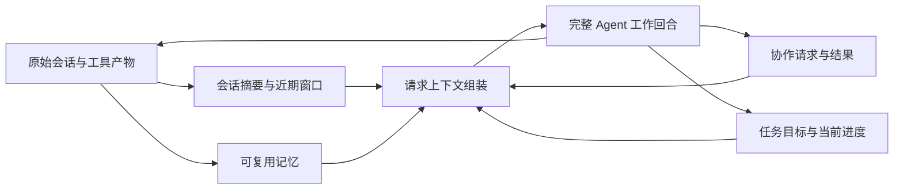

# M3 联合调研：上下文压缩、长短期记忆与多会话协作

> 核查截止：2026-09-18。范围为 coding agent 的公开产品行为、官方工程说明和部分固定源码，不是同条件性能评测。未运行第三方产品、调用模型或读取个人会话。
>
> 本文补充 [12 上下文压缩](12-context-compaction.md) 与 [01 记忆](01-memory.md)，重点回答三个模块如何组成一个可持续工作的 harness。落地入口：[M3 总体方案](../plan/m3-implementation-plan.md)、[压缩计划](../plan/m3-context-compaction-plan.md)、[记忆计划](../plan/m3-memory-plan.md)、[协作计划](../plan/m3-collaboration-plan.md)。

> 同日进一步修订：用户希望吸收前期调研中的新技术。具体机制、实验范围与不采用项见 [M3 技术吸收](../plan/m3-technology-adoption.md) 和本文第 11 节；不把本轮机制借鉴描述为论文复现。

## 1. 研究结论

三个模块应共同设计，但分别保存状态：**压缩决定本次请求看什么，记忆决定以后还值得记住什么，协作决定谁做什么、怎样交接。** 原始历史提供回查依据，任务当前状态提供最新目标；它们不能被一份模型摘要取代。

近期商业产品正在把项目协调、共享知识和多个执行会话组合起来。Claude 9 月 17 日发布的新版 Projects 正是这一方向；Cursor 当前 Projects 也使用协调者和共享项目资料。但这不意味着需要照搬它们的云环境、自动建会话或仓库副本。

对当前项目，建议采用以下组合：

- 压缩：规则减少旧长输出 + 同模型增量摘要 + 近期完整交互 + 历史 / 产物回读。
- 记忆：任务工作状态作为短期共享记忆；项目 / 用户条目作为长期记忆；小索引、按需检索、空闲时整理。
- 协作：保留 M2 已有会话与角色，在任务层补齐消息送达、结果接续、handoff 和可观察分工；临时子 agent 由开关控制。

这是一项工程取舍，不是“上述产品已证明这套组合最优”。尤其摘要质量、记忆命中与多 agent 加速，仍需在本项目的 Go 双模型上验证。

## 2. 三者的联系与边界

| 对象 | 回答的问题 | 生命周期 | 是否可由摘要覆盖 |
| --- | --- | --- | --- |
| 原始会话与工具事实 | 当时到底发生了什么 | 随历史保存 | 不覆盖；可减少发送量 |
| 当前任务 / 活动 Goal | 现在要完成什么，已停止什么 | 任务 / 局部目标 | 不由摘要改写 |
| 会话压缩 checkpoint | 怎样接着这一段工作 | 单会话，逐次替换有效窗口 | 可更新，原始历史仍在 |
| 任务工作记忆 | 新会话怎样理解当前进度与结论 | 跨会话，随任务演进 | 可整理，但保留事实来源 |
| 长期记忆 | 后续任务有哪些可复用知识 | 项目或用户范围 | 可纠正、停用、遗忘 |
| 协作消息 / handoff | 另一个执行者要做什么、返回什么 | 一次安排与后续交流 | 消息事实保留，简报可缩短 |

“共享记忆”不等于把所有会话互相拼接；“多会话”不等于自动并行；“graph engineering”也不等于知识图谱数据库。这里的执行图以完整 Agent 工作单元为节点，边表示委派、依赖和 handoff；记忆关系只负责查找相关知识。

## 3. Claude：最新 Projects、Agent Teams 与 subagents

### 3.1 9 月 17 日发布的 Projects 正是本轮需要关注的新能力

官方发布介绍了项目协调者、可并行线程、共享记忆与资料库。用户可在项目主对话或具体线程中指导工作。它目前是部分 Pro / Max 用户可用的 beta，各线程运行于云端，各自拥有仓库副本和分支；修改重叠仍通过合并冲突处理，本机执行尚属后续方向。[官方发布，2026-09-17](https://claude.com/blog/projects-redesigned)

**设计启示：** 长期目标可以由协调入口维持，实际工作分给多个保有自己上下文的执行者，结论与产物回到共享层。公开文章没有给出记忆数据库、检索排序、并发合并算法或质量评测，不能据此声称已经解决长期一致性。

本项目可以借鉴这种组织方式，把“项目协调”落实到更细的任务层；由用户选定的已有会话承担协调角色，不自动增加常驻协调模型或新用户会话。

### 3.2 Agent Teams 是另一种会话组队机制

Agent Teams 文档描述 lead、独立上下文的 teammates、共享任务列表和邮箱。teammate 接收任务说明及项目上下文，不自动继承 lead 的全部聊天；结果和消息会主动送达。该能力仍标为实验性，默认关闭，恢复、任务状态与退出仍有已知限制。[Agent Teams](https://code.claude.com/docs/en/agent-teams)

它与普通父子 subagent 的区别，在于队员可相互交流、认领工作、持续存在；与新版 Projects 的区别，在于后者还提供产品级项目协调、共享记忆和云端线程管理。不能用“Claude 支持多 agent”一句话把三个层级混在一起。

**采用判断：** 借鉴邮箱、状态通知和任务分工；不照搬自动生成用户会话、额外计划审批或强制提交工作表。本项目的消息失败应影响对应消息，不让一条坏记录阻塞整个任务。

### 3.3 记忆与压缩也有不同职责

Claude Code 把用户编写的 CLAUDE.md 与自动记忆分开。自动记忆使用短入口及按需读取的主题文件；subagent 的持久记忆还能按用户、项目或本地范围组织。这类文件式渐进读取，不要求先有向量数据库。[Memory](https://code.claude.com/docs/en/memory)、[Subagent memory](https://code.claude.com/docs/en/sub-agents)

长会话管理则先减少旧工具输出，再按需总结。官方明确提醒早期细节可能丢失；必须持续适用的指导不应仅藏在早期聊天里。subagent 的中间日志留在自己的上下文，可以减少父会话的噪声。[工作原理](https://code.claude.com/docs/en/how-claude-code-works)

Claude 原生 compaction API 又是独立层。它公开压缩块及续接契约，但不能由此推断 Claude Code 所有路径都采用同一实现，更不能直接套到 Go 的 Chat Completions。不同 API 版本和后台摘要方式详见 [专题 12](12-context-compaction.md)。

## 4. Codex 与 Cursor：产品化后的两种组合

### 4.1 Codex

Codex 的本地 memory 与 ChatGPT 网页记忆分开；使用已有记忆和贡献未来记忆可以分别控制。它从符合条件的旧会话后台整理本地记忆，不要求每轮结束立刻总结。官方仍建议把必须遵循的团队规则放在 AGENTS.md。[本地 Memories](https://learn.chatgpt.com/docs/customization/memories)

Codex subagents 用独立执行上下文承接有边界的工作，再把结果返回主任务；官方强调并行读密集工作较适合，写密集任务可能增加冲突与协调成本。它提供的是能力与调度入口，不保证所有拆分都更快。[Subagents](https://learn.chatgpt.com/docs/agent-configuration/subagents)

压缩方面，客户端触发 / 持久化与服务商原生 compaction 是两层。OpenAI Responses 可以返回不透明续接项；本项目无法检查其内部表示，也不能在 GLM / DeepSeek 之间通用迁移。[Compaction API](https://developers.openai.com/api/docs/guides/compaction)

**本项目取舍：** 借鉴后台记忆整理、使用 / 贡献分开、子任务独立上下文；默认继续使用可读摘要。当前研究依据为官方文档，没有声称逐行审计 Codex 云端或整个 memory 实现。

### 4.2 Cursor Projects 与 subagents

当前 Projects 文档描述了专门的协调者和一组执行 agents；共享文件在工作环境之间同步，保存研究、产物、项目知识和工作偏好。产品依赖 Cloud Agents，且有可用范围限制。这里可核实的是文件式共享上下文与协调方式，内部摘要和记忆提取算法并未公开。[Projects](https://cursor.com/docs/agent/projects)

Cursor subagents 支持前台 / 后台工作，默认新上下文，由父会话提供必要说明。当前文档明确默认共享 checkout，也可以选择独立副本。因此“多 agent 一定必须工作副本”并不是通用产品规则。[Subagents](https://prod.cursor.com/docs/subagents)

压缩方面，Cursor 公开了两种不同优化：长工具输出外部化、历史按需发现；以及把 self-summarization 纳入 Composer 训练。前者可以迁移到我们的 harness，后者依赖模型训练，不能靠提示词直接获得相同效果。[Dynamic context discovery](https://cursor.com/blog/dynamic-context-discovery)、[Self-summarization](https://cursor.com/blog/self-summarization)

旧 Cursor Memories 页面记载 sidecar 生成项目记忆的流程，但其资料较旧；本轮不把该页面的 beta 状态或审批方式当作所有当前 Cursor 产品的统一行为。

## 5. 开源实现：哪些机制可以直接学习

### 5.1 DeepSeek Harness：压缩与委派作为独立能力

核对提交：`0d1f50007f9bca3f52b06e1c3074fa14d5fb0720`。以下是代码 / 仓库说明阅读，没有复制代码或替换本项目运行时。

压缩路径复用 system、工具定义和历史前缀，再附加总结要求，调用同一 LLM 接口并记录 usage、sessionId 和 purpose。其 `summarizeWithLlm` 会提取正常完成的非空文本；提示词虽然要求章节，并没有逐章节打分才能采用的语义门槛。[固定 summarizer 源码](https://github.com/deepseek-ai/deepseek-harness/blob/0d1f50007f9bca3f52b06e1c3074fa14d5fb0720/packages/compaction/compaction-basic/src/summarizer.ts)

协作区分一次性子任务与可继续的 child。后者有稳定身份、顺序消息、忙时 steer、空闲时启动新回合，以及中断和发现入口。spawn 从新上下文开始，fork 可带父会话已完成历史。[固定 subagent 说明](https://github.com/deepseek-ai/deepseek-harness/blob/0d1f50007f9bca3f52b06e1c3074fa14d5fb0720/packages/subagent/subagent/README.md)

一个值得保留的源码细节是：**子 agent 自己写的消息与宿主报告“子任务已结束”使用不同来源类型**，避免把宿主状态说明误当成模型结论。[消息来源源码](https://github.com/deepseek-ai/deepseek-harness/blob/0d1f50007f9bca3f52b06e1c3074fa14d5fb0720/packages/subagent/subagent/src/continuation-messages.ts)

记忆方面，该提交的 MCP memory 配置是需要显式组合的参考方案，不能据此宣称核心自带完整的自动长期记忆。持久会话、压缩与接入 memory 工具，也不等于已经有记忆提取 / 检索 / 遗忘闭环。[参考配置](https://github.com/deepseek-ai/deepseek-harness/blob/0d1f50007f9bca3f52b06e1c3074fa14d5fb0720/apps/cli/config/examples/mcp-memory/mcp-reference-memory.cordis.yml)

**采用判断：** 学习缓存前缀、来源类型和可继续子任务；本项目暂不需要 DSH 的整个插件注册体系、多 provider transport 或其所有权限策略。

### 5.2 Pi：可读 checkpoint、完整日志与最小核心

本次把读取基线固定为 `71dca871bc80b6bc97be37f0ca3189399d651fff`，提交页日期为 2026-09-11；这是本次可核对的快照，**不是断言它是 9 月 18 日最新 HEAD**。此前专题 12 使用移动分支，本次增加可复查依据。

Pi 记录 `CompactionEntry`、`firstKeptEntryId`、摘要及文件操作信息；新请求使用摘要加保留尾部，原始 JSONL 继续保存。较长单回合可以拆出前缀总结，但工具结果不单独成为切点。[固定压缩设计](https://github.com/earendil-works/pi/blob/71dca871bc80b6bc97be37f0ca3189399d651fff/packages/coding-agent/docs/compaction.md)

它使用独立摘要提示。固定源码中，有调用方 sessionId 就复用，没有才新建，并设置摘要缓存策略；这比文档“一律使用新 routing ID”的概括更具体。本文以源码为准，不把 sessionId 复用等同于一定命中缓存。[固定压缩源码](https://github.com/earendil-works/pi/blob/71dca871bc80b6bc97be37f0ca3189399d651fff/packages/coding-agent/src/core/compaction/compaction.ts)

该快照的 README 明确把 subagents 等能力留给扩展或外部组合；AGENTS.md、skills、持久会话与扩展接口都可利用，但不能把社区 memory / team 插件概括成 Pi 核心的默认能力。[固定 README，MIT](https://github.com/earendil-works/pi/blob/71dca871bc80b6bc97be37f0ca3189399d651fff/packages/coding-agent/README.md)

**采用判断：** checkpoint 与日志分离、文件操作索引很适合当前项目；不为了三模块强行搬入一个完整 agent 框架。

### 5.3 OpenCode V2：客户端 checkpoint 与原生路由兼容

V2 保存历史、在边界创建 checkpoint，再从最新完成 checkpoint 重建请求。普通摘要使用当前 session 的 agent / model；原生 checkpoint 则受 provider、模型、协议和 endpoint 兼容限制。关闭自动压缩不会抹掉已存在的 checkpoint。[V2 compaction](https://opencode.ai/v2/docs/compaction)

它有摘要标题校验与纠正请求，也有溢出恢复策略。**本项目仅采用 checkpoint 生命周期、边界调度和路由兼容的思路**；不复制标题门槛或隐式重试。用户此前已经明确不希望因为非关键格式条件中止正常工作。

V1 与 V2 参数不同；OpenCode CLI / agent 与 OpenCode Go 模型服务也不同。本项目的 Go Key 只解决既有服务接入，不会自动获得 OpenCode 的记忆与多会话能力。

### 5.4 Gemini CLI：确定性上下文管理与后台记忆候选

当前配置将历史窗口、保留区、工具输出缩短 / masking 与压缩阈值分别管理；这些参数说明上下文管理不只是一次模型总结。文档可核对配置，本文没有声称审计了当前所有分支的调度实现。[配置参考](https://geminicli.com/docs/reference/configuration/)

GEMINI.md 提供分层项目指导；Auto Memory 则是另一项实验能力，从闲置历史提取记忆更新或 skill 草案，放到 inbox 等用户采用。它是后台知识整理，不是主会话摘要。[Memory management](https://geminicli.com/docs/cli/tutorials/memory-management/)、[Auto Memory](https://geminicli.com/docs/cli/auto-memory/)

Subagents 以工具方式进入独立循环，再返回结果。**采用判断：** 借鉴分层输入、后台批处理和可查看来源；我们的自动项目记忆不需要复制它每条候选都审批的交互，也不照搬固定闲置时长 / 消息条数门槛。[Subagents](https://geminicli.com/docs/core/subagents/)

### 5.5 OpenHands SDK：三个模块已有明确分工

`LLMSummarizingCondenser` 处理滚动对话，保留必要头尾并总结较早内容。它属于当前 conversation 的上下文管理。[Condenser](https://docs.openhands.dev/sdk/guides/context-condenser)

当前持久记忆文档另提供用户 / 项目两层 Markdown：短 `MEMORY.md` 入口与按需读取的日记。它默认关闭，记忆读取失败按提示处理，不要求因此阻止普通会话。[Persistent memory](https://docs.openhands.dev/sdk/guides/persistent-memory)

TaskToolSet 创建或恢复子会话，完成后返回结果；该入口文档明确是**同步阻塞**任务，不能仅因用了多个 agent 就称为并行执行。[Task Tool Set](https://docs.openhands.dev/sdk/guides/task-tool-set)

**采用判断：** 复用职责划分和记忆渐进读取；本项目的协作调度继续使用自己的异步会话服务，不引入 SDK 来替换 M2 核心。

### 5.6 Cline 与 Aider：简单机制仍有价值

Cline Auto Compact 在窗口接近限制时总结历史；Memory Bank 则是用户配置的 Markdown 文档方法，包含当前进展与长期项目知识。两者不是同一个自动记忆数据库。其 subagents 文档目前侧重实验性并行研究，不能推断为任意共享写入的团队系统。[Auto Compact](https://docs.cline.bot/features/auto-compact)、[Memory Bank](https://docs.cline.bot/best-practices/memory-bank)、[Subagents](https://docs.cline.bot/features/subagents)

Aider repo map 压缩的是**代码结构索引**，通过相关符号与依赖帮助选文件；它不能代替用户决定、任务进度或跨会话经验。此类确定性结构信息值得让宿主计算，避免摘要模型反复猜文件关系。[Repository map](https://aider.chat/docs/repomap.html)

## 6. 长期记忆：其他商业产品和专门方案

### 6.1 GitHub Copilot：仓库共享经验及按需核实

GitHub 2026-01-15 工程文章描述由工具写入事实与代码引用，供不同 Copilot agents 使用；在应用记忆时读取相关代码，修正已失效内容。文中当时的检索是近期仓库记忆注入，不应写成已证明部署了复杂向量 / 图检索。[工程说明](https://github.blog/ai-and-ml/github-copilot/building-an-agentic-memory-system-for-github-copilot/)

这是“来源能帮助纠正记忆”的有用案例。对本项目，保存来源、必要时读当前代码即可；不把每条历史引用重校验、代码 hash 或模型记忆可信分数变成所有工具的执行前置条件。

### 6.2 Devin 与旧 Cascade：必须区分当前产品和历史能力

Devin Knowledge 支持简短知识条目、触发说明、相关时读取、用户停用及更新建议；可以绑定仓库，也可以由任务相关性决定是否使用。这提供了比“每次把全部记忆塞入 prompt”更实用的入口。[Knowledge](https://docs.devin.ai/product-guides/knowledge)

它的云 handoff 打包当前工作上下文和代码状态，交给新的执行环境；聊天信息与文件状态都需要交接，只有一句总结不够。[Handoff](https://docs.devin.ai/work-with-devin/devin-handoff)

原 Windsurf memories URL 当前跳到 Devin Desktop 文档，并明确指出自动 memories 仅适用于 legacy Cascade；新 Devin Local 不持久化该类 memories，建议迁移到 skills。因此不能沿用旧资料声称 Windsurf 的记忆机制就是当前 Devin Local 的实现。[当前 Cascade memory 文档](https://docs.devin.ai/desktop/cascade/memories)

### 6.3 Letta Code：把记忆作为可维护的文件资料库

2026-02-12 的 Context Repositories 将记忆组织为文件，目录和描述引导按需读取，指定内容常驻。Git 记录版本，后台反思与多个记忆整理者可以通过 worktree 合并知识。[Context Repositories](https://www.letta.com/blog/context-repositories/)

**采用判断：** 学习小索引、正文渐进读取、后台合并；本项目使用本地单写者就能处理当前并发，不需要为了记忆引入 Git、多个反思 agent 或每次自动提交。Memory graph / 向量库可以在明确召回不足后扩展，不成为 M3 能用的前提。

## 7. 效果与代价：公开证据能说明多少

| 证据 | 能支持的判断 | 不能推导的结论 |
| --- | --- | --- |
| [Factory 压缩评估](https://factory.com/news/evaluating-compression)，2025-12-16 | 评估应检查事实、文件、决定和接续；其测试中产物追踪是共同弱点 | 不能据旧 API、自家数据与模型裁判宣布 2026 年 9 月产品排名 |
| [Cursor self-summarization](https://cursor.com/blog/self-summarization) | 摘要可由后续任务效果参与训练；模型训练会影响质量 | 不能把厂商报告的收益套给 Go 双模型普通摘要 |
| [GitHub memory 工程评估](https://github.blog/ai-and-ml/github-copilot/building-an-agentic-memory-system-for-github-copilot/) | 厂商报告 PR 合并率从 83% 到 90%，说明跨任务知识值得验证 | 不代表所有任务节省 7% 时间，也不是本项目已经获得的提升 |
| DSH / Pi 固定源码 | 可以核对切点、请求、持久化与消息归属 | 实现可读不等于摘要正确率或协作加速已被测定 |
| Claude / Cursor Projects 官方产品资料 | 证明项目协调与共享记忆已进入产品设计 | 没有公开同条件长周期结果，不能断言不会遗忘或冲突 |

压缩后的输入更短，不一定首字更快：摘要自身要生成，改动旧前缀可能损失缓存，遗漏信息可能增加回读和返工。多 agent 也可能降低墙钟时间、同时提高总 token。记忆如果召回过多或过时，会把每个新会话重新塞满。

本项目应观察 **任务是否接得上、是否误用旧决定、额外请求 / token / 首字等待、重复读取与返工**。先用少量明确场景验证，不建设庞大评测平台，也不要求模型给自己的记忆逐条打分才能继续编码。

### 7.1 横向对照

下表压缩前文已引用的机制，不是能力或效果排行榜；“未核定”不代表产品没有该能力。

| 代表实现 | 压缩 / 窗口 | 长期记忆 | 协作形态 | 对当前项目最有用的部分 |
| --- | --- | --- | --- | --- |
| Claude Code / 新 Projects | Code 清理旧观察并摘要；云 Projects 内部算法未公开 | 自动主题笔记；Projects 项目共享层 | subagent、Teams、云项目线程是三种层级 | 区分个人上下文与共享知识，按需交流 |
| Codex | 客户端管理与原生 opaque compaction 分层 | 本地后台整理，使用 / 贡献分开 | 独立子 agent 及结果回传 | 辅助作业可控、可见，避免主会话承受全部历史 |
| DSH | 增量摘要、稳定前缀、宿主记录来源 | 固定快照中核对到显式 MCP 示例，未核定完整核心自动记忆 | 一次性 / 可继续 child，消息与状态通知 | 调度和消息来源最贴近现有自研运行时 |
| Pi | checkpoint + 原始日志 + 保留尾部 | 核心指导文件与扩展能力分开 | 核心不强制内置子 agent | 最小职责划分和可回读历史 |
| OpenCode V2 | 本地摘要与 provider-native checkpoint | 本轮未展开完整记忆机制 | 本轮未展开完整协作机制 | 请求边界与路由兼容，不能把 Go Key 等同整个 agent |
| Cursor | 动态发现、外部化；自摘要训练属于模型层 | Projects 文件式共享上下文 | 项目协调、子 agent、可选环境隔离 | 渐进加载与协调入口；不默认必须 worktree |
| Gemini CLI | 规则窗口与压缩分别配置 | GEMINI.md 与实验性后台候选 | 独立子循环工具 | 空闲增量整理，但不照搬审批与固定门槛 |
| OpenHands SDK | 滚动 condenser | 短索引与按需日记 | 所查 TaskToolSet 为同步委派 | 三模块职责清晰；多个 agent 不等于并行 |

### 7.2 机制的实际取舍

| 选择 | 收益 | 代价 / 适用限制 |
| --- | --- | --- |
| 规则减量 | 无额外模型生成，行为可解释 | 只能缩短已知类型内容，不能可靠总结决定 |
| 可读模型摘要 | 可跨默认模型接续，用户能查看 | 有生成费用与信息损失，需要原始回读 |
| provider 原生压缩 | 服务方可保留普通文本之外的状态 | 不透明，受模型 / 路由契约限制，当前 Go 不能直接套用 |
| 本地词法记忆 | 无额外服务，易管理和纠正 | 同义表达召回较弱，需要保留主动查找入口 |
| 向量 / 图记忆 | 有机会改善语义或关系检索 | 增加索引维护与成本，不能自动保证事实新鲜 |
| 并行 agent | 独立工作可减少整体等待 | 总 token、上下文传递和冲突处理可能增加 |
| 同目录分工 | 直接复用现有环境和文件 | 重叠写入需要局部协调，不能声称隔离 |

因此 M3 首先选择规则与模型的混合压缩、文件式记忆生命周期和事件驱动协作；收益需要用接续结果和实际等待验证，不能靠组件数量判断。

## 8. 本项目采用方案的推导

### 8.1 压缩不是长期记忆提取器

“刚执行到哪一步”可能只对这一任务有用；“这个项目为什么采用某种接口约定”可能值得保留更久。把所有摘要直接存成永久记忆，会保存过期 Goal、失败猜测、瞬时服务端口和重复背景。应从真实事件 / 最新任务事实提取候选，而非不断对摘要再摘要。

### 8.2 任务工作记忆连接压缩与协作

M2 已有用户目标 / 约束、工作报告与来源。M3 应将其组合成任务简报，保留各会话最新报告，避免最后一个会话的报告覆盖其他人的进展。新的执行者先看到当前任务状态和分工，再按需读取来源会话。

一段会话的 checkpoint 可以用于它自己恢复，但交接应按接收角色筛选内容：实现者需要接口与未完成工作；说明编写者需要实际行为与文件；Review 需要范围和变更。交接不要求全量复制对方的推理、失败日志或 provider 私有状态。

### 8.3 长期记忆先做生命周期，再考虑复杂召回

最小有用闭环是：记录 → 按范围召回 → 使用时可见 → 纠正 / 停用 / 忘记。存储与索引放在已配置数据根，通过项目身份关联，而非写死仓库位置。

自动提取和显式“记住”共用保存入口；普通自动经验标明来源，不升级成用户命令。最新用户纠正和当前代码优先。高频过程知识可由用户后来整理为 skill，但 M3 不自动改 AGENTS.md 或创建运行规则。

### 8.4 协作需要事件接续，不需要不断轮询模型

委派安排先持久化，接收会话按空闲状态执行，结果成为消息。来源会话忙时在模型请求边界读取结果；有等待事项时事件唤醒继续；没有接续事项时仅展示结果。用户已经停止的 Goal 不被迟到消息自动恢复。

这比“发送后每隔几秒再问模型是否完成”更省请求，也更容易解释。独立任务可以并行；依赖只是当前安排的先后关系，不把整个可选工作图变成执行门槛。

## 9. 采用与暂不采用

| 方向 | M3 采用 | 暂不采用及理由 |
| --- | --- | --- |
| 压缩 | 可读增量摘要、原始回读、工具产物索引、后台准备 | 服务商专有 opaque 状态：Go 路由未提供可移植契约 |
| 记忆 | 任务工作简报、项目 / 用户条目、自动整理、显式记住与遗忘、相关召回 | 图数据库 / 常驻 embedding 服务：当前未证明必要，增加依赖与成本 |
| 协作 | 已有角色会话、消息与结果、handoff、任务分工视图、可选临时子 agent | 自动建立用户会话、默认 worktree、云控制面：不符合已确认使用方式 |
| 运行 | 复用现有 Go、连接池、工具与预算；显示当前活动 | 定时多模型互评、逐条记忆审批、强制报告完整性：增加延迟和阻断 |
| 可扩展性 | 清楚的数据接口，后续可替换检索 / 整理实现 | 本阶段重写为通用图引擎、插件市场或自进化系统 |

## 10. 证据范围与维护

| 资料组 | 本次读取深度 / 基线 | 限制 |
| --- | --- | --- |
| Claude Code / Projects | 官方产品文档；Projects 发布日 2026-09-17 | 闭源协调 / 记忆内部算法未公开；beta 可用性会变化 |
| Codex / OpenAI | 官方 Memories、subagents、原生 compaction 文档 | 客户端、ChatGPT Work 与云端实现不能混用 |
| DSH | `0d1f500…` 的摘要源码、消息源码、子 agent 说明与本地 memory 示例 | 本地是此前审计的定向文件缓存，不是已运行整个仓库 |
| Pi | `71dca871…` 的压缩设计、源码与 README | 可复查快照；未证明最新发布版；本轮不复用源码 |
| OpenCode / Gemini / OpenHands / Cline | 官方当前文档及部分源码定位 | 配置、旧文档和现行入口有差异；未实际安装运行 |
| Cursor / Copilot / Devin / Cascade / Letta / Factory | 官方文档、工程文章和报告 | 产品说明不等于独立实测；旧报告保留原日期 |

本轮公共 GitHub API 的本机直连失败，未更改代理 / VPN；通过网页读取到固定 Pi 提交及文件。部分旧 URL 失效，已转到可读取的官方入口。没有因抓取失败推断产品不存在，也没有把搜索摘要当作完整源码审计。

新增资料按上述日期保存；旧专题中的历史比较继续有效于其原范围。接下来应执行三模块计划中的最小闭环，依据本项目实际失败调整，而不是先增加更多框架。

## 11. 前期技术调研怎样影响 M3

上一版采用判断偏重生命周期，对前期专题中的算法机制展开不足。按用户要求重新对照后，M3 增加以下内容；这是本项目的设计推导，原始资料与核查深度见 [技术吸收说明](../plan/m3-technology-adoption.md)。

| 前期专题中的线索 | M3 修订后的落点 | 仍需区分 |
| --- | --- | --- |
| OpenViking 分层上下文、RLM 外部输入 | 材料短索引 / 概览 / 正文，归档搜索、过滤与统计 | 本地渐进读取不等于部署 OpenViking 或完整递归 RLM |
| SimpleMem 语义单元与合成 | 项目 / 主体 / 时间明确的可独立条目，增量合并重复内容 | 自己的批量维护时序与论文在线合成不同，不声称完整复现 |
| Graphiti 时间关系、A-MEM 关联 | 明确替代关系直接实现；弱关联作为可选实验 | 轻量 ID 连接不等于通用知识图谱，也不是自动因果事实 |
| Hindsight 多路召回与派生页面 | 词法 / 结构 / 关系检索；按主题整理知识页 | 不部署其向量 / reranker 服务；自动页面维护默认关闭 |
| ACE playbook | 程序性经验按条目增量更新，保留条件和纠正入口 | 改进上下文不是在线训练或自动修改正式 skill |
| Fork / isolated、SWE-grep 检索工作单元 | worker 按职责独立或继承有效上下文；检索返回原文位置 | 不复制工作区，不增加专用模型，不绕过子 agent 总开关 |

关联记忆和知识页自动维护在 M3 内提供实际可试用功能，不只是占位配置。复杂向量 / 图服务、训练门控、GEPA 等离线优化仍按明确缺口再选型。用户可以体验新机制，同时普通任务仍沿现有运行流程推进。
