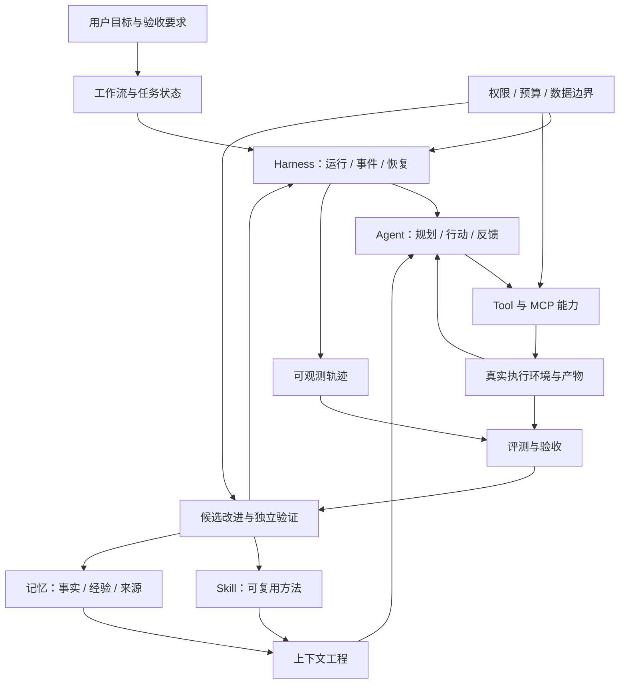

# 大模型应用与 Coding Agent 调研

> 本轮检索截止：**2026-09-16**。十一篇专题分别保存；本文提供阅读入口、跨专题分析和范围说明。针对深度、完整性与时效性的再次检查见[复查与补充记录](00-review-2026-09-16.md)。发布日期、访问深度、维护状态及证据限制见[证据与时效台账](00-evidence-register.md)。执行记录见[调研进度](../progress/research.md)。

> **2026-09-18 专项补充：** [12 上下文压缩](12-context-compaction.md) 对照 Claude Code、Codex、Cursor、Factory、DSH、Pi 与 OpenCode 的压缩机制和效果证据，并连接本项目的 [上下文管理方案](../plan/context-management-plan.md)。该专题有独立截止日期与 [进度记录](../progress/context-compaction-research.md)，不将前十一篇的历史检索日期改写为本次重新核查。

> **同日 M3 联合调研：** [13 上下文、记忆与多会话协作](13-m3-context-memory-collaboration.md) 补查 Claude 9 月 17 日新版 Projects、Agent Teams，以及 Codex、DSH、Pi、Cursor 等当前机制，给出三模块共同架构与采用边界。对应 [M3 总体方案](../plan/m3-implementation-plan.md) 及三份模块计划；实际状态见 [M3 进度](../progress/m3.md)。

> **前期技术的落地接续：** [M3 技术吸收](../plan/m3-technology-adoption.md) 将专题 01 / 03 / 04 / 06 / 08 中的分层上下文、语义记忆、时间 / 关联、多路检索、增量经验及 fork / isolated 转为具体实现项，明确直接采用、可选实验和仍待研究的边界。

这组文档面向没有读过原论文和项目文档的开发者。每篇从具体问题开始，解释概念、运行过程、关键状态或数据结构，再讨论代表方案的实现、实际价值和失败条件。文中的教学场景与架构建议均有标识，不能当作已经完成的产品功能或第三方复现实验。

## 阅读入口

| 专题 | 要回答的问题 | 主要展开的内容 |
| --- | --- | --- |
| [01 长短期记忆](01-memory.md) | 怎样跨会话记住有用事实，又能纠正和忘记 | MemGPT / Letta、Mem0、Graphiti / Zep、Hindsight、LLM Wiki、Persona、A-MEM、SimpleMem、写入 / 读取门控 |
| [02 Skill / Tool / MCP](02-skills-tools-mcp.md) | 方法、动作、连接和分发怎样组织 | 渐进加载、动态发现、Code Mode、MCP 2026-07-28 / MCP2.0 辨析、Skills over MCP、9 月 SDK 与调用者身份 |
| [03 自进化与 RSI](03-self-evolution.md) | 什么在变好，谁负责改善改进器 | GEPA / ACE / Hermes、DGM / AHE / HoH、STOP / SICA / MetaSkill-Evolve / Beagle、DSPy / Flex、Agent Lightning v1 |
| [04 编程与 AI Coding 工作流](04-workflows.md) | 需求、产物、Agent 与长任务怎样接续 | OpenSpec、Spec Kit、Superpowers、GSD、LangGraph、Temporal、Stripe Blueprint、Agents SDK、ADK 2.0、CrewAI Flows |
| [05 Coding Agent](05-coding-agents.md) | 从最小模型循环到可用产品，需要哪些运行对象 | mini / SWE-agent ACI、Pi、OpenHands、Codex、Claude Code、OpenCode、Aider、Cline / Roo、Gemini、Cursor、Devin、Goose |
| [06 Harness](06-harness.md) | 同一个模型为什么会因运行系统不同而表现不同 | DeepSeek Harness、Pi、Anthropic 长任务、Goal、Deep Agents 固定源码、DeerFlow 2、托管 Agents API |
| [07 推理模式](07-reasoning-modes.md) | 应当怎样分解、规划、行动、搜索和修正 | Self-Ask、ReAct、Plan–Execute–Replan、依赖与搜索、Step-Back、Least-to-Most、Self-Discover、测试时计算与选择器 |
| [08 上下文工程与代码检索](08-context-engineering.md) | 怎样让正确证据在正确时刻进入模型 | Aider Repo Map、GraphRAG、SWE-grep、RLM、Manus、fork / isolated、Credit Genie OpenWiki、OpenViking |
| [09 评测与可观测性](09-evaluation-observability.md) | 怎样证明改善，怎样解释失败 | SWE / Terminal / ProgramBench、Harbor、LangSmith / Langfuse / Phoenix / Braintrust / Weave、9 月 Pro Verified、生产率证据 |
| [10 执行安全与恢复](10-security-recovery.md) | 怎样使权限、动作和现实结果一致 | 提示注入、CaMeL、Windows 隔离、幂等恢复、具体 SDK 权限继承与解释器 / 宿主边界 |
| [11 Agent 互操作协议](11-agent-protocols.md) | 工具、远端 Agent、编辑器和界面怎样对接 | A2A 1.0、两种 ACP 辨析、Agent Client Protocol 的回合 / 取消、AG-UI 快照与增量、协议身份映射 |
| [12 上下文压缩（9 月 18 日补充）](12-context-compaction.md) | 怎样降低长任务上下文成本并正确接续 | 商业产品与原生 API、规则裁剪、增量摘要、后台准备、缓存与效果证据、本项目采用方案 |
| [13 M3 联合调研（9 月 18 日补充）](13-m3-context-memory-collaboration.md) | 压缩、长短期记忆和多会话怎样共同支撑持续工作 | 最新 Claude Projects 与 Teams 辨析、DSH / Pi 固定源码、项目共享记忆、消息接续、效果限制与三模块落地 |

如果首先想理解一个 Coding Agent 的整体构成，可按 **05 → 06 → 07 → 08** 阅读；如果正在设计长期任务与知识积累，可按 **04 → 01 → 03** 阅读；如果准备真实落地，将 **02、09、10** 一起看；涉及编辑器、远端 Agent 或 UI 互操作，再读 **11**。每篇也可以独立阅读。已经读过上一版的读者，可先看复查记录中的逐篇变更位置。

## 十一个专题怎样构成同一个系统

用户提出目标之后，工作流负责组织阶段和产物，Harness 负责让每次运行发生并保存事实。Agent 根据推理策略选择行动；上下文工程从代码、历史和记忆中组织输入；Skill 提供方法，Tool 承担动作，MCP 连接外部能力。观测与评测把结果变成可解释证据，自进化才可能据此提出下一版本。

图中的每条箭头都有具体契约。记忆进入上下文时需要范围和时效判断；模型提出工具动作时需要参数与权限校验；执行结果进入任务状态时需要区分成功、失败和未知；评价结果进入演化器时需要防止测试答案和评分规则被候选修改。单独选一个框架，无法自动补齐这些契约。

## 跨专题的关键判断

### 1. 聊天记录、任务状态与可复用知识具有不同寿命

聊天保存发生过什么；任务状态保存现在要完成什么、还缺什么；记忆保存未来可能用到的知识。一个任务可以跨多个会话，一条记忆也可以被多个任务使用。只用聊天摘要承载三者，会在压缩、换会话、用户纠正和并发运行时失去事实边界。[记忆专题](01-memory.md)、[Harness 专题](06-harness.md)

这意味着长期能力应先建立稳定的任务身份、已确认约束、产物和证据索引，再决定是否增加向量库、时间图或自动 Wiki。图数据库解决关系检索问题，无法替代任务完成条件。

### 2. 自主性依赖可核验状态，而不只依赖更复杂的规划

Plan–Execute–Replan 有用，是因为它能根据新证据修订剩余工作；如果执行器无法知道文件是否写入、进程是否结束，规划器再复杂也只能基于错误状态推理。推理模式与执行可靠性应分别设计再连接。[推理专题](07-reasoning-modes.md)、[安全与恢复](10-security-recovery.md)

同样，工作流节点可以内部运行完整 Agent。没有必要把所有模型行为都展开成固定图节点；也不应让一个自由循环独自承担跨天调度、授权和持久事务。外层组织与内层求解可以使用不同控制结构。

### 3. Skill、记忆和 RSI 之间存在连续关系，但不能互换

一条经验被保存、一个 Skill 被改写、一个 Harness 被修改、一个改进器改变自己的改进方法，分别改变不同对象。RSI 必须讨论这种递归关系；是否冻结基座模型不是唯一判断轴，是否改善下一轮的改进过程同样关键。[自进化与 RSI](03-self-evolution.md)

越接近运行核心和改进机制，越需要独立任务、固定预算、隔离评价和版本回退。自动生成更多规则并不能证明能力提高；被评分器奖励也不能证明真实工作更好。

### 4. 开放源码与闭源实践提供不同种类的证据

mini-swe-agent、Graphiti、Aider 等可以检查关键实现路径；闭源产品通常只能核对公开协议、产品文档和工程案例。SDK 公开不表示云端控制面公开，项目可自托管不表示许可条件相同，厂商实验成功不表示已在本项目环境复现。[Coding Agent](05-coding-agents.md)、[评测平台比较](09-evaluation-observability.md)

因此文档按可见证据分析机制，不给未经同条件测试的总排名。生产案例用于理解工作如何组织，公开基准用于判断受控能力，社区讨论用于发现实际摩擦；三者不相互替代。

### 5. 时效性需要追踪状态变化，不只是加入新名词

核查影响结论的变化包括：MCP 2026-07-28、GSD 迁移、Roo 归档、Mem0 平台与 OSS 差异、Devin Fusion、Terminal-Bench 4.0、LangSmith 更新与 Windows sandbox alpha。第二轮又核对了 ADK 2.0、Agent Lightning v1、A2A 1.0，以及 9 月的子 Agent 上下文、调用者连接与评测材料。详细日期和版本差异见[时效台账](00-evidence-register.md)。

旧论文仍可解释概念起点，但旧 API、旧仓库和旧产品状态不能当作当前操作依据。反过来，新预印本发布时间很近，也不等于已经形成稳定企业方案。

## 代表方案的选取依据与覆盖边界

本轮采用按机制分层的代表性调研：每个专题优先选择概念起点、可观察实现、当前主要产品、能揭示失败的反例和真实使用证据。选取依据应当能解释“它代表什么”，而不是仅因为搜索结果靠前或仓库星数高。

| 层面 | 本轮已展开 | 没有据此宣称什么 |
| --- | --- | --- |
| 记忆 | 分层内存、服务式记忆、时间图、文件 Wiki、关联与压缩算法、写入 / 读取门控 | 已比较所有向量库或所有记忆产品 |
| 能力组织 | 方法包、执行契约、协议版本、动态发现、程序化组合 | 所有宿主对同一 Skill / MCP 扩展行为完全相同 |
| 演化 | 经验、技能、程序结构、参数训练、Harness、元改进与受限 RSI | 已出现无需外部验证、持续指数改进的通用系统 |
| 工作流 | 规范产物、技能化流程、图状态、持久执行、托管仓库自动化 | 对每个通用多 Agent SDK 做完整源码评测 |
| Coding Agent / Harness | 最小循环、可扩展核心、远程工作区、富客户端、闭源协作系统 | 产品综合排名或当前模型采购结论 |
| 推理 | 问题分解、行动反馈、重规划、依赖图、搜索、反思、程序行动、递归上下文 | 穷尽所有提示变体；内部隐藏思维机制已被观察 |
| 上下文 | 词法与结构检索、图综合、检索子 Agent、外部输入与递归处理 | 已验证每种索引在本项目的性价比 |
| 评价与观测 | 公共基准、Harbor、五个平台、OTel、任务质量与真实生产率 | 已覆盖全部市场，或遥测数据自动证明业务收益 |
| 安全与恢复 | 信息流、配置顺序、进程与网络边界、并发和幂等 | 已完成攻击测试、形式化验证或 Windows 沙箱验收 |
| 互操作 | A2A、Agent Client Protocol、AG-UI 与 MCP 的关系 | 标准已被所有产品完整兼容，或自动提供业务事务 |

仍值得独立扩展的方向包括模型路由与服务网关、浏览器及 GUI Agent、多模态代码任务、生成式 UI 标准，以及通用协作 SDK 更广的源码比较。训练部分目前聚焦 Agent Lightning 与自进化的关系，不覆盖全部后训练方法。已研究、只核对方向、尚未展开的边界见复查记录；当前内容不是全行业无遗漏目录。

## 对当前项目的采用判断

本轮开始时读取的项目基线是 Windows 优先、Python 核心、Electron 桌面、已完成 M1 只读闭环。其他任务可能继续更新阶段设计，因此这里是调研开始时的事实基线，不替代[进度总览](../progress/README.md)的后续状态。

最值得优先讨论的是任务与运行事实、可接管的 Agent 循环、代码上下文、执行结果及恢复边界。它们共同支撑长期目标、记忆与工作流。没有这些基础时先接入大量 Skill、MCP 服务或演化框架，会增加可调用能力，却未必增加可靠完成任务的能力。

在基础闭环形成后，再用相同任务与预算比较记忆、规划和检索策略；之后才引入离线 Skill 改进。是否采用 LangGraph、OpenSpec、LangSmith 或特定记忆服务，应由实际职责缺口和验证结果决定。这些判断不改变本项目既定模型范围、Go 地址、E 盘数据根或依赖基线，也不自动启动下一阶段实现。

## 资料与维护说明

文内链接尽量紧邻其支持的断言。对于关键来源，[证据台账](00-evidence-register.md)记录原始日期、读取深度与限制；移动分支和动态产品页未统一固定提交，因此复用源码前仍需记录准确版本与许可。企业案例中的数字保留原口径，不把 PR 数、代码行数或厂商报告的成功率改写成人均生产率。

9 月 16 日原调研没有安装、运行或付费调用第三方项目，没有复现论文实验，也没有访问企业私有系统；当时写入集中在研究目录与独立进度。9 月 18 日专项调研按用户要求补充 M3 实施计划与阶段进度，同样未运行第三方产品或调用模型。文档中的实验方案是后续验证设计。
