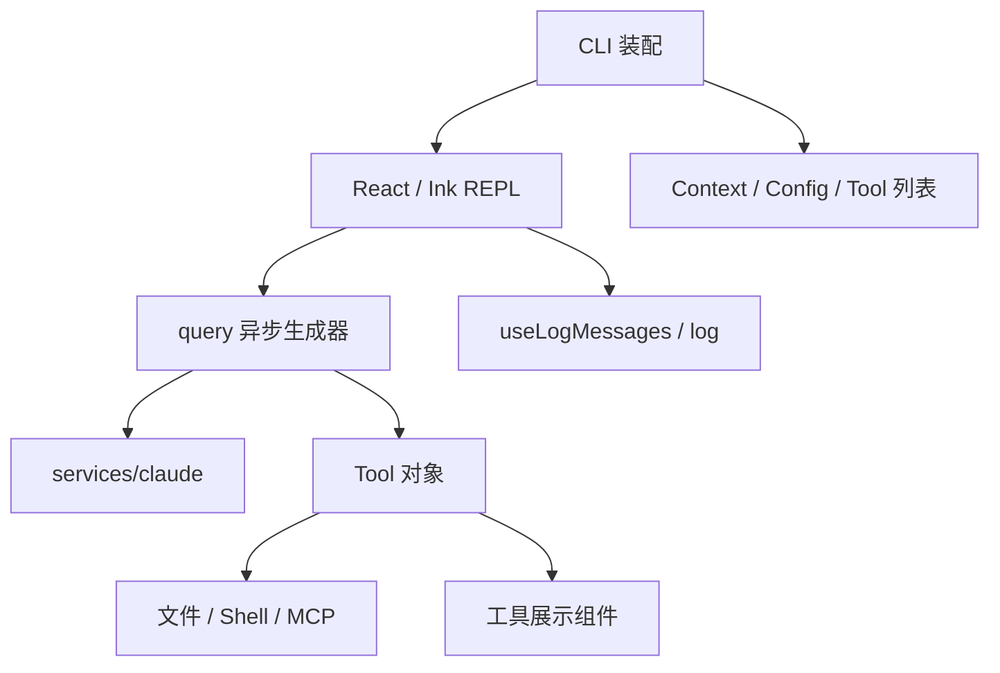
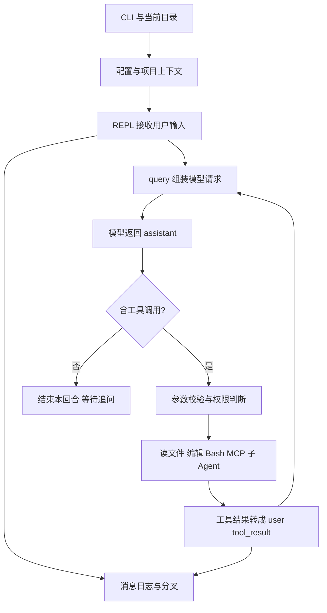

# Claude Code 0.2.8：从终端输入到递归工具循环的早期实现

> 核查日期：2026-09-21。分析对象：2025 年 2 月的 Claude Code 0.2.8 发布包源码映射快照；镜像固定提交 `da716d77b251868918bb5776377f85a18a47ffdf`。这是历史版本的独立分析，不代表今天的 Claude Code。另一个独立样本见 [2.1.88](claude-code-v2.1.88.md)。

## 1. 先理解它解决什么问题，以及这份源码能证明什么

设想用户在仓库里输入“找到取消后子进程仍然存活的原因，并修复”。普通聊天应用只能返回建议；这个版本的 Claude Code 会收集仓库背景，把搜索、读文件、编辑和 Bash 暴露给模型，接收模型的工具调用，执行后再请求模型，直到模型给出不含工具调用的回答。终端只是入口，真正的运行核心是一个能反复吸收执行反馈的异步生成器。

它的设计可以概括为：**使用现成模型负责下一步决策，把项目上下文、工具权限、文件修改和交互渲染留给客户端。** 没有证据表明这里存在一个统一编排所有任务的规划图；子 Agent 也主要用于独立搜索，而非今天常见的可恢复团队协作。

本次读取的是公开镜像中保留的 `cli.mjs` 与其内嵌 source map。包头和编译常量均显示 `0.2.8`。source map 有 2,783 条 source，其中 211 个非依赖 `src/` 文件在镜像里存在，统一换行后全部与 `sourcesContent` 一致。这证明镜像内部的提取一致性，不构成官方签名验证，也不意味着还原了所有类型、测试、构建脚本或内部服务。比如源码引用的纯类型 `Tool.ts` 没有进入该提取集，不能把缺失文件自行补写成“原始源码”。[来源与包体][archive]

这是专有软件发布包的历史快照。本文做机制解释，不把公开可读等同于开源许可，也不提供整段源码搬运。

### 1.1 仓库组织：先辨认发布包投影与内部 monorepo 的边界

镜像顶层的 `cli.mjs`、vendor、WASM 与提取出的 `src/` 来自已发布产物。本文可以分析保留下来的模块组织与依赖，却不能根据镜像缺少 package.json、测试或某些类型文件，就断言 Anthropic 内部没有这些工程设施。纯类型可能编译消除，未参与 bundle 的模块可能从未进入 source map。构建与测试架构属于这份材料的证据缺口。

在这个范围内，实际代码以一个客户端应用的源码目录组织，关键边界如下。

| 位置 | 运行职责 | 为什么不只是目录分类 |
| --- | --- | --- |
| `src/entrypoints/cli.tsx` | 参数、配置、项目、MCP、恢复与交互启动 | 约 1,000 行，承担产品装配，不只是调用 main 的薄入口 |
| `src/screens/REPL.tsx` | 会话画面与交互回合控制 | React state 持有消息、abort 和渲染状态，调用 query |
| `src/query.ts` | 异步生成器循环、工具分组与递归请求 | 约 500 行；调用模型服务并逐项 yield 运行消息 |
| `src/services/claude.ts` | Claude API 请求与响应处理 | 同时面对模型协议、计费及产品模型策略 |
| `src/tools.ts` 与 `src/tools/<Tool>/` | 工具集合、schema、执行、展示和描述 | 一个工具目录纵向收纳其交互与执行实现 |
| `src/context.ts`、`utils/config.ts` | 项目上下文与配置 | 通过缓存 / 模块状态供多个调用位置使用 |
| `src/permissions.ts`、`hooks/useCanUseTool.ts` | 工具决策与交互确认 | 将宿主是否允许和终端如何问用户接到一起 |
| `hooks/useLogMessages.ts`、`utils/log.ts` | 根据消息变化保存、恢复日志 | 持久化协调仍与 React 生命周期相连 |

阅读顺序应是 CLI 装配 → REPL 输入 → query 生成器 → services/claude 或具体工具 → 日志 hook。沿此路径能看到真实调用关系；单独看 `services/` 会误以为产品行为都集中在服务层。[入口][cli] [REPL][repl] [query][query]

### 1.2 设计收益与耦合：工具是纵向功能模块

以 FileEditTool 为例，同一 `.tsx` 文件定义输入 schema、isReadOnly、权限需要、输入校验、编辑动作以及 React 结果组件。开发一个面向终端的新工具时，这种纵向组织让描述、行为、错误和展示容易同时修改；也避免 UI 再维护一份与工具失配的名称表。[编辑实现][edit]

代价是工具模块直接 import Ink / React、主题与展示组件，运行协议也带进度展示数据；query 还引用二元反馈、权限 hook 类型及全局 cwd。它可以被无界面入口调用，但不能因此说它已是一个与 UI 无关、可独立发布的 Agent core。这里的解耦主要靠异步生成器和传入的 ToolUseContext，不是完整的领域层隔离。

消息数组主要由 REPL 持有，query 接收上下文并 yield 新消息；配置、cwd 与消息 getter/setter 又存在模块级入口。状态并非全部集中到一个 Session 对象。若要支持同进程多个独立会话，必须检查这些共享入口，而不是简单创建两个 REPL 组件就宣布隔离完成。

### 1.3 改一项功能的实际路线

新增工具通常需要建立工具目录，补描述、schema、校验、执行和展示，再加入 `tools.ts`，并确认权限选择与只读子 Agent 工具集是否应该包含它。主 query 不必知道具体工具业务，但并发资格和返回结构必须符合它的假设。

替换模型服务则更难：query 和 Message 类型已经依赖 Anthropic 的 ToolUseBlock / MessageParam，`services/claude.ts` 也承载产品模型策略；并不是增加一个 base_url 参数就得到 provider 中立内核。修改恢复或压缩则会穿过命令、REPL 的消息替换 / fork 和日志文件命名。这个版本最适合学习清晰的反馈循环与工具实现，不适合被描述为完整通用 Agent SDK。

## 2. 启动：当前目录先成为项目身份，再建立终端会话

入口 `src/entrypoints/cli.tsx` 负责参数、配置、初始化和进入交互界面。主界面是 React + Ink 的 `REPL`。这会影响架构：消息列表、是否正在请求、权限弹窗和分支展示都在 React 状态与回调中协调；运行核心通过 `yield` 提供消息，界面逐步消费。[CLI][cli] [REPL][repl]

这里的“项目”主要是当前工作目录、按项目保存的配置以及该目录对应的日志空间，并不是带任务图、多个工作副本和独立运行环境的领域对象。项目配置能保存上下文、允许的工具和 MCP 服务器；启动后 Git 状态和目录结构帮助模型定位。选择目录不会自动建立容器或隔离工作副本。

核心数据的职责如下：

| 对象 | 放什么 | 在流程中承担什么职责 |
| --- | --- | --- |
| `messages` | 用户、助手和工具结果 | 下一次模型调用的对话材料 |
| `context` | 项目背景的键值文本 | 补充到系统提示，不等同于对话历史 |
| `toolUseContext` | 工具列表、取消控制器、模型选择、读文件时间戳等 | 让工具共享一次运行所需的宿主状态 |
| `ProgressMessage` | 子 Agent 的中间消息与展示信息 | 终端展示，不直接作为普通历史发给模型 |
| `messageLogName / forkNumber / sidechain` | 主会话、分支与子任务日志身份 | 把 UI 上的分叉映射到持久日志 |

## 3. 装配上下文：先给地图，再靠工具补充细节

`getContext()` 使用记忆化缓存，把项目配置中的上下文、Git 状态、目录轮廓、代码风格、其他 `CLAUDE.md` 的位置和根目录 `README.md` 合并。Git 状态包括当前分支、主分支、修改清单和近期提交；过长状态会截断。目录枚举有自己的短超时，说明它追求启动时快速建立方位，而不是一次把代码库读完。[上下文实现][context]

有两个很容易误读的细节：

1. **启动背景是快照。** Git 文本明确告诉模型它不会随会话自动更新。模型编辑文件、切分支后仍要通过工具获取当前事实，不能继续相信最初的状态。
2. **发现文件不等于加载内容。** `getClaudeFiles()` 搜索下级目录的 `CLAUDE.md`，返回的是位置和“进入相关目录时读取”的提示。它没有把所有子目录规范全文塞进系统提示。根 README 则直接读取内容。

这种分工节省输入，也让模型先知道“信息在哪里”。代价是遵守下级规范依赖后续读取行为；不能据此宣称存在一个对所有编辑强制执行的规范继承器。

`setContext / removeContext` 把用户维护的项目背景保存到项目配置，同时排除自动产生的目录与风格字段。于是背景有了跨会话生命周期，但仍是简单文本，而非带事实冲突处理、相似度检索或遗忘算法的记忆系统。

## 4. 用户提交后：命令、思考预算与模型请求怎样分流

REPL 处理新输入，把命令产生的消息或普通用户消息接到当前历史，再调用 `query()`。`/compact` 等本地命令有独立处理函数，因此“用户在终端输入了一行文字”不一定对应一次普通主模型请求。[REPL][repl] [压缩命令][compact]

`query()` 先将项目背景装进系统提示，再通过 `normalizeMessagesForAPI` 投影对话，调用 `querySonnet()`。中间 progress、界面元数据和 API 所需的 role/content 并非同一个结构。工具回传也会被转换成模型能识别的 `tool_result`，而不是把终端渲染出来的字符串直接抓回去。[核心循环][query]

模型服务层集中处理 Anthropic、Bedrock、Vertex 等入口、流式请求、缓存控制、错误和重试。SDK 自动重试被关闭，应用自己的重试逻辑依据错误类别与响应头决定是否等待重试。因此“模型请求失败”并不在这一历史版本里一律等价于马上结束；也不能只数界面回合来估算实际请求次数。[模型服务][model]

这个版本还有一个有代表性的历史实现：`getMaxThinkingTokens()` 检查最新用户文本中的 `think hard`、`megathink`、`ultrathink` 等表达，为部分模式选择不同 thinking token 预算。它是**提示触发的推理预算设置**，不是自动建立计划、验证计划并重新规划的工作流。内部用户变量、ThinkTool 启用状态也影响这条分支。[思考预算][thinking]

同理，`queryWithBinaryFeedback` 中存在内部用户和功能开关控制的双响应比较路径，不能因为读到了它，就说默认每个请求都会向两个模型发问。

## 5. 一轮执行：递归 query 如何把工具结果变成下一步决策

`query()` 是异步生成器。它首先产出助手消息，然后直接检查内容中有没有 `tool_use` 块。没有工具调用就返回；有工具调用则执行，再把助手消息与工具结果接回历史，递归调用自身。这实现了一个反馈循环：模型决定动作，宿主执行，模型解释结果并决定下一步。[核心循环][query]

它没有要求模型先提交完整计划，也没有要求每一步都修改一个显式任务状态。比如“找泄漏原因”可以直接产生多个搜索调用；工具结果显示问题在清理逻辑后，下一轮才决定读哪个文件。计划在这里主要存在于语言上下文和模型行为中。

并发规则相当具体：**一批调用全部是只读工具时，最多并发 10 个；只要其中有写工具，整批走顺序执行。** 这比“所有工具都并行”保守，也比“永远串行”更适合代码搜索。它依赖工具的 `isReadOnly` 标记，不能自动识别任意 shell 命令的全部副作用。

取消信号在模型与工具边界传播。中断会产生相应消息并结束本次递归。已经产生的文件修改不会因生成器退出而自动回滚；取消与事务撤销是不同职责。工具调用输出中，progress 负责展示，真正结果进入后续上下文，这防止每一个动画或中间状态都占用 token。

## 6. 工具边界：参数、目标状态和权限各自解决什么问题

一项工具不只有名字和 JSON schema，还包含启用条件、只读属性、权限需求、参数规范化、实际调用和面向模型 / 界面的结果渲染。`checkPermissionsAndCallTool()` 依次做 schema 校验、输入规范化、工具特有校验、权限判断，再消费工具的异步结果。[核心循环][query] [工具目录][tools]

这些步骤不能互相替代：

- schema 只能说明参数形状正确，不能说明文件真的存在。
- 文件存在不能说明模型读到的是当前版本。
- 参数与目标都正确，也不代表用户同意执行。
- 用户同意执行，仍然不代表命令处于操作系统隔离中。

以 `FileEditTool` 为例，修改已有文件需要先有读取时间戳；文件的 `mtimeMs` 晚于记录时拒绝旧写入；原字符串必须能找到且不能产生歧义。写入保留检测到的编码与换行，返回结构化 patch 和片段，刷新时间戳。[文件编辑][edit]

这是一种对“模型拿旧内容改文件”的防御。它不是跨进程文件锁，也不是对校验与写入之间竞态的原子事务保证。其价值在于把常见冲突变成明确反馈，使模型重新读取；不能用它宣称多人同时改同一文件不会发生任何冲突。

工具错误以模型可见结果反馈后，模型可以调整路径、字符串或调用方案。架构上，工具失败既是执行事实，也是下一轮推理的输入；不应把所有失败都藏进终端日志。

## 7. 权限之后：持久 Shell 怎样工作，为什么它不是 sandbox

`permissions.ts` 维护只读安全命令、工具许可和 Bash 前缀许可。复合命令会拆分并检查，各子命令都满足条件才允许；对难以可靠确定的前缀或注入风险路径，转向更具体的判断和询问。文件编辑权限可限定本会话，其他许可可写入项目配置。`dangerouslySkipPermissions` 则显式绕过这一层。[权限判断][permissions]

Bash 的执行基础是 `PersistentShell`：启动一个登录 shell，命令排队发送，通过临时输出、退出状态和 cwd 文件知道命令结果；命令执行后的目录会写回。取消和超时触发子进程清理。因此它能支持前一个命令改变目录后，后续命令沿用该状态。[持久 Shell][shell]

共享 shell 状态有便利，也有耦合：目录和环境变化会影响下一条命令；为稳定状态，队列串行化有实际意义。一个“删除某个目录”的 Bash 调用，其真实影响由运行账户与操作系统决定，不能靠模型工具列表里的项目根路径限制推导出来。

在此快照的默认执行链和源码搜索中，没有找到后来系统级 sandbox adapter 那样的操作系统文件 / 网络隔离层。这里可以确认的是**工具权限与本机 shell 执行**。不能把现行 Claude Code 的沙箱能力回填到 0.2.8，也不把没有在提取集找到模块夸大为对所有内部版本的结论。

## 8. 扩展能力：MCP 已有完整接入，Skill 尚不是独立资源体系

MCP 并非这个早期版本的空壳。`mcpClient.ts` 合并全局、`.mcprc` 与项目配置，处理服务器批准状态，建立 stdio 或 SSE 连接，通过能力声明决定请求 tools / prompts。单个服务器失败被记录，已连接服务器仍能提供能力。[MCP 客户端][mcp]

服务器的工具经 `tools/list` 发现，转换成客户端统一工具对象，名称采用 `mcp__服务器__工具`。调用时转成 MCP `callTool`，文本 / 图像结果再映射回模型结果块。于是主循环不需要为每种业务系统新增执行分支，只处理统一 Tool 接口。

源码在远程 JSON schema 适配处仍保留加强 Zod 校验的 TODO，说明“协议有 schema”与“客户端对远程参数做了同等严格的本地验证”不是同一事实。MCP 服务器运行在进程或网络另一端，客户端的本地文件工具检查也不会自动约束服务器内部操作。

在此提取集与工具装配中，没有发现现代 `SKILL.md` 目录扫描、描述索引、按需正文加载和插件技能命名空间这套链路。可复用行为主要靠项目上下文、CLAUDE.md、slash command 与 MCP prompt。它们都能影响模型，但生命周期和资源形态不同，不宜全部统称为 skill。

## 9. 需要更大搜索范围时：子 Agent 使用同一循环，但不继承整段主历史

`AgentTool` 新建只含任务提示的消息列表，重新获取 Agent 系统提示、项目背景与工具集，再调用相同 `query()`。主会话获得进度展示和最终文本，而不是把所有搜索输出都混进自己的上下文。这个结构把“搜索成本”放进子轨迹，把“有用结论”回收给父轨迹。[子 Agent][agent]

默认子 Agent 使用只读工具，并移除 AgentTool，避免递归启动。显式跳过权限时可使用更广的工具集，但仍移除自身。默认只读集合来自内置工具目录，而非包含 MCP 的完整工具集合。因此不能说任何 MCP 工具都会自动出现在子 Agent 中。[子 Agent 工具选择][agent-prompt]

每次调用是独立任务，没有可向同一子 Agent 追加消息的持久身份；提示要求一次交代完整任务。它保存独立 sidechain 日志，和“可以继续对话的长期工作者”不同。设计价值是简单的上下文分流；代价是父 Agent 需要重新提供背景，且最终报告有信息损失。

## 10. 长对话超过舒适范围后：手动摘要直接形成新的对话分支

`/compact` 取得当前历史，增加摘要要求，再单独调用模型。摘要必须具有有效文本，错误响应不被当作成功摘要。成功后清空当前屏幕与消息，把说明消息和摘要响应设为下一次渲染的分叉起点，同时清除部分上下文缓存。[压缩命令][compact]

这里没有旧摘要 + 精确近期原文窗口的统一切点算法，也没有在该命令中按 token 反向选择完整工具配对单元。它是较直接的“把历史交给模型总结，然后开始一个更短的上下文”。

源码将摘要响应的输入 usage 改成低值，用来重置 UI 的上下文警告；注释说明后续真实 usage 会覆盖估计。这个行为属于客户端显示和计量策略，不能解读为服务端真的没有处理原历史，也不能用改写后的数值计算本次摘要请求成本。

设计收益是实现简单，能马上继续工作；代价是摘要漏掉的约束和证据不再天然出现在活动上下文中。日志可以帮助人追溯，但这段压缩实现本身并没有为模型提供一个自动历史检索闭环。

## 11. 回合结束到下次进入：日志、项目记忆与多轮恢复的边界

REPL 用 `useLogMessages` 在消息变化时保存非 progress 消息；`overwriteLog` 写出带版本等元数据的 JSON 消息数组。路径区分项目、会话、fork 与子 Agent sidechain。它不是当前一些系统采用的逐事件追加 JSONL 日志，也不能据此声称拥有数据库事务级断电恢复。[消息持久化][log] [保存 Hook][log-hook]

终端追问继续沿用内存中的消息。日志列表、历史选择和 fork 机制用于恢复或从较早位置重开对话；对话分叉不等于撤销代码库，之前的文件修改依然存在。恢复后模型必须重新核对仓库事实，尤其是另一个会话可能已改过文件。

长期记忆需要分层看：

| 层次 | 此版本的实际实现 | 不应混淆的能力 |
| --- | --- | --- |
| 短期工作记忆 | 当前消息数组与工具结果 | 不是跨会话知识库 |
| 会话压缩记忆 | `/compact` 生成的摘要 | 不是无损历史 |
| 项目长期说明 | 保存的 context、README、CLAUDE.md | 不会自动检测所有事实过期 |
| 历史轨迹 | 主日志、fork、sidechain | 不等于自动语义召回 |
| 专用 Memory 工具 | 源码中存在，但装配和启用有额外限制 | 不能算默认自动记忆 |

其中 `MemoryWriteTool` 不仅受内部用户装配分支影响，其 `isEnabled()` 直接返回 false；它的存在不能证明普通用户获得了自动长期记忆。文件存储代码本身也没有等价于成熟记忆提取、去重、冲突修订与检索管线的逻辑。[工具装配][tools] [MemoryWrite][memory]

## 12. 把整个任务走一遍：哪些设计值得借鉴

回到“修复取消后的子进程残留”：启动背景告诉模型仓库结构；搜索与只读子 Agent 定位清理模块；读取结果建立编辑依据；工具校验和权限层决定是否能改；Bash 实际运行检查；输出进入下一轮 query；模型看到失败再修正；最后不再发出工具调用，回合结束并保存日志。用户下一句补充要求沿同一消息列表继续；太长时手动摘要开新分支。

这条路径中，harness 是 `REPL + query + model service + tools + permissions + logs` 的协作结果，而不是一个恰好叫 Harness 的类。它的工程价值有三点：第一，把工具结果作为一等对话事实；第二，以统一工具接口连接本地能力与 MCP；第三，用只读子轨迹减轻主上下文。

同样应看到它的历史局限：状态较多地依附全局配置和 UI；项目主要由 cwd 表达；压缩较粗；子 Agent 不可继续；日志不是完整业务事件模型；没有可确认的默认 OS 沙箱，也没有现代技能资源与自动记忆链。理解这些限制，才能看清 [2.1.88](claude-code-v2.1.88.md) 为什么增加大量生命周期和策略模块，而不是单纯增加几个工具。

本次做了固定快照的静态阅读与 source map 一致性检查，没有运行此历史客户端、连接 MCP 服务器或调用模型；未把镜像源码可读性当作实际产品能力验收。

[archive]: https://github.com/lyconear/Claude-Code/tree/da716d77b251868918bb5776377f85a18a47ffdf
[cli]: https://github.com/lyconear/Claude-Code/blob/da716d77b251868918bb5776377f85a18a47ffdf/src/entrypoints/cli.tsx
[repl]: https://github.com/lyconear/Claude-Code/blob/da716d77b251868918bb5776377f85a18a47ffdf/src/screens/REPL.tsx
[context]: https://github.com/lyconear/Claude-Code/blob/da716d77b251868918bb5776377f85a18a47ffdf/src/context.ts
[query]: https://github.com/lyconear/Claude-Code/blob/da716d77b251868918bb5776377f85a18a47ffdf/src/query.ts
[model]: https://github.com/lyconear/Claude-Code/blob/da716d77b251868918bb5776377f85a18a47ffdf/src/services/claude.ts
[thinking]: https://github.com/lyconear/Claude-Code/blob/da716d77b251868918bb5776377f85a18a47ffdf/src/utils/thinking.ts
[tools]: https://github.com/lyconear/Claude-Code/blob/da716d77b251868918bb5776377f85a18a47ffdf/src/tools.ts
[edit]: https://github.com/lyconear/Claude-Code/blob/da716d77b251868918bb5776377f85a18a47ffdf/src/tools/FileEditTool/FileEditTool.tsx
[permissions]: https://github.com/lyconear/Claude-Code/blob/da716d77b251868918bb5776377f85a18a47ffdf/src/permissions.ts
[shell]: https://github.com/lyconear/Claude-Code/blob/da716d77b251868918bb5776377f85a18a47ffdf/src/utils/PersistentShell.ts
[mcp]: https://github.com/lyconear/Claude-Code/blob/da716d77b251868918bb5776377f85a18a47ffdf/src/services/mcpClient.ts
[agent]: https://github.com/lyconear/Claude-Code/blob/da716d77b251868918bb5776377f85a18a47ffdf/src/tools/AgentTool/AgentTool.tsx
[agent-prompt]: https://github.com/lyconear/Claude-Code/blob/da716d77b251868918bb5776377f85a18a47ffdf/src/tools/AgentTool/prompt.ts
[compact]: https://github.com/lyconear/Claude-Code/blob/da716d77b251868918bb5776377f85a18a47ffdf/src/commands/compact.ts
[log]: https://github.com/lyconear/Claude-Code/blob/da716d77b251868918bb5776377f85a18a47ffdf/src/utils/log.ts
[log-hook]: https://github.com/lyconear/Claude-Code/blob/da716d77b251868918bb5776377f85a18a47ffdf/src/hooks/useLogMessages.ts
[memory]: https://github.com/lyconear/Claude-Code/blob/da716d77b251868918bb5776377f85a18a47ffdf/src/tools/MemoryWriteTool/MemoryWriteTool.tsx
