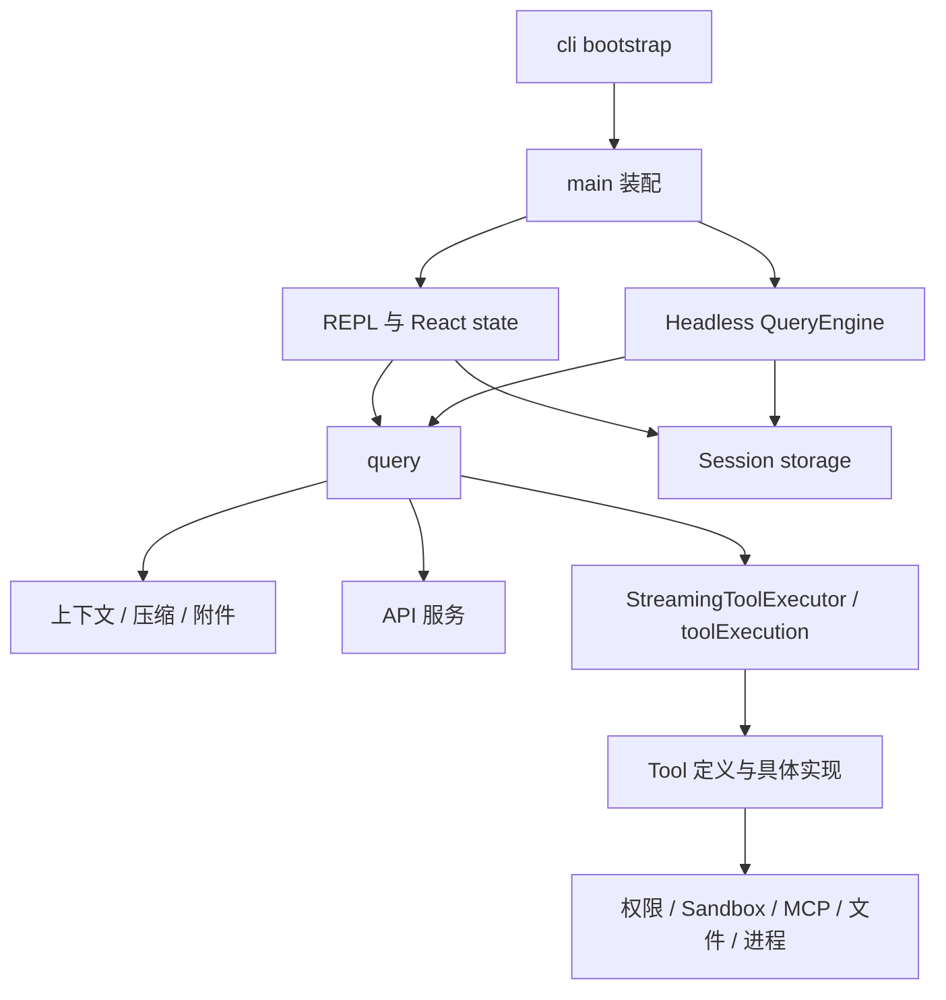
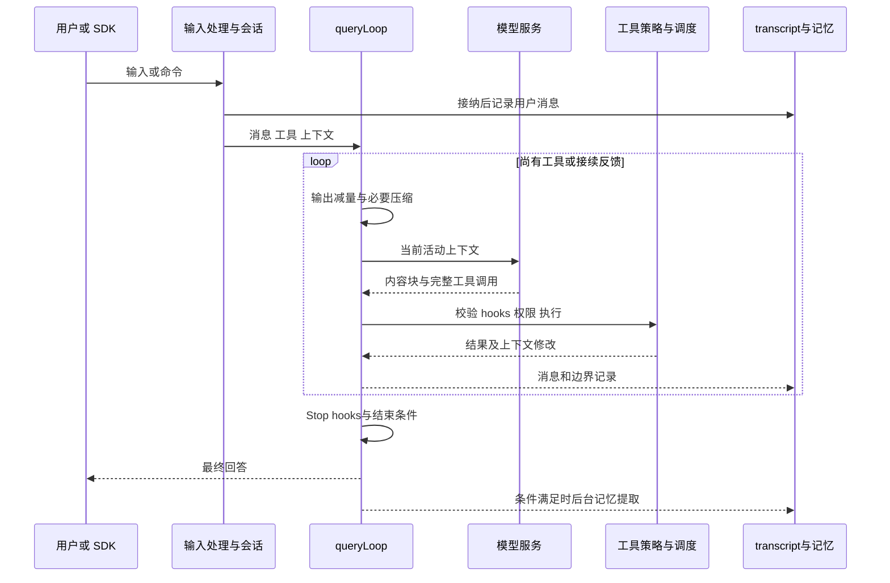

# Claude Code 2.1.88：从输入接纳到上下文重建、工具调度与记忆整理

> 核查日期：2026-09-21。对象是 2026-03-31 公开流出的 npm 包 source map 所对应的 **2.1.88 历史快照**，不是 9 月闭源产品的现行源码。提取镜像固定提交 `4e5426b82ab19c81244f165b4f18306944b8a169`。早期版本另见独立文档 [0.2.8](claude-code-v0.2.8.md)。

## 1. 阅读起点：它已经是围绕模型的完整运行系统

用户要求“改造项目取消逻辑，检查进程残留，保留已有修改”，实际上同时提出了几种要求：理解目标、定位代码、保存工作状态、受控执行、处理长输出、在长对话后保留约束，并能接受后续纠正。2.1.88 的主要复杂度正来自这些模型之外的职责。

因此不能只用“一个 while 循环加几个工具”解释它。循环依然是中心，但外围已经形成输入预处理、权限策略、工具调度、技能加载、MCP 发现、压缩、文件历史、子任务和记忆等协作层。它们共同组成 harness：决定模型每次看到什么、能做什么、执行结果如何回来，以及下一轮能否继续。

本次核对了镜像保留的 `artifacts/original/claude-code-2.1.88.tgz`：包名为 `@anthropic-ai/claude-code`，版本为 2.1.88；`cli.js.map` 有 4,756 个 source，去除依赖后 1,902 个应用 `src/` 文件全部存在，统一换行后与 `sourcesContent` 全部一致。原压缩包 SHA-256 为 `d836a86d9150ecc594a7025524c50e24080478904c979f386d447770275ef813`。[源码镜像与原始产物][archive]

这只能证明该镜像与其保留包体内部一致，不能证明拿到了完整内部仓库或全部线上配置。source map 会保留编译前源文，其中 `feature(...)` 分支可能没有进入外部分发构建；另外一些模块还依赖远端实验配置。本文分别说明**可读实现、启用条件、未能确认的部署状态**。公开提取物没有使原专有许可变成开源许可。

### 1.1 源码组织：分发产物中可见的是一个不断拆分的产品核心

本镜像根目录的提取脚本、展示页与说明不是 Anthropic 原始开发仓库的组成证据。能较可靠分析的是 source map 保留的应用 `src/` 依赖与原包中的发布入口；不能从中还原完整内部 workspace、CI、测试和服务端架构。下文的“仓库组织”限定为这套可验证的源码组织。

| 位置 | 职责 | 实际边界与集中点 |
| --- | --- | --- |
| `entrypoints/cli.tsx` → `main.tsx` | 轻量 bootstrap → 较重产品装配 | 前者动态导入保留快速路径；后者约 4,700 行，仍协调配置、入口、认证和 UI |
| `screens/REPL.tsx`、hooks、components、state | 交互会话与界面状态 | REPL 约 5,000 行，不是纯显示组件 |
| `QueryEngine.ts` | headless/SDK 会话应用服务 | 自持 messages、读文件缓存、用量和 abort；源码说 REPL 复用属于后续阶段 |
| `query.ts`、`query/` | 模型步骤、上下文处理、终止与继续 | 跨入口共享的主查询逻辑，以及 stop hooks 等局部模块 |
| `services/api/`、`services/tools/` | 模型请求与工具运行机制 | 重试、流式工具调度、权限执行的公共路径 |
| `tools/<Tool>/`、`Tool.ts`、`tools.ts` | 工具纵向实现、统一契约、产品注册 | 名称、schema、校验、权限、执行、展示共同组成一个工具 |
| `services/compact/`、`skills/`、`memdir/`、记忆服务 | 上下文、技能和长期材料的生命周期 | 检索 / 加载 / 摘要 / 写回是不同模块，不能一概视为 prompt |
| `utils/sessionStorage.ts`、`utils/fileHistory.ts`、tasks | 持久轨迹、文件快照、后台任务 | 不同状态有不同所有者和恢复条件 |
| `utils/permissions/`、`utils/sandbox/`、`services/mcp/` | 访问决策、执行约束、外部能力连接 | 共同服务工具循环，但不合并成一种权限 |

这些目录不是严格依赖分层。比如 `ToolUseContext` 包含 getAppState/setAppState、readFileState、abort、MCP、subagent 等能力；工具可以经它修改应用事实。`tools.ts` 为 Team 工具使用 lazy require 打破循环依赖，说明实际图并非一个理想的单向树。[Tool 契约](https://github.com/Shengfu-Zhang/claude-code-public-package-extract/blob/4e5426b82ab19c81244f165b4f18306944b8a169/src/Tool.ts) [工具装配](https://github.com/Shengfu-Zhang/claude-code-public-package-extract/blob/4e5426b82ab19c81244f165b4f18306944b8a169/src/tools.ts)

图中共享的是 query，不是已经完成统一的 QueryEngine。忽略这点会把真实双入口状态管理误写成理想架构。源码对 QueryEngine 的注释明确把 REPL 接入列为 future phase；本文按当前调用关系分析。[QueryEngine][engine]

### 1.2 为什么要同时看状态归属、feature gate 和加载时机

QueryEngine 保存 headless 对话的消息与缓存；REPL 保留交互滚动历史和 UI 状态；ToolUseContext 是向工具传递这些能力的载体，子 Agent 可以得到限制后的 setter，而后台任务又可能使用共享的 `setAppStateForTasks`。所以复制一个 context 对象不等于深度隔离所有状态，必须看哪些引用仍指向根会话。

模块加载也有产品含义。轻量 CLI 先处理 --version 等路径，再动态载入大系统；main 顶部先启动配置 / 凭据预取，再继续较重 import。`feature(...)` 控制构建裁剪，远端配置控制运行策略；提取的原始 source 可能保留未进入分发 bundle 的分支。能找到一个文件和能在普通用户会话启用它，是两种证据。

这套组织支持快速增加产品功能，但 `utils/`、ToolUseContext、main、REPL 仍是横向耦合点。不能仅因目录非常多就称为完全模块化的微内核；也不能因存在大文件就否认已经抽出的调度、压缩和服务边界。

### 1.3 一个新工具或新上下文策略，应该沿什么路线修改

增加工具需考虑 `Tool.ts` 的 schema / validateInput / checkPermissions / 并发 / 结果与展示契约，加入 `tools.ts` 及启用条件，再让公共 toolExecution 处理生命周期。若它返回 context modifier 或产生后台任务，还要决定修改子会话还是根应用状态，不能在工具内部任意读写全局 AppState。[工具执行][tool-exec] [流式调度][stream-tools]

修改压缩则需同时追踪 query 何时触发、compact 如何生成恢复材料、消息如何越过 compact boundary、sessionStorage 如何保留轨迹，以及 REPL / SDK 对历史裁剪的不同要求。修改自动记忆还要处理另一个生命周期，不能把 extractMemories 当成每次 compact 必然执行的一步。

替换终端界面时，可复用 query 和工具服务，但仍须提供 ToolUseContext 中的状态、权限与回调；单独复制 query.ts 不会得到完整产品。这里适合借鉴的是细粒度执行机制和长期会话政策；专有源码及残缺构建信息使“直接复用整个仓库”既没有许可基础，也没有可验证的工程闭环。

## 2. 启动与进入项目：先确定运行方式，再加载较重的系统

入口 `entrypoints/cli.tsx` 使用动态导入分流启动路径；`--version` 可以直接返回，特殊集成入口也不会先启动完整交互界面。这不是外观优化：工具模块会在导入时读取部分配置，启动顺序决定这些值是否已经就位。[启动入口][cli]

完整应用进入后，cwd、原始 cwd、配置来源、权限上下文、会话身份、工具目录与模型选择共同构成运行环境。项目相关数据不只放在仓库里：会话 transcript 按项目存入配置根下，CLAUDE.md / rules 可以位于项目中，自动记忆又有自己的项目命名空间。把所有数据统称为“项目目录”会掩盖它们不同的共享与持久化范围。

此版本存在交互 REPL 和 headless / SDK 两条入口。`QueryEngine` 明确承担 headless 会话生命周期，注释说将来才进一步供 REPL 使用。**不能画成所有界面已经统一调用 QueryEngine。** 两条路径的重要公共核心是 `query()`、工具执行和持久化设施。[QueryEngine][engine]

| 状态 | 关键内容 | 生命周期 |
| --- | --- | --- |
| AppState | 权限模式、MCP 客户端、任务等共享状态 | 应用 / 会话 |
| QueryEngine | 可变消息、文件读取缓存、累计 usage、取消控制器 | 一个 headless 会话，多个 submitMessage |
| ToolUseContext | 当前工具、模型、缓存、权限入口、agentId、上下文修改接口 | 查询及工具执行 |
| query State | 本轮历史、压缩追踪、重试状态、turnCount、转换原因 | 一次 agentic turn 内的多次模型调用 |
| transcript | 消息 UUID、parentUuid、边界与关联元数据 | 跨进程恢复 |

## 3. 首次组装背景：规范、长期记忆和技能目录分开进入

### 3.1 项目规范按照作用域发现

`utils/claudemd.ts` 明确处理 managed、user、project、local 几类说明；项目来源包括 `CLAUDE.md`、`.claude/CLAUDE.md` 和 `.claude/rules/*.md`，本地私有说明有 `CLAUDE.local.md`。从 cwd 向父目录发现规范，同时支持 `@` 引入和按路径条件匹配的 rules。[规范加载][claudemd]

这里的“优先级”有一部分体现为加载和提示排列顺序，并不意味着所有自然语言冲突都被宿主形式化消解。条件规则则有实际路径匹配代码；进入不同文件范围时可以补充有关说明。全量启动说明与后续按路径加载的内容，是两种不同的上下文成本。

### 3.2 自动记忆先加载小索引，再读主题文件

自动记忆以文件为基础。`MEMORY.md` 是索引，主题文件保存完整内容；入口限制同时检查 **200 行与 25,000 字节**，防止“行数少但单行极长”的索引绕过大小控制。模型先看到目录和简短线索，需要时再读取细节。记忆提示区分 user、feedback、project、reference 等类型，并提醒可从代码重新获得的事实不必机械重复保存。[记忆目录][memdir] [记忆类型][memory-types]

`isAutoMemoryEnabled()` 默认开启，但环境变量、bare 模式、无持久存储的 remote 环境及设置可以改变结果。这个默认只表示文件记忆能力启用，**不表示每一种后台提取 / dream 实验都默认运行**。[记忆路径与开关][memory-paths]

因此这里有三种不同材料：规范告诉 Agent 应当怎样做；长期记忆提供跨会话背景；当前消息保存这次实际发生的事。三者都影响模型，但不应使用同一覆盖策略。

### 3.3 Skill 的首次成本主要是发现信息

`loadSkillsDir.ts` 把技能和命令统一成 Command 风格对象，解析 description、allowed-tools、arguments、model、effort、hooks、paths、user-invocable、disable-model-invocation、`context: fork` 等 frontmatter。描述用于发现，正文在调用时进入上下文；资源包可以包含脚本与参考材料。[Skill 加载][skill-load]

所以 skill 的实现不只是“读取一个 Markdown”：它还决定谁能调用、参数如何替换、在哪个上下文执行、是否注册 hooks。完整正文若始终注入，很多技能会迅速挤占有效上下文；发现与展开分开，才使规模增长可承受。

## 4. 接纳一条输入：先转成可恢复事实，再进入模型循环

`processUserInput` 将普通文本、slash command 与附件等输入转成消息，返回是否还要请求模型、临时允许工具、可能的模型选择和本地结果。headless 的 `submitMessage()` 把新消息接入会话后，在默认持久化路径里**先记录用户输入，再进入 query**。[QueryEngine][engine]

源码注释给出了具体故障背景：如果用户发出请求后进程被停止，而直到 API 响应才写日志，恢复时可能找不到任何有效会话。先保存输入便能保留“用户已经要求了什么”。bare 路径为了启动成本使用异步写入，源码明确区分这两种行为，不能一概宣称每个入口都有同样的持久化时点。

此时还没有执行用户文字中提到的 shell 命令。用户输入首先是语义材料，只有后续模型形成完整工具调用，经过执行边界后，才会发生实际副作用。

## 5. 每次请求前：上下文不是简单拼接全部历史

`queryLoop` 把跨迭代可变状态放进显式 State，在 `while (true)` 中读取并更新。请求前先处理工具结果总量，再经过按条件启用的历史减量、microcompact、其他压缩分支以及 autocompact，最后形成模型请求材料。[主循环][query]

顺序有实际意义：先去掉过量工具正文，可能已经解除窗口压力，从而避免一次昂贵且有信息损失的摘要；反过来先摘要再减量，既浪费请求，也可能将无关大输出写进摘要。

压缩与缓存也存在冲突。清理旧消息会改变模型缓存前缀；`microCompact.ts` 的时间间隔路径在判断缓存已经冷却后清空部分旧工具结果，保留最近结果。缓存编辑路径还要求构建开关、模型支持与主线程来源，某些外部构建 / 子 Agent 不走这一分支，而由 autocompact 处理压力。[Microcompact][micro]

源码明确避免把子 Agent 的工具 ID 登记进主线程的缓存编辑状态：否则主线程可能试图删除自己从未持有的结果。这体现一个通用原则——上下文优化器必须知道自己处理的是哪条轨迹。

`HISTORY_SNIP`、`CONTEXT_COLLAPSE`、reactive compact 等名称在控制流中可见，但部分实现或完整启用配置不在这份提取物中。本文只据可见调用顺序解释接口与失败转移，不凭模块名称还原未知算法，更不把这些实验合并为普通用户默认流水线。

## 6. 模型开始返回后：完成一个工具块即可调度，但仍须通过执行边界

模型的流式内容会拆成事件与消息。启用 streaming tool execution 时，完整工具块进入 `StreamingToolExecutor`；调度器记录 queued / executing / completed 状态。未知工具直接产生匹配 tool_use_id 的错误结果。输入 schema 与 `isConcurrencySafe(input)` 决定是否可与当前执行中的工具并行。[流式工具调度][stream-tools]

这不等于把半截 JSON 直接执行：addTool 接收的是工具块，参数还要在统一执行路径里校验。流式执行的收益是模型继续输出其他内容时，先前完整动作已经可以开始；其复杂度是流失败、fallback、取消和迟到结果的清理。`discard()` 表示放弃旧调度器的结果轨迹，不代表已经产生的外部副作用可以撤销。

非流式路径的 `runTools()` 将连续的可并发调用分为一组，把不可并发调用当作串行屏障，默认并发上限为 10，可由配置环境改变。与 0.2.8 的“一项写调用使全批串行”相比，这能让写入前后的只读组各自并行。[批量调度][orchestration]

并发工具还可能返回 `contextModifier`。调度器先收集它们，再按原工具调用顺序应用；不让网络或磁盘完成时序随意决定共享上下文状态。这里保护的是上下文更新确定性，仍不等同于对所有文件副作用建立事务。

## 7. 真正执行之前：校验、Hooks、权限和沙箱分层协作

`toolExecution.ts` 统一处理工具存在性、输入解析、工具自身 `validateInput`、PreToolUse hooks、权限决策、实际执行、结果包装和后置处理。hooks 可以提供反馈、更新输入或参与权限判断；权限结果被归类并记录，不把“用户点击允许”“规则允许”“hook 决定”混成同一种来源。[统一执行链][tool-exec]

权限上下文存在 default、acceptEdits、plan、dontAsk、bypassPermissions，以及受条件控制的 auto 等分支。plan 是对当前工作模式和可执行行为的约束；它不是一个自动证明计划正确性的求解器。dontAsk 对需要询问的动作转为拒绝，也不等于全部允许。[权限实现][permissions]

文件编辑进一步检查读取状态、当前内容、匹配字符串与替换范围。相较只比较 mtime，2.1.88 针对“时间变了但内容没变”的场景增加完整读取内容比较，减少同步软件等造成的误拒绝；文件历史另用于跟踪修改。[编辑工具][edit]

### 沙箱是下一层，而不是权限弹窗的另一个名字

`sandbox-adapter.ts` 把设置与规则转换成 sandbox runtime 配置，包括读写路径、域名、socket、代理等，委托外部 sandbox runtime 实施系统限制。适配器检查平台支持与用户配置；本快照的提示明确指向 macOS、Linux、WSL2，不能因为 CLI 有 Windows 分支就宣称原生 Windows 具有同一沙箱实现。[沙箱适配][sandbox]

`shouldUseSandbox.ts` 决定某条 Bash 是否进入这一执行路径。excludedCommands 是便利配置，源码明确不将它当作安全边界；排除后仍需要经过相应权限流程。远程 MCP 服务也不因为本地 Bash 开了沙箱就自动受到约束。[Bash 沙箱选择][sandbox-choice]

这层架构的落地价值是把“能否执行”与“执行后最多能触及什么”分开配置。代价是配置转换、平台兼容和不同后端一致性都要维护，不能仅靠一个 sandbox 布尔值描述真实状态。

## 8. 执行中按需扩展：Skill、插件与 MCP 怎样接入同一循环

SkillTool 选择相应命令，加载正文，替换参数、技能目录和会话变量。普通上下文技能将指令交回主会话；`context: fork` 技能则交给独立 Agent 上下文，并回收结果。模型调用限制与用户可调用性分别设置，因此一个只允许用户主动运行的技能不该被发现器自动触发。[SkillTool][skill-tool]

本地技能可含运行前 shell 展开；远程 MCP skill 的 Markdown 不允许执行这种内联 shell 展开。这个差异直接写在加载器里，说明来源信息贯穿到执行语义，而不只是界面上的一个标签。[Skill 加载][skill-load]

插件把命令 / 技能、Agent、MCP 等资源组织在一个分发单元中，但运行时仍由相应加载器和工具执行层承接，不能认为安装插件后出现了另一套独立 Agent loop。插件提供内容和能力，harness 保持执行职责。

MCP 客户端支持 stdio、SSE、Streamable HTTP 等连接形态，处理认证、工具、资源和 prompt 映射。远程连接还需要 OAuth 刷新与 HTTP 接受类型等传输细节。这些失败属于连接层，不能由模型猜一个工具名解决。[MCP 客户端][mcp]

工具太多时，`ToolSearchTool` 面向 deferred tools，支持关键词检索及 `select:名字` 直接选择，返回命中的工具以供后续调用。发现减少首次 schema 负担，但增加“先发现再调用”的一次决策过程；完整工具列表、已发送 schema 与模型当前知道的工具必须保持一致。[工具搜索][tool-search]

MCP prompt 与 MCP skill 在 SkillTool 中被明确区分；不能因为名称相似，就认为任意服务器 prompt 都能经 SkillTool 被模型猜名调用。工具、资源、prompt、skill 的组织关系是转换和适配，不是协议定义已经合并。

## 9. 工作变复杂时：子 Agent、后台任务与 worktree 进入流程

AgentTool 可以设置子任务类型、前后台执行、cwd，并在支持的路径上选择 worktree 隔离。`runAgent.ts` 为子 Agent 建立 agentId、独立轨迹和工具上下文，记录初始消息及 agentType / worktreePath 元数据，再调用共享 `query()`。[AgentTool][agent-tool] [子 Agent 运行][run-agent]

与 0.2.8 的一次性搜索相比，这里已有恢复子 Agent 的身份基础；元数据用于恢复时选择正确类型与目录。前台 / 后台差异不仅是 UI 显示：生命周期、权限交互、完成通知和清理都需要区分。子 Agent 收尾会清理其拥有的后台 shell 任务，避免主任务已经结束而子进程继续存活。

worktree 解决的是代码工作副本互相覆盖的问题。它不是文件 / 网络 sandbox，也不自动合并结果。新副本是否携带未提交改动、结束时是否有修改、如何保留，都是单独的工作副本生命周期问题，不能由“有子 Agent”直接推导。

Agent 还可以拥有 user、project、local 三类持久记忆目录。它们按 Agent 类型命名，区别于每次运行的临时上下文和主 Agent 的项目记忆。[Agent 记忆][agent-memory]

对本项目开发者最有用的设计点，是将“并行执行实体”“历史轨迹”“工作目录”“记忆作用域”分别建模。把四者都塞进同一个 session ID，会让恢复、删除和共享语义混乱。

## 10. 长回合继续之前：压缩生成的不只是一个摘要字符串

`autoCompact.ts` 用模型上下文容量减去摘要输出预留，再考虑 13,000 token 的自动压缩缓冲；还有用户设置、模型窗口和启用条件。不能把某个固定百分比当作全部模型的永久规则。连续自动压缩失败有计数，达到 3 次后停止无效尝试。[自动压缩][auto-compact]

压缩输出是结构体：boundaryMarker、summaryMessages、可选 messagesToKeep、attachments、hookResults，以及前后 token / usage。`buildPostCompactMessages()` 固定这些材料的顺序。这说明“压缩之后有什么”是明确的重建协议，而非任意拼接摘要。[完整压缩][compact]

本快照至少需要区分以下路径：

| 路径 | 数据如何变短 | 对近期原文的处理 |
| --- | --- | --- |
| 工具结果预算 / microcompact | 减少旧工具正文，部分路径使用缓存编辑 | 保留近期结果，条件与主线程范围受控 |
| 常规完整 compact | 对当前历史生成摘要，再重建必要附件 | 不能默认说一定保留固定近期窗口 |
| Session Memory compact 实验 | 使用已维护的会话摘要，保留摘要水位后的材料并向前扩展 | 默认参数 minTokens 10K、至少 5 条含文本消息、maxTokens 40K；还需修正配对边界 |
| 部分 / reactive 等分支 | 由特定入口或故障恢复触发 | 存在保留段接口；未公开完整模块不推断其全部选区算法 |

Session Memory 的选区会照顾 tool_use / tool_result 配对，以及流式拆出的同一 API assistant message 的 thinking / text 块。token 截点若切断这些关系，压缩后即使语义上能读，也可能不满足 API 协议。[会话摘要压缩][sm-compact]

完整压缩后还会补回近期文件、计划模式、已调用技能、后台 Agent 与工具 / MCP 发现信息。这里既要防止遗忘当前执行约束，也要控制重注入成本；比如不简单重发整个技能列表。[完整压缩][compact]

保留的消息在磁盘上仍有原 parentUuid。压缩边界保存 headUuid / anchorUuid / tailUuid，恢复时重接活动链。没有这层元数据，重启可能重新装回压缩前全部历史，或丢失保留段。QueryEngine 在写边界前还确保保留尾部已记录，这解决的是“内存正确、磁盘不完整”的恢复问题。[QueryEngine][engine] [Transcript][session]

## 11. 模型说“完成”之后：Stop hooks 可以要求继续，记忆还有另一生命周期

没有工具调用的助手回复首先进入结束处理。Stop hooks 可产生阻断性反馈，主循环把这些消息加回去继续；也可明确阻止继续。循环带 stopHookActive 等状态，API 上下文过长等无效响应有专门退出路径，避免把错误再送入结束钩子形成无限追加。[Stop hooks][stop]

这实现了一种可插入的验证 / 反馈机制，但“hook 要求继续”不意味着任务已经通过独立验证。是否真的运行测试、检查外部结果，取决于具体 hook。计划模式、工具反馈、自我检查和外部验证不是同一种推理模式。

跨会话记忆又分三条线：

1. 主 Agent 按提示直接维护主题文件和索引，是可见文件记忆机制。
2. `extractMemories` 在回合结束时使用 forked agent 读取本轮材料，写入允许的记忆目录；若主 Agent 已写过该范围，则跳过重复提取。它有构建与远端开关，不可宣称默认所有用户都会调用。[后台提取][extract]
3. `autoDream` 跨多个会话整理记忆。设置 `autoDreamEnabled` 可覆盖远端开关；还检查自动记忆、运行模式、时间 / 会话数量和整理锁。它调用受限 forked agent，记录后台任务进度，而不是修改模型参数。[Dream 调度][dream] [Dream 开关][dream-config]

这类文件更新可称为经验积累或记忆整理，但还不是已证明的递归自我改进：源码中没有由此自动证明能力持续提升的完整评测、选优、回滚闭环。把 dream 直接写成 RSI 会混淆“整理经验”与“改进自身优化过程”。

Session Memory 则服务于同一长会话的连续性：它按照 token 压力、工具调用等条件更新会话摘要，供相应压缩路径使用。它与项目 MEMORY.md 的事实沉淀不能混为一谈。[Session Memory][session-memory]

## 12. 保存、恢复与再次追问：轨迹有树形身份，外部世界没有自动回滚

`sessionStorage.ts` 保存 JSONL transcript，区分主会话、Agent sidechain 和元数据。消息以 UUID / parentUuid 表达因果链；并非所有进度条目都参与链。写入队列、flush、去重和压缩保留段恢复共同支持多轮接续。[Transcript][session]

headless QueryEngine 每次 submitMessage 开新 turn，但保留消息、缓存和累计 usage；交互 REPL 则有自己的状态接续。恢复的不仅是给用户看的文字，还包括会影响后续请求的关联事实。但恢复日志不等于重放 shell 副作用，也不自动撤销上一次修改，外部文件和服务仍需重新观察。

以上述修复任务为例，理想路径是：保存用户要求 → 加载项目规则和必要记忆 → 搜索与读文件 → 形成完整编辑调用 → 经 hooks / 权限 / 工具校验执行 → 实际测试 → 把输出反馈给模型 → 压缩时保留当前约束与证据入口 → 结束检查 → 保存可恢复轨迹 → 适用时沉淀经验。每一个箭头都有明确宿主代码，而不是全靠一句系统提示。

## 13. 从这个版本能提炼的设计判断

它最值得研究的不是工具数量，而是四种职责已经开始明确分开：**原始轨迹与活动上下文、语义材料与执行能力、许可决定与系统隔离、当前任务状态与跨会话记忆。** 各自有单独的结构和生命周期，才支撑长任务与多入口。

复杂度同样真实：多入口未完全统一，功能开关和实验路径很多，缓存与压缩互相影响，后台任务增加清理与恢复责任。复制整套目录并不自动获得成熟产品；更合理的复用是选择能够解决当前问题的机制，再保持自身行为一致。

本次静态核查覆盖上文主要链路及关键分支，未执行该历史包、未验证线上 feature flag、未测量真实模型成本 / 质量，也没有获得 2026 年 9 月闭源代码。来源完整性与运行正确性分别陈述，不用镜像文件数量代替架构结论。

[archive]: https://github.com/Shengfu-Zhang/claude-code-public-package-extract/tree/4e5426b82ab19c81244f165b4f18306944b8a169
[cli]: https://github.com/Shengfu-Zhang/claude-code-public-package-extract/blob/4e5426b82ab19c81244f165b4f18306944b8a169/src/entrypoints/cli.tsx
[engine]: https://github.com/Shengfu-Zhang/claude-code-public-package-extract/blob/4e5426b82ab19c81244f165b4f18306944b8a169/src/QueryEngine.ts
[query]: https://github.com/Shengfu-Zhang/claude-code-public-package-extract/blob/4e5426b82ab19c81244f165b4f18306944b8a169/src/query.ts
[claudemd]: https://github.com/Shengfu-Zhang/claude-code-public-package-extract/blob/4e5426b82ab19c81244f165b4f18306944b8a169/src/utils/claudemd.ts
[memdir]: https://github.com/Shengfu-Zhang/claude-code-public-package-extract/blob/4e5426b82ab19c81244f165b4f18306944b8a169/src/memdir/memdir.ts
[memory-types]: https://github.com/Shengfu-Zhang/claude-code-public-package-extract/blob/4e5426b82ab19c81244f165b4f18306944b8a169/src/memdir/memoryTypes.ts
[memory-paths]: https://github.com/Shengfu-Zhang/claude-code-public-package-extract/blob/4e5426b82ab19c81244f165b4f18306944b8a169/src/memdir/paths.ts
[skill-load]: https://github.com/Shengfu-Zhang/claude-code-public-package-extract/blob/4e5426b82ab19c81244f165b4f18306944b8a169/src/skills/loadSkillsDir.ts
[skill-tool]: https://github.com/Shengfu-Zhang/claude-code-public-package-extract/blob/4e5426b82ab19c81244f165b4f18306944b8a169/src/tools/SkillTool/SkillTool.ts
[mcp]: https://github.com/Shengfu-Zhang/claude-code-public-package-extract/blob/4e5426b82ab19c81244f165b4f18306944b8a169/src/services/mcp/client.ts
[tool-search]: https://github.com/Shengfu-Zhang/claude-code-public-package-extract/blob/4e5426b82ab19c81244f165b4f18306944b8a169/src/tools/ToolSearchTool/ToolSearchTool.ts
[stream-tools]: https://github.com/Shengfu-Zhang/claude-code-public-package-extract/blob/4e5426b82ab19c81244f165b4f18306944b8a169/src/services/tools/StreamingToolExecutor.ts
[orchestration]: https://github.com/Shengfu-Zhang/claude-code-public-package-extract/blob/4e5426b82ab19c81244f165b4f18306944b8a169/src/services/tools/toolOrchestration.ts
[tool-exec]: https://github.com/Shengfu-Zhang/claude-code-public-package-extract/blob/4e5426b82ab19c81244f165b4f18306944b8a169/src/services/tools/toolExecution.ts
[permissions]: https://github.com/Shengfu-Zhang/claude-code-public-package-extract/blob/4e5426b82ab19c81244f165b4f18306944b8a169/src/utils/permissions/permissions.ts
[edit]: https://github.com/Shengfu-Zhang/claude-code-public-package-extract/blob/4e5426b82ab19c81244f165b4f18306944b8a169/src/tools/FileEditTool/FileEditTool.ts
[sandbox]: https://github.com/Shengfu-Zhang/claude-code-public-package-extract/blob/4e5426b82ab19c81244f165b4f18306944b8a169/src/utils/sandbox/sandbox-adapter.ts
[sandbox-choice]: https://github.com/Shengfu-Zhang/claude-code-public-package-extract/blob/4e5426b82ab19c81244f165b4f18306944b8a169/src/tools/BashTool/shouldUseSandbox.ts
[agent-tool]: https://github.com/Shengfu-Zhang/claude-code-public-package-extract/blob/4e5426b82ab19c81244f165b4f18306944b8a169/src/tools/AgentTool/AgentTool.tsx
[run-agent]: https://github.com/Shengfu-Zhang/claude-code-public-package-extract/blob/4e5426b82ab19c81244f165b4f18306944b8a169/src/tools/AgentTool/runAgent.ts
[agent-memory]: https://github.com/Shengfu-Zhang/claude-code-public-package-extract/blob/4e5426b82ab19c81244f165b4f18306944b8a169/src/tools/AgentTool/agentMemory.ts
[micro]: https://github.com/Shengfu-Zhang/claude-code-public-package-extract/blob/4e5426b82ab19c81244f165b4f18306944b8a169/src/services/compact/microCompact.ts
[auto-compact]: https://github.com/Shengfu-Zhang/claude-code-public-package-extract/blob/4e5426b82ab19c81244f165b4f18306944b8a169/src/services/compact/autoCompact.ts
[compact]: https://github.com/Shengfu-Zhang/claude-code-public-package-extract/blob/4e5426b82ab19c81244f165b4f18306944b8a169/src/services/compact/compact.ts
[sm-compact]: https://github.com/Shengfu-Zhang/claude-code-public-package-extract/blob/4e5426b82ab19c81244f165b4f18306944b8a169/src/services/compact/sessionMemoryCompact.ts
[stop]: https://github.com/Shengfu-Zhang/claude-code-public-package-extract/blob/4e5426b82ab19c81244f165b4f18306944b8a169/src/query/stopHooks.ts
[extract]: https://github.com/Shengfu-Zhang/claude-code-public-package-extract/blob/4e5426b82ab19c81244f165b4f18306944b8a169/src/services/extractMemories/extractMemories.ts
[dream]: https://github.com/Shengfu-Zhang/claude-code-public-package-extract/blob/4e5426b82ab19c81244f165b4f18306944b8a169/src/services/autoDream/autoDream.ts
[dream-config]: https://github.com/Shengfu-Zhang/claude-code-public-package-extract/blob/4e5426b82ab19c81244f165b4f18306944b8a169/src/services/autoDream/config.ts
[session-memory]: https://github.com/Shengfu-Zhang/claude-code-public-package-extract/blob/4e5426b82ab19c81244f165b4f18306944b8a169/src/services/SessionMemory/sessionMemory.ts
[session]: https://github.com/Shengfu-Zhang/claude-code-public-package-extract/blob/4e5426b82ab19c81244f165b4f18306944b8a169/src/utils/sessionStorage.ts
