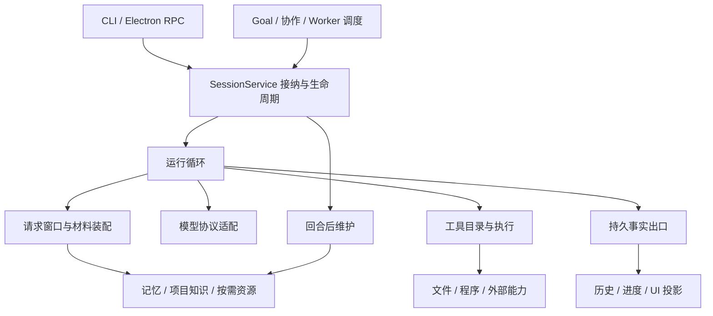

# 从四个 Coding Agent 的演化看本项目：按核心模块的设计总结

> 日期：2026-09-21。依据为本目录八篇固定版本源码分析，以及当日本项目工作区的实际代码、M3 进度与压缩第二版。本文是研究总结和设计建议，不是新的实施计划，不改变既定模型、执行方式和开发阶段。其他任务仍在修改工作区，本项目结论以本次读取位置为准。
>
> 版本、完整 SHA 和材料可信度见 [源码调研索引](README.md)。Claude Code 的两份材料是历史发布包映射，不能证明 2026 年 9 月闭源产品内部仍保持同一实现；两个快照也不能还原各项目全部中间版本。

## 1. 总体判断与本项目现在的位置

对本项目最有价值的参考，是把一个已经能完成编码任务的 Agent，逐步变成能跨多轮、长任务、后台维护和中断恢复保持一致行为的产品。四个项目的演化共同说明：**模型—工具循环可以相对简单，真正不断增加的复杂度来自状态由谁持有、材料何时进入模型、执行何时可以提交，以及多个工作单元如何接续。**

我的建议是保留现有 Python 核心与 Electron 边界，继续围绕已经实现的服务演进：从 Pi 借鉴内核与资源层的分工，从 DSH 借鉴运行事实、请求视图与执行 provider 的关系，从 Hermes 借鉴跨会话记忆和技能维护的生命周期，从 Claude Code 借鉴项目知识的渐进装载、工具执行链和复杂回合的交互控制。每个来源都同时提供正面机制与需要避免的成本。

### 1.1 当前已经具备什么

以下依据实际入口与源码，不把旧规划中的“未实施”当作当前状态。

| 模块 | 当前实现事实 | 对研究建议的影响 |
| --- | --- | --- |
| 运行核心 | `run_loop` 依赖 ModelClient、ToolExecutor、RunSink；生产 CLI 与 RPC 都经 `build_sessions` 装配 | 已有可复用核心，应继续维持入口与业务分离 |
| 项目与工作组织 | 已有 project、task、session、run、goal，以及用户安排的协作和可选内部 worker | 接下来主要是完善这些实体的交接语义，而不是重新引入一套任务框架 |
| 会话事实 | RunAccepted、RequestStarted、AssistantCommitted、工具及终态等事实追加保存；展示流与持久事实分开 | 已有事件化基础，不需要为了借鉴 DSH 先重写为另一种事件系统 |
| 上下文 | 已有 checkpoint、完整工具边界、持久工具预览、token 计量、归档与历史回读 | 重点转向材料质量、来源可发现性和真实使用效果 |
| 长期记忆 | 已有项目 / 全局范围、修订、替代、时间、召回、纠错、遗忘和空闲维护；关联 / 自动知识页可选 | 重点是减少错误知识传播，并提高有用知识的命中与更新 |
| 工具与执行 | 文件、命令、服务、网页等已接通；工具串行执行；文件修改有基线与写前变化检查 | 并发与新后端应在现有执行事实之上增加 |
| Skill / MCP | 已有六种包内工作方法；当前生产装配未发现用户 Skill 资源加载器或 MCP 客户端链 | 这是明确的扩展空间，但内置方法不能直接称为完整 Skill 系统 |
| 项目规范载入 | 当前系统提示、任务材料和记忆已装配；没有发现目标项目 AGENTS.md / SKILL.md 的自动加载链 | 仓库内规范约束开发本应用的助手，不代表本应用已自动读取目标项目规范 |
| Sandbox | 本机直接执行已实现；选择尚未提供的 sandbox 会明确失败，不静默回退 | 继续如实表达执行能力；Docker / WSL 规划不能写成已接通 |

代码入口见 [装配][local-bootstrap]、[主循环][local-loop]、[会话服务][local-sessions]、[上下文服务][local-context]、[记忆服务][local-memory]、[环境选择][local-environments]。M3 的既有验证见 [阶段进度][local-progress]；本轮没有重新运行那些检查。

### 1.2 怎样理解四条演化路径

| 项目与两个样本 | 可观察到的变化 | 对本项目的主要启发 |
| --- | --- | --- |
| Pi：0.50.0 → 9 月主线 | 已有 AgentSession / SDK / 会话树，继续增加协议、缓存、工具调度和资源能力；另建新 Harness，当前 CLI 仍使用原主链 | 保留稳定入口，通过清楚的接口逐步迁移；新抽象存在不等于产品已迁移 |
| Hermes：3 月 → 9 月 | 集中的 AIAgent 与文件记忆，演进出 phase、turn lease、项目登记、memory provider、context engine 和后台 review | 长期助手的难点逐渐从“怎么调用模型”转向跨入口、跨时间的状态和维护 |
| Claude Code：0.2.8 → 2.1.88 | 从 REPL + query 递归反馈，演进出流式工具调度、多层上下文整理、Skill、Hooks、任务与记忆服务 | 大量价值来自围绕核心循环完善产品行为；也要警惕入口、工具上下文与全局服务耦合 |
| DSH：rc.7 → alpha.2 | 已有服务组合与事件 / surface，继续拆出 durable Inbox、attempt 结算、受管进程 PTC、投影缓存等 | 不断明确哪些是可重建视图、哪些是持久事实、哪些由执行后端拥有 |

“变化背后的压力”在后文属于架构推断，依据接口、默认装配和数据流分析，不冒充维护者对每次变更的官方动机说明。四个产品定位不同、两个样本间隔也不同，不能据此排列统一成熟度或比较开发速度。

## 2. Harness 与仓库组织：围绕状态所有权拆模块

### 2.1 演化说明了什么

Pi 较早就把模型协议、通用 Agent 与 coding 产品分包，但 AgentSession 仍协调会话、压缩、资源和界面相关能力。9 月另有新 Harness，并未让 CLI 自动获得整套新内核。Hermes 则从较大的 AIAgent 拆出 phase / mixin，但这些函数仍依赖同一个 agent 的共享字段。Claude 2.1.88 的 query 周边模块更多，QueryEngine 此时仍主要用于 headless；REPL 尚未统一到它。DSH 的服务契约、provider 和 consumer 提供更强的组合能力，同时付出动态依赖、插件卸载及发布闭包成本。[Pi 两版][pi-old] [Pi 新版][pi-new] [Hermes 新版][hermes-new] [Claude 新版][claude-new] [DSH 新版][dsh-new]

因此，“文件拆小”与“边界清楚”是两件事。一个函数拆到新文件，却继续读写三十个宿主字段，调用者仍无法从接口判断它需要什么、改变什么。反过来，一个几百行的串行循环，只依赖模型、工具与事实出口，可能更容易理解和替换。

### 2.2 本项目应该怎样吸收

当前 `runtime/loop.py` 约 300 行，依赖方向已经比较清楚；值得保持。主要协调成本在 `SessionService` 与其连接的 Goal、context、memory、collaboration、delegation 服务：接纳、预算、取消、等待、压缩和结果结算都在这里交接。建议随实际修改逐步明确这些交接接口，优先让“准备请求”“运行”“结算”“回合后维护”各自拥有可说明的输入与结果。[主循环][local-loop] [会话协调][local-sessions]

例如修改压缩策略，应主要影响 `ContextService.prepare`、窗口投影与 checkpoint；不应要求 Electron、Goal 驱动和每个工具同时理解切点算法。新增记忆来源，应进入记忆召回和材料清单，而不是在多个请求入口各拼一次提示。这种“改一个机制会牵动哪些地方”的检查，比按文件行数机械拆分有用。

`bootstrap.py` 当前用一层层 ToolExecutor wrapper 接入文件、程序、网页、协作、上下文、记忆与 worker。这在当前规模能够工作。如果之后加入 Skill / MCP，新增工具经常需要调整多层转发，才值得集中成显式工具目录 / registry；不要直接引入与 DSH 相同规模的插件容器。新增能力仍在一个装配根连接，保持核心不反向导入 RPC 或 Electron。[装配根][local-bootstrap]

建议保留的职责关系如下；它描述现有边界及演进方向，不要求立即创建新目录或空接口：

近期价值是减少修改传播与隐含状态，不是追求包数量。多宿主、多 provider 或第三方插件成为真实需求时，再评估更通用的 Harness 接口。

## 3. 项目、任务、会话与输入：身份比聊天数组更重要

### 3.1 上游怎样演化

Claude 早版主要围绕 cwd、项目配置、REPL 消息和日志分支；新版多出子任务、后台任务、复杂队列和 worktree。Hermes 从 cwd / task_id 执行分组进一步发展到项目登记、profile 作用域和会话租约。Pi 的会话树提供分支与恢复，但不天然等于项目任务管理系统。DSH 将 Workspace、Session、Agent 分开，新版又把待处理输入放到 durable Inbox 中。[Claude 早版][claude-old] [Hermes 早版][hermes-old] [Hermes 新版][hermes-new] [Pi 早版][pi-old] [DSH 两版][dsh-old] [DSH 新版][dsh-new]

共同问题是：用户在工作中追加要求时，这条输入是否保存了，属于哪次任务，何时生效，重启后还在不在。仅保存“最后一份聊天文本”难以回答这些问题。DSH 9 月发布仍专门修复待处理 Inbox 重启恢复，也说明这不是建立一个队列变量就解决的能力。[官方发布说明][dsh-release]

### 3.2 本项目已经走在正确方向上

project 保存工作地点和关联配置，task 保存共同目标 / 决定 / 工作进度，session 保存一条对话轨迹，run 保存一次实际运行，goal 驱动跨 Run 持续推进。`operation_id` 用于输入幂等，`run_id` 用于执行归属；这些身份不应合并成一个“聊天 ID”。`SessionService.start` 先保存 RunAccepted 再启动；Goal 插话通过 GoalInputQueued 保存并在完整边界让出。[会话服务][local-sessions] [Goal 驱动][local-goals]

应该继续明确三类输入：新工作请求、正在执行时的补充 / 纠正、其他工作单元送来的参考材料。它们可以共享一部分基础设施，但不能都自动变成新的最高优先级用户指令。尤其是协作结果、旧 Goal、压缩摘要和长期记忆，应该维持来源身份。

本项目当前插话机制主要围绕 Goal 的安全让出；如果以后希望普通长 Run 也支持更细的 steering，应扩展这套输入接纳语义，而不是让 UI 直接修改运行中的 messages。需要说清的是“下一次模型请求生效”与“立即取消在途请求”两个不同动作，避免用户以为已停止的命令仍在执行。

### 3.3 保留原目录协作，按需要提供副本

上游的 fork、子 Agent、session tree 和 worktree 服务不同目的。继承上下文不产生文件副本，项目登记不产生 OS 隔离，会话租约也不锁住其他会话的全部文件。对本项目，继续遵循已选定的原目录工作方式，依靠分工、交接、文件冲突反馈和已有变更记录协作；独立副本只在用户选择时提供。

未来若出现多进程共同推进同一会话，Hermes / DSH 的租约与持有者检查才成为直接参考。目前已有应用数据单写者与会话锁，不需要提前叠加分布式租约系统。

## 4. 模型适配、推理与流式输出：协议正确性归宿主

### 4.1 从“能发请求”到“能完整接续”

Pi 的跨模型协议层持续处理消息转换、reasoning 和停止原因；新版会避免执行因 length 截断而不完整的工具轮。Claude 在后期允许完整工具块就绪后开始调度，缩短工具等待，但要配套流式调度器、权限和取消。DSH 则从旧版逐 chunk 事件转向新版 attempt 的实时帧与最终结算分工。[Pi 新版][pi-new] [Claude 新版][claude-new] [DSH 早版][dsh-old] [DSH 新版][dsh-new]

这些变化说明三种对象应分开：用户看见的文本 / 思考、模型续接需要的原生状态、已完成且可以执行的工具调用。可见文字已经出现，不意味着这一轮协议完整；完整工具参数已经出现，也不等于宿主已执行成功。

### 4.2 本项目应保留的实现

`GoClient` 已把正文、可见 reasoning 与 native 续接分别保存，只有解析完整结束原因和工具参数之后才返回 ModelTurn。`run_loop` 保存 AssistantCommitted 后才执行工具；`ServiceSink` 的 text / reasoning delta 主要服务实时展示，最终事实负责持久接续。这些设计与较新上游的方向一致，值得保持。[模型响应][local-model] [运行事实][local-loop] [展示与提交][local-sessions]

不建议为了降低一次工具启动时延，立即把“完整模型响应后执行”改成边收流边执行。只有观测到这段等待构成明显成本时，才增加工具块级的完成、取消和结算语义；参数不完整时仍不能执行。也不应为了压缩 token 无条件删除 native reasoning 字段，因为 provider 可能把它作为合法续接的一部分。

本项目继续使用已选定的两个模型和 Go 服务。Pi / Hermes 的多 provider 能力可以帮助检查协议边界，不构成新增 provider、自动切换或自动重试的理由。

### 4.3 推理能力应放在合适层次

“思考文本更多”“effort 更高”“采用计划—执行—重规划”不是同一件事：前两者与模型协议 / 预算相关，后者与任务组织及反馈有关。建议保持以下分工：

| 对象 | 应放在哪里 | 不应混淆什么 |
| --- | --- | --- |
| 模型支持的 reasoning / 输出参数 | 模型适配与运行配置 | 不假定不同模型支持同一参数或同一含义 |
| 模型—工具反馈循环 | runtime loop | 不能只靠提示伪造工具执行事实 |
| Plan–Execute–Replan、诊断、审查 | 工作方法、Goal 与任务状态 | 方法建议不等于额外权限，也不保证已有完整自主规划器 |
| Self-Ask 的子问题与资料查找 | 工作方法、已有检索工具；必要时已有 worker | 分解问题不必每次创建子 Agent |
| 向用户询问缺失信息 | 已有 HITL / 输入接纳 | 不能把普通内部推理包装成反复审批 |

更完整的工作流应用见第 11 节。

## 5. 上下文管理：从压短聊天发展到选择正确材料

### 5.1 上游变化的主线

Claude 从早期手动摘要形成新分支，演进为工具减量、自动压缩、摘要后的恢复材料与其他受条件控制的路径。Pi 将树状历史与当前分支窗口分开，压缩时保留完整边界、近期原文与分支摘要。Hermes 将早期中段摘要发展成上下文引擎、预处理、减量和受控提交；一些减量独立于摘要采用。DSH 从一开始就分 log / surface / request，新版又让系统提示变化参与可追溯投影，并按图片与模型路线调整计量。[Claude 两版][claude-old] [Claude 新版][claude-new] [Pi 两版][pi-old] [Pi 新版][pi-new] [Hermes 新版][hermes-new] [DSH 新版][dsh-new]

共同价值不在“使用哪个摘要提示”，而在把以下职责拆开：

1. **原始记录**保存当时实际收到的材料。
2. **有效工作窗口**决定本次需要的摘要、尾部和回读片段。
3. **请求投影**满足具体模型的角色、工具配对和原生续接要求。
4. **材料清单与用量**解释究竟发送了什么、为什么占用这些空间。

这些层可以共享存储与代码，不要求建立四套数据库。

### 5.2 本项目已经采用了哪些关键机制

当前 `ContextService.prepare` 在发送前装配有效窗口，按 token 压力维护后再检查实际可用容量。checkpoint 保存 through_seq，原始事件不改写；`window.groups` 按完整工具配对选切点；旧工具预览按 seq 持久保存，新输入不会自动把已减量正文全部装回。自动整理与手动整理采用不同的近期保留策略。[上下文装配][local-context] [窗口与切点][local-window]

因此，不应再把“建立压缩”“从字节改 token”“压缩后还能回读”作为从零新增建议。128K 起点、近期目标、工具预览和摘要目标已经是可调政策；它们分别服务维护时机、尾部保留、结果长度与摘要正文，不是一个万能压缩比例。判断效果应比较同一输入快照，不能拿摘要后的估计与若干轮之后的实际 usage 直接相减。

### 5.3 现在最值得加强的是摘要取材和回查线索

当前 `_compact` 先保存工具预览，再从 `projected_records` 构造摘要输入。这意味着某个旧工具结果的中段虽然仍在原始事件中，却可能在摘要模型概括之前已经被裁去。这里存在两个不同需求：主模型窗口需要短预览，摘要模型在容量允许时需要看到被总结前缀中更完整的证据。建议后续把这两个取材路径分清，仍只读取实际选中范围，必要时按真实容量分批。[具体取材顺序][local-context]

例如一个长日志的中部含真正错误，而头尾都是正常启动信息。短预览可以帮助主模型知道“这是一份日志，可回读”，但不能让摘要直接推断“日志没有错误”。本项目已提示省略内容不代表不存在；进一步改善取材，才能减少提示本身无法弥补的信息损失。

摘要还应保留少量“尚未展开的主题 / 精确内容 → 来源”的线索。不是把全部 seq、工具参数和日志再次塞进摘要，而是让下一轮知道哪里可能有答案。例如“Windows 退出清理仍待核实，原始失败结果见某次运行”，比“已检查过退出逻辑”更可接续。来源线索错误应返回可修正反馈，不必变成摘要准入评分或任务执行门槛。

### 5.4 活跃证据、稳定前缀与按需读取

“结果已经被一个助手回复消费”不等于“这个结果之后不再重要”。本项目当前以此识别可减量工具输出，规则简单，但调试中的关键栈、正在对照的 diff 和未解决反例可能仍属于活跃材料。可以结合当前工作范围改善选取，而不是永久保留所有搜索 / 命令结果，或要求用户逐条 pin。[减量候选][local-window]

缓存方面，Hermes 和 Pi 提醒我们：频繁重建长系统前缀会抵消部分上下文收益。本项目每次请求会刷新共同任务、记忆与协作材料，应区分稳定产品指令和易变参考材料，并观察实际缓存使用；不应为缓存冻结已经被用户纠正的知识，也不能不顾当前 Chat Completions 协议直接照搬 DSH 的系统消息历史形式。

检索也先走现有 read_file / search / read_history / 归档路径。只有出现“不同表述反复找不到同一内容”“大型仓库符号关系确实难查”等真实样本，再分别评估语义召回、符号索引或检索 worker。它们解决的问题不同，不能用安装向量库代替完整材料装配。

## 6. 记忆与自进化：先让经验可纠正，再谈递归改进

### 6.1 四个项目并没有同一种记忆系统

Hermes 早版就明确区分 MEMORY / USER 文件、历史查询和 Skill；新版再加入 provider、后台复盘、并发控制及历史分层读取。Claude 早版主要依靠项目说明和日志，甚至存在但禁用的 MemoryWrite；2.1.88 可见自动记忆和 dream 路径，但具有运行条件与功能开关。Pi / DSH 的会话持久化、项目资源和 Skill 不应直接算作同等的自动个人长期记忆。[Hermes 两版][hermes-old] [Hermes 新版][hermes-new] [Claude 两版][claude-old] [Claude 新版][claude-new] [Pi 新版][pi-new] [DSH 新版][dsh-new]

对我们最重要的区分是：任务进度记录当前做到了哪里，长期记忆保存可复用事实，经验手册保存条件化做法，Skill 保存可调用的程序性知识。把每次失败、临时工具不可用或模型自述都升级成长期事实，会让后续任务越用越偏。

### 6.2 当前实现的重点已经转向质量

本项目已经有来源、修订、有效期、supersedes、相关条目、用户编辑保护和删除传播；维护会按新材料寻找相关旧条目，支持同 ID 纠正 / 停用。召回使用词法、结构和可选关系，自动召回与手动关键词查找也已区别处理。无需再把“记忆放 JSON”“增加一个检索方法”当作主要建议。[记忆维护][local-memory] [召回与替代][local-memory-store]

近期更有价值的是观察三种质量：是否把助手猜测当事实，用户纠正后是否仍带入旧结论，当前任务是否找到真正相关的经验。前两者主要靠来源区分与更新生命周期；第三种才可能需要更强检索。不能因为词法召回有局限，就直接推断引入 embedding 能解决错误记忆。

### 6.3 后台维护必须服从前台工作

Hermes 的新版本专门处理前台回合抢占 review、会话租约与 profile 传播，说明维护任务已经成为真正的并发参与者。Claude 的 dream 也有整理锁与独立任务状态。本项目现有维护只在前台和 Goal 空闲后启动，并与普通运行分开保存费用及失败状态，这是合理起点。[Hermes review][hermes-new] [Claude dream][claude-new] [本项目维护调度][local-memory]

如果以后把维护做得更实时，应明确它读取哪个历史前缀、能修改哪些记忆版本、前台纠正如何使过时结果失效。优先复用已有修订与取消，不为正常提取增加第二个审核模型或逐条审批。用户确定的变化应能及时纠正，维护失败也不应让下一次普通编码任务自动失败。

### 6.4 自进化与 RSI 对我们意味着什么

四份产品样本能直接支持的是经验整理、技能更新、插件 / 工具扩展和工作策略变化。Hermes 写出新 Skill、Claude 整理记忆、DSH 运行 Ralph 或安装插件，都不自动证明能力提高，更不等于模型权重递归优化。

本项目可以沿下面的顺序理解“变得更会做事”：先记录在什么场景下哪种做法有效；再把稳定经验整理成可调用方法 / Skill；之后在明确任务样本上比较不同版本的成功率、成本与重复劳动，并允许撤回无效修改。只有进一步允许改进系统修改自己的改进策略，才涉及更强意义的 RSI。广义研究见 [自进化专题](../03-self-evolution.md)。

这个顺序不要求立刻建立常驻优化器。当前适合把经验维护质量做好；正式 Skill 导出、策略搜索和递归优化属于后续具体需求。不能用“Agent 自称经验更好”代替独立任务结果，也不能把所有日常工作强制纳入一套自演化评测流程。

## 7. 工具系统：从功能集合走向可调度、可解释的执行单元

### 7.1 演化主要发生在调度和结果语义

Pi 以少量文件 / 命令工具构成有效编码闭环，随后增加工具执行控制和操作替换接口。Hermes 从自注册 registry、主链顺序执行，演进到识别实际文件目标的并行段与屏障；MCP 并发还有显式条件。Claude 新版把输入校验、Hooks、权限、执行和结果包装集中到执行链。DSH 从 registry 到 rolling pool / 独占屏障，再让 PTC 复用同一工具能力。[Pi 两版][pi-old] [Pi 新版][pi-new] [Hermes 两版][hermes-old] [Hermes 新版][hermes-new] [Claude 新版][claude-new] [DSH 两版][dsh-old] [DSH 新版][dsh-new]

这说明增加工具数量只完成了“能做什么”，还需要回答：何时执行、能否并行、输出是否完整、失败怎样反馈、取消后哪些副作用已经发生。工具不是一个函数名加 JSON schema 就结束了。

### 7.2 本项目的近期方向

当前 ToolExecutor 提供 definitions、is_mutating、execute；主循环串行执行，按 ToolStarted / ToolCompleted 保存事实，并区分可修正输入问题与实际执行失败。这能保持顺序和停止语义，暂时没有理由仅因上游支持并行就整体更换。[工具契约][local-tools] [主循环][local-loop]

更优先的是让结果表达稳定：操作状态、退出码、是否截断、原文 / 归档入口与可修正原因应各自清楚。比如“命令正常执行但测试未通过”不同于“进程无法启动”，写前发现文件变化不同于保存失败。新工具应复用这些语义，不自己决定静默重试、吞错或切换执行方式。

随着工具来源增加，可以将目录集中管理，使 UI 展示、模型 schema、执行路由和默认启用范围都从同一份注册事实得到。无需给每种来源再加一层不同的通用框架，也不需要让模型掌握宿主内部模块结构。

### 7.3 并发只在收益明确时增加

最适合先并行的是互不依赖的只读操作或明确不同目标的操作。参考 Hermes，需要考虑真实 patch 目标，而非只看工具名称；参考 DSH，需要同时设计执行顺序、结果提交顺序、独占屏障与取消排空。任意 shell 命令会触及什么文件通常无法完整推导，因此不能靠 `is_mutating=false` 或一份模型声明自动判断安全并行。

本项目已经有按目标的进程内 FileCoordinator、唯一原文匹配与写前内容比较。应继续沿这些机制返回冲突，让模型读取当前内容后调整；不要重新要求模型提供 hash 或重复读一次才能写。进程内锁和写前比较仍不等于跨进程原子比较交换，也无法把任意外部编辑器纳入同一个事务。[文件修改][local-files]

适合增加并行的触发条件是：实际任务中串行等待占据明显时间，且一组操作的依赖和副作用足够清楚。需要比较节省的等待与新增取消、冲突和部分完成复杂度。

## 8. 项目规范、Persona 与 Skill：把知识入口建在运行核心之外

### 8.1 从提示字符串到有来源的资源

Pi 较早就将项目指令、Skill、模板和扩展区分；Hermes 将 SOUL / persona、用户记忆、技能目录与项目规则分开。Claude 从早期项目说明和命令，演进到带 invocation policy、参数、上下文方式和资源路径的 Skill；DSH 以 registry / provider / consumer 组织技能，并通过 Office bundle 展示可执行资源如何跟随技能分发。[Pi 早版][pi-old] [Hermes 两版][hermes-old] [Hermes 新版][hermes-new] [Claude 新版][claude-new] [DSH 新版][dsh-new]

共同机制是**先提供可发现的短描述，需要时再展开正文和资源**。它解决的是规模增长后的上下文成本与能力发现，不意味着每次加载 Skill 都另建一个 Agent。Skill 中的脚本仍要通过普通执行边界运行；文本本身不会扩大权限。

### 8.2 本项目的明确扩展空间

目前 `workflow/methods.py` 从包内加载 discuss、plan、implement、diagnose、review、handoff，记录方法名和版本。这已经具备“可版本化过程知识”的起点，但没有用户资源发现、技能索引、按需读取或资源基目录等完整机制。[内置方法][local-methods]

建议先增加一个简洁的项目知识 / 资源加载路径，接到已有 ContextMaterial，而不是先建设插件市场。初始可支持：目标项目规范的可解释加载、工作方法与技能的短目录、按需展开、来源及作用范围、明确的资源基目录。资源缺失只影响所需能力，不成为整个项目无法打开的前置条件。

项目规范的发现政策要明确：哪些目录参与、父子规则如何组合、何时刷新、很长时怎样按需读取。Hermes 早版只有先找到顶层 AGENTS 才递归收集，就是“支持 AGENTS”四个字无法表达的行为差异。我们应根据目标项目工作方式选择政策，而非机械复制某个版本的遍历条件。

### 8.3 四种材料分别负责什么

| 材料 | 在本项目中的合适职责 | 建议的载入时机 |
| --- | --- | --- |
| 产品系统指令 | 固定的工作边界、错误处理和工具使用原则 | 每次请求的稳定部分 |
| 项目规则 | 当前项目的构建方式、目录约定和开发要求 | 进入项目后建立索引，按相关范围载入 / 刷新 |
| Persona / 用户偏好 | 表达方式、协作习惯、已确定偏好 | 复用既有配置 / 记忆范围，避免与项目规则重复 |
| Skill / 方法 | 某类任务的操作步骤、资源和适用条件 | 初始短描述，选择后展开正文 |

来源规则应由宿主解释，不能让一个项目文件、网页或 MCP 返回文本自称已经获得更高权限。与此同时，遵循本项目已有授权规则，不为普通项目打开再增加“可信项目”布尔开关或逐条审批。

后续如要支持 Skill 的 fork 执行，可以复用现有 worker 的 isolated / inherit 语义；不必一开始就照搬 Claude 的所有 frontmatter、hooks、shell 展开和模型覆盖。先支持能够端到端解释的少量能力，其他能力如实显示不支持。

## 9. MCP：统一的是能力接入，不是替代整个 Agent

### 9.1 版本演化暴露的是连接生命周期

Claude 0.2.8 已有 MCP 工具接入，证明 MCP 并非后期才出现的能力；新版进一步区分工具、资源、prompt 和 Skill。Hermes 将远端 schema 转为本地注册项，后续必须处理 profile、后台 event loop、连接复用、重连与关闭。DSH 通过稳定工具身份和准备后替换维护目录，新版还提供资源列表 / 模板 / 读取等独立接入。Pi 的这两个默认样本则没有同样的内建 MCP 主链，主要依靠扩展。[Claude 两版][claude-old] [Claude 新版][claude-new] [Hermes 两版][hermes-old] [Hermes 新版][hermes-new] [DSH 两版][dsh-old] [DSH 新版][dsh-new] [Pi 新版][pi-new]

当接入由一个服务器变成多个服务器，问题会从“调用 tools/call”发展为：名称冲突、断线状态、schema 变化、异步客户端所属 loop、连接关闭以及大目录的 token 成本。MCP 适配器的长期价值就在这些生命周期与身份管理上。

### 9.2 对本项目的落点

当前没有 MCP 装配链。未来明确需要 GitHub、数据库、浏览器或其他外部服务时，可让 MCP adapter 贡献工具目录，并将调用结果接回现有工具执行、归档和上下文体系。模型不应另学一套隐藏于协议外的执行入口。

建议保留四个边界：服务器连接归一个管理者持有；暴露给模型的工具身份稳定；resources 按材料读取处理；prompts / skills 按其实际来源和调用规则处理。某个服务器不可用应清楚影响对应能力，不应让所有本地编码工具都无法运行。

只有目录确实大到增加请求负担时，再做工具搜索 / 按需描述，并保存本次真正使用的目录版本。不能因“支持 MCP”就一次装载所有 schema，也不能把连接成功等同于每个工具都实际可执行。

最重要的执行边界是：MCP server 的进程和远端服务不会天然受我们文件工具的项目范围或未来 sandbox 管理。接入时需要如实说明它在哪里运行、可访问什么；不把一次协议调用误称为本机沙箱内执行。具体权限仍复用既有产品政策，不重复审批已授权操作。

## 10. 执行环境、Sandbox 与程序生命周期：共同保证代码实际运行在哪里

### 10.1 演化路径是“执行位置与所有权越来越明确”

Claude 早版 PersistentShell 提供连续 shell 状态，却不提供 OS 隔离；新版才有更完整的执行权限与平台 sandbox 路径。Hermes 支持多种 terminal backend，并在新版把 profile 终端策略放入运行作用域。Pi 可替换工具操作，但默认本机行为也不能称为沙箱。DSH 从 Worker Code Mode 发展到受管 Node 进程 PTC，并让文件、子进程和 sandbox provider 使用同一执行世界。[Claude 两版][claude-old] [Claude 新版][claude-new] [Hermes 新版][hermes-new] [Pi 新版][pi-new] [DSH 两版][dsh-old] [DSH 新版][dsh-new]

这里的演化价值不只是“隔离更强”，还包括 shell、文件工具和模型看到的 cwd 是否一致，进程退出是否真的完成，服务与短命令怎样区分，以及远端失败是否会错误回退到本机。

### 10.2 本项目现有选择值得继续保持

当前项目默认直接使用本机环境，已显式绑定的环境失效不回退；未提供的 sandbox 返回不可用。程序由 ProgramService 保存启动意图和归属，普通运行结束清理未交付的程序，已保留服务可继续供用户使用，应用真正退出再清理自身进程。[环境选择][local-environments] [程序生命周期][local-programs]

这些是已确定的产品行为。引入新后端时应该保持同一套生命周期，而不是让 Docker 命令、远端 shell 和文件工具各自另建清理规则。特别是远端执行，如果命令在远端、read_file 仍读本机同名路径，Agent 会根据两个不同项目的事实做决策；DSH 成对组合 filesystem / subprocess provider 对此有直接参考价值。

### 10.3 Windows 应按实际能力实现

Claude 的 macOS / Linux / WSL2 路径不能直接视为 Windows 原生方案；DSH 的 Windows ACL 约束也有读、网络和文件系统语义方面的限制。当前项目文件工具的范围校验、凭据环境筛除和进程 Job Objects 各有价值，但不能合称任意子进程的文件 / 网络隔离。

需要沙箱时，按本项目 Windows 用例选择能够验证的后端，展示实际约束并在失败时停止该执行，不静默降级。无需让容器成为本机普通任务的前置条件。

PTC / Code Mode 更适合大量工具结果需要程序过滤、聚合、循环的场景。若我们以后引入，应复用工具目录、预算、归档和程序生命周期。近期可以先使用已有程序与归档访问能力；无需因 DSH 提供 PTC 就立即向模型开放另一套任意宿主代码环境。

## 11. Goal、规划与工作流：把推理策略放在可持续工作的层次

### 11.1 从单轮完成到多轮工作

Claude 的基本 query 循环没有消失，后期通过 Stop hooks、任务与后台运行增加回合结束后的控制。DSH 将 Goal 作为完整 Agent 轮次的外层驱动，workflow 可以编排完整子 Agent；Ralph 是一种 fresh-agent 迭代，所选新版 base 默认关闭。Hermes 的 review / skill 积累属于回合后学习，不能直接等同于 Goal 的持续执行。Pi 核心较克制，复杂工作组织主要由外围组合。[Claude 新版][claude-new] [DSH 两版][dsh-old] [DSH 新版][dsh-new] [Hermes 新版][hermes-new] [Pi 新版][pi-new]

本项目已经有 Goal → Run → 模型 / 工具往返这几个层次。工作图选择的是当前要做的工作单元；runtime 执行一轮反馈；Goal 根据持久结果、用户输入与预算决定是否继续。这种分工适合现阶段，不需要把每个文件读取都搬进一个显式 DAG。[Goal 驱动][local-goals] [工作方法][local-methods]

### 11.2 将不同推理模式落到现有能力

| 模式 | 对本项目的实际价值 | 对应实现层与限制 |
| --- | --- | --- |
| ReAct 式观察—行动—反馈 | 根据代码和命令结果修正下一步 | 主循环已有工具反馈结构；不必强制输出固定 Thought 文本 |
| Plan–Execute–Replan | 长任务中按新证据更新步骤和依赖 | 方法提示 + task / Goal 状态；当前提供组成部件，不宣称已实现通用自主重规划算法 |
| Self-Ask / 子问题分解 | 将不确定问题拆成可查询的小问题 | 检索工具、方法和必要时的 research worker；缺少真实用户选择时才用 HITL |
| 审查—修改—验证 | 区分实现产出与检查意见，减少自我确认 | review 方法、已授权协作 / worker、实际命令结果；不能以审查文字替代运行证据 |
| 并行 / pipeline 工作流 | 独立工作并行，依赖满足后接续 | 现有调度服务按真实需求扩展；可视化编辑器和任意脚本编排后置 |

模型可以改变计划内容，宿主仍负责真实输入、状态、预算和停止。一个复杂任务不一定需要多 Agent，一个自我检查步骤也不一定需要新增 LLM 请求。

### 11.3 不应照搬的停止与权限政策

本项目实际调用 / 执行故障停止 Run 及所属 Goal，明确接续才继续；可修正参数与文件变化反馈交回模型。某些上游的自动 fallback、stop hook 反复补充和压缩重试不适合直接复制。持续推进必须保留用户要求和真实失败语义。

Plan mode 也不能仅看名称。DSH 所选样本主要通过指令表达规划约束并保持工具目录稳定；本项目文件和程序工具已经落实 Plan 的执行限制，指定计划文档是明确例外。这里应该保持已有行为，不能为了缓存收益退回仅靠提示约束。[运行模式][local-modes] [文件工具][local-files] [程序工具][local-programs]

工作报告帮助跨 Run 接续，但不要借鉴上游的复杂任务模型后，把每项元数据、引用、检查清单都升级为结束或继续的必填门槛。现有 summary / outcome 最小输入和可选详细证据更符合本项目已确认的工作方式。

## 12. 子 Agent 与会话协作：增加的是生命周期，不只是并发数

### 12.1 演化方向

Claude 早版子 Agent 偏向独立搜索；新版出现更多任务、后台执行与工作副本相关能力。DSH 从不同子 Agent provider 的一次性 / 可继续语义，发展到可选的更复杂协作；新版 Teams 实验有 mailbox、任务板和去重，但共享 cwd 与 advisory writeScopes 仍不等于文件隔离。Hermes 的 delegate 与项目任务逐步增加运行控制，源码中的共享预算传递也不保证回合初始化后仍保持同一个预算对象。[Claude 两版][claude-old] [Claude 新版][claude-new] [DSH 两版][dsh-old] [DSH 新版][dsh-new] [Hermes 两版][hermes-old] [Hermes 新版][hermes-new]

需要借鉴的是任务何时接纳、从哪里获得上下文、谁承担费用、怎样取消、什么时候交回结果。仅仅多开几个模型请求容易得到更多重复探索和相互覆盖。

### 12.2 本项目已经有合适的基础

当前用户安排的正式会话协作与内部 worker 分开；worker 默认关闭，可选 isolated / inherit，复用同一 SessionService。继承提供已完成历史材料，不继承父 Goal 的执行权，也不重放旧工具。子请求和工具通过 DelegatedUsage 归入父安排 / Goal，等待用本地事件而非反复请求模型轮询。[内部委派][local-delegation] [会话协作][local-collaboration]

这比先做一个通用多 Agent 框架更贴近当前产品。接下来应观察哪些任务真的值得分开：独立代码审查、互不依赖的资料检索、清楚划定的模块工作。需要完整先验诊断的接续任务适合 inherit；希望获得独立判断的任务更适合 isolated。上下文方式与文件副本方式继续分开。

### 12.3 重点完善交接质量和竞争关系

子任务返回“完成”还不足以让父任务可靠接续。结果应能说明做了什么、涉及哪些文件、检查了什么、有什么未解决问题，并提供可按需展开的原始轨迹；主会话无需重新导入全部子历史。字段服务接续，不变成每项必须填写的审核表。

共享项目下优先明确写入范围与交接顺序，用文件工具实际冲突反馈纠正；不要把模型声明的 scope 说成强制锁。需要多个进程 / 宿主真正并发时，才进一步研究 durable mailbox、会话持有者和跨进程协调。

是否增加并发，应比较完整任务时间、总请求量、重复检索和人工纠正次数。并行后更快但失败更多，或者两个 worker 都重新研究主会话已完成的内容，都可能抵消收益。现有共同预算值得保留，不能因为某个上游写有“共享预算”注释就忽略它实际在哪里重置。

## 13. 持久化、恢复与可观测性：让界面与真实执行对得上

### 13.1 从保存聊天到保存可恢复事实

Pi 的 JSONL 会话树使分支、压缩与恢复有明确身份；Claude 用日志、父子消息和压缩边界管理轨迹。DSH 明确把日志与投影分开，新版通过 generation、格式实现和投影缓存控制增长；缓存损坏不应该夺取原日志的权威。Hermes 从会话 DB 继续扩展检索、压缩接续和租约。[Pi 两版][pi-old] [Pi 新版][pi-new] [Claude 新版][claude-new] [DSH 新版][dsh-new] [Hermes 新版][hermes-new]

共同原则是：界面显示、模型请求、检索索引和统计都可以从事实派生，但不要让它们各自维护一份互相竞争的真相。一次压缩应改变模型使用的窗口，而非伪造旧执行结果；会话恢复也不等于回滚磁盘或重放命令。

### 13.2 本项目应延续并说明的保证

SessionStore 追加关键事实并保存后通知；SessionLog 重建完整工具关系；checkpoint 与 preview 单独保存为派生上下文；文件修改和程序记录另有真实副作用证据。恢复对结果未知的工具做当前状态核对，不自动重复旧动作。这些边界已存在，应在新增工具、MCP 和协作中继续复用。[会话存储][local-store] [恢复服务][local-recovery] [窗口投影][local-window]

实时 delta 当前主要在内存中，完整回答提交后才成为可恢复事实。因此界面已经显示一部分文本而宿主突然退出，不能承诺全部片段都会成为永久历史。这与 DSH 新版 attempt 的选择有相似取舍：减少逐 token 持久开销，同时明确结算之前的边界。只有实际需求要求恢复中间片段时，才增加相应机制。

投影缓存是后续可考虑的性能手段。如果历史加载、列表聚合或重放成为已测得瓶颈，可保存带版本和 seq 的派生快照，失败时回到原日志重建。目前没有做性能测量，不能只根据文件变大就宣布必须更换数据库或复制 DSH 的压缩分块格式。

### 13.3 观测与评估应服务当前问题

本项目已有 request / run / tool 身份、模型阶段、实际 usage、上下文材料清单和辅助调用费用。近期可以围绕这些事实回答：延迟花在准备、模型还是工具；摘要是否在同一快照上减少输入；一次任务是否反复读同样材料；记忆纠正是否影响下一请求；worker 是否真正减少主任务工作量。[请求清单][local-loop] [上下文计量][local-context] [运行展示][local-sessions]

LangSmith、Langfuse 等平台可以在后续承担跨运行分析或评测；选择应基于是否缺少某种查询 / 实验能力，而不是把平台安装当作可观测性已经完成。当前本地事实必须先足够清楚，外部平台也不能替代宿主判断工具是否真实执行。相关完整比较见 [评测与可观测性专题](../09-evaluation-observability.md)。

对“借鉴是否有效”，可在实际需要时使用少量固定代表任务：同一个长调试任务比较重复探索与回读；同一个偏好变更比较旧记忆误用；同一个模块任务比较单 Agent 和明确分工后的成本。固定模型、任务条件及预算口径，保留失败证据。日常编码不因此强制运行新的评测流水线。

## 14. 建议的吸收顺序与明确的取舍

### 14.1 先巩固已实现的主链

| 建议 | 为什么优先 | 已有落点 / 预期可观察结果 |
| --- | --- | --- |
| 分清主请求预览与摘要取材 | 已在当前代码看到“先裁再摘要”的信息损失路径 | context/service.py；摘要更可能覆盖原始前缀的重要证据 |
| 改善摘要与历史回查的简短线索 | 原文保存并不保证下一轮知道应该查哪里 | checkpoint、历史工具和材料清单；减少重复研究与错误推断 |
| 观察并修正记忆的提取、替代与召回 | 记忆功能已具备，错误复用会跨会话放大 | memory/service.py、store.py；明确纠正后旧结论不再带入 |
| 保持执行事实、展示与派生状态的一致性 | 新能力容易绕过既有保存 / 错误 / 停止语义 | SessionService、RunSink、恢复与 UI 投影；界面不把准备当执行 |

这里是建议优先级，没有授权本轮修改代码。也不要求先全部完成这些项，才允许正常使用现有产品。

### 14.2 下一类有明确使用价值的扩展

| 扩展方向 | 最小有用形态 | 扩大范围的条件 |
| --- | --- | --- |
| 项目规范与 Skill | 来源明确的项目材料加载、短目录、按需展开、复用现有工具执行 | 多来源资源、同名覆盖、fork 技能等需求真实出现 |
| MCP | 接入一个实际需要的服务，统一工具身份、生命周期和结果归档 | 多服务器、大目录或资源能力产生具体压力 |
| 工具并行 | 一组明确独立的工具，带顺序、屏障、取消与事实结算 | 实测串行等待明显，收益覆盖复杂度 |
| 更好的协作接续 | 明确角色、合适上下文、简短结果与轨迹入口 | 独立任务确实能减少主会话负担 |
| 执行后端 | 某个确有使用需求的 sandbox / 远端环境，文件与命令保持一致 | 用户需要实际隔离或远端项目，且平台约束能验证 |

这不是固定“先 Skill 再 MCP”的强制排期。如果最近任务依赖一个外部服务，MCP 可以先做；如果主要痛点是同仓库反复解释规范，项目知识入口更直接。优先级应由用户实际工作决定。

### 14.3 暂不整体照搬的设计

| 上游能力 / 组织方式 | 当前不整体采用的原因 | 应保留的可迁移部分 |
| --- | --- | --- |
| DSH 全量 Cordis 插件体系 | 当前没有同等动态组合和多产品宿主需求 | 显式装配、契约 / 实现分离、统一生命周期 |
| Pi 新旧两套 Harness 并行迁移 | 我们已有可用 Python 核心，复制双轨会制造两套行为 | 在真实替换需求下保持入口兼容与渐进迁移 |
| Claude 的全部 Hooks / feature gates | 大产品政策与历史实验成本，不全是我们的需求 | 清楚的执行阶段与有限、明确的扩展点 |
| Hermes 的全部网关、profile 和训练设施 | 个人桌面产品不必同时承担所有助手场景 | 记忆维护、状态归属、前台优先 |
| 默认复杂 Teams / Ralph / 任意工作流脚本 | 多 Agent 不自动提高成功率，当前能力已能表达基本分工 | 完整 Agent 工作单元、持久结果、预算与取消 |
| 默认向量库 / 全量知识图谱 / RSI 优化器 | 尚需具体任务证明当前检索或策略确实不够 | 可替代、可纠正的记忆与基于任务结果的改进 |

### 14.4 本项目适合的演化形态

从现有实现继续向前，更合适的顺序是：**让已有长任务更可靠 → 让项目知识与技能更容易被正确使用 → 接入真实需要的外部能力 → 在有证据的等待和协作场景增加并发 → 在需求明确后增强执行后端与策略优化。**

这条顺序吸收的是四个项目反复处理的核心问题，不复制它们全部产品形态。主循环保持可读，运行事实保持统一，项目 / 会话 / 工具 / 记忆各自有清楚的状态归属；新能力沿已有主链进入，避免每扩展一种能力就再造一套运行与恢复系统。

## 15. 证据与核查范围

上游依据为八篇独立版本文档及其固定提交代码；本轮对 DSH alpha.2 官方发布页再次只读核对。Pi 固定提交 README 的网页读取失败，继续使用上一轮已固定的本地源码和对应分析，不把网页失败解释为项目不存在，也没有改变版本依据。

本项目只读核对了装配入口、循环、会话接纳与存储、上下文切点 / 取材、记忆召回 / 维护、工具边界、Goal、委派、协作及执行环境等关键路径。结论区分现有代码事实、上游变化和建议；没有执行第三方代码、产品回归或真实模型调用。没有给出未经测量的性能提升比例。

本文没有修改实施方案；与既有规划中的历史状态不一致时，以当日实际入口与最新进度为准。例如当前 CLI 的 run 入口实际也调用 `build_sessions`，不能仅因 run_loop 保留 window_provider 缺省分支，就断言生产 CLI 一定没有接入上下文服务。[CLI 入口][local-cli]

[pi-old]: pi-v0.50.0.md
[pi-new]: pi-2026-09-21.md
[hermes-old]: hermes-v2026.3.12.md
[hermes-new]: hermes-2026-09-21.md
[claude-old]: claude-code-v0.2.8.md
[claude-new]: claude-code-v2.1.88.md
[dsh-old]: deepseek-harness-v0.1.0-rc.7.md
[dsh-new]: deepseek-harness-v0.1.6-alpha.2.md
[dsh-release]: https://github.com/deepseek-ai/deepseek-harness/releases/tag/dsh-v0.1.6-alpha.2
[local-bootstrap]: ../../../src/my_agent/bootstrap.py
[local-loop]: ../../../src/my_agent/runtime/loop.py
[local-tools]: ../../../src/my_agent/runtime/tools.py
[local-modes]: ../../../src/my_agent/runtime/modes.py
[local-cli]: ../../../src/my_agent/cli.py
[local-model]: ../../../src/my_agent/models/go.py
[local-sessions]: ../../../src/my_agent/sessions/service.py
[local-store]: ../../../src/my_agent/sessions/store.py
[local-recovery]: ../../../src/my_agent/sessions/recovery.py
[local-context]: ../../../src/my_agent/context/service.py
[local-window]: ../../../src/my_agent/context/window.py
[local-memory]: ../../../src/my_agent/memory/service.py
[local-memory-store]: ../../../src/my_agent/memory/store.py
[local-methods]: ../../../src/my_agent/workflow/methods.py
[local-files]: ../../../src/my_agent/tools/files.py
[local-environments]: ../../../src/my_agent/execution/environments.py
[local-programs]: ../../../src/my_agent/execution/service.py
[local-goals]: ../../../src/my_agent/goals/service.py
[local-delegation]: ../../../src/my_agent/delegation/service.py
[local-collaboration]: ../../../src/my_agent/collaboration/service.py
[local-progress]: ../../progress/m3.md
