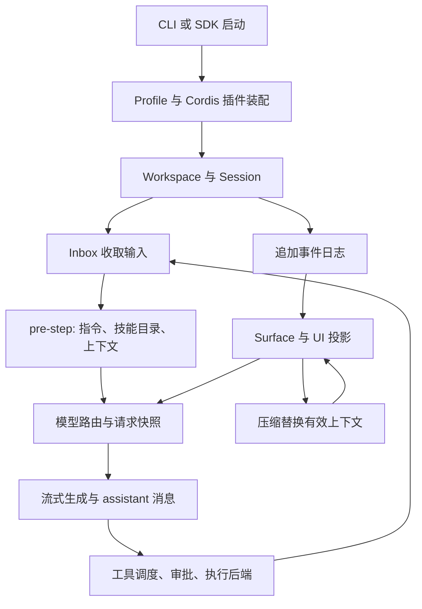
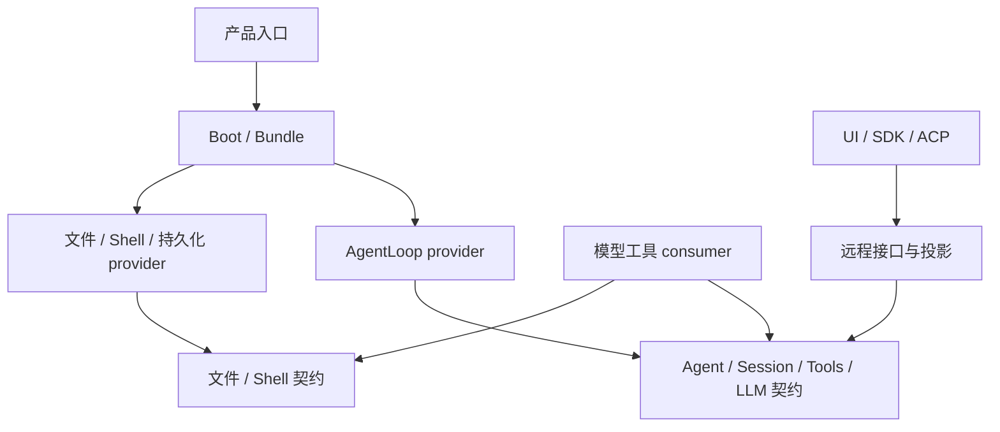

# DeepSeek Harness v0.1.0-rc.7：从插件装配到可重放的 Agent 会话

> 阅读与核查：2026-09-21。官方仓库 `deepseek-ai/deepseek-harness`，标签 `dsh-v0.1.0-rc.7`，固定提交 `99f6f02fecdb7dff40c3fbc9470f5907c29f74ca`，2026-08-17 的发布候选版本。许可证 MIT。本文独立分析这个版本，不借用后续版本的实现填补它；所有源码引用固定到该提交。方法是源码静态追踪和配置交叉核对，未运行 DSH、沙箱或模型。[版本源码][repo]

## 1. 先理解它要组织什么

DeepSeek Harness，简称 DSH，是可组合的 Agent 运行宿主。模型只是其中的生成服务：用户输入怎样排队、一次请求对应什么历史、工具怎样获得执行权限、长会话怎样压缩、断线后页面怎样恢复，都属于 harness。这个版本已经同时具有 CLI、Web、SDK、ACP、持久会话、Goal、可继续子 Agent 和代码式工具调用；不能因为版本号是 `0.1.0-rc.7` 就把它理解为几百行 ReAct 示例。

它的组织重点是把“能力的定义”“能力的提供者”和“能力的使用者”分开。例如 `fs` 定义文件服务，`fs-local` 提供本地实现，`tool-fs` 把文件服务暴露给模型。替换文件执行位置时，原则上应该换提供者，而不是让每个工具重新处理本地、容器、远端路径。这种分离通过 Cordis 的服务依赖与插件生命周期落实，而不只是 TypeScript interface。[包组织][packages] [基础装配][base]

全文用一个场景串联：用户在项目中要求“定位一个失败用例，修改实现并说明验证结果”，执行途中补充限制，输出超长后进行压缩，最后恢复会话。沿这个过程，先看装配，再看数据进入、模型请求、执行与保存。

### 1.1 仓库组织：按可替换能力分包，按产品组合装配

仓库的 `apps/` 是产品入口，`packages/<family>/<package>/` 是能力实现，`vendor/` 放所用基础设施的仓库内版本，`native/` 放原生支持，`scripts/` 负责构建与检查。它不是按“所有 controller / 所有 service”简单横切；同一能力 family 内通常同时有契约、provider 和模型入口。[包地图][packages]

| 位置 | 所有权 | 依赖方向为什么这样设计 |
| --- | --- | --- |
| `apps/cli/src/bin.ts` 与 profile-boot | 解析命令并选择 profile | 动态载入对应路径，不亲自跑模型循环 |
| `packages/boot/app-boot`、`bundle/*` | 配置解释、依赖装配、公共与产品 patch | 允许依赖具体插件；它们是选择实现的位置 |
| `core/agent` | Agent 契约、registry 与事件词汇 | 工具 / UI 面向它，不需要 import 具体 ReAct 驱动 |
| `core/agent-loop` | Agent 工厂、创建 / 销毁、turn/step machine | 依赖 LLM、Session、Tools、SystemPrompt 等契约 |
| `core/session`、`session/session-persistence*` | 会话事件与持久后端 | Session 定义事实，provider 决定物理保存 |
| `fs/fs` → `fs-local` / `fs-sandbox`；`fs/tool-fs` | 文件契约、实现与模型 consumer | 模型工具依赖服务接口，装配选择执行位置 |
| `skill/skill` → `skill-filesystem`；`skill/tool-skill` | 技能 registry、发现与加载 | 技能来源可以更换，不强迫重写工具 |
| `compaction/compaction` → `compaction-basic`；`command-compact` | 压缩契约、算法、用户入口 | 斜杠命令不直接绑定某个算法 |
| `host/`、`client/`、`api/`、`typert/` | 宿主、浏览器和类型 / RPC 连接 | UI 消费远程能力与投影，不能靠直接 import 文件工具工作 |

`agent-loop` 的 package.json 把这些宿主服务列为 peerDependencies，而其实现通过 Cordis 的 inject 使用它们。这既表达“需要同一部署提供的服务”，也避免每个插件偷偷构造一套独立 Session / LLM 单例。包依赖与运行时服务依赖仍是两张图：npm 安装存在，不等于对应插件已经激活。[循环包声明](https://github.com/deepseek-ai/deepseek-harness/blob/99f6f02fecdb7dff40c3fbc9470f5907c29f74ca/packages/core/agent-loop/package.json) [CLI 入口](https://github.com/deepseek-ai/deepseek-harness/blob/99f6f02fecdb7dff40c3fbc9470f5907c29f74ca/apps/cli/src/bin.ts)

箭头表示代码消费 / 实现关系的主干，不是所有运行时事件的方向。waterfall 允许策略包挂入工具和请求链，scope 控制可见性，effect 负责插件注销；这些横向机制使简单的静态 import 图不足以解释完整行为。

### 1.2 实现内部仍有集中点，不能把“多包”当成自动解耦

`core/agent-loop/src/index.ts` 管工厂、scope、注册与释放，`agent.ts` 管会话推进，`tool-calls.ts` 管批次调度，边界相对清楚。相对地，`core/tools/src/index.ts` 约 1,900 行，registry、展示、策略与执行生命周期仍集中在一起；`Session` 也同时承担日志接纳和派生状态的基础规则。

这么做的收益是关键规则只在一个地方决定，例如工具调用接受后怎样取消、结果怎样归一化；代价是这些核心契约一旦变化，会影响大量 provider、UI 与插件。waterfall 扩展还要求每个监听者遵守调用 next、取消与资源释放规则，不能只检查 TypeScript 编译就认定组合行为正确。

### 1.3 修改一个能力要同时考虑哪几张图

新增文件工具时，先实现 consumer 包并依赖 `fs` / `tools`，再在 bundle 或用户 patch 注册；通常无需改 AgentLoop。若提供新的远程文件实现，则实现 fs provider，同时核对 shell / subprocess 是否在同一执行世界，修改的是提供者组合，而非每个模型 schema。

新增一种持久会话事件则不同：要明确 Session 是否认识它、surface 怎样投影、恢复是否需要它、UI reducer 如何消费。若改变结构契约，还要处理格式版本；不能把一个普通业务事件的添加和历史格式破坏混为一谈。新增 UI 面板需要 host API / 类型连接和 client 模块，不能让浏览器直接读 Session 文件。

根构建将 host/client 分开处理，类型与远程契约有生成步骤；包内测试、snapshots 与 test-support 分别提供局部验证和跨入口回放设施。本文未执行它们。这种工程布局是在保证多个组合不会各自漂移，也意味着提取某个包时要连同其契约和生成产物评估，而不能只复制一个 src 文件。

## 2. 启动：配置决定运行中的系统，而不是包是否存在

`packages/bundle/base/cordis.patch.yml` 给空 profile 插入公共插件行，后续 bundle 和用户 patch 通过稳定的 row id 修改配置。这里有两条容易误读的规则：row 顺序用于阅读，**实际激活由服务可用性决定**；覆盖一行 `config` 是整体替换，不是深度 merge。因此研究默认行为必须读组合配置，不能只看到某包目录就说它默认开启。[基础装配][base]

公共装配建立 `llm`、`session`、`agent`、投影、文件与 shell、skill、Goal、压缩、subagent 等服务。主机平面的服务被多个会话使用，而 agent 的 scope 决定它能看到哪些工具、技能及具体覆盖。新建会话与装载一个插件是两种生命周期：前者产生任务状态，后者产生可调用能力和资源释放责任。

例如 Code Mode 是工具展示方式。`agent-tool-presentation` 可以让一个 agent 看完整原生工具 schema，另一个只看 `run_code` 和生成的 TypeScript SDK。工具 registry 仍在宿主层，因为调度器、工具卡片和工具提供者都要使用它。预设只选择视图；代码运行时必须由宿主提供，不能由一个只含提示词的预设凭空获得。[工具展示][presentation]

这种选择带来可复用性，也带来调试成本：一个功能失效，可能是包没有装载、服务依赖尚未满足、scope 把它遮蔽、工具展示限制了调用路径，或者底层执行失败。只追模型 prompt 会漏掉其中大部分原因。

## 3. 进入项目：Workspace、Session、Agent 各自持有什么

`WorkspaceRegistryService` 管理项目身份和会话归属；它对 cwd 做规范化，并结合持久会话 header 建立项目映射。启动时先等会话存储可用，再做历史导入，避免把“暂时读不到存储”误认为“没有会话”。它没有把创建会话等同于复制代码目录或新建 Git worktree。[项目 registry][workspace]

`Session` 保存追加事件及创建 metadata。header 中的 cwd、lineage、seed 边界属于会话创建事实，接受后深冻结。`Agent` 则持有运行状态、Inbox、取消信号及当前 turn/step。项目记录、会话历史和正在执行的对象分开，所以 UI 可以列出一个没有活跃 agent 的旧会话，也可以恢复历史后重新绑定执行器。[Session 实现][session] [循环实现][loop]

三个容易混淆的“上下文”对象必须先区分：

| 对象 | 内容与用途 | 为什么需要独立 |
| --- | --- | --- |
| 事件日志 `session.events` | 输入、请求、工具、压缩、生命周期等历史事实 | 审计和恢复不能随压缩删除 |
| `session.surface` | 日志上当前有效、排序后的节点集合 | 被摘要替换的原文仍在日志，但不再全部进入模型 |
| 请求边界消息 `deriveMessages()` | 将 surface 转换成模型可接受的 Message | UI 事件、日志字段不等于模型协议消息 |

因此，“恢复会话”不是读一个 messages JSON 后继续 append；它需要恢复事件、重建 surface、折叠配置、再创建新的运行对象。这个分层是后续压缩、fork、页面重连都能成立的基础。

## 4. 接收输入：多轮对话由 Inbox 与状态机控制

`ReactLoopAgent` 有 `idle`、`maintenance`、`running` 三种 phase。普通 follow-up 放入 `next-turn` 并唤醒；steer 放入 `next-step` 并唤醒；内部 inject 进入 `next-step`，本身不唤醒。因此用户的补充要求可以在当前工具结束后的下一步进入，不必总是等待整个任务回答完，也不会直接篡改正在发送的那次请求。[循环实现][loop]

每轮先记 `turn/start`，每个模型步骤记 `step/start` / `step/end`。`preStep()` 从 Inbox 认领消息、组装系统提示与运行上下文，再经过 `agent/pre-step` waterfall。插件可以拒绝这一步，也可以加入上下文。只有接受的输入才作为 `user/message` 进入 surface；这使排队、被消费和进入模型历史成为可区分的事实。

维护状态服务于手动压缩等操作：只有空闲、没有待唤醒工作的 agent 能进入；维护期间新输入被排队，维护结束后再唤醒。它避免压缩与模型请求同时修改上下文的同一视图。取消也有明确归属：清空队列与否由调用参数决定，已经 abort 的运行收到新输入时会将其移到下一轮，而不是塞回已经结束的请求。

落地价值在于多轮对话的时序可解释。用户说“不要改测试”，究竟影响了已经开始的 shell，还是下一次模型选择，需要由事件边界回答。提示词不能提供这个保证；Inbox 和执行状态机才是承载它的地方。

## 5. 请求前装配：项目指令、技能与记忆分别进入哪里

### 5.1 项目指令不是永远只读一次的 system 字符串

`agent-instructions` 在第一次请求前建立指令基线，并把它放入持久上下文。后续成功的文件 read/write/edit 会触发对接触目录的指令检查，新增、变更和移除信息经 Inbox 进入后续步骤。文件提供者缺席时该插件可不工作，而不是迫使所有产品形态都具备本地文件系统。[指令注入][instructions]

这解决“开始只读根目录 AGENTS，后来进入子目录却没有新规范”的问题。代价是指令变化也成为历史的一部分：模型既可能见过旧规则，也会见到后续更新。分析其行为时要查看进入请求的顺序，不能仅打开磁盘上的最终文件。

### 5.2 Skill 是带来源和可见性的延迟加载资源

`skill` 是服务契约与分层 registry，`skill-filesystem` 是发现提供者，`tool-skill` 是模型 / 用户的调用入口。摘要含名称、描述、when-to-use、model/user invocation 标志、provider 和来源。默认文件来源具有明确优先级，包括项目 `.dsh`、项目 `.agents`、runtime/custom、用户目录与 bundled；同名技能由层级规则选出，不是简单把所有目录拼接。[技能服务][skill] [文件发现][skillfs]

初始上下文只发布与当前工具可见性一致的技能目录。调用 `skill` 时再次按当前 agent scope 查询、检查 `modelInvocable`、加载正文，并返回 `resourceBase`。这个 base 可以是目录、URL 或 opaque 描述，用来解释正文中的相对资源。用户直接 `/<name>` 调用则走确定性加载路径，不必指望模型先猜出要调 skill。[技能工具][skilltool]

因此 skill 的扩展点不是给 system prompt 添加一整本手册，而是“可发现摘要 → 显式加载 → 带资源位置的执行指令”。它能降低初始上下文，但加载正文仍消耗 token；而且技能内容不会因为来自某个目录就自动变成宿主执行权限。

### 5.3 这个版本的长期状态不等于自动个人记忆

源码中可确认的是持久会话、项目指令、技能、Goal 和历史查询。它们分别保存发生过什么、应该遵守什么、怎样执行某类工作、当前目标是什么。本文核查的默认组合中，没有发现 Hermes 那种独立的用户画像 / MEMORY 文件提炼写回链，不能把“会话可持久化”写成“已有自动长期记忆”。

若要添加长期记忆，合理位置是新服务负责事实来源、更新与遗忘，再由上下文插件按步骤注入；不宜让数据库 driver 自行把所有历史塞进每次请求。这是根据现有边界作出的设计推导，不是该版本已经实现的功能。

## 6. 模型请求：先确定路由，再固定请求事实

循环从 `AgentOptions` 建立 provider/model，只有相同路由下明确设定过的 reasoning effort 才从历史恢复。adapter 自动推导的默认值会先剥离，再经过 `agent/request` waterfall，最后 `llm.prepareCall()` 绑定实际适配器及其默认配置。这避免从旧模型继承一个只适用于它的推理参数。[请求构建][loop]

请求 header 保存配置、system、工具 schema，并标记 initial/resume/change；`request/context` 保存 provider、model、contextWindow。真正请求则由边界消息、header 和 signal 组合并冻结。保存的是“这一代请求实际用了什么”，不是只保存用户设置面板中的意图。

生成时，每个 chunk 先写 `assistant/chunk`，`BlockAssembler` 合并文本、思考、工具参数及完成状态；最终 `assistant/message` 通过 `sourceEventSeqs` 指向组成它的 chunk。provider 的 `replayState` 和通用 message 分开保存，避免将原生续接信息硬塞进跨模型通用协议。[循环实现][loop]

如果模型报错，循环向 `agent/request-error` 插件询问是否重试；没有明确 retry 决策就失败。达到 max-tokens 会记录为该 turn 的粘性结束原因，不能因为后续一步正常就抹掉，而且该次不继续执行工具调用。这类控制必须读 finish 分支，不能从“支持重试插件”推断“默认无限重试”。

## 7. 工具执行：从模型意图到可追溯副作用

### 7.1 Registry 统一可见性、策略与返回值

模型给出的工具名与参数先被转成 detached、可无损 JSON 序列化的输入。runtime 解析当前 scope 下的定义，进入 `tools/pre-execute`，处理 allow/deny/ask；审批结束后还经过 guard。真正函数体在 `tools/execute` waterfall 内执行，之后进行结果归一化、延迟上下文和最终内容处理。[工具 runtime][tools]

这使文件工具、MCP 工具和 Code Mode 内调用可以复用共同的策略与结果链。特别是 Code Mode 不只是隐藏普通工具 schema：如果模型绕过 `run_code` 直接调用被折叠的工具名，runtime 会给出带正确调用路径的错误。因此“展示哪些能力”与“接受哪些调用”保持一致。

### 7.2 并发执行与结果提交顺序分开

`executeToolCalls()` 根据实时 `executionMode` 区分可并行任务和 exclusive barrier；并行部分采用有限滚动池，不是一口气 `Promise.all`。开始新任务前再次分类，支持工具 registry 在运行中变化。执行可以重叠，但策略提交、工具结果与补充上下文保持模型给出的顺序。[工具调度][scheduler]

取消时停止补充新任务并等待已启动任务安静下来，对尚未启动的调用生成成对的取消结果，维持模型协议中 call/result 关系。内部调度故障不会伪造成功结果。这个设计说明，安全的并发不只是加一个 semaphore，还要定义事件顺序、barrier、取消和半途失败。

### 7.3 文件与 shell 的执行世界要一致

文件工具依赖 `fs`，shell 依赖对应执行服务与 sandbox provider。若换远程文件提供者却仍在本机跑测试，模型看到的文件和实际测试的文件会不一致。DSH 的服务划分提供替换接口，但部署仍必须装配成一致的执行世界；“接口可换”不等于任意 provider 组合都有语义保证。[文件包][fs] [沙箱装配][base]

超长结果有两层处理：spill-policy 在 inline 超过配置字节数后保存完整内容并返回可访问引用；tool-result-pruner 对进入上下文的结果保留头尾。base 的 50,000 bytes 与 8,192/4,096/1,024 chars 是本快照的配置，两套单位、两个阶段，不能混成一个 token 上限。[基础装配][base]

## 8. MCP、Code Mode 与 workflow：三种不同的组合位置

MCP client 为一个配置好的 stdio 或 Streamable HTTP server 管理连接、发现与释放。远端 `(serverName, rawName)` 映射为稳定的 `mcp__...` 工具名，超长或非法字符用规范化与摘要后缀处理；真正协议调用仍使用原始名。刷新工具目录先准备新一代，准备失败保留旧代，注册冲突则清理本代，避免静默留下混合目录。[MCP client][mcp] [MCP 工具桥][mcptools]

Code Mode 把工具投影成 TypeScript bindings，模型一次提交程序，可以循环、筛选、并行调用工具，只返回最终需要的结果。`code-runtime-worker-thread` 每次创建 Worker，去除 TS 类型后执行，bindings 通过消息端口回到宿主；有 CPU 忙时间、墙钟、输出、堆限制。等待工具不等同于 CPU 忙时间。**这个 Worker 可终止同步死循环，但源码明确把它视为与 bash 同等级的信任，不是安全隔离。**[代码运行时][coderuntime]

workflow 则在更高一层运行模型编写的编排程序，通过 `agent()` 启动子 Agent，提供 parallel/pipeline 等组合。`workflow-worker-thread` 先检查 meta 和语法，再在独立 Worker 执行，限制并发子 Agent、总启动数、集合大小与取消宽限。它桥接的是完整 agent 工作，而不只是文件工具。[工作流实现][workflow]

以失败用例场景举例：MCP 可以提供 issue 数据；Code Mode 可以批量筛选返回的 issue；workflow 可以把三个独立模块的调查委派给三个 Agent 再汇总。三者分别解决外部能力接入、单次工具程序和多 Agent 编排，不能因为都“能调用工具”就合并成同一层。

## 9. 权限和 sandbox：审批结论必须落到真实后端

base 将 sandbox mode 与 approval mode 分别配置：read-only/workspace-write 对应 ask，danger-full-access 对应 never。前者决定执行限制，后者决定何时找用户；用户同意某个调用并不自动使进程处于隔离状态。[权限配置][base]

`sandbox-local` 按系统装配实现，Linux 包含 bwrap 与 Landlock 路径，macOS 使用 Seatbelt，Windows 使用受限 token 与 ACL 的实现；选择依据包括能力探测。[本地沙箱][sandbox]

Windows 后端把正常账户访问权与 restricting SID 允许的写权限求交。workspace SID 按规范项目路径稳定生成，temp SID 属于当前会话私有临时目录，避免会话共享临时写权限。然而它报告 `enforcement: partial`：读取、网络和进程可见性不因此受限，Everyone 的已有授权及硬链接对象权限也构成边界；workspace ACL 是实际、可能持久的目录修改。[Windows 实现说明][windows]

这对本项目尤其有参考价值：原生 Windows 的“限制写入”与容器的文件 / 网络隔离不是同一个承诺。采用类似机制需要保留能力报告、失败状态和系统差异，而不能只把 UI 标签写成 sandbox 后便宣称强隔离。本文没有运行上游的真实 Windows 验证，所述边界来自实现和上游说明。

## 10. 长会话：先减少工具噪声，再事务式提交摘要

`compaction-basic` 用同一个 token meter 支持压力判断、保留区间和摘要收益计算。自动路径先 prune 超长工具结果，重新测量；仍超过阈值才选择摘要区间。contextWindow 必须由目标模型 / 配置解析，不能拿一个任意常量假装适用于所有模型。压缩次数和溢出恢复有上限，无法降到目标时明确报错。[压缩入口][compact]

`selectCompactableRange()` 从 surface 尾部反向累积保留量，并退回到工具调用 / 结果配对完整的边界。即使 `retainTokens = 0` 也至少留最后一个节点，再按配对需要调整。因此手动压缩“保留 0”并不是删除全部最近上下文。[区间事务][region]

一次摘要按以下顺序提交：记录 compaction/start → 对选中区间调用 summarizer → 检查 surface 或所选 span 是否仍稳定 → 追加 compaction/summary 元数据 → 追加携带检查点摘要的 user/message，以 surfaceOp replace 替换当前可见区间 → compaction/end。真正进入后续模型上下文的是检查点消息；它通过 sourceEventSeqs 关联起始事件、摘要元数据和被遮蔽的原事件。原日志保留，摘要记录可追溯来源。摘要调用失败和提交失败分别记阶段；手动压缩结束还要 flush 持久存储。[区间事务][region]

这个事务解决的不是“LLM 会不会漏掉信息”，而是“一个依据旧上下文生成的摘要能否错误覆盖新输入”。内容质量仍依赖摘要模型和提示；结构正确不能保证语义无损。对失败用例场景，摘要必须保留用户限制、定位结论、改动位置和验证状态，否则恢复后仍可能重做错误操作。

## 11. 一轮结束后：Goal、子 Agent 与项目接续

普通循环在模型不再请求工具时结束。Goal 提供同一 session 上的外层轮次驱动：目标域保存目标状态，round-driver 判断 active/armed、agent 是否静止、是否有竞争用户输入，才排入下一轮。轮次带 goal id/revision 和 queued/claimed/admitted 身份，目标变化后旧轮次不能继续冒充当前任务；agent/error 会解除驱动，而不是把失败当作下一轮继续理由。[Goal 驱动][goal]

Plan mode 是另一件事：它记录规划状态、注入规划策略、通过 exit_plan_mode 展示方案并等待用户选择。此版特意保持工具目录不变以稳定请求前缀，主要通过指令约束规划行为；不能把它等同于已经切换到 OS read-only。Goal 的持续推进、规划模式的用户决策与 sandbox 的执行权限是三个控制维度。[规划控制][plan]

默认 subagent spawn 可以成为可继续的后台子会话，控制工具支持后续发送消息；fork 则保持 one-shot，以复用完成历史及请求前缀，避免给 fork 追加 continuable 专属 report 工具和提示而破坏继承语义。共享 driver 捕获父级委派策略，创建独立 session id，并保存 lineage/seed。[子会话 driver][subdriver] [装配理由][base]

这些子会话不自动产生独立 Git worktree。上下文分离、运行对象分离、文件隔离分别需要不同机制。Ralph 工具也已在 base 注册，以预先固定的脚本驱动 fresh-agent 轮次；它是额外调用入口，不能把注册存在推导成普通会话默认自动进入 Ralph 循环。[基础装配][base]

## 12. 保存与恢复：事件事实、查询和页面视图分层

默认 `session-persistence-jsonl` 是事件存储 provider，根目录由装配明确传入 `$DSH_HOME/sessions`。虽然包名叫 JSONL，默认物理编码包含 Zstandard frame 和无损 chunk run packing，不能直接假定磁盘文件都是逐行明文。它管理 header、连续事件以及 coordinator；历史版本兼容是存储契约，不应由 UI 自己猜测。[持久化实现][persistence]

`session-query-sqlite` 是历史查询能力，与权威日志不同。base 配置 `:memory:`、`openAt: never`，因此不能宣称默认就有跨所有会话的 SQLite 全文索引；准确定位的会话读取仍可依赖存储。仓库还存在另一个 SQLite persistence provider，也不能因此反推 base 使用它。[基础装配][base]

`session-projection` 让功能注册增量 reducer，把事件折叠为 UI / API 所需的状态。服务端保留可恢复事实，页面订阅的是投影，不必得到所有 provider 原生字段。`session-checkpoint-policy` 在模型请求和顶层工具 dispatch 前做持久检查点：先保存已知前因，再开始下一次外部动作。这缩小断电后的歧义，但不会把外部 shell、文件修改与日志 flush 变成一个跨系统事务。

## 13. 从一条真实设计链看可复用价值

一个输入先成为 Inbox 中的待消费工作，再成为会话事件，再投影成模型请求；工具结果经过同一 runtime 返回日志和 surface；长历史被摘要替换视图；目标驱动只在运行静止后排入新输入。各阶段都把“意图”“已经接受”“已经执行”“模型现在可见”分开，正是 DSH 比普通循环复杂的原因。

可直接借鉴的是这些边界，以及对取消、配对、版本和恢复的处理。需要谨慎借鉴的是全面插件化：Cordis scope、waterfall、服务装配和多份投影增加了定位难度，小产品不一定需要立刻复制全部包结构。更合理的做法是先让会话事实、执行策略、模型适配与界面之间依赖清楚，再在真实替换需求出现时抽 provider。

本篇覆盖上述关键主链与代表实现，没有声称逐个审计所有插件或通过其测试。第 1 节补充了仓库组织、状态所有权和改动传播；本版事实不能用于证明后续版本仍按 chunk 逐条持久化或继续使用同一 Worker runtime。

[repo]: https://github.com/deepseek-ai/deepseek-harness/tree/99f6f02fecdb7dff40c3fbc9470f5907c29f74ca
[packages]: https://github.com/deepseek-ai/deepseek-harness/blob/99f6f02fecdb7dff40c3fbc9470f5907c29f74ca/packages/README.md
[base]: https://github.com/deepseek-ai/deepseek-harness/blob/99f6f02fecdb7dff40c3fbc9470f5907c29f74ca/packages/bundle/base/cordis.patch.yml
[presentation]: https://github.com/deepseek-ai/deepseek-harness/blob/99f6f02fecdb7dff40c3fbc9470f5907c29f74ca/packages/core/agent-tool-presentation/README.md
[workspace]: https://github.com/deepseek-ai/deepseek-harness/blob/99f6f02fecdb7dff40c3fbc9470f5907c29f74ca/packages/workspace/workspace/src/index.ts
[session]: https://github.com/deepseek-ai/deepseek-harness/blob/99f6f02fecdb7dff40c3fbc9470f5907c29f74ca/packages/core/session/src/index.ts
[loop]: https://github.com/deepseek-ai/deepseek-harness/blob/99f6f02fecdb7dff40c3fbc9470f5907c29f74ca/packages/core/agent-loop/src/agent.ts
[instructions]: https://github.com/deepseek-ai/deepseek-harness/blob/99f6f02fecdb7dff40c3fbc9470f5907c29f74ca/packages/context/agent-instructions/src/index.ts
[skill]: https://github.com/deepseek-ai/deepseek-harness/blob/99f6f02fecdb7dff40c3fbc9470f5907c29f74ca/packages/skill/skill/src/index.ts
[skillfs]: https://github.com/deepseek-ai/deepseek-harness/blob/99f6f02fecdb7dff40c3fbc9470f5907c29f74ca/packages/skill/skill-filesystem/src/index.ts
[skilltool]: https://github.com/deepseek-ai/deepseek-harness/blob/99f6f02fecdb7dff40c3fbc9470f5907c29f74ca/packages/skill/tool-skill/src/index.ts
[tools]: https://github.com/deepseek-ai/deepseek-harness/blob/99f6f02fecdb7dff40c3fbc9470f5907c29f74ca/packages/core/tools/src/index.ts
[scheduler]: https://github.com/deepseek-ai/deepseek-harness/blob/99f6f02fecdb7dff40c3fbc9470f5907c29f74ca/packages/core/agent-loop/src/tool-calls.ts
[fs]: https://github.com/deepseek-ai/deepseek-harness/tree/99f6f02fecdb7dff40c3fbc9470f5907c29f74ca/packages/fs
[mcp]: https://github.com/deepseek-ai/deepseek-harness/blob/99f6f02fecdb7dff40c3fbc9470f5907c29f74ca/packages/mcp/mcp-client/src/index.ts
[mcptools]: https://github.com/deepseek-ai/deepseek-harness/blob/99f6f02fecdb7dff40c3fbc9470f5907c29f74ca/packages/mcp/mcp-client/src/tools.ts
[coderuntime]: https://github.com/deepseek-ai/deepseek-harness/blob/99f6f02fecdb7dff40c3fbc9470f5907c29f74ca/packages/code-runtime/code-runtime-worker-thread/src/index.ts
[workflow]: https://github.com/deepseek-ai/deepseek-harness/blob/99f6f02fecdb7dff40c3fbc9470f5907c29f74ca/packages/workflow/workflow-worker-thread/src/index.ts
[sandbox]: https://github.com/deepseek-ai/deepseek-harness/blob/99f6f02fecdb7dff40c3fbc9470f5907c29f74ca/packages/sandbox/sandbox-local/src/index.ts
[windows]: https://github.com/deepseek-ai/deepseek-harness/blob/99f6f02fecdb7dff40c3fbc9470f5907c29f74ca/packages/sandbox/sandbox-windows-acl/README.md
[compact]: https://github.com/deepseek-ai/deepseek-harness/blob/99f6f02fecdb7dff40c3fbc9470f5907c29f74ca/packages/compaction/compaction-basic/src/index.ts
[region]: https://github.com/deepseek-ai/deepseek-harness/blob/99f6f02fecdb7dff40c3fbc9470f5907c29f74ca/packages/compaction/compaction-basic/src/region.ts
[goal]: https://github.com/deepseek-ai/deepseek-harness/blob/99f6f02fecdb7dff40c3fbc9470f5907c29f74ca/packages/goal/goal-round-driver/src/index.ts
[plan]: https://github.com/deepseek-ai/deepseek-harness/blob/99f6f02fecdb7dff40c3fbc9470f5907c29f74ca/packages/plan/plan-mode/src/index.ts
[subdriver]: https://github.com/deepseek-ai/deepseek-harness/blob/99f6f02fecdb7dff40c3fbc9470f5907c29f74ca/packages/subagent/subagent-in-process-driver/src/index.ts
[persistence]: https://github.com/deepseek-ai/deepseek-harness/blob/99f6f02fecdb7dff40c3fbc9470f5907c29f74ca/packages/session/session-persistence-jsonl/src/index.ts
