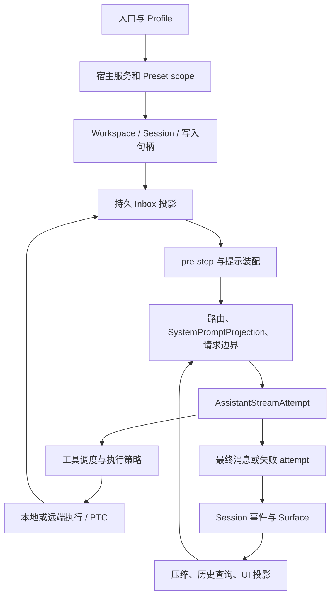
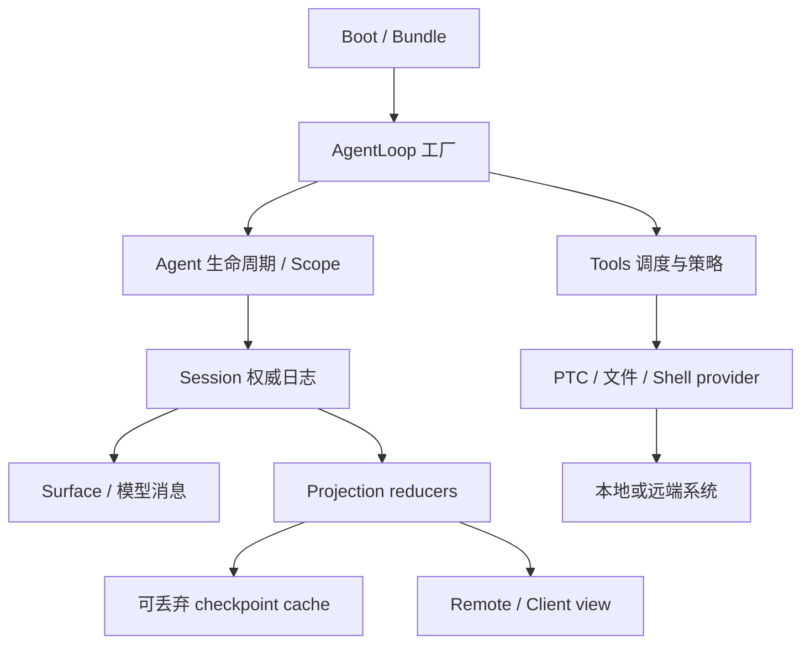

# DeepSeek Harness v0.1.6-alpha.2：以事件、投影与执行服务组织 Coding Agent

> 核查日期：2026-09-21。官方仓库 `deepseek-ai/deepseek-harness`，标签 `dsh-v0.1.6-alpha.2`，提交 `ddefc45fbc7f8e46dd73185e68295696d1297887`；发布于 2026-09-17，明确属于预发布，许可证 MIT。本文以该固定版本为整体分析对象，不把滚动网站、main 分支或实验插件的能力混写成全部默认启用。源码静态核查，未安装、执行或调用模型。[发布记录][release] [固定源码][repo]

## 1. 它的核心设计：让运行事实能够投影成不同产品

DSH 将 Coding Agent 分成可装配的运行服务：LLM 生成、会话日志、Agent 驱动、工具 registry、执行提供者，以及面向 Web / SDK / ACP 的展示与接入。这里 harness 的职责不仅是“循环调用模型”，还包括跨轮输入、资源生命周期、审批、取消、压缩、恢复和插件卸载后的状态一致性。

本版最值得读的主线是：**会话保存事实，projection 生成视图，AgentLoop 决定推进时机，工具 runtime 管理副作用入口，执行 provider 决定动作发生的位置和约束。**这些边界使同一会话能被页面展示、被 SDK 操作、在重启后恢复，而不必为每个入口复制一套推理循环。[Session][session] [AgentLoop][factory] [工具 runtime][tools]

以“进入一个仓库，定位 bug，运行测试，继续用户补充要求”为例，全文按照下面的数据流展开；读者不需要先看旧版。

### 1.1 仓库组织：产品入口、能力包、基础设施与发布运行时分开

`pnpm-workspace.yaml` 的实际边界包括 `apps/*`、`packages/*/*`、vendor、native/system 及平台包、benchmarks、website 和 Python runtime 的部署清单。Python SDK / runtime 不意味着核心循环变成 Python；运行内核仍是 TypeScript，部署目录负责把对应运行时交付给另一种语言的调用者。[Workspace 清单](https://github.com/deepseek-ai/deepseek-harness/blob/ddefc45fbc7f8e46dd73185e68295696d1297887/pnpm-workspace.yaml)

| 组织层 | 代表位置 | 解决的具体问题 |
| --- | --- | --- |
| 产品入口 | `apps/cli`、`apps/web`、`apps/desktop`、`apps/desktop-host` | 命令、网页与桌面交付，不各自实现 Agent loop |
| 启动与组合 | `packages/boot/app-boot`、`plugin-manager`、`packages/bundle` | 选择 profile、解析包、应用 patch、挂载与卸载 |
| 运行契约 | `core/agent`、`session`、`tools`、`system-prompt`、`llm/llm` | 定义身份、消息、事件、可执行能力和生命周期 |
| 具体驱动 | `core/agent-loop` | 工厂、phase、Inbox、request、stream attempt、工具批次 |
| 执行能力族 | `fs`、`subprocess`、`sandbox`、`ssh`、`ptc-runtime` | 契约与本地 / 远端 provider 组合成同一个执行世界 |
| 上下文与持续工作 | `context`、`skill`、`compaction`、`goal`、`subagent`、`workflow` | 在既有事件和工具边界上增加政策 |
| 持久与查询 | `session`、`session-query`、`storage`、`workspace` | 会话日志、派生查询、非会话配置和项目各有所有者 |
| 宿主 / 客户端契约 | `api`、`host`、`client`、`typert` | 将宿主事实转换成可校验的远程接口和页面视图 |
| 非默认试验 | `experimental/` | Teams、自动审查等显式试验组合，稳定性另行约定 |

扩展插件应依赖 Service Definition，具体实现由组合选择。例如 UI / hooks 依赖 `dsh-agent`，而不是具体 `dsh-agent-loop`。这一规则既写在 package map 中，也能从 AgentLoop 的 peerDependencies 与 `static inject` 看见。`core/agent` 本身管理 registry、factory delegation 和 initiator scope；具体创建与推进属于 loop，名称相近但不是重复实现。[包约定](https://github.com/deepseek-ai/deepseek-harness/blob/ddefc45fbc7f8e46dd73185e68295696d1297887/packages/README.md) [Agent 定义](https://github.com/deepseek-ai/deepseek-harness/blob/ddefc45fbc7f8e46dd73185e68295696d1297887/packages/core/agent/src/index.ts)

### 1.2 构建边界为何直接影响运行架构

host 与 client 分别有 TypeScript aggregate：两边会扩展同名 Cordis Context key，但对应不同对象，不能在一个类型程序中混合。Typert 从显式 export 的公共类型生成 schema / remote 产物，生成器只在构建时运行，活跃会话使用产物和 registry。这个边界的价值是让“前端可调用什么”由公开契约决定，而不是把宿主实现整个打到浏览器。[Host 类型入口](https://github.com/deepseek-ai/deepseek-harness/blob/ddefc45fbc7f8e46dd73185e68295696d1297887/tsconfig.host.json) [Typert 生成器说明](https://github.com/deepseek-ai/deepseek-harness/blob/ddefc45fbc7f8e46dd73185e68295696d1297887/packages/typert/generator/README.md)

原生 sandbox、PTY、单文件发布与 Electron 又有自己的依赖闭包，因此 npm workspace 中能 import 不等于打包后也能找到资源。当前根清单对 native 与 runtime 发布目录有明确位置；插件依赖改为运行时解析、支持卸载，也要求 effect disposer 能完整释放注册和后台工作。这不是文件布局美观问题，而是决定运行中更换能力能否一致完成的问题。

### 1.3 数据所有权比 service 名字更重要

Session 是运行事实的来源，surface 是当前模型输入结构，projection cache 是重放捷径，Workspace 是项目归属，subprocess handle 是正在执行的进程。它们不能互相替代。流式 attempt 的帧只负责实时观察，结算事件才接入持久链。这也解释了为什么源码把 inbox、assistant-stream、runtime-context 从 agent.ts 拆出：拆的是状态与提交职责，而不只是缩短文件。

核心仍有集中点：Tools 管很多横切阶段，AgentLoop 工厂承担复杂创建 / 回收事务，Session 需要理解合法历史与投影规则。动态 scope、waterfall 和 Context 扩展还使静态 imports 无法完全表达运行依赖。因此“高度模块化”应理解为可替换边界多，不能理解为任意插件组合都低成本、无耦合。

### 1.4 用两次扩展演示改动怎样传播

要增加远端运行后端，应成套实现 fs、subprocess、sandbox provider，并通过 bundle 替换组合；PTC、文件和 shell consumer 得以继续使用相同契约。若只替换 shell，会产生读的是本机文件、测的是远端代码的问题。SSH 目录中成组的 provider 正是对此约束的实际回应。

要增加一个可在重启后恢复的任务板，不能只写 React 组件。需要宿主领域事件、projection、持久语义、remote 契约、模型工具和 UI consumer；实验 Teams 将 journal、roster、mailbox、task-board 分为独立所有者，提供了具体例子。任务状态和消息回执进入 Lead 日志，UI 是消费者，writeScopes 仍不等于文件执行锁。

要换摘要算法，则可替换 compaction provider，但必须满足边界选择、surface 提交和错误恢复契约；要换完整循环，则实现 Agent factory / lifecycle 约定，让 UI 和工具继续依赖 Agent 服务。仓库提供包内检查、snapshots、test-support 和构建产物检查来约束这些边界，本文没有执行这些上游检查。对二次开发，最有价值的是先选择所需组合，再验证其完整依赖闭包，避免把全仓目录都当成最小运行集。

## 2. 启动与装配：一个仓库里有多种产品组合

`packages/bundle/` 区分 base、headless、web-app、acp-app、sdk-app、sdk-minimal；base 本身只代表使用这份组合的产品共有部分。Cordis 根据服务依赖激活插件，YAML 的 row 顺序不是初始化顺序。patch 通过 row id 修改组合，一行 config 的覆盖是整体替换。研究或二次开发时，入口、bundle、用户 overlay、agent preset 都必须纳入观察。[基础组合][base]

宿主平面包括共享工具 registry、LLM、持久化和执行服务；preset scope 则选择 Agent 可见的能力与 persona。`agent-tool-presentation` 在该 scope 上声明 `native`、`ptc` 或 `both`，同一宿主可以容纳不同展示模式。PTC preset 依赖实际运行时，缺少它时装配就报告对应未激活行，而不等第一轮生成后才发现 `run_code` 无法执行。[展示选择器][presentation]

本版增加了可持久安装、配置、启停插件的管理路径。`plugin-manager` 在存在 profileContext 时挂载；模型侧管理工具在 base 默认关闭，不能把“有插件设置页”理解为“任何模型都能安装任意插件”。实现围绕 profile manifest、patch、安装锁与 package/lock 文件恢复组织；HMR 默认关注 profile 配置，代码模块目录需显式配置。[插件管理][plugins] [基础组合][base]

它与 skill 的区别很实际：skill 是交给模型阅读的程序性知识，插件是宿主执行的代码及服务注册。调整 skill 通常改变模型决策；调整插件可能改变进程权限、生命周期和持久数据契约。Creator 模式转向插件管理的发布说明，应按这种差异理解，而不是泛称“自进化”。[发布记录][release]

## 3. 进入项目与创建会话：先建立身份和所有者

`WorkspaceRegistry` 维护项目记录、规范 cwd 和会话成员关系。它依赖 storageDomain 与 sessionPersistence，先读取并验证 session header，再完成历史归属初始化；存储不可用不会被当成空历史写回。项目选择并不意味着创建代码副本。[Workspace][workspace]

Session header 保存 cwd、lineage、格式版本等创建事实；事件日志记录运行事实；Agent 实例保存当前 phase、取消信号、驱动 scope 与 Inbox。恢复旧会话是重新打开存储、恢复 Session 并挂接驱动，不是反序列化一个活跃 JavaScript 对象。[Session][session] [Agent 工厂][factory]

本版持久化采用 per-session handle：`create/open` 返回句柄，写句柄持有跨进程所有权。POSIX 使用内核 flock，Windows 使用按路径派生的命名内核 semaphore；进程死亡释放所有权，仍活着但卡住的进程不会因“锁过期”被另一个写者接管。这样避免旧进程恢复后与新进程同时追加同一日志。[写入所有权][lease]

这直接回应桌面 Agent 的一个真实问题：两个窗口可以浏览同一项目，不代表两个宿主可以同时修改同一会话文件。文件执行的共享与会话日志的单写者是两种边界，必须分别处理。

## 4. 用户输入进入持久 Inbox，再进入下一轮或下一步

`ReactLoopAgent` 用 idle / maintenance / running phase 管理运行。follow-up 进入 next-turn；steer 进入 next-step 并唤醒；inject 进入 next-step 但不主动唤醒。turn 与 step 各有开始、结束事件，所以“一个用户轮次”可以包含多次模型请求与工具批次。[循环实现][loop]

新版 `ReactLoopInbox` 是 **driver-owned 的持久投影与命令 facade**。`agent/inbox/spliced` 事件记录队列修改，投影 reducer 重建两条队列，验证 splice 范围并拒绝重复 message id；loop 不再持有一份与投影无关的队列真相。恢复 pending Inbox 是本次发布列出的实际修复之一。[Inbox][inbox] [发布记录][release]

`pre-step` 认领输入并装配上下文，插件可以补充或拒绝进入请求。维护操作获得独占的推进时段，完成后处理等待输入；如果维护因 dispose 取消，则不再重新唤醒已销毁的 agent。这些细节决定“停止后收到新消息”“压缩时输入”“页面恢复后重复发送”是否可预测。

例子中用户在测试运行时追加“不要修改公共 API”，这条 steer 不会重新定义已开始的测试进程。它进入下一步，随后才成为模型可见消息。日志能区分排队与消费；UI 不应只凭“用户按下发送”便宣称当前工具已采用该限制。

## 5. 上下文装配：指令、Persona、技能、记忆的生命周期不同

系统提示服务收集带顺序的 section、工具定义及 persona。项目指令插件提供第一次请求前的基线，并在后续成功文件访问后检查涉及路径的新增、变更或删除，必要时向 Inbox 注入更新。这使根目录规范和子目录规范随工作范围进入上下文，而不要求一开始递归读取全仓。[项目指令][instructions]

Skill 则由 registry、provider 和 tool 三层协作。文件 provider 发现项目 / 用户 / 自定义根中的 Markdown 或 SKILL.md bundle，按来源 rank 处理同名覆盖。初始目录只给摘要，`skill` 调用按当前 scope 和 invocation policy 再加载正文，返回 resourceBase，保留相对资源的解释位置。[Skill 发现][skillfs] [Skill 工具][skilltool]

本版 `skill-office` 是这一设计的具体应用：插件从自身资产定位 docx、pptx、xlsx 的 SKILL.md 与检查脚本，注册 bundled provider；真正正文延迟读取。目录中的 Python 脚本不是 prompt token，而是技能在执行阶段引用的资源。它说明“技能文件 + 脚本 + provider”如何产品化，但不能据其存在推断所有 profile 都安装了 Office 工具链。[Office provider][office]

本版默认链路中，长期状态主要是会话、工作区、指令、技能和目标；本文未发现独立的自动个人画像提炼与 MEMORY 写回主链。会话压缩是保住当前任务的上下文，历史查询是按需回看记录，两者都不能直接替代有来源、有效期和遗忘语义的长期事实记忆。

对自有产品的启示是先定义需要记住什么：用户偏好、项目约束、任务检查点分别有不同所有者。如果都装进 Session.messages，再依靠一次摘要“自动变成记忆”，恢复和遗忘都会缺少明确语义。

## 6. 请求准备：把系统提示更新也纳入可追溯历史

### 6.1 路由与参数先解析，再接受本次请求消息

`prepareRequest()` 从 AgentOptions、同路由可恢复配置和 `agent/request` 插件得到候选参数，再由 `llm.prepareCall()` 绑定适配器。明确的 `options.reasoningEffort` 优先于历史值，adapter 自动默认不被盲目继承。provider、model、contextWindow 与系统提示更新能力成为请求 context 的一部分。[请求实现][loop]

这里“推理模式”是 provider 接受的 reasoning effort / 响应内容控制，和 Goal、Plan mode、ReAct 的宿主流程不同。模型内部思考量更大，不会自动产生持久计划、任务依赖或工具权限。

### 6.2 `SystemPromptProjection` 解决动态提示与缓存的冲突

本版系统提示不再仅放在独立 request header 字段里，而以 `system/message` 进入 surface。第一条系统提示占据 surface 开头；如果适配器支持 `in-history`，同一请求序列中的非空提示变化可以追加在后部，保留前缀。若不支持、开始新 series 或提示被清空，则替换头部提示并清空后续旧提示节点。[提示投影][runtimecontext]

“新 series”的依据包括 pre-step 声明、surface contentGeneration 变化，以及工具 schema 变化。请求 header 因此区分 initial、resume、change、series。模型实际收到的是更新后的 `deriveMessages()`，并非一份旧 messages 外加一个任意最新 system 字符串。[循环实现][loop]

这个设计有很强的工程含义：缓存稳定不能以偷偷沿用过期指令为代价；指令更新也不能无条件改写整个缓存前缀。是否支持后部系统消息由适配器声明，不能假设所有模型都有相同行为。即使结构允许复用，实际命中率仍需服务端测量，本文没有性能实测。

## 7. 模型流式生成：实时画面与持久事实不再一一对应

`AssistantStreamAttempt` 将同一次请求同时送入 `BlockAssembler` 和 `AssistantStreamAccumulator`。前者产出文本 / 思考 / 工具调用 blocks，后者保留紧凑的 stream 记录；UI 收到带 attemptId、revision、index 的瞬时 start/chunk/end frame。[流式 attempt][stream]

正常完成时，最终 `assistant/message` 连同 stream 和 usage 写入 Session，成功提交后才发出 committed end frame，标明对应 seq。失败尝试可以保存 `assistant/attempt`；取消时若有可安全展示的前缀则写 interrupted message，否则只记 attempt。如果提交自身失败，输出 abandoned，不能让页面误以为结果已经持久保存。[循环实现][loop] [流式结算][stream]

这解决了两类扩展性问题。第一，逐 token UI 更新不必每次都驱动全套持久事件投影。第二，失败后重试可以拥有独立 attempt 身份，不把前一次半截文字与后一次成功答案拼成一条消息。但它也有代价：进程硬崩溃发生在结算前时，内存里的瞬时帧不能被当作已持久化记录；“正在显示”不等于“已保存”。这是由代码结算顺序推导的边界。

最大输出上限仍形成 max-tokens 结束状态；普通模型错误是否重试由 error waterfall 决定。provider 原生 replayState 附着在来源信息上，与跨 provider 的通用内容分开。记录 stream 可用于恢复展示和诊断，不能据此声称恢复后会自动重放副作用。

## 8. 工具调用：一个 registry 承担多种入口的一致行为

工具定义包括参数、执行方式、输出 schema、模型内容和展示信息。`ToolRuntime` 在 agent scope 中解析名字，复制参数，进入 pre-execute 策略，必要时获取用户决策，然后通过执行 waterfall 调用函数体并规范化结果。超时、取消、spill 等横切能力在有明确语义的阶段挂接。[工具 runtime][tools]

调度器将 exclusive 调用视为屏障，可并行调用放进有上限的滚动池。并行启动前重新查看工具模式；实际执行可重叠，结果和补充上下文按模型顺序提交。取消停止补充任务并等待已开始的执行清理，未开始调用补配取消结果；内部调度失败保留真实已发生事件，不制造假成功。[调度实现][scheduler]

在 bug 场景中，多个只读搜索可以重叠；涉及共享状态的工具按定义串行。这个系统并不推断任何两个任意 shell 命令在语义上互不影响，它依赖工具分类及执行契约。因此开放一个新的工具时，不仅要写 schema，还要决定并发、取消、输出与副作用归属。

超长结果先可 spill 成外部保存内容与预览，再在上下文中做工具结果减量。结构化返回给程序、日志中留存的内容、模型最终看到的文本也可能不同。错误地把这三者合并，会让“省 token”的实现同时损坏可调试性或程序计算所需数据。

## 9. PTC 与 workflow：执行模型产生的程序

PTC 是 Programmatic Tool Calling。模型看到 `run_code` 和生成的 SDK，提交一个程序，程序内部经 `tools.name(args)` 调用工具。`core/tools/src/ptc.ts` 让内部调用走同一 registry 与调度契约，记录 `tool/ptc-dispatch`，而只有外层经过选择的结果进入模型历史。完整结构化值可以供程序使用，日志副本可被 spill 策略缩减。[PTC 桥][ptc]

`NodePtcRuntime` 先 `resolve()` 明确 cwd、超时和 sandbox policy，再 `run()` 创建新的受管 Node 进程。去 TS 类型、生成启动参数、绑定控制通道、读取 stdout/stderr、处理输出账本和子调用上限都由 runtime 负责。`danger-full-access` 明确绕过 confinement；其他模式通过 `sandbox.confine()` 得到真实 argv 与 enforcement，再交给 subprocess provider 启动。[Node PTC][ptcnode]

所以本版的改进不是仅把 Worker 改叫 sandbox：脚本的直接 Node 文件访问现在也跟随同一执行策略，工具 bindings 又走宿主工具策略。两条路径都要约束。空环境、堆限制、输出上限本身不是 OS 隔离，实际强度仍取决于对应系统后端。

`workflow-ptc` 复用 PTC runtime，让程序通过 agent/parallel/pipeline 等 helper 编排完整子 Agent；仍在宿主预检脚本、解析子 Agent provider 和数量上限。VM 提供 helper，受管进程承担文件策略，子 Agent 的生命周期归宿主。这样 Code Mode 与工作流不再各自维护不同的执行隔离机制。[workflow 实现][workflow]

程序化调用适合批量查询后只取少数结果、按条件启动检查、组合可独立任务。收益来自减少模型往返和中间 token，代价是一次程序可能包含更多副作用，失败时需要保留子调用事实。它不天然保证结果正确，也不能代替任务验收。

## 10. MCP 和执行位置：能力入口与运行环境分开

MCP client 管理 stdio / Streamable HTTP 连接、server 工具发现、名称规范化、刷新和释放；模型调用最终仍进入 ToolRuntime。MCP server 本身在哪运行、有什么权限，不由一个 `mcp__` 名称决定。[MCP bridge][mcp]

本版将资源访问组织为独立 `mcp-resources` 服务。连接插件注册 scope 内的 resource provider，统一工具暴露 list、templates/list、read；provider 接受 server-owned cursor 与 URI。首个 provider 注册时安装共享工具，最后一个卸载时移除对应入口，避免每个 server 都造一套同名资源工具。[MCP resources][resources]

执行世界则由 fs、subprocess、sandbox 等 provider 共同决定。`sandbox-ssh` 将 confinement 请求交到 SSH 目标主机，返回经过 schema 校验的 argv、enforcement 与失败分类事实，与远端文件 / 进程 provider 在同一主机生效。这比“本地生成沙箱命令然后假设远端能执行”更明确。[SSH sandbox][ssh]

本地 provider 在 Linux 选择 bwrap/Landlock，在 macOS 采用 Seatbelt，在 Windows 使用 ACL restricted token，并做功能探测。选择受限模式但无法提供 confinement 时返回失败，不偷偷使用原 argv。Windows 后端依旧声明 partial：它限制写入，不提供通用读文件与网络隔离，Everyone 与硬链接边界仍需保留。[本地 sandbox][sandbox] [Windows 边界][windows]

还需区分 Agent 的命令工具与用户自己打开的 Web 终端。发布记录明确后者采用系统用户权限，与 Agent sandbox mode 独立；不能因为两者都出现在同一界面，就向用户暗示终端继承了 Agent 的限制。[发布记录][release]

## 11. 上下文压力：文本摘要、工具减量和图片卸载协同

自动压缩先测量当前请求压力，对工具结果做减量并重新计量，仍超阈值才摘要。保留区间从最近消息反向选择，并保持 tool-call/result 配对；手动入口在 maintenance 中选择 `retainTokens = 0`，也仍保留至少末尾节点和必要的完整协议单元。[压缩入口][compact]

由于 system 进入历史，本版 `selectCompactableRange()` 特别跳过 surface 首部的 `system/message`。摘要输入由该系统消息、当前工具 schema 和选中历史组合，目标是利用既有请求前缀。摘要不会把首部系统规范当普通历史一起消除。[区间实现][region]

计量也区分用途：固定 heuristicTokens 用于投影中可快速累计的 shadow price；按路由计算的 tokens 用于保留区间和“是否真正变小”的判断。摘要含图片的区间时，文本启发式长度与模型实际输入压力可能差别很大，本版用 `shadowedRouteTokenCount` 比较新摘要大小，避免以错误单位判断收益。[区间实现][region]

事务流程是 start → summary → 稳定性复核 → 保存 summary 事实及替换用的 user/message → end → 必要 flush。自动压缩要求整体 surface 稳定，手动路径允许所选 span 外的新节点存在，只要选中区间仍连续、配对完整且计价一致。失败阶段、取消与保存失败分别保留。[区间实现][region]

图片超预算还有单独的恢复路径：`compaction-image-offload` 处理 `IMAGE_OFFLOAD_REQUIRED`，记录最早保留图片的 offload 决策，通过消息投影用占位文本替代对应输入；既能作用于普通请求，也能作用于摘要请求。它属于已改变上下文的恢复后再请求，不是原请求无差别重试；代码没有把它计入普通 provider retry 预算。模型调用费用仍可能产生，部署不能把“未用 retry 预算”理解为“没有新请求”。[图片卸载][images]

## 12. 一轮结束后的持续任务、委派与协作

Goal 在单会话上驱动更多 turn。它保存目标状态，并在当前 agent 静止、目标 active/armed、没有应先处理的竞争输入时排入下一轮；以目标 id/revision 和轮次身份过滤过期排队工作。普通请求失败、用户取消、目标变更都有对应驱动处理，不靠模型一句“继续”自行循环。[Goal driver][goal]

Plan mode 保存规划状态和用户方案审阅，保持工具目录稳定并注入规划规则。它与 sandbox mode 独立：要求模型先规划不等于内核已经禁止写入。Ralph 是 fresh-agent 工作流，base 在这一版默认禁用，且完成来自 worker 自报，不是独立评测；不能作为默认 RSI 或可靠自改进系统的证据。[基础组合][base]

普通 spawn 子 Agent 可继续对话；fork 继承完成历史及父路由，base 仍配置 one-shot，但 preset 可以选择不会破坏前缀的 continuable 方式。发布说明给出的可继续委派默认上限是同时保留 8 个子 Agent、深度 1，并可调整。把这些参数当部署选择，比宣称“无限并行 Agent”更符合代码。[基础组合][base] [发布记录][release]

实验性的 Agent Teams 在此之上增加命名 roster、durable mailbox、共享 task board。`TeamService` 是 facade，真正所有者拆为 TeamJournal、TeamRoster、TeamMailbox、TeamTaskBoard 和生命周期对象；事实保存在 Lead Session 日志，不另建一份同等权威的共享内存账本。[Teams facade][teams]

发送消息先持久排队，再按目标串行投递；目标 `user/message` 的 team-message 来源充当 receipt，Lead 侧记录 delivered，恢复时检查 receipt 避免重复。任务更新要求 expectedRevision，claim 检查归属及依赖，完成后要明确 reopen/release 才改变相应状态。writeScopes 是建议性分工，不是文件锁。[Mailbox][mailbox] [Task board][taskboard]

这解决的是中断后还能知道谁负责什么、谁已经收到消息。它不是分布式工作流系统：本实验包使用同一共享工作目录，不支持多进程共同维护一个 team，也没有自动到期释放任务认领。本文静态分析了状态迁移和回执路径，没有将 README 的“从不重复 / 丢失”扩展成任意机器故障下的绝对保证。[实验边界][teamreadme]

## 13. 保存、查询和重连：缓存不能变成第二份真相

权威会话存储由 `session-persistence-jsonl` 提供，默认 Zstandard 编码，header 与连续事件通过句柄访问。格式迁移由格式包转换 JSON 语义，generation 模块负责物理编码、源身份、生成新一代和发布；读取、迁移和继续追加有不同职责，不能通过就地覆盖旧数据草率升级。[存储实现][persistence] [代际发布][generation]

`session-projection-cache` 保存各投影的带版本 checkpoint，按 seq 接着重放尾部。它明确是加速缓存：版本不合适可以丢弃，写失败只增加下次冷读成本，不夺取原始日志的权威。base 配置按事件数 / 时间节流，创建、turn/end、dispose 有强制写点。[投影缓存][projectioncache]

日志、工具历史、模型 surface、UI 投影是不同阅读方式。历史查询不应把全部日志反灌模型，UI 也无需在每个 chunk 重算全部历史。流式 revision 和最终提交 seq 则把临时画面接到持久事实。这种设计让“页面已经显示”“服务器已经接受”“已经写盘”可以分别说明。

遥测策略同样要按本版配置读：base 默认 `FEEDBACK_ONLY`，显式用户反馈可释放对应会话日志前缀；它不同于旧版默认 DISABLED。本文没有发送任何遥测、运行反馈流程或验证远端接收行为。该例说明研究时只沿用旧版环境变量解释，会遗漏实质产品变化。[基础组合][base]

## 14. 适用价值和仍要承担的复杂度

DSH 适合作为“把一个 Agent 做成长期运行应用”的结构参考：事件事实与当前上下文分开，工具有统一生命周期，PTC 与 shell 共享执行策略，持久队列和投影支持恢复。它也展示了插件卸载、格式迁移、并发工具顺序、多入口状态一致性如何从附加功能变成核心复杂度。

对本项目，优先可借鉴的是数据流和所有权：谁写会话、谁刷新上下文、谁处理取消、谁报告实际隔离、谁能继续目标。是否采用 Cordis、多少个 npm 包、是否开放用户插件，是另外的产品决策。直接复制整个 monorepo 会同时引入其预发布 API、打包体系、运行时依赖解析和多产品组合成本。

本文覆盖固定版本的关键实现链及代表扩展，没有声明全仓每个包都完成审计，没有第三方性能 / 效果实测。实验功能、装配条件、静态推导和发布声明分别标注；八篇之间的对比只使用各自真正存在的模块。

[release]: https://github.com/deepseek-ai/deepseek-harness/releases/tag/dsh-v0.1.6-alpha.2
[repo]: https://github.com/deepseek-ai/deepseek-harness/tree/ddefc45fbc7f8e46dd73185e68295696d1297887
[base]: https://github.com/deepseek-ai/deepseek-harness/blob/ddefc45fbc7f8e46dd73185e68295696d1297887/packages/bundle/base/cordis.patch.yml
[session]: https://github.com/deepseek-ai/deepseek-harness/blob/ddefc45fbc7f8e46dd73185e68295696d1297887/packages/core/session/src/index.ts
[factory]: https://github.com/deepseek-ai/deepseek-harness/blob/ddefc45fbc7f8e46dd73185e68295696d1297887/packages/core/agent-loop/src/index.ts
[loop]: https://github.com/deepseek-ai/deepseek-harness/blob/ddefc45fbc7f8e46dd73185e68295696d1297887/packages/core/agent-loop/src/agent.ts
[inbox]: https://github.com/deepseek-ai/deepseek-harness/blob/ddefc45fbc7f8e46dd73185e68295696d1297887/packages/core/agent-loop/src/inbox.ts
[presentation]: https://github.com/deepseek-ai/deepseek-harness/blob/ddefc45fbc7f8e46dd73185e68295696d1297887/packages/core/agent-tool-presentation/src/index.ts
[plugins]: https://github.com/deepseek-ai/deepseek-harness/blob/ddefc45fbc7f8e46dd73185e68295696d1297887/packages/boot/plugin-manager/src/index.ts
[workspace]: https://github.com/deepseek-ai/deepseek-harness/blob/ddefc45fbc7f8e46dd73185e68295696d1297887/packages/workspace/workspace/src/index.ts
[lease]: https://github.com/deepseek-ai/deepseek-harness/blob/ddefc45fbc7f8e46dd73185e68295696d1297887/packages/session/session-persistence-jsonl/src/lease.ts
[instructions]: https://github.com/deepseek-ai/deepseek-harness/blob/ddefc45fbc7f8e46dd73185e68295696d1297887/packages/context/agent-instructions/src/index.ts
[skillfs]: https://github.com/deepseek-ai/deepseek-harness/blob/ddefc45fbc7f8e46dd73185e68295696d1297887/packages/skill/skill-filesystem/src/index.ts
[skilltool]: https://github.com/deepseek-ai/deepseek-harness/blob/ddefc45fbc7f8e46dd73185e68295696d1297887/packages/skill/tool-skill/src/index.ts
[office]: https://github.com/deepseek-ai/deepseek-harness/blob/ddefc45fbc7f8e46dd73185e68295696d1297887/packages/skill/skill-office/src/index.ts
[runtimecontext]: https://github.com/deepseek-ai/deepseek-harness/blob/ddefc45fbc7f8e46dd73185e68295696d1297887/packages/core/agent-loop/src/runtime-context.ts
[stream]: https://github.com/deepseek-ai/deepseek-harness/blob/ddefc45fbc7f8e46dd73185e68295696d1297887/packages/core/agent-loop/src/assistant-stream.ts
[tools]: https://github.com/deepseek-ai/deepseek-harness/blob/ddefc45fbc7f8e46dd73185e68295696d1297887/packages/core/tools/src/index.ts
[scheduler]: https://github.com/deepseek-ai/deepseek-harness/blob/ddefc45fbc7f8e46dd73185e68295696d1297887/packages/core/agent-loop/src/tool-calls.ts
[ptc]: https://github.com/deepseek-ai/deepseek-harness/blob/ddefc45fbc7f8e46dd73185e68295696d1297887/packages/core/tools/src/ptc.ts
[ptcnode]: https://github.com/deepseek-ai/deepseek-harness/blob/ddefc45fbc7f8e46dd73185e68295696d1297887/packages/ptc-runtime/ptc-runtime-node/src/index.ts
[workflow]: https://github.com/deepseek-ai/deepseek-harness/blob/ddefc45fbc7f8e46dd73185e68295696d1297887/packages/workflow/workflow-ptc/src/index.ts
[mcp]: https://github.com/deepseek-ai/deepseek-harness/blob/ddefc45fbc7f8e46dd73185e68295696d1297887/packages/mcp/mcp-client/src/index.ts
[resources]: https://github.com/deepseek-ai/deepseek-harness/blob/ddefc45fbc7f8e46dd73185e68295696d1297887/packages/mcp/mcp-resources/src/index.ts
[ssh]: https://github.com/deepseek-ai/deepseek-harness/blob/ddefc45fbc7f8e46dd73185e68295696d1297887/packages/ssh/sandbox-ssh/src/index.ts
[sandbox]: https://github.com/deepseek-ai/deepseek-harness/blob/ddefc45fbc7f8e46dd73185e68295696d1297887/packages/sandbox/sandbox-local/src/index.ts
[windows]: https://github.com/deepseek-ai/deepseek-harness/blob/ddefc45fbc7f8e46dd73185e68295696d1297887/packages/sandbox/sandbox-windows-acl/README.md
[compact]: https://github.com/deepseek-ai/deepseek-harness/blob/ddefc45fbc7f8e46dd73185e68295696d1297887/packages/compaction/compaction-basic/src/index.ts
[region]: https://github.com/deepseek-ai/deepseek-harness/blob/ddefc45fbc7f8e46dd73185e68295696d1297887/packages/compaction/compaction-basic/src/region.ts
[images]: https://github.com/deepseek-ai/deepseek-harness/blob/ddefc45fbc7f8e46dd73185e68295696d1297887/packages/compaction/compaction-image-offload/src/index.ts
[goal]: https://github.com/deepseek-ai/deepseek-harness/blob/ddefc45fbc7f8e46dd73185e68295696d1297887/packages/goal/goal-round-driver/src/index.ts
[teams]: https://github.com/deepseek-ai/deepseek-harness/blob/ddefc45fbc7f8e46dd73185e68295696d1297887/packages/experimental/agent-team/src/index.ts
[mailbox]: https://github.com/deepseek-ai/deepseek-harness/blob/ddefc45fbc7f8e46dd73185e68295696d1297887/packages/experimental/agent-team/src/mailbox.ts
[taskboard]: https://github.com/deepseek-ai/deepseek-harness/blob/ddefc45fbc7f8e46dd73185e68295696d1297887/packages/experimental/agent-team/src/task-board.ts
[teamreadme]: https://github.com/deepseek-ai/deepseek-harness/blob/ddefc45fbc7f8e46dd73185e68295696d1297887/packages/experimental/agent-team/README.md
[persistence]: https://github.com/deepseek-ai/deepseek-harness/blob/ddefc45fbc7f8e46dd73185e68295696d1297887/packages/session/session-persistence-jsonl/src/index.ts
[generation]: https://github.com/deepseek-ai/deepseek-harness/blob/ddefc45fbc7f8e46dd73185e68295696d1297887/packages/session/session-persistence-jsonl/src/generation.ts
[projectioncache]: https://github.com/deepseek-ai/deepseek-harness/blob/ddefc45fbc7f8e46dd73185e68295696d1297887/packages/session/session-projection-cache/src/index.ts
