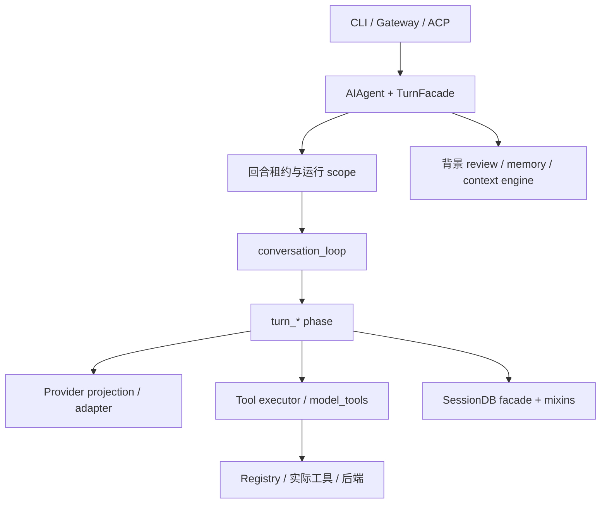
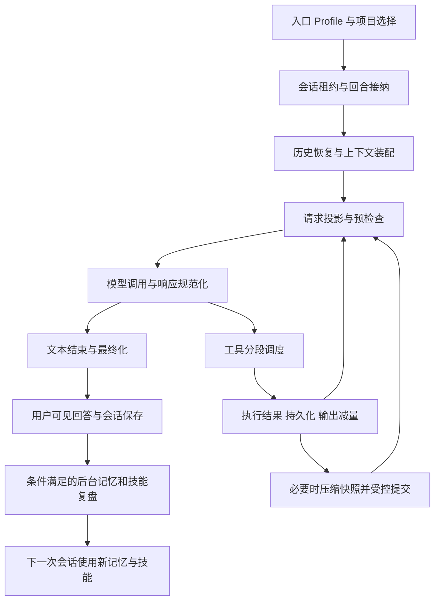

# Hermes 2026-09-21：多入口个人 Agent 的执行、上下文与学习生命周期

> 核查日期：2026-09-21。官方仓库固定提交 `5470f260cac7bafc7b98676dfba1c12fcddc3234`，包内版本 0.21.3。本文分析的是 9 月 21 日抓取的主线快照，**不冒充 v2026.9.14 发布标签本身**；仓库仍在快速变化。MIT 许可。早期版本完整分析见 [v2026.3.12](hermes-v2026.3.12.md)。

## 1. 先建立整体认识：同一个助手要跨项目、入口和时间工作

Hermes 把编码放进更广的个人助手场景：用户从终端、消息网关或其他入口提出目标，Agent 进入合适工作目录，调用模型与工具，保存对话，积累用户背景与可复用技能。一次任务结束不意味着整个助手生命周期结束。

例如“继续昨天那个项目的取消逻辑修复，把验证步骤整理下来”，需要历史检索、项目选择、代码执行和技能维护共同工作。9 月快照已经不能用“一个大脚本加 MEMORY.md”概括：运行循环拆成多个 phase，项目有显式登记，记忆与上下文引擎有扩展接口，后台复盘有自己的并发与取消规则。

但目录拆分并不等于状态已经完全解耦。AIAgent 通过多个 mixin 和转发器继续持有大量共同状态，phase 还通过同一个 agent 对象协作。应把它理解为**正在模块化的产品运行核心**，而不是完全无共享状态的插件微内核。[AIAgent][agent] [主循环][loop]

### 1.1 仓库组织：从大运行器拆出阶段模块，但保持既有入口

当前树同时有 Python 核心、CLI、gateway、ACP、Web / TUI / desktop 相关目录，以及工具、插件、provider 和资源目录。对架构研究，先定位 `pyproject.toml` 的入口比从文件最多的目录开始更有效：`hermes` 仍进 `hermes_cli.main`，`hermes-agent` 进 `run_agent`，另有 `hermes-acp` 进入 ACP adapter。不同入口最终共享 AIAgent 的回合能力，但各自负责渠道、会话身份和交互事件。[包与入口](https://github.com/NousResearch/hermes-agent/blob/5470f260cac7bafc7b98676dfba1c12fcddc3234/pyproject.toml)

| 位置 | 主要职责 | 状态所有者 / 变化传播 |
| --- | --- | --- |
| `hermes_cli/`、`gateway/`、`acp_adapter/` | 用户入口与渠道适配 | 映射输入、会话、显示与确认；不各自重写模型循环 |
| `run_agent.py`、`agent/agent_init.py` | AIAgent facade、构造与兼容入口 | 大量共享字段仍在 AIAgent 上 |
| `agent/turn_facade.py`、`turn_facade_lease.py` | 回合接纳、租约、取消后台复盘、scope | 把并发运行边界包在 loop 外 |
| `agent/conversation_loop.py`、`turn_*.py` | 预检、请求、响应、工具、恢复、结束等 phase | 通过同一个 agent 与 turn 状态协作 |
| `agent/provider_projection.py`、各 provider adapter | 内部历史到协议请求的转换 | provider 原生续接与主轨迹保持区分 |
| `model_tools.py`、`tools/registry.py`、`agent/tool_executor.py` | 发现、工具集、dispatch 与工具轮执行 | registry 提供能力，executor 决定本轮调度 |
| `tools/mcp_tool.py` 及同名前缀模块 | MCP 生命周期与协议功能 | facade 持有连接 / loop / 锁，子模块在调用时访问它 |
| `hermes_state.py`、`hermes_state_*.py` | SQLite 会话、搜索、压缩、租约及维护 | SessionDB facade 组合多个 mixin，数据库仍是持久事实 |
| `agent/context_engine.py`、memory / review 模块、`plugins/` | 上下文政策、记忆提供者、后台经验整理 | 可扩展接口与产品生命周期共同决定是否运行 |

`conversation_loop.py` 开头列出了具体阶段函数，例如 build_api_request、perform_api_call、normalize_model_response、run_tool_round、finalize_turn。它在模块载入时绑定这些 helper，以免源码更新过程中一次运行中途混入另一代 phase。这个细节说明拆文件既服务可读性，也必须处理热更新 / 长会话下的版本一致性。[主循环][loop]

### 1.2 文件模块化不等于状态已经解耦

`run_agent.py` 缩到约 1,600 行，循环另有约 1,700 行，多个 mixin 继续通过 AIAgent 的 MRO 提供方法。阶段函数接收整个 agent，兼容 forwarding 还保留调用者对 `run_agent` 上符号的 patch 行为。收益是既有 CLI、测试替身与插件不必一次性迁移；代价是一个字段的真实写入者可能跨多个模块，签名本身不一定列出所有依赖。

MCP 是类似例子：`mcp_tool.py` 持有 `_servers`、后台 event loop 与锁，其他 `mcp_tool_*` 模块通过核心 facade 取状态。这比复制多份连接管理正确，但如果只读 transport 文件，会漏掉重连、profile 作用域与关闭时序。SessionDB 也以多个 mixin 拆分查询和写入职责，不能因文件数增加就认定每个模块有独立数据库事务。[MCP facade](https://github.com/NousResearch/hermes-agent/blob/5470f260cac7bafc7b98676dfba1c12fcddc3234/tools/mcp_tool.py) [状态 facade](https://github.com/NousResearch/hermes-agent/blob/5470f260cac7bafc7b98676dfba1c12fcddc3234/hermes_state.py)

工具 async bridge 已改成主线程 / 工作线程各自持久 event loop，避免缓存的异步客户端随每次调用关闭 loop。这个变化应读 `model_tools.py`，而非只比较工具 schema；它改变的是资源所有权。[工具装配](https://github.com/NousResearch/hermes-agent/blob/5470f260cac7bafc7b98676dfba1c12fcddc3234/model_tools.py)

### 1.3 改动路径与发布布局也属于架构

增加新 memory provider，需要实现 provider 契约、配置选择与取回 / 更新生命周期，并检查注入发生在请求前还是回合后；后台 review 产生的新知识还要处理前台回合抢占。只修改系统提示无法得到这些接续与取消语义。改变压缩则至少穿过 context engine、具体 compactor、provider 投影和 SessionDB 接续，必须保证真实发送 payload 与计量对象一致。

增加一个工具，通常经过 registry 发现、toolset、执行器并发分组和结果分类；若涉及文件目标，还应检查工具 guard 与后端路径语义。增加一个用户入口，则可复用 TurnFacade，自己承担输入身份、恢复选择、权限交互和输出流，不应跳过租约直接调用内层 phase。[回合 facade](https://github.com/NousResearch/hermes-agent/blob/5470f260cac7bafc7b98676dfba1c12fcddc3234/agent/turn_facade.py)

顶层仍有大量 `hermes_state_*.py` 等独立模块。`setup.py` 动态列出根目录 Python 模块，pyproject 显式覆盖子 package 和资源；其注释说明曾因静态列表落后于拆分而损坏 wheel。这是仓库组织产生的真实发布问题：源码目录可运行，不代表打包后文件都在。二次开发需要同时检查源码依赖与安装产物，而不是把目录拆分看作纯内部重构。[构建模块枚举](https://github.com/NousResearch/hermes-agent/blob/5470f260cac7bafc7b98676dfba1c12fcddc3234/setup.py)

总体上，这版更适合观察持续演进的个人 Agent 产品如何保持兼容。它提供很多现成扩展点，也保留了共享状态、动态导入、全局 registry 的成本；设计判断应建立在具体调用链上，而非把模块数量等同于架构质量。

## 2. 启动并进入项目：先解决“这次工作属于谁、在哪里执行”

配置 profile、入口、session、task、project 是不同维度。profile 决定数据根与服务配置；session 表达对话；task 关联执行状态；project 登记用户项目及目录。项目数据库有 projects、project_folders、元数据和发现仓库等结构，支持多个目录、primary path、slug 和归档。[项目数据库][projects]

模型侧 project 工具有 list / create / switch。switch 查找项目，保存 active project，再通过宿主注册的 workspace callback 将主目录应用到当前 task。这个实现细节意味着：**登记状态更新与每个入口执行 cwd 更新之间仍有适配契约**；缺少 callback 时，不能仅凭“switch 返回 success”就推断所有工具后端已经切换。[项目工具][project-tools]

相比 cwd 就是项目的早期版本，显式项目身份能承载重命名、多目录和跨入口选择。但项目目录不等于容器根，不等于 profile 数据根，更不等于每个并发任务自动获得一个副本。

### 多 profile 共享一个进程时，环境变量不能当作会话状态

`terminal_scope.py` 使用 ContextVar 保存当前 profile 的完整终端策略。其原因很具体：一个网关服务多个 profile，如果先把第一份配置写到 `os.environ`，后续 profile 可能误用它的 backend。解析 profile 策略失败时安装拒绝 scope，而不是静默继承别人的执行环境。[终端作用域][terminal-scope]

这种修正说明长期运行、多用户路由系统的难点常在状态归属，而不是模型本身。后台线程还必须复制 contextvars；否则 memory provider 的工作线程可能落到默认 profile。[MemoryProvider][memory-provider]

## 3. 接纳用户回合：会话租约避免同一轨迹被两个执行者同时推进

`TurnFacadeMixin.run_conversation()` 包住实际 conversation loop，负责前台优先、跨进程 durable turn lease、租约刷新和 liveness 监控，并设置中断与计量作用域。它先处理可能仍在运行的后台复盘，避免同一会话前缀被前后台同时推进。[回合接纳][facade]

租约保护的是“谁当前有权推进该 session”。它不自动阻止另一个不同 session 编辑同一项目文件，也不构成文件锁或系统沙箱。把会话并发和文件并发分开看，才能正确选择需要保护的对象。

`build_turn_context()` 准备本回合状态、历史、输入持久化信息、系统提示与压缩状态；各入口可以提交 display metadata 和原始用户文字覆盖值，避免把临时提示拼接物永久保存成用户原话。[回合上下文][turn-context]

这里的多轮对话有两个层次。用户追问启动一个新的外层回合，入口把同一会话的 `conversation_history` 传入；构建器先处理压缩后轮换到子会话的恢复，再浅复制历史列表、加入本次用户消息，并从历史恢复缺失的 todo、用量锚点和用户轮次计数。它不是只把上一轮最终回答拼到新问题前面。系统提示按会话缓存，当前回合的运行计数则另行初始化；历史、稳定前缀与运行预算不能混成同一份“会话状态”。[回合上下文][turn-context]

一个外层回合内部又可以发生多个模型—工具往返，用户的 `/steer` 在请求前的准备阶段进入这条循环，不必等普通追问重新开一轮。压缩可能重建消息列表，导致原来的当前用户下标失效；`export_current_turn_boundary()` 因而在最终消息投影上重新定位并输出 `turn_id / current_turn_user_idx`，无法证明对应关系时就不输出这两个字段。否则页面可能把历史中相同的一句用户输入误认成本次输入，连带展示错误的回答归属。多轮正确性因此也涉及宿主和界面的消息身份，而不只是模型能否记住前文。[回合边界][turn-context] [迭代准备][iteration]

## 4. 装配背景：把稳定前缀、项目材料和易变信息分层

`system_prompt.py` 按 stable、context、volatile 三层组织系统提示。stable 包括身份、行为指导、运行环境与 coding brief；context 包括工作区快照、调用者说明和上下文文件；volatile 包括技能目录、记忆、用户画像、外部 memory provider 和时间。[系统提示][system]

这里 volatile 是相对更易变化的材料分类，不能理解为每个工具步骤都重新读取磁盘。系统提示仍强调会话内稳定与在压缩等受控边界重建；缓存范围、前缀和工具目录变化另由相应模块管理。

SOUL / persona、AGENTS 与记忆继续有不同职责：persona 规定交互倾向，项目规则说明约束，记忆提供跨会话事实。它们都是模型输入，不能替代工具权限和宿主校验。coding_context 等模块再补充编码场景背景，使通用助手在代码任务中知道当前环境。

工具目录同样不应无限全部展开。当前工具执行层认识 tool_search / tool_describe 等发现入口，在调度前能解包发现桥接的真实调用，防止工具藏在 wrapper 里绕过并发和路径冲突判断。[工具分段与包装][dispatch]

## 5. 记忆进入当前回合：本地小记忆与外部 provider 可以协作

本地 MemoryStore 仍维护有字符预算的 MEMORY.md / USER.md，默认容量沿用 2,200 / 1,375 字符；系统提示使用冻结快照。当前写入链增加文件锁、重新读取当前内容、外部格式漂移处理及原子保存，不再只依赖 Agent 内存里的旧条目覆盖文件。[记忆存储][memory-store]

普通 add / replace / remove 各自有具体规则；`_mutate` 允许按操作选择是否执行漂移检查，不能把它描述成所有变更都经过完全相同的校验。读取已有文件失败会返回错误，避免误把“读不到”当作“空记忆”重新写盘。

`MemoryProvider` 定义 initialize、system prompt block、prefetch、sync_turn、工具与可选生命周期回调；`MemoryManager` 协调这些入口。一次可选择一个外部 provider，内置文件记忆仍有自己的职责。Honcho、Hindsight 等名字是可实现的 provider，不代表它们默认全部启用。[Provider 契约][memory-provider] [管理器][memory-manager]

对短确认、问候等缺乏语义信号的输入，代码可以跳过召回，防止多一次网络往返又引入无关旧背景。压缩前 provider 还可提交 checkpoint，但版本化契约区分旧的 best-effort 与新能力；不能要求所有插件都有同一种持久保证。

这种设计的价值是把“需要历史背景”从某一家记忆服务中抽出来。其成本是异步预取、超时、线程 context、提交与关闭都变成必须管理的生命周期，不能只增加一个 search 方法了事。

## 6. 请求投影与主循环：一条用户输入会经过哪些 phase

`conversation_loop.py` 的外层循环当前清楚列出：begin_iteration → prepare_iteration → assemble_api_request → preflight gate → API retry loop → normalize_model_response → tool round 或 finish_text_response → finalize_turn。[主循环][loop]

begin 处理预算、重定向与中断；prepare 处理 steer 队列、工具参数修复及消息配对；request 层负责 provider 需要的格式和缓存计划；response 层区分正文、reasoning、工具调用与不同停止原因。每个 phase 返回 fallthrough / continue / break / return 等动作，使异常恢复能显式选择回到哪里。

用户在执行中补充一句 `/steer`，不会成为一个随意修改所有历史的字符串替换。准备阶段在最新工具结果之后加入单独用户行，让模型下一次请求看到它，同时维持历史顺序。[迭代准备][iteration]

provider-specific projection、重试与 fallback 都有实际分支。它们服务多 provider 兼容，不代表本仓库应复制上游的自动切换政策；本项目已确认的失败停止规则仍应由本项目决定。

循环使用单回合迭代预算与可配置运行时间预算；当前 turn_context 仍会在回合开始重置 IterationBudget。因此本文不从旧版“共享预算”注释推导新版一定具有统一父子总成本上限。全局费用、子任务预算与单次回合计数需要分别核对。

## 7. 模型发出工具后：分段并行必须考虑实际文件目标

当前 `_execute_tool_calls()` 不再把整批工具无条件串行。planner 将可并行段与顺序屏障交替排列；只读工具、互不重叠的文件目标、明确允许并发的 MCP 服务器可以进入相应并行段。[AIAgent 调度入口][agent] [分段规则][dispatch]

文件规则比单纯 `readOnly=true` 更细：读者可共享子树，写者与任何重叠目标冲突。结构化 patch 的目标从补丁正文的文件头解析，不相信另一个可能无关的 path 参数。否则模型可以提供一个看似不冲突的 path，而真实 patch 修改同一文件。

工具执行器负责参数解析、授权等待、中断、超时、checkpoint、输出处理与消息保存。超大结果可以外置为文件，轨迹保存预览和回读线索，减少模型上下文与 Python 进程内存；不能只截断文本却丢掉证据入口。[工具执行器][executor]

并行仍有边界：planner 只知道被声明或解析出来的目标；任意终端命令可能触及更多路径，所以不能据此宣称任意 Bash 都可无冲突并行。文件目标冲突控制也不是操作系统 sandbox。

## 8. 命令落地：执行后端、作用域和后台进程各有责任

terminal backend builder 表包含 local、Docker、Singularity、Modal、Daytona、Vercel Sandbox、SSH，并允许注册插件后端。可选 SDK 按需导入，缺某种环境只影响对应后端。local 仍然是本机能力，不应被包装成“默认云沙箱”。[后端装配][backends]

各后端接收明确 cwd、timeout、资源和挂载等参数；profile scope 防止策略串线，terminal lifecycle / background 模块处理活动环境与后台进程。真实隔离强度由实际后端决定：SSH 登录不自动等于容器，Docker 挂宿主目录也可能写入该目录。

开发者应特别区分三件事：终端会话隔离让 shell 状态分开；工作副本隔离让代码修改分开；sandbox 限制进程能访问什么。Hermes 中存在前两类管理设施和多种后端，不应把它们合并成一个无条件的安全保证。

## 9. 外部工具进入循环：MCP 连接也有 profile 与资源生命周期

当前 MCP 已拆成 transport、registration、discovery、handlers、sampling、health、lifecycle、scope 等模块。仍将远端 schema 和调用适配到普通工具，但增加延迟连接、重连、发现更新和冷却状态。[MCP 主模块][mcp] [连接发现][mcp-discovery]

一个具体并发问题是两个 profile 都配置名为 github 的服务器，却使用不同路由或凭据。若仅以服务器名做全局 key，第一个连接会遮住第二个。当前 ledger 在多 profile 下使用 `(owner_scope, name)`，只有路由与凭据匹配时才允许共享连接，并记录哪些 scope 已采用。[MCP 作用域][mcp-scope]

重连期间需要尽快结束旧连接上的在途调用，而不是让 future 永远挂在失效 transport 上。连接成功也不立即等同于服务已经稳定，当前状态还追踪实际调用证明与重连预算。这里“能力存在”“连接成功”“调用成功”是三个事实。

MCP 是否并行由服务器明确 opt-in；其 read-only / 并发信息参与工具调度。协议连接不会为远端业务自动建立沙箱，也不能保证服务器声明与真实副作用一致。

## 10. 长任务开始挤压窗口：上下文引擎先减量，再摘要，再受控提交

### 10.1 引擎接口区分活动请求与持久历史

`ContextEngine` 现在是可替换接口，默认实现为 ContextCompressor，一次选择一个上下文引擎。它除了 usage、should_compress、compress，还提供 `prune_tool_results_only`、`select_context` 和 `on_turn_complete`。[上下文引擎][context-engine]

`select_context` 可以为本次请求替换上下文，用于检索或主题路由，但契约明确要求不得将它当作持久 transcript 修改。这样插件可以改变模型此刻看到的材料，而不改写“用户过去说过什么”。会话结束回调也不能在每个用户 turn 后误触发，否则长期插件会反复关闭。

### 10.2 默认压缩器已经采用 token 近期区与分阶段处理

当前构造默认触发比例为 0.50，可被模型配置与绝对上限影响；`protect_first_n=3`、`protect_last_n=20` 不能单独解释最终保留区。实际 tail 使用 token 预算，默认 lean 模式取窗口的 2.5%，夹在 10K–25K 之间，再受窗口 20% 上限约束；legacy 路径另算。配置不是质量保证，更不能继续引用 3 月“85%、最后四条”的结论。[压缩器][compress]

compress 的实际顺序是：旧工具结果减量 → 清理空回声 → 选择头 / 中 / 尾边界 → 处理已有摘要与交接材料 → 生成结构化摘要或明确 fallback → 组装新消息 → 校验和完成。近期区修正还考虑最新用户要求、助手消息与工具配对，避免纯 token 切片破坏调用关系。

确定性减量可以早于摘要，且某些减量会在摘要中止后保留。因此“摘要未采用”不必然意味着所有活动消息字节完全没变。网络、认证 / 配额、截断与空摘要等终止类失败会中止摘要替换；其他失败依据 `abort_on_summary_failure` 选择保留或静态 fallback。源码不能支持“所有失败都保持原文”或“所有失败都删除历史”这两种简述。[压缩失败分支][compress]

### 10.3 后台压缩最难的是不能提交过期结果

`conversation_compression.py` 使用私有深拷贝作为压缩工作输入，通过 `CompressionCommitFence` 接纳结果；超时后即使工作线程稍后返回，也不能覆盖已经推进的会话。同一 session 有持久锁，内部 attempt generation 还防止过期尝试回滚新尝试的摘要或冷却状态。[压缩协调][compression]

这解决的是明确的竞态：用户继续说话或备用压缩先成功，旧压缩随后完成。没有提交边界，旧快照会覆盖新进度。它不是模型摘要准确性保证，而是宿主状态一致性机制；两个问题需要分别验证。

## 11. 子 Agent 与项目任务：完成结果回流，不等于任意递归自治

当前顶层模型调用 delegate_task 默认走后台，先返回 handle，结果随后作为消息回流；已有 orchestrator 子 Agent 的内部委派仍可同步。接口还支持按 subagent_id 发送消息和管理任务，已经不同于 3 月父工具一直等待所有子任务结束的简单批量模式。[委派入口][agent] [子任务运行][child]

子任务需要自己的工具范围、会话记录、进度心跳与清理。超时监测区分没有进度和正在等待有界模型请求，避免把活跃任务误判成僵死。顶层、子 Agent、cron、kanban worker 的身份也会影响记忆写入和历史搜索可见性。

这些设施增加长期任务组织能力，但不意味着所有普通编码请求都需要开多 Agent 或任务看板。若任务只是修一处函数，额外调度、报告和同步可能比编码本身更贵。

## 12. 回答完成后：技能与记忆复盘怎样产生下一次可用的经验

`finalize_turn` 保存最终回答、轨迹、诊断和退出原因，清理内部重试提示，并在条件满足时触发后台 memory / skill review。它还处理一个实际恢复问题：用户已经收到 final_response，但 transcript 尾部没有相应 assistant 行，下一次模型就可能把旧输入重新当作未回答。最终化集中补齐这一事实。[最终化][finalizer]

后台 review 使用当前会话快照、新的 AIAgent 和执行侧工具白名单；它继承有利于缓存复用的运行配置，写入记忆 / 技能存储，但不修改主会话消息与缓存提示。下一条前台消息到来时，foreground priority 可以中断或阻止 review 的启动。[后台复盘][review]

### Skill 的组织已经超出创建一个 Markdown

技能仍采用索引发现、按需正文与支持文件。模板变量默认可展开，内联 shell 展开有独立配置，默认关闭；技能 bundle 将多个技能名和组合说明变成可调用单元。[技能预处理][preprocess] [Bundle][bundles]

usage 数据区分 view、use、patch generation 与修改后再次使用，便于观察技能是否被重新采用。用户 `/learn` 得到的技能标为 learn，并不自动等同于允许 curator 自主维护的 agent-created；自动整理资格有独立选择。[使用与归属][usage]

skill ledger 记录 actor（agent / user / curator）与修改快照。删除、归档、清理的回滚需要完整包，不能只恢复 SKILL.md 而丢掉支持脚本；快照排除 venv、node_modules 等可重建大文件。[技能变更账本][ledger]

这比早期“模型直接更新文件”有更好的追溯与恢复基础。不过 use_count 和 patch_count 是活动指标，**不是任务正确率**。要声称技能自进化有效，仍需代表任务、等预算评测、候选选优与退化回滚；这里的自动复盘和版本账本是部分构件，不能据此证明无约束 RSI。

## 13. 下一次回来：先查原始历史，再决定载入多少

当前 `session_search` 已发生值得注意的变化：它按参数提供 DISCOVERY、SCROLL、READ、BROWSE，直接返回数据库中的实际消息，**不再在该工具中调用模型生成摘要**。发现阶段使用 FTS5，并按压缩 lineage 去重；scroll 以消息 ID 为锚点，读取附近窗口。[历史检索][search]

为避免自动任务大量重复文本淹没用户对话，cron 结果降权，某些工具集成 / 子任务来源不进入普通用户历史搜索。这个设计解决的是召回对象选择，而不是只调整 BM25 分数。

持久化模块区分临时提示、用户原文、展示内容与 API 内容，并协调批量写入、压缩后的会话末端与已写标记。不能因模型请求为了兼容 provider 改了某个字段，就同时改写原始用户记录。[会话保存][persistence]

下一次用户说“继续昨天的问题”，模型可以先发现相关会话，再读取锚点附近原文；项目工具确定目录；工作循环重新观察文件与测试事实；需要时使用已沉淀技能。这条路径比把所有历史压成一份永久摘要，更容易回到可核对的证据。

## 14. 设计价值与真实成本

这个快照最值得借鉴的是：把多入口状态归属、背景材料生命周期、执行并发和学习产物追溯接到同一真实流程中。相比早期版本，它增加的是“长期运行中怎样不串线、不覆盖新状态、不丢掉可追溯事实”，而不仅是更多工具。

其复杂度也很高：mixin 共用状态、很多兼容分支、后台线程与租约、压缩提交协议、多个存储视图。需要按具体故障选择机制，不能把整个 harness 直接搬入一个规模更小的产品。本项目已有单写者、失败停止与默认本机执行等约定，研究结论不自动修改这些约定。

本次只读核对固定源码，未运行 Hermes、未调用外部记忆或模型、未验证各云后端。本文详细解释已读关键链路，不声称审核了整个仓库每个插件，或确认全部功能在默认安装里启用。

[agent]: https://github.com/NousResearch/hermes-agent/blob/5470f260cac7bafc7b98676dfba1c12fcddc3234/run_agent.py
[loop]: https://github.com/NousResearch/hermes-agent/blob/5470f260cac7bafc7b98676dfba1c12fcddc3234/agent/conversation_loop.py
[projects]: https://github.com/NousResearch/hermes-agent/blob/5470f260cac7bafc7b98676dfba1c12fcddc3234/hermes_cli/projects_db.py
[project-tools]: https://github.com/NousResearch/hermes-agent/blob/5470f260cac7bafc7b98676dfba1c12fcddc3234/tools/project_tools.py
[terminal-scope]: https://github.com/NousResearch/hermes-agent/blob/5470f260cac7bafc7b98676dfba1c12fcddc3234/tools/terminal_scope.py
[facade]: https://github.com/NousResearch/hermes-agent/blob/5470f260cac7bafc7b98676dfba1c12fcddc3234/agent/turn_facade.py
[turn-context]: https://github.com/NousResearch/hermes-agent/blob/5470f260cac7bafc7b98676dfba1c12fcddc3234/agent/turn_context.py
[system]: https://github.com/NousResearch/hermes-agent/blob/5470f260cac7bafc7b98676dfba1c12fcddc3234/agent/system_prompt.py
[memory-store]: https://github.com/NousResearch/hermes-agent/blob/5470f260cac7bafc7b98676dfba1c12fcddc3234/tools/memory_tool_store.py
[memory-provider]: https://github.com/NousResearch/hermes-agent/blob/5470f260cac7bafc7b98676dfba1c12fcddc3234/agent/memory_provider.py
[memory-manager]: https://github.com/NousResearch/hermes-agent/blob/5470f260cac7bafc7b98676dfba1c12fcddc3234/agent/memory_manager.py
[iteration]: https://github.com/NousResearch/hermes-agent/blob/5470f260cac7bafc7b98676dfba1c12fcddc3234/agent/turn_iteration_prep.py
[dispatch]: https://github.com/NousResearch/hermes-agent/blob/5470f260cac7bafc7b98676dfba1c12fcddc3234/agent/tool_dispatch_helpers.py
[executor]: https://github.com/NousResearch/hermes-agent/blob/5470f260cac7bafc7b98676dfba1c12fcddc3234/agent/tool_executor.py
[backends]: https://github.com/NousResearch/hermes-agent/blob/5470f260cac7bafc7b98676dfba1c12fcddc3234/tools/terminal_tool_backends.py
[mcp]: https://github.com/NousResearch/hermes-agent/blob/5470f260cac7bafc7b98676dfba1c12fcddc3234/tools/mcp_tool.py
[mcp-discovery]: https://github.com/NousResearch/hermes-agent/blob/5470f260cac7bafc7b98676dfba1c12fcddc3234/tools/mcp_tool_discovery.py
[mcp-scope]: https://github.com/NousResearch/hermes-agent/blob/5470f260cac7bafc7b98676dfba1c12fcddc3234/tools/mcp_tool_scope.py
[context-engine]: https://github.com/NousResearch/hermes-agent/blob/5470f260cac7bafc7b98676dfba1c12fcddc3234/agent/context_engine.py
[compress]: https://github.com/NousResearch/hermes-agent/blob/5470f260cac7bafc7b98676dfba1c12fcddc3234/agent/context_compressor.py
[compression]: https://github.com/NousResearch/hermes-agent/blob/5470f260cac7bafc7b98676dfba1c12fcddc3234/agent/conversation_compression.py
[child]: https://github.com/NousResearch/hermes-agent/blob/5470f260cac7bafc7b98676dfba1c12fcddc3234/tools/delegate_tool_child_run.py
[finalizer]: https://github.com/NousResearch/hermes-agent/blob/5470f260cac7bafc7b98676dfba1c12fcddc3234/agent/turn_finalizer.py
[review]: https://github.com/NousResearch/hermes-agent/blob/5470f260cac7bafc7b98676dfba1c12fcddc3234/agent/background_review.py
[preprocess]: https://github.com/NousResearch/hermes-agent/blob/5470f260cac7bafc7b98676dfba1c12fcddc3234/agent/skill_preprocessing.py
[bundles]: https://github.com/NousResearch/hermes-agent/blob/5470f260cac7bafc7b98676dfba1c12fcddc3234/agent/skill_bundles.py
[usage]: https://github.com/NousResearch/hermes-agent/blob/5470f260cac7bafc7b98676dfba1c12fcddc3234/tools/skill_usage.py
[ledger]: https://github.com/NousResearch/hermes-agent/blob/5470f260cac7bafc7b98676dfba1c12fcddc3234/tools/skill_ledger.py
[search]: https://github.com/NousResearch/hermes-agent/blob/5470f260cac7bafc7b98676dfba1c12fcddc3234/tools/session_search_tool.py
[persistence]: https://github.com/NousResearch/hermes-agent/blob/5470f260cac7bafc7b98676dfba1c12fcddc3234/agent/session_persistence.py
