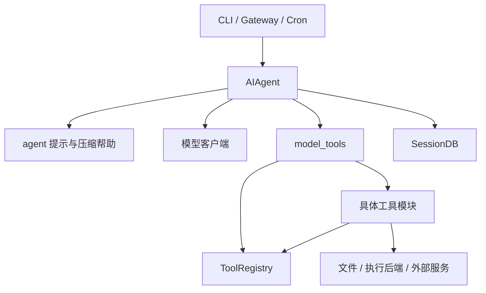
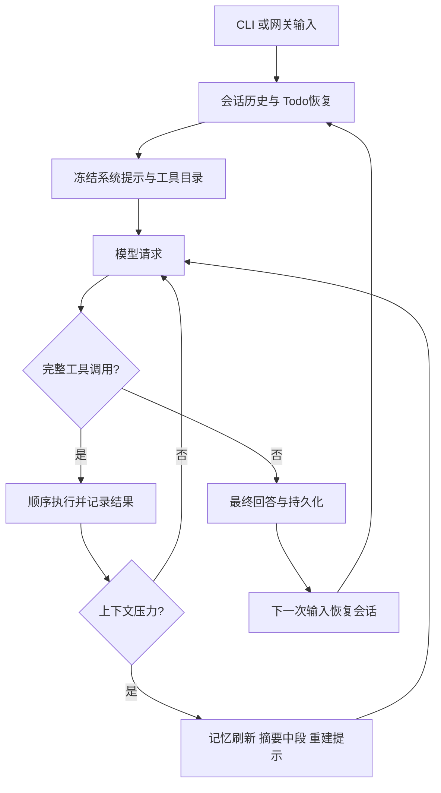

# Hermes v2026.3.12：有记忆与技能积累的个人 Agent，怎样完成一次编码任务

> 核查日期：2026-09-21。官方仓库 `NousResearch/hermes-agent`，标签 `v2026.3.12`，固定提交 `a370ab8391ca5f8de7ebbc449f05cb0df36ade7c`；包内版本为 0.2.0。日期标签与包版本不是同一种编号。本文独立分析早期实现，后续版本见 [2026-09-21 快照](hermes-2026-09-21.md)。项目使用 MIT 许可。

## 1. 从需求理解架构：编码只是个人助手的一类任务

Hermes 面向能长期使用、从经历中积累经验的个人助手。用户可以在 CLI 或消息网关提出要求，Agent 使用终端、文件、网页等工具解决问题，并把值得保留的用户偏好和操作方法留给后续会话。因此研究它的 coding 能力时，不能只看文件编辑器；记忆、技能与跨入口会话才是其区别于简单编码循环的部分。

以“修复某项目的进程取消问题，以后记住这个项目的启动方式”为例，这实际上有三种输出：本次代码修改、本次任务轨迹、可供下次复用的知识。Hermes 分别通过文件工具、会话存储、memory / skill 工具处理它们，并没有把所有东西都写进一段无限增长的系统提示。

不过这个早期版本的核心仍较集中：`run_agent.py` 中的 `AIAgent` 同时承担模型调用、回合控制、部分工具路由、压缩与持久化协调。`agent/` 和 `tools/` 已开始拆分职责，但它不是一个每项能力都可独立替换的微内核。[运行核心][agent]

从 harness 的角度看，模型只负责产生回答或工具调用，宿主负责把这种意图接成可持续执行的系统：准备输入、限定可见能力、执行工具、保存反馈、处理预算与压缩，最后把结果交回入口。在本版里，这套 harness 分布于 AIAgent、提示构建器、工具 registry、执行环境和 SessionDB，尚未成为独立发布、边界单一的 harness package。研究它应追踪这些组件如何共同拥有一次运行，而不是寻找一个恰好叫 harness 的文件。[运行核心][agent] [工具注册表][registry]

### 1.1 仓库组织：共享运行核心，外围按使用入口与工具域分开

这个版本采用 Python 顶层模块加若干 package 的组织，而非一个严格的 `src/hermes/...` 分层库。`pyproject.toml` 将 `hermes` 命令指向 `hermes_cli.main:main`，`hermes-agent` 指向 `run_agent:main`。`cli.py` 承载交互聊天，`run_agent.py` 承载 AIAgent；二者不是同一个入口文件的别名。[入口清单](https://github.com/NousResearch/hermes-agent/blob/a370ab8391ca5f8de7ebbc449f05cb0df36ade7c/pyproject.toml)

| 位置 | 负责的边界 | 运行中实际依赖 |
| --- | --- | --- |
| `hermes_cli/`、`cli.py` | 命令分流、配置、交互聊天 | 装配 AIAgent，消费显示与工具回调 |
| `gateway/`、`cron/` | 消息渠道、计划触发与会话接续 | 将外部输入映射到会话，再调用公共核心 |
| `run_agent.py` | AIAgent 与主 conversation loop | 模型客户端、提示、压缩、工具路由、状态存储与显示帮助 |
| `agent/` | 从核心抽出的 prompt、压缩、计量、trajectory 等帮助模块 | 主要按功能拆分，仍由 AIAgent 协调 |
| `model_tools.py`、`toolsets.py`、`tools/registry.py` | 工具发现、分组、schema 与 dispatch | 供 CLI、AIAgent、batch / 环境入口共用 |
| `tools/*_tool.py`、`tools/environments/` | 具体能力与命令后端 | 文件、终端、浏览器、memory、skill、MCP 等 |
| `hermes_state.py` | 会话事实及查询 | SQLite，供恢复与历史检索使用 |
| `skills/`、`optional-skills/` | 可阅读的程序性知识资源 | 被技能目录 / loader 发现，不是模型权重或循环代码 |

`model_tools.py` 明确保留过去较大模块的 public API。它 import 具体工具模块触发自注册；registry 本身不反向 import 工具，避免初始化循环。registry 的 ToolEntry 保存 schema、handler、toolset、availability 和 async 标志。这是一条可以实际追踪的依赖方向，不是靠文件名推测。[工具 facade](https://github.com/NousResearch/hermes-agent/blob/a370ab8391ca5f8de7ebbc449f05cb0df36ade7c/model_tools.py) [registry](https://github.com/NousResearch/hermes-agent/blob/a370ab8391ca5f8de7ebbc449f05cb0df36ade7c/tools/registry.py)

### 1.2 哪些东西拆开了，哪些耦合仍在

工具执行函数与发现表已分开，所以同一工具可以被编码助手和其他环境复用。记忆正文与技能正文也是外部资源，不需要修改核心 Python 才能增补工作知识。这是组织方式的实际收益。

但 AIAgent 所在文件仍约 4,800 行，并同时导入模型、工具、清理、prompt、压缩及显示帮助；导入阶段还处理环境加载和若干全局设置。因此它不是“构造一个无副作用领域对象”那么纯粹。registry 是进程级共享对象，导入顺序和可选依赖探测会影响发现结果；多入口并存也要求不要把 CLI 专属变量当所有会话共有事实。

持久状态至少分三类所有者：AIAgent 的当前 messages 与运行预算、SessionDB 的历史会话、memory / skill 文件中的可复用内容。压缩把一个长会话接成新分段，而不是让一个内存列表永久承担所有历史。研究恢复逻辑必须同时沿这几条路径看，不能只看到 DB 存在就判断所有运行状态都恢复了。

### 1.3 以扩展工具和改记忆为例看改动传播

新增工具需写 handler / schema 并注册，再确保 discovery 会 import 该模块、toolset 能选到它、可选依赖检查可解释。若它是 async，还会经过 `model_tools._run_async` 的同步 / 异步桥；这个版本会按调用建立 event loop 或临时线程，长生命周期客户端必须注意 loop 归属。只写一个 `tools/new_tool.py` 并不能确保模型看得到。

新增记忆类型则涉及 memory 工具的存储与限额、prompt_builder 的注入位置、AIAgent 生命周期及必要的恢复语义；它不是普通工具注册的一步改动。改变终端后端应优先实现执行接口和资源清理，避免每个文件工具各自识别 Docker / SSH。这里体现了边界的不同成熟度：工具发现已统一，运行状态和产品政策仍集中。

仓库还包含 batch、训练环境与独立实验目录，目录共存不意味着它们都在一次 CLI 聊天中运行。本文沿发布命令与 AIAgent 主路径分析，不把训练设施或某个示例的能力自动计入默认个人助手。

## 2. 启动：配置决定可见工具，也决定执行发生在哪个环境

CLI 装配模型配置、工具组、记忆和会话数据库，再建立 AIAgent；网关同样可使用该核心，但可能每条用户消息重新建立实例。因此“Python 对象是否还活着”不能作为对话能否接续的唯一依据。[CLI 入口][cli] [运行核心][agent]

工具装配使用 toolset。工具注册项包含名字、schema、handler、所属 toolset、依赖检查、环境要求和同步 / 异步标记；注册发生于工具模块加载时。目录按照所选工具名取得定义，并过滤依赖不可用的能力，再转成模型所需的 function schema。[工具注册表][registry]

这种结构把“可用工具范围”与“工具实现”分开。例如没有配置某个外部服务时，其工具可以不进入模型目录，而不需要主循环为每个服务写一个失败分支。但一些需要访问 Agent 状态的工具，如 memory、todo、session_search、delegate，在 AIAgent 中仍有专门路由，不能把它描述为已经完全无状态的通用 dispatcher。

终端默认 `TERMINAL_ENV=local`，cwd 使用宿主当前目录。还存在 Docker、Singularity、Modal、Daytona、SSH 等后端；容器 cwd 与宿主 cwd 不同，配置代码专门处理不能直接映射的宿主路径。[终端工具][terminal]

| 标识 / 状态 | 在本版本中主要负责什么 |
| --- | --- |
| `session_id` | 对话持久化、来源、标题和续接关系 |
| `task_id` | 终端环境、工具缓存等执行状态分组 |
| `conversation_history` | 调用者传入的前序消息 |
| `AIAgent` | 当前模型与工具循环的运行状态 |
| `MEMORY.md / USER.md` | 跨会话的一般记忆和用户画像 |
| `SKILL.md` 目录 | 可再次调用的过程知识 |

这些标识不是天然的项目权限边界。两个 task_id 可以分开管理终端，却仍访问同一个本机目录；只有具体执行后端真正实施的限制才构成隔离。

## 3. 装配系统提示：人格、记忆、技能与项目说明各有位置

`_build_system_prompt()` 的顺序是身份提示、用户 / 网关提示、持久记忆快照、技能指导、上下文文件、启动时间与平台格式提示。相关行为提示按已加载工具注入：没有 memory 工具就不应要求模型调用 memory，没有 session_search 就不应让它猜测历史查询能力。[提示装配][agent]

上下文文件加载器处理 `SOUL.md`、`AGENTS.md`、`.cursorrules` 与 Cursor rules。SOUL 是个性 / 行为说明载体，影响表达和行为倾向，但不会改变底层权限。AGENTS 在本版本有一个具体条件：先发现 cwd 顶层 AGENTS.md，才递归收集其下同名文件，按深度组合，过滤一些无关目录并截断总材料。[上下文文件与技能索引][prompt]

这与“进入某个文件时动态加载最近一级规则”并不相同。一次加载多个子目录规范可能增加上下文和规则冲突；截断又可能遗漏后半部分。因此不能只说它“支持 AGENTS.md”而不解释发现范围和加载时机。

系统提示在会话内缓存。MEMORY.md 与 USER.md 的注入内容也是加载时冻结的快照；模型后续写了记忆文件，并不会立刻改变每一轮的系统前缀。压缩时才失效并重建。网关重新创建实例时，还可以从数据库恢复上一次保存的系统提示，避免无意改变前缀缓存。[记忆存储][memory] [运行核心][agent]

这是一个明确取舍：用稳定前缀换取缓存命中；本轮刚写入的知识可以从工具结果得知，但另一个会话修改的记忆不保证马上反映到当前系统提示。

## 4. 输入进入后：恢复任务状态，再开始有预算的多轮循环

`run_conversation(user_message, system_message, conversation_history, task_id)` 复制调用者历史，加入本次用户消息，恢复必要的 todo 状态，准备缓存系统提示，然后开始多次模型请求。返回值包含最终响应、消息、完成 / 中断等状态，而不只是一段字符串。[运行核心][agent]

todo 恢复尤其说明网关接续的实际问题：网关新建 AIAgent 后，内存 todo 是空的；代码从历史最近的 todo 工具结果重新装回它。短期状态因而不完全依赖某一个进程对象。

模型适配还处理不同服务的 reasoning 字段与请求结构。推理内容、普通回答和工具调用分别解析；工具调用回合中已有的文字也会被保留，以便异常情况下不丢掉所有可用内容。循环对错误 JSON、未知工具、空回复、上下文超限和请求错误有不同恢复路径，不能简化为“任何错误都自动重试一次”。

预算用于约束循环，但应注意一个静态阅读发现：构造函数接受父级共享 `IterationBudget`，delegate 也把它传给子 Agent；然而此提交的 `run_conversation()` 开始时无条件新建预算。这会覆盖注入的共享对象。由可见调用路径判断，**不能把本版描述为已经可靠实现父子统一总预算**；这是接口意图与实际重置逻辑不一致的风险，本文没有运行它来测量具体超额结果。[构造与回合重置][agent] [委派调用][delegate]

## 5. 工具执行：主回合顺序推进，反馈重新进入模型

`_execute_tool_calls()` 按助手消息中的顺序执行调用，每个调用开始前检查中断。如果用户在某个工具运行中要求停止，剩余工具不会启动，而会逐个补上取消结果，维持 tool_call_id 对应关系。[工具执行][agent]

文件工具包括分页读取、搜索、写入和 patch；patch 支持指定旧 / 新字符串的 replace 模式，也支持结构化补丁格式。读取跟踪器记录已读文件范围，重复读取会得到提醒或相应处理，目的是减少模型在相同材料上空转。[文件工具][files]

checkpoint 管理器可在 write_file / patch 等修改前保存工作目录快照。这是恢复辅助，不是每种终端副作用的完整事务。经 Bash 删除数据库、调用远端 API 等行为，不会因某个文件 checkpoint 存在就自动可撤销。

工具结果被追加成带关联 ID 的 tool 消息。比如测试失败应把实际输出交回模型，让其调整假设或代码；运行成功但输出不足也不能被宿主“优化”为任务成功。这种执行反馈是 Agent 推进的依据，而不是只供用户查看的日志。

## 6. 终端与 sandbox：后端可替换，不代表默认隔离

terminal 工具负责把命令送往所选执行后端，管理 task 对应的环境、运行中进程、输出和超时。local 是本机执行；SSH 是远程账户执行；容器 / 云沙箱的边界取决于镜像、挂载、网络和运行服务。它们的隔离强度不能由同一个工具名字推断。[终端工具][terminal]

另有 `approval.py` 对危险命令模式做识别，按 session_key 保存等待审批和已批准状态。它是模式检测加交互状态，不是完整 shell 语义证明，也不是操作系统沙箱。[危险命令审批][approval]

对于 coding agent 开发，这个设计的价值是：文件和终端操作要围绕同一个执行环境组织，否则模型看到的是远程文件，测试却跑在本地。代价是后端路径、依赖、进程清理和错误语义都需要适配。研究中不能拿“支持 Docker”代替“本次执行已进入 Docker”。

## 7. 需要外部能力时：MCP 被转换成本地工具注册项

早期 Hermes 已有较完整 MCP 适配。`discover_mcp_tools()` 读取配置，连接尚未连接的服务器，把工具注册到同一目录；未安装可选 SDK 或未配置服务器时返回空集合，不拖垮其他能力。发现阶段可以并行连接，单服务器故障单独记录。[MCP 实现][mcp]

主 Agent 有不少同步代码，而 MCP SDK 使用 asyncio / anyio。实现专门启动后台事件循环线程，把同步调用提交进去；每个 MCPServerTask 的连接、发现、服务、关闭都保持在同一个 asyncio Task 中，避免 anyio cancel scope 跨 Task 退出。这是适配层里真正重要的生命周期问题，不能用“支持 MCP 协议”一笔带过。

该实现支持 stdio 与 HTTP / StreamableHTTP，也提供 resources 和 prompts 的访问包装。服务器内容最终回到统一工具结果，模型无需知道本地文件工具与远程业务工具的传输差别。支持 sampling 的代码另外有模型选择与速率控制，不应把服务器触发的模型调用视为零成本工具操作。

MCP 并没有给服务器内容天然可信地位；返回材料仍可能不准确，也不会因为经过协议包装就获得修改主系统提示或读取全部凭据的授权。

## 8. 子任务出现时：新上下文节省主轨迹，却仍要管理执行资源

`delegate_task` 创建子 AIAgent，给予明确目标、可选背景、工具范围与独立 task_id，父级只收汇总，不接收子级全部中间思考和工具结果。批量模式通过线程池运行多个子任务，父工具等待它们结束。[委派实现][delegate]

子 Agent 默认跳过父级上下文文件与个人记忆加载，去掉 delegation、clarify、memory 等工具组，并限制递归深度。这样既缩小输入，也避免每个子任务都随意改全局用户画像。它不是把主历史完整复制后换一个提示词。

独立 task_id 可以隔离工具状态与终端会话，但本机后端仍可能共享文件系统。若两个子任务改同一个文件，身份不同不等于不会冲突。前文预算重置风险也表明，是否真的共享预算必须读调用链，不能只相信接口注释。

## 9. 长对话中途：先抢救长期信息，再压缩中段

`ContextCompressor` 默认按模型窗口的 85% 触发，使用服务端 usage 与请求前粗估计判断压力；默认保护前 3 条、后 4 条消息，摘要目标 2,500 token。源码注释有时称 turns，但算法实际用消息数组下标切分，不能把它误解为保护三个完整用户回合。[压缩器][compress]

它将中段摘要，头尾保留原文，前后边界调整以避免切断工具调用组，随后清理孤立配对。与按近期 token 预算反向选区相比，按消息数实现直接，但每条工具消息大小差异巨大：四条消息可能只有数百 token，也可能是巨量日志。

还有一个重要的历史行为：摘要不可用时，代码仍会保留头尾、丢弃中段，并显示没有摘要的提示。它不是“摘要失败就完全保持原上下文”。这有助于从容量困境中继续，却可能丢失关键约束，不应当作无损压缩或稳健默认直接复用。[压缩器][compress]

外层 `_compress_context()` 在压缩前调用 `flush_memories()`，额外请求模型把有价值内容保存到 memory。该请求只给 memory 工具，结束后清除刷新提示与中间产物。随后压缩器工作，再补入 todo 快照和已读文件范围，重新加载记忆并重建系统提示。[压缩协调][agent]

已读文件提示在本版甚至要求不要重读、依赖摘要继续。这是一种防止读取循环的策略，却可能在摘要不完整或文件已变化时压制必要观察。应将其理解为此版本的具体取舍，而非普适上下文工程准则。

压缩还会结束旧数据库 session，创建带 `parent_session_id` 的续接 session，并延续标题。这意味着界面上的长对话可能对应多段存储身份；历史搜索必须理解这种关系，不能只按一个 ID 判断“以前没有做过”。

## 10. 回合结束后：长期记忆、历史检索和技能各保存不同东西

### 10.1 记忆是受限文本，不是隐形向量数据库

MemoryStore 管理 MEMORY.md 与 USER.md，默认字符额度分别为 2,200 和 1,375。add 拒绝空内容和精确重复，超出额度时返回当前条目与用量，让模型 replace / remove；更新后保存文件。其去重主要是字符串层面，不是语义事实合并。[记忆存储][memory]

默认 CLI 配置开启一般记忆与用户画像，但 AIAgent 仍依据实际配置和 skip_memory 决定是否加载。小额度迫使内容精炼，稳定系统快照控制缓存成本；缺点是复杂知识需要外置，并且“同义事实矛盾”主要靠模型维护。

可选 Honcho 接入承担另外的用户建模与跨会话背景，预取、观察保存、同步均有单独入口。它不是本地 MemoryStore 的必需依赖；本地记忆存在也不证明 Honcho 已配置或启用。[运行核心][agent]

### 10.2 历史用 SQLite 搜索，再用模型过滤阅读成本

`hermes_state.py` 保存 sessions / messages，FTS5 索引支持历史文本查询。`session_search` 先按关键词找到相关消息，聚合为几个会话，再截取匹配附近的历史交给辅助模型生成针对查询的摘要。[会话数据库][state] [历史检索工具][search]

这是一条“关键词召回 → 会话材料 → 问题导向摘要”的链路。优点是主模型不会一次吃进全部历史；代价是召回依赖词面，摘要有成本和遗漏可能。不能称为默认语义向量召回，也不能把摘要当原始证据本身。

### 10.3 Skill 保存可重复执行的方法

skills_list / skill_view 让模型先看目录、再读完整步骤；索引还根据平台与所需工具决定展示。`skill_manage` 支持创建、修改、patch、删除技能和支持文件，并校验 frontmatter、名称与路径；写入使用临时文件替换，扫描不通过的部分修改会回滚。[技能管理][skill-manage] [技能读取][skills]

例如修复完成后，可以把“如何定位和验证本项目进程清理问题”整理成带命令、判据和例外的 SKILL.md；用户偏好写 USER.md；某次测试输出留在会话历史。三者分开，才能避免记忆索引变成操作手册、技能又被塞入某次临时错误。

技能积累是这个版本所说学习的主要载体之一，但没有在该链中看到对每次改写都自动做基准任务评测、候选选择和能力退化回滚。扫描处理的是规则与内容风险，不是证明技能更有效；**程序知识可编辑不等于 RSI 已经成立**。

## 11. 下一次追问与重启：持久状态怎样接回运行核心

同一对象内继续传入历史，或网关从数据库恢复历史后新建对象，都能重新进入 run_conversation。系统提示、todo、消息与压缩父子关系承担接续；工具环境又有独立 task 生命周期。轨迹、会话日志与 SQLite 服务于不同观察需求，不应把某一格式当作所有状态的唯一真相。[运行核心][agent] [会话数据库][state]

恢复对话不意味着恢复外部命令到中断前那一行。实际进程、远程环境与文件可能已经改变。编码任务继续时仍需要读取当前事实，尤其不能用旧压缩摘要证明当前测试通过。

## 12. 对实现者的判断

这版最有价值的组合是：小容量长期记忆负责方向，历史搜索负责回忆，技能负责操作过程，工具循环负责当下执行。它把“长期助手”落到真实文件、数据库和调用流程，而非只用 persona 提示模拟持久性。

其代价也可从代码直接看到：大型 AIAgent 协调过多职责；同步核心与异步 MCP 需要线程桥接；按消息数压缩不精细；摘要失败仍丢中段；共享预算注入被回合重置覆盖。后续版本是否修正，应查具体实现，不能凭版本更新推断全部解决。

本次为固定提交静态分析，未安装 / 启动 Hermes，未调用模型、Honcho、MCP 或任何云执行环境。上述风险是源码路径判断，不是运行事故报告；未声称在本项目复用了实现。

[agent]: https://github.com/NousResearch/hermes-agent/blob/a370ab8391ca5f8de7ebbc449f05cb0df36ade7c/run_agent.py
[cli]: https://github.com/NousResearch/hermes-agent/blob/a370ab8391ca5f8de7ebbc449f05cb0df36ade7c/hermes_cli/main.py
[registry]: https://github.com/NousResearch/hermes-agent/blob/a370ab8391ca5f8de7ebbc449f05cb0df36ade7c/tools/registry.py
[prompt]: https://github.com/NousResearch/hermes-agent/blob/a370ab8391ca5f8de7ebbc449f05cb0df36ade7c/agent/prompt_builder.py
[memory]: https://github.com/NousResearch/hermes-agent/blob/a370ab8391ca5f8de7ebbc449f05cb0df36ade7c/tools/memory_tool.py
[terminal]: https://github.com/NousResearch/hermes-agent/blob/a370ab8391ca5f8de7ebbc449f05cb0df36ade7c/tools/terminal_tool.py
[approval]: https://github.com/NousResearch/hermes-agent/blob/a370ab8391ca5f8de7ebbc449f05cb0df36ade7c/tools/approval.py
[files]: https://github.com/NousResearch/hermes-agent/blob/a370ab8391ca5f8de7ebbc449f05cb0df36ade7c/tools/file_tools.py
[mcp]: https://github.com/NousResearch/hermes-agent/blob/a370ab8391ca5f8de7ebbc449f05cb0df36ade7c/tools/mcp_tool.py
[delegate]: https://github.com/NousResearch/hermes-agent/blob/a370ab8391ca5f8de7ebbc449f05cb0df36ade7c/tools/delegate_tool.py
[compress]: https://github.com/NousResearch/hermes-agent/blob/a370ab8391ca5f8de7ebbc449f05cb0df36ade7c/agent/context_compressor.py
[state]: https://github.com/NousResearch/hermes-agent/blob/a370ab8391ca5f8de7ebbc449f05cb0df36ade7c/hermes_state.py
[search]: https://github.com/NousResearch/hermes-agent/blob/a370ab8391ca5f8de7ebbc449f05cb0df36ade7c/tools/session_search_tool.py
[skills]: https://github.com/NousResearch/hermes-agent/blob/a370ab8391ca5f8de7ebbc449f05cb0df36ade7c/tools/skills_tool.py
[skill-manage]: https://github.com/NousResearch/hermes-agent/blob/a370ab8391ca5f8de7ebbc449f05cb0df36ade7c/tools/skill_manager_tool.py
