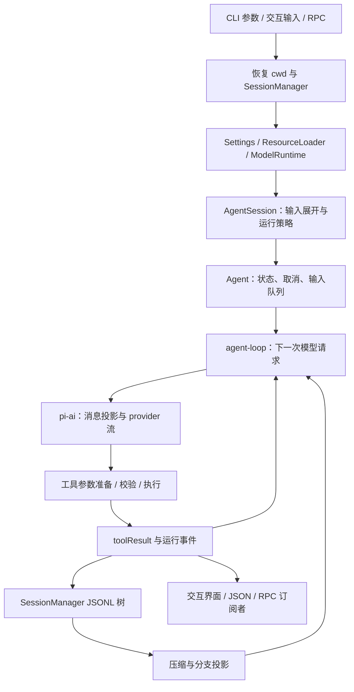
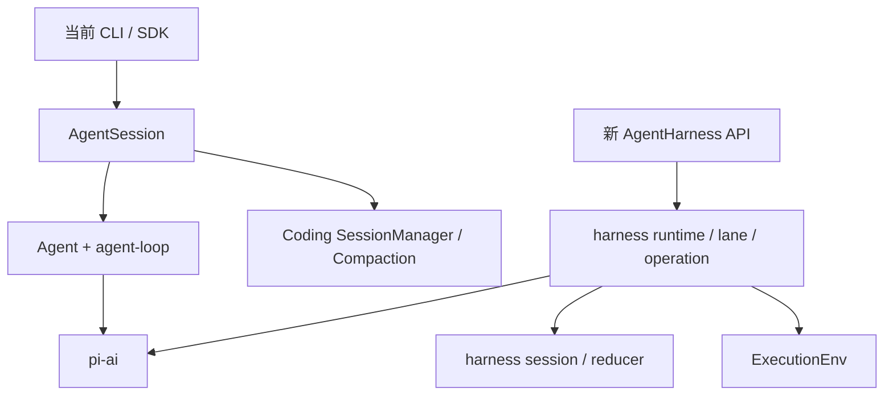

# Pi：2026-09-21 主线源码中的完整 Coding Agent 数据流

> 核查日期：2026-09-21。源码固定为 `earendil-works/pi@8bfef4de880cd529b8d4fc164497a723542780c3`，提交时间为 2026-09-21；包清单版本 `0.86.1`，包含该发布之后的主线修改，不能与 `v0.86.1` tag 完全等同。旧地址 `badlogic/pi-mono` 当前重定向到此仓库。许可证 MIT。本篇直接阅读源码，未安装依赖或运行模型。
>
> 对照版本见 [Pi v0.50.0](pi-v0.50.0.md)。本篇独立解释当前版本，不要求先读旧版。文内“源码事实”指固定提交可见行为；“设计分析”是对这些行为的解释，不是性能实测。

## 1. 从一次实际工作理解 Pi 的设计目标

设用户在一个 Python 项目中启动 Pi，要求“定位取消任务后残留子进程的问题，修改实现并运行相关测试”，中途又补充“保留原有 Windows 行为”。一个可用的 Agent 必须解决六件事：确定操作目录，装配项目指令，理解追加要求，连续调用读写和命令工具，防止测试输出撑满模型窗口，以及下次启动时恢复工作。

Pi 的选择是保留一个小而通用的执行循环，把具体工作方式交给可组合资源。它默认提供 `read / bash / edit / write`，还可选择其他内建工具与扩展；不会把一套固定计划、待办和子 Agent 流程强加给所有任务。这个“小”指默认产品策略，并不表示今天的仓库只有一个简单 while 循环：资源发现、会话树、provider 适配、压缩、运行事件和扩展生命周期已经是独立子系统。[产品定位][readme]、[默认装配][sdk]

从开发者角度，Pi 最有价值的是三个可替换层次：`pi-ai` 处理模型协议，`pi-agent-core` 处理消息与工具推进，`pi-coding-agent` 把它们装配成持久 CLI 产品。前两层可以嵌入自己的应用，第三层增加终端交互、配置、资源和会话管理。TUI 并不负责决定“工具结果后是否继续调用模型”。

### 1.1 仓库组织：稳定 CLI 路径与新的 Harness 路径同时存在

这份 monorepo 的主要包仍是 ai、agent、coding-agent、tui，但不能仅按包名判断实现边界。当前 `packages/agent/src/index.ts` 同时导出原有 `Agent` / `agent-loop`，以及 `harness/agent-harness.ts`、新会话与压缩接口；包的 `./node` 入口再提供 NodeExecutionEnv。**同一 npm 包包含两条抽象路径，不代表 CLI 已经切到新路径。**[Agent 导出](https://github.com/earendil-works/pi/blob/8bfef4de880cd529b8d4fc164497a723542780c3/packages/agent/src/index.ts) [包入口](https://github.com/earendil-works/pi/blob/8bfef4de880cd529b8d4fc164497a723542780c3/packages/agent/package.json)

实际 `coding-agent/src/core/sdk.ts` 仍创建 Agent 与 AgentSession，导入自己的 SessionManager、ResourceLoader、ModelRuntime 和 CacheWarmer。coding-agent 自身的 `core/compaction/` 与 `session-manager.ts` 也仍有完整实现，不是全部转发到新 harness。因此阅读相同名称的 compaction/session 文件时，必须沿调用者确认是哪套代码。[SDK][sdk]

| 组织位置 | 当前责任 | 关键依赖 / 所有者 |
| --- | --- | --- |
| `packages/ai/src/` | provider 协议、统一消息、流与兼容 API | 面向生成服务，独立于 CLI 的会话目录 |
| `packages/agent/src/agent.ts`、`agent-loop.ts` | CLI 当前采用的内存运行核心 | 消息、队列、工具执行状态；通过流函数访问 ai |
| `packages/agent/src/harness/` | 新 Harness 的 Context、lane、operation、session、环境与 reducer | 用显式运行记录表达操作；内部有独立 runtime 和 compaction |
| `packages/coding-agent/src/core/sdk.ts` | CLI / SDK 的默认装配 | ModelRuntime、缓存预热、扩展回调与 AgentSession |
| `core/agent-session.ts`、`session-manager.ts` | 当前产品的持久会话与跨轮应用逻辑 | JSONL 树、活跃分支、压缩、资源和模型切换 |
| `core/extensions/`、`resource-loader.ts`、`tools/` | 用户扩展、资源发现、代码操作 | 工具 / 生命周期接口与实际 cwd |
| `modes/`、`packages/tui/`、client 导出 | 不同输入输出形式 | 订阅运行状态、发命令；各自有展示状态 |

这张图刻意画出两条路径。新 Harness 的存在说明正在扩大通用宿主能力，但把它画成当前 CLI 的必经节点会给二次开发者错误的修改目标。某个 experimental export 的存在也只证明接口可见，不能代替实际入口接入和稳定性承诺。

### 1.2 状态归属与兼容层怎样影响维护

当前 CLI 中，Agent 的内存上下文负责下一次请求，SessionManager 保存可恢复条目，AgentSession 将执行事件和持久记录同步；ModelRuntime 管理可用模型及请求适配，CacheWarmer 检查消息前缀是否仍对应当前上下文。扩展通过 callback / runner 插入操作，但不应自行成为会话树的另一位权威写者。

新的 harness 则用 operation、lane、Session 和 reducer 给运行结果更明确的身份，执行环境也单独抽象。这有利于非 CLI 宿主重用；同时带来过渡期维护成本：两套压缩与会话机制需要分别理解，修复一条路径不自动修复另一条。代码中存在 `compat` 导入及阶段性接口，同样提示不能把命名升级视为迁移已经结束。

包依赖也随之变化：agent 包现在依赖 ai、telemetry、chord 以及文件 / schema 相关库，不再是仅放循环的几份文件。新版“轻量”仍适合描述默认工作策略，已经不适合被解释为整个 agent 包几乎没有基础设施依赖。

### 1.3 改一项能力，会牵动哪些位置

要给当前 CLI 增加自定义工具，首先走 coding-agent 的工具工厂或扩展注册，并处理执行、取消和展示；不要只在新 harness 的资源列表里注册后期待 CLI 自动发现。要改当前会话压缩，应沿 AgentSession → coding-agent compaction → SessionManager 的调用链；要嵌入新 Harness，则另看其 runtime 与 session API。

增加 provider 应从 ai 的消息 / stream 契约、provider 实现与注册进入，再补 ModelRuntime 的产品选择和认证接入。若涉及工具调用 replay、thinking 或新增系统消息语义，必须同时检查消息转换，不能只替换 HTTP 地址。`ai/package.json` 的 provider 子路径与 `compat` 导出，正是区分新接口和兼容消费者的实际边界。[AI 包入口](https://github.com/earendil-works/pi/blob/8bfef4de880cd529b8d4fc164497a723542780c3/packages/ai/package.json)

这套组织的优点是能够渐进演进，保留当前产品路径的可用性；代价是读者必须先辨认调用链。本文后续主流程跟随真实 CLI 路径，新 Harness 单独在第 11 节解释，避免把两个实现拼接成一个不存在的 Agent。

## 2. 启动：先恢复工作地点，再创建运行时

### 2.1 入口与对象职责

`packages/coding-agent/src/main.ts` 把参数、所选模式和会话选择转换为运行时配置；`createAgentSessionRuntime()` 管理新建、恢复、fork 和切换会话时的整体重建；`createAgentSession()` 则真正创建 `Agent` 与 `AgentSession`。[入口][main]、[运行时生命周期][session-runtime]

这里容易混淆四个对象：

| 对象 | 它持有的事实 | 不应误认为 |
| --- | --- | --- |
| `SessionManager` | 会话文件、条目树、当前叶子和 cwd | 一个正在调用模型的 Agent |
| `Agent` | 当前消息、模型、工具、活动运行与输入队列 | 持久存储服务 |
| `AgentSession` | 产品级输入处理、资源、扩展、压缩、重试与事件持久化 | 单纯 UI 包装器 |
| `AgentSessionRuntime` | 跨会话的创建、销毁、cwd 切换与资源重装配 | 模型自己的规划循环 |

恢复会话时，程序先读取 session 的 cwd，检查实际目录，再按该目录重建配置和资源。否则，从项目 A 切换到项目 B 的历史时，很容易继续使用 A 的工具工作目录或扩展。`AgentSessionRuntime` 中切换路径调用 `teardownCurrent()`，然后用新的 `SessionManager` 和 cwd 调用工厂；这是一种明确的产品生命周期边界。

“项目管理”在这条 CLI 主链中主要是 **cwd、项目资源和按目录组织的会话**。它没有要求用户先创建一个独立业务 Project 数据库。会话 fork 改变对话历史，不会自动复制 Git 工作树；两条分支仍可能写入同一目录。

### 2.2 项目 trust 的真实含义

当前版本有 `project-trust.ts` 与 `trust-manager.ts`。启动遇到尚未确认的项目资源时，判断是否允许加载项目 `.pi` 配置、安装其缺失 packages、执行项目 extensions。信任记录可作用于目录或父目录，非交互模式按全局默认值与显式参数处理。[实现][project-trust]、[当前说明][readme]

这与 README 中“不内置每次工具调用的权限弹窗”并不矛盾：一个是**加载项目提供的可执行扩展**，另一个是**模型调用工具时是否逐次审批**。项目被信任也不代表启动了操作系统沙箱。对本仓库而言，这是上游行为研究，不是要求修改已经确认的默认本机执行规则。

## 3. 装配输入：项目指令、Skill 与扩展各在什么时候进入

### 3.1 ResourceLoader 把文件资源变成运行对象

`DefaultResourceLoader.reload()` 依次处理信任决策、settings、package 解析、extensions、skills、prompt templates、主题、项目上下文和系统提示来源。对于需要信任处理的启动，它先加载用户级及命令行指定扩展，让它们参与 `project_trust`；获得决策后再装配项目资源。这个顺序避免“为了询问是否执行某项目扩展，先把它执行了”。[资源加载器][resources]

上下文文件查找具有明确优先顺序：同一目录先尝试 `AGENTS.override.md`，然后 `AGENTS.md` 等兼容名称和 `CLAUDE.md`；加载用户级上下文和目录祖先上下文时还处理遮蔽、去重。它没有在启动时无差别拼入整个仓库。模型需要源码证据时，仍通过读文件和 shell 搜索获取。

这是两种不同的输入：上下文文件说明“这个地方怎样工作”，按需文件读取提供“这个问题的实际证据”。把项目全部源码当作长期系统提示，会把每次请求成本和陈旧风险一起放大。

### 3.2 Skill 是渐进展开的程序性知识

`skills.ts` 解析 frontmatter，建立名称、描述、文件路径、基础目录和来源元数据。`formatSkillsForPrompt()` 只把可由模型调用的技能索引放入提示，并让模型通过 `read` 或可用 shell 加载正文。`disable-model-invocation` 的技能不进入该自动选择索引，但仍可由用户显式调用。[技能解析][skills]

用户输入 `/skill:name 参数` 时，`AgentSession.prompt()` 先处理扩展命令和 `input` 事件，再展开 Skill 和 prompt template。于是显式 Skill 变成这次用户请求的一部分；模型自主读取 Skill 则产生普通工具结果，进入后续上下文。二者有相同的知识目的，但进入消息流的位置不同。

例如“先复现取消问题，再核对进程树”的方法可写在 Skill 中；具体进程 PID、测试输出和源文件内容则属于本次运行事实。Skill 不应自动承担这些易变事实的数据库职责。

### 3.3 Extension 是能改变运行行为的代码

Extension 可以注册工具、命令、UI、provider 和事件处理器。它与 Skill 的关键区别是：Skill 通常是模型读取的说明；Extension 在宿主中执行，并能直接改变输入、工具执行或模型请求。[扩展分发器][extension-runner]

`emitContext()` 先复制消息，再按处理器顺序传递结果，因此上下文裁剪可以只影响这次请求投影，而不直接篡改持久历史。`emitToolCall()` 遇到明确阻断结果会提前返回；`emitToolResult()` 则可以改变发回模型的内容和附属 details。扩展不是全部同一种“回调”：不同事件的失败和传播语义需要分别阅读，不能假设异常一律吞掉或一律终止。

例如，一个评测扩展可以在 `tool_result` 把大日志替换成摘要，并把完整日志路径放进结果；一个交互扩展可以在 `tool_call` 发起确认。前者改变模型可见数据，后者改变动作能否发生。两者都不能仅靠安装 Skill 实现。

## 4. 用户提交后：构造可恢复的提示与工具状态

### 4.1 输入处理顺序

`AgentSession.prompt()` 的顺序是：尝试扩展命令 → 发出 input 事件 → 展开 Skill / template → 判断当前是否正在运行 → 立即运行或进入输入队列 → 处理待补消息和模型认证 → 创建本次运行输入。[会话协调器][agent-session]

这意味着 `/某扩展命令` 可以被本地处理而不发模型请求；已经在 streaming 时，普通追加内容需要说明是 steer 还是 follow-up；压缩期间的提交也有单独处理条件。把所有输入都直接追加到一个 `messages[]` 会丢失这些产品语义。

### 4.2 2026 年 9 月的关键变化：提示也成为 transcript 状态

`system-prompt.ts` 构造具名 sections，包含工具规则、追加提示、项目文件、技能索引和 cwd。当前 Agent 循环还会把工具集合变化表达成 transcript 中的 `toolsAdded / toolsRemoved`，而不仅是每次改一个外部 `tools` 参数。这样恢复会话或在树上切换时，能恢复当时的提示和工具集合。[提示装配][system-prompt]、[循环中的工具变更声明][loop]

`0.86.0` 的 changelog 明确记录了中途 system prompt / tool 变化入 transcript，以及 provider 输入改为规范化 `TranscriptContext` 的破坏性变化。这不是早期 Pi 示例中“固定 systemPrompt + 消息数组”的简单复制。[版本记录][changelog]

还有一个细节：当扩展的 `before_agent_start` 返回完整覆盖提示，`_installAgentForcedPromptProjection()` 会在请求投影时把它置于 leading system prompt，而持久 transcript 保持结构化事实。因为在历史中部增加一条 system 消息，不保证所有 provider 都把它解释成替换最前面的提示。

设计价值在于把“历史里发生了什么”“下一次实际发什么”分开，同时保持二者有可追溯关系。代价是 provider 适配必须理解提示更新，不能把历史中的全部 system 段粗暴拼接成重复规则。

## 5. 模型请求：Agent 内部消息怎样变成 provider 输入

`sdk.ts` 创建 `Agent` 时注入三个重要接口：`transformContext`、`convertToLlm` 和 `streamFn`。`agent-loop.ts` 在每次请求中先变换内部消息，再转为 LLM 消息，最后规范化并交给流函数。[SDK][sdk]、[请求生成][loop]

内部消息不仅有 user / assistant / toolResult，还能有自定义消息、分支摘要和压缩摘要。模型 API 未必认识这些类型，所以必须有投影层。工具的 `details` 也主要用于宿主与渲染，不能默认当成模型正文发送。这样一个工具可以给模型简短结论，给界面结构化 diff，两者不必相同。

`pi-ai` 负责把统一模型对象、文本、图像、思考、工具调用、usage 和 stop reason 转换为不同 provider 的协议。统一接口不表示所有模型能力完全相同：图像限制、思考级别、签名思考续接、缓存、严格工具 schema 仍需按模型能力处理。[模型类型边界][ai-types]

当前 `sdk.ts` 的请求构建还汇总超时、provider retry 配置、headers 扩展事件和响应事件。这些属于 harness 成本与故障行为，不能归因于“模型自己重试”。若在本项目借用这种结构，应保持本项目已有的失败停止策略，不能顺便照搬上游重试默认值。

### 5.1 缓存是请求前缀的性质

当前版本增加 `CacheWarmer`：主会话请求用于更新待保温的缓存上下文，压缩与分支摘要使用自己的 routing id，不覆盖主会话缓存记录；保温前还判断当前 transcript 是否仍是该请求前缀的延伸。`cacheContextIsCurrent()` 比较消息对象的前缀关系，而不只比较数组对象身份。[实现][sdk]

这解释了为什么“系统提示很长但不经常改变”有时仍可接受，而每轮把日期、临时状态、无关记忆塞到最前面会很昂贵。保温本身可能消耗请求和费用，不能把它写成免费的性能提升；当前 changelog 也记录了成本感知和可配置模式。[版本记录][changelog]

## 6. 推进循环：工具回合、追加要求与终止

`runLoop()` 有两个层次。内层处理模型响应、工具结果和 steering 消息；当模型没有继续工具调用、也没有 steering 时，外层检查 follow-up 队列，决定是否开始另一轮。[完整控制流][loop]

以开头场景为例：

1. 模型读取进程管理文件，宿主返回 `toolResult`。
2. 用户在读取期间补充“保留 Windows 行为”，消息进入 steering 队列。
3. 当前工具批次完成后，下一次请求带入这条约束，模型可以调整方案。
4. 用户另外排队“之后整理文档”，作为 follow-up 等当前工作自然结束后再处理。

当前读取的循环在工具批次结束后取 steering，不能把它描述成一定会取消同一批次内尚未完成的工具。更细粒度的旧版 steering 行为见旧版独立文档。取消请求则是另一条 AbortSignal 通道，不等同于追加一条用户消息。

每个模型请求会产生 `turn_start / message_start / message_update / message_end / turn_end` 等事件；一次用户工作还会有 `agent_start / agent_end`。流中 delta 用于显示，最终 message 用于状态与保存。如果模型以 `error` 或 `aborted` 结束，内核结束这次 loop；产品层是否重试由 `AgentSession` 另行决定。

一个容易忽略的实现是 `stopReason === "length"`：即使响应中出现工具调用，参数也可能截断，循环会为这些调用产生失败结果而不执行。语法上看似 JSON 完整，不足以证明整个工具批次正常完成。

## 7. 工具执行：从模型提议到真实文件与进程

### 7.1 准备、执行、归一化分开

当前工具调用先查表，再经过 `prepareArguments` 和 `validateToolArguments`，接着运行 `beforeToolCall`。未知工具、参数错误或阻断形成可见的错误工具结果；通过后才进入 execute。执行后还有结果终结与事件发出阶段。[工具调度][loop]

循环支持顺序和并行批次：如果配置要求 sequential，或者批次中有工具声明 `executionMode: "sequential"`，走顺序分支。是否并行是宿主策略，不是模型在文字里说“并行”就能成立。即使允许并行，两个修改同一文件的调用仍需要更细粒度协调。

### 7.2 当前 edit 的语义已不是只有一对 oldText / newText

本版 `edit` 接受一个文件中的 `edits[]`。每项旧文本都对照**同一份原文件**匹配，要求匹配唯一、范围不重叠；相邻或嵌套改动应由模型合并。`prepareArguments` 留有旧参数兼容，但模型-facing schema 采用数组。[文件编辑][edit]

实现先进入按文件路径的 `withFileMutationQueue()`，再读取原文件，处理 BOM、归一化换行、计算所有替换，恢复原换行后写入，并返回模型文本和界面 diff / patch。取消检查放在 await 之后，不从 abort listener 提前释放队列，避免写入尚未结束就让下一个调用进入。

它解决的是**本进程内同路径修改的顺序**。当前默认 `writeFile` 不因此变成跨进程事务，也不能保证用户编辑器在读取和写入之间的修改一定被检测。这一边界在“多个 Agent 共用目录”时特别重要。

### 7.3 Shell 输出同时服务模型与界面

`bash.ts` 将执行委托给可替换的 `BashOperations`，调用者可把它换成远程执行。输出先进入 `OutputAccumulator`，界面得到节流的进度快照，完成后生成模型可见结果；超过上限会提供截断提示与完整输出文件路径。[Shell 工具][bash]

默认公共截断工具以行数和字节数中先达到者为界，目前常量为 2,000 行和 50 KiB。对于 shell，保留尾部有利于看到最终错误；对于读文件，分页位置更重要。它们是输出策略，不是模型上下文 token 的精确上限。[截断实现][truncate]

工具返回失败后模型可以根据错误再行动，这与自动重放命令不同。取消也不构成文件回滚：已经完成的编辑仍留在项目里，是否撤销要由后续明确操作决定。

## 8. 长任务中的上下文管理：计量、切分、摘要、重新投影

### 8.1 为什么不能每轮把全文重新估一遍

`estimateContextTokens()` 优先取最近 assistant 的实际 usage，再加它之后新增消息的估算；没有 usage 时才全量估算。自动触发条件是 `contextTokens > contextWindow - reserveTokens`。当前默认 `reserveTokens=16384`、`keepRecentTokens=20000`，并支持按模型覆盖。[压缩算法][compaction]、[9 月版本记录][changelog]

二者职责不同：reserve 为下一次生成及压缩预留空间；keepRecent 控制希望保留多少近期原文。它们不是“压缩率”和“保留历史百分比”。如果上下文中的大部分是不可缩减固定输入，再缩历史也可能无法解决溢出。

### 8.2 findCutPoint 保持协议完整，而不机械保留整个用户回合

算法从尾部累计估算量，达到 recent 预算后选择合法切点。可以切在 user 或 assistant 消息前，不能直接切在 tool result 前，使结果失去对应调用。若尾部工具结果自身超预算，会保留它前面的 assistant 调用作为边界。[切点实现][compaction]

一个用户请求可能运行几十次模型调用。若所有这类请求都必须整体保留，长任务本身就无法压缩。Pi 因而允许 split turn：以前的对话生成 history summary，当前长回合被切掉的前半段生成 turn-prefix summary，两部分合并，再接近期原文。

`prepareCompaction()` 从上一份 compaction 边界继续，传入 previousSummary，并追踪读过、修改过的文件；`compact()` 将这些文件操作信息附到结果。这样摘要不仅说“做了一些修改”，还给后续 Agent 找回工作位置。

### 8.3 压缩不是改写原会话文件

持久层追加 `CompactionEntry`，包含 summary、`firstKeptEntryId`、`tokensBefore`、可选 usage / details 与当前 systemMessage。恢复时，`buildSessionContext()` 从当前叶子构造分支，再按 compaction 决定模型可见窗口。旧原文还在 JSONL 中，并没有因为本次请求不再携带就被删除。[会话结构][sessions]

这带来三种不同“大小”：磁盘归档持续增长、当前投影可以缩小、下一次 API 实际 token 还受工具定义与 provider 规则影响。界面必须区分这三者，否则“压缩后文件没变小”和“下一次请求仍然很大”会被误诊成同一个问题。

### 8.4 自动恢复有明确终止条件

`AgentSession._checkCompaction()` 排除旧模型产生的溢出、早于最新压缩边界的 usage，以及不适合自动恢复的取消状态；对于可恢复的 overflow / length 情况，限制一次 compact-and-retry，避免用同一个陈旧错误不断触发压缩。[协调逻辑][agent-session]

本篇没有实测摘要质量，也没有证明任何一组默认值最优。源码可以解释什么时候调用摘要、保存什么、怎么接续，却不能替代“摘要后是否仍能正确修复问题”的任务验证。

## 9. 一轮结束：保存历史、跨轮接续与树状导航

`AgentSession` 订阅 Agent 事件，在 `message_end` 保存完成消息；不是每个字符 delta 都单独作为一条永久对话。普通消息、模型切换、思考级别变化、压缩和分支摘要都拥有条目类型。[事件保存][agent-session]

JSONL header 保存 session id、cwd、时间、版本和可选 parentSession。每个条目保存 `id / parentId / timestamp`。从当前 leaf 逆向追踪 parentId，再正序重建，就得到一条模型历史；同一文件能保留多条试验路径。[会话管理器][sessions]

例如第一次修复失败后，用户回到“修改前”的历史节点，改用另一种方案：这只改变当前会话树的延伸点，不会自动把真实文件退回原状态。分支摘要可以把放弃分支的发现带入新路径，但代码工作区必须另外处理。**对话 rewind、文件回滚和 Git 分支是三种操作。**

当前 `_persist()` 还会延迟写出尚无 assistant 的全新会话，等出现助手记录才第一次完整 flush；已有文件后续追加。这个细节减少空会话，但也说明恢复保证要按实际写入点讨论，不能把尚未落盘的输入宣称为已持久化。

## 10. 跨会话记忆、MCP 与 Sandbox：默认实现和扩展能力的分界

### 10.1 默认记忆是什么

默认可确认的持久知识载体是项目指令、技能文件和会话历史；压缩摘要只服务会话窗口。当前 CLI 主链没有在每次结束后自动运行“抽取偏好 → 合并事实 → 写向量库”的统一长期记忆流水线。[资源加载][resources]、[会话保存][sessions]

如果希望记住“这个项目必须通过 Job Object 终止整棵进程树”，可以由用户或扩展写入项目文件；需要在以后按问题召回大量经验，则应另建检索和纠错逻辑。仅有可恢复 JSONL，并不等于已经有语义长期记忆系统。

### 10.2 MCP 并非默认传输层

本版 README 明确不内置 MCP，建议使用有说明文档的 CLI 或安装对应扩展。资源系统与工具注册接口使 MCP 桥接可实现，但本篇没有把任何第三方 MCP package 当成核心默认能力。[设计声明][readme]

桥接扩展需要自行完成连接、工具发现、名称映射、schema 转换、取消和重新连接，再注册为 Pi 工具。单纯把 MCP 服务 URL 写进 Skill 不会建立协议连接。这种选择降低默认内核复杂度，也把生态兼容和连接可靠性留给了扩展作者。

### 10.3 Sandbox 不由提示或 cwd 自动产生

默认文件操作和 shell 在本机权限下运行。Operations 接口允许替换远端执行，用户也可把整个 Pi 放入容器；这与核心默认已经隔离文件和网络是不同命题。Extension 是同进程代码，仅给模型工具增加路径检查不能约束它的全部宿主权限。[默认文件操作][edit]、[执行委托][bash]

因此研究 Pi 的安全设计，应分清项目资源信任、工具拦截和系统隔离三个层次。它的优势是边界少、可塑性高；部署成多人服务时，应用必须明确补齐租户隔离、凭据、资源回收和审批策略，而不能直接复制个人 CLI 的运行假设。

## 11. 界面、RPC 与新的 Harness 代码为什么不能混在一起

交互、print / JSON、RPC 和嵌入式 SDK 共用会话能力。`rpc-mode.ts` 把 stdin JSON 命令映射为 `prompt / steer / follow_up / abort / compact / switch_session / fork` 等调用，同时通过 stdout 发出响应和事件。RPC 的价值是把“会话运行”与“怎样显示”分开，不要求上层应用模拟终端按键。[RPC 实现][rpc]

当前仓库还公开导出新的 `AgentHarness`，并包含 `harness/runtime`、session 存储抽象和 `pico3` 代码。已经读到的 `Harness` 管理多个 lane；每个 lane 有 operation，`driveOperation()` 按 checkpoint、assistant、tools、summary、deferred 等阶段推进，显式处理待完成 effect 与取消协调。[新接口][new-harness]、[状态驱动器][drive]

这种结构试图把运行中断和恢复变成持久状态机，区别于只保留已经完成的聊天消息。但从本篇实际追踪的 `main → sdk → new Agent → AgentSession` 入口，不能得出默认 CLI 已完整迁移到这套 lane runtime 的结论。`pico3` 等目录也没有因为名字出现在仓库里就自动成为生产默认。本文对新架构只确认上述接口和驱动状态，未审计全部 effect 恢复语义。

## 12. 一条完整案例与可以吸收的实现原则

回到开头的取消问题：启动恢复项目 cwd，装配 AGENTS 和技能索引；用户输入变成 AgentSession 的 prompt；模型读取实现，工具返回受限结果；用户的 Windows 约束在下个请求边界进入；模型提交同文件多处替换，文件队列串行化修改；测试日志过大时写完整输出文件并回传尾部；历史接近预算后生成摘要，JSONL 保存边界；下次恢复从该分支、该模型配置和该摘要窗口继续。

这条链中真正值得复用的是职责分离：

| 设计 | 解决的问题 | 移植时需要保留的边界 |
| --- | --- | --- |
| AgentMessage → 请求投影 → provider | 宿主状态与模型协议不同 | 不把 UI details 或任意内部对象原样发送 |
| SessionManager 条目树 | 多方案探索和恢复 | 对话分支不等于工作树隔离 |
| Skill 索引 + 按需正文 | 控制初始上下文 | Skill 说明不等于可执行 Extension |
| 工具 prepare / execute / finalize | 格式反馈、权限拦截和真实副作用分开 | 错误返回不能暗中重放已执行动作 |
| 分层输出截断与 compaction | 单个大结果和全局历史压力不同 | 保留全文回读与正确工具配对 |
| transcript 中提示和工具变更 | 恢复时保留当时能力状态 | provider 必须正确解释变更 |

Pi 适合学习如何把 coding loop 做成可组合的产品内核。若需求是自带长期记忆、企业项目空间、后台任务编排和默认系统沙箱，则需要明确设计扩展层，而不能把这些能力当成轻量内核隐含提供的东西。

## 13. 源码阅读范围与版本边界

本篇重点阅读入口与 SDK、Agent 循环、AgentSession 的输入 / 事件 / 压缩分支、SessionManager 的结构 / 投影 / 写入、ResourceLoader、Skill、Extension runner、edit / bash / truncate、project trust，以及新 Harness 的公共接口和 drive。provider 全部实现、每种平台子进程清理、新 Harness 全部恢复路径、第三方 MCP / sandbox 扩展未逐一审计。

2026-09 的主线与 v0.50.0 在包名、项目资源信任、消息投影、编辑参数、工具调度、模型级压缩配置等方面均需分别核对。文中固定提交链接用于复查事实；安装教程和其他文章引用的旧 API 不应直接拼接进本版调用图。

[readme]: https://github.com/earendil-works/pi/blob/8bfef4de880cd529b8d4fc164497a723542780c3/packages/coding-agent/README.md
[main]: https://github.com/earendil-works/pi/blob/8bfef4de880cd529b8d4fc164497a723542780c3/packages/coding-agent/src/main.ts
[sdk]: https://github.com/earendil-works/pi/blob/8bfef4de880cd529b8d4fc164497a723542780c3/packages/coding-agent/src/core/sdk.ts
[session-runtime]: https://github.com/earendil-works/pi/blob/8bfef4de880cd529b8d4fc164497a723542780c3/packages/coding-agent/src/core/agent-session-runtime.ts
[agent-session]: https://github.com/earendil-works/pi/blob/8bfef4de880cd529b8d4fc164497a723542780c3/packages/coding-agent/src/core/agent-session.ts
[loop]: https://github.com/earendil-works/pi/blob/8bfef4de880cd529b8d4fc164497a723542780c3/packages/agent/src/agent-loop.ts
[sessions]: https://github.com/earendil-works/pi/blob/8bfef4de880cd529b8d4fc164497a723542780c3/packages/coding-agent/src/core/session-manager.ts
[resources]: https://github.com/earendil-works/pi/blob/8bfef4de880cd529b8d4fc164497a723542780c3/packages/coding-agent/src/core/resource-loader.ts
[skills]: https://github.com/earendil-works/pi/blob/8bfef4de880cd529b8d4fc164497a723542780c3/packages/coding-agent/src/core/skills.ts
[system-prompt]: https://github.com/earendil-works/pi/blob/8bfef4de880cd529b8d4fc164497a723542780c3/packages/coding-agent/src/core/system-prompt.ts
[extension-runner]: https://github.com/earendil-works/pi/blob/8bfef4de880cd529b8d4fc164497a723542780c3/packages/coding-agent/src/core/extensions/runner.ts
[compaction]: https://github.com/earendil-works/pi/blob/8bfef4de880cd529b8d4fc164497a723542780c3/packages/coding-agent/src/core/compaction/compaction.ts
[edit]: https://github.com/earendil-works/pi/blob/8bfef4de880cd529b8d4fc164497a723542780c3/packages/coding-agent/src/core/tools/edit.ts
[bash]: https://github.com/earendil-works/pi/blob/8bfef4de880cd529b8d4fc164497a723542780c3/packages/coding-agent/src/core/tools/bash.ts
[truncate]: https://github.com/earendil-works/pi/blob/8bfef4de880cd529b8d4fc164497a723542780c3/packages/coding-agent/src/core/tools/truncate.ts
[project-trust]: https://github.com/earendil-works/pi/blob/8bfef4de880cd529b8d4fc164497a723542780c3/packages/coding-agent/src/core/project-trust.ts
[ai-types]: https://github.com/earendil-works/pi/blob/8bfef4de880cd529b8d4fc164497a723542780c3/packages/ai/src/types.ts
[rpc]: https://github.com/earendil-works/pi/blob/8bfef4de880cd529b8d4fc164497a723542780c3/packages/coding-agent/src/modes/rpc/rpc-mode.ts
[changelog]: https://github.com/earendil-works/pi/blob/8bfef4de880cd529b8d4fc164497a723542780c3/packages/coding-agent/CHANGELOG.md
[new-harness]: https://github.com/earendil-works/pi/blob/8bfef4de880cd529b8d4fc164497a723542780c3/packages/agent/src/harness/agent-harness.ts
[drive]: https://github.com/earendil-works/pi/blob/8bfef4de880cd529b8d4fc164497a723542780c3/packages/agent/src/harness/runtime/drive.ts
