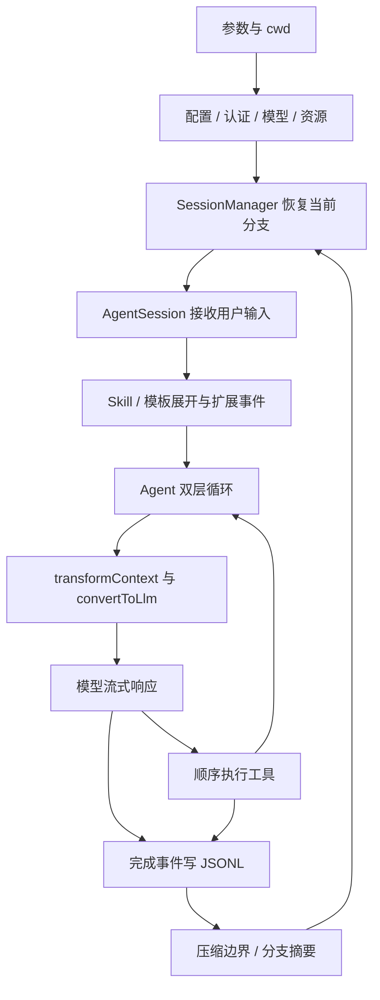
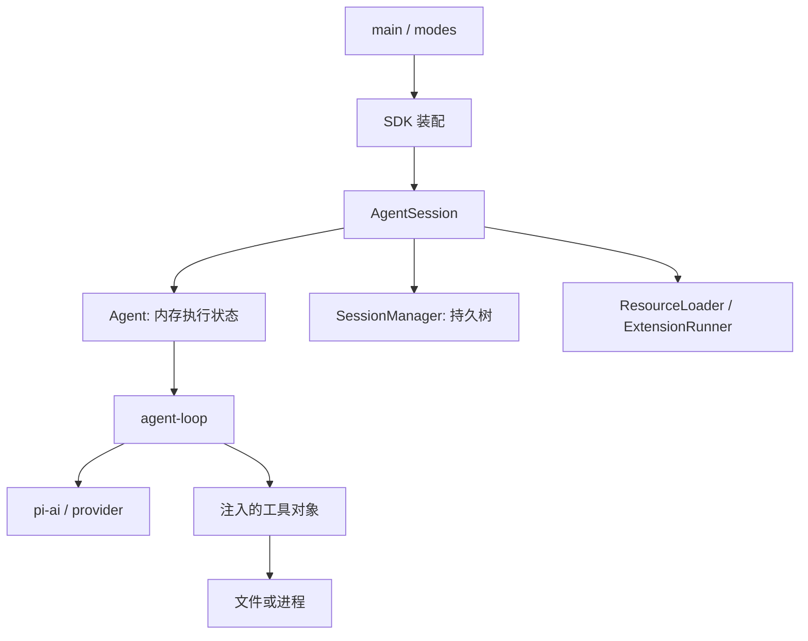

# Pi v0.50.0：轻量可扩展 Coding Harness 的完整运行机制

> 版本：`v0.50.0`，2026-01-26 发布提交 `453e104d3a32c02c5f586d1652636ca8b71d6d05`。核查日：2026-09-21。代码当时位于 `badlogic/pi-mono`，现可经 `earendil-works/pi` 固定提交访问。MIT。本文阅读该 tag 的实际源码，未运行第三方 Agent。
>
> 选择理由：这是已经具备 SDK、扩展、Skill、树状会话和分段压缩，而核心 loop 仍很紧凑的代表版本，适合完整理解基础设计。它不是最初提交，也不代表当前版本；新版另见 [2026-09-21 主线分析](pi-2026-09-21.md)。

## 1. 从用户进入项目开始：什么是这里的 Harness

用户进入仓库，运行 Pi，要求修复一个单元测试。模型需要先查看文件，再编辑，再运行测试，并根据结果继续。Pi 把这件事拆成“模型协议”“推进循环”“Coding 产品”三层，而不把终端、网络和文件工具写进一个无法复用的命令函数。

`packages/ai` 定义统一模型与消息类型、provider 流式请求；`packages/agent` 定义 Agent 状态及工具循环；`packages/coding-agent` 增加项目上下文、资源加载、会话保存、压缩、交互与 RPC。工具是注入 Agent 的对象，Agent 不需要知道用户界面是终端还是另外一个桌面程序。[SDK 装配][sdk]、[循环][loop]

该版本的设计理念是让用户定制工作方法：默认只给模型 read、bash、edit、write，不默认加入规划模式、待办工具、子 Agent、MCP 或逐工具确认弹窗。它通过少量稳定机制承载更多策略，例如用文件保存计划、用扩展实现审查流程、用 tmux 管理长命令。[该版产品说明][readme]

这并不意味着它“没有工程状态”。相反，越少内建策略，越需要把消息、工具结果、会话树和扩展接口定义清楚，否则定制者只能 fork 整个产品。



### 1.1 仓库组织：三层职责有边界，包依赖并非完全纯净

读这版源码，建议从 `packages/coding-agent/src/core/sdk.ts` 出发，再沿它实际创建的对象向下读。`createAgentSession()` 是装配中心：接收或创建 AuthStorage、ModelRegistry、SettingsManager、SessionManager 和 ResourceLoader，再构造 Agent 与 AgentSession。CLI、print、RPC 是这组对象的不同使用入口。[SDK 装配][sdk]

| 源码位置 | 对外职责 | 持有的状态及下游关系 |
| --- | --- | --- |
| `packages/ai/src/` | Message/Model 类型、provider 流、统一调用入口 | 一次模型请求及协议转换；不知道当前会话树和项目 Skill |
| `packages/agent/src/agent.ts`、`agent-loop.ts` | 内存 Agent、队列、工具循环和事件 | 当前消息、模型、工具、abort；调用 pi-ai，不保存 JSONL |
| `packages/coding-agent/src/core/sdk.ts` | 产品装配与依赖注入 | 将模型、工具、资源、持久管理器连在一起 |
| `core/agent-session.ts` | 跨交互模式的会话应用服务 | 订阅 Agent 事件，协调保存、压缩、资源、模型切换和树导航 |
| `core/session-manager.ts` | 会话条目和分支结构 | JSONL 条目、父子关系、当前 leaf；投影当前分支消息 |
| `core/resource-loader.ts`、`skills.ts`、`prompt-templates.ts`、`extensions/` | 发现和加载用户资源 | 文件资源、技能目录与扩展运行器 |
| `modes/` 与 `packages/tui/` | interactive/print/RPC 输入输出、终端组件 | 消费事件，增加界面自身状态 |

三层图是主运行路径的职责图，不是经过验证的绝对无环依赖图。该版 `pi-agent-core/package.json` 仍声明 `pi-tui` 依赖，`AgentSession` 也直接导入 interactive theme 与 HTML export 支持；把它称为“整个产品核心完全不依赖界面代码”会过度美化。[Agent 包清单](https://github.com/earendil-works/pi/blob/453e104d3a32c02c5f586d1652636ca8b71d6d05/packages/agent/package.json) [AgentSession 实现](https://github.com/earendil-works/pi/blob/453e104d3a32c02c5f586d1652636ca8b71d6d05/packages/coding-agent/src/core/agent-session.ts)



### 1.2 为什么 Agent、AgentSession、SessionManager 不能合并理解

Agent 需要一组能直接请求模型的 messages；SessionManager 需要保留分叉、摘要和模型切换等历史条目；AgentSession 负责让两者在一次操作后重新一致。压缩后写入 compaction entry、重建当前 branch 的消息，再替换 Agent 的运行上下文。树上存在的条目不一定全部进入模型，这就是两份表示存在的理由。

相应的耦合集中在 AgentSession：增加一种会话级能力通常要修改它的生命周期或事件处理。这比让每个 UI 模式各写一次保存逻辑更可维护，但该文件已有约 2,600 行，职责集中仍是实在的复杂度。目录拆分没有消除“谁负责协调所有状态”的问题。

### 1.3 用改动路径检验这套组织是否有效

如果新增 `run_tests` 工具，先在 `core/tools/` 实现 schema、执行、取消与结果，再决定是否加入工具工厂 / 默认表；若作为用户扩展，可走 `extensions/` 的注册与包装，无需改 provider。只要产出标准 tool result，底层 loop 无须认识“测试”的业务含义。终端中的测试进度应使用展示接口，而非让工具直接修改 REPL 状态。

如果改压缩算法，则要读 `core/compaction/` 的选择与摘要、SessionManager 的条目投影、AgentSession 的提交与事件；仅替换摘要 prompt 并不能处理分支切点和旧消息引用。若增加模型协议，则优先修改 pi-ai 的 provider 与注册，再由产品 ModelRegistry 暴露选择，原则上不需要改文件工具。这些改动路径说明了分层具体减少哪些连带修改。

包清单提供独立构建 / 发布边界，测试按包组织；这说明可分别验证协议和会话行为，不意味着本文执行了那些测试。对自有桌面产品，复用 `pi-agent-core` 得到的是内存执行器，复用 coding-agent SDK 才同时引入会话、资源和产品策略，二者成本不同。

## 2. 启动时构造的对象：不要把 Session 当成聊天数组

`createAgentSession()` 先确定 cwd 与 agentDir，再创建或接收调用者提供的 `AuthStorage`、`ModelRegistry`、`SettingsManager`、`SessionManager` 和 `ResourceLoader`。接口允许注入这些对象，所以嵌入方可以使用自己的配置、工具和内存会话，无需启动 CLI。[实现][sdk]

随后调用 `sessionManager.buildSessionContext()` 判断是否存在历史。若历史记录了模型，优先尝试从 registry 找到并取得对应认证；若无法恢复，会形成说明，再按配置寻找可用初始模型。恢复聊天和恢复可用 provider 是两个步骤：JSONL 里记了某个模型 ID，并不能保证该模型今天仍可访问。

`Agent` 的初始状态拥有 model、thinkingLevel、systemPrompt 和 tools；`AgentSession` 再装配资源和产品行为。已有历史通过 `replaceMessages()` 注入 Agent；新会话则记录初始模型与思考级别，使以后的 resume 有依据。

| 对象 | 在本版中的职责 | 典型错误理解 |
| --- | --- | --- |
| `ModelRegistry` | 模型目录、认证解析、所选模型查询 | 模型本身的推理状态 |
| `ResourceLoader` | 查找扩展、Skill、模板、主题和项目指令 | 语义代码检索服务 |
| `SessionManager` | JSONL、父子条目、分支和压缩重建 | shell 或 Git 工作树管理器 |
| `Agent` | 一次运行内消息、队列、事件和取消 | 项目级持久知识库 |
| `AgentSession` | 把这些能力协调成多轮产品 | 只负责转发 prompt 的薄对象 |

本版项目边界主要由 cwd 表达，会话目录按工作目录组织。它没有因为用户启动两个会话就自动创建两个独立仓库副本。嵌入方必须决定是否共享工作区；否则两个独立历史仍然可能修改同一组文件。

## 3. 装配项目知识：规则、Skill、模板、扩展是四种资源

### 3.1 项目上下文先提供约束，不预装全部源码

`resource-loader.ts` 从用户级 agent 目录与 cwd 的祖先目录加载 `AGENTS.md` 或兼容的 `CLAUDE.md`，去重后交给系统提示构造器。`system-prompt.ts` 将工具用法、项目文件、技能索引、时间和 cwd 组织到字符串中。[资源实现][resources]、[系统提示][system-prompt]

例如 AGENTS 说明测试命令和编码风格，模型据此知道怎样行动；测试失败堆栈仍由 bash 工具获取。规则与事实分开，可以避免系统提示随着每次读文件不断永久膨胀。

在本版所读的 `reload()` 主链中，没有 9 月版那套 `resolveProjectTrust → 预信任扩展 → 再加载项目资源` 的流程。不能把新版项目资源信任机制倒写进 v0.50.0。该版更接近“用户在本机运行自己选定资源”的部署假设。

### 3.2 Skill：先目录，再正文

`skills.ts` 查找技能文件，解析 frontmatter，得到 name、description、filePath、baseDir、source 和 `disableModelInvocation`。系统提示中只列出可自动调用技能的描述与路径，要求模型匹配到任务时用 read 加载正文。[技能实现][skills]

这种结构相当于把程序性知识拆成索引与内容：索引帮助模型做“要不要读”的决定，正文告诉模型“具体怎么做”。一个测试排错 Skill 可以包含复现、缩小失败范围、修改与验证步骤，但实际执行依然通过工具发生。

`disable-model-invocation` 排除的是自动选择索引，不是删除文件。显式 `/skill:name` 由 AgentSession 展开。用户点名一个 Skill 与模型自主选中 Skill 的消息来源不同，分析成本或审计使用时不应合并为同一个事件。

### 3.3 Prompt template 与 Extension

Prompt template 是输入文本的参数化展开；Extension 是宿主 TypeScript 代码，能够注册工具、命令和事件。前者改变模型看到的请求，后者可以改变请求处理与执行本身。

`AgentSession.prompt()` 先尝试扩展命令，再让 input handler 处理输入，之后展开 Skill / template。扩展命令可以完全在本地完成而不调用主模型；context 扩展可以改变下一次模型输入；工具包装器可以提供执行前后钩子。[会话协调器][agent-session]

因此，“Pi 能实现某功能”至少要分三层：默认 CLI 已实现、官方扩展接口允许实现、某第三方包实际实现。本文只把前两层按源码说明，没有把生态中可能存在的能力当成默认产品事实。

## 4. 用户消息怎样进入正在运行的 Agent

空闲时，prompt 经过展开后成为 user 消息，Agent 开始新运行。正在运行时，输入通过 steer 或 follow-up 队列进入，而不是并发启动第二个模型循环。[输入处理][agent-session]

steer 表达“调整正在做的工作”；follow-up 表达“做完后继续这一项”。如果用户先要求修测试，随后说“别改公开 API”，后者应尽早进入当前工作；如果用户说“修完后再写变更说明”，可以排在自然结束之后。

这不是纯 UI 差别。队列读取点决定旧计划还会执行多少动作。本版 `executeToolCalls()` 顺序处理工具，**每完成一个工具后检查 steering**；如果收到追加要求，它为同批剩余调用生成 skipped 结果，然后返回主循环，让模型带着新要求重新决定下一步。[循环 294–377 行][loop]

被跳过的工具仍要返回协议层结果，否则历史中会留下只有 tool call、没有 tool result 的悬空配对。模型因此能知道“这些动作没有发生”，而不是误以为全部执行成功。

steer 不会撤销已经完成的写入，也不等于立刻杀死当前 shell。真正取消由 AbortSignal 驱动；这两种入口需要在用户界面和运行记录中分清。

## 5. 组装模型请求：本版的 systemPrompt、messages、tools 分开传入

每次生成前，`streamAssistantResponse()` 执行 `transformContext(AgentMessage[])`，再执行 `convertToLlm()`，构造包含 `systemPrompt / messages / tools` 的 Context，交给 `streamSimple()` 或注入流函数。[模型调用][loop]

这里有两次转换的原因是：宿主消息可能含自定义类型、bash execution、compaction summary、branch summary；模型协议只接受有限消息角色和内容块。`messages.ts` 负责把摘要、命令结果等变成可供模型理解的消息形式，并省略不进入上下文的记录。[消息转换][messages]

这也说明不能直接序列化整个 SessionManager 当 prompt：会话里有 UI 元数据、分支和自定义状态，不是全部都是当前模型应该看到的知识。

该版 SDK 的认证回调使用在途请求传入的 provider，而不盲目读取可能已经切换的 `agent.state.model`。如果用户在旧请求完成前切换模型，新设置不应该使旧请求拿到另一个 provider 的密钥。[SDK 280–322 行][sdk]

这一层还区分 text、thinking、toolCall 和 usage 等统一事件。统一 API 的价值是让上层 loop 不为每家 provider 重写，但它不保证模型间思考续接、图像能力和缓存规则完全一致。切模型本身也不能证明旧历史中的原生思考可无损搬运。

## 6. Harness 内核：两层循环及其停止条件

内层循环持续执行“生成 → 若有工具则执行 → 把结果放回消息 → 检查 steering”；外层在模型自然停止之后检查 follow-up。没有工具、没有 steering、没有 follow-up 时，发出 agent_end。[循环 106–198 行][loop]

Agent、turn 和 message 不是同一个计数单位。一项用户任务可以产生多个模型 turn，每个 turn 可以有多个工具，所有这些共同属于一次持续运行。只按“用户按了几次 Enter”统计成本，会漏掉工具反馈后的多次模型请求和摘要调用。

流式响应会产生 message_start、增量更新与 message_end。工具也产生 start / update / end 事件。UI 可以直接展示这些事实，不必用假进度百分比推测模型是否在工作。

当模型返回 error 或 aborted，内核发出结束事件并返回。`AgentSession` 在其上管理自动重试、上下文溢出恢复等产品行为。因而“loop 已结束”不总等于“产品准备接受下一次独立输入”：产品层可能仍在退避或准备摘要。这些状态需要作为产品事件对外暴露。

## 7. 工具：一个小表怎样覆盖真实代码修改

### 7.1 工具契约

内核按名称查找 `AgentTool`，先校验参数，再调用 execute，收集 content 与 details，包装成带 toolCallId 的 toolResult。未知工具和执行异常会形成错误结果，让模型据此调整，而不是伪造空成功。[工具调度][loop]

`content` 用于模型交互，`details` 可以装 diff 等宿主信息。`onUpdate` 则用于执行期间的进度，不要求等工具完全结束才显示。这三个通道使一个工具同时满足模型、界面和可观测性需要。

本版的执行器是顺序批次，没有把 9 月版的 parallel / sequential 批次配置写进来。顺序让文件依赖与 steering 边界更直观，但独立读取与命令也不能自动获得并行收益。

### 7.2 read / edit / write 的区别

read 提供已有文件证据；write 写完整内容；edit 进行定位替换。本版 edit schema 是 `path / oldText / newText`，不是当前版本的 `edits[]`。[编辑实现][edit]

edit 读取原文件后剥离 BOM，归一化换行，先精确匹配，再尝试 `fuzzyFindText()` 的规范化匹配；随后检查规范化后的匹配是否唯一。若同一段内容出现多次，返回需要更多上下文的错误；若替换没有造成变化，也给出反馈。最后恢复换行并写入，生成 diff。

这里的“fuzzy”不是让另一模型猜要改哪一行，而是确定性的文本规范化匹配。它容忍部分空白或字符差异，降低模型复制文本时的脆弱性；但宽松匹配与唯一性仍要一起设计，否则会提高误改风险。

默认操作用本机 fs，没有因为传入 cwd 就限制了系统权限，也不能保证其他进程不同时修改文件。本版所读 edit 路径尚不是 9 月版按文件排队、多块统一对照原文的实现。不要把后来修进的并发语义当成早期保证。

### 7.3 bash 的输出与取消

默认 `BashOperations` 使用 child_process 启动 shell，持续消费 stdout / stderr；超时和 abort 调用 `killProcessTree()`，不是仅让等待协程结束。接口可替换为 SSH 等执行后端。[Shell 实现][bash]

输出采用尾部截断，超过限额时保留完整日志路径。这样测试失败的最后几行能及时回到模型，大日志仍可按需读取。截断是一次工具结果的输出策略，后面的 conversation compaction 才是整个历史窗口策略；两个层次解决的问题不同。

README 不提供默认后台 bash 工作流，建议用 tmux。工具支持超时和取消，并不意味着它已经有可持久恢复的后台 job 管理器。把异步 JavaScript Promise 称为“后台任务系统”会夸大恢复能力。

## 8. 历史变长时：完整压缩过程

### 8.1 压力估计与触发

`estimateContextTokens()` 采用最近一次有效 usage 加后续消息估算；无 usage 时才估整段。`shouldCompact()` 比较窗口减 reserve 后的阈值。本版默认 reserve 16,384 token、保留近期 20,000 token。[算法][compaction]

这两个参数分别控制生成余量和原文尾部，不能读成固定压缩率。工具 schema 和系统提示很大时，仅压缩历史也未必足够。usage 也有模型归属；AgentSession 会避免用前一个模型的溢出错误直接驱动新模型压缩。

### 8.2 选择合法切点

`findCutPoint()` 从尾部累计估算 token，达到近期目标后选择 user / assistant 边界，保持工具调用与结果配对。它允许切开一个很长的用户回合，并记录对应 turnStartIndex。[切分实现][compaction]

例如一次修复经历了读取十个文件、修改三次、运行四次测试：不能因为仍是同一用户请求，就把所有过程永远保留。可以将早期探索浓缩成“确认原因与已经排除的路径”，保留最新修改和测试结果原文。

### 8.3 两份摘要并行生成，再汇合

`prepareCompaction()` 输出待总结历史、长回合前缀、旧摘要、文件操作集合和首个保留条目 ID。在 split-turn 路径，本版 `compact()` 使用 `Promise.all()` 并行生成历史摘要与 turn-prefix 摘要，再合成一份 summary；普通情况只生成历史摘要。[compact 705–769 行][compaction]

摘要正文预算由 reserve 推导：历史摘要使用约 0.8 倍 reserve 的输出上限，回合前缀另有自己的额度。这只是生成上限，不能保证一定输出该长度，更不能保证摘要一定保留全部约束。并行能降低墙钟等待，但两次模型调用都应计费和观测。

读文件和修改文件列表附到摘要，帮助恢复后重新找到工作对象。摘要是压缩后的解释，不是新的原始事实证据；遇到关键细节仍应回读文件或历史。

### 8.4 保存边界，替换当前投影

压缩返回 summary、`firstKeptEntryId`、tokensBefore 和文件操作 details。`SessionManager` 追加 compaction 条目，重建上下文时使用摘要加保留原文，旧历史仍留在文件里。[存储结构][sessions]

因此，原始日志大小可以增长而模型输入减小。恢复后的正确性取决于摘要质量、保留切点、工具配对以及当前项目状态四者，而不只是“摘要 token 比原文少”。本篇没有实测质量，不把代码中的默认预算写成已验证最优值。

## 9. 完成与下一轮：追加日志、树状历史和记忆

`AgentSession` 在 `message_end` 保存 user / assistant / toolResult 和可见自定义消息；`SessionManager` 用带 id、parentId、timestamp 的条目表达历史。模型切换、思考级别、压缩和分支摘要各有类型。[事件保存][agent-session]、[会话树][sessions]

`buildSessionContext()` 从当前 leaf 追溯到根，恢复沿途模型设置与压缩后的消息。用户可以回到某节点继续探索，也可创建分支会话；放弃分支的发现可以通过 branch summary 带到新路径。

例如修复方案 A 失败，用户转向 B：会话树保留 A 的推理与工具事实，新的分支不必假装 A 从未发生。但真实工作目录中的 A 改动还在，Agent 必须检查文件，而不是认为切换对话节点已经撤销代码。

本版“记忆”应分三层理解：

| 层次 | 实际载体 | 使用方式 |
| --- | --- | --- |
| 工作记忆 | 当前 Agent 消息 | 每次模型请求的主要上下文 |
| 会话记忆 | JSONL、压缩和分支摘要 | resume、树导航和长对话接续 |
| 稳定知识 | AGENTS / CLAUDE、Skill、用户维护文件 | 启动注入或按需读取 |

这三层不等于一个自动学习用户偏好、矛盾合并和语义检索的长期记忆服务。本版默认没有这种统一流水线。扩展可以从 agent_end 提取经验、写文件或接外部检索，但提取与纠错策略由扩展负责；不能把“可扩展”写成“已经自动学会”。

## 10. MCP、Sandbox 和多 Agent 在完整流程中的位置

MCP 若通过扩展加入，会发生在资源装配与工具注册阶段：连接 server、发现 schema、包装 execute，之后照常进入核心工具循环。本版没有默认 MCP client，因此本篇没有虚构连接池、OAuth 或 reconnect 实现。[本版声明][readme]

Sandbox 若通过 Operations 替换或外层容器提供，位于工具执行阶段。cwd 是路径基准，不是隔离边界；工具 hook 能限制已注册工具的使用，也不能约束同进程扩展任意 Node.js 代码。对外部署需要由宿主明确承担进程、文件、网络和凭据隔离。

多 Agent 可以用多个 Pi 实例、SDK 实例或扩展实现。每个实例独立历史不等于独立项目副本；若共享 cwd，需要明确写入分工。该版没有内置一个 task board + mailbox + worker 生命周期的统一协作层。

这三项都体现同一设计取舍：核心保留足够的替换点，产品默认不负担全部策略。对于个人自动化这很灵活；对于企业多租户系统，开发者必须把欠缺的操作边界补成真实实现。

## 11. 从终端到自有产品：复用哪一层

交互模式负责用户输入、显示与会话导航；print / JSON 面向脚本；RPC 用 stdin / stdout JSON 命令和事件与外部进程集成；SDK 则直接返回可调用的 AgentSession。[本版使用接口][readme]

如果只需要统一多 provider 调用，取 pi-ai 的边界即可；如果需要工具循环而自己保存会话，可研究 pi-agent-core；如果需要现成压缩、Skill、扩展和会话树，可以从 coding-agent SDK 学习装配。直接包装 CLI 容易继承其全部配置与恢复假设，未必符合自己的项目数据模型。

下面是依据源码抽象的流程，不是可直接运行的 Pi API 示例：

```text
恢复当前分支 → 加载项目规则与技能索引 → 接收用户请求
  → 变换内部消息 → 投影 provider 输入 → 获取完整 assistant 结果
  → 逐个执行工具 → 每个工具后检查用户 steering
  → 保存配对工具结果 → 继续生成或处理 follow-up
  → 必要时追加压缩边界 → 等待下一次输入
```

## 12. 设计价值、限制及与后续版本的分界

本版最值得学习的是“小循环 + 明确会话层 + 可插拔资源”：四个工具足以让模型自主浏览、修改、测试；树状归档保留探索路径；请求投影使宿主消息不必受 provider 类型限制；压缩拆分长回合，使长期任务有继续空间。

与此同时，本机文件与 shell 的默认权限、扩展执行、跨进程编辑冲突、自动长期记忆和后台协作都需要额外设计。它不是完整企业平台的缩小版，而是一套把默认策略保持精简的开发内核。

| 观察点 | v0.50.0 源码事实 | 为什么需要单独阅读后续版 |
| --- | --- | --- |
| 请求形态 | systemPrompt / messages / tools 分离 | 后续有 transcript 化的系统与工具变化 |
| 工具调度 | 顺序执行，每个工具后取 steering | 后续支持不同批次执行模式，注入点改变 |
| edit | 单对 oldText / newText，精确后规范化匹配 | 后续有 edits[] 与按文件修改队列 |
| 压缩 | split-turn 两份摘要并行 | 后续增加 usage、路由与更丰富恢复管理 |
| 资源信任 | 本篇所读主链无新版分阶段 trust 装配 | 新版把项目扩展加载单独治理 |
| 产品内核 | Agent + AgentSession + SessionManager | 后续仓库还包含新的 lane / operation Harness |

本篇直接核对了 SDK、loop、消息转换、AgentSession、SessionManager、ResourceLoader、Skill、system prompt、edit 和 bash 的主要路径；没有穷尽每个 provider、扩展示例和平台错误分支。分析中的场景用于解释机制，不是实际运行记录。

[readme]: https://github.com/earendil-works/pi/blob/453e104d3a32c02c5f586d1652636ca8b71d6d05/packages/coding-agent/README.md
[sdk]: https://github.com/earendil-works/pi/blob/453e104d3a32c02c5f586d1652636ca8b71d6d05/packages/coding-agent/src/core/sdk.ts
[loop]: https://github.com/earendil-works/pi/blob/453e104d3a32c02c5f586d1652636ca8b71d6d05/packages/agent/src/agent-loop.ts
[agent-session]: https://github.com/earendil-works/pi/blob/453e104d3a32c02c5f586d1652636ca8b71d6d05/packages/coding-agent/src/core/agent-session.ts
[sessions]: https://github.com/earendil-works/pi/blob/453e104d3a32c02c5f586d1652636ca8b71d6d05/packages/coding-agent/src/core/session-manager.ts
[messages]: https://github.com/earendil-works/pi/blob/453e104d3a32c02c5f586d1652636ca8b71d6d05/packages/coding-agent/src/core/messages.ts
[resources]: https://github.com/earendil-works/pi/blob/453e104d3a32c02c5f586d1652636ca8b71d6d05/packages/coding-agent/src/core/resource-loader.ts
[skills]: https://github.com/earendil-works/pi/blob/453e104d3a32c02c5f586d1652636ca8b71d6d05/packages/coding-agent/src/core/skills.ts
[system-prompt]: https://github.com/earendil-works/pi/blob/453e104d3a32c02c5f586d1652636ca8b71d6d05/packages/coding-agent/src/core/system-prompt.ts
[compaction]: https://github.com/earendil-works/pi/blob/453e104d3a32c02c5f586d1652636ca8b71d6d05/packages/coding-agent/src/core/compaction/compaction.ts
[edit]: https://github.com/earendil-works/pi/blob/453e104d3a32c02c5f586d1652636ca8b71d6d05/packages/coding-agent/src/core/tools/edit.ts
[bash]: https://github.com/earendil-works/pi/blob/453e104d3a32c02c5f586d1652636ca8b71d6d05/packages/coding-agent/src/core/tools/bash.ts
