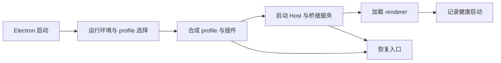

# 从打开桌面到交付成果：Anywhere、OpenDesign 与 iPolloWork

> 调研截止 2026-09-23；按当日关注度分别为 28,591、97,699、6,591 Star。它们代表三种产品组织方式，不能统称为“给 DSH 换皮”。固定提交和阅读范围见 [证据登记](09-evidence.md)。

## 1. 为什么这一组应当优先研究

用户愿意安装一个桌面 Agent，通常是因为它把环境准备、项目切换、能力发现、执行过程和成果操作连接成了一条可理解的路径。只提供一个聊天窗口，仍会把插件安装、失败恢复、文件定位和多轮接续的负担留给用户。

Anywhere 最贴近原生 DSH 生态：桌面本身也是 Cordis 插件，重点在于让一组插件可靠地组成可启动的桌面。OpenDesign 以可编辑设计成果为中心，把多个 coding CLI 当作执行引擎。iPolloWork 则建立跨引擎工作台，在统一项目和扩展生命周期之下保留引擎差异。这三条路线分别回答“插件怎样成为产品”“Agent 怎样成为成果生产器”“多个运行时怎样共处”。

本项目更接近独立核心加桌面适配的路线，不能因为 Anywhere 热度高就改用 DSH 内核；但其启动、恢复和能力管理经验与 Windows 产品高度相关。OpenDesign 与 iPolloWork 的价值则主要在成果和工作台组织，并不自动授权引入更多模型或引擎。

## 2. Anywhere：先可靠地组成产品，再启动会话

### 2.1 仓库怎样表达产品边界

固定快照 `827bd251ef4b74a3738fc083878a8b921ea7852e` 的根仓库是产品 workspace，包含 `dsh-plugin-desktop`、beta、next 及其他产品包。本篇沿 stable 的 `dsh-plugin-desktop/` 阅读，其 package 版本为 `2.0.14`。beta / next 目录存在不意味着其中的实验行为已经进入 stable。

stable 的 `src/main.ts` 负责 Electron 启动与生命周期；`profile*.ts` 负责选择、准备和物化用户 profile；`host-process.ts`、`host-rpc.ts` 和 `host-runtime-bridge.ts` 负责隔离进程与宿主桥；`startup-generation.ts` 管理同一次启动拥有的资源；`profile-checkpoint.ts` 与 recovery 文件负责恢复。拆分的轴心是“哪一层拥有生命周期”，而不是简单分成前端和后端。[包定义](https://github.com/anywhere-labs/dsh-desktop/blob/827bd251ef4b74a3738fc083878a8b921ea7852e/dsh-plugin-desktop/package.json)、[stable 源码目录](https://github.com/anywhere-labs/dsh-desktop/tree/827bd251ef4b74a3738fc083878a8b921ea7852e/dsh-plugin-desktop/src)

### 2.2 启动数据流与为什么需要 generation

流程可以概括为：

启动不是一个布尔变量。用户可能切换 profile、进入恢复、关闭窗口，前一次异步启动的子进程或回调仍可能迟到。`DesktopStartupGeneration` 为一次启动持有 Host、窗口、托盘和运行时等资源，资源通过 `own` 纳入清理。在主入口中，退出与启动失败都连接到 generation 的 `release()`。

它解决的是“前一次启动已经失效，但迟到结果又污染新窗口”的问题。对本项目的启发是把一次后端启动及其订阅、流、窗口关联当作明确所有权；并不需要把上游整个 generation 类复制过来，也不能把它称为执行沙箱。[主启动入口](https://github.com/anywhere-labs/dsh-desktop/blob/827bd251ef4b74a3738fc083878a8b921ea7852e/dsh-plugin-desktop/src/main.ts)、[资源所有权](https://github.com/anywhere-labs/dsh-desktop/blob/827bd251ef4b74a3738fc083878a8b921ea7852e/dsh-plugin-desktop/src/startup-generation.ts)

### 2.3 Host 失败怎样成为可解释的桌面错误

Host 不只是 `spawn` 后等待端口。`host-process.ts` 保存退出码、运行时长和有界 stderr 尾部，使用 `StringDecoder` 处理跨字节块的 UTF-8 输出。退出诊断因此可以区分启动即死与运行数小时后退出，也不至于因为中文被分块解码而丢失错误信息。

这是当前快照相对先前同日快照的重要新增核查点：不能只说“有日志”，应说明日志来自哪个失败进程、何时捕获、是否有长度边界，以及如何带回仍存活的桌面进程。其工业价值主要是缩短安装与现场问题的定位时间，而不是提高模型推理分数。[Host 进程与退出证据](https://github.com/anywhere-labs/dsh-desktop/blob/827bd251ef4b74a3738fc083878a8b921ea7852e/dsh-plugin-desktop/src/host-process.ts)

### 2.4 恢复快照到底恢复什么

`profile-checkpoint.ts` 保存三个轮转槽位，范围包括声明式 profile 文件、锁文件、市场状态、home settings 与 patch。它明确不复制 `node_modules`，恢复时不执行 pnpm。恢复后的首次健康启动还有跳过覆盖标记，避免刚恢复的有效快照被立即轮换掉。

因此它是**配置恢复能力**，不是依赖目录、插件副作用和用户项目的一致性快照。维护者对这个边界写得很清楚，研究也必须保持这个精度：恢复 `package.json` 不会凭空恢复缺失的包入口；恢复配置也不能撤回插件已经向外部系统发出的请求。[检查点实现](https://github.com/anywhere-labs/dsh-desktop/blob/827bd251ef4b74a3738fc083878a8b921ea7852e/dsh-plugin-desktop/src/profile-checkpoint.ts)

### 2.5 真实使用反过来说明恢复设计的边界

用户报告 #1115 描述了 Windows 10、Desktop 2.0.10、DSH 0.1.5-rc.2 下，运行中的目录监视阻止 OpenViking 插件更新。市场恢复了配置，但依赖入口残缺，后续启动卡在 profile 合成。报告还列出了多款共同使用的插件。这是有价值的组合使用证据，但不是本轮复现，也不能直接外推为 2.0.14 仍然必现。[报告与环境](https://github.com/anywhere-labs/dsh-desktop/issues/1115)

可迁移的教训是：扩展更新失败时，恢复界面必须能在完整业务运行时之外工作；“配置已恢复”“依赖可加载”“Host 已启动”“页面已可用”应分别呈现。我们已有后端退出错误和资源管理，不需要新增复杂审批流程，优先保证用户仍能打开管理页并处理出错资源。

## 3. OpenDesign：把 Agent 输出放进可继续工作的产品流程

### 3.1 用户吸引力与仓库分层

OpenDesign 的产品承诺是用用户已有 coding CLI 生成原型、页面、幻灯片等真实成果，并继续预览、修改和导出。97,699 Star 属于完整跨 CLI 设计产品，不能解释为 DSH 插件拥有同等安装量。

固定快照 `b40f25a1c89552725f1fc31f8c2fad172f92acfe` 中，`apps/web` 是产品界面，`apps/daemon` 是本地运行与任务协调层，`packages/dsh-runtime` 是实际运行在 DSH profile 内的 companion。接入协议集中在 daemon 的 `agent-protocol/dsh-profile/`；这意味着新增一种 CLI 应优先增加协议适配，而不是让每个页面理解不同 Agent 的原始事件。[daemon 接入目录](https://github.com/nexu-io/open-design/tree/b40f25a1c89552725f1fc31f8c2fad172f92acfe/apps/daemon/src/agent-protocol/dsh-profile)、[companion](https://github.com/nexu-io/open-design/tree/b40f25a1c89552725f1fc31f8c2fad172f92acfe/packages/dsh-runtime/src)

### 3.2 从一次用户操作到 DSH 原生会话

daemon 的 `attachDshProfileSession` 是一次运行的控制器。它等待子进程的协议 ready，发送含 `request_id`、`cwd`、prompt、模型、推理设置和可选 `resume_session_id` 的 execute 帧。输入输出使用 JSONL，工具参数、文本、思考与最终结果由适配层映射成产品事件。

这里有三种身份：产品的一次执行请求、DSH 的持久会话、承载当前执行的进程。进程可以结束，而会话在下次运行继续恢复。这个设计以进程启动成本换取一次运行结束后较清晰的清理边界；它不等于把历史只保存在进程内。[单次运行控制器](https://github.com/nexu-io/open-design/blob/b40f25a1c89552725f1fc31f8c2fad172f92acfe/apps/daemon/src/agent-protocol/dsh-profile/session.ts)

companion 在 DSH 内使用 `ctx.agents.create` 或 `resume`，而非自行重写工具循环。模型、工具、Skill、上下文和原生会话持久化仍由该 profile 负责。产品侧因此可以专注任务与成果，但也会继承上游的 API、配置和升级兼容成本。

### 3.3 为什么结果帧必须晚于持久化

`packages/dsh-runtime/src/index.ts` 等待 Agent idle 后，还调用 `ctx.sessions.flush`，然后根据记录到的 `turn/end` 生成结果。用户看见本轮完成时，下轮续接所需状态应已保存；否则最容易出现“界面显示做完，重开却丢掉最后一轮”的错觉。

实现还保留提前取消的锁存状态，避免取消发生在执行句柄创建之前而丢失。协议侧同时区分完成、取消和失败，并对缺失终止事件给出错误。值得注意的是，该版本把 `max-tokens` 也映射到外层 `completed`，虽然保留 stop reason；本项目不应把这个外层状态直接解释为任务目标达成。[执行、取消与 flush](https://github.com/nexu-io/open-design/blob/b40f25a1c89552725f1fc31f8c2fad172f92acfe/packages/dsh-runtime/src/index.ts)

### 3.4 MCP 与扩展能力不能由产品宣传推断

本次读取的 daemon execute 构造中，`mcp_servers` 是空数组。不能因为产品整体支持很多 CLI，就声称这条 DSH 路径已经把产品所有 MCP 配置动态传进去。类似地，支持恢复原生 session 不等于跨引擎会话无损迁移。

这里最值得吸收的是**在协议边界明确实际支持的能力**：当前引擎能不能恢复、能不能动态装载工具、怎样取消、什么情况下拒绝 resume。对用户只呈现与操作有关的可用状态；内部 provider 续接对象仍留在后端。

### 3.5 从聊天完成转向成果继续编辑

它对我们最大的产品启发不是“再加一种 Agent”，而是把会话与可操作成果关联起来。用户完成一个页面后，更自然的下一步是预览、查看变更和继续修改；完成图表或报告后，应能打开实际文件并带着原任务继续工作。

本轮未审计其全部导出器，也未运行桌面，不能保证所有格式、平台与 CLI 的组合效果。可以借鉴成果作为工作对象的组织方式；具体导出、渲染和二次编辑必须分别验证。

## 4. iPolloWork：统一工作台如何容纳不同引擎

### 4.1 先纠正“多引擎”的含义

当日 README 将 OpenCode 标为默认运行时，DSH 为可选 peer runtime 和委派目标，并将 Codex 的一条接入描述为 MCP 控制面。固定源码已经能看到 Codex 命名的会话适配文件。**文档口径与源码表面不完全一致，不能据此认定所有引擎具有完全相同的上线能力。** 本篇只跟踪实际读取的 DSH 路径。

重连后已取得固定提交的 LICENSE，确认为 iPolloWork Source Available License 1.0。正文限定个人非商业和少于三人的内部非商业使用，对三人及以上、对外服务和商业使用等另设授权条件，同时保留历史 MIT 与单独许可部分的权利。因此应把当前产品作为源码可读的架构参考，不能因为能浏览 GitHub 就按宽松开源代码直接移植；具体复用需按文件和版本核对。[许可原文](https://github.com/Devin-AXIS/iPolloWork/blob/2b560bd9bfcc6b1d4211978e58b3b5734fb3bbcf/LICENSE)

### 4.2 仓库组织与两条 DSH 路径

`apps/app` 提供共享界面；`apps/desktop` 处理 Electron；`apps/server` 提供本地 API 和引擎边界；`apps/orchestrator` 承载编排入口；`examples/plugin-packages` 是可安装扩展示例，`external-plugins` 是对外宿主发布物。

本轮重点读取 `apps/server/src/deepseek-harness-runtime.ts`、session read model、前端 conversation engine，以及 `plugin-package-lifecycle.ts`。此外，示例插件目录还有自己的 DSH JSON-RPC / headless 服务。**示例插件的运行时不能直接当作主工作台默认会话实现**；这正是只看目录名容易犯的错误。

### 4.3 用户选择项目后，运行时按 workspace 归属

`DeepSeekHarnessRuntimePool` 用 workspace ID 保存 runtime。`forWorkspace` 复用该项目实例，配置中的 MCP 写入会触发对应 workspace 的 runtime 关闭；下一次调用重新启动。这个边界表达了一个产品选择：引擎进程承载项目级扩展配置，因此配置变化可能影响该项目内的多会话，而不是只改当前文本框。

运行时 `#ensureStarted` 合并并发启动，避免两次请求拉起两个后端；关闭时先等待在途启动收敛，清空会话响应路由，再终止子进程并关闭 provider gateway。进程、鉴权 Cookie、服务端 URL 与未完成响应都属于 runtime，而不是 React 组件。[项目运行时与池](https://github.com/Devin-AXIS/iPolloWork/blob/2b560bd9bfcc6b1d4211978e58b3b5734fb3bbcf/apps/server/src/deepseek-harness-runtime.ts)

### 4.4 请求、事件与原生差异怎样跨过统一界面

运行时把产品方法映射到 DSH API，例如历史与 workspace 读取走原生 follow 快照，普通调用发带 rpcId 的 client request。事件流又把原生审批、问题及取消转换为产品事件；流关闭时清理尚未响应的 ID。

前端 `conversation-engine.ts` 的统一状态承载会话、消息、Todo、运行状态和 usage，但仍保留 `dsh` / `codex` 原生扩展字段。`mergeConversationSessionUpdate` 合并增量时保留事件没有带回的原生元数据，防止一个精简状态通知覆盖完整会话对象。

它说明多引擎 UI 的合理统一层是“用户需要的共同事实加可辨认的扩展”，而不是把所有原始事件硬塞成最小公分母。其代价是适配映射与 capability 维护。我们当前只有自有核心，先保证公开 DTO 与原生续接数据分离就够，不必提前做多引擎抽象。[共同会话契约](https://github.com/Devin-AXIS/iPolloWork/blob/2b560bd9bfcc6b1d4211978e58b3b5734fb3bbcf/apps/app/src/react-app/domains/session/engine/conversation-engine.ts)、[DSH UI 适配](https://github.com/Devin-AXIS/iPolloWork/blob/2b560bd9bfcc6b1d4211978e58b3b5734fb3bbcf/apps/app/src/react-app/domains/session/engine/deepseek-harness-conversation-engine.ts)

### 4.5 插件更新是快照、投影和补偿，不是数据库事务

`plugin-package-lifecycle.ts` 把安装包按 plugin ID / version 保存为 artifact，再投影到 workspace。更新流程读取 preview、生成新版本快照，计算各 workspace 的当前与目标投影，先检查再应用；某处失败时逆序补偿已经应用的 workspace。投影成功后才写全局 state，写 state 失败还会尝试反向应用。

这种组织比“复制几份 Skill 文件再改一个版本号”更能追溯资源归属。它还区分缺失、内容匹配与冲突，从而避免更新覆盖用户修改过的激活文件。但是源码也明确可能产生 `plugin_package_rollback_failed`：多个文件和多个 workspace 没有被操作系统赋予一个原子事务，补偿仍可能失败。[更新、投影与补偿](https://github.com/Devin-AXIS/iPolloWork/blob/2b560bd9bfcc6b1d4211978e58b3b5734fb3bbcf/apps/server/src/plugin-package-lifecycle.ts)

## 5. 三条演化路线对我们的具体价值

| 路线 | 为何会这样演化 | 最有价值的吸收点 | 当前不宜直接搬入的部分 |
| --- | --- | --- | --- |
| Anywhere：桌面壳 → profile 产品 → 诊断与恢复 | 插件数量增长后，组合和升级成本成为用户主要痛点 | 一次启动的资源所有权；独立恢复入口；明确配置恢复范围 | 整套 DSH profile / Cordis 运行时、所有渠道并存逻辑 |
| OpenDesign：CLI 包装 → companion 协议 → 成果工作台 | 聊天输出不足以支持预览、编辑和交付 | request / session / process 分离；持久化后报告完成；成果继续编辑 | 为追求 CLI 数量建立庞大兼容层；未经验证的导出承诺 |
| iPolloWork：单引擎体验 → 共同会话边界 → 扩展版本投影 | 多引擎与全局扩展需要明确项目归属 | 原生信息不因增量事件丢失；资源版本和生效范围可见；补偿失败如实报告 | 当前没有需求的多引擎与商业控制面；未经许可审查的源码移植 |

三者共同说明，工业价值往往出现在模型循环之外：用户能否知道自己运行的是什么、失败后能否继续进入产品、成果是否仍能使用。它们有公开产品与真实使用反馈，但本轮没有获得可据以量化企业部署规模、留存或故障率的数据；这些结论属于源码与产品组织分析。
