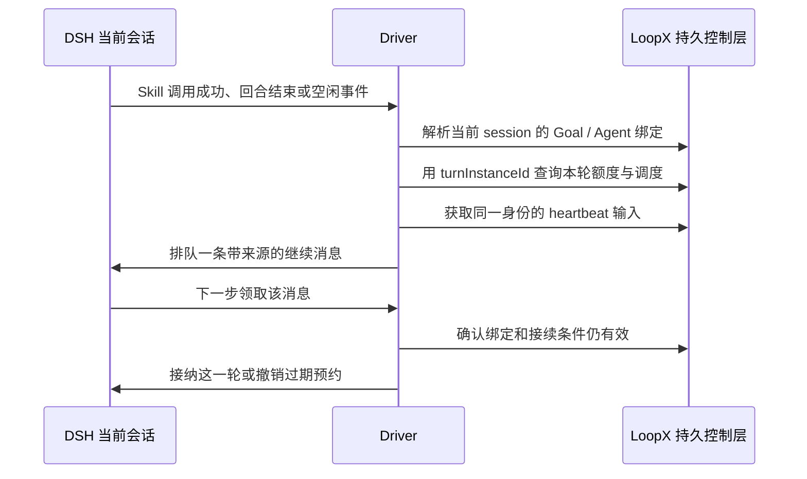

# 从领取任务到跨会话接续：LoopX 与两种 Agent Teams

> 截止 2026-09-23。主线为 LoopX、NanmiCoder/dsh-agent-teams；wowyuarm/dsh-agent-team 是低关注度的机制对照。本文沿任务和消息流解释控制层，不把并发数量当成协作质量。

## 1. 多会话协作首先需要解决哪些问题

设想一个编程任务由实现、检查和资料调查三个会话共同完成。即使它们都能发消息，仍会遇到四种困难：用户不知道哪个会话负责什么；子任务已换人，旧会话却回报成功；会话压缩或 fork 后忘记自己的责任；应用重启后看板保留“进行中”，但运行进程已经不存在。

这些问题需要区分几类对象：**目标**描述长期要达到的结果；**任务**描述可分派的工作；**成员**描述持续承担责任的身份；**会话**承载某段模型上下文；**attempt / run**标识某次执行。消息只负责交流，不能自动证明任务完成。下面三个项目在不同层处理这些问题。

## 2. LoopX：把持久任务控制放在 Harness 外面

### 2.1 为什么入选，仓库如何组织

LoopX 有 5,933 Star / 568 Fork，产品定位是跨 Harness 的长任务控制层。本轮固定 `e57b49e7b6b485c7f3c364e22b3abe078e693b9b`，重点读 `packages/dsh-loopx-plugin`，并向 Python 的 thread binding 和 registry 追踪，不宣称审计了整个四千余文本文件的仓库。

仓库的 Python `loopx/` 保存目标、Agent、Todo、quota、绑定与 CLI 规则；TypeScript DSH 包负责安装接入、驱动下一轮和 GoalBar。插件包版本为 `0.1.1-beta.5`，当前源码 peer 范围写为 DSH `>=0.1.5-rc.1 <0.2.0-0`。同名已发布 beta 包与后来源码的兼容范围不能混用。[插件说明与包](https://github.com/loopx-project/loopx/tree/e57b49e7b6b485c7f3c364e22b3abe078e693b9b/packages/dsh-loopx-plugin)

### 2.2 安装只准备能力，不自动开始目标

DSH bundle 拆成 init、Driver、Host / Client 等行。init 准备 LoopX CLI 和 workflow skills，必要时安装到私有 runtime 目录；它不等于创建目标绑定。Driver 要在**当前确切 session**观察到成功调用 `loopx` Skill 的类型化事件，才具备继续驱动的条件。

这使“用户安装插件”“用户在某会话开始使用”“某个 Goal 允许下一轮”成为三个不同事实。安装后的闲置会话不会仅因看见插件就建立计时器或自动续跑。插件本身不保存第二套 Goal / Todo 事实；模型通过 Skill 指引使用 LoopX CLI，Host 读取同一控制源。[三行装配与激活说明](https://github.com/loopx-project/loopx/blob/e57b49e7b6b485c7f3c364e22b3abe078e693b9b/packages/dsh-loopx-plugin/README.md)

### 2.3 一次自动接续怎样产生

`buildPlan()` 依次读取 binding、quota 和 heartbeat。每次 await 后检查 session 是否还是原对象、Agent 是否仍 live、有无用户命令或新消息竞争。`turnInstanceId` 将额度检查与真正准备执行的一轮关联起来；不能拿另一个 Goal 或另一次 turn 的答复继续。

Driver 中的 reservation 有 `queued / claimed / admitted / retired` 等阶段。排进 inbox 不等于已执行；在 pre-step 被领取后还要确认来源、消息 ID 和内容对应当前 reservation。如果人工消息与自动消息碰到一起，Driver 可撤销自动继续、恢复其他输入，让用户操作先处理。[Driver 的计划、预约与接纳](https://github.com/loopx-project/loopx/blob/e57b49e7b6b485c7f3c364e22b3abe078e693b9b/packages/dsh-loopx-plugin/src/driver.ts)

这套机制的实际价值是防止“界面已经暂停或目标已经换绑，队列里旧的一句继续仍然执行”。它的成本是读取次数、状态种类和适配代码明显增加。我们可复用“排队与接纳分开”的概念，不必把每次业务操作都扩展成多层语义审查。

### 2.4 暂停、错误和 UI 的边界

该版本 GoalBar 的 Pause 主要撤销未来排队与计时接续；已 claimed / admitted 的轮次可被保留，不等于立刻中断执行中的模型或工具。Driver 观察到 aborted / max-tokens 等结局后会停止本次自动继续；部分 CLI 读取另有最多三次尝试。因此不能笼统描述为“任何失败都绝不重试”或“暂停等于强制停止”。

GoalBar 读取持久绑定和目标状态，按 revision 和事件更新，DSH Agent 的忙闲只更新现有显示，不伪造另一份目标状态。绑定本身使用 host surface 与 thread ID，`thread_agent_binding.py` 中的 deep link 解析也明确只是 locator，链接存在不构成执行权限。[绑定实现](https://github.com/loopx-project/loopx/blob/e57b49e7b6b485c7f3c364e22b3abe078e693b9b/loopx/thread_agent_binding.py)

### 2.5 对我们的取舍

我们已经有 Python 单写者的任务 / Goal、运行预算和持久会话，不能再外接一个同样管 Goal 的控制层而不说明谁最终负责。LoopX 更适合作为**接续边界的设计参考**：下一轮归谁、什么输入使旧排队失效、暂停影响当前轮还是下一轮、重启后怎样识别并显示未续跑工作。

它的文档含打包和真实宿主 smoke 分层，但本轮未执行这些验证，也未取得 DSH 接入的企业运行规模。高 Star 和详细测试设施提高研究优先级，不自动变成生产背书。

## 3. Nanmi Agent Teams：在 DSH 内让团队围绕任务图运行

### 3.1 产品吸引力与模块职责

Nanmi 的插件直接给 DSH 提供团队、角色、任务分配、通信和面板。相比需要独立 CLI 的控制层，它对已经使用 DSH 的用户更容易理解。快照 `87c95c94d7847e4a242cb589916adc519981175f`，包版本 `0.1.20`，当日 1,775 Star / 154 Fork。

`src/index.ts` 装配；`state.ts` 保存团队和任务；`scheduler.ts` 领取并派发工作；`members.ts` 负责成员会话、模型选择与唤醒；`mailbox.ts` 把通信纳入模型回合；`harness-compat.ts` 隔离宿主差异。这样的目录组织围绕任务状态与运行过程，而不是把所有工具 handler 堆在入口中。[源码目录](https://github.com/NanmiCoder/dsh-agent-teams/tree/87c95c94d7847e4a242cb589916adc519981175f/src)

### 3.2 从队伍配置到第一次领取

队长形成成员配置和任务图，成员可以按需激活。调度器在成员空闲和任务图发生变化时尝试领取 ready work，而不是让一个模型回合一直轮询。成功领取产生任务、成员和 attempt 身份，派发给真实成员 session。

`attemptId` 很关键。任务重新分配后，旧成员可能仍在模型请求或子进程中；当其迟到回报时，宿主用 attempt 判断它是否仍拥有这项工作。`members.ts` 在处理迟到错误时也对照观察到的 task、attemptId 和 attempt，避免把已经被重新分配的新尝试标为失败。[调度](https://github.com/NanmiCoder/dsh-agent-teams/blob/87c95c94d7847e4a242cb589916adc519981175f/src/scheduler.ts)、[成员生命周期](https://github.com/NanmiCoder/dsh-agent-teams/blob/87c95c94d7847e4a242cb589916adc519981175f/src/members.ts)

这种 fencing 只保护**团队状态更新**。它不阻止旧进程继续修改共享项目文件，不等于文件系统锁或 sandbox。对于我们默认共用原目录的协作方式，仍需明确编辑范围，并在文件写入时保留已有冲突检查。

### 3.3 邮箱为什么不能只是追加文本

邮件包含发送者、接收者以及可关联的任务和 attempt。`mailbox.ts` 在 pre-step 汇入当前可投递消息，同时排除已经不属于有效任务尝试的工作通知。发送、投递、确认处理处于不同阶段，宿主还要避免团队结果报告与原生 `subagent-settled` 通知重复进入队长上下文。

这是一类容易被低估的 token 成本：同一结果既通过工具报告、邮箱、子 Agent 完成提示，又被总结进进度，模型会反复读取同一个事实。该实现不是把所有通知都丢掉，而是保留异常结束及缺少正式报告的兜底信号。[邮箱与通知去重](https://github.com/NanmiCoder/dsh-agent-teams/blob/87c95c94d7847e4a242cb589916adc519981175f/src/mailbox.ts)

### 3.4 空闲不代表任务结束，重启不代表普通续跑

当前 scheduler 明确区分两种情形：进程已经观察到某成员空闲但仍持有未结 attempt 时，把它 park，等待队长显式重新分配；冷恢复时，如果本进程未观察到原持有者怎样结束，则有另一条恢复尝试路径。

这样可以减少持续重唤醒同一个未交报告成员，但它还依赖队长与正式状态工具的使用。当前 prompt 对质量类任务要求结构化结论、命令与验收结果，能服务严格团队，也可能把普通工作变成填表门槛。我们的规则已经明确 summary / outcome 即可报告，不能照搬上游这些阻断条件。

### 3.5 真实问题：队长身份与 fork

公开 #176 在 0.1.18、DSH 0.1.5-rc.2、Linux 的四成员团队中报告：队长会话 fork 后获得新 session ID，但团队仍绑定原 `captainSessionId`，所以新会话不再能管理团队，成员继续向旧会话报告。材料带有状态记录和具体查找位置。本轮不将其直接定性为 0.1.20 未修复，只把它作为必须检查的生命周期场景。[用户报告](https://github.com/NanmiCoder/dsh-agent-teams/issues/176)

另一条 #187 请求兼容 DSH 0.1.6-alpha.2，说明“插件最近更新”与“支持当前宿主版本”不是同一指标。我们的采纳重点应是身份模型和回合边界，而非立即安装并依赖其完整团队框架。[兼容请求](https://github.com/NanmiCoder/dsh-agent-teams/issues/187)

## 4. wowyuarm Agent Team：把成员视为长期对象

### 4.1 为什么低 Star 仍保留，但降低结论强度

该项目在 9 月 22 日目录快照仅 36 Star，本轮未取得同一时点的精确 API 数字。它不能与上述项目同列为用户验证充分的产品。保留它，是因为其 Member、Channel、Thread 与 Session 的分离对长期协作很有针对性。

固定 `ef47ef7a72794e6c053012f03043343f20bf18b3`，版本 `0.1.14`。peer 范围为 `>=0.1.5-rc.1 <0.1.6`，文档认证宿主为 0.1.5-rc.1；因此不得声称已验证最新 0.1.7 线。

### 4.2 从组织成员到使用 session

Host 管理 Workspace、Member、Channel、Thread 和 Task；模型工具是 Host 的客户，UI 也是其投影消费者。成员可以参与多个 workspace，并持有自己的记忆、Skill 与能力设置；session 是当前承载这个成员推理的一段上下文，不是成员永久身份。

它使一个成员在 session rollover 后仍能保留工作关系。但分离身份本身还不够：需要把新旧 session 的切换持久提交，并确保同一 request 不会重复创建或滚转。源码把这些操作放在 Host 和 ledger 内，避免由 UI 改几个字段来“模拟恢复”。[Host 入口](https://github.com/wowyuarm/dsh-agent-team/blob/ef47ef7a72794e6c053012f03043343f20bf18b3/packages/agent-team/src/index.ts)

### 4.3 操作账本怎样产生当前视图

`AgentTeamLedger` 持有 KV 操作表、内存 Projection、request 索引与序列号。一次变更先进入串行 `operationTail`，发现同 requestId 已存在时核对并返回既有结果；新操作先 `await table.put`，再 apply 到当前 projection。启动时通过 replay 重建视图。

它的收益是任务、消息与成员关系可从操作历史解释，而非只剩最后一个 JSON。`projectionVersion` 来自持久序列位置；私有阅读进度不会使所有客户端都误认为共享工作发生变化，减少无意义刷新。[持久操作与投影](https://github.com/wowyuarm/dsh-agent-team/blob/ef47ef7a72794e6c053012f03043343f20bf18b3/packages/agent-team/src/ledger.ts)

限制也要清楚：这里的 Promise 串行器是一个 Host 进程内部的写入排序，不能据此推导跨进程并发事务；持久表写入成功也不保证相关外部工具副作用与该条操作原子完成。

### 4.4 成员记忆何时进入下一轮

`member-context.ts` 在 pre-step 读取当前 member 的 `memory.md` 和 workspace 地址，带来源注入；若最新可见材料相同则不重复。文件失效时会注入明确的缺失 / 不可读状态，提醒不沿用早先私人记忆。

这里还有一个有启发的依赖处理：Host 恢复成员时就会挂载成员 context 插件，因此不能反过来要求该插件在加载时等待完整 Host 服务，否则可能形成初始化循环。实现选择在真正 pre-step 时解析 Host 服务。**延迟解析发生在职责需要的时刻**，而不是用全局变量绕过模块依赖。[成员上下文](https://github.com/wowyuarm/dsh-agent-team/blob/ef47ef7a72794e6c053012f03043343f20bf18b3/packages/agent-team/src/member-context.ts)

### 4.5 恢复策略不是可无条件移植的默认值

`recovery.ts` 对部分瞬时错误设置延迟自动重试，并在连续错误后退出自动恢复。这体现它追求驻留团队自恢复的产品选择。我们已确定真实执行故障停止 Run / Goal，必须保留该行为；成员身份持久化和自动重试是可分离的两项设计。[恢复实现](https://github.com/wowyuarm/dsh-agent-team/blob/ef47ef7a72794e6c053012f03043343f20bf18b3/packages/agent-team/src/recovery.ts)

## 5. 如何用于优化本项目的多会话协作

| 具体问题 | 最合适的上游参考 | 本项目可吸收的最小变化 |
| --- | --- | --- |
| 不清楚下一轮接续归谁 | LoopX 的持久绑定与 reservation | 显示消息、Goal 与承接 run 的关联；新用户输入使过期自动排队失效 |
| 迟到的子任务结果污染新轮次 | Nanmi 的 attempt fencing | 沿已有 run / worker 关联返回结果，明确旧结果属于旧尝试 |
| fork / 压缩后协作关系丢失 | wowyuarm 的 Member 与 Session 分离 | 先明确 task / role 的责任关系是否跨 session 持续，再设计显式交接 |
| 同一报告重复塞进上下文 | Nanmi 的邮箱与原生结束信号去重 | 保留一份权威结果和异常兜底，其他展示引用它 |
| 重启后任务显示与进程事实不一致 | Host ledger 与 LoopX 控制层 | 展示“有历史未完成任务”和“当前正在执行”为不同状态 |

建议顺序是先改善身份与可见性，再考虑更复杂的驻留成员。现有协作邮箱已经持久化发送、按下一次请求交付，并在完整模型回合后确认；这些不是待从零构建的功能。本轮也没有证据支持“多开几个成员就能提高成功率”的结论：沟通成本、共享文件冲突和结束判定才是后续真实任务测量应关注的部分。
