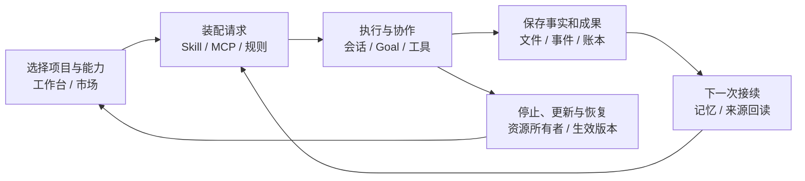

# DeepSeek Harness 非官方生态：重新筛选与深入调研

> 第二轮，资料截止 2026-09-23。本目录替代前轮推荐；[旧稿](../deepseek-plugins/README.md) 仅留作历史。按当日话题 Star 前 100、近期更新和实际适配入口重新筛选，形成 6 篇架构主文、筛选方法、项目建议、证据登记与候选表，共 11 份 Markdown。

## 1. 这轮重新做了什么

研究对象是非 DeepSeek 官方维护的插件、适配器和衍生产品，包含企业维护的公开项目与社区开发；官方 Harness 只作边界参考。先解释同类取舍，再沿请求 / 使用流程阅读源码，不按几个已知插件随意分配篇幅。

本轮重点分析 21 个产品 / 插件对象，对应 22 个源码仓库，包括 EverOS 独立适配和局部比较样本。**这不是 22 个仓库的全量审计，也没有声称穷举整个话题。** 100 项候选逐项记录处置，Star 采用明确时间的元数据；每个主文写出仓库组织、状态所有者、关键实现、失败 / 恢复、用户价值和本项目适配范围。

新纳入重点的 Archify、Distilly、EverOS、MemOS、BrowserSkill、LoopX、iPolloWork、Vibe-Skills 和 SkillCorpus，使选择同时覆盖用户愿意关注的产品与真正可追踪的工程机制。低 Star 样本只在有明确机制价值时进入对照，不被包装成成熟度标杆。

## 2. 阅读入口

| 文档 | 主要对象 | 读完能回答的问题 |
| --- | --- | --- |
| [01 选择理由与方法](01-selection.md) | 热度、时效、接入深度、使用证据 | 为什么是这些项目，为什么另一些暂缓？ |
| [02 桌面与成果工作台](02-workbenches.md) | Anywhere、OpenDesign、iPolloWork | 插件、进程和项目怎样组成产品，结果怎样保存和接续？ |
| [03 长任务与多会话协作](03-collaboration.md) | LoopX、Nanmi Teams、wowyuarm Team | Goal、成员、会话、attempt、消息与持久账本怎样配合？ |
| [04 记忆与企业知识](04-memory.md) | EverOS、MemOS、OpenViking、WeKnora | 原文、提炼、召回、索引、后台队列和 Skill 生成如何分工？ |
| [05 Skill 与成果生产](05-skills.md) | Archify、Distilly、Vibe-Skills、SkillCorpus | 能力如何被找到、执行、版本化，并留下可用成果？ |
| [06 浏览器执行](06-browser.md) | BrowserSkill、dsh-browser | 多会话如何拥有页面，启动未决、排队、观察和取消怎样处理？ |
| [07 上下文与扩展生命周期](07-context-and-lifecycle.md) | dsh-context、billion-context、MCP manager、Claude compat、market | 请求材料和配置何时生效，更新失败如何恢复？ |
| [08 对本项目的参考](08-project-lessons.md) | 对照当前 M4 与实际源码 | 已有能力之外还值得改什么，先后顺序与成本是什么？ |
| [09 证据与版本登记](09-evidence.md) | 固定 SHA、包版本、许可、使用材料 | 哪些结论直接来自代码，哪些尚未验证？ |
| [10 前 100 候选处置](10-candidates.md) | 完整热度快照与少量新机制 | 是否遗漏明显热门项目，筛选是否具有一致理由？ |

若主要关心我们项目的下一步，先读 **08**，再按问题回到相应主文；若要审查筛选是否合理，先读 **01、10、09**。

## 3. 六条主线放回一次使用过程

每个主文沿对象自身的数据路径分析。图中“市场安装完成”“模型可见”“工具运行完成”“任务目标完成”是不同事实，不用一个成功状态代替全部阶段。

## 4. 对本项目最有价值的结论

1. **从能力列表走向可接续成果。** OpenDesign 和 Archify 展示了怎样保留生成输入、真实文件和后续编辑入口。我们已有 Skill 与成果区，可先加强关联，不必重建通用工作台。
2. **解释本次真正生效的能力与上下文。** dsh-context、MCP manager、SkillCorpus 的价值在于请求级来源和生命周期。我们已有按需 schema 与 Skill 材料，不再把它们列为从零建设项。
3. **让协作身份经得住换会话。** LoopX 的绑定、Nanmi 的 attempt、wowyuarm 的 Member / Session 分离，可对照我们已有邮箱、handoff 和 worker；消息送达不等于工作完成。
4. **把启动、取消、保存与恢复做扎实。** Anywhere、BrowserSkill、market 的实现及用户报告展示了 Windows 文件占用、启动结果未知、迟到回调和错误 profile 的真实复杂度。
5. **经验生成需要来源与效果证据。** EverOS、MemOS 和 Distilly 提供局部反馈机制；产生新记忆或 Skill 不等于已证明强 RSI。Vibe 的作者评测也不能直接预测我们的收益。

具体迁移范围、现有代码依据、优先级和采用条件见 [08](08-project-lessons.md)。本研究没有授权切换内核、增加 provider、多引擎、云服务、自动重试或执行门槛。

## 5. 证据强度与限制

正文区分源码机制、作者验证、用户使用报告和可核实生产采用。公开问题报告提供了真实组合使用线索，但不是本轮复现；Star 不是安装量或企业规模。未取得足以统一宣称这些 DSH 适配已有大规模企业生产验证的证据。

未运行第三方 Agent、服务、浏览器扩展或真实模型；没有为文档改动执行应用回归。iPolloWork 采用固定 SHA 的定向源码，BrowserSkill 的 Rust 层、WeKnora 的 Go 后端和独立算法依赖保留明确阅读边界。获取限制、作者评测口径与最终结构检查均见 [证据登记](09-evidence.md)。

正式写入限本独立专题和 [研究进度](../../progress/research.md)，保留其他任务对 docs 和源码的修改；未提交或推送。
