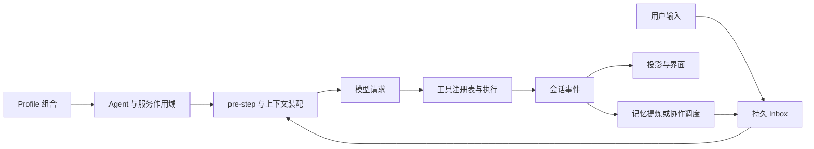

# 附录：核对社区插件所依赖的 DSH 宿主契约

> 核查日期：2026-09-23。官方主线固定提交 `00102833dfaee1da9f48a3a8eae9d34005a75218`，根清单版本为 `0.1.7-alpha.2`，MIT。这是本次读取的主线快照，不等于已经验证其 npm 发布物。此前 [0.1.6-alpha.2 完整分析](../agents/deepseek-harness-v0.1.6-alpha.2.md) 保留为独立历史版本。

本专题主体是非官方二次开发。此篇仅在阅读社区实现时辅助核对服务、作用域和装载边界；建议从 [社区项目阅读索引](README.md) 开始，不将这篇官方基线计入第三方项目成果。

## 1. 为什么“插件二次开发”值得单独研究

一般的模型插件只增加一个工具。DSH 的扩展范围更大：一个包可以提供工具，可以为模型请求追加上下文，可以替换服务的实现，可以增加浏览器界面，也可以把现有组件组合成新的应用。社区项目因此既有几十行的 MCP 连接配置，也有拥有任务调度器、持久状态和完整桌面发行链的应用。

研究时应先辨认扩展层。Skill 是模型阅读的工作方法；MCP 是宿主与外部能力服务通信的协议；Cordis 插件是进入宿主进程执行的代码；bundle 则是一组插件装配配置。它们能够组合，但权限、生命周期和兼容成本不同。一个目录同时收录四者，不能据其条目数推算“可安装的原生插件数”。

## 2. 仓库组织如何影响扩展方式

官方仓库将能力声明、能力实现和应用组合分开。`packages/core` 的 Agent、Session、Tools 等定义共享职责；`packages/boot` 负责启动和插件管理；`packages/bundle` 定义产品组合；`packages/client`、Host / API 包承载界面与远程访问；具体模型、执行、压缩、存储实现另有分组。

这里存在三张不同的依赖图：

| 依赖图 | 解决的问题 | 常见误判 |
| --- | --- | --- |
| npm / TypeScript import | 构建时找到包、类型与代码 | 能 import 就认为运行时服务存在 |
| Cordis inject / scope | 服务可用后激活消费者，确定实现可见范围 | 把 YAML 排列顺序当初始化顺序 |
| bundle / profile / preset | 选择产品与某个 Agent 的能力组合 | 仓库里存在就认为所有会话默认启用 |

官方当前包规范要求共享 Cordis 使用 peer dependency，并在开发依赖镜像声明；这是避免宿主与插件各带一份框架、服务身份不一致。源码中使用 `@deepseek-ai/cordis`，旧教程里的 `cordis` 包名不能未经核对直接套用。[包规范](https://github.com/deepseek-ai/deepseek-harness/blob/00102833dfaee1da9f48a3a8eae9d34005a75218/docs/cookbook/adding-a-package.md)

## 3. 用户安装一个插件时，实际改变了什么

安装从某个 profile 开始。包进入该 profile 的依赖范围，管理器检查其 `package.json` 是否声明 `dsh.bundle`，解析 patch，再把 bundle 纳入选择。profile 是运行组合和依赖位置，workspace 是待工作的代码目录，两者不能混用。

`plugin-manager/src/operations.ts` 的 `runProfilePnpm()` 保存安装前 manifest，调用包管理器，成功后 reconcile 新增 bundle。`runPluginCommand()` 与服务路径共用 profile 写锁。管理器还区分安装中和应用中：安装进程可以取消，安装完成后的组合应用不能简单当作一个可随时打断的 shell 命令。

`plugin-manager/src/index.ts` 明确列出失败恢复涉及的 `package.json`、`pnpm-lock.yaml`，跟踪活跃安装及 request id，卸载时 abort 并等待正在执行的包操作。因此“安装失败可恢复”必须说清恢复对象：保存依赖清单并不自动撤销安装脚本在其他目录造成的副作用，也不等于跨文件数据库事务。[操作实现](https://github.com/deepseek-ai/deepseek-harness/blob/00102833dfaee1da9f48a3a8eae9d34005a75218/packages/boot/plugin-manager/src/operations.ts) [管理器](https://github.com/deepseek-ai/deepseek-harness/blob/00102833dfaee1da9f48a3a8eae9d34005a75218/packages/boot/plugin-manager/src/index.ts)

## 4. 配置加载后，插件如何获得能力

典型插件导出 `name`、`inject`、`Config` 和 `apply(ctx)`。必需服务没有出现时，插件处于 pending；服务提供者替换或卸载时，依赖它的作用域也需要重新处理。工具注册、事件监听、提示段注册应附带 disposer，使卸载真正撤销效果。

Cordis 的 `waterfall` 是 around middleware：监听器接收 `next`，可以先调用下游，再修改返回决定。它并不是“把所有插件返回的字符串拼起来”。例如记忆插件先 `await next()`，发现下游拒绝该 step 就保持拒绝；只有已获准进入的输入批次才追加记忆。两个插件的顺序因此直接影响谁看到最终输入、谁能短路、谁的修改会被覆盖。

同样，`ctx.get()` 访问可选服务，与把服务列为必需 inject 的产品行为不同。可选的侧栏或统计服务不存在时，最好只缺失该展示；把它们都声明为必需依赖，可能令整个记忆或工具插件一直不启动。[Cordis 机制](https://github.com/deepseek-ai/deepseek-harness/blob/00102833dfaee1da9f48a3a8eae9d34005a75218/docs/cordis-primer.md)

## 5. 一次模型请求中，插件有几类介入点

扩展的落点决定它承担什么一致性责任：

- **请求前注入**：需要识别当前输入、去重、预算和取消；自动召回还会增加首字延迟。
- **工具执行**：需要经过宿主工具路径，保留调用身份、参数和结果；另起 shell 绕过注册表会丢失宿主已有记录。
- **已提交事件消费**：适合 Trace、费用、记忆 capture；不能把瞬时 UI chunk 当成最终持久回答。
- **派生投影**：可以重建，应该有版本；缓存损坏不应改写原始会话事实。
- **后台续跑**：已经进入调度器职责，必须说明谁授权、谁计费、谁停止，以及重启是否再次触发。

这些不是要求所有插件实现全部能力，而是要求其真实介入点与声明一致。

## 6. 浏览器界面也是另一半插件

Host 注册不意味着浏览器组件自动存在。包还需声明 client face、客户端依赖和入口；Host 与浏览器是两套执行环境。前者提供数据和能力，后者通过受控远程接口、服务及 slot 渲染。React、UI primitives 等共享模块需要与宿主的模块表一致，不能随意打入另一份框架。

这能解释为什么插件“工具能用但设置页不出现”，也能解释上游 UI slot 重组为什么会影响社区。最新 dsh-context 已明确记录 0.1.6 / 0.1.7 线的 settings 契约变化；旧 `settings.register` 或 `settings.plugin.item` 示例不是当前通用写法，详见 [上下文专题](03-context-inspection.md)。

## 7. 一个真实故障说明兼容检查该检查什么

官方 ACP 事故复盘记录：模块同时导出命名字段与 `export default apply`，Loader 优先解包 default，结果丢掉旁边的 inject / Config。测试直接手动挂载插件，绕开真实 Loader，所以大量单元检查通过而实际编辑器一连接就失败。

第二个问题是服务经过跨作用域代理调用后，可选服务的直接属性读取沿错误的可见性路径查找。修复分别是保留完整插件导出对象，以及通过适当的可选服务入口读取。价值在于找到真正的组合边界：包入口、配置加载、服务查找和真实第一条调用。它不支持“每个小功能都跑全量测试”的结论。[官方复盘](https://github.com/deepseek-ai/deepseek-harness/blob/00102833dfaee1da9f48a3a8eae9d34005a75218/docs/postmortem/0001-acp-default-export-drops-inject.md)

## 8. 对本项目的参考

本项目已经有显式 bootstrap、工具服务、Skill、MCP 和 Trace，优先吸收的是接口所有权、配置快照、作用域清理和来源记录。无需为了模仿 DSH 把 Python 服务全部改成动态插件。

只有当实际需求是“允许第三方代码改变宿主能力”，才需要新增安装、加载、卸载和兼容契约。当前 Skill 导入或 MCP 配置解决不了同进程代码扩展问题，但也不因此必须升级成 npm 插件市场。完整取舍见 [本项目建议](12-project-implications.md)。
