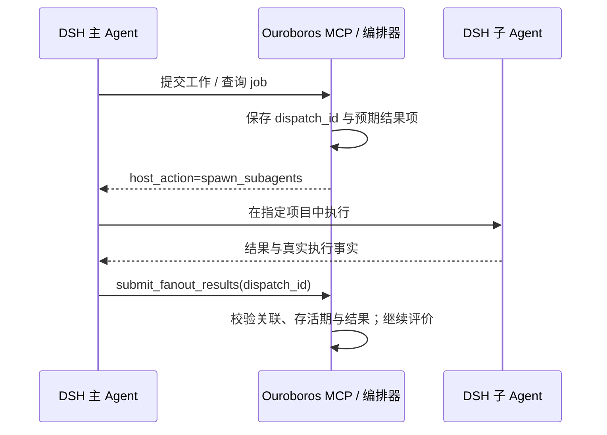

# Ouroboros 与 Odai：社区如何把编排、自改进和治理接到 DSH

> 核查日期：2026-09-23。两者都是第三方项目。Ouroboros 固定 `2f4564619fb9bdd0dca8faf3a650e0d8b9b2f81b`；Odai 固定 `6c6b411ddec23008ba35d87065eeca4baf22209a`，DSH 插件包 0.2.36、MIT。本文分析接入和关键控制流，不代表完成整个项目逐行审计或运行验证。

## 1. 为什么把这两个项目放在一起

普通工具插件只增加一种动作；这两个项目进一步改变“如何做事”。Ouroboros 将需求、执行、评价和下一代改进串成有状态的过程；Odai 将 Skill、职责切换、记忆和输出规则装配到宿主的每轮请求中。

两者都可以被称为 harness 的扩展，但控制权不同：Ouroboros 有自己的 Python 编排器和持久状态，通过 MCP 与 DSH 协商执行；Odai 的 TypeScript 运行时直接订阅 DSH 生命周期，借用原有会话、模型和工具循环。理解这个区别，才能判断“装了插件之后是谁在决定继续、停止和分工”。

## 2. Ouroboros：先把独立编排器接入宿主

### 2.1 仓库怎样分工

`integrations/dsh-plugin/` 是接入层，主要以 Cordis 配置挂载官方 MCP client；`src/ouroboros/orchestrator/` 管执行器与运行时适配；`evolution/` 管代际循环；`evaluation/` 管评价；`persistence/` 保存事件。DSH 插件本身不是又一套 TypeScript coding loop。

当前 `cordis.patch.yml` 以 `uvx` 启动带 MCP 依赖的 Python 包，配置工具超时，并明确提供运行时选择。这是独立进程集成：MCP 的 stdio 负责传输，实际文件操作、模型和子进程仍取决于被选中的执行方式；stdio 本身不提供操作系统沙箱。[固定接入配置](https://github.com/Q00/ouroboros/blob/2f4564619fb9bdd0dca8faf3a650e0d8b9b2f81b/integrations/dsh-plugin/cordis.patch.yml)

### 2.2 最新接入方向：默认由宿主承担执行

固定快照的 `OUROBOROS_AGENT_RUNTIME` 默认值是 `host`。这意味着 Ouroboros 可以提出工作，但由正在使用它的 DSH Agent 创建子 Agent 并回交结果。它不必为每项工作另起一套 Claude CLI。

还存在相反方向的 `llm backend = dsh`：Ouroboros 通过 DSH ACP 使用 DSH 能力，需要明确的配置绝对路径，必要时配置 CLI 路径。两个方向不能混写为“DSH 插件调用 DSH”：前者是 DSH 作为 MCP 宿主帮助 Ouroboros 执行，后者是 Ouroboros 把 DSH 当成底层运行时。部署和生命周期所有者不同。

这也是时效性上的实质变化。旧 [issue #2163](https://github.com/Q00/ouroboros/issues/2163) 讨论过 MCP 进程内执行运行时的问题；本次看到的配置已经选择 host 默认值。问题报告能解释演化动机，不能直接当作当前版本仍有同一故障的证据。

### 2.3 从执行请求到宿主子 Agent 返回

`HostDispatch` 的执行适配器没有直接运行模型，而是创建 durable dispatch，持久登记任务，再等待宿主提交。调用方通过 job wait 等接口看到待处理动作，创建子 Agent，最后调用 `ouroboros_submit_fanout_results` 回交。

这里不能只用 job id：一次 job 内可能发生多次尝试。`host_dispatch.py` 以 dispatch id 管等待者；已消费、被替代或无存活等待者的旧结果返回 `stale_dispatch`，不会唤醒新的尝试。过期结果单独返回 deadline exceeded；明确没有派发子 Agent 记为执行失败，不能把空对象当成功。[HostDispatch 实现](https://github.com/Q00/ouroboros/blob/2f4564619fb9bdd0dca8faf3a650e0d8b9b2f81b/src/ouroboros/orchestrator/host_dispatch.py)

持久登记与内存等待者是两层状态。保存过任务并不代表进程重启后原协程仍存在，因此代码明确拒绝把旧结果塞进新等待链。等待时产生的 heartbeat 用于防止“没有输出”被误判为执行停滞；它不是业务进展，更不是验收通过。

### 2.4 执行结束之后，究竟在“进化”什么

`EvolutionaryLoop` 的核心顺序是 Seed → Execute → Evaluate → Wonder → Reflect。Seed 描述目标和验收约束；执行生成成果；评价检查成果；Wonder 提出未解决的问题；Reflect 将反馈用于下一代。lineage 记录多代之间的关系，状态不只是一段更长的聊天文本。[代际循环](https://github.com/Q00/ouroboros/blob/2f4564619fb9bdd0dca8faf3a650e0d8b9b2f81b/src/ouroboros/evolution/loop.py)

评价分机械检查、语义判断和按条件启用的共识等层级。机械检查可以提供外部可判定事实；语义评价仍然是模型判断，不能自动变成正确性证明。使用多位评价者也会增加成本和相关性误差。[评价流水线](https://github.com/Q00/ouroboros/blob/2f4564619fb9bdd0dca8faf3a650e0d8b9b2f81b/src/ouroboros/evaluation/pipeline.py)

收敛不能只看“前后两代越来越像”。当前 `ConvergenceCriteria` 把通过结果门槛、代数上限、停滞、振荡等分开：第一代已满足结果条件时可以停止；相似却一直失败的任务不能因为 ontology 稳定就宣告成功。`converged` 与 `should_stop` 分开，表达“完成”和“资源耗尽 / 无进展而终止”不是同一件事。[收敛条件](https://github.com/Q00/ouroboros/blob/2f4564619fb9bdd0dca8faf3a650e0d8b9b2f81b/src/ouroboros/evolution/convergence.py)

### 2.5 落地价值与成本

它适合目标可分解、验收相对明确、允许多轮尝试的复杂工作。最有参考意义的是宿主执行桥、尝试身份、代际记录，以及停止原因的准确表达。代价是编排器和宿主形成两个控制面，必须回答谁拥有取消、预算、工作目录和失败后的续跑权。

本项目可以借鉴 dispatch 的结果关联，但当前产品已经规定实际执行 / 模型故障后停止所属 Goal。不能因为上游有 retry、自动多代推进，就把这些策略默认搬过来；普通报告也不应被它的复杂评价表变成前置门槛。

## 3. Odai：在现有运行循环上增加职责和可追踪的策略

### 3.1 先区分源码、发布副本和安装形式

Odai 有 profile 范围的 DSH plugin，也有 agent 范围的 preset。二者共用 `dsh/runtime/src/` 中的 canonical runtime；发布时生成的副本不应分别编辑。Skill 规则也有自己的规范来源。这个组织方式解决的是“多个安装入口看似相同，实际行为逐渐分叉”的维护问题。[插件说明](https://github.com/orziz/odai/blob/6c6b411ddec23008ba35d87065eeca4baf22209a/dsh/plugin/README.md)

`index.mts` 显式依赖 systemPrompt、tools、subagents、sessions 和 llm，装配 prompt、tool、lifecycle、compaction 等模块；`runtime-types.mts` 收敛宿主形状；`session-evidence.mts` 管证据；`semantic-memory*` 管记忆；`skill-*` 管来源选择与版本。这种分层让行为策略与 DSH 事件适配有清楚的接缝，但仍有大量模块共同依赖生命周期顺序，并不是完全独立的微插件。[装配入口](https://github.com/orziz/odai/blob/6c6b411ddec23008ba35d87065eeca4baf22209a/dsh/runtime/src/index.mts)

### 3.2 用户输入到达：本轮采用哪套规则

每轮开始时，prompt runtime 根据当前直接用户输入、配置和未结束的职责范围选择策略。Skill、模型路由、记忆设置采用按 turn 缓存的快照，同一轮不会因为设置文件中途变化而到处使用不同版本。

ordinary work 由 controller 继续处理；发现具体职责缺口时，可在同一 turn 升级到 researcher / planner / reviewer 等职责，或创建独立子 Agent。角色名本身不说明是否并行、是否独立会话，也不自动授予写入权；需要结合 dispatch 类型、请求路由和工具策略判断。[Prompt 选择](https://github.com/orziz/odai/blob/6c6b411ddec23008ba35d87065eeca4baf22209a/dsh/runtime/src/prompt-runtime.mts)、[生命周期适配](https://github.com/orziz/odai/blob/6c6b411ddec23008ba35d87065eeca4baf22209a/dsh/runtime/src/lifecycle-runtime.mts)

请求希望用哪个模型，与实际请求用了哪个模型，记录为不同事实。路由回执可表达 requested、applied、mismatch、unverified。父子回执也检查实际 parent session，只有子 Agent 首次激活才绑定相应父 turn，后续常驻工作只关联父 session，避免把迟到结果错挂到另一轮。

### 3.3 上下文构建：记忆不是任意文本的自动升权

它的本地 semantic memory 并不等于一个向量数据库。自动候选主要从直接用户输入中按规则提取，先检查输入确实来自本轮已领取 / 提交的人类消息，再识别持久偏好、约束或决定；模型引用、工具内容与未提交消息不能直接充当同一来源。

记录包含 scope、category、subject、value、confidence、status 和 provenance。相同事实重复出现可增强可信度；冲突事实先进入 pending，明确纠正可以 supersede 旧项。回读只选择范围内 active 且没有未解决冲突的记录，以 token 集相关性排序，再在条数 / 字符预算内补充少量长期约束。它是可解释的有界文本检索，不应按名字误写成 embedding 检索。[记忆实现](https://github.com/orziz/odai/blob/6c6b411ddec23008ba35d87065eeca4baf22209a/dsh/runtime/src/semantic-memory.mts)

价值在于“为什么记住、在哪些项目生效、后来怎样纠正”都成为数据。局限是规则提取存在漏检，scope 判定与词项相关性也不理解所有语义；本次没有用真实中文对话测召回。对我们而言可参考来源和冲突状态，但没必要复制其所有固定阈值和输入校验层级。

### 3.4 模型与工具运行：策略证据放在哪里

Odai 将扩展证据放在 `$DSH_HOME/odai/session-evidence` 一类 sidecar 存储中，没有把每个插件事件都变成宿主核心日志必须认识的新类型。卸载插件后，原始 DSH 会话仍可由宿主读取；插件自己的视图读取 sidecar 获得职责、路由、Skill 选择等细节。

这种方式减少核心 schema 被生态拖着升级的压力，但带来新的连接问题：sidecar 需要稳定关联 session / turn / step，不能把两边分别成功写入描述成跨文件事务。证据保存失败的日志和业务执行结果也要分别展示。[证据存储](https://github.com/orziz/odai/blob/6c6b411ddec23008ba35d87065eeca4baf22209a/dsh/runtime/src/session-evidence.mts)

### 3.5 一轮以后：Skill 进化是受控的版本机制

`skill-evolution.mts` 的动作包括 propose、validate、activate、rebase、rollback、deactivate。它为候选保存上游基线、修改 patch、结果摘要、父 generation 和变更历史；文件先写临时目录再发布。激活并不覆盖原始 bundled Skill，而是更新 active generation 指针。

具体激活路径会核对候选基线与当前 bundled 上游，取得存储锁，检查状态 revision 未变化，再保存新指针；新规则通常下一轮生效。上游更新后先 rebase，冲突生成报告，不能悄悄应用到不匹配的基线。rollback 也通过历史状态选择版本。[Skill 进化实现](https://github.com/orziz/odai/blob/6c6b411ddec23008ba35d87065eeca4baf22209a/dsh/runtime/src/skill-evolution.mts)

这是一套比较具体的“Agent 策略可以改，但变化可检查、可回退”的实现。不过 `validate` 主要证明结构、来源与一致性，并不能证明新 Skill 在独立任务集上更有效。项目还采用精确授权短语和 digest 参数；这些是其自身产品策略，本项目已有不同授权和文件工具约定，不应照抄为用户的额外负担。

## 4. 这算不算 RSI

RSI（recursive self-improvement，递归自我改进）在这里值得讨论，但必须说明改进对象与证据。

| 层次 | 本文看到的机制 | 可以得出的结论 |
| --- | --- | --- |
| 任务成果迭代 | Ouroboros 多代执行和评价 | 有闭环改进任务成果的结构 |
| 行为策略演化 | Odai Skill 候选、激活、回退 | 能版本化修改 Agent 使用的策略 |
| 跨任务质量提升 | 需要固定任务集、对照、成本和回归证据 | 本次源码阅读没有验证这种提升 |
| 改进“改进器”本身并持续增强 | 需证明递归链条及收益，而非仅自称进化 | 不可据现有接入代码宣称已实现强 RSI |

因此，Ouroboros 的反馈循环和 Odai 的 Skill generation 都是研究 RSI 工程组成部分的好材料；把“反思了一次”“更新了记忆”“产生新版本”直接等同于递归能力增长，会掩盖最难的评价和回归问题。

对本项目最实用的吸收顺序是：先记录规则版本与效果来源，再使候选可比较和回退，之后才讨论自动选择。是否增加独立评测取决于真实改动风险和任务需求，不以研究主题为由给每次正常对话增加评价调用。
