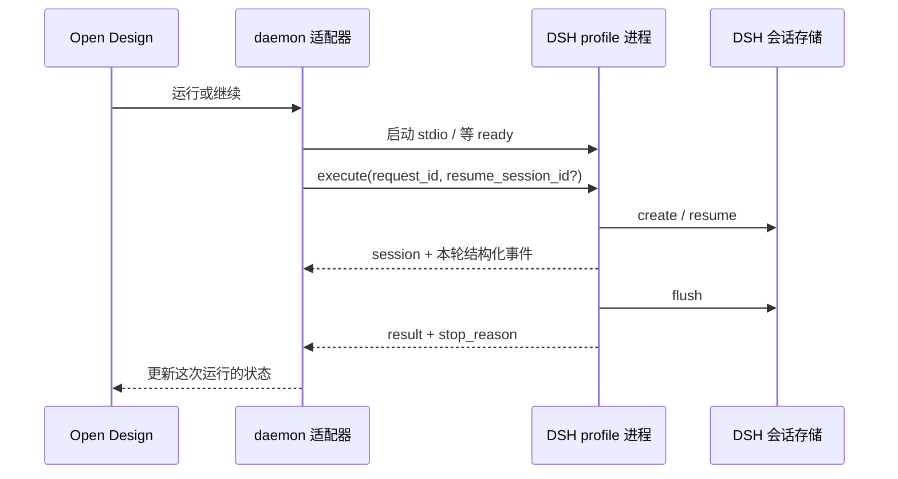

# 话题页补查：Open Design、dsh-web，以及容易混淆的项目

> 2026-09-23。按用户明确指出的 `dsh-plugin` 话题入口补查。本篇深入两种第三方产品化方式，并核对两个边界样本。它不是话题全部仓库的排名，也不以星数推断实现质量。

## 1. Open Design：把用户安装的 DSH 变成设计产品的执行引擎

固定 `nexu-io/open-design@b40f25a1c89552725f1fc31f8c2fad172f92acfe`；所读 DSH runtime 自报插件版本 0.1.0。研究范围为 DSH profile 适配、请求 / 事件协议和会话恢复，没有审计整个设计编辑器、导出和多引擎平台。

### 1.1 产品与仓库中的位置

Open Design 面向设计成果生成，DSH 是其可连接的执行引擎之一。`apps/web/` 面向用户，`apps/daemon/` 管运行时与会话适配，`packages/dsh-runtime/` 则是在 DSH 内运行的伴随插件。两个方向上的适配代码都在同一个仓库，便于联合演化。

`apps/daemon/src/runtimes/defs/deepseek-harness.ts` 声明探测、模型目录和启动参数；`agent-protocol/dsh-profile/` 解析 JSONL；DSH 内的 `protocol.ts` 定义命令，`index.ts` 调用 agents / sessions / llm 等服务。边界是产品 daemon 与 DSH 子进程，不是从页面直接调用 DSH 内部对象。[运行时定义](https://github.com/nexu-io/open-design/blob/b40f25a1c89552725f1fc31f8c2fad172f92acfe/apps/daemon/src/runtimes/defs/deepseek-harness.ts)

### 1.2 首次连接与能力探测

伴随包说明明确：Open Design 不在这个组件里打包 dsh、Node 或用户模型凭据；使用用户已安装的 DSH，把确定的组件压缩包装到 `open-design` profile。探测返回协议和插件身份，模型目录返回 provider-qualified model 及 reasoning 选项，避免用模型裸名称造成同名冲突。[组件说明](https://github.com/nexu-io/open-design/blob/b40f25a1c89552725f1fc31f8c2fad172f92acfe/packages/dsh-runtime/README.md)

探测前先判断 profile 是否存在，原因是旧 DSH 对不存在的 profile 可能自动初始化；“查看可用性”因此不一定天然只读。这个细节很适合我们借鉴：状态查询不要悄悄创建配置或安装环境。

版本策略还存在边界：当前源码识别若干 rc 线和稳定 0.1.x，但不能据此保证任意 alpha 都支持；固定快照未明确纳入我们对照的 0.1.7-alpha.2。日期新不代表每个适配器都已经跟上最新宿主。

### 1.3 一次运行的数据流

产品每次 run 启动短寿命 `dsh --profile open-design --stdio` 进程。先接收 ready，再发送带 request_id、cwd、prompt、可选 resume_session_id、模型和 reasoning effort 的 execute。DSH 侧创建或恢复 Agent，把原生事件投影为 thinking、文本、工具和终态帧。[协议](https://github.com/nexu-io/open-design/blob/b40f25a1c89552725f1fc31f8c2fad172f92acfe/packages/dsh-runtime/src/protocol.ts)

request_id 与 session_id 分开。产品适配器忽略其他 request 的帧；必须先建立 session，之后才接收内容；恢复了不同 session、终态更换 session id 等都返回明确失败。这样不能把“进程输出了文本”误当成目标会话已恢复。[产品侧会话适配](https://github.com/nexu-io/open-design/blob/b40f25a1c89552725f1fc31f8c2fad172f92acfe/apps/daemon/src/agent-protocol/dsh-profile/session.ts)

DSH 侧只转发本轮起点以后的事件，followup 后等待 idle，再 flush 会话并发送 result。历史延续依赖 DSH 存储，进程本身可以退出；这是一种“短进程、长会话”的产品化方式。[DSH 侧执行](https://github.com/nexu-io/open-design/blob/b40f25a1c89552725f1fc31f8c2fad172f92acfe/packages/dsh-runtime/src/index.ts)

### 1.4 取消与终态的细节

用户可能在子进程启动 / 握手期间就取消，此时 AbortController 尚未建立。cancellation latch 先按 request_id 保存取消意图，等 execute 激活时立即应用，而不是丢弃这次取消。

当前 `resultStatus()` 将 `completed` 和 `max-tokens` 都映射到协议 completed，同时返回原始 stop_reason。这是协议层“运行结束”的归类，不能据此宣称任务目标完成；消费方要保留停止原因。handle dispose 的部分异常被忽略，也不能从最终 result 推导所有清理都成功。

`mcp_servers` 出现在协议中，但当前 daemon 提交空数组。单凭 DTO 字段存在不能声称产品侧可以为这条 DSH 路线逐请求注入任意 MCP server。本文也没有为该路径验证操作系统 sandbox；执行隔离依赖用户 DSH 配置。

### 1.5 对我们的参考

最值得参考的是身份握手、请求级取消锁存、短进程恢复长会话、运行终态与任务完成分开。我们的 Python 核心已独立于 Electron，不应因研究而换成外部 DSH 核心；这些机制可以用于审视现有 JSONL / RPC 生命周期。

## 2. dsh-web：多个独立插件怎样组成完整工作台

固定 `zhu1090093659/dsh-web@5106ea71022191b75bd841535be196379839421b`。仓库声明 Apache-2.0；本次重点包 `@linxin666/dsh-client-ui-task-board` 为 0.3.24，声明 DSH `>=0.1.7-alpha.1`。这是独立社区项目，不是官方 Web UI 的另一个仓库名。

### 2.1 组织方式：聚合包不是复制所有源文件

`packages/` 中功能插件各有 host / client / core；`shared/` 管构建和平台模块表；`market/` 是独立创意工坊站点；`desktop/` 提供桌面分发。单包的 `dsh.bundle.patch` 挂宿主部分，`dsh.client` 声明浏览器模块。

聚合包 `dsh-web-all` 从 `aggregate.yml` 生成 patch 和依赖，给行 id 加前缀；host 还有 mount-once 防重复装配。因此单独装某插件与装全家桶的关系需要明确处理，不能只把两份配置拼在一起。[架构说明](https://github.com/zhu1090093659/dsh-web/blob/5106ea71022191b75bd841535be196379839421b/docs/architecture.md)

浏览器构建将 React、Cordis 和宿主 UI 模块放入统一 external / 注入表，避免每个包带自己的一份运行时。它与 GenUI 的“React context 必须相同实例”是同一类生态问题。跨插件交互优先服务和 slot，编译成功并不代表任意宿主页面都具有需要的 slot。

### 2.2 任务创建：看板事实由 Host 持有

Task Board 的后端拆为 ledger、service、runner 和 routes。ledger 保存 task、execution、scheduler、revision 与近期 request 身份；service 管调度 / 轮询；runner 经 gateway 进入真实会话。它已经不是仅靠浏览器 localStorage 展示几张卡片。

`HostTaskLedger` 启动时取得写者锁，加载记录、处理遗留开始状态并提交；动作携带 requestId，重复 id 内容相同则复用，内容不同则报冲突。近期去重信息与状态写入同一 ledger 文档。这是有限窗口幂等，不能保证所有年代的请求都被永久去重。[Host ledger](https://github.com/zhu1090093659/dsh-web/blob/5106ea71022191b75bd841535be196379839421b/packages/dsh-task-board/src/host-ledger.ts)

仓库仍有 browser store 及旧迁移代码，不能看到 `localStorage` 就推断当前生产调度还由页面计时器负责。阅读真实装配链才能识别状态所有者。

### 2.3 开始执行：先有 execution，再关联 session

service 接到已打开的 execution 后启动 runner，得到 sessionId 再 attach；如果会话创建后启动失败，`SessionLaunchError` 仍保留 sessionId 供 ledger 关联，并把 execution 记为 failed。否则 UI 只显示失败而遗留一个找不到来源的会话。[Host service](https://github.com/zhu1090093659/dsh-web/blob/5106ea71022191b75bd841535be196379839421b/packages/dsh-task-board/src/host-service.ts)

handover prompt 可以带冻结的来源时间、原会话和材料引用，避免续接卡片被误当成没有来源的当前用户指令。source wrapper 是上下文表达，不是自动免疫提示注入；真正权限仍由宿主运行规则控制。[Runner](https://github.com/zhu1090093659/dsh-web/blob/5106ea71022191b75bd841535be196379839421b/packages/dsh-task-board/src/host-runner.ts)

### 2.4 多轮复用和定时执行

复用会话需要 task opt-in、最近一个已结束 execution 留有 sessionId，以及实时 roster 确认该会话存在且 idle。代码曾错误读取数组尾部，而新执行记录已先入数组，导致永远找不到可复用会话；当前实现向前找最近已结算项。这是“新 attempt 先持久化”与“选择旧执行上下文”之间真实的顺序问题。[复用规则](https://github.com/zhu1090093659/dsh-web/blob/5106ea71022191b75bd841535be196379839421b/packages/dsh-task-board/src/core/session-reuse.ts)

cron tick 和会话 poll 在 Host 中运行，浏览器关闭不停止它们，Host 退出则另当别论。首轮或检测到长暂停间隙时调用 skipMissed，不把错过的所有计划一口气补跑；正常到期则打开新 execution 并派发。poll 用真实终态结算，暂时查询失败不直接宣布运行失败。

这解决的是后台任务调度和任务台账，并不自动等于多个 Agent 共同拆解、互发消息的 Team。它可与 Team 组合，但两种控制器必须明确谁负责启动和预算。

### 2.5 演化意义与分析边界

dsh-web 展示了从 UI 插件集合，到 Host 权威任务台账、桌面分发和资产市场的演化；当前 task-board 已跟进新 gateway 错误码和 0.1.7 alpha 接口。需要关注的是旧代码、文档截图和新装配路径可能同时存在。

本次未深入 SSH、远程设备授权、皮肤下载及全部 Desktop 打包；不能把仓库功能表中的每项都称作已验证。对本项目，后台调度是可选产品方向，不应使普通消息收件自动启动空闲会话，也不能改变实际故障停止规则。

## 3. 两个边界样本：为什么标签不能代替代码分类

### Ruflo 的同名包

`ruvnet/ruflo@9c61c86f06b439af2a95085ae9bb0ca839662e41` 下确有 `plugins/ruflo-deepseek-harness`，但其清单是 `.claude-plugin/plugin.json`；脚本 `_deepseek.mjs` 直接请求 DeepSeek Chat Completions API。这个被抽查的子包是 Ruflo / Claude 插件生态的 DeepSeek 模型接入，不是 DSH Cordis bundle。[清单](https://github.com/ruvnet/ruflo/blob/9c61c86f06b439af2a95085ae9bb0ca839662e41/plugins/ruflo-deepseek-harness/.claude-plugin/plugin.json)、[调用脚本](https://github.com/ruvnet/ruflo/blob/9c61c86f06b439af2a95085ae9bb0ca839662e41/plugins/ruflo-deepseek-harness/scripts/_deepseek.mjs)

因此本篇不把 Ruflo 整套 swarm、记忆和联邦能力算作已分析的 DSH 二次开发。这个结论限定于已检查的接入包，不宣称整个巨大仓库绝无其他集成路线。

### DeepSeek-Reasonix

`esengine/DeepSeek-Reasonix@4d4700a39af7fcc695581e08930325246bbf0952` 当前介绍和目录表明它有自己的 Go 内核、MCP、Extension Protocol sidecar 与插件包。它是相关的独立 coding agent，可用于另一轮运行时对照，不能仅凭 dsh-plugin topic 就归为 DSH 插件 fork。[项目说明](https://github.com/esengine/DeepSeek-Reasonix/blob/4d4700a39af7fcc695581e08930325246bbf0952/README.zh-CN.md)

本次仅完成身份和组织入口筛查，没有分析它的完整上下文算法、沙箱和会话循环。将它保留在证据登记中，表示确实检查了这个热门候选，不把“下载过仓库”写成“完成深度研究”。
